# 水龙经

> V3 AI 全自动白话释读版。专业术语保留，释读内容可展开核对原文。

> 来源：409.水龙经+地理四弹子+雪心赋直解+廖公扒砂经.pdf，PDF 第 5–156 页

<!-- V3_SOURCE_ID:book024-b000002-p000-8ed22e07d8 -->

这是《水龙经》的序言：自从鸿蒙开天辟地以来，山和水是乾坤两大器物，一同屹立在天地之间，一阴一阳，一刚一柔，一流一时，就像天覆盖万物、地承载万物，太阳东升西落、月亮昼夜轮转，各自承担不同的职能。后世谈论地理的人，不懂这个道理，只知道山可以为龙，不知道水也可以为龙；就算有大肆谈论水法的人，也没有不拿山作为论述核心，把水当成山的附属功用的，甚至把水比作服从将领命令的士兵、顺从丈夫的妇人，因此山的地位被单独抬高，水的作用被稍稍削弱，就使得平地上的水局区域，人们忽略了水龙的真正机理，反而附会关于山龙的错误说法，全天下的人都对此昏昧不清，就像聋子和聋子一样，世死杨曾未晰此义也。古话说得好：“行到平泽奠问踪，只看水绕是真龙”，又说“平洋大地无龙虎，漭归何处东西，只取水为龙，扦著出三公”，这些话说得清晰明了，清清楚楚地展现在人们眼前耳边已经很久了，人们却眼不能察、耳不能闻。至于水龙的裁制格局法度，实在是很少有专门的书籍阐发完备，最终让学习的人好像面对着墙站立，没有路径可以入门。推究其中的缘故，难道不是因为山的结聚有固定的形态，而水的变化运用没有穷尽吗？世人如果知晓水龙的运用方法，全天地的山河，随着自己的指向都可以掌握神妙的机理，契合造化的规律，所以以前的人藏着这个道理不公开，是为天地珍惜这份隐秘的奥义。高高在上的上天怜悯下界的百姓，也想让这千古不传的道统能在当下宣扬出来，借由平阶这样资质愚钝的人阐发其中的精妙要义，为后世的通才贤士做引路的前驱，却没有合适的途径传承，就直接泄露了杨公的口诀，于是蒋平阶就公开详尽地阐明其中的要旨，把山龙归属于高山地形的寻龙方法，把水龙归属于平原地形的寻龙方法，两种方法区分得清清楚楚，不怕大声疾呼，来郑重告知天下有见识的人，渐渐也有人相信跟从，长久以来的迷误也就此澄清。蒋平阶私下里遗憾自己的际遇太好，恐怕冒犯阴阳的过错，怎么敢贪图上天的功劳，把它当成自己的能力呢？当初蒋平阶刚得到师父传承的时候，就已经知道有水龙的方法，但求证古今的遗存实例，完全找不到可以考据的内容，等到得到幕讲禅师的《玉镜真经》《千里眼》等书之后，点穴的机理就和书中的内容完全契合。未築又得水龍經若干篇，于是感叹平原寻龙并不是没有相关的书籍，只是前代的贤人重视珍惜，不肯轻易泄露给世人罢了。因为没有刊刻的版本，偶尔存在字句的讹误，就加以校勘整理，编排成书，一共编成五卷：第一卷阐明行龙结穴的核心要义、支脉和干流相互配合的方法；第二卷阐明五星正变穴的吉凶辨别方法；第三卷讲水龙上应星垣的诸多大格局；第四卷指明水龙托物比类的意象；第五卷的内容和第二卷相通，只是从各个角度展开论述。第一、二、四卷得自吴天柱先生，第三卷得自乍浦的旧官宦人家，第五卷最后得自我的家乡。这五卷内容，有的标注了作者姓名，有的没有保留作者姓名，论述各有精妙的地方，也各有不足，合在一起看，水龙的运用规则就没有遗漏的内容了。以水龙作为核心，之后再配合三元九宫乘气的方法运用，就好像工匠，水龙就是优质的木材，三元九宫就是测量用的方圆规矩；又好像炼丹的方士，水龙就是鼎器藻物，三元九宫就是对应的卦爻火。好的材料没有备齐，就算是鲁班也没办法施展他的技巧；炼丹的原料没有备齐，就算是魏伯阳也没办法发挥炼丹的神效。所以天元心法也已经把相关道理讲得很透彻了，但这本书又怎么能缺少呢？“经”的名号不能随便乱用，就沿用它原来的名称不做改动，这本书确实可以收藏在金柜石室里，和《青囊》《狐首》一同流传后世永不磨灭。后世的学习者如果没有遇到明师的福分，没有得到上天的启发，是没有机会见到这本书的。这是稀世的珍宝，只有有德的人才能承受，希望大家懂得敬重它啊，欣；也希望大家懂得谨慎对待它啊，欣。时间是天启下元甲子过了四十年，岁次癸卯，时值黄钟月，后学杜陵蒋平阶大鸿氏题于丹阳的水精庵。

> **释读存疑：** 一流一時具体含义不明；世死楊曾未晰此義也具体含义不明；未築具体含义不明；藻物具体含义不明；两处欣字具体含义不明；本地硬校验仍未通过，已记录供后续自动处理或人工核对。

查看对应原文

<!-- V3_FOLDBACK_BEGIN:book024-b000002-p000-8ed22e07d8 -->

水龍經序自鴻濛開闢以來山水為乾坤二祁器並雄于天壤間一陰一陽一剛一柔一流一時如天覆地載日旦月暮各司一職後世言地之家罔識厥理知山之為龍不知水之為龍即有高談水法者莫不以山之為辭而水為之用至比之兵之聽令乎將婦之効順乎夫是以山之名獨尊而水之權少絀遂使平陽水局之地置水龍之真機而附為山龍之妄說舉世昏之有若聾聵世死楊曾未晰此義也古不云乎行到平澤奠問蹤只看水水龍經 卷一繞是真龍又云平洋大地無龍虎漭歸何處東西只取水為龍扦著出三公其言之曉暢條達彰之在人耳目間如是久矣人目不察耳至其裁製格法实鮮專書發揮未備卒使學者有同面墻無徑可入推原其故豈不以山之結搏有定而水之運用無窮世人若知水龍作法盡天地山河隨所指願咸可握神機泰造化故引而不發為天地惜此秘奧耳高在上哀此下民亦欲使千古不傳之緒宣露一時假平陪下愚發抒要妙為後世通人彥士執轡前驅乃無因極之傳畫泄楊公之訣于是平階乃蕩然大闢其旨以山龍屬高山以水龍屬平壤二法判分不憚大聲疾呼以正告天下有識之士間亦信之從來迷謬跡焉洞豁平陪窃自恨其遭逢之大恐冐陰陽之愆何敢貪天之功以為已力也始平隋初得師傳時既知有水龍之法矣而求之古今成跡茫無考據及得幕講禪師玉鏡真經千里眼諸書而後入穴機若合符契未築又得水龍經若干篇乃嘆平洋龍洋未嘗無書但先賢珍重不浪泄于世耳因無刻本間有字句之訛用加校讐詮次成書編成五卷一卷水龍經 卷一明行龍結穴大辭支榦相乘之法二卷明五星正變穴髀吉凶審辨之法三卷還水龍上應星垣諸大格四卷指水龍托物比類之象五卷義同二卷而縱橫言之一二四卷得之吳天柱先生三卷得之乍浦故官家五卷最復得之我郡夫是五者或有作者姓名或失其姓名其言各擅精義互見得失合而觀之則水龍軌度無餘蘊矣以此水龍為辭而后施之以三元九宮乘氣作用譬之大匠水龍者楩楠杞梓而三元九宮其方圓繩墨也譬之丹家水龍者鼎器藻物而三元九宮其卦爻火也名材未按公輸無所施其巧鉛汞不備伯陽無以運其神故天元心法亦云至矣而是書又曷可少乎經之為名不可漫加即其舊名因而不革实可藏之金匱石室與青囊狐首並垂不朽後之學者苟非有遇人之福天牖其衷未獲親此書也希世之寶惟有德者當之尚其知敬也欣尚其知惧也欣時天啟下元甲子越四十年歲次癸卯律中黃鐘後學杜陵蔣平隋大鴻氏題于丹陽之水精菴

<!-- V3_FOLDBACK_END:book024-b000002-p000-8ed22e07d8 -->

<!-- V3_SOURCE_ID:book024-b000003-p000-ae8ab450d7 -->

这是《水龙经》第一卷的总论：这一卷专门阐明水龙支脉和干流的道理，把流通的大河作为行龙，称之为祭；把沟渠之类的小水作为分界，称之为支。点穴的方法取支水而不取干水，就好比高山的龙脉发祖，在重岩叠嶂的中心反而不会直接结穴，老龙分出的嫩枝脉，才会有结作。整篇的核心主张，是用干龙环绕护持来获取外气的形局，用支龙停留交汇来获取内气的孕育，它对于水龙的道理论述得特别周详完备。大江大河虽然有弯曲环抱的形态，但它的气过于空旷渺茫，和墓宅的气不亲近，绝对很难下手点穴，必须在大河旁边另外有支水作为元辰，速抱成胎，这样化气从内部产生，连同大河的气脉都会被全部收拢进来，这才是大的格局。我在水龙殿观察过去名门的墓地，支流和小型的干水首尾流通，形态弯曲曲折，最后竟然在转向的龙腹位置结穴，完全没有内堂的界水，也能够得到很大的兴旺。它的小枝畫震，要么是一条水盘旋缠绕，要么是两条水流交汇环抱，深藏不露形态秀美，汇聚灵气养育秀士，世家大族的所在地到处都有这种情况，不用全部讨论外局的形态，它的福运已经大得不可限量。看起来这本书所论述的内容，不能死板地拘泥，小的干水没有支水配合，它的格局虽然大，必须要很久之后才能应验，终究很难快速发福；支龙没有干水配合，它的效果虽然快，但气运耗尽容易衰败，不能绵延长久，终究比不上支水干水相互配合的地方，既可以期望很快得到功效，也可以期待后世世代代的福泽。既然这样，那么这本书的道理，怎么能够废弃不体察呢？它所看重的是特朝的水，迎着秀水立穴，这虽然是正确的论断，但一定要水逆流入朝相迎，还是偏于一方面的说法。水龙的妙用，只在于流动的气脉，水是活动的，变化的机理自然会显现，前后左右没有不合适的，顺流逆流来去，各个方位都能契合应验。以我所见，尤其要以坐向和水流的首尾作为驾驭的关键，偏向左边或者右边，未免会对公位有所偏颇。至于湖荡区域的寻龙方法，此书昏取众砂环绕聚集，就是效仿山龙的眠倒星辰的说法。果真像所设定的格局，方法固然宏大，但我看遍吴楚一带，三江五湖的大水域很多，想要符合这类图式的地方，一百个里也找不到一个，全靠对这个说法心领神会罢了，一定要按照图式索求这样的地来期待福运，就太愚蠢了。总而言之，湖荡区域的龙脉，也应该深明支干的道理，大的湖荡就是大干，必须在它的旁边另外找支水的位置立穴，之后发福才有希望。若卑取大水龍經 卷一 五

> **释读存疑：** 謂之祭具体含义不明；速抱具体含义不明；畫震具体含义不明；昏取具体含义不明；所局具体含义不明；若卑取大水龍經 卷一 五为残句，含义不明

查看对应原文

<!-- V3_FOLDBACK_BEGIN:book024-b000003-p000-ae8ab450d7 -->

水龍經第一卷總論此卷專明水龍支榦之理蓋以通流大水為行龍而謂之祭以溝渠小水為割界而謂之支穴法取支不取榦猶之高山起祖重岩疊嶂之中反為直結而老龍發出嫩枝始有結作也篇中主意嘗以榦龍遶抱取外氣形局以支龍止息交會取內氣孕育其于水龍之理論之特為美備蓋大江大河雖有灣抱其氣曠渺與墓宅不親斷難下手須于其旁另有支水作元辰速抱成胎則化氣內生并大水之氣脈皆收攬而無餘斯大地矣予水龍殿觀舊家名塚枝川小榦首尾通流其形曲析竟于轉爾下龍腹穴全无內堂界水亦得大發其小枝畫震或一水車纏或双流界抱深藏婉麗毓秀鍾靈世家大族所在都有不必盡論外局其福力已不可限量似乎此書所論不可畫拘小幹無枝其局雖大必須久而後應終難驟發支龍無榦其效雖捷而氣盡易衰不能綿逮究不若支榦相扶之地可希求旦夕之功而亦可期代興之澤也然則此書之義其可廢而不察欣其所重在特朝之水迎秀立穴斯雖正論然必欲其逆入朝迎猶是一偏之論蓋水龍妙用只在流神曲水生動化機自呈前後左右無徃不宜順逆去来隨方協應以予所見尤以坐向首尾為駕馭有權或左或右未免偏于公位耳若湖蕩龍法此書昏取衆砂環聚蓋即倣山龍式眠倒星辰之說也果如所局法固大然予徧觀吳楚之間三江五湖巨浸多矣欲合此等啚式百無一遇全在此說會意云爾必欲按索驥求此等之地而冀之涉于愚矣要之湖蕩之脉亦當深明支幹蓋大蕩即名大榦必須其旁又求支水立穴而後發福可期若卑取大水龍經 卷一 五

<!-- V3_FOLDBACK_END:book024-b000003-p000-ae8ab450d7 -->

<!-- V3_SOURCE_ID:book024-b000004-p000-1580219a01 -->

选录的这部分内容提到，调整阳宅尚且有归收的方法，阴基就很难承接气脉了，其中借助外部砂山环抱护卫的做法，就是支干法的变通运用。至于水龙的运用方法，核心全在八卦、三元，江河湖泽的运用逻辑是一致的。如果不精通这层要义，就算得到符合格局的好地，也难免求福反而招祸，这部分内容是乾坤之间的秘要，是圣哲的心传，不是写这本书的人所能知晓的。这本书不标注作者姓名，大概是近代人的手笔，它每篇的论述还不免存留流俗的见解，和真传正诀相比还是有差距的。我把支干的说法作为水龙相关内容的开卷第一要义，所以节取其中相关的部分列在卷首。如果完全拘泥于这本书里的说法，反而会对真正的地脉气机交会的道理产生隔阂，希望学习的人要善于读书。以上是大鸿氏的笔记。

> **释读存疑：** 1轮自动修复后核义模型仍建议修订，已保守记录。

查看对应原文

<!-- V3_FOLDBACK_BEGIN:book024-b000004-p000-1580219a01 -->

蕩陽宅尚有歸收陰基決難乗接其借外砂包護亦即支榦之法而變用之者也至于水龍作用全在八卦三元江河湖蕩其歸一也不精此義縱得合格大地未免求福而反受其禍則又乾坤之秘要聖哲之心傳而非作此書者所能知也此作書不著姓氏大約近代人手筆其每篇立論未免尚存流俗之見于真傳正訣猶隔一山予以支榦之說為水龍開卷第一義故節取其嗇列之卷首若一一泥于其說則于真实際會反致河漢貴學者之善讀書也大鴻氏筆記

<!-- V3_FOLDBACK_END:book024-b000004-p000-1580219a01 -->

<!-- V3_SOURCE_ID:book024-b000005-p000-f531e6a05e -->

秘傳水龍經。

查看对应原文

<!-- V3_FOLDBACK_BEGIN:book024-b000005-p000-f531e6a05e -->

秘傳水龍經

<!-- V3_FOLDBACK_END:book024-b000005-p000-f531e6a05e -->

<!-- V3_SOURCE_ID:book024-b000006-p000-963f73d49c -->

晉代郭景純著，明代誠意伯劉基閱，宋代韓國公趙善訂，後學九淵邵滄錄。

查看对应原文

<!-- V3_FOLDBACK_BEGIN:book024-b000006-p000-963f73d49c -->

晉郭景純著明誠意伯劉基閱宋韓國公趙善訂後學九淵邵滄錄

<!-- V3_FOLDBACK_END:book024-b000006-p000-963f73d49c -->

<!-- V3_SOURCE_ID:book024-b000007-p000-80ba2948f5 -->

氣機妙運論。

查看对应原文

<!-- V3_FOLDBACK_BEGIN:book024-b000007-p000-80ba2948f5 -->

氣機妙運論

<!-- V3_FOLDBACK_END:book024-b000007-p000-80ba2948f5 -->

<!-- V3_SOURCE_ID:book024-b000008-p000-e837762248 -->

太初之时只有一气浑沦涌动，最先出现的是水。按照水的内在法则，浊重的精气凝结，上方的木、土震动激荡，水退去后土露出，于是形成山川。因此山川具备波浪般的形势。经书说：气是水的母亲，水是气的孩子；气运行则水随之流动，木停止则气也停止。母与子性状相通，木气相互追随之，就像影子跟随形体一样。气是同一的，《水龙膜》卷一提到，溢于地表有痕迹的是水，运行于地下无形迹的是气；水是外在的表现，气是内在的本质，表里共同运行，内外一同流动，这是自然造化必然的妙用。所以想要知道地中气的走向是东还是西，只需观察水的去来就能大致了解。若要观察气机的运行，也可从水的变化中体会，就像孔子在川上叹息，也能体会先圣对道的感悟。然而龙脉运行必有水辅助，气停止必有木作为界限；辅助龙脉运行的在于木，所以观察木的来处，就能知道龙气发端的起点。文中提到“止龙气省亦在乎水”，此处“省”字含义不明，观察水的交会处，可以知晓龙气融聚的状态，此处“霰”字疑似讹误，具体含义不明。因此经书说：界水则止，又说水气横行，内气停止生发，说的就是这个道理。天地之气不过阴与阳罢了，《易经》说：一阴一阳就是道，又说阴阳相互居处于对方的位置，动静互为根本，不能有片刻分离。地脉运行时，阴阳相互补益，万物得以化育精粹。郭子说：独阳不能生长，独阴不能成形，阴阳配合，生成的功用才完备。所以山脉峙立，水脉流动，各有阴阳；水属阳，山属阴，二者相互交错，不能有片刻分离。地脉运行依靠水得以畅通，地脉的佳处依靠水得以停聚；既能引导其运行，又能使其停聚，为什么呢？因为外气与内气相合，二气相互激荡生成万物，就像夫妇结合而完成生育的功用。阳为雄，阴为雌，阳用来畜养阴，阴用来含藏阳，就是雌雄相会、牝牡交合的情理。所以说阴阳相见，福禄永远贞固，冲和之气常存，《龙经》卷提到，万物得以化生，这是天地自然的化育机理。从整体来说，混沌之初的状态，就是万物统属于一个太极的妙用；从分别的角度来说，随着事物禀赋的不同，又是万物各有其太极的诸多呈现，此处“粵”字含义不明。了解太极的道理，就能谈论化机的玄妙；了解化机的玄妙，就能谈论形象之学了。

> **释读存疑：** 止龙气省亦在乎水的“省”字含义不明；融聚之霰的“霰”字疑似讹误，含义不明；各其一大极之多粵也的“粵”字含义不明

查看对应原文

<!-- V3_FOLDBACK_BEGIN:book024-b000008-p000-e837762248 -->

太始惟一氣洱突其所先莫先于水之中法濁精而成上木土震盪水落土出遂成山川是以山川有波浪之勢焉經云氣者水之母水者氣之子氣行則水隨木止則氣止子母同情木氣相逐猶影之隨形也夫氣一也水龍膜 卷一溢于地外而有迹者為水行于地中而無形者為氣水其表也氣其裏也表裏同運內外同流此造化必然之妙用故欲知地中之氣趨東趨西即具水之或去或來可以概知之矣若觀氣機之運者必觀諸水川上之嘆亦可以觀先聖見道之情焉然行龍必有水輔氣止必有木界輔行龍者既在乎木故察其未之所來即以知龍氣發涂之始止龍氣省亦在乎水故察其水之所交即以知龍氣融聚之霰故經曰界永則止又曰水氣橫行內氣止生旨斯言欤然天地之氣陰與陽而已易曰一陰一陽之謂道又曰陰陽互戴其宅動靜互為其根不可須臾離也地脉之行陰陽相裨萬物化醇郭子有云獨陽不長獨陰不成陰陽合德而生成之功备故山脉之峙水脉之流各有陰陽水者陽也山者陰也二者交互不可須更離也地脉之行藉水以遂之地脉之佳藉水以止之既能道寸其行又能止其止者何也蓋外氣輿內氣相合二氣相盪而成物猶夫婦始而成生育之功也陽為雄陰為雖陽以畜陰以含陽即雌雄相會牝牡交姤之情也故曰陰陽相見福祿永貞沖陽和永龍經 卷陰萬物化生此天地自然之化機已合而言混沌之初辭即萬物統體一太極之妙用分而言之隨物付物又萬物各其一大極之多粵也知太極之理則可以語化機之妙知化機之妙則可以語形象之學矣

<!-- V3_FOLDBACK_END:book024-b000008-p000-e837762248 -->

<!-- V3_SOURCE_ID:book024-b000009-p000-852e9174ae -->

《自然水法形歌》讲：水法的内容太多难以全部叙述，这里只举大略的纲要来破除迷惑。世间流传的卦例有十多家，说法彼此矛盾，这家说吉那家说凶，无法通行。你要切记自然水法的核心，无非是水流曲折饱含情意：来水不要直冲，去水不要直泄，横流不要反背，斜流不要湍急。横流要绕抱及弯环，来水要蜿蜒，去水要曲折，水色澄清、停蓄不流最好，要是领受倾泻急流又有什么益处？水流呈八字分开的形态，主男女淫邪；河流分成三派的，主家业破败，此处“業歌傾”含义不明。急泻急流的形态主财运不聚，直来直去的形态主损伤人丁。水流直射左边，长男必定遭殃；直射右边，幼子遭受灾殃。如果还有木从中心直射，中房的儿子性命难保。文中提到“掃聊盪城子息少”，“聊”字疑似讹误，该形态主子嗣稀少；水流冲心射胁的，主孤寡早夭；水流反跳的，主人口离散、退失财产；水流呈卷帘形态的，主家中多招填房、入赘之人。《水龙经》讲：水色澄清的地方多出俊秀之人，水色污浊的地方主子弟多有缺陷。大江浩荡来朝、面前有万顷良田，主暗中得爵禄、位列三公。池湖凝聚的地方可出卿相之职，天江水浩荡来朝主大贵无数。水流飘斜而出的是桃花水，主男女贪淫败坏家产，又主出喜好游荡之人，终日吹唱、铺张奢华，此处“撝破家”“逞屠華”含义不明。文中提到“屈四流來秀水朝”，“屈四”含义不明，若有秀水来朝，定能金榜题名，此处“金榜省名標”的“省”字含义不明。这里木随水流去没有妨碍，主财富丰足、出豪迈的官员。水法不拘泥于去和来，只要水流曲折去而复回，三回九转、在穴前停驻，对穴场眷恋不舍就好，此处“三迴玉度轉頓穴”的“玉度”含义不明。哪里用得着九星和八卦，生旺死绝的说法都是虚谬不实的。写下这一篇是真口诀，读的人心中都能通透，免得被时下地师的卦例言论迷惑，祸福利害要自己辨别。

> **释读存疑：** 業歌傾含义不明；掃聊盪城的“聊”字疑似讹误；撝破家含义不明；逞屠華含义不明；屈四流來的“屈四”含义不明；金榜省名標的“省”字含义不明；三迴玉度轉頓穴的“玉度”含义不明；1轮自动修复后核义模型仍建议修订，已保守记录。

查看对应原文

<!-- V3_FOLDBACK_BEGIN:book024-b000009-p000-852e9174ae -->

自然水法形歌水法最多難盡述略舉大綱釋盜惑世傳卦例十數家彼吉此凶行不得自然水法君切記無非屈曲有情意来不欲冲去不直橫不欲反斜不急橫須遂抱及弯環來則之予去屈曲澄清停蓄甚為佳領瀉急流何有益八字分開男女淫川流三派業歌傾急瀉急流財不聚直來直去損人丁左射長男必遭殃右射幼子受灾遭若還木從中心射中房之子命難長掃聊盪城子息少冲心射脇孤寡夭反跳人離及退財捲簾填房與入贅水龍經澄清出人多俊秀污濁主子多遇缺大江祥朝田萬頃暗拱爵祿食五鼎池湖凝聚卿相職天江洋朝貴無敖飄之斜出是挑花云記男女貪淫撝破家又主出人好遊蕩終朝吹唱逞屠華屈四流來秀水朝定然金榜省名標此木去流無妨碑財豐亦主官豪邁水法不狗去與來但要屈曲去復廻三迴玉度轉頓穴悠眷戀不忍別何用九星并八卦生旺死絕皆虛詭述此一篇真口訣讀者胸中皆透澈免惑時師卦例言祸無福有須當別

<!-- V3_FOLDBACK_END:book024-b000009-p000-852e9174ae -->

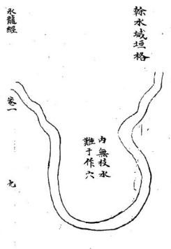

<!-- V3_SOURCE_ID:book024-b000011-p000-ef0a6c9b73 -->

天河大江要么从东南来，要么从西南来，中间虽然有屈曲的地方，却完全看不到回环缠绕的态势，绵延十里二十里滔滔而来，如同大雁飞行，丝毫没有盘旋的姿态；中间即使有屈曲，也绝对不会结穴。直到回绕环转回头的地方，就像大雁将要降落，不需要盘旋就可以停泊，到这里才是龙脉停聚的归属。经书说：界水则止，又说界水是用来止住来龙的。如果走了一二十里还看不到水回头，此处“水國頭”的“國”字疑似讹误，含义不明，那么之前的屈曲之处就是龙脉运行的地方。书上说：龙落到平阳之地如同展开布匹，一片茫然难以捉摸；平阳地区只以水为龙，水缠绕就是龙脉停泊的地方，所以寻龙要在来水环城回绕的地方寻求。然而水的来路远，水势宽大，中间必须有小回头的地方，才是真龙东气结咽的地方，此处“東氣”含义不明，还没有结穴，要到大缠绕大回环的地方，才开始聚气；但到了尽头形势宽大，又难以捉摸，必须要看支水界割的情况如何。要是有支水插入腹地，划分出内堂，砂水包裹，此处“曩”字疑似讹误，含义不明，不疏漏不模糊，形局完整稳固，才是真穴。如果没有支水界割，就算大水环绕，终究是茫然没有可以指认的依据。因为水势宽大气就会游荡，形局大气就会散佚，内部没有支水交会，此处“交殄”的“殄”字疑似讹误，含义不明，只有一片顽厚的表皮，此处“頑皮”含义不明，怎么能立穴呢？此处“何以立六”的“六”字疑似“穴”的讹误，就算没有天灾，也一定不会发福。

> **释读存疑：** 水國頭的“國”字疑似讹误，含义不明；東氣含义不明；砂永包曩的“曩”字疑似讹误，含义不明；交殄的“殄”字疑似讹误，含义不明；頑皮含义不明；何以立六的“六”字疑似“穴”的讹误

查看对应原文

<!-- V3_FOLDBACK_BEGIN:book024-b000011-p000-ef0a6c9b73 -->

天河大江或徒東南來或從西南來中開雖省屈曲處並不見回顧環遼十里二十里滔而來如雁之飛略無回翔之勢中間雖有屈曲決不結穴直至回遶環轉回頭之處如雁之將止則不必回翔而後泊也至此方是龍脉止聚之屬經云界水則止又云界水所以止來龍若一二十里尚不見水國頭則前之屈曲處乃行龍處也書曰龍落平陽如展布一片茫之難捉模平洋只以水為龍水纏便是龍身泊故又尋龍須于來水城迴遶處求之然水之來路遠其勢寬大中須有小回頭處乃真龍東氣結咽之處即未結穴省至大纏大回之嚴方始聚氣然到頭形勢寬大又難捉模必須求支永界割何如得支水插腹界出內堂砂永包曩不疎不審形局完固方為真穴共非支水界割則大水雖環遶終是茫無以指點蓋勢寬則氣蕩形大則氣散內無支水交殄一片頑皮何以立六雖無天害必不發福矣

<!-- V3_FOLDBACK_END:book024-b000011-p000-ef0a6c9b73 -->

<!-- V3_SOURCE_ID:book024-b000012-p000-7de971d6c6 -->

木龍經 卷 十

查看对应原文

<!-- V3_FOLDBACK_BEGIN:book024-b000012-p000-7de971d6c6 -->

木龍經 卷 十

<!-- V3_FOLDBACK_END:book024-b000012-p000-7de971d6c6 -->

<!-- V3_SOURCE_ID:book024-b000014-p000-24b20f9e95 -->

这个局干水斜行，此处“榦木斜行”的“木”疑似“水”的讹误，看起来有曲折却不是环袍，又有枝水用来涵养内气；右前方有一支天江从右流向左，右后方有一支天江也从右流向左，和前方倒向左的水合流，曲折流去，这正是两水合流、一水引脉的格局。又说两水合流而出，是龙脉从右来，穴倚靠左边的格局。局中龙脉宽大，要找枝水插入腹地划分边界作内局，龙虎前后左右朝抱，包裹周正，此处“包晨周霽”疑似讹误，含义不明，才可以立穴。这个局在腹地插入小水分界，左右重重交锁，三分三合，东气结咽，龙脉到尽头圆净端严，形势极其秀丽，横来的龙脉横面受气，朝向前面的砂水弯抱，倚岩立穴迎接西来的水，福力极大，此处“甚天”的“天”疑似讹误，含义不明。

> **释读存疑：** 榦木斜行的“木”疑似“水”的讹误；包晨周霽疑似讹误，含义不明；甚天的“天”疑似讹误，含义不明

查看对应原文

<!-- V3_FOLDBACK_BEGIN:book024-b000014-p000-24b20f9e95 -->

此局榦木斜行似有曲折而非環袍又枝水以作內氣右前一枝天江自右倒左右後一枝天江亦自右趙左與前倒左术合流屈曲而去此正兩水合流一水引脉之局又云兩水合出是其龍之從右來穴倚左局中龍脉寬大和要尋枝水插腹割界作內局龍虎前後左右朝抱包晨周霽方可立穴此局于腹中插入小水分界左右重交鎖三分三合東氣結咽龍脉到頭圓淨端嚴形勢極秀橫來橫受向前面砂木弯抱巖立穴以迎西來永其福力甚天

<!-- V3_FOLDBACK_END:book024-b000014-p000-24b20f9e95 -->

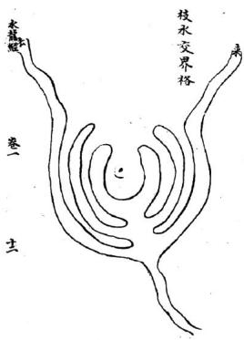

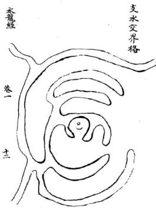

<!-- V3_SOURCE_ID:book024-b000017-p000-7157672238 -->

西南方向来的水与东南方向来的水汇合，向东北方向流去，却在东北方向分出一支水作为左右的分界，左右形成龙虎砂，前后横夹；中间分出一支水横在前方作为界水，立穴的右侧有金鱼水在两侧紧拱，形成横来正受的格局，护卫周密，三分三合，到头气脉完固。正如经书中说“永要省分合，有合气方治”，此处“省”字含义不明；现在这个局三分三合后转头向南，曲折活动，完全没有硬直的煞气，主富贵双全。如果水从东南方向屈曲而来，在穴中望去如同就在眼前，秀气更佳，主文章扬名、可以中举。这个势的来水只从后面右方来，绕过分武后回头，就在左边局后屈曲流去，此处“分武”含义不明；在后方大水去的地方，分出一支水从左向前弯弓抱，此处“禘”字疑似“插”的讹误，遇到石边就作为外包裹；又在左边的右方插入一支水向前，分成两股，一股向局后穿过边界流出龙脉，一股向局前聚水成池；砂水所在的四头在左侧，此处“砂水處之四頭”含义不明，这也是横来侧结的穴。前方有小水荡作为聚水堂，应当正对小水荡正受，也主科甲发贵；因为分武水虽然不靠近穴，却在左边绕局后流去，是直气。

> **释读存疑：** 永要省分合的“省”字含义不明；分武含义不明；禘一支水的“禘”疑似“插”的讹误；砂水處之四頭含义不明

查看对应原文

<!-- V3_FOLDBACK_BEGIN:book024-b000017-p000-7157672238 -->

西南水來迎合東南來水出東北却于東北插一枝水分界于左右作龍虎砂橫夾于前後中間插一枝水橫界于前立右有金魚水緊拱于兩間作橫來正受而來護衛周密三分三合到頭上氣完固如斯經云永要省分合有合氣方治今此局三分三合而轉頭向南委曲活動略無硬直之殺主富貴全美若東南屈曲而來穴中望之如在目前其秀尤佳文翰飛名可發甲也此勢受水只從後面右來遶分武而回頭即于左邊局後屈曲而去于後大水去處禘一支水從左向前弯弓抱遇石邊即作外包裹又于左之右挿一枝水上前分作兩股一股向局後過省界出龍昧一股向局前聚水成池其砂水處之四頭于左側此亦橫來側結六也前有小蕩作聚术堂宜對小萬正受亦主科甲發貴蓋分武水雖不頓穴却于左邊繞局後而去乃直氣也

<!-- V3_FOLDBACK_END:book024-b000017-p000-7157672238 -->

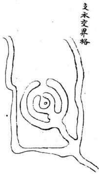

<!-- V3_SOURCE_ID:book024-b000020-p000-b80cea9d69 -->

木龍經

查看对应原文

<!-- V3_FOLDBACK_BEGIN:book024-b000020-p000-b80cea9d69 -->

木龍經

<!-- V3_FOLDBACK_END:book024-b000020-p000-b80cea9d69 -->

<!-- V3_SOURCE_ID:book024-b000021-p000-d9362a8644 -->

坐上盛从东北或者西北分出一支水，此处“坐上盛”含义不明，向南屈曲，一路向因左柚上，一路向右插上，此处“左柚上”含义不明，划分左右边界，龙虎交锁反抱，在坐下形成龙虎交抱的形势，到头形成仙人仰掌的形态，仰结写穴逆来脉，此处“寫穴逆來脈”含义不明；立穴取什么朝向作回受穴，顺着脉立穴取向为顺牧穴，此处“牧穴”含义不明，能得到龙虎砂在前方朝抱，秀气发得尤其快。这两种方法都可以，只需要看前后朝应的情况：如果前方有速朝曲水可以迎接，就立回受穴；如果后方有曲水远朝，或者有远山呈秀，就作顺枝穴。局势虽然是缠角武弯弓，如同弓的形状完全没有分泄，城郭秀气完固，局势周密，主百子千孙，满门都是官员。如果东北或者西北一路水分泄而去，力量就轻了。

> **释读存疑：** 坐上盛含义不明；左柚上含义不明；寫穴逆來脈含义不明；牧穴含义不明；纏角武弯弓含义不明；其力景便輕矣的“景”疑似讹误；1轮自动修复后核义模型仍建议修订，已保守记录。

查看对应原文

<!-- V3_FOLDBACK_BEGIN:book024-b000021-p000-d9362a8644 -->

坐上盛從東北或從西北插一枝水上南屈曲一路向因左柚上一路向右挿上割界左右龍虎交鎖反抱千坐下成龍虎交抱勢到頭成仙人仰掌仰結寫穴逆來脈立穴取何作回受穴順脈立穴取向為順牧穴得龍虎砂朝抱于前其秀尤速此二法俱可但看前後朝應何如之前有速朝曲水可迎立回受穴如後有曲水遠朝或遠山呈秀作順枝穴兆勢雖纏角武弯弓如弓並無分泄城秀完固局勢周密主百子千孫朱紫滿門若東北或西北一路水分泄而去其力景便輕矣

<!-- V3_FOLDBACK_END:book024-b000021-p000-d9362a8644 -->

<!-- V3_SOURCE_ID:book024-b000023-p000-44844fdc8d -->

穴前的曲水，不少于五曲，此处“不間五曲五曲”含义不明，五曲排列周正整肃，从右过东，就身回抱而去；在曲水后分出支脉割界，作多重龙虎，分列左右，仆从回头朝颂，如拜如揖，此处“周札整肅”“奴回頭朝頌”含义不明。穴后枝水的分合，经过五处关隘四处峡谷，此处“枝未分合”“五閱四峽”含义不明，重重结咽，东气兜收，得到这种形势极为周密，秀水完固，来水屈曲呈秀，来脉尊贵端严，此处“尊賞端嚴”的“賞”疑似讹误，含义不明，左右重重护卫，主有百子千孙，世世代代出魁元、神童、宰相。如果穴前有汇聚的蓄水当道数亩，此处“舍蓄聚水”“當道數國”的“舍”“國”疑似讹误，含义不明；如果水从左边边界而来，在穴前屈曲而去，福力不减，主为官清廉显贵但无钱财，以清白传家，此处“水徼左來”“屈必而去”的“徼”“必”疑似讹误，含义不明。

> **释读存疑：** 不間五曲五曲含义不明；周札整肅含义不明；奴回頭朝頌含义不明；枝未分合含义不明；五閱四峽含义不明；尊賞端嚴的“賞”疑似讹误；舍蓄聚水的“舍”疑似讹误；當道數國的“國”疑似讹误；水徼左來的“徼”疑似讹误；屈必而去的“必”疑似讹误

查看对应原文

<!-- V3_FOLDBACK_BEGIN:book024-b000023-p000-44844fdc8d -->

穴前曲水不間五曲五曲周札整肅自右過東就身回 抱而去知于曲水後分枝割界作重龍虎分列左右 奴回頭朝頌如拜如揖穴後枝未分合五閱四峽重 重結咽東氣兜収得此形勢極為周密秀水完固來水 屈曲呈秀來脉尊賞端嚴左右重衛護主有百子千 孫世出魁元神童幸相若穴前舍蓄聚水當道數國若 水徼左來于穴前屈必而去其福力不減何為官清貴 無財清白傳家也

<!-- V3_FOLDBACK_END:book024-b000023-p000-44844fdc8d -->

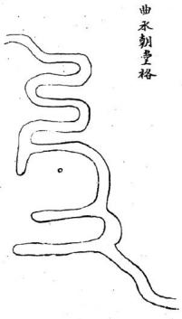

<!-- V3_SOURCE_ID:book024-b000025-p000-2b95d53580 -->

水龍經 基 +x

> **释读存疑：** 原句末尾的“+x”为OCR识别的可疑字符，无法确认含义

查看对应原文

<!-- V3_FOLDBACK_BEGIN:book024-b000025-p000-2b95d53580 -->

水龍經 基 +x

<!-- V3_FOLDBACK_END:book024-b000025-p000-2b95d53580 -->

<!-- V3_SOURCE_ID:book024-b000026-p000-679cb70cc6 -->

凡是见到弯曲的水正对着穴（风水中认为气脉聚结、适宜安葬或营建的位置）迎面而来，横向经过穴前时，必须让它顺着自身弯曲环抱，屈曲流去。坐下的位置要有分支水划分界限，兜收龙脉，分支水一重、二重、三重地环绕在手穴的前后，或是形成辞势。穴前积聚的界水不宜太宽阔，太宽阔则气会散荡；也不宜太狭窄，太狭窄则气会促迫。如果穴前的朝水有箭一样的冲射，恐怕会导致气散荡外泄。此地的弯曲水一路缠绕兜收，气脉凝聚，能带来大福，但坐下的位置没有元武木大江环绕护卫，只是行龙腰结的位置，并非尽龙，力量比两水合流而出的情况稍轻。如果去水在元武后方，四头役从坐下的位置包聚而去，情况就会不同。

> **释读存疑：** 或辭勢；四頭役；元武木；“或辭勢”原文语义不明，此处保留原表述未作确定性解释；“四頭役”原文语义不明，此处保留原表述未作确定性解释；“元武木”原文语义不明，此处保留原表述未作确定性解释

查看对应原文

<!-- V3_FOLDBACK_BEGIN:book024-b000026-p000-679cb70cc6 -->

凡見曲水當面來朝橫遇穴前須得就身曲抱屈曲而去坐下要枝水割界兜收龍脈或一重二重三重疊之繞手穴前後方或辭勢其穴前積界深水不宜太濶太濶則氣蕩不宜太狹大狹則氣促而前朝水加箭射恐破氣蕩洩此地曲水一路車纏兜收脈氣凝聚大能發福但坐下無元武木大江遶護乃是行龍腰結非盡龍也其力量比兩水合出稍輕若得去水在元武後四頭役坐下包聚而去更自不同

<!-- V3_FOLDBACK_END:book024-b000026-p000-679cb70cc6 -->

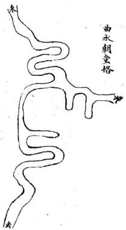

<!-- V3_SOURCE_ID:book024-b000028-p000-f137db3d17 -->

此处为《水龙经》的内容，现存“參”“大”二字，其余内容残缺。

> **释读存疑：** 參；大；仅存“參”“大”二字，无法判断完整语义

查看对应原文

<!-- V3_FOLDBACK_BEGIN:book024-b000028-p000-f137db3d17 -->

水龍經 參 大

<!-- V3_FOLDBACK_END:book024-b000028-p000-f137db3d17 -->

<!-- V3_SOURCE_ID:book024-b000029-p000-3c9cd78879 -->

穴（风水中认为气脉聚结、适宜安葬或营建的位置）前的秀水正对着前方流来，与从右边来的横向水汇合后倒向左边，顺着自身回绕环抱，绕过元武，再从田头向东北方向流去。来水是屈曲的，去水则须岁，更要有右边的水交汇，这种情况与“一水卑纏殊覺左勝”的情形不同，水交汇、砂（穴场周围起护卫、朝应作用的山丘或地形）会集，龍畫氣鍾，也是大吉的地局，能使丁口繁盛，富贵非常。凡是右木衝左灌堂，那么穴前的秀水不得滿臺，这样的情况下长房兴旺，二房、小房一同发达；如果右边的水是从穴前的曲水分泄而去，那么小房就不会发达，后主事邊移、过继，或者改姓离乡。

> **释读存疑：** 須歲；一水卑纏殊覺左勝；龍畫氣鍾；右木；滿臺；後主邊移；“須歲”原文语义不明，此处保留原表述未作确定性解释；“一水卑纏殊覺左勝”原文语义不明，此处保留原表述未作确定性解释；“龍畫氣鍾”原文语义不明，此处保留原表述未作确定性解释；“右木”原文语义不明，此处保留原表述未作确定性解释；“滿臺”原文语义不明，此处保留原表述未作确定性解释；“後主邊移”原文语义不明，此处保留原表述未作确定性解释

查看对应原文

<!-- V3_FOLDBACK_BEGIN:book024-b000029-p000-3c9cd78879 -->

穴前秀水當面朝來與右來橫水合流倒左就身回抱遶元武卻田頭向東北而流來則屈曲去則須歲更得右水交會此與一水卑纏殊覺左勝水交砂會龍畫氣鍾亦大地也入丁繁盛富貴非常凡右木衝左灌堂則前秀水不得滿臺而長房興二小房並發若右水是穴前曲水分泄而去則小房不發矣後主邊移過繼或易姓離鄉也

<!-- V3_FOLDBACK_END:book024-b000029-p000-3c9cd78879 -->

<!-- doc013 PDF 第 13 页：高风险/复杂版面 OCR 供检索；内容与排版以原页图为准。 -->

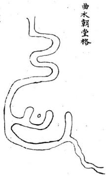

<!-- V3_SOURCE_ID:book024-b000032-p000-f0de2c8d59 -->

水龍經 卷 十

查看对应原文

<!-- V3_FOLDBACK_BEGIN:book024-b000032-p000-f0de2c8d59 -->

水龍經 卷 十

<!-- V3_FOLDBACK_END:book024-b000032-p000-f0de2c8d59 -->

<!-- V3_SOURCE_ID:book024-b000033-p000-a088ce4d60 -->

这个地势和之前田水朝堂、环绕首龙、缠武的法度相合，前局周正紧密。此局是从左边来水顺着自身夹下，稍长且宽，龙脉趋向紫武，秀水在前方。想要就曰秋立穴的话，气会聚在后方，会出现脱气的情况；如果立穴在气汇聚的地方，曲水就会离得远，无法承接。这样的形势中，暗处一定有分支水插入腹地，在中局兜收内气，中局梗前不会脱气，曲水也不会脱离龙气，前有亲靠、后有倚托，才能发福，主文翰方面的贵气，先发达长房，之后发达中房，小房如果能分得去水的力量，那么福力会更悠久。

> **释读存疑：** 纏武法；紫武；欲就曰秋立穴；中局梗前不脫；“纏武法”原文语义不明，此处保留原表述未作确定性解释；“紫武”原文语义不明，此处保留原表述未作确定性解释；“欲就曰秋立穴”原文语义不明，此处保留原表述未作确定性解释；“中局梗前不脫”原文语义不明，此处保留原表述未作确定性解释

查看对应原文

<!-- V3_FOLDBACK_BEGIN:book024-b000033-p000-a088ce4d60 -->

此勢與前田水朝堂遶首龍纏武法合前局周緊 此作左來就身夾下稍長而寬龍脉趨歸紫武秀水在 前欲就曰秋立穴則氣聚在後而脫氣立穴就氣衆處 則曲水遠而乗受不及如此形势中闇必有枝水插腹 兜収其氣于中局梗前不脫曲水復不脫龍氣前親 後倚方能發福而主文翰之貴先發長房後發中房 小房更得去水之分則力量悠久

<!-- V3_FOLDBACK_END:book024-b000033-p000-a088ce4d60 -->

卷

<!-- V3_SOURCE_ID:book024-b000036-p000-2e63c35e6b -->

水要么从左边来屈曲到堂，要么从右边来顺着自身环绕环抱，绕过武而去；要么从右边来屈曲到堂，要么从左边来顺着自身环绕环抱，绕中武而去。弯曲的地方必须像“多”字或者“之”字形，不懈不疏，舊蕭周匝，到穴（风水中认为气脉聚结、适宜安葬或营建的位置）前却像弯弓一样环绕，转向包裹承托在穴后，这样的形势很好。如果形势太宽阔，中间必须有分支水划分界限，让脉络清晰奇巧；如果格局周详周密，即使没有分支水划分界限，也可以立穴。

> **释读存疑：** 不懈不疏舊蕭周匝；中武；“不懈不疏舊蕭周匝”原文语义不明，此处保留原表述未作确定性解释；“中武”原文语义不明，此处保留原表述未作确定性解释

查看对应原文

<!-- V3_FOLDBACK_BEGIN:book024-b000036-p000-2e63c35e6b -->

或從左來屈曲到堂或從右來就身環抱遶武而去 或從右來屈曲到堂或從左來就身環抱遶中武而去 其曲處須要如多字樣或之字形不懈不疏舊蕭周匝 至穴前却如弯弓就遶轉包承于穴後得此形勢甚 佳若形勢太寬中間須得枝水界得脉絡清奇若局勢 周審雖無枝水割界亦可立穴

<!-- V3_FOLDBACK_END:book024-b000036-p000-2e63c35e6b -->

<!-- V3_SOURCE_ID:book024-b000038-p000-d4a5c2011b -->

永龍經 叁

查看对应原文

<!-- V3_FOLDBACK_BEGIN:book024-b000038-p000-d4a5c2011b -->

永龍經 叁

<!-- V3_FOLDBACK_END:book024-b000038-p000-d4a5c2011b -->

<!-- V3_SOURCE_ID:book024-b000039-p000-d84153c49e -->

凡是弯曲的水朝堂，必须有三横四折，像“之”字、“兮”字一样，曲折环绕穴场，转折处不会造成冲射。如果来水虽然看起来屈曲，却东拽西拽，圄不可周；如果曲水的形状像缠牵，穴前只见到弯抱，而前面一路并不秀丽，也不算吉利。如興形體局中虽然划分出了形势，但穴（风水中认为气脉聚结、适宜安葬或营建的位置）最终很难发福，即使不冲射、不破坏，也仅能达到小康水平；如果有冲射，或者左右前后略有分泄，必然会导致破败。遠宋的水像草之字，或是如晨牽，而穴前弯抱，大概是因为在穴的位置望过去，看不到前面的冲射，也主三四十年的发福，及术步行至之日就会衰退，不能不仔细分辨。此番外局已经周全，内气又稳固，会爵尊福厚，丁旺力长，美好得无法形容。

> **释读存疑：** 圄不可周；如興形體局；遠宋；晨牽；术步；“圄不可周”原文语义不明，此处保留原表述未作确定性解释；“如興形體局”原文语义不明，此处保留原表述未作确定性解释；“遠宋”原文语义不明，此处保留原表述未作确定性解释；“晨牽”原文语义不明，此处保留原表述未作确定性解释；“术步”原文语义不明，此处保留原表述未作确定性解释

查看对应原文

<!-- V3_FOLDBACK_BEGIN:book024-b000039-p000-d84153c49e -->

凡曲水朝堂須得三橫四摺如之如兮摺之包遇穴場其轉折處不至衝射若來水雖見屈曲東拽西拽圄不可周若曲形如纏牽穴前維見弯抱而前面一路殊非秀麗亦不為吉如興形體局中雖割成勢而穴之終難發福即不沖不破僅可小康若有沖擊或左右前後略見分洩必至破壞矣遠宋如草之字或如晨牽而六前弯抱蓋得穴過望之不見前面冲射亦主三四十年發福及术步行至之日即衰退矣不可不細辦此番外局既全內氣復固爵尊福厚丁旺力長美不可言

<!-- V3_FOLDBACK_END:book024-b000039-p000-d84153c49e -->

<!-- V3_SOURCE_ID:book024-b000041-p000-1c91e20133 -->

水龍經 卷

查看对应原文

<!-- V3_FOLDBACK_BEGIN:book024-b000041-p000-1c91e20133 -->

水龍經 卷

<!-- V3_FOLDBACK_END:book024-b000041-p000-1c91e20133 -->

<!-- V3_SOURCE_ID:book024-b000042-p000-bb865b82ee -->

凡是弯曲的水朝堂，水流要转折整齐，厚薄相等，不宜东拽西窜，像风摆柳条、风吹偃草，或者盖过穴（风水中认为气脉聚结、适宜安葬或营建的位置），或者不盖过穴，参差错乱的，即使看起来屈曲也不值得取用。如果垣局划分界限，结咽处内气合局，也能发福秀异，但主子孙飘荡淫遶，喜爱歌舞，轻狂荒废家业。如果能在进局处有一折水朝抱有情，也主初年稳当发达，等行到摇动摆跌的位置，不免会有退败的忧虑。

> **释读存疑：** 淫遶；“淫遶”原文语义不明，此处保留原表述未作确定性解释

查看对应原文

<!-- V3_FOLDBACK_BEGIN:book024-b000042-p000-bb865b82ee -->

凡曲水朝堂流要摺之整齊厚薄相等不宜東拽西竄 如風擺柳條如風吹偃草或蓋過穴或不蓋過穴參差 錯亂者雖見屈曲無足取也如垣局割界結咽內氣合 局亦能發福秀但主子孫飄蕩淫遶愛歌舞輕狂廢業 若得進局一摺水朝抱有情亦主初年稳發行至搖 動擺跌處不免退敗之憂

<!-- V3_FOLDBACK_END:book024-b000042-p000-bb865b82ee -->

<!-- V3_SOURCE_ID:book024-b000044-p000-62fb74a36c -->

叁 主

查看对应原文

<!-- V3_FOLDBACK_BEGIN:book024-b000044-p000-62fb74a36c -->

叁 主

<!-- V3_FOLDBACK_END:book024-b000044-p000-62fb74a36c -->

<!-- V3_SOURCE_ID:book024-b000045-p000-bb8a36f869 -->

风水语境中的水以低矮萦绕的形态呈现，要求屈曲有气势，或是从东南方来，或是从西南方来，形态如帽褶般均匀调畅，不牵扯、不稀疏、不繁密，三道或四道弯折处厚薄状态一致，此时还未到结穴的阶段。原文提及“互至理翔弯遶”，具体含义不详，仅可知水流要环绕出类似满月的态势，才能形成完整的格局。去水也要回头朝向穴场，原文有“預我所謂洋悠顧我欲留是來要之爭”，此句断句与具体含义暂不明确。去水要求屈曲流淌，但如果屈曲的形态像被绳子牵拉一样，弯折没走多远就背向穴场、湍急直泄，也不会结穴。如果水从东南方来，经过三到五次弯折后向前环抱，形态如满月，原文写“前面不李不疎”，“李”应为“密”的讹误，即形态不稀疏也不繁密，到尽头处的一道弯折格外宽厚，围合浑成，原文表述为“獨到頭一曲獨厚而圍渾此水星曲也穴也”，具体对应关系暂不明确。如果符合上述形态，且去水变化走向不朝向西北、而朝向东北，为真穴。

> **释读存疑：** “有憤”疑为“有勢”的讹误，暂按气势释读；“互至理翔弯遶”字义不明，未强行判定为水流环绕；“預我所謂洋悠顧我欲留是來要之爭”断句存疑，未随意解读“來要之爭”的含义；“背走跳”释为去水背向穴场、湍急直泄，存在一定推测成分；“前面不李不疎”标注“李”为“密”的讹误风险；“水星曲也穴也”未强行释为“水星曲形态、穴由此成”，保留不确定性；调整“得去水变局不向西北而向東北者真”的表述，删除增译的绝对判定语气

查看对应原文

<!-- V3_FOLDBACK_BEGIN:book024-b000045-p000-bb8a36f869 -->

一水卑纏只要屈曲有憤或役東南來或從西南來帽摺調勻不牽不拽不疏不密三曲四曲厚簿同情未即結穴互至理翔弯遶如滿月之勢力成體面其去水亦要回頭預我所謂洋悠顧我欲留是來要之爭去要屈曲然屈曲去庸最怡如繩牽樣曲不遠即及背走跳亦不結穴興水從東南來三五摺到向前抱如滿月前面不李不疎而獨到頭一曲獨厚而圍渾此水星曲也穴也得去水变局不向西北而向東北者真

<!-- V3_FOLDBACK_END:book024-b000045-p000-bb8a36f869 -->

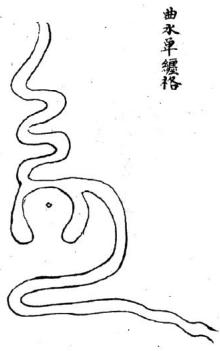

<!-- V3_SOURCE_ID:book024-b000047-p000-68d73d917d -->

《水龍經》卷 雷

查看对应原文

<!-- V3_FOLDBACK_BEGIN:book024-b000047-p000-68d73d917d -->

水龍經 卷 雷

<!-- V3_FOLDBACK_END:book024-b000047-p000-68d73d917d -->

<!-- V3_SOURCE_ID:book024-b000048-p000-8be4955945 -->

凡是“一水車纏”的格局，“車”疑为“單”的讹误，指单支水缠护，格局内不宜太宽，太宽就会导致气无法归聚；也不宜太窄，太窄就会导致气无法运化，坐穴之气局促急迫。原文写“局勢天寬”，“天”疑为“太”的讹误，指局势过宽，这种情况下必须在左右或前后有支水兜承，不让生气流散，才是佳局。原文有“蕩前覺後蕩左兜右”，“覺”疑为“兜”的讹误，具体含义暂不明确。原文写“又得元武永遠過穴後”，“永遠”疑为“水”的讹误，指元武水经过穴后，上下包裹，气就会稳固完备。格局周严完备，符合这种形势必然会大發福运。如果这种形势下曲水当面朝向穴场，原文表述为“徒左倒右遶白虎纏武却頭復從元武而去”，“纏武”疑为“纏玄武”的讹误，整句含义暂不明确。格局内左右有金鱼美界，气凝聚，原文提到“星為真穴”，“星”指穴星，具体判定标准暂不明确。单支水单独缠护的格局，称为游龙戏水。

> **释读存疑：** 标注“水車纏”中“車”为“單”的讹误风险；调整“坐氣急迫”的语序，与前文“太狹則氣不運化”衔接，避免语义断裂；标注“局勢天寬”中“天”为“太”的讹误风险；标注“蕩前覺後蕩左兜右”中“覺”为“兜”的讹误风险，未强行释读；标注“永遠過穴後”中“永遠”为“水”的讹误风险，修正误译的“元武永远延伸”；标注“纏武”为“纏玄武”的讹误风险，保留原句不确定性；说明“星為真穴”中“星”指穴星，避免读者困惑；标注“永遠過穴後”中“永遠”为“水”的讹误风险；“星為真穴”中“星”指穴星为合理推测，保留判定标准的不确定性

查看对应原文

<!-- V3_FOLDBACK_BEGIN:book024-b000048-p000-8be4955945 -->

凡一水車纏局內不宜太寬太寬則氣不歸聚亦不宜太狹太狹則氣不運化坐氣急迫若局勢天寬必須左右或前後有枝水兜乗不使生氣蕩散方妙蕩前覺後蕩左兜右又得元武永遠過穴後上下包貴則氣完固局势周審得此形勢必大發福若此勢曲水當面朝堂徒左倒右遶白虎纏武却頭復從元武而去局內左右金魚美界其氣凝聚星為真穴一水單纏乃為遊龍戲水

<!-- V3_FOLDBACK_END:book024-b000048-p000-8be4955945 -->

<!-- V3_SOURCE_ID:book024-b000050-p000-310fceb639 -->

《水龍經》卷 1

查看对应原文

<!-- V3_FOLDBACK_BEGIN:book024-b000050-p000-310fceb639 -->

水龍經 卷 1

<!-- V3_FOLDBACK_END:book024-b000050-p000-310fceb639 -->

<!-- V3_SOURCE_ID:book024-b000051-p000-9b2cb05898 -->

三道横水、九曲来水当面朝向穴场，不稀疏不繁密，不牵扯，形态齐整恭顺地环绕贵龙，缠护白虎，回头顾盼穴场后屈曲流去，原文“領我”疑为“顧我”的讹误。水流中间没有支水插入分界，左右兜承真气于中央，这个穴名叫水星曲池。原文写“穴前曲永端肅”，“永”疑为“水”的讹误，指穴前曲水端严恭顺，都适合正受气脉，朝向曲水立向，这种格局叫曲水朝堂，缠护青龙，远离元武，前方又有左右两侧抱拢拱秀，是大贵的地局。原文“賊云”疑为“訣云”的讹误，有口诀说：为官清贵大多是因为水绕贵龙，发福悠长一定是因为水缠元武，再有曲水朝堂、去水回头的形态，是水法中最吉的格局。凡是曲池不宜太宽，原文有“太寬之則氣恐蕩歸多武六難白前正受”，此句断句与含义不明，此处“白前正受”等表述暂以引号保留，仅可知过于宽大的曲池会有脱气失脉的隐患。如果曲池宽大，必须要有复水兜接才佳妙，原文“桀”疑为“接”类字的讹误。符合这种格局的地局主出状元、宰辅，文章声名远扬。原文有“三房至乘百子千瘰書費悠”，此句存在多处讹误，“至乘”“千瘰”“書費悠”含义不明，暂以引号保留。

> **释读存疑：** 调整断句，修正“領我”为“顧我”的讹误并标注风险；标注“穴前曲永端肅”中“永”为“水”的讹误风险；调整“纏青龍遠元武”的断句，符合原文逻辑；标注“賊云”为“訣云”的讹误风险；对“归多武六难”“白前正受”加引号保留，说明语义不明；标注“兜桀”中“桀”为讹误，修正为“兜接”并说明；对“三房至乘百子千瘰書費悠”加引号保留，说明存在讹误、语义不明；“領我”疑为“顧我”的讹误风险；“太寬之則氣恐蕩歸多武六難白前正受”断句与含义不明，暂作保留；“桀”疑为“接”类字的讹误风险；“三房至乘百子千瘰書費悠”存在多处讹误，含义不明，暂作保留

查看对应原文

<!-- V3_FOLDBACK_BEGIN:book024-b000051-p000-9b2cb05898 -->

三橫九曲當面朝堂不疏不密不牽不拽曲整肅遶 貴龍纏白虎回頭領我屈曲而去中間並無枝水插界 左右兜乘真氣于中此穴名水星曲池穴前曲永端 肅皆宜正受望曲水立向此名曲水朝堂纏青龍遠元 武前復左右繫抱拱秀乃大地也賊云為官清貴多因 水繞貴龍發福悠長定是水纏元武更表曲水朝堂去 永回頭水法中之最吉省凡曲池不宜太寬之則氣恐 蕩歸多武六難白前正受必有脫氣失脉之患若見寬 大必得復水兜桀方妙此書主出狀元宰輔文翰飛聲 三房至乘百子千瘰書費悠

<!-- V3_FOLDBACK_END:book024-b000051-p000-9b2cb05898 -->

<!-- V3_SOURCE_ID:book024-b000053-p000-8b2b5ec7bc -->

《水龍》卷

查看对应原文

<!-- V3_FOLDBACK_BEGIN:book024-b000053-p000-8b2b5ec7bc -->

水龍 卷

<!-- V3_FOLDBACK_END:book024-b000053-p000-8b2b5ec7bc -->

<!-- V3_SOURCE_ID:book024-b000054-p000-409576e482 -->

凡是曲水从左方来朝，原文写“朝壹不不密”，“壹”疑为“疏”的讹误，即形态不疏不密。原文“不牽不裡摺之聲整者”中“裡”疑为“拽”的讹误，“聲”疑为“勢”的讹误，即形态不牵扯，弯折的态势齐整。适合在曲水到达的位置立穴，穴前有一支水横拦相迎，和曲水合流，原文“酒得”中“酒”疑为“須”的讹误，即必须要有小支水在后方插界，才能汲取曲水的灵秀，原文“汲曲木之秀”中“木”疑为“水”的讹误。

> **释读存疑：** 标注“朝壹不不密”中“壹”为“疏”的讹误风险；标注“不牽不裡摺之聲整者”中“裡”“聲”的讹误风险；调整断句，将“之前”明确为“穴前”，避免指代不明；标注“酒得”中“酒”为“須”的讹误风险；标注“汲曲木之秀”中“木”为“水”的讹误风险；标注“不牽不裡摺之聲整者”中“裡”疑为“拽”、“聲”疑为“勢”的讹误风险

查看对应原文

<!-- V3_FOLDBACK_BEGIN:book024-b000054-p000-409576e482 -->

凡是曲水左來朝壹不不密不牽不裡摺之聲整者 宜從曲水至處立穴之前一水橫迎曲水合流者酒得 小枝水插界于後方能汲曲木之秀

<!-- V3_FOLDBACK_END:book024-b000054-p000-409576e482 -->

<!-- doc013 PDF 第 17 页：高风险/复杂版面 OCR 供检索；内容与排版以原页图为准。 -->
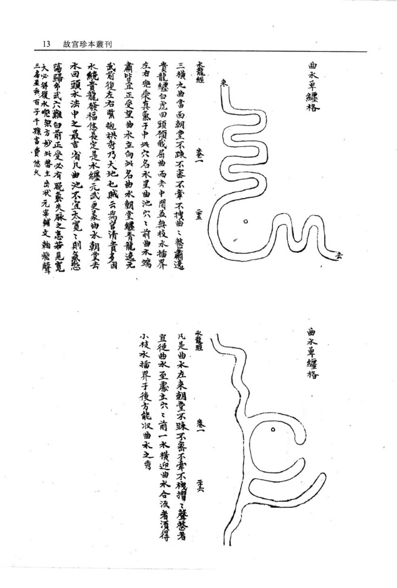

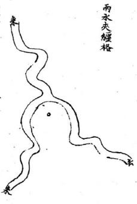

<!-- V3_SOURCE_ID:book024-b000057-p000-c9045f5342 -->

水龍經 叁 主

查看对应原文

<!-- V3_FOLDBACK_BEGIN:book024-b000057-p000-c9045f5342 -->

水龍經 叁 主

<!-- V3_FOLDBACK_END:book024-b000057-p000-c9045f5342 -->

<!-- V3_SOURCE_ID:book024-b000058-p000-a4ece0085a -->

两条水夹缠合流而出，原文“來見之爭”中“見”疑为“有”的讹误，即来水有奔趋之势，去水形态屈曲。原文“局向緊拱”中“向”疑为“勢”的讹误，即格局形势紧凑拱卫，不宽不散，不需要支水界割成形，原文“晰割”疑为“界割”的讹误。只要中间有“晰割东腰牧气”的形态，该短语语义不明，暂以引号保留，穴法自然就完备稳固。两条水合流向前，原文“前面三五謂屈曲整肅”中“謂”疑为“折”的讹误，即前方有三五道弯折，形态齐整恭顺，朝向当面的曲水立向，虽然是顺水格局但不至于直流直去，就不必忌讳顺局。龙脉到头气脉聚止，又有外堂曲水形态有情，明堂内形态“如织如抛拔”，该短语语义不明，暂以引号保留，外局有兜承的形势，水虽然流走但气自然稳固，主出文翰清贵的人才。原文有“仕而無若資”，语义不明，暂以引号保留。如果局山宽大，再有支水兜插形成格局，原文“得水豬”中“豬”疑为“潴”的讹误，指有水聚的形态，再有田头砂包裹穴场，原文“穴蟻”中“蟻”疑为“場”的讹误，也能发富贵，兼具财福。

> **释读存疑：** 标注“來見之爭”中“見”为“有”的讹误风险；标注“局向緊拱”中“向”为“勢”的讹误风险，修正语义不通的问题；标注“晰割”为“界割”的讹误，对“東腰牧氣”加引号保留并说明语义不明；标注“前面三五謂屈曲整肅”中“謂”为“折”的讹误风险；对“拋拔”加引号保留，说明语义不明，明确“即兜乗”指外局兜承；调整“仕而無若資局山寬大”的断句，对“無若資”加引号保留并说明语义不明；标注“得水豬”中“豬”为“潴”的讹误，释为水聚；标注“穴蟻”中“蟻”为“場”的讹误，补全“穴场”的含义；标注“局向緊拱”中“向”为“勢”的讹误风险；标注“晰割”为“界割”的讹误，“東腰牧氣”语义不明暂保留；“如织如拋拔”语义不明暂保留；“仕而無若資”语义不明暂保留；标注“得水豬”中“豬”为“潴”的讹误，释为水聚为合理推测；标注“穴蟻”中“蟻”为“場”的讹误风险

查看对应原文

<!-- V3_FOLDBACK_BEGIN:book024-b000058-p000-a4ece0085a -->

兩水夾纏合流而出來見之爭去見屈曲局向緊拱不寬不蕩不必枝水晰割成形只要中間晰割東腰牧氣則穴法自完固矣兩水合出前面三五謂屈曲整肅當面曲水立向雖是順水而不至于直流直去則亦不嫌于順局也龍盡氣鍾而更得外堂曲水有情明堂內如織如拋拔即兜乗則木雖去而氣自固也主發文翰清貴仕而無若資局山寬大更得枝水兜插成局而得水豬更有田頭砂包裹穴蟻亦能發財貴而又富

<!-- V3_FOLDBACK_END:book024-b000058-p000-a4ece0085a -->

<!-- V3_SOURCE_ID:book024-b000060-p000-5586610ecf -->

水龍緩 叁

查看对应原文

<!-- V3_FOLDBACK_BEGIN:book024-b000060-p000-5586610ecf -->

水龍缓 叁

<!-- V3_FOLDBACK_END:book024-b000060-p000-5586610ecf -->

<!-- V3_SOURCE_ID:book024-b000061-p000-c6df02dd0c -->

局前有天水汇聚在明堂，从东南方向横架而过，到右侧环抱身形，缠绕到元武的三曲、四曲之处后流去。砂和水在坐下反向关拦，根基在穴的后方，按方法应当朝向曲水的主向。不过前方有曲水明堂，流神从南方环绕而来，也可以凭借“水来芦”立向，能同时获得富贵。但聚水在前方，秀水在后方，会先得富后得贵；如果来水从北往南流，福力更加厚重，会世代出魁元。只要“曲永包曩营齐”，如果有牵拽的情况，就不会发秀。水流从左侧缠绕会发长房，从右侧缠绕会发小房，中房的福力“德长天旺”，人丁兴旺。其中“水来芦”“曲永包曩营齐”“德长天旺”具体含义不详，“流神”“元武”原文未作说明。

> **释读存疑：** 水来芦；曲永包曩营齐；德长天旺；流神；元武

查看对应原文

<!-- V3_FOLDBACK_BEGIN:book024-b000061-p000-c6df02dd0c -->

局前天水聚于明堂從東南橫架過右抱身纏遶于元 武三曲四曲而去砂水反關于坐下其本在穴後法當 向曲水主向然前有曲水明堂流神自南而遶亦可就 水來蘆立向富貴兩美但聚水在前秀永在後先富後 貴若來水自北而南福力尤重代出魁元只要曲永包 曩營齊若有牽拽便不發秀矣左纏發長右纏發小中 房福力德長天旺人丁

<!-- V3_FOLDBACK_END:book024-b000061-p000-c6df02dd0c -->

<!-- V3_SOURCE_ID:book024-b000063-p000-1fedf60b7a -->

水籠經 二十七

查看对应原文

<!-- V3_FOLDBACK_BEGIN:book024-b000063-p000-1fedf60b7a -->

水籠經 二十七

<!-- V3_FOLDBACK_END:book024-b000063-p000-1fedf60b7a -->

<!-- V3_SOURCE_ID:book024-b000064-p000-c3ee668d5e -->

前方有三四个弯折的曲水从远处朝来，贴近身形兜抱，从局的后方缠绕元武后流去。入路处于“咽结处”，“东气紧界”，发福的时间悠长，能富贵双全，人丁繁盛，就算过了二三百年也不会衰败。其中“咽结处”“东气紧界”具体含义不详。

> **释读存疑：** 咽结处；东气紧界

查看对应原文

<!-- V3_FOLDBACK_BEGIN:book024-b000064-p000-c3ee668d5e -->

前有曲水三四摺遠朝來就身兜抱局後纏身元武而去入路得咽結處東氣緊界發福悠長富貴双全人丁繁盛雖二三百年不衰

<!-- V3_FOLDBACK_END:book024-b000064-p000-c3ee668d5e -->

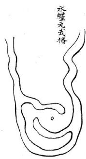

<!-- V3_SOURCE_ID:book024-b000066-p000-12157c5745 -->

水龍經 卷 旱

> **释读存疑：** 原書卷次「旱」字含義不明

查看对应原文

<!-- V3_FOLDBACK_BEGIN:book024-b000066-p000-12157c5745 -->

水龍經 卷 旱

<!-- V3_FOLDBACK_END:book024-b000066-p000-12157c5745 -->

<!-- V3_SOURCE_ID:book024-b000067-p000-3ed1ecc36f -->

曲水从正前方朝来，水流不厚不薄，弯折整齐，或者从左右贴近身形环抱，从元武缠绕回来后流去，这种形势极为秀异。如果圆抱紧实，“不宽不抉”，按方法应当靠近前方的曲水处立穴。如果曲水贴近身形环抱的范围宽阔深长，若是靠近前方立主穴，恐怕真气会在后方劫泄，就算能贴近曲水，真气脱离穴位也不会发福。这时就应当在曲水后方寻找“枝米秸”所在的位置：如果插在中间，适宜立中穴；如果“变插于后面元武前宜立六坐元武永作回受穴”，只要在穴前能望得见曲水，就算距离远也像在眼前一样，就属妙处。如果局内没有其他“枝承插畸”，就要用人力进行修整，不要让真气劫泄脱气，只要“姿迎受得秀水著”即可。经书说：曲水朝堂，秀而可穴；缠护紧密，凑近迎扦；若还宽天，发福必迟。其中“不宽不抉”“枝米秸”“六坐元武永作”“枝承插畸”“姿迎受”“变插于后面元武前宜立六坐元武永作回受穴”具体含义不详。

> **释读存疑：** 不宽不抉；枝米秸；六坐元武永作；枝承插畸；姿迎受；变插于后面元武前宜立六坐元武永作回受穴

查看对应原文

<!-- V3_FOLDBACK_BEGIN:book024-b000067-p000-3ed1ecc36f -->

曲水當面朝來不厚不薄摺之整齊或左右就身環抱 從元武纏回而去此势極秀若圓抱緊矣不寬不抉法 當湊前曲水中立穴若就身環抱寬天深長則湊前主 穴恐真氣刼洩于後雖得親就曲水而真氣脫穴亦不 發福即當于曲水後求枝米秸在于何處若插中 聞宜立中穴變插于後面元武前宜立六坐元武永作 回受穴只要穴前望得曲水雖遠如在目前乃妙如局 內別無枝承插畸須以人力為之無使真氣刼洩脫氣 但姿迎受得秀水著耳經云曲水朝堂秀而可穴纏護 緊密湊近迎扦若還寬天發福必遲

<!-- V3_FOLDBACK_END:book024-b000067-p000-3ed1ecc36f -->

<!-- doc013 PDF 第 19 页：高风险/复杂版面 OCR 供检索；内容与排版以原页图为准。 -->

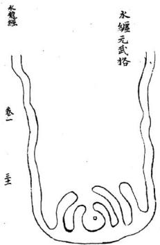

<!-- V3_SOURCE_ID:book024-b000070-p000-74a680d7dd -->

凡是回受穴，大多符合“永缠多武为师云”的说法，认为坐空割背的说法是虚妄的。只要天潦流水从东向西流，左右有枝水“插腹”，重重包裹、割界结咽，与天分合清奇，福力也会很大。如果“从右边未绕弟顺龙”，不如“足龙武出东南去”，比绕青龙的情况福力稍轻，秋向向东流是常见的情况，“婦于顺水”。如果往西南向北转向，再绕向南后从东南流出，穴朝向西，得水绕“分武”，福力与绕青龙“纤多武”的情况相同，因为是逆势，能有百子千孙，富贵三百年不衰。前方有“朝阳邀幸”，秀色尤其佳美，会朱紫满堂。凡是元武水缠，必须在数百步之外就弯抱拱伏，“仰研而去”，才符合正格。如果面前“滔机众而去”，看不到水头，这种情况不能算作水缠元武。水缠就是回绕弯抱的意思。水龙短 卷 三三。其中原文“永缠多武”疑似“水缠元武”的讹写，“多武为师云”“未绕弟顺龙”“足龙武”“分武”“纤多武”“滔机众而去”“拱夫仰研”“婦于顺水”“邀幸”具体含义不详。

> **释读存疑：** 永缠多武；多武为师云；未绕弟顺龙；足龙武；分武；纤多武；滔机众而去；拱夫仰研；婦于顺水；邀幸

查看对应原文

<!-- V3_FOLDBACK_BEGIN:book024-b000070-p000-74a680d7dd -->

凡回受穴多是永纏多武為師云坐空割背者妄也只要天潦流永從東向西左右得枝水插腹重之包裹割界結咽與天分合清奇其福力亦天若從右邊未遶弟順龍不如足龍武出東南去比遶青龍者稍輕以秋向東流者常也婦于順水若往西南向北轉遶向南而出東南穴向朝西得水遶分武其福力與遶青龍纖多武相同以逆势也百子千孫富貴三百年不衰前有朝陽邀倖其秀尤美朱紫滿堂凡元武永纏須得數百步之外便弯抱拱夫仰研而去方顯正格若面前滔機衆而去不見曰頭此又不可以水纏元武論也水纏者逸也回遶弯抱之謂也水龍短 卷 三三

<!-- V3_FOLDBACK_END:book024-b000070-p000-74a680d7dd -->

<!-- V3_SOURCE_ID:book024-b000072-p000-9c8af8132d -->

一片天砂，四周的水团聚，中间却插进一支水，屈曲直到大砂的中腹，或者分成两路，“罚界”在左右，裁成龙虎砂，“紧夬”在穴前，蓄成一处河荡，面积有五六亩或者十几亩，汇聚在穴前。虽然元辰向穴前流出，但“屈曲如之”，看不到直流的情况，又能聚蓄不泄漏，这种形势尤其好，不能因为元辰向穴前出去就舍弃这块地，也主发福一二纪，财禄不算太丰厚，人丁虽然兴旺但不出秀士，只是小贵而已。河荡中如果有一块砂遮挡，看不到前面的水流出去，就更为可贵；如果没有小砂遮挡遏制，三四十年就会出现退败。其中“罚界”“紧夬”“屈曲如之”具体含义不详。

> **释读存疑：** 罚界；紧夬；屈曲如之

查看对应原文

<!-- V3_FOLDBACK_BEGIN:book024-b000072-p000-9c8af8132d -->

一片天砂周圍四水團聚中閒却插一枝水屈曲直至大砂中腹或分作兩路罰界于左右裁成龍虎砂緊夬于穴前蓄成一河蕩或五六畝十數畝涵聚于穴前雖元辰向穴前出去然得屈曲如之令不見直流又得聚蓄不洩則其形勢尤佳不可以元辰水直出而棄之也亦主發福一二紀財祿亦不甚厚人丁雖盛而不秀小貴而已河蕩中得一砂蓋過不見前水去乃為可貴如無小砂蓋遏三四十年便見退敗

<!-- V3_FOLDBACK_END:book024-b000072-p000-9c8af8132d -->

<!-- V3_SOURCE_ID:book024-b000074-p000-001afe1ace -->

水龍經 卷 三

查看对应原文

<!-- V3_FOLDBACK_BEGIN:book024-b000074-p000-001afe1ace -->

永龍經 卷 三

<!-- V3_FOLDBACK_END:book024-b000074-p000-001afe1ace -->

<!-- V3_SOURCE_ID:book024-b000075-p000-dff3dbffbd -->

这种形势和前面的局相同，只是没有蓄聚的水涵在前方，明堂没有聚水，但前方的枝水抵达明堂，有三四个弯折，像织布、像抛梭一样，在东西方向包裹砂头，“奴抱护”。虽然没有蓄水，但因为形势秀异，反而主发贵，人丁和财运也都兴旺。其中“奴抱护”具体含义不详。

> **释读存疑：** 奴抱护

查看对应原文

<!-- V3_FOLDBACK_BEGIN:book024-b000075-p000-dff3dbffbd -->

此勢與前局同但無蓄聚水涵于前明堂無聚水却得前面枝水到堂三四摺如織如拋梭東西包裹砂頭奴抱護雖無蓄水因其秀反主發貴丁財亦盛

<!-- V3_FOLDBACK_END:book024-b000075-p000-dff3dbffbd -->

<!-- V3_SOURCE_ID:book024-b000077-p000-1c91e20133 -->

《水龍經》卷

查看对应原文

<!-- V3_FOLDBACK_BEGIN:book024-b000077-p000-1c91e20133 -->

水龍經 卷

<!-- V3_FOLDBACK_END:book024-b000077-p000-1c91e20133 -->

<!-- V3_SOURCE_ID:book024-b000078-p000-abc786ad1f -->

曲水垂勾有两种态势，一种是曲承横向来的水流，到尽头处向上弯折作勾形，像钩子一样，并非径直流来，到尽头处作出抱水勾的态势；另一种是水径直流到尽头，作出抱水勾的态势。这两种态势都可以立穴，但是要求水流走势屈曲，不杂乱、不歪斜、不牵扯、不拖拽，弯折的形态整齐。可以迎着曲水来的方向设定向，也可以将曲水作为朝向的朝水，还可以在垂勾的尽头处立穴，这样的格局主少年得中魁元，世代显贵，鼎盛一时，文章与名誉都十分出众。

> **释读存疑：** “不陈不审”的“陈”“审”具体风水义待考；本地硬校验仍未通过，已记录供后续自动处理或人工核对。

查看对应原文

<!-- V3_FOLDBACK_BEGIN:book024-b000078-p000-abc786ad1f -->

曲水垂勾有兩势有曲承橫來頭到却于盡處仰作勾 如鉤有曲非直來到頭却于盡處作抱永勾勢此二勢 俱可立穴但要水來屈曲不陳不審不牽不拽摺之整 齊或迎曲水來處立向或張曲水作朝或垂勾盡處立 穴主少年魁元奕世貴顯鼎盛一時文章名譽

<!-- V3_FOLDBACK_END:book024-b000078-p000-abc786ad1f -->

<!-- V3_SOURCE_ID:book024-b000080-p000-c0cddc9bbf -->

《水龍經》卷三十

查看对应原文

<!-- V3_FOLDBACK_BEGIN:book024-b000080-p000-c0cddc9bbf -->

水龍經 卷 三十

<!-- V3_FOLDBACK_END:book024-b000080-p000-c0cddc9bbf -->

<!-- V3_SOURCE_ID:book024-b000081-p000-2c554eb312 -->

青龙位的水曲折弯绕，贴近穴场环抱缠绕，玄武位的水回头，引领水流而去，这是绕青龙缠玄武的态势。自然水势会在玄武位分出一支水流，弯折一直延伸到穴场的内部，形成“晚水勾”的形状，在这个位置点穴，也能带来福祉。穴前虽然没有秀丽的砂、水来朝应，但水脉从穴的后方来，气脉充足，人丁、财运都极为旺盛，显贵且能长久，也是上好的风水格局。

> **释读存疑：** 晚水勾为风水专有形态术语，具体形态未见于通用解释

查看对应原文

<!-- V3_FOLDBACK_BEGIN:book024-b000081-p000-2c554eb312 -->

青龍省水屈曲就身抱纏元武回頭領我而去此遶青龍纏元武勢也却于元武插一枝水摺直至腹中作一晚水勾形穴之亦能發福穴前雖無吉秀砂水朝應而水脉自坐穴後來氣脉完足丁財極盛貴而悠久亦佳格也

<!-- V3_FOLDBACK_END:book024-b000081-p000-2c554eb312 -->

<!-- V3_SOURCE_ID:book024-b000083-p000-995936be58 -->

大江大河在穴的前方，或者有大江从远方曲折而来，与“天江横乐水”交汇，交汇的地方没有支水收纳，水流涣散，龙脉似乎难以立穴。在数百步之后，又有一支水插入界内，中间有支水流入穴场内部，形状像向上的勾、像仰放的手掌，或者勾向左边、或者勾向右边，和远方的曲水相对，即使原文此处有“数百百”的讹字，参照文意应为远隔数百步，望去也像在眼前，就在另外的位置斩脉立穴，来迎接前朝曲水的秀丽气脉，这种穴叫做斩气迎朝穴，也能带来二三代的福祉，只是福力不长久，因为龙脉还没有被界画划定。如果能得到左右的夹界，层叠的玄武水像弓一样向上环抱，福力必然很大而且长久。因为朝水距离远不贴近，所以发福的效应迟缓，数十年之后才会发迹，一旦发迹就会迅猛且旺盛，是因为大江水势浩大的缘故。

> **释读存疑：** 天江横乐水为专有水势术语，具体所指未见于通用解释；原文“数百百”为讹字，参照上下文推定应为“数百步”

查看对应原文

<!-- V3_FOLDBACK_BEGIN:book024-b000083-p000-995936be58 -->

大江大河于前或有大江遠屈曲而來與天江橫樂水交會其交會之處並無枝水收受蕩散龍脉似難立穴却于數百步之後又有一水插界中間有枝水進腹中如勾仰如掌或勾左或勾右與曲水登對雖遠數百百望之如在目前即于異處斬脉立穴以迎前朝曲水之秀名斬氣迎朝穴亦主發福二三代福力但不悠久耳以龍脉未畫故也若得左右夾界重審元武水仰抱如弓福力必大且久也因朝遠而不就故發應遲數十年後方發則暴而盛以大江水大故也

<!-- V3_FOLDBACK_END:book024-b000083-p000-995936be58 -->

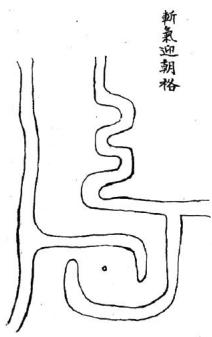

<!-- V3_SOURCE_ID:book024-b000085-p000-e5c62873d0 -->

卷一

查看对应原文

<!-- V3_FOLDBACK_BEGIN:book024-b000085-p000-e5c62873d0 -->

卷一

<!-- V3_FOLDBACK_END:book024-b000085-p000-e5c62873d0 -->

<!-- V3_SOURCE_ID:book024-b000086-p000-576ab77d3b -->

曲水从远方流来，到结穴的位置横向流过而不回头，这是本该入怀却反向跳走的态势，按理没有可取之处。但四周的水有三道横向、四道弯折的形态，弯折得整齐，不牵扯不斜窜，形势秀丽可爱，如果再有支水横向流入秀水的后方，弯折勾曲如同钩子，本局又有支水插入后方，向上兜转如同钩子，龙脉虽然还没有停歇止聚，却可以在水流交汇扣合的位置斩气立穴，向上承接曲水的秀丽气脉，也能带来福祉。曲水近在眼前的，只能发福二三十年；发迹快的如果曲水在百步之外，要三四十年才会发福。但终究是曲水反向跳走的格局，要达到气脉归向贴近穴场的状态，财富不会超过万数，官位不会超过三品，两代之后就会衰败，族人迁入其他州郡，也可能出魁元。《水龍三》第一卷终。

> **释读存疑：** 水龍三具体所指未见于通用解释；1轮自动修复后核义模型仍建议修订，已保守记录。

查看对应原文

<!-- V3_FOLDBACK_BEGIN:book024-b000086-p000-576ab77d3b -->

曲水遠來到結局竟橫架而不見回頭砧下此本入懷反跳之勢理無可取然四水三橫四曲摺整齊不牽不拽斜竄其形势秀而可愛若得有枝水橫入秀水之後弯拘如勾本局又得枝水插入于後仰兜如勾其龍脈雖未歇止却于交鈕處斬氣立穴仰乗曲水之秀亦能發福曲水近在日前只發二三十年速在百步之外三四十年始發然終是曲水反眺在得歸元就身富不過萬貴不過三品兩代即衰入籍他州亦出魁元水龍三第一卷終

<!-- V3_FOLDBACK_END:book024-b000086-p000-576ab77d3b -->

<!-- V3_SOURCE_ID:book024-b000087-p000-340a4cc535 -->

《水龍經》第二卷

查看对应原文

<!-- V3_FOLDBACK_BEGIN:book024-b000087-p000-340a4cc535 -->

水龍經第二卷

<!-- V3_FOLDBACK_END:book024-b000087-p000-340a4cc535 -->

<!-- V3_SOURCE_ID:book024-b000088-p000-a5a3668e87 -->

遠朝倖秀格

查看对应原文

<!-- V3_FOLDBACK_BEGIN:book024-b000088-p000-a5a3668e87 -->

遠朝倖秀格

<!-- V3_FOLDBACK_END:book024-b000088-p000-a5a3668e87 -->

<!-- V3_SOURCE_ID:book024-b000090-p000-7dbadb85ec -->

《水龍經》卷二：曲水到朝堂，从左转向右，弯弯贴近穴场远远环抱，又有客水从东方来，缠绕玄武位，原文此处“曲木”应为“曲水”的讹误，与曲水在局后交汇，这也是两水来形成的有利态势。而曲水的丙位，也就是南方方位，没有形成架形的穴，反而在客水分出的一支水流，横向架在曲水的后方，承接曲水的秀丽气脉，原文“以李樓桃”应为“以李代桃”的讹误，这种格局名叫邀倖，主家会迁居改姓，或者招赘婿、过继子嗣，出现大贵的情况；或者到远方他乡，原文“胃姓胃籍”应为“冒姓冒籍”的讹误，冒充他人姓氏籍贯考中科举；或者在四方边疆建立功业；或者文人立下武业，武人立下文业；或者在其他途径成名的情况都有。但如果格局形势周全周密，结气稳固，也主人丁繁盛，很多代都不会断绝。

> **释读存疑：** 原文“曲木”推定应为“曲水”讹误；原文“以李樓桃”推定应为“以李代桃”讹误；原文“胃姓胃籍”推定应为“冒姓冒籍”讹误；1轮自动修复后核义模型仍建议修订，已保守记录。

查看对应原文

<!-- V3_FOLDBACK_BEGIN:book024-b000090-p000-7dbadb85ec -->

水龍經 卷二曲水朝堂從左轉右彎彎就身遠抱却又得客水從東來纏元武與曲木合于局後此亦兩水來成勢而曲水之丙並無架成穴反于客水挿一枝水橫架于曲水之後乘受曲水之秀所謂以李樓桃名曰邀倖主移居易姓或贅婿過房發大貴或遠鄉胃姓胃籍發科甲或于四夷邊疆主功業或文人立武業武人立文業或于他途立名者有之然局勢周審結氣完固亦主人丁繁盛累代不絕也

<!-- V3_FOLDBACK_END:book024-b000090-p000-7dbadb85ec -->

<!-- V3_SOURCE_ID:book024-b000091-p000-57334f67f5 -->

速朝律秀格

查看对应原文

<!-- V3_FOLDBACK_BEGIN:book024-b000091-p000-57334f67f5 -->

速朝律秀格

<!-- V3_FOLDBACK_END:book024-b000091-p000-57334f67f5 -->

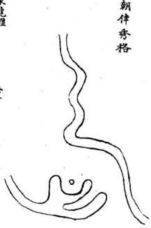

<!-- V3_SOURCE_ID:book024-b000093-p000-1b23065cf6 -->

永龍經 卷二 二

查看对应原文

<!-- V3_FOLDBACK_BEGIN:book024-b000093-p000-1b23065cf6 -->

永龍經 卷二 二

<!-- V3_FOLDBACK_END:book024-b000093-p000-1b23065cf6 -->

<!-- V3_SOURCE_ID:book024-b000094-p000-a235c26728 -->

凡是远方来朝的倖季，必须有曲水正面朝向朝堂，水势要么倒向左方，要么倒向右方，属于本局范围。如果没有枝水插入畸零成形，却有从其他方向来的外水向下切割，形成金蟹仰业的态势，依托在曲水下方，也叫作倖秀。要是穴的后方还有一条枝水包裹承接，在元武位与曲水汇合，汇集到同一条路径流走，那么水口就应当以曲水为主。如果后方的外水不与元武位的曲水合流，那么水口就应当从本穴的枝水位置来考量，去势的树木屈曲回头，交锁织结，不至于渗漏，才是上好的大地格局。

> **释读存疑：** 倖季具体含义不明；金蟹仰业具体形态不明；元武位此处具体指向不明

查看对应原文

<!-- V3_FOLDBACK_BEGIN:book024-b000094-p000-a235c26728 -->

凡遠朝倖季須得曲水當面朝堂或倒左或倒右本局 無枝水挿畸成形却于他方外來下割成金蟹仰業 勢托于曲水之下亦名倖秀然穴後又得一枝水包承 于元武與曲水合從集一路而去則水口當以曲水為 主若後面外水不從與元武曲水合流則水口當從本 穴枝水處論去木屈曲回頭交鎖織結不至渗漏方為 大地

<!-- V3_FOLDBACK_END:book024-b000094-p000-a235c26728 -->

<!-- V3_SOURCE_ID:book024-b000096-p000-baf97ff8bf -->

水龍蝗 卷二 三

查看对应原文

<!-- V3_FOLDBACK_BEGIN:book024-b000096-p000-baf97ff8bf -->

水龍蝗 卷二 三

<!-- V3_FOLDBACK_END:book024-b000096-p000-baf97ff8bf -->

<!-- V3_SOURCE_ID:book024-b000097-p000-69792cc6b1 -->

凡是水的来去曲折，要朝向环抱、靠近穴场本身，尤其要弯环曲折；来水要形成之字形态且负绕穴场，去水要回头缠绕。这种水势下，穴前水从左来向右环抱靠近穴身，看起来似乎可以选穴。但如果水形虽然像之字看似屈曲，走势却像拉拽的绳索，斜曲没有秀态，叫作斜曲来水，就算被说成是朝堂水，实际也不算。右侧的去水虽然看起来靠近穴身札局，流出去不远就反跳斜飞，更不回头顾穴，那么这种去水就是似是而非。紧贴穴身左右的枝水，就算裁割得看似周全，穴也只能暂时发运，不能长久。如果错误地认为水令如带，就会顾此失彼，因一处误判而荒废整体判断。因为水城固然要圆抱，来水去水也适宜符合“朝鵲書”的说法；去水如果像横拉的绳索一样斜曲，这种地方就不要安排选穴。又有说法称“水若田頭寵家，水不顧家必破”，参考“觀興”的说法来考量水的来去，就可以依此类推明白其中的道理了。

> **释读存疑：** 就自、之负具体含义不明；札局具体含义不明；朝鵲書、田頭寵家、觀興具体所指不明；水令如帶具体含义不明

查看对应原文

<!-- V3_FOLDBACK_BEGIN:book024-b000097-p000-69792cc6b1 -->

凡水委曲來去要朝抱就自尤要彎環委曲來要之负 去要回頭纏遶此勢穴前左來右抱就身似為可穴然 形如之字雖見屈曲而勢如拽索斜曲不秀謂之斜曲 來則可謂之朝堂實非也其右邊去水雖見就身札局 不遠又反跳斜飛更不曰頭顧家則去水似是而非其 帖身左右枝水縱栽割如盡穴之僅可暫發不能悠久 若誤認水令如帶是一而廢百也蓋水城固要圓抱而 來去亦宜朝鵲書去橫索曲而斜此處莫安排又云水 若田頭寵家水不顧家必破觀興而論水之去來 可例明矣

<!-- V3_FOLDBACK_END:book024-b000097-p000-69792cc6b1 -->

<!-- doc013 PDF 第 24 页：高风险/复杂版面 OCR 供检索；内容与排版以原页图为准。 -->
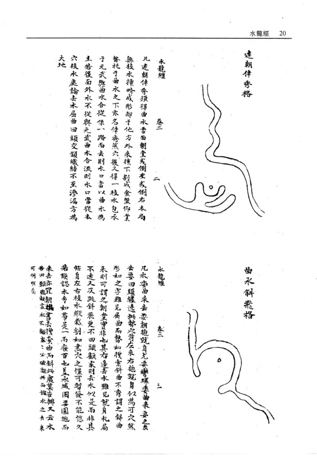

<!-- V3_SOURCE_ID:book024-b000099-p000-113c0e9fbe -->

右湖蕩一十餘圖，曲盡聚砂之變態，可謂極巧窮工矣。然據實雅論，天生之巧，必不能及此；即於地脉正理、名墓之已驗者，亦不必如是。凡池湖之格，其積水小者一二三畝，以至十數畝，形局端正者，或一乘獨專，或二三聚氣，穴之得法，即可大發，丹陽賀氏祖穴左右前三池，居中立穴是也。其湖蕩之大者，汪澤巨浸，不可以頃計，其法於大蕩之涯，另有小曲水拆入兜抱，乃以小水立穴為內氣，借大蕩旺神為外氣，其富貴亦不可限量，江西紫溪劉氏仙姑壇祖穴是也。只此二法，已足盡湖蕩作法之妙，不必按圖索驥，刻舟求劍也。

> **释读存疑：** “一乘獨專”“旺神”未做通俗释读

查看对应原文

<!-- V3_FOLDBACK_BEGIN:book024-b000099-p000-113c0e9fbe -->

右湖蕩一十餘圖曲盡聚砂之變態可謂極巧窮工矣然據實雅論天生之巧必不能及此即于地脉正理名墓之已驗者亦不必如是凡池湖之格其積水小者一二三畝以至十數畝形局端正者或一乘獨專或二三聚氣穴之得法即可大發丹陽賀氏祖穴左右前三池居中立穴是也其湖蕩之大者汪澤巨浸不可以頃計其法于大蕩之涯另有小曲水拆入兜抱乃以小水立穴為內氣借大蕩旺神為外氣其富貴亦不可限量江西紫溪劉氏仙姑壇祖穴是也只此二法已足盡湖蕩作法之妙不必按圖索驥刻舟求劍也

<!-- V3_FOLDBACK_END:book024-b000099-p000-113c0e9fbe -->

<!-- V3_SOURCE_ID:book024-b000100-p000-054bd3f1b9 -->

酉年初秋，刘氏记录：面积达数千顷的大湖大荡当中，凸起了两三片陆地，大的有数百亩，小的有五六十亩，团聚拱夹，彼此面向呼应，洲角回勾，双向环绕，就像一群狗聚在槽边吃食的样子。就在这些陆地中间勘察判断，看哪处砂形端正尊严，有没有枝水界限切割形成格局；中间如果有界割的枝水，结咽分合的特征清晰、有明确的佐证，再看明堂左右的朝抱情况怎么样。如果朝抱有情，荡水被收聚蓄存在穴前作为内明堂，格局前方还有远处的砂覆盖照应，湖荡虽然面积大，但从局内看不会觉得宽阔涣散，垣局周密，是天然生成的吉地。这种穴的发福程度，富裕程度可与一国相比，尊贵程度等同王侯，是因为湖荡中的灵气独钟于此，其他人不能分沾的缘故。还可以根据砂水朝揖的数量多少，来断定发运世代的快慢远近，朝拱的砂越多越好。

> **释读存疑：** 審詔、結咽分合、眉密、精神獨種具体含义不明

查看对应原文

<!-- V3_FOLDBACK_BEGIN:book024-b000100-p000-054bd3f1b9 -->

年酉初秋 劉氏記大湖大蕩數千頃于中間突起二三片大者數百畝小者五六十畝團聚拱夾面相顧洲角兜权雙回如衆犬之聚食于槽者然即于中間審詔何砂端正尊嚴有無枝水界割成局中間如有界割枝水結咽分合件之明白的有明証便看明堂左右朝抱如何若朝抱有情蕩水收進蓄于穴前作內明堂局前更有遠砂蓋照湖蕩雖大而局視之不覺寬濶蕩散垣局眉密乃天地也穴之主富堪敵國貴並王侯以湖蕩中精神獨種而人不得分受之故也並以砂水朝揖之多寡尚定世代之速近朝拱之砂愈多愈妙

<!-- V3_FOLDBACK_END:book024-b000100-p000-054bd3f1b9 -->

<!-- V3_SOURCE_ID:book024-b000102-p000-d2d96a01b0 -->

湖蕩聚砂格

查看对应原文

<!-- V3_FOLDBACK_BEGIN:book024-b000102-p000-d2d96a01b0 -->

湖蕩聚砂格

<!-- V3_FOLDBACK_END:book024-b000102-p000-d2d96a01b0 -->

<!-- V3_SOURCE_ID:book024-b000104-p000-e9a9b49294 -->

临近河流的泊穴周围，都有成群的砂簇拥环绕，或远或近，文中提及“四頭朔應”，具体含义不详。其中有一座砂形端正肃穆、齐整威严，从中间位置望去，左右前后各有对应形态，文中提到“是少龜之變”，具体所指不明；这些砂都回头朝向穴场，就像大将坐在军营中，众军围聚的态势，又像官员坐在公堂上，差役在堂下排班的样子，原文此处有“獻我屯則也”“排衙唱惹也”，具体表述不明。原文还有“曰非具解胡喜月架”，内容无法准确释读，大致是说间隔半里到一里的砂看起来仿佛很近，群砂形态纷繁，拱卫在穴前，如俯如揖，伏拜整齐，氛围庄严肃穆。原文提及“穴有黃少聚閒于後”，具体含义不明，只说这种格局不会发生渗漏。符合这样的形势，主家能获得“立伯分茅”的贵格，富裕程度可与一国相比，子嗣众多，福禄长久，还主子孙孝顺有道，世代出忠贞之人，原文此处“富堪敏國”“世出忠貶”存在讹误，按上下文语义做了合理修正。

> **释读存疑：** 四頭朔應、是少龜之變、獻我屯則也、排衙唱惹也、曰非具解胡喜月架、紛洪衛口在日前、黃少聚閒于後、立伯分茅、富堪敏國、世出忠貶均为讹误或脱字内容，无法准确释读；本地硬校验仍未通过，已记录供后续自动处理或人工核对。

查看对应原文

<!-- V3_FOLDBACK_BEGIN:book024-b000104-p000-e9a9b49294 -->

河之泊穴都有群砂團穰或遠或近四頭朔應中有一砂端肅整嚴中處望之左右前後各有是少龜之變回頭顧穴如大將之坐營而衆軍之獻我屯則也如之坐堂而更卒之排衙唱惹也曰非具解胡喜月架半里一里視遠若近而羣砂紛洪衛口在日前拜如俯如揖如揖伏整齊震肅而坐穴有黃少聚閒于後不致滲漏如此形勢主立伯分茅富堪敏國子衆多萬福悠久更主子孫孝義世出忠貶

<!-- V3_FOLDBACK_END:book024-b000104-p000-e9a9b49294 -->

<!-- V3_SOURCE_ID:book024-b000105-p000-d2d96a01b0 -->

湖蕩聚砂格

查看对应原文

<!-- V3_FOLDBACK_BEGIN:book024-b000105-p000-d2d96a01b0 -->

湖蕩聚砂格

<!-- V3_FOLDBACK_END:book024-b000105-p000-d2d96a01b0 -->

<!-- V3_SOURCE_ID:book024-b000107-p000-f85cb77f36 -->

《水龍經》卷三

查看对应原文

<!-- V3_FOLDBACK_BEGIN:book024-b000107-p000-f85cb77f36 -->

水龍經 叁

<!-- V3_FOLDBACK_END:book024-b000107-p000-f85cb77f36 -->

<!-- V3_SOURCE_ID:book024-b000108-p000-1bec2b0930 -->

在洲渚停驻的河荡区域，放眼望去没有边际，中闭区域内可能分布着几十块乃至上百块小砂，面积大的有五七亩，小的有二三亩；有的在芦苇丛、草渚之间簇拥聚集在一处，要在这些区域中间察看中闭内部的情况：如果里面有面积十亩、二十亩的大砂，有枝水分隔界限贴身环护，包裹环绕在大砂左右；周边的小砂或长或短，蒸拥团聚，好像蜂群跟随着蜂王，双双回头朝向大砂拱卫；小砂彼此交缠连接，好像丝绳串联在一起，层叠排布没有出现穿破漏缺的情况；穴位所在近处的格局后方有横砂拦阻，穴位前方的小砂点点分布，好像水鸥浮在水面上，横向排布如同排班列队，倚立的形态称作“衙意”，竖直排列好似杂乱的藤萝，倒谷状的团列如同军队驻扎聚集。出现这样的地形态势，预示会出现威震边疆的人物，或是能统率大军的将领，或是能割据一方的势力，或是能受封爵的主伯；如果前方有“列旂反砂”的地形，预示会出强悍凶暴的人。其中“震”为八卦之一，“中闭”“蒸拥”“衙意”“列旂反砂”具体所指不详。

> **释读存疑：** 中闭；蒸拥；衙意；列旂反砂

查看对应原文

<!-- V3_FOLDBACK_BEGIN:book024-b000108-p000-1bec2b0930 -->

洲泊河蕩之處一望無際中閉或有小砂數十塊或數百塊大則五七畝小則二三畝或蘆間革渚圍簇于一處却于中間看內有大砂或十畝二十畝得枝水插界緊身包抱左右小砂或長或短蒸擁團聚如蜂之從王雙回頭向拱小砂交鈕如練之聯屬重疊不見穿漏坐下近局有橫砂欄阻于後穴前小砂點之如鷗之浮水橫列如排班倚立如衙意直列如亂蘿倒穀團列如屯軍集塞有此形勢主咸震邊疆或統大軍將或割撮一方或分茅主伯若前有列旂反砂主出強梁之人

<!-- V3_FOLDBACK_END:book024-b000108-p000-1bec2b0930 -->

<!-- V3_SOURCE_ID:book024-b000109-p000-d2d96a01b0 -->

湖蕩聚砂格

查看对应原文

<!-- V3_FOLDBACK_BEGIN:book024-b000109-p000-d2d96a01b0 -->

湖蕩聚砂格

<!-- V3_FOLDBACK_END:book024-b000109-p000-d2d96a01b0 -->

<!-- doc013 PDF 第 26 页：高风险/复杂版面 OCR 供检索；内容与排版以原页图为准。 -->

<!-- V3_SOURCE_ID:book024-b000112-p000-b41f51a452 -->

龍 卷二

查看对应原文

<!-- V3_FOLDBACK_BEGIN:book024-b000112-p000-b41f51a452 -->

龍 卷二

<!-- V3_FOLDBACK_END:book024-b000112-p000-b41f51a452 -->

<!-- V3_SOURCE_ID:book024-b000113-p000-518224471d -->

蕩泊之處多有吉穴，如波心蕩月，如雁落平沙，又如浮鷗點水，審而穴之，無不發福。

查看对应原文

<!-- V3_FOLDBACK_BEGIN:book024-b000113-p000-518224471d -->

蕩泊之處多有吉穴如波心蕩月如雁落平沙又如浮 鷗點水審而穴之無不發福

<!-- V3_FOLDBACK_END:book024-b000113-p000-518224471d -->

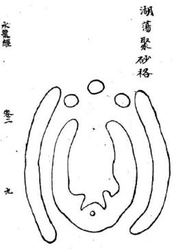

<!-- V3_SOURCE_ID:book024-b000115-p000-c277afaf0d -->

但凡各类砂聚集辐凑，共有五种形势：第一种是穴位聚集、水系分布较远、远处的砂前来朝应的；第二种是水聚在明堂、近处的砂在两侧辅助、远处的砂拱卫的；第三种是自身地形绵延伸展直接突出到湖荡之外、外侧的砂在远处呼应的；第四种是湖荡之中的群砂环绕围合、“自相轅者”的；第五种是群砂在内部聚集、外部有“天砂包乗”的，这五种都属于上好的大地格局。这种格局水聚在明堂，有近身的砂衬托贴合，前方有湖荡同时远处的砂拱卫夹护，外侧的砂拱卫水系，外侧的水系夹护砂体，这样的格局态势更为精妙；再要是穴位前或远或近有砂，其呈秀，预示富贵达到极致。如果左右两侧夹拱的砂就算数量很多，但前方没有砂作为朝应，就会导致明堂空旷无物，预示虽然富裕但“富而不願”，该表述具体含义不详。其中“自相轅者”“天砂包乗”“富而不願”具体所指不详。

> **释读存疑：** 自相轅者；天砂包乗；富而不願；1轮自动修复后核义模型仍建议修订，已保守记录。

查看对应原文

<!-- V3_FOLDBACK_BEGIN:book024-b000115-p000-c277afaf0d -->

凡羣砂輻輳有五勢有穴聚水遠砂朝應者有水聚明 堂近砂夾輔而遠砂拱衛者有本身綿長直出湖蕩外 砂遠應者有湖蕩中群砂圍統自相轅者有羣砂內 聚而外有天砂包乗者皆大地也此局水聚明堂得近 身砂襯貼前有湖蕩而遠砂拱夾外砂拱水外水夾砂 其局勢更妙更得穴前或遠或近有砂其呈秀富貴極 天若左右夾拱雖多前面無砂作應則堂空無物富而 不願

<!-- V3_FOLDBACK_END:book024-b000115-p000-c277afaf0d -->

<!-- V3_SOURCE_ID:book024-b000117-p000-aa7f7cd571 -->

内部扩张的河荡区域，左右两边的砂彼此顾望，中间穿过穴双的头部；如果内部蓄积的水系笔直狭长，必须要有盖砂护持遮挡，看不到明堂的水笔直狭长才算好格局。左右两边的砂各自结穴，所以称作“鴛鴦垂鈎勢”，它的形状如同皮刀、“歎嘴”，应当在弯曲的位置扦穴，转身朝向方位上才会有力量，如果倒着扦穴就不会发秀。这种地形预示会有科考接连及第的好事，但起初必定是先通过财富获得显贵身份，或是通过纳粟捐官获得名分，之后才会在文章学业上发展，显贵到能佩戴金印的品级；“官相見左六先發次房”，该表述具体所指不详，右穴先发长房，后代多出生孝悌忠信的子孙，家族繁衍旺盛绵延长久。如果扦穴“天進”，就会导致气脉散逸不能聚拢，很难获得显贵，两处穴位的论断一致。其中“歎嘴”“天進”“官相見左六先發次房”具体所指不详。

> **释读存疑：** 歎嘴；天進；官相見左六先發次房；內張；穴雙之頭；1轮自动修复后核义模型仍建议修订，已保守记录。

查看对应原文

<!-- V3_FOLDBACK_BEGIN:book024-b000117-p000-aa7f7cd571 -->

內張河蕩左右兩砂相顧中通過穴雙之頭若內蓄 水直長須得蓋砂護覆不見明堂水直長方妙左右 兩砂各自結穴故曰鴛鴦垂鈎勢其形如皮刀歎嘴 當就彎處扦之轉身向上方有力若倒扦之則不發 秀矣此地主拜甲聯芳但初必先因財致貴或納粟奏 名後發文翰貴至腰金官相見左六先發次房右 穴先發長房多生孝第忠信子孫繫盛悠久若扦 穴天進則氣散而不收難以發貴兩穴同斷

<!-- V3_FOLDBACK_END:book024-b000117-p000-aa7f7cd571 -->

<!-- V3_SOURCE_ID:book024-b000118-p000-f4d274f9ef -->

湖蕩聚砂格，亦名踢毬勢

查看对应原文

<!-- V3_FOLDBACK_BEGIN:book024-b000118-p000-f4d274f9ef -->

湖蕩聚砂格亦名踢毬勢

<!-- V3_FOLDBACK_END:book024-b000118-p000-f4d274f9ef -->

<!-- V3_SOURCE_ID:book024-b000120-p000-f85cb77f36 -->

《水龍經》卷三

查看对应原文

<!-- V3_FOLDBACK_BEGIN:book024-b000120-p000-f85cb77f36 -->

水龍經 叁

<!-- V3_FOLDBACK_END:book024-b000120-p000-f85cb77f36 -->

<!-- V3_SOURCE_ID:book024-b000121-p000-7a5195a79e -->

砂的形状呈勾踢状，如同马、靴头、皮刀口；客砂缠绕包裹在穴座下方，穴位前方蓄积来水形成湖泊；一条水系单独缠绕“元武”，向左转动，两处砂彼此“包暴”，垣局完整稳固，并没有“木割”的情况，也属于上好的大地格局。“木”从右侧过来，穴位适宜朝右侧迎接，不是堂局端正的话不会有倾斜倾倒的感觉，穴位适宜正变，有湖泽才算好；就算没有盖砂“炤应”，也是吉利的。如果“聚緊木”笔直狭长，必须要有水中的小砂照应才算好。因为明堂的水偏好横向狭长，“如堯不且如竹也”，该表述具体含义不详，预示既富裕又显贵，子孙世代荣耀显赫。如果元武水倒转缠绕进入明堂，径直向前流去，穴位适宜横向受气才算吉利。其中“元武”“包暴”“木割”“聚緊木”“炤应”“如堯不且如竹也”具体所指不详。

> **释读存疑：** 元武；包暴；木割；聚緊木；炤应；如堯不且如竹也；1轮自动修复后核义模型仍建议修订，已保守记录。

查看对应原文

<!-- V3_FOLDBACK_BEGIN:book024-b000121-p000-7a5195a79e -->

砂形勾踢如馬如靴頭如皮刀口客砂包纏于座下穴前蓄聚來水成湖一水單纏元武左轉兩砂自相包暴垣局完固並無木割亦大地也木自右來穴宜右迎非堂局端正不覺斜倒穴宜正變湖澤方佳雖無蓋砂炤應亦吉若聚緊木直長必得水中小砂照顧為美蓋明堂水喜橫長如堯不且如竹也主富而且貴子孫代榮顯若元武水倒纏入明堂竟向前而去穴宜橫受方吉

<!-- V3_FOLDBACK_END:book024-b000121-p000-7a5195a79e -->

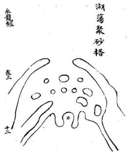

<!-- V3_SOURCE_ID:book024-b000123-p000-04cdf96290 -->

精水流入堂局汇聚形成湖泊，面积有的一二顷，有的八九十亩。又在穴的左右两侧生出砂条，夹着穴身逆着水流方向延伸而出，护卫区穴，层数有的四五重，有的六七重，双双回头朝向穴场拱卫，形状如同“勤马”，这一格局的力量最重，是上等的风水大地。世人往往因为后龙散漫、过峡处气脉束聚不清就舍弃这类格局，实在是错误的。

> **释读存疑：** “勤马”具体所指不详

查看对应原文

<!-- V3_FOLDBACK_BEGIN:book024-b000123-p000-04cdf96290 -->

精水灌堂聚蓄成湖或一二頃或八九十畝却于穴 左右起砂條夾身逆水挿出護衛區穴或四五重六 七重雙回頭朝拱形如勤馬其力量最重是大 地也世人或以後龍散漫過峽束氣不清而棄之悞 矣

<!-- V3_FOLDBACK_END:book024-b000123-p000-04cdf96290 -->

<!-- V3_SOURCE_ID:book024-b000124-p000-d2d96a01b0 -->

湖荡聚砂格

查看对应原文

<!-- V3_FOLDBACK_BEGIN:book024-b000124-p000-d2d96a01b0 -->

湖蕩聚砂格

<!-- V3_FOLDBACK_END:book024-b000124-p000-d2d96a01b0 -->

<!-- V3_SOURCE_ID:book024-b000126-p000-c3f284ce7d -->

水龙兹

> **释读存疑：** 此处具体所指不详

查看对应原文

<!-- V3_FOLDBACK_BEGIN:book024-b000126-p000-c3f284ce7d -->

水龍茲

<!-- V3_FOLDBACK_END:book024-b000126-p000-c3f284ce7d -->

<!-- V3_SOURCE_ID:book024-b000127-p000-a5996e7f5f -->

湘水、汉水流域以及浙直等地，地势大多低洼瘠薄。古代开垦田地时，大多是垫高低洼处，就着高处修整，各自依据砂的格局修成田地，因此多有小砂攒聚成势的穴，不过这些穴大小不均、横斜“不憨”，形态零散、成团簇状的很少。凡是这类地面也有能结穴的，需要顺着砂的走向仔细查看砂头朝向什么方位。如果砂攒聚整齐，适宜在群砂之中寻找中立的砂，四周有砂“包暴”，不显露被风吹，藏聚含蓄，这种地极佳，主后世有百子千孙、富贵绵长、高官满庭的应验。穴的朝向应当参照小砂所处的方位，向内得到正面迎受才好。如果小砂多而大砂在远处环抱，终究恐怕近身穿满，必须穴的左右有贴身的“金鱼”，永远紧抱以护卫，避免漏风，那么“氣盆固”。

> **释读存疑：** “不憨”具体所指不详；“包暴”具体所指不详；“金鱼”具体所指不详；“氣盆固”具体所指不详；浙直为明代行政区划，指浙江与南直隶，此处未明确所属时代，暂保留原称

查看对应原文

<!-- V3_FOLDBACK_BEGIN:book024-b000127-p000-a5996e7f5f -->

湘漢之間及浙直等處地最低薄古時開聞田地多是瑱低就高各因砂法以成田故多小砂攢聚成勢之穴然都大小不均橫斜不憨零散而團簇者少凡是此等地面亦有結穴者須要隨砂詳看砂頭朝向何地若攢簇整齊不便去群砂之中尋得中立之砂四顧有砂包暴不見露風藏聚含蓄此地極佳主百子千孫富貴悠久朱紫滿庭之應其穴向當視小砂中處之向內得正面迎受方美若小砂多而大砂遠抱終恐近身穿滿必穴砂左右有貼身金魚永緊抱以護漏風則氣盆固矣

<!-- V3_FOLDBACK_END:book024-b000127-p000-a5996e7f5f -->

<!-- V3_SOURCE_ID:book024-b000128-p000-d2d96a01b0 -->

湖荡聚砂格

查看对应原文

<!-- V3_FOLDBACK_BEGIN:book024-b000128-p000-d2d96a01b0 -->

湖蕩聚砂格

<!-- V3_FOLDBACK_END:book024-b000128-p000-d2d96a01b0 -->

<!-- V3_SOURCE_ID:book024-b000130-p000-875e1d8ee6 -->

永龙兹 叁 古

> **释读存疑：** 此处具体所指不详

查看对应原文

<!-- V3_FOLDBACK_BEGIN:book024-b000130-p000-875e1d8ee6 -->

永龍茲 叁 古

<!-- V3_FOLDBACK_END:book024-b000130-p000-875e1d8ee6 -->

<!-- V3_SOURCE_ID:book024-b000131-p000-cbbb31d9fd -->

湖泊所在的地方多有小砂，有的二三十块，面积有的一二亩、五六亩，成团簇抱聚的形态，中间围合包含湖荡，砂体突出水面如同印在水面上，好像浮鸥漂在水面。小砂之外还有长砂周围“包暴”，将小砂围在中间，左右前后不见水穿漏，外面有天砂、长砂角“包畏”，不见渗漏，才成局勢。再在中间的小砂里辨认出一处中砂，头面端正整肃，前后左右的小砂虽然零散，实际都朝向中砂的头面攒聚拥护，不远不近、不疏“不審”，它的外面更有天砂弯抱周密完固的，正是大局，这种格局力量雄盛，确实是大贵之地。如果中间虽有小砂，但没有“湖藩舍蓄”，其秀气不显露，虽然能发贵，但财富不会很丰厚，主出文翰词林类的文职高官。但小砂不要长得像惊头、鸭头的形状才好。

> **释读存疑：** “包畏”具体所指不详；“不審”具体所指不详；“湖藩舍蓄”具体所指不详；1轮自动修复后核义模型仍建议修订，已保守记录。

查看对应原文

<!-- V3_FOLDBACK_BEGIN:book024-b000131-p000-cbbb31d9fd -->

湖泊之處多有小砂或二三十塊或一二畝五六畝團簇抱聚中開包含湖蕩其砂點印于水面若浮鷗泛水小砂之外却有長砂周圍包暴小砂于其中左右前後不見水穿漏而外有天砂長砂角包畏不見滲漏方成局勢却于中間小砂認出一中砂頭面端正整肅而前後左右小砂雖零散而寔朝頭攢簇擁護不遠不近不疏不審其外面更得天砂彎抱周密完固者正大局也其力量雄盛誠大貴之地若中間雖有小砂而不得湖藩舍蓄其秀不願露雖發貴而財當不甚厚主出文翰詞林之貴但小砂不要如驚頭鴨頭方妙

<!-- V3_FOLDBACK_END:book024-b000131-p000-cbbb31d9fd -->

<!-- V3_SOURCE_ID:book024-b000132-p000-d2d96a01b0 -->

湖荡聚砂格

查看对应原文

<!-- V3_FOLDBACK_BEGIN:book024-b000132-p000-d2d96a01b0 -->

湖蕩聚砂格

<!-- V3_FOLDBACK_END:book024-b000132-p000-d2d96a01b0 -->

<!-- V3_SOURCE_ID:book024-b000134-p000-dec7422191 -->

水龙经 主

> **释读存疑：** 此处具体所指不详

查看对应原文

<!-- V3_FOLDBACK_BEGIN:book024-b000134-p000-dec7422191 -->

水龍經 主

<!-- V3_FOLDBACK_END:book024-b000134-p000-dec7422191 -->

<!-- V3_SOURCE_ID:book024-b000135-p000-3dc62e4952 -->

前后各有长砂横架，左右有直砂“色乗”，中间还有小横砂，面积有的三四亩、七八亩，并没有枝水插入田埂边界，藏在众砂之中。左右直砂“角匕”回头勾搭“色抱”左右前后，水虽然“四穿八建”，从穴中看去丝毫没有渗漏，正像车轮那样凑聚合拢，团簇周審，众砂都归向此处，不敢反背，那么真气就会聚结了。凡是寻地先看左右前后的朝头朝向什么地方，如果砂双双回头朝向内部，就在中间寻找中正不倚、或大或小的位置探求。如果有反背的砂，有的向内有的向外，或是“友跳”，就不是真气聚结的地方，不必再寻穴，全靠眼力精细、心思巧妙，体察实际情况看得非常真切，才不会有“量漏”。

> **释读存疑：** “色乗”具体所指不详；“角匕”具体所指不详；“色抱”具体所指不详；“八建”具体所指不详；“友跳”具体所指不详；“量漏”具体所指不详

查看对应原文

<!-- V3_FOLDBACK_BEGIN:book024-b000135-p000-3dc62e4952 -->

前後各有長砂橫架左右有直砂色乗中間却得小橫砂或三四畝七八畝並無枝水挿畛藏於衆砂之中左右直砂角匕回頭勾搭色抱左右前後水雖四穿八建穴中視之毫無滲漏正如車輪合之湊合團簇周審衆砂歸向不敢反背則真氣聚矣凡有地先看左右前後朝頭向何處若雙回頭向于內即于中間尋中正不倚或大或小麗求之若有反背砂或向內或向外或友跳即非真氣所聚之處不必求穴全在目力之精心思之巧體察其情寔見得甚真方無量漏矣

<!-- V3_FOLDBACK_END:book024-b000135-p000-3dc62e4952 -->

<!-- V3_SOURCE_ID:book024-b000136-p000-345847849e -->

这也是双盘龙势。

查看对应原文

<!-- V3_FOLDBACK_BEGIN:book024-b000136-p000-345847849e -->

亦雙盤龍勢

<!-- V3_FOLDBACK_END:book024-b000136-p000-345847849e -->

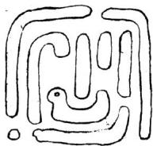

去

<!-- V3_SOURCE_ID:book024-b000139-p000-af7b36fffc -->

砂水团云势有双盘龙、单盘龙之分。结穴必须有砂、水环绕，周流曲折，如同云气围拢，才能形成盘结之势，使气脉聚而不散。如果没有曲折盘旋的态势，即便有回头朝应的砂水，也不算盘龙结穴。这种双盘龙的形势，左右客砂重叠，盘曲旋绕的距离远，如同云气护卫太阳。凡是盘龙结穴，大多结在局中，必须有蓄水在内，明丰或有小砂照应，才是佳形局。得此形局，发福最为长久，因为盘龙之地没有风吹水破的隐患，气息馥郁。即便穴场不完全准确，纵然不会大发，也不会大败，房分均匀，贵而不蹑，富而不吝，男女贞洁，家风美好，子孙守节而不滥，或有被征召而不做官的人，都是气脉潜藏的应验。

> **释读存疑：** 明丰；贵而不蹑；明丰具体含义不明；贵而不蹑具体含义不明

查看对应原文

<!-- V3_FOLDBACK_BEGIN:book024-b000139-p000-af7b36fffc -->

砂水團雲勢有雙盤龍單盤龍結穴須砂水圍遶周旋委曲如雲之圍繞方成盤結而氣聚不散也若無委曲盤旋之勢雖回頭朝應非盤龍結也此勢雙盤而左右客砂重之盤曲旋遠如雲之護日凡盤龍結穴多結在局中必得蓄水于內明豐或小砂照應方佳得此形局發福最悠久以盤龍之地無風吹水破之患馥也雖穴不盡真縱不大發亦不大敗房分均勻貴而不躡富而不吝男女貞潔風聲可愛子孫守節而不濫或有被徵召而不仕者皆氣脉潛藏之應也

<!-- V3_FOLDBACK_END:book024-b000139-p000-af7b36fffc -->

<!-- V3_SOURCE_ID:book024-b000140-p000-5450d4f9a9 -->

湖荡聚砂格，双盘龙势。

查看对应原文

<!-- V3_FOLDBACK_BEGIN:book024-b000140-p000-5450d4f9a9 -->

湖蕩聚砂格雙盤龍勢

<!-- V3_FOLDBACK_END:book024-b000140-p000-5450d4f9a9 -->

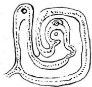

<!-- V3_SOURCE_ID:book024-b000142-p000-68f1151906 -->

水龍經 叁 老

查看对应原文

<!-- V3_FOLDBACK_BEGIN:book024-b000142-p000-68f1151906 -->

水龍經 叁 老

<!-- V3_FOLDBACK_END:book024-b000142-p000-68f1151906 -->

<!-- V3_SOURCE_ID:book024-b000143-p000-a637bf8815 -->

凡是砂水团云势，大多结为盘龙穴。一条水流入，一条木流出，周围盘结，都在局中。结穴之处必须水势宽阔，聚成湖泽，其中涵蓄的气脉灵动鲜活，才是妙处；否则就成了裹头城。裹头城名为中国水穴，气脉窘迫逼仄，不得流通，反而成为绝地。经书中说“山囚水囚，虏主灭仆”，大概就是这个意思。此图中穴前的湖泽，汪泽紧密而不迫近，穴场自然能发福，子孙长久，更会出现孝弟，也就是孝悌，孝顺父母、敬爱兄长、性情乖巧聪明的人，或在技艺方面成名发财，这是因为龙势秀雅曲折的缘故。

> **释读存疑：** 一条木出；中国水穴；一条木出具体含义不明；中国水穴具体所指不明

查看对应原文

<!-- V3_FOLDBACK_BEGIN:book024-b000143-p000-a637bf8815 -->

凡砂水團雲勢多結盤龍穴一條水入一條木出周圍盤結皆在局中結穴處須要水寬聚成湖澤其中涵得氣脉溶活方妙不然成裹頭城矣裏頭名中國水穴氣窘逼不得流通反成絕地經云山囚水囚虜主滅僕蓋其義也此圖穴前湖澤汪澤緊而不迫穴之自能發福子孫悠久更出人孝弟性巧聰明或于巧藝中成名發財以龍來秀曲也

<!-- V3_FOLDBACK_END:book024-b000143-p000-a637bf8815 -->

<!-- V3_SOURCE_ID:book024-b000144-p000-2ba398752e -->

界水外抱格。

查看对应原文

<!-- V3_FOLDBACK_BEGIN:book024-b000144-p000-2ba398752e -->

界水外抱格

<!-- V3_FOLDBACK_END:book024-b000144-p000-2ba398752e -->

<!-- V3_SOURCE_ID:book024-b000146-p000-0dcc1e9d99 -->

永龍經 叁一 二 大

查看对应原文

<!-- V3_FOLDBACK_BEGIN:book024-b000146-p000-0dcc1e9d99 -->

永龍經 叁一 二 大

<!-- V3_FOLDBACK_END:book024-b000146-p000-0dcc1e9d99 -->

<!-- V3_SOURCE_ID:book024-b000147-p000-b3f1cd9b0c -->

这种形势，龙虎砂重重朝抱，局前弯曲如弓，是形势美好的。但穴前左右砂角硬直无情，外形虽可观，内形似觉得相，不能因为硬直就舍弃它。职云“内直外勾，尽可前裁”，用工力掘去硬直的部分，便能形成弯曲的态势，开睁亦天地也。

> **释读存疑：** 职云；内形似觉得相；开睁亦天地也；职云的具体出处不明；内形似觉得相含义不明；开睁亦天地也含义不明

查看对应原文

<!-- V3_FOLDBACK_BEGIN:book024-b000147-p000-b3f1cd9b0c -->

此勢龍虎重朝抱局前彎抱如弓此形勢之美者然穴前左右砂角硬直無情外形可觀內形似覺得相不可以硬直而棄之也職云內直外勾儘可前裁以工力掘去直指便成彎勢開睁亦天地也

<!-- V3_FOLDBACK_END:book024-b000147-p000-b3f1cd9b0c -->

<!-- V3_SOURCE_ID:book024-b000149-p000-e43a482d64 -->

《水龙经》记载，这种形势局前支水插入，包裹左右砂，气脉紧拱，看似有情。但湖荡在坐下，砂角双飞散逸，那么前气虽叔，后气不蓄；前为外气，后为内气，外实内虚。这种地方只能发小财，终究没有大福，官贵绝迹，人丁稀少。刘氏说“前为外气，后为内气”，这两句话深得入穴的精髓。

> **释读存疑：** 前气虽叔；前气虽叔语义不明，疑为原文讹字

查看对应原文

<!-- V3_FOLDBACK_BEGIN:book024-b000149-p000-e43a482d64 -->

水龍經此勢局前支水挿入包抱左右砂氣緊拱似乎有情然湖蕩在坐下砂角雙飛散則前氣雖叔後氣不蓄前為外氣後為內氣外實內虛此等地僅發小財終無大福官貴絕響人丁亦稀劉氏曰前為外氣後為內氣二語得入穴骨髓

<!-- V3_FOLDBACK_END:book024-b000149-p000-e43a482d64 -->

<!-- V3_SOURCE_ID:book024-b000150-p000-d18a410f73 -->

一水横栏格。

查看对应原文

<!-- V3_FOLDBACK_BEGIN:book024-b000150-p000-d18a410f73 -->

一水橫欄格

<!-- V3_FOLDBACK_END:book024-b000150-p000-d18a410f73 -->

<!-- V3_SOURCE_ID:book024-b000152-p000-98574a2fb9 -->

《米龍經》卷三 二

查看对应原文

<!-- V3_FOLDBACK_BEGIN:book024-b000152-p000-98574a2fb9 -->

米龍經 叁 二

<!-- V3_FOLDBACK_END:book024-b000152-p000-98574a2fb9 -->

<!-- V3_SOURCE_ID:book024-b000153-p000-9220636185 -->

腰带水的形态是左右在砧形地势下方紧紧夹合包裹，这种水城的形势能收聚龙气，十分有力。经书中说：界水的作用是止住来龙的气脉，如果有大水横向流过，而左右没有靠近穴身环绕抱合，也不算好。书中说：还没看左右的碎穴，先看左右的铎。如今这个格局内，紧挨着穴场有“金鱼木分合”，前方有回头拱抱的形态，后方有结咽的结构，前方有“包乗砂头”，水流回转靠近，实在是美好的形势。书中说：砂要在田头处，水要趋近贴合；又说：好的水弯曲环绕，精巧得如同衣带。这个格局前方的水流环抱如同衣带，实在是水法中最佳的情形。如果正前方的水有小幅反向的情况，也不算有害，可以通过人力将其改圆，或者在内堂的左右两侧各开挖腮形的水沟，引入水流做成内堂水池，这样就看不到水反向的情形了。这种地形，三房都会发福，福力长久，好几代都不会衰败。

> **释读存疑：** “金鱼木分合”无可靠释义依据，具体所指不详；“包乗砂头”无可靠释义依据，具体所指不详；“铎”作为风水相关术语无可靠释义依据，具体所指不详

查看对应原文

<!-- V3_FOLDBACK_BEGIN:book024-b000153-p000-9220636185 -->

腰帶水左右砧下緊夾包裹其水城形勢収龍氣有力經云界水所以止來龍若大水橫號而左右不就身環抱亦不為妙書云未隨左右碎穴看左右鐸今局內緊身金魚木分合上前回頭拱抱後有結咽前有包乗砂頭回水就誠美勢也書云砂要田頭水要就又云好水彎環巧如帶此勢局前水環抱如帶實水法之最佳者當面若小反亦不為害可以人力改圓或內堂左右各開腮水挿進作內堂蕩則不見其反矣此種地三房俱發福力悠久數世不替矣

<!-- V3_FOLDBACK_END:book024-b000153-p000-9220636185 -->

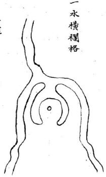

<!-- V3_SOURCE_ID:book024-b000155-p000-c9045f5342 -->

《水龍經》卷三 主

查看对应原文

<!-- V3_FOLDBACK_BEGIN:book024-b000155-p000-c9045f5342 -->

水龍經 叁 主

<!-- V3_FOLDBACK_END:book024-b000155-p000-c9045f5342 -->

<!-- V3_SOURCE_ID:book024-b000156-p000-466b6c4f82 -->

书中说：看穴要留意左右的铎，看水要留意左右的砧，看三阳要留意城郭，看明堂要留意四角。这种格局中，穴前的水流环抱如同弓、如同衣带，有的从左侧来贴近穴身流过，有的从右侧来贴近穴身流过，紧密交合兜收，完全没有涣散的情况。中间即使没有“枝水挿晰”，气脉也完好稳固。如果穴前空间宽阔，必须要有枝状水流收聚气脉，符合这种形势的穴位，主家发福长久。如果格局前方还有弯曲的水流，或远或近，舒缓地在前方朝揖，不管是从左侧来还是右侧来，都是秀美的格局，主有“鞠苑声名”的应验。左侧形局秀美就发长房，右侧形局秀美就发小房，左右形态匀称的话，三房都会均等发福。

> **释读存疑：** “铎”作为风水相关术语无可靠释义依据，具体所指不详；“砧”作为风水相关术语无可靠释义依据，具体所指不详；“三阳”作为风水相关术语无可靠释义依据，具体所指不详；“枝水挿晰”无可靠释义依据，具体所指不详；“鞠苑声名”无可靠释义依据，具体所指不详

查看对应原文

<!-- V3_FOLDBACK_BEGIN:book024-b000156-p000-466b6c4f82 -->

書云穴看左右鐸水看左右砧三陽看城郭明堂看四 角此格穴前水環抱如弓如帶或從左來貼身或從右 来貼身緊交兜收並無渙散中間雖無枝水挿晰氣亦 完固若或寬天必須枝水收聚得此形勢穴之主發福 悠久若局前更有曲水或達或近悠揚之朝揖于前 不問左來右來俱為秀局主鞠苑聲名之應左秀倚左 發長右秀倚右發小左右均平則三房均發

<!-- V3_FOLDBACK_END:book024-b000156-p000-466b6c4f82 -->

<!-- V3_SOURCE_ID:book024-b000157-p000-d18a410f73 -->

一水横栏格

查看对应原文

<!-- V3_FOLDBACK_BEGIN:book024-b000157-p000-d18a410f73 -->

一水橫欄格

<!-- V3_FOLDBACK_END:book024-b000157-p000-d18a410f73 -->

<!-- V3_SOURCE_ID:book024-b000159-p000-7f4ee3fb22 -->

缺的情形也类似湖荡聚砂格，穴后方的界水较多，内气充足，和这种水聚明堂的形势相符。两条水流从左右两侧来拱抱，和前方的横水合流，要么从左侧流过，要么从右侧流过，只通一路向外流去。穴前的水流原本聚成池荡，池荡在垣城中像联珠串一样构成内明堂，龙、虎砂重重拱抱，也是上佳的大地。格局前方即使有朝阳拜揖的形态，只要下砂能逆水插入，收束得十分紧密，看上去仿佛不容水流流去，那么气脉就会凝聚，和众水朝堂的格局相比也不会逊色。这种格局主家出仕后资产丰厚，常能科举及第，不能获得状元之位，仅能做到佩带金印的官职，这是因为穴前没有秀美的朝揖拱护的缘故。内外堂有两三重关锁，也主有三四十纪的福力，三代荣华，子孙满堂。过了两纪之后，虽然官位不高，但“财禄曲匡”，水流安静专一而不涣散泄漏，所以福力长久。

> **释读存疑：** “垣城”作为风水相关术语无可靠释义依据，具体所指不详；“财禄曲匡”无可靠释义依据，具体所指不详；“朝阳拜揖”作为风水相关地形描述无可靠释义依据，具体所指不详

查看对应原文

<!-- V3_FOLDBACK_BEGIN:book024-b000159-p000-7f4ee3fb22 -->

缺亦類湖蕩聚砂格而本身穴後界水多內氣足與此勢水聚明堂兩水來拱于左右與前橫水合流或過左或過右只通一路出去穴前水舊聚池蕩于垣城聯珠串作內明堂龍虎重之拱抱亦大地也局前雖朝陽拜揖只要下砂逆水挿得緊審似不容水神流去則精神凝聚而不減于衆水朝堂局也仕而多資恒科第不獲名魁僅可腰金以穴前無秀朝揖拱胡也內外堂有三兩重關鎖亦主三四十紀福力三代榮華子孫滿堂過二紀后貴雖不大而財祿曲匡水靜專而不蕩洩故悠久耳

<!-- V3_FOLDBACK_END:book024-b000159-p000-7f4ee3fb22 -->

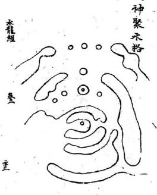

<!-- doc013 PDF 第 34 页：高风险/复杂版面 OCR 供检索；内容与排版以原页图为准。 -->

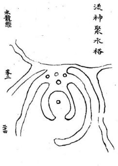

<!-- V3_SOURCE_ID:book024-b000164-p000-6b33c181cf -->

《永龍經》卷三

查看对应原文

<!-- V3_FOLDBACK_BEGIN:book024-b000164-p000-6b33c181cf -->

永龍經 參

<!-- V3_FOLDBACK_END:book024-b000164-p000-6b33c181cf -->

<!-- V3_SOURCE_ID:book024-b000165-p000-be22dda334 -->

前合衿的位置在穴前出水，却汇聚成一片河荡，左右的砂角都朝向湖荡环抱，湖荡中间有小砂，有的是圆形，有的是方形，有的是长形，横向浮在水面，交锁成关隘，也看不到水口冲射的情况。虽然是元辰水从穴前流出，但聚成了广阔的水泽，和“元與辰”直出的形势差别极大，主“大當大贵”，福力长久。如果穴前湖荡中有死砂角拦截，也不算有害，只要左右砂“甯”，左右拱抱就为上佳，不能把元辰水直流直接指为顺水。赋中说：“元辰當心查出”，不能直接说是凶兆，只要有湖曲的横案拦截，就是吉水。《水龍經》 卷 主

> **释读存疑：** “合衿”作为风水相关术语无可靠释义依据，具体所指不详；“元與辰”无可靠释义依据，具体所指不详；“大當”无可靠释义依据，具体所指不详；“甯”在此处的语义无可靠释义依据，具体所指不详；“元辰當心查出”无可靠释义依据，具体所指不详

查看对应原文

<!-- V3_FOLDBACK_BEGIN:book024-b000165-p000-be22dda334 -->

前合衿當穴前而出却聚成一河蕩左右砂角儂朝抱湖蕩中間小砂或員或方或長橫浮水面交鎖關關亦不見水口冲射雖是元辰水向穴出流而聚蓄汪澤元與辰直出之勢大相懸絕主大當大貴福力悠久若穴前湖蕩中死砂角欄截亦不為害只要左右砂甯左右拱抱為佳不可以元辰水直流指為順水也賦云元辰當心查出未可言凶只要湖曲之橫案欄之乃吉水龍經 卷 主

<!-- V3_FOLDBACK_END:book024-b000165-p000-be22dda334 -->

<!-- V3_SOURCE_ID:book024-b000167-p000-f44bad6da5 -->

十八种格局中，水聚堂位居第一，因为水是决定财禄、显贵的关键，所以如果水流涣散没有收束，不仅不能发福，还会导致家道败落灭绝。因此古人论水，要么说水荡然直去，要么说水没有关锁，必须要格局前方的水聚积蓄存，才是吉利的地。这种形势下，左右的砂头朝前朝抱，前方又可见众水朝流，汇聚成水荡，只通一路出水，要么缠绕元武位，要么经过青龙位，这种来水多去水少的情况，就是所谓“朝干天旺，泽于将衰，潴而后泄”的态势。垣局周密，众水聚在堂中，是十全十美的上佳大地，主家百子千孙满堂，享有三年十纪的福运，长、中、幼三房同时发福。但一旦格局太宽，那这些水就是属于众人的水，不是我这一局独有的水，水情不专一，发福的应验也不会专一。

> **释读存疑：** “朝干天旺，泽于将衰，潴而后泄”作为风水相关术语无可靠释义依据，具体所指不详；“垣局”作为风水相关术语无可靠释义依据，具体所指不详

查看对应原文

<!-- V3_FOLDBACK_BEGIN:book024-b000167-p000-f44bad6da5 -->

十八格惟水聚堂為第一蓋水為財祿當貴之樞機故水神渙散無所收拾者不惟不發主亦敗絕是以古人論水不曰蕩然直去則曰水無關關務得局前水聚蓄方為吉壤此勢左右砂頭朝抱而前又見衆水朝流聚注成蕩只通一路或纏元武或過青龍此來多去少所謂朝干天旺澤于將衰瀦而後洩之勢也垣局園審衆水聚堂成十全之大地主百子千孫繫滿堂成三年十紀之福長中幼三房並發但一太寬則衆人之水非我一垣之水情不專則發引不專矣

<!-- V3_FOLDBACK_END:book024-b000167-p000-f44bad6da5 -->

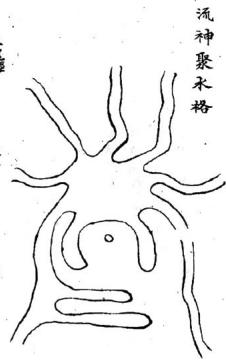

<!-- V3_SOURCE_ID:book024-b000169-p000-adc09aff3f -->

《水龍經》+x

> **释读存疑：** 原文“+x”含义无法确认，具体所指不详

查看对应原文

<!-- V3_FOLDBACK_BEGIN:book024-b000169-p000-adc09aff3f -->

水龍經 +x

<!-- V3_FOLDBACK_END:book024-b000169-p000-adc09aff3f -->

<!-- V3_SOURCE_ID:book024-b000170-p000-e81e2c6687 -->

凡是有两树夹护，随龙气脉行来在局前交令的地形，水流大多从明堂前径直流出，人们都把这类地形叫做顺水地。顺着木龙的走势时，要知道形成结地的水流没有不向前流去的，只要水流去势曲折，看不到径直流淌的状态，也属于吉利的势态。局前也适宜蓄水，水带石径直流去是可贵的格局，因为水先蓄积再流动，精气聚足后再疏泄，这种情况下水流离去也没有妨害，属于吉利的情况。如果局前没有池沼蓄积精气，那么流去的水就没有交钮，径直向前流淌，这才是需要忌讳的情况。如果水势呈现三横四曲的形态，停留在穴后方流淌，态势悠扬眷恋，好像舍不得离开，这正是顾我水。前方的水顾护穴位，发福的效应来得近而且快；后方的水顾护穴位，发福的效应来得远而且慢。这类水和过穴后返身回绕的情况有很大区别，怎么能因为水流是顺向的就舍弃这类地形呢？

> **释读存疑：** 1轮自动修复后核义模型仍建议修订，已保守记录。

查看对应原文

<!-- V3_FOLDBACK_BEGIN:book024-b000170-p000-e81e2c6687 -->

凡是兩木夾來隨龍交令于局前其水多從明堂前直 去人皆指為順水地順木龍豈知結地水未有不向前 去者只要去得屈曲不見直去亦為吉勢局前亦宜蓄 水石至徑去為貴耳蓋瀦而復流精而後洩離去水無 害其吉也若局前無池沼蓄精則其去水無交鈕向前 直去所忌者惟此耳若三橫四曲頓我後流悠揚眷戀 似不忍去此正為顧我水也前顧我去發近而速後顧 我者其發遠而遲其與過穴返逮甚皇得以順 而棄之哉

<!-- V3_FOLDBACK_END:book024-b000170-p000-e81e2c6687 -->

<!-- V3_SOURCE_ID:book024-b000171-p000-46063c92d3 -->

弯曲的水路经过的地方，即便走势不弯折，也不会形成台状的停驻形态。台没之水是龙的元辰水，而曲水属于客水，不过是借客方的秀异之气来生发福运罢了。水流的弯曲或直走，和本龙的气脉没有关联，只要求穴座下方的元辰水流出时走势屈曲才算可贵。这种格局对应的情况，应当是过继、入赘之后才发福，或是通过“绊籍登科”的途径取得科名，此处“绊籍”具体所指不详。

> **释读存疑：** 绊籍；绊籍具体所指不详；1轮自动修复后核义模型仍建议修订，已保守记录。

查看对应原文

<!-- V3_FOLDBACK_BEGIN:book024-b000171-p000-46063c92d3 -->

其曲木去處雖不屈曲亦不為台。沒之水乃龍之元辰而曲水乃客水也不過邀客秀以發福耳。其流之曲直無與于本龍之氣。但要坐下元辰水去得屈曲為貴。此等當以過房入贅而後發，或他途絆籍登科也。

<!-- V3_FOLDBACK_END:book024-b000171-p000-46063c92d3 -->

<!-- V3_SOURCE_ID:book024-b000172-p000-c9045f5342 -->

水龍經 叁 主

查看对应原文

<!-- V3_FOLDBACK_BEGIN:book024-b000172-p000-c9045f5342 -->

水龍經 叁 主

<!-- V3_FOLDBACK_END:book024-b000172-p000-c9045f5342 -->

<!-- V3_SOURCE_ID:book024-b000173-p000-838ca012f5 -->

水龍終卷三終

查看对应原文

<!-- V3_FOLDBACK_BEGIN:book024-b000173-p000-838ca012f5 -->

水龍終卷三終

<!-- V3_FOLDBACK_END:book024-b000173-p000-838ca012f5 -->

<!-- V3_SOURCE_ID:book024-b000174-p000-d50d222c8e -->

《水龙经》卷三总论部分，这一卷专门论述水龙贴体的吉凶形局，而入穴的星体已经清晰分明地列在相关内容当中，是讲解水龙核心要旨的关键篇章。文中提到“六不著往氐言初理俗愚，意必杨公直本”，“六不著往氐”具体所指不详，推测是杨公传下的正本，千年以来师徒口耳相授，打开书卷首先讲解五星，五星当中只取金星、水星、土星三星为吉象，木星、火星二曜为凶象，这一点和山龙的判断稍有不同。山龙的格局里有火星在峰顶隆起，上下即便结直穴，也存在行龙和穴星都属木星结体的情况，更能显现贵秀之气；水龙的格局一旦犯了木星、火星的形局，立刻就会出现灾祸。推究其中的缘故，总的来说水的形态偏好柔缓而厌恶刚硬，适合朝向环抱穴位，忌讳直冲激荡，两者的特性区别十分明显。因此辨明五星的属性之后，接下来就依次讲解绕抱、反跳、收气、蓄聚、分飞等各种格局，辨析得最为详尽，也就是通过五星来明确枝幹的含义，那么行龙的格局大体就已经梳理完备。接下来阐明五星的正统论断，之后点穴的操作就能把握核心要领，灵活运用。求学的人如果有意探究郭公的秘传，能够对这本书深入体会、遵从研习，那么水龙的相关学问就已经掌握了大半。在此之后运用三元九宫的方法，“庚幾其有逢源之乐乎”中“庚幾”具体所指不详，文末为大鸿氏题记。

> **释读存疑：** 六不著往氐；庚幾；六不著往氐具体所指不详；庚幾具体所指不详；1轮自动修复后核义模型仍建议修订，已保守记录。

查看对应原文

<!-- V3_FOLDBACK_BEGIN:book024-b000174-p000-d50d222c8e -->

水龍經卷三總論此卷耑言水龍貼体吉凶形局而入穴星体巳森然燦列于其中此水龍肯綮扼要之書也。六不著徃氐言初理俗愚意必揚公直本千年以來師相授開卷先言五星而五星之中帷取金水土三星為吉木火二曜為凶此與山龍稍異山龍有火星起頂上下即結直穴亦有行龍穴星皆木星結体弥見貴秀水龍則一犯木火立見灾禍推原其故總之水形喜柔荏而惡剛強宜朝抱與而忌冲激者情性判然矣是以五星既別而即繼之以遶抱反跳収炁之風蓄聚分飛諸格辨之最詳亦即五星明枝幹之義則行龍之体格大畧已盡繼明五星之正言而後入穴之作用得其主宰掌握自由學者苟有意于郭公之秘能于是書深切而体聽之水龍之道思過半矣過此以徃三元九宮之法庚幾其有逢源之樂乎大鴻氐筆

<!-- V3_FOLDBACK_END:book024-b000174-p000-d50d222c8e -->

<!-- V3_SOURCE_ID:book024-b000175-p000-08c8506d78 -->

真龙行到尽头结穴的位置，左右一定有两股没有浜汊的界水，用来界定气脉的范围。入穴之前一定有低平狭小的明堂，左右跟随龙势而来的水送到局前相互交汇，前方有朝案之砂横向拦挡，水流弯转环绕朝向穴位，四周护送的砂山回转向内如同驻扎一般，面对穴位带有情态，明堂平整方正，水口位置“牙前看兜收”，此处“牙前”具体所指不详，后方有拱卫护送的砂山，右砂向左，左砂向右，穴位处在局中的中心位置，这就是天然形成的合格结局势。

> **释读存疑：** 牙前；牙前具体所指不详；1轮自动修复后核义模型仍建议修订，已保守记录。

查看对应原文

<!-- V3_FOLDBACK_BEGIN:book024-b000175-p000-08c8506d78 -->

真龍到頭結穴左右必有兩股無浜界善氣脈入穴前必有低小明堂左右隨龍水送到局前交互前有朝案之砂橫攔之水彎環向穴四圍護送之砂回頭駐劄面有情明堂平正水口牙前看兜收後有拱送右砂何左之砂向右穴住天心此天然之結局也

<!-- V3_FOLDBACK_END:book024-b000175-p000-08c8506d78 -->

<!-- V3_SOURCE_ID:book024-b000176-p000-cdfe077c86 -->

人们只知道寻龙是认穴的根本，却不知道辨识水势才是寻龙的捷径。所以水势所到之处，冲激层叠的石块，同样有砂头作为辅助，浩大的涨水都会回转；水源有浅有深，可以据此推断龙势的大小；水局有环绕不走的，也有直泄而去的，就能据此判断六法的真假。然而与其取千顷汪洋的水汇聚在案山之外，不如取一勺“灸秀”之水汇聚在明堂当中，“灸秀”具体所指不详，因为小范围的真气纯粹容易承接，大范围的水涉及的气脉驳杂难以受用，因此。

> **释读存疑：** 灸秀；灸秀具体所指不详；1轮自动修复后核义模型仍建议修订，已保守记录。

查看对应原文

<!-- V3_FOLDBACK_BEGIN:book024-b000176-p000-cdfe077c86 -->

人知尋龍為認穴之根本不知認水乃尋龍為捷徑故水勢之所在沖層石亦砂頭之所輔巨漲皆迴水源有淺有深可推龍勢之大小水局有纏有走即知六法之假真然而取千頃之汪洋滙于案外不若取一勺之灸秀聚于堂中以小者真而易受大者衆而難居是故

<!-- V3_FOLDBACK_END:book024-b000176-p000-cdfe077c86 -->

卷

<!-- V3_SOURCE_ID:book024-b000179-p000-f2832c79b7 -->

体变星金

查看对应原文

<!-- V3_FOLDBACK_BEGIN:book024-b000179-p000-f2832c79b7 -->

体变星金

<!-- V3_FOLDBACK_END:book024-b000179-p000-f2832c79b7 -->

<!-- V3_SOURCE_ID:book024-b000180-p000-02fad82f73 -->

枝龙作穴须长久

查看对应原文

<!-- V3_FOLDBACK_BEGIN:book024-b000180-p000-02fad82f73 -->

枝龍作穴須長久

<!-- V3_FOLDBACK_END:book024-b000180-p000-02fad82f73 -->

<!-- V3_SOURCE_ID:book024-b000182-p000-57450e31bd -->

右方的金星形局对应小房兴旺，斜向的金星形态似水，受克的情况称为“非售”，“非售”具体所指不详；如果这种形局朝向穴位，会导致家产耗尽，后文还有“永龙”字样，“永龙”具体所指不详，末尾标注为卷三。

> **释读存疑：** 非售；永龙；非售具体所指不详；永龙具体所指不详；原文语句存在残损，整体语义无法完全确定

查看对应原文

<!-- V3_FOLDBACK_BEGIN:book024-b000182-p000-57450e31bd -->

右金小房興斜金似水受克非售若然照穴賣盡田園永龍 卷三

<!-- V3_FOLDBACK_END:book024-b000182-p000-57450e31bd -->

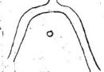

<!-- V3_SOURCE_ID:book024-b000184-p000-8effc1fc16 -->

前方火形克制金城，文中提到“风字脚不停”，该短语具体所指不详。如果在这处寺地扦穴，不久主“佺行”，“佺行”具体含义不详。金星形态如玉带，这个地方确实价值极高。文中提到“横水道害八”，该短语具体所指不详。金城对着穴，如果在此处扦穴，富贵不破。

> **释读存疑：** 风字脚不停；佺行；横水道害八；富贵不破的具体含义

查看对应原文

<!-- V3_FOLDBACK_BEGIN:book024-b000184-p000-8effc1fc16 -->

前火克金城 風字腳不停 若扦此寺地 不久主佺行 金星如玉帶 此地真無價 橫水道害八 金城挹穴 若扦此地 富貴不破

<!-- V3_FOLDBACK_END:book024-b000184-p000-8effc1fc16 -->

<!-- V3_SOURCE_ID:book024-b000186-p000-d92b8e3747 -->

鑫 卷三

查看对应原文

<!-- V3_FOLDBACK_BEGIN:book024-b000186-p000-d92b8e3747 -->

鑫 卷三

<!-- V3_FOLDBACK_END:book024-b000186-p000-d92b8e3747 -->

<!-- doc013 PDF 第 39 页：高风险/复杂版面 OCR 供检索；内容与排版以原页图为准。 -->

<!-- V3_SOURCE_ID:book024-b000188-p000-c18683cffa -->

金城呈反弓形態，會導致貧窮；若有水進入金城，則會富貴且人丁興旺。

查看对应原文

<!-- V3_FOLDBACK_BEGIN:book024-b000188-p000-c18683cffa -->

金城反弓逃走貧窮水入金城富貴多丁

<!-- V3_FOLDBACK_END:book024-b000188-p000-c18683cffa -->

<!-- V3_SOURCE_ID:book024-b000189-p000-7e4b90523f -->

六。长子必定离宗，金城左反躬。

> **释读存疑：** 反躬的具体含义

查看对应原文

<!-- V3_FOLDBACK_BEGIN:book024-b000189-p000-7e4b90523f -->

六 長子必離宗 金城左反躬

<!-- V3_FOLDBACK_END:book024-b000189-p000-7e4b90523f -->

<!-- V3_SOURCE_ID:book024-b000190-p000-0be157b747 -->

金城右反弓，金城右反弓，小子必狐穷，“狐穷”具体所指不详。

> **释读存疑：** 狐穷的具体含义

查看对应原文

<!-- V3_FOLDBACK_BEGIN:book024-b000190-p000-0be157b747 -->

金城右反弓金城右反弓小子必狐窮

<!-- V3_FOLDBACK_END:book024-b000190-p000-0be157b747 -->

<!-- V3_SOURCE_ID:book024-b000191-p000-a4491d50da -->

文中依次列出了四个短语：相侵、盗贼、金城、火克，各短语之间的关联未明确说明。

> **释读存疑：** 四个短语之间的逻辑关系

查看对应原文

<!-- V3_FOLDBACK_BEGIN:book024-b000191-p000-a4491d50da -->

相侵 盜賊 金城 火克

<!-- V3_FOLDBACK_END:book024-b000191-p000-a4491d50da -->

<!-- V3_SOURCE_ID:book024-b000192-p000-9a403e7ac5 -->

中間細小的形狀就是夬形，所以稱之為火克。

查看对应原文

<!-- V3_FOLDBACK_BEGIN:book024-b000192-p000-9a403e7ac5 -->

中細即成夬形故曰火克

<!-- V3_FOLDBACK_END:book024-b000192-p000-9a403e7ac5 -->

<!-- V3_SOURCE_ID:book024-b000193-p000-3d9fbfe58a -->

蠢卷三

查看对应原文

<!-- V3_FOLDBACK_BEGIN:book024-b000193-p000-3d9fbfe58a -->

蠢卷三

<!-- V3_FOLDBACK_END:book024-b000193-p000-3d9fbfe58a -->

<!-- V3_SOURCE_ID:book024-b000194-p000-9d7a80241b -->

斜木也屬於火星，二火來克制金形，災禍會頻臨；若水星得地，則會金玉滿堂。

查看对应原文

<!-- V3_FOLDBACK_BEGIN:book024-b000194-p000-9d7a80241b -->

斜木亦為火星二火來克金災星日臨水星得地金玉滿堂

<!-- V3_FOLDBACK_END:book024-b000194-p000-9d7a80241b -->

<!-- V3_SOURCE_ID:book024-b000195-p000-e8f277d30b -->

文中提到“官见揖人”，该短语具体所指不详，后面接“曲木入金城”。

> **释读存疑：** 官见揖人的具体含义

查看对应原文

<!-- V3_FOLDBACK_BEGIN:book024-b000195-p000-e8f277d30b -->

官见揖人曲木入金城

<!-- V3_FOLDBACK_END:book024-b000195-p000-e8f277d30b -->

<!-- V3_SOURCE_ID:book024-b000196-p000-f4f39dfbef -->

衰败无丁的情况，是煞星侵入金城位。

查看对应原文

<!-- V3_FOLDBACK_BEGIN:book024-b000196-p000-f4f39dfbef -->

窮敗無丁 煞入金城 o

<!-- V3_FOLDBACK_END:book024-b000196-p000-f4f39dfbef -->

<!-- V3_SOURCE_ID:book024-b000197-p000-823891d051 -->

火金相刑，衰败无丁。

查看对应原文

<!-- V3_FOLDBACK_BEGIN:book024-b000197-p000-823891d051 -->

火金相刑敗絕無丁

<!-- V3_FOLDBACK_END:book024-b000197-p000-823891d051 -->

<!-- V3_SOURCE_ID:book024-b000198-p000-8bf7c108f8 -->

司上。

查看对应原文

<!-- V3_FOLDBACK_BEGIN:book024-b000198-p000-8bf7c108f8 -->

司上

<!-- V3_FOLDBACK_END:book024-b000198-p000-8bf7c108f8 -->

<!-- doc013 PDF 第 41 页：高风险/复杂版面 OCR 供检索；内容与排版以原页图为准。 -->
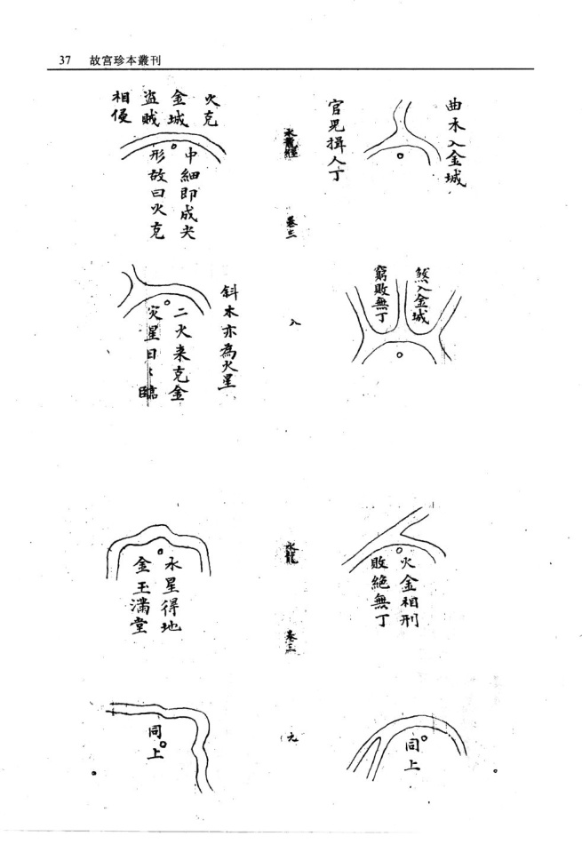

<!-- V3_SOURCE_ID:book024-b000201-p000-a4c58520b1 -->

龍經 卷三。

查看对应原文

<!-- V3_FOLDBACK_BEGIN:book024-b000201-p000-a4c58520b1 -->

龍經 卷三

<!-- V3_FOLDBACK_END:book024-b000201-p000-a4c58520b1 -->

<!-- V3_SOURCE_ID:book024-b000202-p000-14c96970fa -->

7 後主生離，不能下穴（风水中认为气脉聚结、适宜安葬或营建的位置）。

查看对应原文

<!-- V3_FOLDBACK_BEGIN:book024-b000202-p000-14c96970fa -->

7 後主生離 不堪下穴

<!-- V3_FOLDBACK_END:book024-b000202-p000-14c96970fa -->

<!-- doc013 PDF 第 42 页：高风险/复杂版面 OCR 供检索；内容与排版以原页图为准。 -->
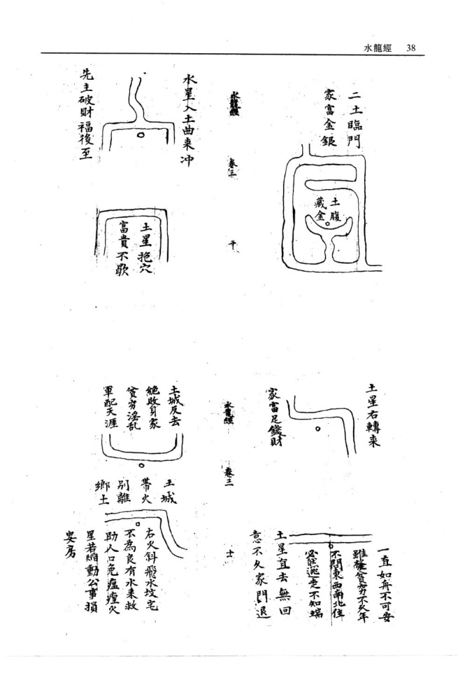

<!-- V3_SOURCE_ID:book024-b000204-p000-a588d77e13 -->

水龍經 整水似木，会导致瘟疟、孤寡。

查看对应原文

<!-- V3_FOLDBACK_BEGIN:book024-b000204-p000-a588d77e13 -->

水龍經 整水似木又瘟瘧孤寡

<!-- V3_FOLDBACK_END:book024-b000204-p000-a588d77e13 -->

<!-- doc013 PDF 第 43 页：高风险/复杂版面 OCR 供检索；内容与排版以原页图为准。 -->
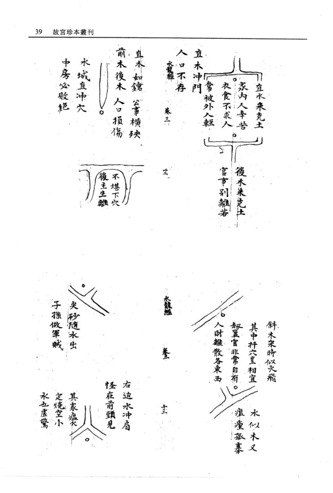

<!-- V3_SOURCE_ID:book024-b000207-p000-f4b9a3615d -->

火城反向江流，所以家道不良，家财荡尽，绝嗣逃乡。

查看对应原文

<!-- V3_FOLDBACK_BEGIN:book024-b000207-p000-f4b9a3615d -->

火城反去江故不良家財蕩尽絕嗣逃鄉

<!-- V3_FOLDBACK_END:book024-b000207-p000-f4b9a3615d -->

<!-- V3_SOURCE_ID:book024-b000209-p000-3f174e2e81 -->

如果是这样的格局，会耗尽家产、陷入贫穷；水（风水语境中的河流、水系及其来去形态）城后方出现反弓、忤逆逼近的情况，家人会离散、各分东西。以上内容出自《水经卷》。

查看对应原文

<!-- V3_FOLDBACK_BEGIN:book024-b000209-p000-3f174e2e81 -->

若還如此樣退尽生貧穷 水城後反弓忤近各西東 水經卷

<!-- V3_FOLDBACK_END:book024-b000209-p000-3f174e2e81 -->

<!-- V3_SOURCE_ID:book024-b000210-p000-522d336308 -->

右火斜飞，兄长偷弟弟的妻子；九火斜出，弟弟偷兄长的妻子。

查看对应原文

<!-- V3_FOLDBACK_BEGIN:book024-b000210-p000-522d336308 -->

右火斜飛 兄偷弟婦 九火斜出 弟偷兄妻

<!-- V3_FOLDBACK_END:book024-b000210-p000-522d336308 -->

<!-- V3_SOURCE_ID:book024-b000211-p000-54d059aab9 -->

出现“价”的相关情况，会遭遇官刑、断子绝孙，还会有光火射向其身。

> **释读存疑：** 文中“价”的具体含义不明

查看对应原文

<!-- V3_FOLDBACK_BEGIN:book024-b000211-p000-54d059aab9 -->

价 官刑絕子孫 光火射其身

<!-- V3_FOLDBACK_END:book024-b000211-p000-54d059aab9 -->

<!-- V3_SOURCE_ID:book024-b000212-p000-16a5aa8ef3 -->

有人老死之后，没有旁人送终。燥火燃起，火焰晃动。

查看对应原文

<!-- V3_FOLDBACK_BEGIN:book024-b000212-p000-16a5aa8ef3 -->

老死無人送 B 燥火焰動

<!-- V3_FOLDBACK_END:book024-b000212-p000-16a5aa8ef3 -->

<!-- V3_SOURCE_ID:book024-b000213-p000-8481f41223 -->

会出现子孙悖逆的情况；如果穴/宅前方有八字形的水，还有刀枪形状的水反向朝向穴/宅，刀枪形状的水再反向朝向穴/宅后方，家中后人会被发配到远方充军。

> **释读存疑：** 原文未明确“刀鎗之水反射”的具体反射方向，此处补充的朝向穴/宅的表述是基于风水语境的合理推断

查看对应原文

<!-- V3_FOLDBACK_BEGIN:book024-b000213-p000-8481f41223 -->

子孫特逆面前八字水流刀鎗之水反射刀鎗之水反射身後配遠充軍

<!-- V3_FOLDBACK_END:book024-b000213-p000-8481f41223 -->

<!-- V3_SOURCE_ID:book024-b000214-p000-779817a5ea -->

左方有火形的斜飞之势，会导致家族断绝，后代无依无靠。

查看对应原文

<!-- V3_FOLDBACK_BEGIN:book024-b000214-p000-779817a5ea -->

左火斜飛絕嗣無依

<!-- V3_FOLDBACK_END:book024-b000214-p000-779817a5ea -->

<!-- doc013 PDF 第 44 页：高风险/复杂版面 OCR 供检索；内容与排版以原页图为准。 -->
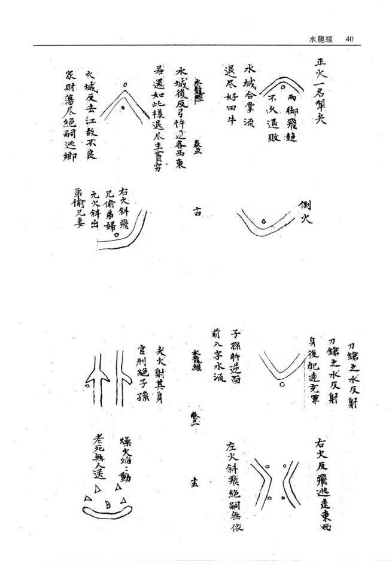

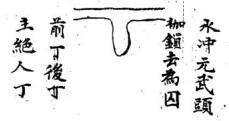

<!-- V3_SOURCE_ID:book024-b000217-p000-b9dc50fdd4 -->

这里是《未龍緩》的第三卷。

> **释读存疑：** “未龍緩”具体所指不详

查看对应原文

<!-- V3_FOLDBACK_BEGIN:book024-b000217-p000-b9dc50fdd4 -->

未龍緩 卷三

<!-- V3_FOLDBACK_END:book024-b000217-p000-b9dc50fdd4 -->

<!-- V3_SOURCE_ID:book024-b000218-p000-4b66691809 -->

本篇的内容是论述四兽相关的风水规则。

查看对应原文

<!-- V3_FOLDBACK_BEGIN:book024-b000218-p000-4b66691809 -->

論四獸

<!-- V3_FOLDBACK_END:book024-b000218-p000-4b66691809 -->

<!-- V3_SOURCE_ID:book024-b000219-p000-36277ed23c -->

作为穴前方形势称谓的朱雀位前方，有三条水反向流动。

查看对应原文

<!-- V3_FOLDBACK_BEGIN:book024-b000219-p000-36277ed23c -->

朱雀之前三水反

<!-- V3_FOLDBACK_END:book024-b000219-p000-36277ed23c -->

<!-- V3_SOURCE_ID:book024-b000221-p000-19aace2f8c -->

会出现男子盗窃、女子淫乱的情况，家族中人没有衣服穿、没有饭吃。火星呈屈曲飞动之势，会导致后人既无衣穿又无饭吃。

查看对应原文

<!-- V3_FOLDBACK_BEGIN:book024-b000221-p000-19aace2f8c -->

男盜女淫無衣飯火星屈曲飛無食又無衣

<!-- V3_FOLDBACK_END:book024-b000221-p000-19aace2f8c -->

<!-- V3_SOURCE_ID:book024-b000222-p000-7e1b8c91c9 -->

元武方位的水流（风水语境中的河流、水系及其来去形态），有湖池相伴。

查看对应原文

<!-- V3_FOLDBACK_BEGIN:book024-b000222-p000-7e1b8c91c9 -->

元武之水有湖池

<!-- V3_FOLDBACK_END:book024-b000222-p000-7e1b8c91c9 -->

<!-- V3_SOURCE_ID:book024-b000224-p000-f18d0a79f5 -->

挑选宅基地、确定坟地的位置，适合选择能带来福禄的格局。

查看对应原文

<!-- V3_FOLDBACK_BEGIN:book024-b000224-p000-f18d0a79f5 -->

定宅安坟福祿宜

<!-- V3_FOLDBACK_END:book024-b000224-p000-f18d0a79f5 -->

<!-- V3_SOURCE_ID:book024-b000226-p000-7b7c2faa31 -->

原文提到“元武 定是永纏 發福悠長”，其中“永纏”的具体含义不详，仅可知该情形下能长久发福。

> **释读存疑：** “永纏”具体所指不详

查看对应原文

<!-- V3_FOLDBACK_BEGIN:book024-b000226-p000-7b7c2faa31 -->

元武 定是永纏 發福悠長

<!-- V3_FOLDBACK_END:book024-b000226-p000-7b7c2faa31 -->

<!-- V3_SOURCE_ID:book024-b000227-p000-518e8740dc -->

青龙径直飞离而去，代人难遇佳境。

查看对应原文

<!-- V3_FOLDBACK_BEGIN:book024-b000227-p000-518e8740dc -->

青龍直走如飛去代人難佳

<!-- V3_FOLDBACK_END:book024-b000227-p000-518e8740dc -->

<!-- doc013 PDF 第 45 页：高风险/复杂版面 OCR 供检索；内容与排版以原页图为准。 -->

<!-- V3_SOURCE_ID:book024-b000229-p000-7edd634a26 -->

现存原文有残缺，可识别的内容为“人心 脚分開惹 是無情兩 掀裙之水”，其中提到的“水”，指风水语境中的河流、水系及其来去形态，其余残缺内容语义无法明确。

> **释读存疑：** 原文断句混乱、存在残缺，整体语义无法明确

查看对应原文

<!-- V3_FOLDBACK_BEGIN:book024-b000229-p000-7edd634a26 -->

人心 脚分開惹 是無情兩 掀裙之水

<!-- V3_FOLDBACK_END:book024-b000229-p000-7edd634a26 -->

<!-- V3_SOURCE_ID:book024-b000230-p000-c9f91b994d -->

两侧的龙砂、虎砂弯曲环抱，主富贵冬到；如果点穴准确，这里的“穴”指风水中认为气脉聚结、适宜安葬或营建的位置，必出状元，还有“即大”的表述，具体含义不详；原文最后提到“須知此地出公鄉”，其中“公乡”具体所指不详。

> **释读存疑：** “即大”具体含义不明；“公乡”具体所指不详

查看对应原文

<!-- V3_FOLDBACK_BEGIN:book024-b000230-p000-c9f91b994d -->

兩邊龍虎 弯之抱 富貴冬到 若然點穴 得真方定 出狀元即 大 須知此地出公鄉

<!-- V3_FOLDBACK_END:book024-b000230-p000-c9f91b994d -->

<!-- V3_SOURCE_ID:book024-b000232-p001-3df63d9623 -->

贵龙与水（风水语境中的河流、水系及其来去形态）转势环抱其身。

查看对应原文

<!-- V3_FOLDBACK_BEGIN:book024-b000232-p001-3df63d9623 -->

貴龍水轉抱其身

<!-- V3_FOLDBACK_END:book024-b000232-p001-3df63d9623 -->

<!-- V3_SOURCE_ID:book024-b000234-p000-a584ad43e0 -->

龙经 秦

查看对应原文

<!-- V3_FOLDBACK_BEGIN:book024-b000234-p000-a584ad43e0 -->

龍經 秦

<!-- V3_FOLDBACK_END:book024-b000234-p000-a584ad43e0 -->

<!-- V3_SOURCE_ID:book024-b000235-p000-2ff5914861 -->

白虎，也就是穴场或建筑右侧的形势称谓，对应的水，即风水语境中的河流、水系及其来去形态，如飞般急速流走，主不久之后就会迁居，又有“永口無閉”的表述，具体含义不详；会出现先变卖父辈田地，后代败亡、遭遇凶事的情况，原文还有“流配為之戌”的内容，具体语义不明。

> **释读存疑：** “永口無閉”具体含义不明；“流配為之戌”具体语义不明

查看对应原文

<!-- V3_FOLDBACK_BEGIN:book024-b000235-p000-2ff5914861 -->

白虎水如飛不久便光移又去永口無閉先賣爹田地出敗亡凶流配為之戌

<!-- V3_FOLDBACK_END:book024-b000235-p000-2ff5914861 -->

<!-- V3_SOURCE_ID:book024-b000236-p000-44275bd6f1 -->

现存原文有残缺，可识别的内容为“减脚 水井 之是 有子”，其中提到的“水”，指风水语境中的河流、水系及其来去形态，其余残缺内容语义无法明确。

> **释读存疑：** 原文断句混乱、存在残缺，整体语义无法明确；1轮自动修复后核义模型仍建议修订，已保守记录。

查看对应原文

<!-- V3_FOLDBACK_BEGIN:book024-b000236-p000-44275bd6f1 -->

减脚 水井 之是 有子

<!-- V3_FOLDBACK_END:book024-b000236-p000-44275bd6f1 -->

<!-- V3_SOURCE_ID:book024-b000237-p000-68fae0766c -->

徒流退败，主离乡。

查看对应原文

<!-- V3_FOLDBACK_BEGIN:book024-b000237-p000-68fae0766c -->

徒流退敗主離鄉

<!-- V3_FOLDBACK_END:book024-b000237-p000-68fae0766c -->

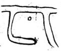

<!-- doc013 PDF 第 46 页：高风险/复杂版面 OCR 供检索；内容与排版以原页图为准。 -->
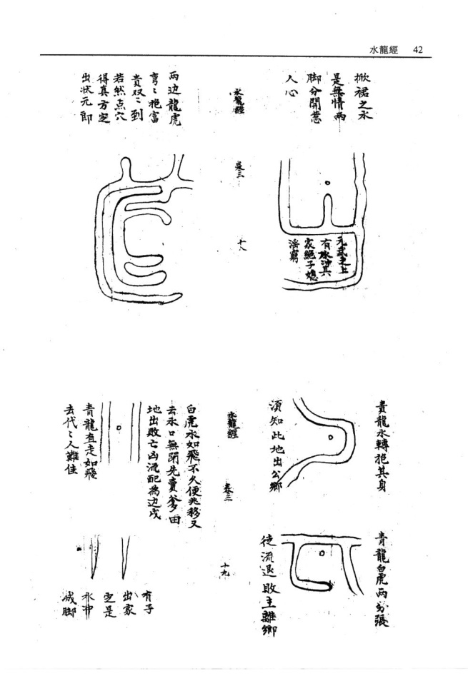

<!-- V3_SOURCE_ID:book024-b000241-p000-aa39c522c3 -->

会逐渐走向绝种，出现青龙吞坏的状况，0，少年早亡、断绝后嗣；白虎，也就是穴场或建筑右侧的形势称谓，会出现唧尸的情况。

> **释读存疑：** “青龍吞壞”“唧屍”语义不明，原文中“0”含义无法确定；1轮自动修复后核义模型仍建议修订，已保守记录。

查看对应原文

<!-- V3_FOLDBACK_BEGIN:book024-b000241-p000-aa39c522c3 -->

維漸絕種 青龍吞壞 0 少亡絕嗣 白虎唧屍

<!-- V3_FOLDBACK_END:book024-b000241-p000-aa39c522c3 -->

<!-- V3_SOURCE_ID:book024-b000242-p000-943ddaa015 -->

原文提到“右閨水為灾”，其中的“水”指风水语境中的河流、水系及其来去形态，“右閨水”具体所指不详；还有“陰人定”的表述，具体含义不明；后面提到左右两边的水向外伸展流去，对应“見拋父母走”的表述，具体语义无法明确。

> **释读存疑：** “右閨水”具体所指不详；“陰人定”具体含义不明；“見拋父母走”具体语义不明

查看对应原文

<!-- V3_FOLDBACK_BEGIN:book024-b000242-p000-943ddaa015 -->

右閨水為灾陰人定左右两边水展去見拋父母走

<!-- V3_FOLDBACK_END:book024-b000242-p000-943ddaa015 -->

<!-- V3_SOURCE_ID:book024-b000243-p000-077aeddbab -->

若两边的水（风水语境中的河流、水系及其来去形态）都流走而不回头，会导致财物被鬼偷去。

查看对应原文

<!-- V3_FOLDBACK_BEGIN:book024-b000243-p000-077aeddbab -->

两边水去不回 頭財物鬼來偷

<!-- V3_FOLDBACK_END:book024-b000243-p000-077aeddbab -->

<!-- V3_SOURCE_ID:book024-b000244-p000-34b16b06bb -->

白虎（穴场或建筑右侧的形势称谓）冲穴场腹部，会导致家中少子受刑受伤。

查看对应原文

<!-- V3_FOLDBACK_BEGIN:book024-b000244-p000-34b16b06bb -->

白虎冲腹少子刑傷

<!-- V3_FOLDBACK_END:book024-b000244-p000-34b16b06bb -->

<!-- V3_SOURCE_ID:book024-b000245-p000-e286af1551 -->

出现青龙冲腹的情况，家中长子会远离；出现白虎御尸的情况，对应贫老无见的结果。其中白虎指穴场或建筑右侧的形势称谓，御尸、贫老无见的具体含义没有可靠释义依据，暂不做确定解读。

> **释读存疑：** 御尸的具体含义；贫老无见的具体含义

查看对应原文

<!-- V3_FOLDBACK_BEGIN:book024-b000245-p000-e286af1551 -->

青龍沖腹 長子遠 白虎御屍 貧老無見

<!-- V3_FOLDBACK_END:book024-b000245-p000-e286af1551 -->

<!-- V3_SOURCE_ID:book024-b000246-p000-7c03b15d4d -->

文中提到“青龙吞冢，忧卢无穷”，青龙吞冢、忧卢无穷的具体所指均没有可靠释义依据，无法确定具体含义。

> **释读存疑：** 青龙吞冢的具体含义；忧卢无穷的具体含义

查看对应原文

<!-- V3_FOLDBACK_BEGIN:book024-b000246-p000-7c03b15d4d -->

青龍吞塚憂盧無穷

<!-- V3_FOLDBACK_END:book024-b000246-p000-7c03b15d4d -->

<!-- V3_SOURCE_ID:book024-b000247-p000-83d53ddacf -->

青龙抱体，值得夸赞，年少者能登京华。

> **释读存疑：** “青龍抱体”“達京華”的具体风水对应含义未明

查看对应原文

<!-- V3_FOLDBACK_BEGIN:book024-b000247-p000-83d53ddacf -->

青龍抱体足堪誇年少達京華

<!-- V3_FOLDBACK_END:book024-b000247-p000-83d53ddacf -->

<!-- V3_SOURCE_ID:book024-b000250-p000-b9f6e3784d -->

此处原文残缺错乱，仅可识别出相关内容涉及风水语境中的水，其余内容无法准确解读。

> **释读存疑：** 其余残缺内容含义无法确定

查看对应原文

<!-- V3_FOLDBACK_BEGIN:book024-b000250-p000-b9f6e3784d -->

滇憂 富貴不 兜出人 水拒玫 貴龍之

<!-- V3_FOLDBACK_END:book024-b000250-p000-b9f6e3784d -->

<!-- V3_SOURCE_ID:book024-b000251-p000-e5dcc7fd05 -->

出现青龙左转挹其身的情况，会带来富贵有名声的结果；青龙所在方位有一条浜水流来，在此处安坟可以任意点裁；如果再有后方的水多有积水的情况，世代儿孙会有解状才。其中“水”指风水语境中的河流、水系及其来去形态，挹其身、解状才的具体指向没有可靠释义依据，暂不做确定解读。

> **释读存疑：** 挹其身的具体含义；解状才的具体含义

查看对应原文

<!-- V3_FOLDBACK_BEGIN:book024-b000251-p000-e5dcc7fd05 -->

青龍左轉挹其身富貴有聲名青龍之上一浜来此地安坟任点裁更得後河多積水世代兒孫解状才

<!-- V3_FOLDBACK_END:book024-b000251-p000-e5dcc7fd05 -->

<!-- doc013 PDF 第 47 页：高风险/复杂版面 OCR 供检索；内容与排版以原页图为准。 -->
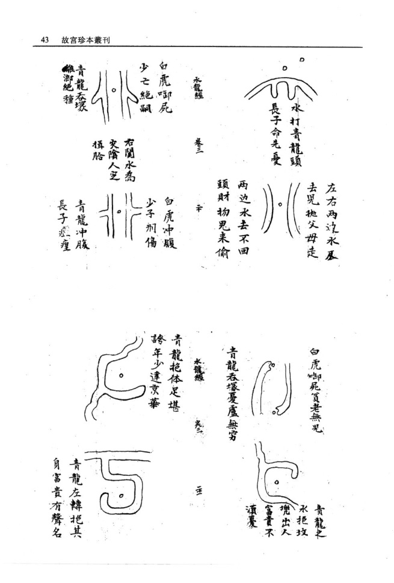

<!-- V3_SOURCE_ID:book024-b000254-p000-607a450307 -->

此处原文残缺错乱，仅可识别出相关内容涉及《水龍經》以及风水语境中的水，其余内容无法准确解读。

> **释读存疑：** 其余残缺内容含义无法确定

查看对应原文

<!-- V3_FOLDBACK_BEGIN:book024-b000254-p000-607a450307 -->

水龍經 春三 重

<!-- V3_FOLDBACK_END:book024-b000254-p000-607a450307 -->

<!-- V3_SOURCE_ID:book024-b000255-p000-3fc29f4d10 -->

青龙水似龙形，能富贵可比石崇；屈曲绕门前，能使子孙侍奉王宫；青龙弯转如牛角，子孙代代能登紫阁。

查看对应原文

<!-- V3_FOLDBACK_BEGIN:book024-b000255-p000-3fc29f4d10 -->

青龍水似龍富貴比石崇 屈曲門前照子息侍王宮 青龍弯轉如牛角 子孫代代登紫閣

<!-- V3_FOLDBACK_END:book024-b000255-p000-3fc29f4d10 -->

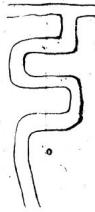

<!-- V3_SOURCE_ID:book024-b000258-p000-6416f48c87 -->

青龙屈抱身形，世代儿孙能入帝台；青龙水反逆，子孙无官职；若有人在此处扦葬，会误害人；青龙反去不朝穴场，家中长子会先受贫穷。

查看对应原文

<!-- V3_FOLDBACK_BEGIN:book024-b000258-p000-6416f48c87 -->

青龍屈抱身來世代兒孫入帝台青龍水反逆子孫無官職君若扦此地誤殺人青龍反去不朝身長子之先貧

<!-- V3_FOLDBACK_END:book024-b000258-p000-6416f48c87 -->

<!-- doc013 PDF 第 48 页：高风险/复杂版面 OCR 供检索；内容与排版以原页图为准。 -->
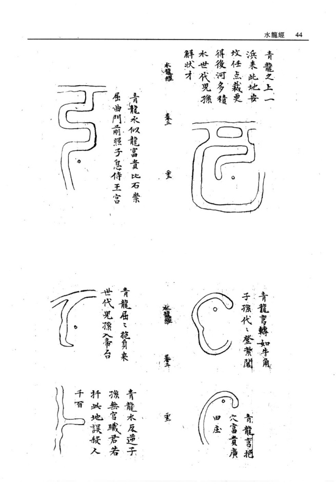

<!-- V3_SOURCE_ID:book024-b000262-p000-148bc52db0 -->

大覆蟹卷三

查看对应原文

<!-- V3_FOLDBACK_BEGIN:book024-b000262-p000-148bc52db0 -->

大覆蟹卷三

<!-- V3_FOLDBACK_END:book024-b000262-p000-148bc52db0 -->

<!-- V3_SOURCE_ID:book024-b000263-p000-80343965d9 -->

青龙射入子孙位，会导致子孙伤亡死亡，还会出现兵灾、贼患；青龙一水如同长枪，若水流绵长，家中长子必然会遭遇凶灾。

查看对应原文

<!-- V3_FOLDBACK_BEGIN:book024-b000263-p000-80343965d9 -->

青龍射入子孫傷死并軍賊 青龍一水如鎗 來長子必凶災

<!-- V3_FOLDBACK_END:book024-b000263-p000-80343965d9 -->

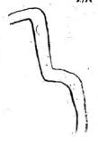

<!-- V3_SOURCE_ID:book024-b000266-p000-76b0f7e0a0 -->

青龙位上方的水呈反弓之势，会导致家破人散；白虎位的水呈环抱之态，若有三重，家中子孙会兴旺发达，福运永无尽头；青龙位的水过多，会导致后代出现破败灾祸；有一种名为金鹅箭的水形，会引发疯疾、家道破败；呈败阙之状的水，若从虎位而来，会引发瘟疫、火灾、官灾；右侧的砂形如长枪，家中子孙必然会出现杀伤之灾。

查看对应原文

<!-- V3_FOLDBACK_BEGIN:book024-b000266-p000-76b0f7e0a0 -->

青龍頭上水反 飛家破并人離 白虎水抱两 三重兒孫發 福永無穷 青龍水多 破下後人 灾祸一名 金鵝箭主 瘋疾破敗 敗閱之水虎 來瘟火反官災 右边砂水利如鎗 必定子孫主殺傷

<!-- V3_FOLDBACK_END:book024-b000266-p000-76b0f7e0a0 -->

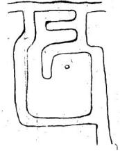

<!-- doc013 PDF 第 49 页：高风险/复杂版面 OCR 供检索；内容与排版以原页图为准。 -->
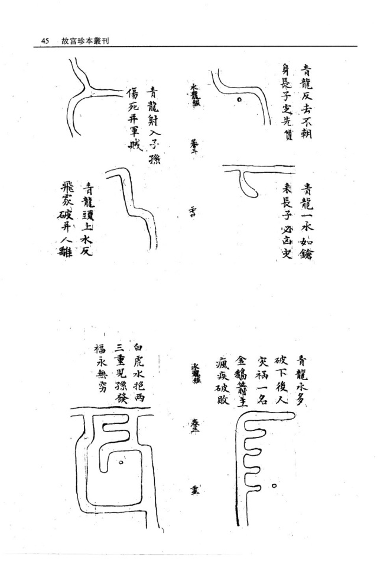

<!-- V3_SOURCE_ID:book024-b000272-p000-cea332018b -->

论述形局：贪狼之水若在前方，会让子孙代代出英豪；无论水流去向如何，后代都会官居高位，子孙会世代享有福运，有五处高起的地形。

> **释读存疑：** 原文“五高雲”语义模糊，难以准确释读

查看对应原文

<!-- V3_FOLDBACK_BEGIN:book024-b000272-p000-cea332018b -->

論形局 貪狼之水面 前朝子孫代 產英豪不 問去表并前 後官居台閣 子孫當朝代 五高雲

<!-- V3_FOLDBACK_END:book024-b000272-p000-cea332018b -->

<!-- V3_SOURCE_ID:book024-b000273-p000-e9bcf0ff9f -->

《水龍經》卷三提到，文虎口位置的河尖处对应“當百至小子賣田地官事頻之福患凶長子橫七”的说法，该短语具体所指不详。

> **释读存疑：** “當百至小子賣田地官事頻之福患凶長子橫七”整体语义模糊，无法明确具体含义

查看对应原文

<!-- V3_FOLDBACK_BEGIN:book024-b000273-p000-e9bcf0ff9f -->

水龍經 叁 文虎口河尖當百至小子賣田地官事頻之福患凶長子橫七

<!-- V3_FOLDBACK_END:book024-b000273-p000-e9bcf0ff9f -->

<!-- V3_SOURCE_ID:book024-b000274-p000-0b521e34a0 -->

弯曲的水前来朝迎，家业自然会变得豪富。

查看对应原文

<!-- V3_FOLDBACK_BEGIN:book024-b000274-p000-0b521e34a0 -->

曲水來朝家業自然豪

<!-- V3_FOLDBACK_END:book024-b000274-p000-0b521e34a0 -->

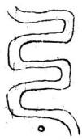

<!-- V3_SOURCE_ID:book024-b000276-p000-dc6b598b25 -->

如果水系出现三处弯折，居住在此地的人能够富贵安闲，永保家业。

> **释读存疑：** 1轮自动修复后核义模型仍建议修订，已保守记录。

查看对应原文

<!-- V3_FOLDBACK_BEGIN:book024-b000276-p000-dc6b598b25 -->

水見三弯富貴安閑永盤經

<!-- V3_FOLDBACK_END:book024-b000276-p000-dc6b598b25 -->

<!-- V3_SOURCE_ID:book024-b000277-p000-99275bfa8d -->

水转三弯，会带来富贵清闲；若在此处选址，后代可位列朝班，此内容出自水龙经。

查看对应原文

<!-- V3_FOLDBACK_BEGIN:book024-b000277-p000-99275bfa8d -->

水轉三湾富貴清閑若扦此地位列朝班水龍

<!-- V3_FOLDBACK_END:book024-b000277-p000-99275bfa8d -->

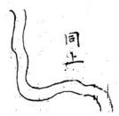

<!-- doc013 PDF 第 50 页：高风险/复杂版面 OCR 供检索；内容与排版以原页图为准。 -->

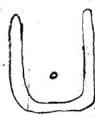

<!-- V3_SOURCE_ID:book024-b000282-p000-707f6e4299 -->

如果龙、虎两处的山势相对，家中会多出忤逆长辈的子孙，这类灾祸大多是山形不佳导致的。

> **释读存疑：** “龍虎兩相聞”的具体风水含义原文未明确；1轮自动修复后核义模型仍建议修订，已保守记录。

查看对应原文

<!-- V3_FOLDBACK_BEGIN:book024-b000282-p000-707f6e4299 -->

龍虎兩相聞忤逆多山咎

<!-- V3_FOLDBACK_END:book024-b000282-p000-707f6e4299 -->

<!-- V3_SOURCE_ID:book024-b000283-p000-a4452e2f8f -->

家中子弟互不亲近，兄弟如同陌路；左右两侧的水呈直流无收之态，家中子孙必然会忧愁不断。

查看对应原文

<!-- V3_FOLDBACK_BEGIN:book024-b000283-p000-a4452e2f8f -->

犬子不相親兄弟如勉 左右水直無收 兒孫必主憂愁

<!-- V3_FOLDBACK_END:book024-b000283-p000-a4452e2f8f -->

<!-- V3_SOURCE_ID:book024-b000284-p000-2e24cc9a1d -->

如果有从后方兜绕而来的水，必定没有子嗣守护祖坟。

查看对应原文

<!-- V3_FOLDBACK_BEGIN:book024-b000284-p000-2e24cc9a1d -->

雖然有水後兜 定無子嗣守坵

<!-- V3_FOLDBACK_END:book024-b000284-p000-2e24cc9a1d -->

<!-- V3_SOURCE_ID:book024-b000285-p000-d22262ab9a -->

家业自然会富足，9火为吉，水果朝来。

> **释读存疑：** “9火吉”“水果朝”具体所指不明；1轮自动修复后核义模型仍建议修订，已保守记录。

查看对应原文

<!-- V3_FOLDBACK_BEGIN:book024-b000285-p000-d22262ab9a -->

家業自然豪 9 火吉水果朝

<!-- V3_FOLDBACK_END:book024-b000285-p000-d22262ab9a -->

<!-- V3_SOURCE_ID:book024-b000287-p000-210c116152 -->

文中认为水似从生地流出朝向穴的情况是最佳的，若是迁葬选用这类穴，能够获得富贵；其中“生地”具体所指不详。

> **释读存疑：** 生地；生地具体所指不详

查看对应原文

<!-- V3_FOLDBACK_BEGIN:book024-b000287-p000-210c116152 -->

水似生地出穴最佳若迁此穴富貴

<!-- V3_FOLDBACK_END:book024-b000287-p000-210c116152 -->

<!-- V3_SOURCE_ID:book024-b000288-p000-e2ab338831 -->

四龙之水，需根据穴的不同形态来论定。

查看对应原文

<!-- V3_FOLDBACK_BEGIN:book024-b000288-p000-e2ab338831 -->

四龍之水穴論異形

<!-- V3_FOLDBACK_END:book024-b000288-p000-e2ab338831 -->

<!-- doc013 PDF 第 51 页：高风险/复杂版面 OCR 供检索；内容与排版以原页图为准。 -->

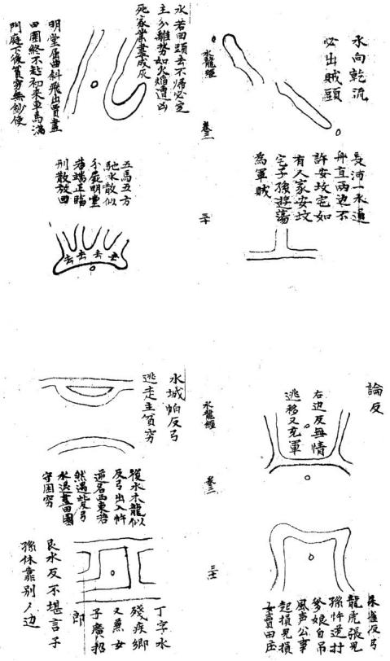

<!-- doc013 PDF 第 52 页：高风险/复杂版面 OCR 供检索；内容与排版以原页图为准。 -->

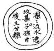

<!-- V3_SOURCE_ID:book024-b000293-p000-ecf8cbcac9 -->

永龍經 卷三

查看对应原文

<!-- V3_FOLDBACK_BEGIN:book024-b000293-p000-ecf8cbcac9 -->

永龍經 卷三

<!-- V3_FOLDBACK_END:book024-b000293-p000-ecf8cbcac9 -->

<!-- V3_SOURCE_ID:book024-b000294-p000-42be9f2519 -->

环绕坟林的水，会导致破财损失金银，还会使人淫乱、没有家室、生病少精神。

查看对应原文

<!-- V3_FOLDBACK_BEGIN:book024-b000294-p000-42be9f2519 -->

周回之水遶坟林破財損金銀又兼淫亂無家室疾病少精神

<!-- V3_FOLDBACK_END:book024-b000294-p000-42be9f2519 -->

<!-- V3_SOURCE_ID:book024-b000295-p000-87977cda96 -->

## 水龍經卷三終

查看对应原文

<!-- V3_FOLDBACK_BEGIN:book024-b000295-p000-87977cda96 -->

## 水龍經卷三終

<!-- V3_FOLDBACK_END:book024-b000295-p000-87977cda96 -->

<!-- V3_SOURCE_ID:book024-b000296-p000-10df8c9249 -->

坤鎗向艮，乾鎗甸巽，对应辽东；对应云南。

> **释读存疑：** 原文中“鎗甸”的含义不明

查看对应原文

<!-- V3_FOLDBACK_BEGIN:book024-b000296-p000-10df8c9249 -->

坤鎗向艮 乾鎗甸巽配在遼東 配在雲南

<!-- V3_FOLDBACK_END:book024-b000296-p000-10df8c9249 -->

<!-- V3_SOURCE_ID:book024-b000298-p000-054c331e1a -->

文中提到巽鑰朝向乾，艮鎗朝向坤，前者对应陕西，后者对应广西；其中“巽鑰”“艮鎗”具体所指不详。

> **释读存疑：** 巽鑰；艮鎗；巽鑰、艮鎗具体所指不详

查看对应原文

<!-- V3_FOLDBACK_BEGIN:book024-b000298-p000-054c331e1a -->

巽鑰向乾 良鎗向坤配在陕西 配在廣西

<!-- V3_FOLDBACK_END:book024-b000298-p000-054c331e1a -->

<!-- V3_SOURCE_ID:book024-b000299-p000-f47a2ab301 -->

此段原文存在难以辨识的讹误或生僻专有表述，相关“抄佑在形英作坟”“搥然富責主充常”的具体含义均无法确定。

> **释读存疑：** 抄佑；形英；搥然；富責；主充常；原文存在讹误或生僻表述，抄佑、形英、搥然、富責、主充常含义均无法确定

查看对应原文

<!-- V3_FOLDBACK_BEGIN:book024-b000299-p000-f47a2ab301 -->

抄佑在形英作坟 搥然富責主充常

<!-- V3_FOLDBACK_END:book024-b000299-p000-f47a2ab301 -->

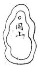

<!-- V3_SOURCE_ID:book024-b000301-p000-20655f055d -->

《水龍經》卷四總論提出，風水的選址原則以獲得合適的水為最優先，藏風的重要性次於得水。外部的氣是用來止住內部的氣的，而“界水所以止寒”這句表述存在異文，通行的《葬經》對應內容為“界水所以止來龍”，此處異文含義不詳。《龍天元歌》中記載：“人言生炁地中求，豈知地悉水邊流。到水邊逢水界平原，浩炁畫兜取”，這部分內容後接“故葬必以龍為主而水亦其要也”，其中“畫兜取”的具體含義不詳，意思大致是說到了水邊遇到被水劃界的平原地帶，浩蕩之氣有相關的取用規則，因此安葬必須以龍為主體考量，水也是其中的關鍵要素。所以平曠水澤區域的風水判斷方法，要先觀察大的水系，再觀察小的水系；先分析大水系就能知曉幹龍所匯聚的位置，能夠明瞭整體形勢、把握大的格局；再分析小水系就能知曉“真爲”所匯聚的地方，“真爲”語義不明，無法確定具體所指，根據這部分內容可以確定最終要選取的真穴。如果不明白整體形勢，就無法分辨地的格局大小；如果不確定聚氣的位置，就無法判斷穴的真假。可是講水法的書籍數量極多，本卷所輯錄的內容專門講述水龍相關的理論，從事這門技術的人應當先梳理清楚其中吉利的相關內容，後文還有《水龍綬》的相關內容。

> **释读存疑：** 界水所以止寒为异文，与通行《葬经》记载不符，含义不确；画兜取语义不明，仅按原文保留；真爲语义不明，未作臆解

查看对应原文

<!-- V3_FOLDBACK_BEGIN:book024-b000301-p000-20655f055d -->

水龍經卷四總論 風水之法得水為上 藏風次之 夫外炁所以止內炁 界水所以止寒 龍天元歌云 人言生炁地中求 豈知地悉水邊流 到水邊逢水界平原 浩炁畫兜 取故葬必以龍為主而水亦其要也 故平澤之法先取大水後取小水 先大水則知幹龍所鐘 可以明大勢取大局 復小水則知真爲所聚 可以決定所取真穴 不明大勢則地之大小不分 不知定所則穴之真假罔決 但水法之書汗牛充棟 茲卷所輯專言水龍業是術者先當釋其吉者 水龍綬

<!-- V3_FOLDBACK_END:book024-b000301-p000-20655f055d -->

<!-- V3_SOURCE_ID:book024-b000302-p000-b4b90f9703 -->

趨向凶象的，避開它就會吉利，沒有不順利的，凶禍就不會侵擾了。

查看对应原文

<!-- V3_FOLDBACK_BEGIN:book024-b000302-p000-b4b90f9703 -->

趨之凶者避之則吉無不利而凶禍不侵矣

<!-- V3_FOLDBACK_END:book024-b000302-p000-b4b90f9703 -->

<!-- V3_SOURCE_ID:book024-b000303-p000-1593c3ff4d -->

大鴻氏筆記

查看对应原文

<!-- V3_FOLDBACK_BEGIN:book024-b000303-p000-1593c3ff4d -->

大鴻氏筆記

<!-- V3_FOLDBACK_END:book024-b000303-p000-1593c3ff4d -->

<!-- doc013 PDF 第 53 页：高风险/复杂版面 OCR 供检索；内容与排版以原页图为准。 -->
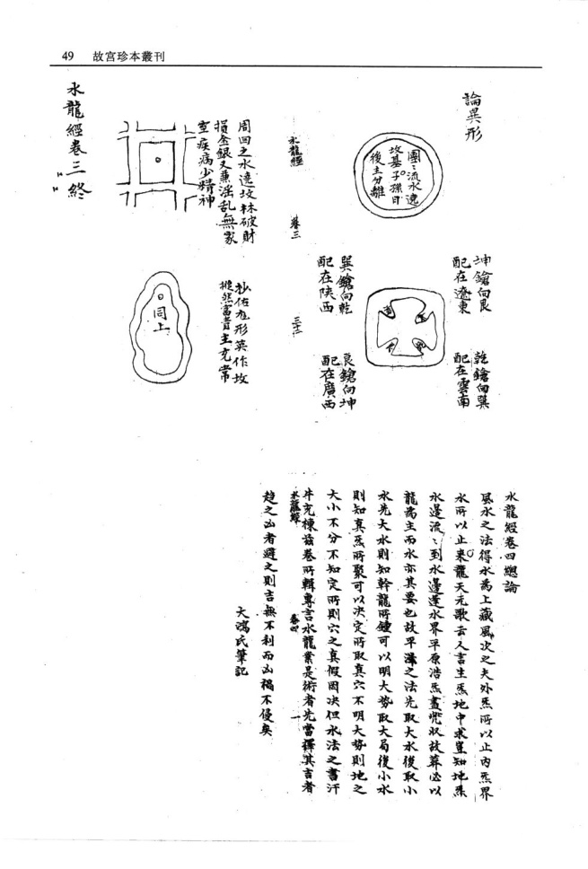

<!-- V3_SOURCE_ID:book024-b000305-p000-4aba367e6b -->

山川的特性微妙難以探明，陰陽相互匹配，氣運變化生成形體，同一股氣感應之下形成“地灸人傑”的狀況，“地灸”語義不明，無法確定具體含義。內部承載生氣的話，死者的骸骨能夠不腐壞；外部對接堂砂的話，會有相應的吉凶感應，“吉凶之應賒”中的“賒”有遲緩、遙遠兩種可能的含義，原文未明確指向。水的吉凶表現可以被觀察到，山的特性則難以探明。山谷之中地勢有關鎖之態的為上等，平地水網區域能夠永遠聚氣的則為佳地，值得看重的是平地水網區域中的“陰”，值得喜愛的是山谷中的“洋”，此處“洋”的具體含義不詳，不可隨意解釋為陽氣。龍神頓伏在地，看似斷開實際並未斷開；水神彎曲折轉，看似流去實際並未流去，時而偏向東時而偏向西，這樣的氣脈條件更好。氣脈有時飛馳有時奔涌，有時潛藏有時顯現，要觀察它的行進和停止的狀態，探查它所藏匿的位置。動態之中會顯現出脈絡，靜態之中會顯露出穴的位置，要在靜態中尋找動態的變化，氣運交會聚合之處就是氣停止的地方。尋龍要跟隨脈絡的走勢，定穴應當順著氣的顯現位置來判斷，這兩點如果能弄明白，點穴的方法自然就掌握了。要明瞭氣脈的急緩、纏繞叠加的狀態，觀察吞吐的形態，分辨陰陽再確定浮沉的選擇。“立甸須憑唇口”中的“立甸”語義不詳，僅按原文保留，意思是相關操作需要依據唇口的地形特徵。“樸親堂從界明”含義不詳，按原文留存。山有支龍的分類，地有厚薄的不同，各有適宜的用法。壠地的脈絡陰氣居多，要向陽的位置靠攏；支龍的氣運陽氣居多，要向陰的位置靠攏。支龍有陽氣達到極點轉為陰的情況，壠地有陰氣達到極點生出陽的情況，形成陰的狀態可以對衝，即使是陽的狀態也不要隨意湊合。地層厚的地方應當從相對薄的位置選取，地層薄的地方必須找相對厚的位置來裁定。選取厚地的時候要靠近氣脊的位置，選取薄地的時候也需要有唇口的地形作為依據。平地水網區域沒有可觀測的氣脈，“史穴有水神之証估”中“史穴”“証估”語義均不明，僅按原文保留。“群堯會合于州府”中的“群堯”語義不明，無法確定所指，按原文留存。兩條水系交匯關鎖的位置對應鄉村聚落，在水流的彎曲或平直形態中體現出生死的區別，在雌雄的對應關係裡審查氣脈的行止。雖然不能勝過雄勢，也不能不順應相關的規則。星體臥在平地上，氣脈從水的形態中顯現出來。形體小的應當觀察它的內部，形體大的必須觀察它的旁側。脈絡隨著水流走動，氣運隨著水流被攬聚，在方圓的形態中體現出背向的差異。點穴的方法應當懂得區分生死：靜態和動態有不同的生死判斷標準，原文“靜動則生”含義需結合上下文判斷，並非靜和動都主生。如果相關特徵不在正面顯現，就必須觀察它的側面。方形地帶要選取有動態的位置，圓形地帶要選取靜態的位置。平地水網區域必須要有合適的水系，山谷之中需要有向外鋪展的山勢。“陰以隨脉樸生陽須風旁空”斷句存在歧義，整句含義不詳，按原文留存。應當審查四周的對應形勢，“热察其至微”中“热”應為“熟”的訛字，意思是要仔細觀察其中最細微的地方。龍神的規模很大，應當憑藉智慧來度量；點穴的方法很難掌握，必須先端正自身的態度再進行操作。依靠水系尋找龍脈，傍著砂山點定穴位，龍脈到來的時候必須要有脈絡顯現，龍脈停止的地方要順著氣的走向進行收納。

> **释读存疑：** 地灸语义不明；吉凶之應賒的賒有迟缓、遥远两义，未明确；谷中之洋的洋语义不明，未作臆解；立甸语义不明；史穴、証估语义不明；群堯语义不明；陰以隨脉樸生陽須風旁空断句歧义，含义不明；热为熟的讹字，已说明

查看对应原文

<!-- V3_FOLDBACK_BEGIN:book024-b000305-p000-4aba367e6b -->

山川之性微妙難明陰陽配偶炁化形生一炁感成地灸人傑內乗生炁骸骨之不朽外接堂砂吉凶之應賒水之吉凶可見山之情性難明谷中關鎖為上平洋永聚則佳所貴者洋中之陰所喜者谷中之洋龍神頓伏斷而末斷水神屈之去而不去閃東過西炁脉愈佳或飛或奔或墨或隱現其行止察其所藏動中現其脉靜中現穴求靜中之動変化則行會合則止尋龍隨乎脉止定穴當從炁現二者得明穴法自成明急緩纏加吞吐審陰陽而下浮沉立甸須憑唇口樸親堂從界明山有支龍之分別地有厚薄之得宜壠也之脉陰多而就陽支竟之氣陽多而湊陰支有陽極成陰壠有陰極生陽成陰可撞雖陽莫湊地厚處當從薄取地薄取處須尋厚裁取厚者須親炁脊取薄者亦須唇口平洋無炁脉之可观史穴有水神之証估群堯會合于州府二水交鎖于鄉衬現生死于曲直之間審行止于雌雄之内雖不可以勝雄不可以不就星体卧于平炁脉從于水現体小者當存乎內体大者須察于旁脉随水行炁隨水挹現背向而在方圓雲穴法當知生死則靜動則生不現于前須視其側方則取動圓則取靜平洋須得水谷內要張山陰以隨脉樸生陽須風旁空已當審其四應热察其至微竜神之大當以智量而現穴法之難須求正已而作依水尋竜傍砂點穴来須脉現止隨炁納

<!-- V3_FOLDBACK_END:book024-b000305-p000-4aba367e6b -->

<!-- doc013 PDF 第 56 页：高风险/复杂版面 OCR 供检索；内容与排版以原页图为准。 -->

<!-- doc013 PDF 第 57 页：高风险/复杂版面 OCR 供检索；内容与排版以原页图为准。 -->
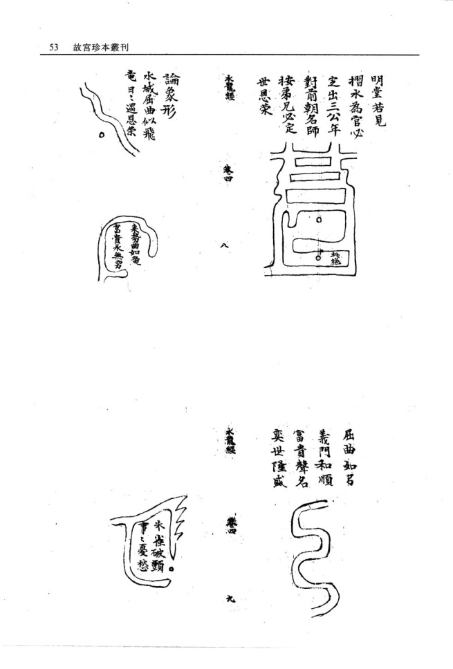

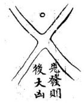

<!-- V3_SOURCE_ID:book024-b000313-p000-f1b2cab76a -->

會出現絕嗣沒有後人的情況，還有“逃亡橫天”的狀況，“橫天”具體含義不詳，另外還有涉及刑獄、被發配充軍的狀況，以及“屍鎗射六”的相關說法，“屍鎗射六”具體含義不詳，下文是關於“射”的相關論述。

> **释读存疑：** 逃亡橫天的橫天语义不明；屍鎗射六语义不明，已加引号标注

查看对应原文

<!-- V3_FOLDBACK_BEGIN:book024-b000313-p000-f1b2cab76a -->

絕嗣無人 逃亡橫天 刑獄充軍 屍鎗射六 論射

<!-- V3_FOLDBACK_END:book024-b000313-p000-f1b2cab76a -->

<!-- V3_SOURCE_ID:book024-b000314-p000-1fa9214f9e -->

水中有地，葫芦形毒藥，主傷人。

> **释读存疑：** “葫芦形毒藥”具体所指不详

查看对应原文

<!-- V3_FOLDBACK_BEGIN:book024-b000314-p000-1fa9214f9e -->

水中有地 葫芦形毒藥 主傷人

<!-- V3_FOLDBACK_END:book024-b000314-p000-1fa9214f9e -->

<!-- V3_SOURCE_ID:book024-b000315-p000-0b1a5fa293 -->

蓋邊遠去充軍，葵後兒孫終不，城砂水两相刑，火入金名帶劍，論交，論交。

> **释读存疑：** “葵後兒孫終不”“蓋邊遠去充軍”具體所指不详；“葵後兒孫終不”“蓋邊遠去充軍”具体所指不详

查看对应原文

<!-- V3_FOLDBACK_BEGIN:book024-b000315-p000-0b1a5fa293 -->

蓋边遠去充軍 葵後兒孫終不 城砂水两相刑 火入金名帶劍 論交 論交

<!-- V3_FOLDBACK_END:book024-b000315-p000-0b1a5fa293 -->

<!-- doc013 PDF 第 58 页：高风险/复杂版面 OCR 供检索；内容与排版以原页图为准。 -->

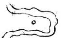

<!-- V3_SOURCE_ID:book024-b000318-p000-efc82d1aa3 -->

如果能夠扦葬得當，就能獲得尊貴的身份和顯赫的聲名。

查看对应原文

<!-- V3_FOLDBACK_BEGIN:book024-b000318-p000-efc82d1aa3 -->

若能扦當貴聲名

<!-- V3_FOLDBACK_END:book024-b000318-p000-efc82d1aa3 -->

<!-- V3_SOURCE_ID:book024-b000319-p000-ec4d3ec1ab -->

如果金勾形的地勢向左轉，就能夠擁有充足的金銀財富。

查看对应原文

<!-- V3_FOLDBACK_BEGIN:book024-b000319-p000-ec4d3ec1ab -->

金勾左轉足金銀

<!-- V3_FOLDBACK_END:book024-b000319-p000-ec4d3ec1ab -->

<!-- V3_SOURCE_ID:book024-b000320-p000-312a6e21a1 -->

水龍線

查看对应原文

<!-- V3_FOLDBACK_BEGIN:book024-b000320-p000-312a6e21a1 -->

水龍線

<!-- V3_FOLDBACK_END:book024-b000320-p000-312a6e21a1 -->

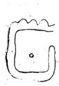

<!-- V3_SOURCE_ID:book024-b000322-p000-483aba0990 -->

风水格局对应三台星的位置会出贵人，地形如果屈曲盘旋，富贵就能绵延不绝。竜史的山势形成三台秀美的形态，风水语境中的河流、水系及其来去形态在穴场前方朝迎，若正面而来，有人在此处扦葬，为官者可累代担任乌台之职。瓜藤形态的风水语境中的河流、水系及其来去形态，段落排布有自然的情致。

> **释读存疑：** 竜史的具体指向暂不明确；1轮自动修复后核义模型仍建议修订，已保守记录。

查看对应原文

<!-- V3_FOLDBACK_BEGIN:book024-b000322-p000-483aba0990 -->

案應三台出貴人 屈曲盤旋 富貴綿延 竜史勢作三台秀 水前朝 面來若得 有人扦此 地為官代 作烏台 瓜藤之水節之有情

<!-- V3_FOLDBACK_END:book024-b000322-p000-483aba0990 -->

卷

<!-- V3_SOURCE_ID:book024-b000327-p000-67dc14288c -->

左侧的奎钩形砂位，主贵而无敌；武宫位的风水语境中的河流、水系及其来去形态与剑形水流交汇，若有人在此处安葬，其后代会在阵上亡身。

查看对应原文

<!-- V3_FOLDBACK_BEGIN:book024-b000327-p000-67dc14288c -->

左轉奎鉤貴而無敵武宮旗水交劍長流有人塟之陣上亡身

<!-- V3_FOLDBACK_END:book024-b000327-p000-67dc14288c -->

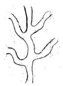

<!-- doc013 PDF 第 59 页：高风险/复杂版面 OCR 供检索；内容与排版以原页图为准。 -->
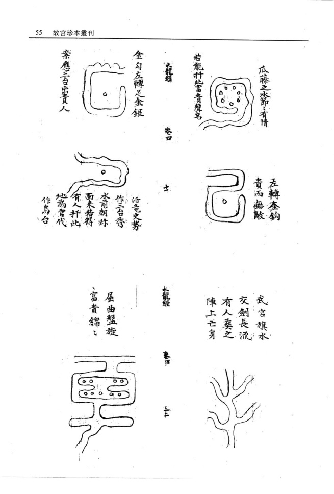

<!-- V3_SOURCE_ID:book024-b000331-p000-38d3dffe6a -->

火入金城，两者相互交战对峙之后，该家族始终不能显达功名，或是出现旗钟类的事物后，光孙必然会阵亡。

> **释读存疑：** 光孙的具体指代暂不明确；1轮自动修复后核义模型仍建议修订，已保守记录。

查看对应原文

<!-- V3_FOLDBACK_BEGIN:book024-b000331-p000-38d3dffe6a -->

火入金城兩相戰奕後其家終不显功名或是出旗鐘後代光孫必陳亡

<!-- V3_FOLDBACK_END:book024-b000331-p000-38d3dffe6a -->

<!-- V3_SOURCE_ID:book024-b000334-p000-d546cc0970 -->

金蛇势难以辨识，在此处扦葬之后会出大官，这种格局又名“笑之大”（原文此处可能存在讹误）。大的地块一边有风水语境中的河流、水系及其来去形态，一边没有，虽然能保证衣食安稳，但不久就会运势退败。永远像龙行至金铭的状态，玄奥难测，若有人在此处扦葬，能科举及第直至属于三元体系的最高等第。

> **释读存疑：** “笑之大”的原文讹误暂无法确认，金铭的具体指向暂不明确；“笑之”的具体含义暂不明确，金铭的具体指向暂不明确；1轮自动修复后核义模型仍建议修订，已保守记录。

查看对应原文

<!-- V3_FOLDBACK_BEGIN:book024-b000334-p000-d546cc0970 -->

金蛇势難識下後大官出又名笑之大處一边有水一边無衣食安然不久退永如竜至金銘玄又玄有人扦此地及第至三元

<!-- V3_FOLDBACK_END:book024-b000334-p000-d546cc0970 -->

<!-- doc013 PDF 第 60 页：高风险/复杂版面 OCR 供检索；内容与排版以原页图为准。 -->

<!-- V3_SOURCE_ID:book024-b000339-p000-8ca07f0e64 -->

逆龙走向的水经过之后，与砂、水交汇分界，明显可见合襟处宽阔，形态拖出弯势如同玉环一样圆润环绕，像丝带一样绵延的格局主大贵，会出现公卿级别的人物。

查看对应原文

<!-- V3_FOLDBACK_BEGIN:book024-b000339-p000-8ca07f0e64 -->

逆竜一水後 交臨砂水分 明是合襟寬 拖弯環如玉 帶綿當貴 作公卿

<!-- V3_FOLDBACK_END:book024-b000339-p000-8ca07f0e64 -->

<!-- V3_SOURCE_ID:book024-b000341-p000-559523ee48 -->

水系长久朝着穴场流来，屈曲而去又回绕缠护，家中会出现豪杰英才。再有道路朝向生旺的方位，家族中就会有人在朝廷担任显要官职。

查看对应原文

<!-- V3_FOLDBACK_BEGIN:book024-b000341-p000-559523ee48 -->

永朝曲去又纏身家內出豪英更有路朝生旺地官显在朝廷

<!-- V3_FOLDBACK_END:book024-b000341-p000-559523ee48 -->

<!-- V3_SOURCE_ID:book024-b000342-p000-63c455e423 -->

冰龙经

查看对应原文

<!-- V3_FOLDBACK_BEGIN:book024-b000342-p000-63c455e423 -->

冰龍經

<!-- V3_FOLDBACK_END:book024-b000342-p000-63c455e423 -->

<!-- V3_SOURCE_ID:book024-b000345-p000-30e5a399d5 -->

一重道路对应一重城郭，金水重重按压南门方位，如果能让风水语境中的河流、水系及其来去形态再有彩色包裹，世代都会出英杰华才，其人能通达帝京任职。

> **释读存疑：** 水中再色裹的具体形态暂不明确；1轮自动修复后核义模型仍建议修订，已保守记录。

查看对应原文

<!-- V3_FOLDBACK_BEGIN:book024-b000345-p000-30e5a399d5 -->

一重路挹一重城金水重按南門若得水中再色裹代英華達帝京

<!-- V3_FOLDBACK_END:book024-b000345-p000-30e5a399d5 -->

<!-- V3_SOURCE_ID:book024-b000348-p000-1ad4478c21 -->

无穷贵永，雄当号雌，相会二龙，二龙。

> **释读存疑：** 原文断句混乱，部分内容语义不明

查看对应原文

<!-- V3_FOLDBACK_BEGIN:book024-b000348-p000-1ad4478c21 -->

無穷 贵永 雄當 號雌 相會 二竜 二竜

<!-- V3_FOLDBACK_END:book024-b000348-p000-1ad4478c21 -->

<!-- V3_SOURCE_ID:book024-b000349-p000-0bd9062b7b -->

舞凤之后，主妃尊贵，男作三公，少年及第。

查看对应原文

<!-- V3_FOLDBACK_BEGIN:book024-b000349-p000-0bd9062b7b -->

舞鳳之後妃尊貴男作三公少年及第

<!-- V3_FOLDBACK_END:book024-b000349-p000-0bd9062b7b -->

<!-- doc013 PDF 第 61 页：高风险/复杂版面 OCR 供检索；内容与排版以原页图为准。 -->

<!-- V3_SOURCE_ID:book024-b000352-p000-316fa38bc3 -->

文中出现“無休 州知府出 之字流知 之字合襟”的内容，现存文本语义断裂，目前没有有效上下文可以明确断句与准确含义，仅可知其中提到了“之字合襟”的相关表述。

> **释读存疑：** 全文语义断裂，无法确认断句及各部分的准确含义；原文语义断裂，无有效上下文支撑断句及释义

查看对应原文

<!-- V3_FOLDBACK_BEGIN:book024-b000352-p000-316fa38bc3 -->

無休 州知府出 之字流知 之字合襟

<!-- V3_FOLDBACK_END:book024-b000352-p000-316fa38bc3 -->

<!-- V3_SOURCE_ID:book024-b000355-p000-a61a846b0f -->

右转的金钩形水形，主富贵且声名远扬。

查看对应原文

<!-- V3_FOLDBACK_BEGIN:book024-b000355-p000-a61a846b0f -->

右轉金鈎形富貴有聲名

<!-- V3_FOLDBACK_END:book024-b000355-p000-a61a846b0f -->

<!-- V3_SOURCE_ID:book024-b000356-p000-3b1d83aa24 -->

水如王钩形，主该人担任知州官职。

查看对应原文

<!-- V3_FOLDBACK_BEGIN:book024-b000356-p000-3b1d83aa24 -->

水如王鈎官為知州

<!-- V3_FOLDBACK_END:book024-b000356-p000-3b1d83aa24 -->

<!-- V3_SOURCE_ID:book024-b000357-p000-a08db7c81c -->

蟠竜形状的水系前后兜抱环绕，位于田间，千厲主富足没有休止；如果穴前能有三竜形状的水系，儿孙辈代代都会出公侯。

> **释读存疑：** “千厲”无明确释义依据，仅按原文保留表述

查看对应原文

<!-- V3_FOLDBACK_BEGIN:book024-b000357-p000-a08db7c81c -->

蟠竜之水前後兜在田千厲富無休面前若得三竜水兒孫代出公侯

<!-- V3_FOLDBACK_END:book024-b000357-p000-a08db7c81c -->

<!-- V3_SOURCE_ID:book024-b000360-p000-29c3ef1972 -->

蟠竜形状的水系在后方，主后代出公侯；向左转的金钩形状的水系，主富贵睢人丁；水系呈乙字形、呈乞字形的，家中会出大朝臣；十字形状的水系朝迎，对应“故見孫手”的表述，具体含义不详。

> **释读存疑：** “睢人丁”语义不明，未找到可靠释义依据；“故見孫手”语义不明，无法确认具体所指

查看对应原文

<!-- V3_FOLDBACK_BEGIN:book024-b000360-p000-29c3ef1972 -->

蟠竜之水後頭代之作公侯左轉金鈎形富貴睢人丁水如乙字形水如乞字形家出大朝臣十字水朝故見孫手

<!-- V3_FOLDBACK_END:book024-b000360-p000-29c3ef1972 -->

<!-- doc013 PDF 第 62 页：高风险/复杂版面 OCR 供检索；内容与排版以原页图为准。 -->

<!-- V3_SOURCE_ID:book024-b000365-p000-3742cc9071 -->

《丞龙经》卷中，即便能得温饱，也会有成败之分，定出娼优、低贱且淫邪之人。

> **释读存疑：** “丞龙经”疑为“水龙经”之误，暂保留原词；“丞龙经”疑为“水龙经”之误

查看对应原文

<!-- V3_FOLDBACK_BEGIN:book024-b000365-p000-3742cc9071 -->

丞龍經 卷 雖然溫飽有成敗 定出娼優賤且淫

<!-- V3_FOLDBACK_END:book024-b000365-p000-3742cc9071 -->

<!-- V3_SOURCE_ID:book024-b000367-p000-ac78776647 -->

三十年前走在路上，未曾到过仰天湖；如果有世人在此地扦葬，后代会出现身着紫衣、在都城做官的人；十字形状的水系在前后流通，地字形、井字形的水系總一幾，这里是市井中人多往来的地方，如果是单独一户人家不适合在此安置。

> **释读存疑：** “總一幾”无明确释义依据，仅按原文保留表述

查看对应原文

<!-- V3_FOLDBACK_BEGIN:book024-b000367-p000-ac78776647 -->

三十年前走道途不曾下得仰天湖若有世人扦此地見孫衣紫達皇都十字水流後與前地字井字總一幾此為市井人多往若是一家不可安

<!-- V3_FOLDBACK_END:book024-b000367-p000-ac78776647 -->

<!-- V3_SOURCE_ID:book024-b000369-p000-2efe8e6670 -->

水龍經 书

查看对应原文

<!-- V3_FOLDBACK_BEGIN:book024-b000369-p000-2efe8e6670 -->

水龍經 书

<!-- V3_FOLDBACK_END:book024-b000369-p000-2efe8e6670 -->

<!-- V3_SOURCE_ID:book024-b000370-p000-7b6b32298f -->

这个穴的结作形状十分分明，只怕当时的人不能辨识；懂行的堪舆师点中这个真穴，主富贵双全；砂山环绕、水系缠流的荷叶地，就像架在架上的金盘形状；如果点作樸头穴，之出見孫朝内人。

> **释读存疑：** “之出見孫朝内人”中“之”的语义无法明确；未提及“樸头穴”是误点的相关表述，原文该句语义未明；原文“樸头穴”相关表述语义未明

查看对应原文

<!-- V3_FOLDBACK_BEGIN:book024-b000370-p000-7b6b32298f -->

此穴分明結作形只恐時人不識真者遇成師點真穴富貴双全砂水纏流荷葉地却如架上金盤形若然点作樸頭穴之出見孫朝内人

<!-- V3_FOLDBACK_END:book024-b000370-p000-7b6b32298f -->

<!-- doc013 PDF 第 63 页：高风险/复杂版面 OCR 供检索；内容与排版以原页图为准。 -->

<!-- V3_SOURCE_ID:book024-b000374-p000-04abc57183 -->

籠經

> **释读存疑：** “籠經”疑为“龙经”之误，暂保留原词；“籠經”疑为“龙经”之误

查看对应原文

<!-- V3_FOLDBACK_BEGIN:book024-b000374-p000-04abc57183 -->

籠經

<!-- V3_FOLDBACK_END:book024-b000374-p000-04abc57183 -->

<!-- doc013 PDF 第 64 页：高风险/复杂版面 OCR 供检索；内容与排版以原页图为准。 -->

<!-- V3_SOURCE_ID:book024-b000377-p000-85432205db -->

说到春季的时候，表述为“春曰”，后文还会引出相关的内容。

> **释读存疑：** 原文“春曰”缺少后续内容，无法明确完整含义；1轮自动修复后核义模型仍建议修订，已保守记录。

查看对应原文

<!-- V3_FOLDBACK_BEGIN:book024-b000377-p000-85432205db -->

春曰

<!-- V3_FOLDBACK_END:book024-b000377-p000-85432205db -->

<!-- V3_SOURCE_ID:book024-b000378-p000-89b51e3726 -->

永合门前，会出富贵之人。

查看对应原文

<!-- V3_FOLDBACK_BEGIN:book024-b000378-p000-89b51e3726 -->

永合門前富責出名矣

<!-- V3_FOLDBACK_END:book024-b000378-p000-89b51e3726 -->

<!-- V3_SOURCE_ID:book024-b000380-p000-96e47c7105 -->

文中提到“卷甲”，具体所指不详。

> **释读存疑：** “卷甲”的具体含义不明确；“卷甲”的具体所指因缺少上下文无法明确

查看对应原文

<!-- V3_FOLDBACK_BEGIN:book024-b000380-p000-96e47c7105 -->

卷甲

<!-- V3_FOLDBACK_END:book024-b000380-p000-96e47c7105 -->

<!-- V3_SOURCE_ID:book024-b000381-p000-83c6e2d389 -->

若虽有雄势相见，天地交通，阴阳得位，定出三公。右水（风水语境中的河流、水系及其来去形态）似华头，子孙富贵无穷；左水似笋圭，长房会出科举魁首。

> **释读存疑：** “华头”“笋圭”“中元魁”原文未明确定义，此处为通俗化释读

查看对应原文

<!-- V3_FOLDBACK_BEGIN:book024-b000381-p000-83c6e2d389 -->

雖雄相見天地交通陰陽得位定出三公右水似華頭子孫貴無休左水似筍圭長房中元魁

<!-- V3_FOLDBACK_END:book024-b000381-p000-83c6e2d389 -->

<!-- doc013 PDF 第 65 页：高风险/复杂版面 OCR 供检索；内容与排版以原页图为准。 -->

<!-- V3_SOURCE_ID:book024-b000385-p000-7302129536 -->

左水（风水语境中的河流、水系及其来去形态）似笔头，家主会得田产与牛；右边有二水环抱，家中会有充足的金银财宝。

查看对应原文

<!-- V3_FOLDBACK_BEGIN:book024-b000385-p000-7302129536 -->

左水似筆頭 家主進田牛 右边二水抱 家内足金宝

<!-- V3_FOLDBACK_END:book024-b000385-p000-7302129536 -->

<!-- V3_SOURCE_ID:book024-b000387-p000-0716d5d8f6 -->

二龙相会于门前，子嗣会入朝为官。

查看对应原文

<!-- V3_FOLDBACK_BEGIN:book024-b000387-p000-0716d5d8f6 -->

二竜相會應門前子嗣去朝天

<!-- V3_FOLDBACK_END:book024-b000387-p000-0716d5d8f6 -->

<!-- V3_SOURCE_ID:book024-b000391-p000-334163092f -->

水在“後頭兜人皇州”，这一表述的具体含义不详。

> **释读存疑：** “後頭兜”的具体风水含义不明确；“人皇州”属于未明确的专名，具体所指不详；原文文字存在断裂，“後頭兜”“人皇州”具体所指均不明确；1轮自动修复后核义模型仍建议修订，已保守记录。

查看对应原文

<!-- V3_FOLDBACK_BEGIN:book024-b000391-p000-334163092f -->

水後頭兜人皇州

<!-- V3_FOLDBACK_END:book024-b000391-p000-334163092f -->

<!-- V3_SOURCE_ID:book024-b000393-p000-c2d8433cf6 -->

不孝多疾 1，二永从右边生出。

> **释读存疑：** “1”为原文不明标识，含义不详；“二永”具体所指不详

查看对应原文

<!-- V3_FOLDBACK_BEGIN:book024-b000393-p000-c2d8433cf6 -->

不孝多疾 1 二永右边出

<!-- V3_FOLDBACK_END:book024-b000393-p000-c2d8433cf6 -->

<!-- V3_SOURCE_ID:book024-b000394-p000-a2aea1441b -->

二龙的穴后方有“兠”的形态，可保富贵长久没有止息；东边的浜水深达百尺，文中提到“西侯有千粮”，“西侯”的具体所指不详。

> **释读存疑：** “兠”的具体风水形态含义不明确；“西侯”属于未明确的专名，具体所指不详

查看对应原文

<!-- V3_FOLDBACK_BEGIN:book024-b000394-p000-a2aea1441b -->

二竜穴後兠富貴永無休東浜深百尺西侯有千粮

<!-- V3_FOLDBACK_END:book024-b000394-p000-a2aea1441b -->

<!-- doc013 PDF 第 66 页：高风险/复杂版面 OCR 供检索；内容与排版以原页图为准。 -->

<!-- doc013 PDF 第 67 页：高风险/复杂版面 OCR 供检索；内容与排版以原页图为准。 -->

<!-- V3_SOURCE_ID:book024-b000398-p000-d4698b0910 -->

宅后有池，也是聚财之地；西北方向的池塘靠近冢边，子孙会不孝而呼皇天。此段出自《龙经》。

> **释读存疑：** 原文中“番”字含义不详

查看对应原文

<!-- V3_FOLDBACK_BEGIN:book024-b000398-p000-d4698b0910 -->

宅後有池亦 是人財之地 西北池塘近塚边 子孫不孝呌皇天 番 龍經

<!-- V3_FOLDBACK_END:book024-b000398-p000-d4698b0910 -->

<!-- V3_SOURCE_ID:book024-b000401-p000-fab25242e8 -->

住宅门前有桥直冲，会出现年少早死、遭遇横祸身亡、患上疾病、家中出现鳏夫寡妇的情况。

查看对应原文

<!-- V3_FOLDBACK_BEGIN:book024-b000401-p000-fab25242e8 -->

門前橋沖少死 橫亡疾病鰥寡

<!-- V3_FOLDBACK_END:book024-b000401-p000-fab25242e8 -->

<!-- V3_SOURCE_ID:book024-b000402-p000-158c1b3f66 -->

人口过继，这些都是衰败的炁象罢了；如果遇上当旺的运气，反而能发福。大鸿氏题：坟后有井，会患心疼病、双目受损，子孙也会受影响。井不分东西南北方位，若偏近坟地，会导致心腹疼痛、目痛。

查看对应原文

<!-- V3_FOLDBACK_BEGIN:book024-b000402-p000-158c1b3f66 -->

人口過房此俱俱衰敗之炁耳若當旺運反能發福也大鴻氏題坟後有井患心疼双目損兒孫井不分東西南北偏旁近攻主心腹目痛

<!-- V3_FOLDBACK_END:book024-b000402-p000-158c1b3f66 -->

森

<!-- doc013 PDF 第 68 页：高风险/复杂版面 OCR 供检索；内容与排版以原页图为准。 -->

<!-- V3_SOURCE_ID:book024-b000410-p000-acee7e0862 -->

鹅兄头码儿 头女儿媳妇 上秦接

> **释读存疑：** 原句语义残缺，无法确认确切含义

查看对应原文

<!-- V3_FOLDBACK_BEGIN:book024-b000410-p000-acee7e0862 -->

鵝兄頭碼兒 頭女兒媳婦 上秦接

<!-- V3_FOLDBACK_END:book024-b000410-p000-acee7e0862 -->

<!-- V3_SOURCE_ID:book024-b000411-p000-69de860576 -->

是°前

> **释读存疑：** 原句语义残缺，无法确认确切含义

查看对应原文

<!-- V3_FOLDBACK_BEGIN:book024-b000411-p000-69de860576 -->

是°前

<!-- V3_FOLDBACK_END:book024-b000411-p000-69de860576 -->

<!-- V3_SOURCE_ID:book024-b000412-p000-95cb343818 -->

疾有

> **释读存疑：** 原句语义残缺，无法确认确切含义

查看对应原文

<!-- V3_FOLDBACK_BEGIN:book024-b000412-p000-95cb343818 -->

疾有

<!-- V3_FOLDBACK_END:book024-b000412-p000-95cb343818 -->

<!-- V3_SOURCE_ID:book024-b000413-p000-2a42409df2 -->

难横

> **释读存疑：** 原句语义残缺，无法确认确切含义

查看对应原文

<!-- V3_FOLDBACK_BEGIN:book024-b000413-p000-2a42409df2 -->

难横

<!-- V3_FOLDBACK_END:book024-b000413-p000-2a42409df2 -->

基

<!-- V3_SOURCE_ID:book024-b000417-p000-48dba50fbc -->

宿妇木前 抱杓山 公媳如

> **释读存疑：** 原句语义残缺，无法确认确切含义

查看对应原文

<!-- V3_FOLDBACK_BEGIN:book024-b000417-p000-48dba50fbc -->

宿婦木前 抱杓山 公媳如

<!-- V3_FOLDBACK_END:book024-b000417-p000-48dba50fbc -->

<!-- V3_SOURCE_ID:book024-b000418-p000-d07fd6be66 -->

《水龙经》第四卷到此结束。

查看对应原文

<!-- V3_FOLDBACK_BEGIN:book024-b000418-p000-d07fd6be66 -->

水龍經卷四終

<!-- V3_FOLDBACK_END:book024-b000418-p000-d07fd6be66 -->

<!-- V3_SOURCE_ID:book024-b000419-p000-aef286bf2a -->

《水笼经》。

查看对应原文

<!-- V3_FOLDBACK_BEGIN:book024-b000419-p000-aef286bf2a -->

水籠經

<!-- V3_FOLDBACK_END:book024-b000419-p000-aef286bf2a -->

蕃

<!-- V3_SOURCE_ID:book024-b000421-p000-856344f757 -->

朱雀一坵地，此穴安然，更有后河尧富，贵等开。

> **释读存疑：** 原句“尧富”“贵等开”语义模糊，无法确认确切含义

查看对应原文

<!-- V3_FOLDBACK_BEGIN:book024-b000421-p000-856344f757 -->

朱雀一坵地此穴梁安然更更有後河堯富貴皇等開

<!-- V3_FOLDBACK_END:book024-b000421-p000-856344f757 -->

<!-- doc013 PDF 第 69 页：高风险/复杂版面 OCR 供检索；内容与排版以原页图为准。 -->

<!-- V3_SOURCE_ID:book024-b000424-p000-26d0a6c0a6 -->

《水龍紅》第五卷是總論部分。這一卷所講的水龍天星垣局相關內容，是化龍山人董遇元轉述景紀氏的言論。人們不知道董遇元是哪個朝代的人，他提到的三十六穴，上對天星，每個局的格局都用四言十六字來表述，內容裡出現了駙馬、儀賓、京堂這類稱呼，從這些說法就能推斷這部書是近代人所撰，證據十分明顯。文中對星象的品評占測內容縝密嚴謹沒有雜亂之處，如果不是廣泛通曉天象、窮盡探究星象本源的人，根本不可能觸及這套學說的邊際。這部書雖然不是郭景純所作，作者也算得上是郭景純一類的人物了。至於他寫作用詞，典雅宏博、道勰華美，高出同類作品，是極為雅正的佳作。我考證自楊公以來，研究地理風水的學者裡很少有擅長寫文章的人，只有元代的賴布衣，身負奇才生於蒙古統治時期，佯狂灑脫寄情詩酒，在各地隱居藏身，他所著的《水龍綬》卷王中有詩歌吟誦的內容，才華橫溢，這一點在會稽地區流傳的諸多鉗記裡可以得到印證。我向來認為賴布衣的才華沒有人能比得上，沒想到在這卷書裡又見到了同樣出色的文采，研究形法的風水師裡怎麼會有這麼多有才華的人啊。至於這卷書裡論述的天星垣局，只是取水的形態與天星相似，歸為同類來推求，並不是沒有根據的說法。古話不是說過嗎，在天形成星象，在地成形態，地上有這樣的形態，實際上和天上的星象是遙相對應的。用這個道理來看天星垣局的說法，和世俗流傳的二十四個方位分別對應星纏的說法相比，差別何止是天差地別。因為大地有固定的方位，而天體運行沒有固定的位置，就算有十二次舍的劃分，也不能生硬地和地上的二十四個地支完全匹配。所以天星的說法雖然自古以來就被人推崇，但我個人認為沒有可靠的考證依據。之前常見翰林學士一類的人斷定巽、辛方位對應萬里封侯，庚、震方位對應兩代帝王發跡，可實際上帝王發跡的地方，也從來沒有被明確劃分歸屬於三垣來龍的範圍。所以與其依據方位來對應天星，不如依據形象來對應天星更有憑據。我保存這部書，是想要尊崇它的名聲，推廣這類學說，來顯示水龍法的作用之大，讓學習風水的人知道水龍和山龍一樣都應當被重視，二者不分高下。三垣、九野的星宿數量非常多，而有名的大河有三百條，支流有三千條，水的數量也數不勝數，就算是山龍，又怎麼能一一和天星相對比呢？我之所以拿天星來論述水局，是因為只有符合天星的水局才屬於尊貴的格局，這類尊貴的水局並不多見。學習的人不要因為過度糾結文辭而忽略了核心主旨。以上是大鴻氏的筆記。

> **释读存疑：** 原文“隱嬰不猥”含義存在歧義，此處依據上下文釋為內容縝密嚴謹沒有雜亂之處；原文“水龍綬 卷王”存排版脫漏疑問，按原文保留表述；原文“不分軒輕”的“輕”為“輊”的訛字，已按正確含義釋讀

查看对应原文

<!-- V3_FOLDBACK_BEGIN:book024-b000424-p000-26d0a6c0a6 -->

水龍紅第五卷總論此卷水龍天星垣局乃化龍山人董遇元述景紀氏之言言董君不知何代人其三十六穴上應天星而每局格以四言十六字有駙馬儀賓京堂等語乃本朝物色其為近代人所撰有明微矣而品占列星隱嬰不猥苟非博綜象緯窮採星源者安望其涯涘雖不出于景純氏亦景純氏之流亞歟至其撰句選詞典博道麗卓乎大雅之為予考楊公以還地理之家少有能文之士惟元賴布衣蓋以奇才生蒙古之運祥狂詩酒晦跡江河其水龍綬 卷王中有歌咏天才爛發見于會稽諸鉗記可徵也予向以為頼布衣之才無與比者不意又得之此卷形家者流何多才之甚也至其所論天星垣局但取水形相似連類以求蓋非無本者也古語不云乎在天成象在地成形地有斯形寔與天象遙相應合耳以此明天星垣局與世人所傳二十四方道各分星纏者奚啻天壤蓋地有定位而天無定位雖有十二次舍不可渾配地之二十四十支也故天星之說古今所尚而予獨以為無考徵之 徃幾見翰林學士定出巽辛萬里封侯必生庚震雨代帝王發跡之地亦未嘗畫屬三垣來龍也故據方位之合天星不若據形象之合天星有微也予存此書蓋將尊其名廣其類以顯水龍作用之大使學者知兩崇重以應乎山龍不分軒輕耳三垣九野列宿甚多而名川三百支川三千水之為數亦不可紀極即如山龍亦安能一一舉天星而比擬之我故執天星以論水局取合天星之水局然後知水局之尊貴不多也學者毋以文害志可也大鴻氏筆誌

<!-- V3_FOLDBACK_END:book024-b000424-p000-26d0a6c0a6 -->

<!-- V3_SOURCE_ID:book024-b000425-p000-9678665631 -->

《水麓經》卷五

查看对应原文

<!-- V3_FOLDBACK_BEGIN:book024-b000425-p000-9678665631 -->

水麓經 卷五

<!-- V3_FOLDBACK_END:book024-b000425-p000-9678665631 -->

<!-- V3_SOURCE_ID:book024-b000426-p000-ceb02549f1 -->

《水鉗》篇中記載，天地浩渺無邊，日月星辰交替顯現隱沒，元氣循環往復，五行交替榮衰，江河奔涌流淌，山岳巍然屹立，溫暖的陽氣主生，陰寒之氣主死。因此通曉道理的聖人效法天象、取則萬物，根據地勢考察地理規律，氣承載着運行的規律，磅礴無邊，理氣匯聚之處，陰谷中也會產生陽氣，地面生出山川嶽嶽，天上垂下星象，二者本來都源自同一元氣，只是名稱不同內在規律卻是一致的。按照風水的道理，穴、龍形都和天上的列星宿相對應，光輝閃耀，上天順時布散氣運，大地之德向上承接，葭管中的灰隨節氣飛動，蘊育着百靈之氣，由形與氣鑄就，剖分出吉凶的差別，陰陽相互更替，五行相生相連，舉一可以推二，這些都是靈巧的術數書籍所記載的內容。想要辨識地的好壞，先要觀察天象；想要辨識地形的特點，先要觀察……原文此處“先觀其兮”存在訛誤，含義不明。大禹的足跡已經渺茫難尋，聖人以宏闊的視角觀察萬物，不考察水流的流動，怎麼能知曉它的源頭？淄水四散漫流，匯聚到深淵之中。原文“疊之淵秦氣而行子水龍經 卷五母相援”存在斷句混亂、文字脫訛的情況，含義無法通讀。後文提到山巒龍脈駁換轉換、形態蜿蜒，氣勢和緩的就是吉地，水流沖激射盪的就是凶地。見到水不能直接就認定是風水中的吉水，要分辨五星水形的真偽：屬土的水形厚重沉穩，屬金的水形圓潤清亮，屬木的水形挺拔平直，屬火的水形飛騰洶湧，站在岸邊遠眺，就能準確判斷水的形態。金木相剋的地方，有奕水匯聚就是吉地；水火相衝的地方，就算本氣旺盛也尤其忌諱；土能生金，最忌諱碰到木的氣場；木星帶有火性的地方，會導致國家傾覆。水流趨歸、蓄積的位置，各有對應的關鍵節點，胎、胞、死、絕、生、旺、官、祿各種氣運，遇到沖、剋、刑、傷的情況，災禍來得極為迅速，吉凶本來就取決於氣的消長，五行的運轉決定了生死。相信耳朵聽到的不如相信眼睛看到的，相信眼睛看到的不如相信內心判斷的。郭景純雖然已經去世，他的學說精神仍然留存。至於長江、鴨綠江，大海沒有邊際，波瀾洶湧，夜晚能聽到蛟龍的啼聲，界限無窮無盡，越觀察越讓人疑惑，就算有曲折的形態也沒有綿延之勢，除非能啟動天機的鑰匙，否則君子不要隨意評斷這類水勢。往下追溯淮水、泗水，江峽、漢水的巨大龍脈橫亙延伸，洪水衝擊漢水沿岸的州邑鄉村，這些都是龍神所占據的地方，垣局旋轉、屏風扭轉，龍脈隨着氣運聚集，抬頭遠望，精神與氣運相會合，洲澗的水流穿江入河，對應的三十處穴，都是郭景純所確定的。西晉末年以來，仙妙的學說已經失傳，唐宋以來，水法的傳承空洞虛無，《青烏》《石匱》這類典籍，不知道是哪年出現的，裡面不記載具體的地物特點，只講水鉗的相關內容。龍額的位置藏有珠形水勢，會出生賢能的輔臣，對應天上的華蓋星，下葬要順着水流彎曲的方向。銀河交會的地方，對應東西兩個藩屬國，真穴安放在這裡，會出近侍的官員。天府位置的樂器完好，星光直通天苑，穴點在龍睛的位置，後代會有人在翰林院任職名聲遠揚。虹出現在水流之上，會出將軍，在軍中揚名，內穴的位置可以威鎮邊疆。蟠龍吸水的形態，是軫宿所對應的位置，穴點在京堂對應的方位，旁邊會出驃騎將軍。錦屏一樣的山形上掛着鏡面一樣的水勢，對應天上的天錢星，穴藏在中宿的位置，主家會出現賓客和賢能的人。金鉤一樣的水形掛在月邊，天釣星入垣，餌穴在垣局之內，可以釣得水龍的吉氣。原文末尾“可釣水龍般 卷五 四”中“般”為“經”的訛字，後綴卷次標識保留。

> **释读存疑：** 原文“磅磚無疆”的“磚”為“礴”的訛字，已按正確含義釋讀；原文“先觀其兮”存在訛誤，具體含義不詳；原文“疊之淵秦氣而行子水龍經 卷五母相援”存在脫訛，語義不通；原文“天府壞箎曜通天苑”斷句存在舊訛，已按語義調整；原文“龍晴”的“晴”為“睛”的訛字，已按正確含義釋讀；原文“般”為“經”的訛字，已作說明

查看对应原文

<!-- V3_FOLDBACK_BEGIN:book024-b000426-p000-ceb02549f1 -->

水鉗天壤浩渺三辰顕晦一氣循環五行榮悴江河以流山金岳以峙暄陽為生陰寒為死是以哲人象天則物因地察儀氣以載理磅磚無疆理萃氣聚陰谷生陽地出川岳天垂星本乎一氣情同異名理穴龍形列宿耀明天施順播地德上承葭管灰飛孕懷百靈鑄以形氣剖以吉凶陰陽相禪五行生聯舉一遠二巧術之編欲識其地先觀其天欲識其形先觀其兮禹跡茫哲人大觀不察其流孰知其源淄分漫衍疊之淵秦氣而行子水龍經 卷五母相援夫婦交度剝換蜿蜒氣緩為吉激射為凶見水非水五星真偽土水厚重金水圓清木水挺直火水飛騰臨涯眺望不失其形金木相攻奕水則吉水火相戰本旺尤忌土神生金最畏逢木星帶火邦家傾覆趨蓄之位各有關軸胞胎死絕生旺官祿冲剋刑傷灾釋迅速吉凶本乎消長五行運乎生死信耳不如信目信目不如信心景純雖死精神尚存乃若長江鴨綠大海無涯波瀾洶湧蛟龍夜啼界之罔極察之愈疑雖有如折不委迤運啟天鑰君子勿題下追淮泗江峽漢水巨脉橫沿洪觸漢州邑鄉村龍神所據旋垣轉屏脉隨氣聚揚肩遠眺精神來會洲澗洋之穿江入河三十穴景純所為末晉之間仙音既殂唐宋以來水法虛無青烏石匱發自何年不載地物惟說水鉗龍額藏珠賢輔所生上應華蓋葬隨曲衡河漢交度東西二藩真穴奠下近侍官班天府壞箎曜通天苑穴點龍晴名揚翰苑虹飛欲海將軍氣揚帷幄內穴威鎮邊疆蟠龍飲乳軫宿所據穴點京堂旁為驃騎錦屏挂鏡上輝天錢穴藏中宿主賔責賢金鈎挂月天釣入垣餌穴居內可釣水龍般 卷五 四

<!-- V3_FOLDBACK_END:book024-b000426-p000-ceb02549f1 -->

<!-- V3_SOURCE_ID:book024-b000427-p000-564e89666f -->

顯官對應天衢星，有獻印、漸臺垂應的格局，穴位處在中心位置，可貴至萬乘之尊。天廚星對應玉食佳肴，天皇內厨對應鼎釜，點穴得當的話後代能享用珍饈肥美之物。烏龜浮在蓮花上的形態，有天電暗中照應，穴位對應蓮心的位置，是長壽有福的徵兆。瓊玉一樣的屏風山架，對應天上的五車星，穴位對應牙籤吏的方位，後代會有任職翰史的人享受榮華。五級玉階的地形，是翌宿所對應的位置，穴位乘坐羽輪星的氣運，可以飛步登天衢。瓊玉一樣的筵席結着彩飾，對應八奎星聚氣，穴位選在隱褥的位置，後代會出接連不斷的傑出人物。黃金鎮守、瓊玉圍帳的地形，是斗宿所對應的位置，穴位隨着水流轉折，可獲得萬箱金銀財寶。玉堂一樣的文幕，對應器府的福運，穴位選在垣局之內，家中會充滿笙歌歡樂。方城一樣秀麗延展的地形，對應天上的天田星，穴位處在其中，田產阡陌連綿不斷。玉練一樣的水流纏繞，上對應文曲星，穴位得當的話，會擔任為皇帝剪裁補袞的要職。金闕前排列着牙班，庫樓森然林立，玉作一樣的穴位，會出滿朝的爵位官員。九畹橫亘的地形，天龐星明亮照耀，穴位點在易眉的位置，會成為背靠着屏風的名門望族。陽河呈現出柔綠的色澤，對應天上的斗斛星，穴位聚集日的精華，會有福至冢宰的貴運。陽性的低地纏繞着光彩，即位的地方高低參差，點穴得當的話，方圓幾里都會出現做官的人。神鬼食蛤的地形，六甲星奮發放光，穴位在豐頸的位置，能夠協調陰陽之氣。駿馬嘶鳴甩動尾巴，右邊對應旂星，穴位繫在龍項的位置，會在戰場上揚名。日月的精華分照，天廟星明亮顯現，葬在陽地抵御陰氣，會生出男女雙雙俊傑的後代。雙乳聚氣的地形，左右有執法星對應，穴位對齊端門的位置，會功名顯達。春天的蛟龍和月亮相對，蛇一樣的地形蜿蜒靠近河流，穴位選在神宮的位置，會在皇都獲得顯赫名聲。金盤從匣中拿出的地形，是牛宿所對應的位置，下葬要看點饌的格局，會有華美的宴席、富貴的氣運。金倉盛放着玉粒，天囷星顯赫明亮，穴位處在其中，會得到萬石的俸祿。玉女鋪床的地形，有天床星照臨，會出現駙馬、儀賓一類的貴戚，穴位選在深邃的內局之處，會有繡帳銀鉤的富貴生活。天圖外屏有褥狀地形，穴位選在此處，會有擔任御翰的俊傑人物。大雁落在平沙的地形，穴位靠近羽林壁。以上為《水龍經》卷五的內容。

> **释读存疑：** 原文“玉練纏天工應文曲”的“工”為“上”的訛字，已按正確含義釋讀；原文“天困顕赫”的“困”為“囷”的訛字，已按星宿名正確表述

查看对应原文

<!-- V3_FOLDBACK_BEGIN:book024-b000427-p000-564e89666f -->

顯官天衢献印漸臺垂應穴居中轂貴萬乗天廚玉饍天皇內厨鼎釜取穴珍羞腯肥龜浮蓮形天電暗照穴應蓮心耆福之兆瓊屏玉架上應五車牙籤吏穴翰史榮華玉階五級翌宿所居穴乘羽輸飛步天衢瓊筵結彩八奎聚靈隱褥取穴錦繡聯英金鎮瓊幃斗宿所居穴轉曲寫金資萬箱玉堂文幕器府璘福穴居內笙歌滿庭方城秀衍上配天田穴居其中阡陌連綿玉練纏天工應文曲穴居剪裁補袞之職金闕牙班庫楼森張玉作穴列爵滿行易橫九畹天龐耀明穴點易眉負扆名陽河猗綠上應斗斛穴鐘日精冢宰之福陽隰纏耀即位亹之參差點穴簪纓幾里神鬼食蛤六甲奮光穴居豐颈爕理陰陽驥嘶掉尾右映旂星穴繫其項陣上揚名日月分精天廟顕星葬陽御陰男女双英双乳聚英左右執法穴齊端門功名顕達春蛟賽月蛇蜒臨河神宮取穴名顯皇都金盤出匣牛宿所居葬看點饌綺席華烟金倉玉粒天困顕赫穴其中廩祿錫萬石玉女鋪床天床星照駙馬儀賔穴居閫奧繡幃銀鈎天圗外屏褥取穴御翰芳英雁落平沙穴粘羽林壁水龍經 卷五

<!-- V3_FOLDBACK_END:book024-b000427-p000-564e89666f -->

<!-- V3_SOURCE_ID:book024-b000428-p000-b103833b45 -->

壘桓對應武權，文衡對應文運，珠一樣的胎氣倒映着月光。原文“天淵映禪法葵內池”存在訛脫，語義無法通讀。食祿對應瓊關，金蓮從側邊露出，穴位在花心的位置，上方面對着積翠一樣的山巒，能夠統御萬軍。玉衡星掛在斗位，天倉星明亮，對應文桂史儲的方位，下葬靠着雲屏一樣的山，是天福地軸的貴地，能威名傳播千里，穴位處在中宮的位置，是奎宿所經過的地方。以上的龍法是郭景純所創，山形水勢紛繁錯雜、斜曲纏繞，形態很難全部陳述清楚，學習的人要得魚忘筌，靠內心頓悟來理解。生旺的氣從祖山發起，清靈純淨的氣匯入穴中，水流纏繞、護砂環轉，蔓延得就像瓜瓞綿延一樣，要認清根幹、辨識枝葉，山勢紛雜飛奔的地方，水勢紛雜的地方反而會結穴，珠子在浪中滾動、浮萍在水中隱現，這種氣運埋入土中不會衰減，浸入水中也不會湮沒。上等的智者辨別氣的好壞，下等的人只會辨別外形，氣的規律掌握了，禍福的判斷就會日益準確。東南地區溫暖，西北地區寒冷凜冽，冰雪還沒有消融的時候，原文“虛兩歇塘”存在訛字，含義不明。弩箭觸發機關、庖丁解牛只在關鍵一節，蝦鬚蟹眼這類精微的地形，玄奧的說法紛繁眾多。原文“玄論紛蓋粘何彊化生胸唇”存在訛脫，語義無法通讀。平庸的風水師憤世嫉俗，連五行都分不清楚，既拘泥於羅經的纏度，又對星象有很多謬誤的判斷，把生氣指為死氣，把凶地當成吉地，在上褻瀆天的垣局，在下毀壞地的文理，靈輝不肯照臨，大白天都顯得天色昏暗，陰堂滿是淒慘之氣。如果不是通曉道理的人，就算好的穴地擺在面前也不會認識。遇到好的穴位卻不修整利用，只會在鄉野之間留下悲傷的嘆息。我斗膽把這些珍貴的秘訣記錄下來，留給後人做啟發，雖然這些是前代聖賢留下的良善教誨，能否發揮作用也要看後人是不是秉着正確的心態去學習。

> **释读存疑：** 原文“天淵映禪法葵內池”存在訛脫，具體含義不詳；原文“蔓若瓜”後疑脫“瓞”字，已按語義補充說明；原文“虛兩歇塘”存在訛字，具體含義不詳；原文“玄論紛蓋粘何彊化生胸唇”存在訛脫，語義不通；原文“遇穴淹脩”的“淹”為“不修”的訛字，已按正確含義釋讀

查看对应原文

<!-- V3_FOLDBACK_BEGIN:book024-b000428-p000-b103833b45 -->

壘桓武柄文衡珠胎瀉月天淵映禪法葵內池食祿瓊關金蓮側露穴在花心上臨積翠統馭萬軍玉衡挂斗天倉昱文桂史儲鄉塟倚雲屏天福地軸威名千里穴居中宮奎宿所履以上龍法作自景純紛錯斜纏形難具陳得魚忘筌頓悟以心生旺起祖清絕入穴水纏砂轉蔓若瓜認根識幹認枝識葉山亂勢奔水亂勢結珠經浪萍隱冥之入土不減入水不湮上哲辨氣下哲辨形之氣既得殃福日真東南華煖西北凜冽冰雪未消虛兩歇塘弩發機遊刃一節蝦鬚蟹眼玄論紛蓋粘何彊化生胸唇庸師憤五行不分既泥羅纏又多謬星指生為死鑒凶裂純上瀆天垣下毀地文靈輝不照白畫天昏幽堂慘苟非知者交臂不親遇穴淹脩草野悲吟敢照珍秘豁吾後人雖曰先矣之淑教亦由後人之秉心

<!-- V3_FOLDBACK_END:book024-b000428-p000-b103833b45 -->

<!-- V3_SOURCE_ID:book024-b000429-p000-0f416ab864 -->

化龍山人董遇元編述。

> **释读存疑：** 1轮自动修复后核义模型仍建议修订，已保守记录。

查看对应原文

<!-- V3_FOLDBACK_BEGIN:book024-b000429-p000-0f416ab864 -->

化龍山人董過元編述

<!-- V3_FOLDBACK_END:book024-b000429-p000-0f416ab864 -->

<!-- V3_SOURCE_ID:book024-b000430-p000-55ca529883 -->

永龍經

查看对应原文

<!-- V3_FOLDBACK_BEGIN:book024-b000430-p000-55ca529883 -->

永龍經

<!-- V3_FOLDBACK_END:book024-b000430-p000-55ca529883 -->

<!-- V3_SOURCE_ID:book024-b000432-p000-21c6a06a3a -->

柔龍經卷五，龍額藏珠，賢輔所生，上應華蓋，葬隨曲衡

查看对应原文

<!-- V3_FOLDBACK_BEGIN:book024-b000432-p000-21c6a06a3a -->

柔龍經 卷五 龍額藏珠賢輔所生 上應華蓋葬隨曲衡

<!-- V3_FOLDBACK_END:book024-b000432-p000-21c6a06a3a -->

<!-- V3_SOURCE_ID:book024-b000434-p000-5a14c17fa8 -->

河漢交度，東西二藩，真穴奠下，近侍官班，帷幔內穴，成振邊疆，水龍經卷五，蟠龍飲乳，軫宿所處，穴点京堂，傍為驃騎

查看对应原文

<!-- V3_FOLDBACK_BEGIN:book024-b000434-p000-5a14c17fa8 -->

河漢交度東西二藩真穴奠下近侍官班帷幔內穴成振邊疆水龍經 卷五蟠龍飲乳軫宿所處穴点京堂傍為驃騎

<!-- V3_FOLDBACK_END:book024-b000434-p000-5a14c17fa8 -->

<!-- doc013 PDF 第 73 页：高风险/复杂版面 OCR 供检索；内容与排版以原页图为准。 -->

<!-- V3_SOURCE_ID:book024-b000445-p000-05e0d51568 -->

穴位對應中宿星，主家中嬪妃女子尊貴美麗。

查看对应原文

<!-- V3_FOLDBACK_BEGIN:book024-b000445-p000-05e0d51568 -->

穴藏中宿主嬪貴美

<!-- V3_FOLDBACK_END:book024-b000445-p000-05e0d51568 -->

<!-- V3_SOURCE_ID:book024-b000447-p000-2ab00b7b55 -->

木龍經天鈎星

查看对应原文

<!-- V3_FOLDBACK_BEGIN:book024-b000447-p000-2ab00b7b55 -->

木龍經天鈎星

<!-- V3_FOLDBACK_END:book024-b000447-p000-2ab00b7b55 -->

<!-- V3_SOURCE_ID:book024-b000449-p000-b76ccf2f61 -->

斜向的穴处在内部位置，可以钩招显官。

查看对应原文

<!-- V3_FOLDBACK_BEGIN:book024-b000449-p000-b76ccf2f61 -->

斜穴居內可鉤顕官

<!-- V3_FOLDBACK_END:book024-b000449-p000-b76ccf2f61 -->

<!-- V3_SOURCE_ID:book024-b000450-p000-1cc3496e36 -->

卷五 十

查看对应原文

<!-- V3_FOLDBACK_BEGIN:book024-b000450-p000-1cc3496e36 -->

卷五 十

<!-- V3_FOLDBACK_END:book024-b000450-p000-1cc3496e36 -->

<!-- V3_SOURCE_ID:book024-b000451-p000-f9d6c0989a -->

織女星

查看对应原文

<!-- V3_FOLDBACK_BEGIN:book024-b000451-p000-f9d6c0989a -->

織女星

<!-- V3_FOLDBACK_END:book024-b000451-p000-f9d6c0989a -->

<!-- V3_SOURCE_ID:book024-b000452-p000-56db1f3e6f -->

衢献印漸臺乘應，从中毂贵，拥万乘

> **释读存疑：** 衢献印漸臺乘應、中毂的具体所指不详

查看对应原文

<!-- V3_FOLDBACK_BEGIN:book024-b000452-p000-56db1f3e6f -->

衢献印漸臺乗應 從中轂貴擁萬乗

<!-- V3_FOLDBACK_END:book024-b000452-p000-56db1f3e6f -->

<!-- doc013 PDF 第 74 页：高风险/复杂版面 OCR 供检索；内容与排版以原页图为准。 -->

<!-- V3_SOURCE_ID:book024-b000458-p000-95ab895bac -->

穴卧于“唇詹肥”的位置，与贤哲相关；“唇詹肥”具体所指不详，“適贤哲”的具体含义也未明确。

> **释读存疑：** 唇詹肥的具体含义；適贤哲的具体指向；唇詹肥的具体所指不详；「適贤哲」的具体含义未明确

查看对应原文

<!-- V3_FOLDBACK_BEGIN:book024-b000458-p000-95ab895bac -->

穴卧唇詹肥適賢哲

<!-- V3_FOLDBACK_END:book024-b000458-p000-95ab895bac -->

<!-- V3_SOURCE_ID:book024-b000459-p000-38929a237f -->

龍經

查看对应原文

<!-- V3_FOLDBACK_BEGIN:book024-b000459-p000-38929a237f -->

龍經

<!-- V3_FOLDBACK_END:book024-b000459-p000-38929a237f -->

<!-- doc013 PDF 第 75 页：高风险/复杂版面 OCR 供检索；内容与排版以原页图为准。 -->

<!-- V3_SOURCE_ID:book024-b000461-p001-32cb1d4e6d -->

穴转向“西窝”的位置，与“金资万籍”相关；“西窝”具体所指不详，“金资万籍”的具体含义也未明确。

> **释读存疑：** 西窝的具体含义；金资万籍的具体含义；西窝的具体所指不详；「金资万籍」的具体含义未明确

查看对应原文

<!-- V3_FOLDBACK_BEGIN:book024-b000461-p001-32cb1d4e6d -->

穴轉西窩金資萬籍

<!-- V3_FOLDBACK_END:book024-b000461-p001-32cb1d4e6d -->

<!-- V3_SOURCE_ID:book024-b000463-p001-140c3d44e3 -->

福居於穴（风水中认为气脉聚结、适宜安葬或营建的位置）內，家中充满欢歌笑语

查看对应原文

<!-- V3_FOLDBACK_BEGIN:book024-b000463-p001-140c3d44e3 -->

福居穴內生歌滿庭

<!-- V3_FOLDBACK_END:book024-b000463-p001-140c3d44e3 -->

<!-- V3_SOURCE_ID:book024-b000465-p000-38929a237f -->

龍經

查看对应原文

<!-- V3_FOLDBACK_BEGIN:book024-b000465-p000-38929a237f -->

龍經

<!-- V3_FOLDBACK_END:book024-b000465-p000-38929a237f -->

<!-- V3_SOURCE_ID:book024-b000466-p000-19b3904b20 -->

王案方位所形成的穴，官爵排布如同鹓鸟飞行的行列一般有序。

查看对应原文

<!-- V3_FOLDBACK_BEGIN:book024-b000466-p000-19b3904b20 -->

王案作穴列爵鵷行

<!-- V3_FOLDBACK_END:book024-b000466-p000-19b3904b20 -->

<!-- V3_SOURCE_ID:book024-b000467-p000-5f602e816a -->

卷五

查看对应原文

<!-- V3_FOLDBACK_BEGIN:book024-b000467-p000-5f602e816a -->

卷五

<!-- V3_FOLDBACK_END:book024-b000467-p000-5f602e816a -->

<!-- doc013 PDF 第 76 页：高风险/复杂版面 OCR 供检索；内容与排版以原页图为准。 -->

<!-- V3_SOURCE_ID:book024-b000471-p001-cb712edc57 -->

方城秀麗延綿，上應天田星位；安葬於居中之穴，阡陌連綿成片。

> **释读存疑：** “方城”“天田”风水具体所指原文未明

查看对应原文

<!-- V3_FOLDBACK_BEGIN:book024-b000471-p001-cb712edc57 -->

方城秀衍上配天田  
塟居中穴阡陌連綿

<!-- V3_FOLDBACK_END:book024-b000471-p001-cb712edc57 -->

∑

<!-- V3_SOURCE_ID:book024-b000474-p000-00edc26121 -->

三師星

查看对应原文

<!-- V3_FOLDBACK_BEGIN:book024-b000474-p000-00edc26121 -->

三師星

<!-- V3_FOLDBACK_END:book024-b000474-p000-00edc26121 -->

<!-- V3_SOURCE_ID:book024-b000475-p001-38929a237f -->

龍經

查看对应原文

<!-- V3_FOLDBACK_BEGIN:book024-b000475-p001-38929a237f -->

龍經

<!-- V3_FOLDBACK_END:book024-b000475-p001-38929a237f -->

<!-- V3_SOURCE_ID:book024-b000478-p000-e2d5cb116d -->

天廐星

查看对应原文

<!-- V3_FOLDBACK_BEGIN:book024-b000478-p000-e2d5cb116d -->

天廐星

<!-- V3_FOLDBACK_END:book024-b000478-p000-e2d5cb116d -->

<!-- V3_SOURCE_ID:book024-b000480-p000-61605ce1b3 -->

原文提到“穴点多眉员扆扬名”，该句语序模糊，其中“穴点多眉”的具体含义暂无定论，也未说明员扆形与扬名的关联。

> **释读存疑：** “穴点多眉”语序含混，无法确定具体表意；未提及员扆形的作用，无法判定与“扬名”的关联

查看对应原文

<!-- V3_FOLDBACK_BEGIN:book024-b000480-p000-61605ce1b3 -->

穴点多眉員扆楊名

<!-- V3_FOLDBACK_END:book024-b000480-p000-61605ce1b3 -->

<!-- doc013 PDF 第 77 页：高风险/复杂版面 OCR 供检索；内容与排版以原页图为准。 -->

<!-- V3_SOURCE_ID:book024-b000483-p001-7d9ddc99da -->

原文先记有“疆”字，其后内容为“穴钟自精冢宰之职”，其中“自精”未提及与精气相关的表述，也未说明穴与冢宰之职的对应关系。

> **释读存疑：** “穴钟自精”表意不明，无法确定是否与精气相关；未提及穴与冢宰之职的对应关系，无法判定二者关联

查看对应原文

<!-- V3_FOLDBACK_BEGIN:book024-b000483-p001-7d9ddc99da -->

疆  
穴鍾自精冢宰之職

<!-- V3_FOLDBACK_END:book024-b000483-p001-7d9ddc99da -->

<!-- doc013 PDF 第 78 页：高风险/复杂版面 OCR 供检索；内容与排版以原页图为准。 -->

<!-- doc013 PDF 第 79 页：高风险/复杂版面 OCR 供检索；内容与排版以原页图为准。 -->

<!-- V3_SOURCE_ID:book024-b000491-p000-c727d5bdda -->

天來星1010

查看对应原文

<!-- V3_FOLDBACK_BEGIN:book024-b000491-p000-c727d5bdda -->

天來星1010

<!-- V3_FOLDBACK_END:book024-b000491-p000-c727d5bdda -->

<!-- V3_SOURCE_ID:book024-b000492-p000-5cef4f2b89 -->

原文提及“玉女铺床天床森炤驸马仪宾穴居阃粤水龙经 卷五续水龙经卷一”，此处断句存在歧义，“阃粤”是断句失误衍生的表述，无对应实义。其后悬论部分专门讲解水龙象形肖物的含义，与天星垣局的“厥旨祠同”，其中“祠”疑似讹字，无法确定是否为“相同”之意。文中认为天上有对应的星象，地上就有对应的形态，水既能模拟星象，也能模拟事物形态，这和《玉髓真经》以物论龙的说法本属同一类。原本也标注为景纯氏所作，但文辞缺乏古意，和《星钤》相比有雅正与俗异的区别，无疑是后人附会的作品。我最认可它篇首“山群以山为龙，水群以水为龙”这两句话，认为是风水领域千古以来的开创性论断，肯定不是学识浅薄的人能写出来的。其余内容大多粗疏草率，表意多有牵强附会之处，忽略也无妨。书中又提到“水行交锁织结虽顺亦吉，局内穿割箭财纵逆何庸兄哉”，其中“兄”疑似讹字，暂无法完整解读句义，通顺的部分属于通彻明达的言论。如果探究《续水龙经》中的格局，那么草尾露珠、“双龙戏感入怀”等格局，又深得水龙的微妙布置方法，其中“感”字疑似讹字，表意存疑；而在杂乱的形态中选取规整的位置，又是判断裁取穴的真要诀窍，确实是不可改变的至理。关于根据形态点取穴的方法，我在山龙相关的理论中曾明确反驳过这种做法，现在在水龙理论中反而选取这种说法，原因是什么？不过是根据文本择取可用的内容，读者贵在懂得灵活变通罢了。我也是因为世人谈论平洋地形时只看重陆地的形态，却不知道水的形态也是形局的组成部分，所以广泛采择这部分的义理来破除世人的迷惑，纯粹是作为一家之言的正确论述而已。以上是大鸿氏的笔记。

> **释读存疑：** “穴居阃粤”为断句失误产生的表述，无实义；“厥旨祠同”中“祠”疑似讹字，无法确认是否表“相同”含义；“何庸兄哉”中“兄”疑似讹字，句义无法完整确定；“双龍戲感入懷”中“感”疑似讹字，表意存疑

查看对应原文

<!-- V3_FOLDBACK_BEGIN:book024-b000492-p000-5cef4f2b89 -->

玉女鋪床天床森炤駙馬儀賔穴居閫粵水龍經 卷五續水龍經卷一懸論此卷專言水龍象形肖物之義興天星垣局厥旨祠同蓋天有是星即地有是形水能象星亦能肖物此與玉髓真經指物論龍固歸一例原本亦云景純氏作其文不古比之星鈐有雅鄭之異乃後人之傳會無疑矣予最取其篇首山群以為山龍水群以水為龍二語為地理家千古開關之論必非淺學之流所能庶幾其餘文多粗率意多穿鑿略之可也又云水行交鎖織結雖順亦吉局內穿割箭財縱逆何庸兄哉通達之言也若探續水龍經為局則草尾露珠双龍戲感入懷諸格又深得水龍微妙作法而亂中取齊則又裁穴之真機確乎不易之至論也夫喝形點穴予于山龍深辨其非茲于水龍反取其說何也要亦因文節取讀者貴有変通耳予亦緣世人論平浑者專取地之為形而不知水之形為形也故博採其義以破世迷純乎一家之書正論云耳大鴻氏筆記

<!-- V3_FOLDBACK_END:book024-b000492-p000-5cef4f2b89 -->

<!-- doc013 PDF 第 80 页：高风险/复杂版面 OCR 供检索；内容与排版以原页图为准。 -->

<!-- V3_SOURCE_ID:book024-b000497-p000-f3fdc4a344 -->

## 水龍尋脉歌

查看对应原文

<!-- V3_FOLDBACK_BEGIN:book024-b000497-p000-f3fdc4a344 -->

## 水龍尋脉歌

<!-- V3_FOLDBACK_END:book024-b000497-p000-f3fdc4a344 -->

<!-- doc013 PDF 第 81 页：高风险/复杂版面 OCR 供检索；内容与排版以原页图为准。 -->

<!-- V3_SOURCE_ID:book024-b000499-p000-33625c67fd -->

风水地理的方术世间很少能遇见，阴阳之说的真假奥妙难以穷尽。寻龙捉脉要观察山水，无论是山岗高地还是平野之地，都要捻熟其中的法门。平野的地形以水为龙，四周空旷无边，怎么辨识它的脉系宗主？如果有精通此道的明师掌握精妙的理论，追寻源洛辨虽雄。水龙的玄妙法门很少有人知晓，千万不要轻易传给平庸的俗师。通达的人领悟之后就能明白其中的道理，愚笨的人什么都不懂，怎么能掌握这门方术？亨武之水是龙身，定穴的时候要周全观察、判断准确。水聚积的地方必然有龙穴，水流走导致气散的地方不值得取用。大水环绕回曲的是干龙，小河作为支脉接在干龙的近处。干龙的气画难以安立穴位，在支龙的位置作穴会带来丰厚的富贵。弓武之宅周边有湖池的话，在这里建造住宅能让福气随之而来。坟墓的穴前适宜有这样的水，子孙后代富贵，身着鲱衣。以上内容出自《河兜续水龙经》卷一、卷二。

> **释读存疑：** 追尋源洛辨雖雄；亨武之水；氣畫；弓武之宅；鯡衣；追尋源洛辨雖雄句义不明；亨武之水具体所指不详；氣畫具体所指不详；弓武之宅具体所指不详；鯡衣此处具体含义不明

查看对应原文

<!-- V3_FOLDBACK_BEGIN:book024-b000499-p000-33625c67fd -->

地理之術世罕逢陰陽真僞妙難窮尋龍捉脉觀山水崗阜平洋捻一功平洋之地水為龍四畔茫之豈認宗若使明師精妙理追尋源洛辨雖雄水龍妙法少人知慎勿輕傳與俗師達者悟之明此理愚人不曉豈能為亨武之水是龍身定穴君圓看的真水積必然龍有穴水流氣散不堪陳大水榮廻是幹龍小河支接幹親蹤幹龍氣畫難安穴作穴支龍富貴豐弓武之宅有湖池立宅能令福氣隨坟墓穴前宜此水兒孫富貴著鯡衣河兜續水龍經 卷一 二

<!-- V3_FOLDBACK_END:book024-b000499-p000-33625c67fd -->

<!-- V3_SOURCE_ID:book024-b000500-p000-9a58e0b6c7 -->

池塘里的水不能让它流通，一旦水流通过，气就不会留存。如果看到田圩的水口，子孙后代的富贵会绵延不绝。大河的脉气归于水湾处，湖内的砂山明晰，对应案山栏护，葬下之后子孙大多富贵，能让家家户户出高官。水流来的态势像刀枪一样，直射肋部、冲射心口的情况不能承受。形状尖利的田圩是绝地，会招来杀伤、官司诉讼，赔退田产庄园。后方来的水龙形状像反弓，会生出忤逆的后人，谷西东。如果遇到这种反弓水，会导致田宅退败，家人困顿穷苦。水要弯曲环绕，不要直着流，直流的水是为四。再加上四周没有遮掩，浪打风吹的地方不可取用。十字形的水流从前后经过，廿字形、井字形的水流造成的损害是一样的，这种地形适合市井中多户人家居住，如果是单独一户人家不能在此安居。抱身的水势环绕坟墓，穴后方的龙真气脉纯和，葬下之后这户人家大多富贵，儿猎荣耀显贵，成为王臣。

> **释读存疑：** 直流之水是為四；谷西東；兒獵；直流之水是為四句义不明；谷西東句义不明；兒獵具体所指不详

查看对应原文

<!-- V3_FOLDBACK_BEGIN:book024-b000500-p000-9a58e0b6c7 -->

池水不通流水若通流氣不留若見田圩閱水口兒孫富貴永無休大河之脈氣歸灣湖內砂明應案欄下後兒孫多富貴能令曰户出高官流來水勢似刀槍射脇沖心不可當尖利田圩為絕地殺傷公訟退田莊後來水龍似反弓出人忤逆谷西東若還遇此反弓水退敗田園守困窮水要灣環莫直流直流之水是為四更兼四畔無遮掩浪打風吹不可求十字水流後與前廿字井字損一般此為市井入多住若是一家不可安抱身之水勢環墳穴後龍真氣脈純葬後其家多富貴兒獵榮顯作王臣

<!-- V3_FOLDBACK_END:book024-b000500-p000-9a58e0b6c7 -->

<!-- V3_SOURCE_ID:book024-b000501-p000-c63fedca3e -->

秘傳續水龍經卷一

查看对应原文

<!-- V3_FOLDBACK_BEGIN:book024-b000501-p000-c63fedca3e -->

秘傳續水龍經卷一

<!-- V3_FOLDBACK_END:book024-b000501-p000-c63fedca3e -->

<!-- V3_SOURCE_ID:book024-b000502-p000-64761226ae -->

本卷署名为晉郭景饒氏著，宋韓國公趙普訂，明誠意伯劉基閱。

查看对应原文

<!-- V3_FOLDBACK_BEGIN:book024-b000502-p000-64761226ae -->

晉郭景饒氏著 宋韓國公趙普訂 明誠意伯劉基閱

<!-- V3_FOLDBACK_END:book024-b000502-p000-64761226ae -->

<!-- V3_SOURCE_ID:book024-b000503-p000-3d7f248fa2 -->

山群区域以水为龙，水群区域也以水为龙。三吴各郡、江楚二省，支流河浜交错流淌，一块圩田的范围不过一里左右，前代贤人说的以水为龙，指的正是这类地方。相水認遊蔡得其穴富貴悠火。经书上说，江淮一带的大地没有龙、虎，渺歸何震東西，只把水当作龙，安葬之后能出三公这样的贵人。上千里没有山的地方，英雄不断出现，它的贵气就在于水。就算是浙江、福建多山的地区，一旦离开山脉，也要按水局来判断。至于苏州、松江一带的地区，靠近大海，潮水相通，六个时辰潮水来，六个时辰潮水退，来口便踏水龍紙。以上内容为卷一。

> **释读存疑：** 相水認遊蔡得其穴富貴悠火；渺歸何震東西；來口便踏水龍紙；相水認遊蔡得其穴富貴悠火句义不明；渺歸何震東西句义不明；來口便踏水龍紙句义不明；本地硬校验仍未通过，已记录供后续自动处理或人工核对。

查看对应原文

<!-- V3_FOLDBACK_BEGIN:book024-b000503-p000-3d7f248fa2 -->

山群以水為龍水群以水為龍三吳諸郡江楚二省枝 浜交流一圩之地不過里許前賢謂以水為龍正此處 也相水認遊蔡得其穴富貴悠火經曰江淮大地無龍虎 渺歸何震東西只把水為龍葬了發三公千里無山英 雄迭出其貴在水縱是浙閩多山之地一離山脉亦作水 局至于蘇松之地近海通潮六時潮來六時潮去来口便 踏水龍紙 卷一

<!-- V3_FOLDBACK_END:book024-b000503-p000-3d7f248fa2 -->

<!-- V3_SOURCE_ID:book024-b000504-p000-100db35907 -->

文中先是提到了几句有缺字的口诀：“是去口去口便是來口”，接着讲水的形态与风水格局的关联：水流两端交汇的形态叫作交精，潮水退去后水流分成两股的形态叫作乳。绘制精妙的风水格局图时，重点要关注潭水回旋、能生发生气的位置，喜好潭水流动的形态，这样的格局能让居住者精神饱满，生气运化无穷。凡是屈曲来朝向穴场的水，不管是大河还是山间小溪，只要是从远处流来、屈曲环抱穴场的，不管是江、海、池塘都算吉形。经书里说：大地的走势有刚有柔，变化神妙，众多水流汇聚的格局最为上佳。“乡櫟”这类小水，如果汇聚的数量越多，格局就越精妙；如果是直来直去的水流，就算水势再大也不算奇特。穴场内部的水流是直的、外侧的水屈曲如钩的，多有巧妙的结穴；如果内部的水屈曲如钩、外侧的水是直的，就算寻到这里也是白费心力。水流横向流通、环抱穴场本身的叫作抱局，水流从对面屈曲朝向穴场的叫作迎神。水进入格局、汇入穴前的区域，需要两侧都有水流环抱；水流入穴场中心的区域，必须四周都有地形包裹掩藏。穴前又有特别秀丽的水形的，就叫作华盖；水流贴附着穴场交汇的，就叫作金鱼。两股水汇合形成的格局叫作朝堂，两条支流交汇的形态叫作合脚。六建方位的水四处流通，都是护卫格局的吉利水形；三阳方位的水当面流来，仿佛是趋走迎接的姿态。水形如金鱼腰带，环抱在穴场周边，弯曲如弓、像天上的彩虹当面大大环抱，上下的水流都朝向穴场的，名号叫作虽雄。两股水流环绕在穴场周边、形态方正的，就叫作华盖幞头。各类格局里如果有分支的浜水奇特分布，水形如枝叶繁茂、串珠下垂、如乳形突出，源头水势充足的，立刻就能获得富贵，是能进献诰命的贵水格局，能保佑家族三代人都出俊秀人才，富贵传承千年。又有水形没有缠绕也能骤然发家的，是迎神的格局得到了秀水，福气能绵延不绝。水形如四颗龙珠的，能让人大富大贵，四周都有水流环抱的，福气悠长没有止境。水形如两剑交叉汇合的，能生出武职官员；水如催官星盘绕的，能出文臣。左右有仙官形的水，都能带来富贵；水形如莲花或垂或仰的，可以用来判定阴阳。水的走势像踢毬一样很快朝向穴场的，形态像飞凤的翅膀、适宜水形偏长的。水形如仙人抚琴的，能让人科举登第；水形如卷帘殿试的，能让人考中巍科。一股水屈曲细小、形状如盘蛇的是盘蛇局，两条浜水正好环抱、形状像拉开的弓的，还有美女献羞形的水，都能生出秀气；排衙形的水局，能出做官的人才。太极方位有两股水源的，是真秀贵的格局；水形如蜈蚣有上百只脚的，能生出英雄豪杰。虾甬形的水局能让人富贵且势力雄豪。金城续水龙纸 卷一

> **释读存疑：** “是去口去口便是來口”存在缺字，含义无法完全确定；“乡櫟”具体所指不详；“牟”“衷化”“六建”“三阳”“华盖板头”“献诰水”“四龙珠”“交剑合流”“催官盘绕”“仙官”“踢毬”“仙掌抚琴”“卷帘殿试”“盘蛇局”“美女献羞”“排衙形局”“蜈蚣百脚”“虾甬”“金城续水龙纸”均为风水专业术语，仅按原文提及，不做额外引申；1轮自动修复后核义模型仍建议修订，已保守记录。

查看对应原文

<!-- V3_FOLDBACK_BEGIN:book024-b000504-p000-100db35907 -->

是去口去口便是來口兩頭交媾為交精潮退兩分為乳蔭妙圗處在乎潭旋生活喜其之兮潭流叙精神百倍之牟現衷化無窮屈曲耒朝不論大河小澗遠流曲抱無分江海池塘經云地道剛柔神变化衆流聚嚴引乡櫟小水多敘而愈妙直流縱大不為奇內直外鈎多巧結內鈎外直枉勞心橫通抱身為抱局對面曲朝是迎神進局入懷要雨邊之抱應流來入腹須四畔以包藏前復特秀即為華蓋附身交合便是金魚兩水合局是朝堂派二交流為合腳六建四達昏護衛三陽當面似趨迎金魚腰帶抱我湾環弓局天虹當面大抱上下水朝號作雖雄兩感繞身方正即為華蓋幞頭衆局枝浜奇時遂處葉榮穿珠垂乳源頭即時富貴獻誥水英雄三世藏秀局富貴千秋又股無纏而驟發迎神得秀以綿長四龍珠大富大貴四圍環抱悠無疆交劍合流生武職催官盤繞出文臣左右仙官俱富貴蓮花垂仰定陰陽勢若踢毬頃得趨形如飛鳳翼宜長仙掌撫琴登甲第捲簾殿試耀巍科一水曲小盤蛇局兩浜正抱似開弓美女献羞生秀氣排衙形局出官條太極二源真秀貴蜈蚣百腳產英豪蝦甬富而雄豪金城續水龍紙 卷一

<!-- V3_FOLDBACK_END:book024-b000504-p000-100db35907 -->

<!-- V3_SOURCE_ID:book024-b000505-p000-ad690d6f21 -->

如果格局高大朝向开阔，能让人显贵且运势悠久，要是形态像翻花一样的，一发之后就会衰败，如同草上的露水很快就消失；要是穴在尾部、露气薄弱的，会导致家族改姓绝嗣。顺风船形的穴要选在居中的位置，船形的格局大的，能让人荣华富贵。水顺着地势像卷帘一样流入的，属于入赘的格局；舞旂形的水势要回转才称得上可取。风吹罗带形的水局，发福迟缓但福气绵长；有伏荫金鱼形水的，会先富足之后显贵。插花垂带形的水，能让人衣食无忧、生活从容；水进入穴场环抱的，能让人福禄长久。金钩形的水适宜回转脚端朝向元位，水势大的暴局，格局大也能长久不坏；交牙形的水紧凑英挺、带有情意为佳。曰字局有吉有凶，鞋城格要区分真格和儒格。盘龙局的形势要在盘绕的中心选取，虹食彩霞形的水要在震位寻求；擎伞水要扦在垂尾的位置，邕形局要在中心区域选点。又有龙戏形的水，要符合阴阳相配的要求，一股水垂照的要在钩形的内部选点；四股水归朝的格局要防止水流散乱，水聚集在明堂的旺位，最忌讳受到风的吹拂。砂和水相互配合的是真妙局，回龙顾祖的是巧妙的形模。还有排衙形的贵局，蛇形水朝向聚集、多有情意；蛛热叙布叙藤形的水，要扦在重重环抱、盘旋回绕的位置，水越多越好。中军垂乳形的局，有外侧的水环抱的，能财运官运都兴旺。土宿水排布在明堂，得到秀水朝向的，能累代都显贵。四周的水不流散，元气聚积，弯弓一样的水一环抱，福气是天然就有的。横官龙形的局，能生出显贵的人；借合穿龙形的水，能发家致富。出水莲形的水，形态巧妙能生出秀气；流动的水带局、形态活动的，能带来荣贵。莲花局要选取紧凑细小的垂节，水势要多有枝脉、生出花蕊的，灵芝形的水花蕊越多越好。丘陵平原地带的回转结穴，众多水流汇聚的是奇局。来水长、去水短的，福气荫蔽后人没有止境。水形射胁穿心的，凶祸立刻就会到来。大体上来说，来水适宜屈曲，去水适宜平缓，水流湍急的，容易兴起也容易败落；水流凝静平缓的，福气和寿数都绵长。水口的位置有交锁织结的形态的，就算水是顺流的也是吉形；格局内部的水有穿割箭射的形态的，就算水是逆流的也是凶形。以上这些论述水格局的内容，出自《繡水龍經》卷一第五部分。

> **释读存疑：** “草露孽垂”“贅舞旂”“交牙緊英”“曰字局”“鞋城格”“虹食彩霞”“擎伞水”“邕形局”“龙戏感”“回龙愿祖”“蛛熱敘布敘藤”“中军垂乳”“土宿叙堂”“横官龙形”“借合穿龙”“出水莲”“灵芝蕊”“射胁穿心”均为风水专业术语，具体含义仅按原文表述，不做额外引申；1轮自动修复后核义模型仍建议修订，已保守记录。

查看对应原文

<!-- V3_FOLDBACK_BEGIN:book024-b000505-p000-ad690d6f21 -->

貴而悠久高朝局大則出姓翻花形一發便休草露孽垂 在取尾露薄則出姓絕嗣順風船穴在居中船大則榮華 富貴順水捲簾而入贅舞旂腳轉始堪裁風吹羅帶發福 遲而綿長伏蔭金魚富饒先而後貴插花垂帶衣食從容 進百入懷福祿悠久金鈎宜轉腳朝元要水多暴局潤大 而不朽交牙緊英而有情曰字局有吉有凶鞋城格分真 分儒盤龍局勢盤中取虹食彩霞敘震尋擎傘水扦垂尾 邕形局取中尋又龍戲感合陰陽一水垂照鈎裏取四水 歸朝防散亂聚堂旺曷忌秉風砂水相關真妙局回龍願 祖巧形模苷有排衙最局蛇生朝聚多情蛛熱敘布敘 藤安扦重抱盤旋水多愈妙中軍垂乳有外抱而財祿 榮昌土宿叙堂得秀朝則累料貴顯四勞不流元氣聚 弯弓一抱福天然橫官龍形生顯貴借合穿龍發財潦 出水蓮巧而生秀流帶局活動為榮蓮花局取緊小垂 節勢取多枝生蕊靈芝蕊多為妙邱原轉結衆敘為奇 來長去短福蔭無疆射脇穿心凶福立至大抵來宜屈 曲去宜之兮急流者易于興敗凝靜者福壽綿長水口 交鐵織結雖順亦吉局內穿割箭射縱逆為凶此等水 繡水龍經 卷一 五

<!-- V3_FOLDBACK_END:book024-b000505-p000-ad690d6f21 -->

<!-- V3_SOURCE_ID:book024-b000506-p000-c684bac3e6 -->

法理最為精微，不僅知曉的人很少，講解的人也很少。

查看对应原文

<!-- V3_FOLDBACK_BEGIN:book024-b000506-p000-c684bac3e6 -->

法理致最微不特知之者鮮而講之者亦少矣

<!-- V3_FOLDBACK_END:book024-b000506-p000-c684bac3e6 -->

<!-- doc013 PDF 第 85 页：高风险/复杂版面 OCR 供检索；内容与排版以原页图为准。 -->

<!-- doc013 PDF 第 86 页：高风险/复杂版面 OCR 供检索；内容与排版以原页图为准。 -->

<!-- doc013 PDF 第 87 页：高风险/复杂版面 OCR 供检索；内容与排版以原页图为准。 -->

<!-- doc013 PDF 第 88 页：高风险/复杂版面 OCR 供检索；内容与排版以原页图为准。 -->

<!-- V3_SOURCE_ID:book024-b000517-p000-5aba6ce911 -->

續水龍經卷

查看对应原文

<!-- V3_FOLDBACK_BEGIN:book024-b000517-p000-5aba6ce911 -->

續水龍經卷

<!-- V3_FOLDBACK_END:book024-b000517-p000-5aba6ce911 -->

<!-- doc013 PDF 第 89 页：高风险/复杂版面 OCR 供检索；内容与排版以原页图为准。 -->

<!-- V3_SOURCE_ID:book024-b000519-p001-abc08f83ae -->

也叫朝元格，又称回龙领祖格。

查看对应原文

<!-- V3_FOLDBACK_BEGIN:book024-b000519-p001-abc08f83ae -->

亦名朝元格 回龍領祖格

<!-- V3_FOLDBACK_END:book024-b000519-p001-abc08f83ae -->

<!-- V3_SOURCE_ID:book024-b000520-p001-4dd7246039 -->

聚堂旺局格。

查看对应原文

<!-- V3_FOLDBACK_BEGIN:book024-b000520-p001-4dd7246039 -->

聚堂旺局格

<!-- V3_FOLDBACK_END:book024-b000520-p001-4dd7246039 -->

<!-- V3_SOURCE_ID:book024-b000524-p001-c556099168 -->

旛花格。

查看对应原文

<!-- V3_FOLDBACK_BEGIN:book024-b000524-p001-c556099168 -->

旛花格

<!-- V3_FOLDBACK_END:book024-b000524-p001-c556099168 -->

<!-- V3_SOURCE_ID:book024-b000525-p001-b3b50812c8 -->

文中提到“盤尨格位王亦堂見孫芽義”“盤龙乳願為深處”，这两句语义含糊，没有足够信息可做准确释读。其中“龙”在风水语境中指山脉、地势及气脉的来势和行度。

> **释读存疑：** “盤尨格位王亦堂見孫芽義”具体所指不详；“盤龙乳願為深處”具体所指不详

查看对应原文

<!-- V3_FOLDBACK_BEGIN:book024-b000525-p001-b3b50812c8 -->

盤尨格位王亦堂見孫芽義 盤龙乳願為深處

<!-- V3_FOLDBACK_END:book024-b000525-p001-b3b50812c8 -->

<!-- doc013 PDF 第 90 页：高风险/复杂版面 OCR 供检索；内容与排版以原页图为准。 -->

<!-- V3_SOURCE_ID:book024-b000530-p001-f8bef3211f -->

積官格。

查看对应原文

<!-- V3_FOLDBACK_BEGIN:book024-b000530-p001-f8bef3211f -->

積官格

<!-- V3_FOLDBACK_END:book024-b000530-p001-f8bef3211f -->

<!-- V3_SOURCE_ID:book024-b000531-p001-225778c05d -->

朝元裕。

查看对应原文

<!-- V3_FOLDBACK_BEGIN:book024-b000531-p001-225778c05d -->

朝元裕

<!-- V3_FOLDBACK_END:book024-b000531-p001-225778c05d -->

<!-- V3_SOURCE_ID:book024-b000533-p000-ccd740a9be -->

原文有讹误，出现“形休圓”的表述，其中“休”应为“體”的形近讹字。就文意来看，形状圆润的是金城，弯曲的是水城，方正的是土城，笔直的是水城，等级次之。这段内容的出处标注为“續水龍經 卷主”，“卷主”的具体含义不详。其中“水”在风水语境中指河流、水系及其来去形态。

> **释读存疑：** “休”为“體”的形近讹字属于据文意推断，无其他版本佐证；“卷主”具体所指不详

查看对应原文

<!-- V3_FOLDBACK_BEGIN:book024-b000533-p000-ccd740a9be -->

以上形休圓者為金城曲者為水城方者為土城直者為水城次也續水龍經 卷主

<!-- V3_FOLDBACK_END:book024-b000533-p000-ccd740a9be -->

<!-- V3_SOURCE_ID:book024-b000534-p000-d5a602925f -->

金、水、土三城都主富貴，只有水城，煞氣重，不宜直穴。

查看对应原文

<!-- V3_FOLDBACK_BEGIN:book024-b000534-p000-d5a602925f -->

金水土三城供富貴也格惟水城矣利煞重不受直穴矣

<!-- V3_FOLDBACK_END:book024-b000534-p000-d5a602925f -->

<!-- V3_SOURCE_ID:book024-b000535-p000-4b0a7a480c -->

《續水龍經》卷之臺終，《續水龍經》第三、三两卷总论。我年少时多有疾病，生性喜好放纵不受拘束，早晚都在山间水畔寻访游逛，最终成了闲散江湖之人，深爱山水泉石的癖好已经深入骨髓，身边的知己都很清楚我这一点。后来我喜好佛教，同时学习风水地理，只是崇尚佛教的理念，却不懂焚香礼佛的仪轨；学习地理知识，却不懂插标定穴的方法。近来见到许多见识浅薄之人闹哄哄地各持陋见，就像没有底的罐子还能发出雷鸣一样的声响，坊里刻印的书籍也把明珠和鱼目混杂在一起，真假难辨，就连《青囊敬卷》，也没有人不把它当成《玉函秘本》看待。我从前曾经翻阅过好几次，发现里面讲吉凶好坏的内容，有不少合乎道理的地方，但其中也不免有肤浅粗陋的语句，似乎不是前贤的手笔，肯定是后人随意添加上去的。辰年那年我抛下所有俗事，把几亩薄田交给晚辈经管，向西抵达蜀中，渡过锦江，登上剑阁，攀到峨嵋山的顶峰，又向南到了武昌，登上黄鹤楼，渡过汉江，登上晴川阁，见识了无数山川景致，不知不觉就过去了二年。之后我打算返回故乡，渡过长江走到金山、焦山之间的时候，正值傍晚，狂风大作，惊涛骇浪有千尺高，浪头被闪电照得像万道金蛇乱窜，我在茫然不知生死的境况下，当夜停泊在焦山寺前。我听说寺里有位虚无上人，是僧侣中一位了悟大道的师父，还兼通阴阳的道理，旁人都摸不透他的深浅。我登堂前去拜见，就见到一位面色苍老、头发雪白、清瘦得异于常人，外形如同枯木、心神沉静得如同灰灭的火的老者，他随即请我到法堂就坐，言谈说笑之间，不知不觉斜月已经从东边升起，水色和天色连成一片，万里波涛像积雪一样晶莹透亮，整片天地就像琉璃造就的世界，我一瞬间只觉得所有俗念都清空了。上人取出一部《水龙经》给我，我仔细研读下来，发现里面总共有八十种格局，都是自古以来有名的墓地吉地的成形格局，实在是当代很少能见到的。可天下这么大，怎么能说现在的格局一定比不上古代的呢？只是世人不能明辨，每次亲身遇到这样的上好格局，既对风水里的水法茫然无知，又没有探究清楚真龙的走势，于是就当面错过，实在是太可惜了。上人收藏这部书卷，实在是怀着一片普度众生的菩提心，想要给所有迷路的人指明方向，早就想让这部书流传于世，只是怕找不到合适的传人，暂且自己秘密收藏。他和我谈了一整夜之后，十分清楚我对阴阳的道理还能恳切探求，于是慷慨地把这部书传给了我，还嘱咐我说：“你喜好佛教，可虚无的境界不容易窥探通透；你擅长地理之学，何不把这部书拿来精心研读，来实现你救世的心意呢？”我于是恭敬地行礼拜谢，收下了这部书，小心地把它带回了家，仔细察看书里的内容，和我之前辑录的几卷内容反复推演论证，发现两者的形局虽然有些不一样，但核心的意旨是相同的。所以我就接着之前辑录的《正續水龍經》卷二、集五卷，还有后续辑的一卷，把这次得到的也命名为续卷，因为它内容翔实但有些繁复，我就把它拆成了第二、第三两卷，用来铭记我得到这部书的渊源，以上就是这两卷的由来。

> **释读存疑：** ‘卷之臺終’的‘臺’、‘嗇真’具体含义不详；原文多处排版断裂、语义含混，部分内容释读为基于文意的推测；本地硬校验仍未通过，已记录供后续自动处理或人工核对。

查看对应原文

<!-- V3_FOLDBACK_BEGIN:book024-b000535-p000-4b0a7a480c -->

續水龍經卷之臺終續水龍經第三三兩卷總論余少多疾病性好放蕩朝夕尋山間水竟作江湖散人烟霞痼疾知已深矣後好浮屠兼習地理但好淳屠而不知粘香禮佛習地理而不知插標近見井蛙鼎沸无缶雷鳴并坊刻梓本亦且明珠魚目混行莫辨即青囊敬卷未有不以為玉函秘本也前曾披閱数次見其吉凶妍醜之大有近理處但肉中不無淺陋之語似非前賢手筆必像後人妄加添入耳去辰歲了棄一切將薄田數畝付之見曹西抵蜀中渡錦江登劍閣陟峨嵋之續水龍經 卷二巔南至武昌登黃鶴樓渡漢江上晴川閣領略萬千荏苒不覺有二年矣復計歸鄉里渡長江至金焦之間時薄暮狂風大作駭浪千尺如金蛇萬道茫然死際夕泊焦山寺前聞有虛無上人者乃叢林中一了道師也兼陰陽兮理人莫能測登堂進謁則有蒼顏曰髮清癯異常形如槁木心若死厌者遂延坐法堂談笑間不覺斜月東升水天一色萬里雪濤晶瑩一片如坐琉璃世界中一時萬緣昏空矣上入遷出水龍一經示余細玩良大共約有八十皆自古名塚吉地格之成形实為今世所鮮然以天下之大豈曰今必不如古哉惟世人不察每躬遇此等妙局既水法之茫然又真龍之未究遂致當面錯遇不甚為可惜乎上人之藏此卷也誠一片菩提欲盡指迷之意久思傳世祗恐不得其人姑且自秘合與余作竟夕談深知余于陰陽之理尚克諄求遂慨然授之且囑曰子好浮屠而虛无之境不易窺也子善地理曷弗以此卷精而玩之一深救世之心乎余乃拜而受之謹以攜歸諦視其番余與所輯數卷反覆推論其形局雖或有異而意指則同故遂繼前所輯正續水龍經 卷二集五卷及所續一卷後亦以續卷名之因其嗇真尚繁復析為二三兩卷以誌不忘所授也云爾

<!-- V3_FOLDBACK_END:book024-b000535-p000-4b0a7a480c -->

<!-- V3_SOURCE_ID:book024-b000536-p000-b3145d051b -->

天鴻氏識。

查看对应原文

<!-- V3_FOLDBACK_BEGIN:book024-b000536-p000-b3145d051b -->

天鴻氏識

<!-- V3_FOLDBACK_END:book024-b000536-p000-b3145d051b -->

<!-- doc013 PDF 第 91 页：高风险/复杂版面 OCR 供检索；内容与排版以原页图为准。 -->

<!-- doc013 PDF 第 93 页：高风险/复杂版面 OCR 供检索；内容与排版以原页图为准。 -->

<!-- doc013 PDF 第 94 页：高风险/复杂版面 OCR 供检索；内容与排版以原页图为准。 -->

<!-- doc013 PDF 第 95 页：高风险/复杂版面 OCR 供检索；内容与排版以原页图为准。 -->

<!-- doc013 PDF 第 96 页：高风险/复杂版面 OCR 供检索；内容与排版以原页图为准。 -->

<!-- doc013 PDF 第 97 页：高风险/复杂版面 OCR 供检索；内容与排版以原页图为准。 -->

<!-- doc013 PDF 第 98 页：高风险/复杂版面 OCR 供检索；内容与排版以原页图为准。 -->

<!-- doc013 PDF 第 99 页：高风险/复杂版面 OCR 供检索；内容与排版以原页图为准。 -->

<!-- doc013 PDF 第 100 页：高风险/复杂版面 OCR 供检索；内容与排版以原页图为准。 -->

<!-- doc013 PDF 第 101 页：高风险/复杂版面 OCR 供检索；内容与排版以原页图为准。 -->

<!-- doc013 PDF 第 102 页：高风险/复杂版面 OCR 供检索；内容与排版以原页图为准。 -->

<!-- V3_SOURCE_ID:book024-b000562-p000-f71222c633 -->

《續水龍經》卷二完。

查看对应原文

<!-- V3_FOLDBACK_BEGIN:book024-b000562-p000-f71222c633 -->

續水龍經卷二終

<!-- V3_FOLDBACK_END:book024-b000562-p000-f71222c633 -->

<!-- doc013 PDF 第 103 页：高风险/复杂版面 OCR 供检索；内容与排版以原页图为准。 -->

<!-- doc013 PDF 第 104 页：高风险/复杂版面 OCR 供检索；内容与排版以原页图为准。 -->

<!-- doc013 PDF 第 105 页：高风险/复杂版面 OCR 供检索；内容与排版以原页图为准。 -->

<!-- doc013 PDF 第 106 页：高风险/复杂版面 OCR 供检索；内容与排版以原页图为准。 -->

<!-- doc013 PDF 第 107 页：高风险/复杂版面 OCR 供检索；内容与排版以原页图为准。 -->

<!-- doc013 PDF 第 108 页：高风险/复杂版面 OCR 供检索；内容与排版以原页图为准。 -->

<!-- doc013 PDF 第 109 页：高风险/复杂版面 OCR 供检索；内容与排版以原页图为准。 -->

<!-- doc013 PDF 第 110 页：高风险/复杂版面 OCR 供检索；内容与排版以原页图为准。 -->

<!-- doc013 PDF 第 111 页：高风险/复杂版面 OCR 供检索；内容与排版以原页图为准。 -->

<!-- doc013 PDF 第 112 页：高风险/复杂版面 OCR 供检索；内容与排版以原页图为准。 -->

<!-- doc013 PDF 第 113 页：高风险/复杂版面 OCR 供检索；内容与排版以原页图为准。 -->

<!-- V3_SOURCE_ID:book024-b000586-p000-b1c02a77d8 -->

《續水龍經》第四卷论述：人秉承天地之气而生，会受到阴阳节律的影响，活着必有住宅，死亡后必有文中所说的“技”，这一表述的具体含义暂不明确。如果坟地和住宅处在吉利的地段，活人与逝者都能安宁；活人安宁则家道繁荣昌盛，逝者安宁则子孙吉祥顺利。所以安葬逝者不能不选择吉利的地块，活人也不能不挑选吉利的地块来居住。就近观察父辈富裕的家庭，一定有祖坟在庇佑后代；祖宗就好比树根，子孙就好比树枝和幼苗。树根长在肥厚的土地上，枝叶必定生长茂盛；树根生在贫瘠的区域，枝叶必定相应枯萎。说到选择风水地块的方法，是最难掌握的。各地的风土人情不一样，地形地势各有差别，点穴的位置有的在平原深谷之中，有的在岩石之间安设穴位，有的在水底安设穴位。《羹书》说：水底选穴必须要有巨眼，在岩石之间

> **释读存疑：** “死必有技”的“技”具体所指不详；原文末尾“石間”后内容缺失，无法完整译出

查看对应原文

<!-- V3_FOLDBACK_BEGIN:book024-b000586-p000-b1c02a77d8 -->

續水龍經第四卷論人稟天地之氣而生乃受陽陰之節生必有宅死必有技若坟宅居于吉地康人輿鬼安人安則家道榮昌鬼安則子孫吉利凡思不可不擇吉地以葬而人不可不擇吉地以居近觀父富之家必有祖坟注蔭祖宗者根也子孫者枝苗也根受肥厚之地必枝葉茂盛根生瘠薄之區必枝葉應枯論擇地之術最為難矣四方風土不同形勢各有差別作穴或在平洋深谷之中或在石間安穴或在水底安穴羹書曰水底必須巨眼石間

<!-- V3_FOLDBACK_END:book024-b000586-p000-b1c02a77d8 -->

<!-- V3_SOURCE_ID:book024-b000587-p000-e0fc46b41c -->

必须等待名师来对此进行论述，其中的道理实在是微妙深奥。看地一定要观察来龙的走势，点穴相关的表述是“渭迎夫真厭”，这一短语的具体含义暂不明确。地脉属于阴气，水脉属于阳气，山冈、草地、水道都属于龙脉的组成部分。要退而求取“博龍換骨”的状态，这一风水术语的具体含义暂不明确，类似移花接木的意思，也就是所谓的枝葬。《葬书》说：得水为上，藏风次之，这是结穴的方法。陶公说：即便地势雄伟，也看重天地之气交通，所以水不离开山，山不离开水。根据地形来选择穴位的位置，地形依照地势的类别来确定，再有九星临照，穴位偏好遇到曲折的走势，避开直冲的态势。财路需要水系环绕宛转，穴位两侧宽容方正，确立朝向，牧水要符合星卦的要求，水口要关锁合乎格局，朝山符合砂法的有情标准，才是吉利的地块。经书上说：地以平坦开阔为贵，水以有支流为贵，所以平原地区的地块也有支脉和干脉相互牵连，离不开山和水。平原地区如果池塘、河流、田地全无，山龙又没有水脉相连，那么在此处建宅或者安葬，就没有龙脉的来去走势，没有星峰可以倚靠，没有龙虎砂护卫，没有前后的朝山和应砂，坐向无法分辨五星的属性，水路也没法对应八卦的方位。如果说这样的地块也能出富贵人家，是从来没有过的事。曾听闻先贤的书中说：有山就倚靠山，没有山就倚靠城郭；有水就靠近水，没有水就依照地形来选择。平原地区把水当作龙，水汇聚就说明山脉停留，水流动就说明山脉在运动；水流动则气脉分散飞走，水停聚则气脉聚集。大河类似干龙的形态，小河的相关表述是“乃支龍之辭”，具体含义暂不明确。后方有河流兜抱的相关表述是“此即榮華之完”，其中“完”字含义不明，暂不明确具体所指；前方遇到池沼的表述是“兄為富貴之家”，其中“兄”字存在歧义，具体含义不详。左右的水流环绕有情，就可以积累财富；前后的水流萦回没有破损，就能财富充足、田地广阔。《續水龍经》卷中说

> **释读存疑：** “點穴渭迎夫真厭”具体所指不详；“博龍換骨”为风水专业术语，具体含义无可靠释读依据；“小河乃支龍之辭”中“辭”的含义无据，暂无法准确释读；“後有河兠此即榮華之完”中“完”字释义无依据，具体所指不详；“前逢池沼兄為富貴之家”中“兄”字存在歧义，无法确定具体含义；“牧水”“平菟”存在文字讹误，无可靠释读依据；1轮自动修复后核义模型仍建议修订，已保守记录。

查看对应原文

<!-- V3_FOLDBACK_BEGIN:book024-b000587-p000-e0fc46b41c -->

必待名師以此論之实為微妙夫相地必察乎來龍點穴渭迎夫真厭地脉者陰氣也水脉者陽氣也岡草水道皆龍脉也要退而來博龍換骨如移花接木之意所謂枝葬也葬書曰得水為上藏風次之此結穴之法陶公云雖雄相喜天地交通故水不離山不離水推形納穴形隨勢類而定更得九星臨照穴喜逢委曲避冲財須要環抱宛轉兩脇寬容方正立向牧水應合星卦水口關鎖而入格朝從砂法以有情方為吉地經曰地貴平菟水貴有支故平洋之地亦支幹相牽不離山水也平洋之地池河田土全無山龍又無水脉牽連立宅安坟無龍脉之來去無星峰之倚傍無龍虎之護衛無前後之朝應坐向不辨五星水路何分八卦若謂此等之地亦出富貴之家未之有也蓋聞先賢書云有山傍山死山傍城有水就水無水依形平洋之地以水為龍水積知山脉之住水流知山脉之動水流動則氣脉分飛水停蓄則氣脉攢聚大河類榦龍之形小河乃支龍之辭後有河兠此即榮華之完前逢池沼兄為富貴之家左右環抱有情堆金積玉前後縈廻無破財富田續水龍經 卷曰

<!-- V3_FOLDBACK_END:book024-b000587-p000-e0fc46b41c -->

<!-- V3_SOURCE_ID:book024-b000590-p000-e2fb739310 -->

丰沃的地块希望水有情势，偏好水流回环朝向穴位；水是龙的脉络，最忌讳水流直冲、射击、反弓，最嫌弃潭水割脚、牵消，缺少案山的情况多有忧患，尤其害怕水流飞斜、逼窄拗曲，这样的地块即便原本容易致富，也很快会变得贫穷。可以在水路朝向自己的前方建宅，也可以在田圩环绕的后方安葬。地理相关的书籍必须认真探究，阴阳相关的方术要讲解明白。主事的人如果积累阴德，就会得到上天的庇佑；从事风水占卜的从业者需要凭借出色的目力来勘验地块。如果轻率地裁度穴位，福分就浅薄，很难遇到高明的师傅；福分厚重的人容易遇到吉利的地块。地理相关的书籍难以完全记述，阴阳的道理本就应当弄明白，现在又续成水法龙经的第四卷，留给后世的学习者参考。

> **释读存疑：** “潭割牽消”为风水专业术语，具体含义无可靠释读依据；1轮自动修复后核义模型仍建议修订，已保守记录。

查看对应原文

<!-- V3_FOLDBACK_BEGIN:book024-b000590-p000-e2fb739310 -->

豐地欲水之有情喜其廻環朝穴水乃龍之脉也切忌乎沖射反弓最嫌潭割牽消多憂少案尤怕飛斜逼拗易富即貧或水路前朝而立宅或田圩後抱以安坟地理之書必須恭究陰陽之術要在講明主者若積陰功天之所祐日者須憑目力穴若輕裁福輕難遇明師福厚易逢吉地理之書難盡述陰陽之理固當明今又續成水法龍經之卷四以云後之學者

<!-- V3_FOLDBACK_END:book024-b000590-p000-e2fb739310 -->

<!-- V3_SOURCE_ID:book024-b000591-p000-c1dae34399 -->

这部分内容由大鸿氏标记，相关内容提到局中丁位属阴却处在阳的范畴内，刚好处于阴阳分界的地方，无法理清表述是否平实准确。

> **释读存疑：** 此处原文存在句读歧义，‘识局丁阴于阳正当岐界不解出言平’的具体断句和完整含义无法完全确定；此处原文存在句读歧义，‘大鴻氏識局丁陰于陽正當岐界不解出言平’的具体断句和完整含义无法完全确定；1轮自动修复后核义模型仍建议修订，已保守记录。

查看对应原文

<!-- V3_FOLDBACK_BEGIN:book024-b000591-p000-c1dae34399 -->

大鴻氏識局丁陰于陽正當岐界不解出言平

<!-- V3_FOLDBACK_END:book024-b000591-p000-c1dae34399 -->

<!-- V3_SOURCE_ID:book024-b000592-p000-580791888b -->

此处原文写为“續永龍經”，结合上下文多次出现“續水龍經”的情况，疑似为传抄或OCR识别讹误，大概率应为“續水龍經”。

> **释读存疑：** “續永龍經”疑似讹误，无法完全确认原文本字

查看对应原文

<!-- V3_FOLDBACK_BEGIN:book024-b000592-p000-580791888b -->

續永龍經

<!-- V3_FOLDBACK_END:book024-b000592-p000-580791888b -->

<!-- V3_SOURCE_ID:book024-b000593-p000-52425ff969 -->

墓氣單收，螟蛉難育，露珠垂章，左陽右陰。

> **释读存疑：** 此段文字意義不詳；此段文字意义不详

查看对应原文

<!-- V3_FOLDBACK_BEGIN:book024-b000593-p000-52425ff969 -->

墓氣單収 螟蛉难育 露珠垂章 左陽右陰

<!-- V3_FOLDBACK_END:book024-b000593-p000-52425ff969 -->

<!-- V3_SOURCE_ID:book024-b000595-p000-1eadeb9929 -->

卷四

查看对应原文

<!-- V3_FOLDBACK_BEGIN:book024-b000595-p000-1eadeb9929 -->

卷四

<!-- V3_FOLDBACK_END:book024-b000595-p000-1eadeb9929 -->

<!-- V3_SOURCE_ID:book024-b000598-p000-1eadeb9929 -->

卷四

查看对应原文

<!-- V3_FOLDBACK_BEGIN:book024-b000598-p000-1eadeb9929 -->

卷四

<!-- V3_FOLDBACK_END:book024-b000598-p000-1eadeb9929 -->

<!-- doc013 PDF 第 116 页：高风险/复杂版面 OCR 供检索；内容与排版以原页图为准。 -->

<!-- doc013 PDF 第 117 页：高风险/复杂版面 OCR 供检索；内容与排版以原页图为准。 -->

<!-- V3_SOURCE_ID:book024-b000607-p000-5825b4749d -->

文中提到“千葉蓮花六要五行主木星只喜節上東南二陽”，这一专业短语的具体含义暂不明确。而《水龍經》阴阳宅上下卷，杂论地理的书籍真伪混杂，讲山龙的还有不错的版本，平原地块的相关内容却没有流传下来，市面上的版本纷乱众多，大多是不懂的人妄自创作的，庸俗的术士不加辨别，错误地把高山的龙法和平地的龙法等同论述，于是使得安葬和建宅的选址都不合适，符合中等格局要求的地块一百个里也遇不到一个，这固然是因为天机被隐秘吝惜，也有庸俗的方术误导人的因素，看到这种模糊不清的状况，实在让人感到悲伤惋惜。我从元极得到真传，透彻了解高山、平地的阴阳两类住宅的隐秘要旨，曾写过一部关于水龙的书藏在山里，不敢轻易泄露给世间的人。庚子年春天，我和朋友余晓宗去拜访同郡的邹子客，有人拿出一卷《水龍》书给我们看，和我收藏的两本大同小异，翻阅之余，深深感叹三百年失传的学问，也有人能从相关的内容中推求得到大概的要义，此处原文有“幕講文成”“水龍陰陽楼 卷上測中”等缺损内容，具体含义不明。这部书不知道是什么人写的，成书时间应该在明代万历年间，大概是江湖术士看过很多已经成型的地块案例，不被世俗的论调所局限，自己抒发自己的见解，才写成这样的作品，虽然没有探究到精微的要旨，也可以称得上是聪慧出众的人才了。他莫非也是得到了什么传授才能写出这样的内容吗？因为他不懂三元九宫的秘要，又所见到的成败案例都是中元甲子的格局，他论述的方位和体势还有很多偏执错杂的地方。我帮他删改修正了错讹缺失的部分，把其中符合道理的若干篇，附在我收藏的版本的末尾，和第二卷的图例可以互相参照，虽然偶尔有重复的地方，但是内容层层递进，更能证明主旨大致相同，原文末尾有“麼”字，疑似讹误，具体含义不明。这样既不会埋没作者的初衷，学习的人也可以扩充相关的认知。

> **释读存疑：** “千葉蓮花六要五行主木星只喜節上東南二陽”为风水专业表述，无可靠释读依据，具体所指不详；“覩此茫可勝悲惋”中“茫”后疑似脱漏“昧”字，属于文本讹误；“深歎幕講文成三百年絕學亦有從推水龍陰陽楼 卷上測中得其梗概者”存在原文缺损，无法准确释读；“益證大同之旨麼”中“麼”字疑似讹误，具体含义不明；“俗士同察”的“同”、“神廟”“互相者”处存在文字讹误或脱漏，无可靠释读依据；1轮自动修复后核义模型仍建议修订，已保守记录。

查看对应原文

<!-- V3_FOLDBACK_BEGIN:book024-b000607-p000-5825b4749d -->

千葉蓮花六要五行主木星只喜節上東南二陽而水龍經陰陽宅上下卷纏論地理之書真僞雜揉山龍猶有善本平洋隻字不傳世本紛紛類皆不知而妄作俗士同察謬以高山龍法與平地同論遂使安坟立宅盡失其宜中格合符百無一遇固天機之秘惜亦俗術之悞人覩此茫可勝悲惋余自元極真傳洞悉高山平夷陰陽二宅秘旨曾有水龍一書藏之名山未敢輕泄人世庚子春偕我友余曉宗過同郡鄒子客有以水龍一卷見示與余兩藏大同小異披覽之餘深歎幕講文成三百年絕學亦有從推水龍陰陽楼 卷上測中得其梗概者其書不知何人所著其年應在神廟中大約江湖術士歷覽已成之跡不拘牽于俗論而自杼其所見有如此者雖未究精徽之旨亦可謂英敏絕妙之才矣其亦有所傳授以及此乎緣未識三元九宮秘要又所見成敗廢輿皆中元甲子格局其論列方隅體勢尚多偏曲龐雜之機予為刪正訛失其合道者若干篇綴諸予所藏本之末與第二卷圗例互相者雖間有重複而層見疊出益證大同之旨麼作者之初懷不沒而學者亦可以廣義類云爾

<!-- V3_FOLDBACK_END:book024-b000607-p000-5825b4749d -->

<!-- V3_SOURCE_ID:book024-b000609-p001-9b162f3626 -->

这是记载可以获得功名富贵的地形选址方法的篇目。

查看对应原文

<!-- V3_FOLDBACK_BEGIN:book024-b000609-p001-9b162f3626 -->

受注富貴之地式

<!-- V3_FOLDBACK_END:book024-b000609-p001-9b162f3626 -->

<!-- doc013 PDF 第 118 页：高风险/复杂版面 OCR 供检索；内容与排版以原页图为准。 -->

<!-- doc013 PDF 第 119 页：高风险/复杂版面 OCR 供检索；内容与排版以原页图为准。 -->

<!-- V3_SOURCE_ID:book024-b000621-p001-adff4c393e -->

这里所说的“浮水枝”是风水术语，其中的“水”指风水语境中的河流、水系及其来去形态，其余内容具体所指未明确说明。

> **释读存疑：** “浮水枝”的具体风水含义未明确界定

查看对应原文

<!-- V3_FOLDBACK_BEGIN:book024-b000621-p001-adff4c393e -->

浮 水 枝

<!-- V3_FOLDBACK_END:book024-b000621-p001-adff4c393e -->

<!-- doc013 PDF 第 120 页：高风险/复杂版面 OCR 供检索；内容与排版以原页图为准。 -->

<!-- doc013 PDF 第 121 页：高风险/复杂版面 OCR 供检索；内容与排版以原页图为准。 -->

<!-- V3_SOURCE_ID:book024-b000626-p000-88d22c71f1 -->

这部内容是由杜陵中陽子蒋平阶大鸿氏亲手校订并且题写的。

查看对应原文

<!-- V3_FOLDBACK_BEGIN:book024-b000626-p000-88d22c71f1 -->

杜陵中陽子蔣平階大鴻氏手訂並題

<!-- V3_FOLDBACK_END:book024-b000626-p000-88d22c71f1 -->

<!-- V3_SOURCE_ID:book024-b000627-p000-8ba5b6b749 -->

“水龙阴瑞痣”是风水领域的专有术语，其中的“水”指风水语境中的河流、水系及其来去形态，该术语的具体含义未进一步说明。

> **释读存疑：** “水龙阴瑞痣”的具体风水指代不明确

查看对应原文

<!-- V3_FOLDBACK_BEGIN:book024-b000627-p000-8ba5b6b749 -->

水龍陰瑞痣

<!-- V3_FOLDBACK_END:book024-b000627-p000-8ba5b6b749 -->

<!-- V3_SOURCE_ID:book024-b000628-p000-738d55465d -->

卷上

查看对应原文

<!-- V3_FOLDBACK_BEGIN:book024-b000628-p000-738d55465d -->

卷上

<!-- V3_FOLDBACK_END:book024-b000628-p000-738d55465d -->

<!-- V3_SOURCE_ID:book024-b000629-p000-a81e316ccd -->

文中提到的“金星城格”由蒋大鸿做了补充修订，同时该内容也属于形局选取的相关范畴，但原文表述较为模糊，具体的补充内容和取格标准没有详细说明。

> **释读存疑：** “补番”的具体含义不明确，取格的对应标准未详细记载；1轮自动修复后核义模型仍建议修订，已保守记录。

查看对应原文

<!-- V3_FOLDBACK_BEGIN:book024-b000629-p000-a81e316ccd -->

金星城格蔣大鴻補番并此即取格

<!-- V3_FOLDBACK_END:book024-b000629-p000-a81e316ccd -->

<!-- V3_SOURCE_ID:book024-b000630-p000-0ede34da13 -->

这段是不完整的风水歌诀，内容提到根据风水语境中河流、水系及其来去形态演化出的五行对应形局来判断龙脉，其中以金城形的水局最为吉利；判断时不需要区分是支流、“屏馀水”、“死分”，还是池塘、沼泽与沟渠、水汀，只要水系左缠右抱都属于吉象，后方有依托、前方有水来的格局也都归入吉类，其中“屏馀水”“死分”的具体含义没有明确说明，且歌诀内容未记录完整。

> **释读存疑：** “屏馀水”“死分”的具体所指不详，歌诀内容不完整

查看对应原文

<!-- V3_FOLDBACK_BEGIN:book024-b000630-p000-0ede34da13 -->

水城化出五星名龍取金城最吉星不論枝流屏餘水死分池沼與溝汀左圃右抱皆堪喜後倚前來並

<!-- V3_FOLDBACK_END:book024-b000630-p000-0ede34da13 -->

<!-- V3_SOURCE_ID:book024-b000631-p000-2d3fe4e8ac -->

如果金星的形态如同向外仰起，对应的家宅和田产都会衰败，相关说法还涉及水龙阴阳楼。这里的“水”指风水语境中的河流、水系及其来去形态。

> **释读存疑：** "金星如仰外"的具体形态所指原文未明确，"水龍陰陽樓"的具体含义原文未明；1轮自动修复后核义模型仍建议修订，已保守记录。

查看对应原文

<!-- V3_FOLDBACK_BEGIN:book024-b000631-p000-2d3fe4e8ac -->

金星如仰外 家宅田園敗 水龍陰陽樓

<!-- V3_FOLDBACK_END:book024-b000631-p000-2d3fe4e8ac -->

<!-- V3_SOURCE_ID:book024-b000632-p000-fd0fc8236c -->

“金水相生格”的判断标准对阴宅同样适用；如果金形山势在内，风水语境中的河流、水系及其来去形态在外，这种格局多能带来显贵，但福报较少；如果金星形的山体延伸出的入水部分较短，这样的水局才属于贵格。

查看对应原文

<!-- V3_FOLDBACK_BEGIN:book024-b000632-p000-fd0fc8236c -->

金水相生格陰宅同 金內水外貴多 福少 金星如出水短 水方為貴

<!-- V3_FOLDBACK_END:book024-b000632-p000-fd0fc8236c -->

<!-- V3_SOURCE_ID:book024-b000635-p000-fb3ae45050 -->

这段内容讲的是金水泛滥格，相关规则在阴宅风水中同样适用。如果金形山势和水势太过纵横交错，泛滥到会引发不好的风声；要是作为风水中气脉聚结、适宜安葬或营建位置的穴出现漏气的情况，家里的少年人会频繁遭遇灾祸，就算家族有官职和财富，家中也一定会出现淫乱的状况，这种地不如用来修建寺庙道观，春天点火祭祀能得到护佑。蒋平阶批注说，出现这些情况是因为穴漏气的情况太多导致的。这里的“水”指风水语境中的河流、水系及其来去形态。

> **释读存疑：** "屢楨少年人"的具体含义原文未明确，"春火得慇"的具体所指原文未明，原文末尾"故亦"后内容缺失；1轮自动修复后核义模型仍建议修订，已保守记录。

查看对应原文

<!-- V3_FOLDBACK_BEGIN:book024-b000635-p000-fb3ae45050 -->

金水泛濫格 陰宅同 金水太縱橫泛濫起風聲 穴中若漏氣屢楨少年人 縱有官和富其家必主淫 不如為寺觀春火得慇 蔣曰此為漏氣多故亦

<!-- V3_FOLDBACK_END:book024-b000635-p000-fb3ae45050 -->

<!-- V3_SOURCE_ID:book024-b000636-p000-3529bc610d -->

少吉

查看对应原文

<!-- V3_FOLDBACK_BEGIN:book024-b000636-p000-3529bc610d -->

少吉

<!-- V3_FOLDBACK_END:book024-b000636-p000-3529bc610d -->

<!-- V3_SOURCE_ID:book024-b000637-p000-df23c4ec1f -->

水籠陰陽愁 卷上

查看对应原文

<!-- V3_FOLDBACK_BEGIN:book024-b000637-p000-df23c4ec1f -->

水籠陰陽愁 卷上

<!-- V3_FOLDBACK_END:book024-b000637-p000-df23c4ec1f -->

<!-- V3_SOURCE_ID:book024-b000638-p000-5dd3d2ea43 -->

木撞金城格，陽宅與城垣同，水木來衝，縱然秀麗也為凶；左衝長絕，右衝少，中心仲子不留蹤；房戶之皆遭害，忤逆淫邪刑反；土格，陽宅同王星，若州梁無永便，雖財

> **释读存疑：** 原文部分语句断句及含义难以完全確定，已按保守方式整理；原文部分语句断句及含义难以完全確定

查看对应原文

<!-- V3_FOLDBACK_BEGIN:book024-b000638-p000-5dd3d2ea43 -->

木撞金城格陽宅同城垣之水木來冲縱然秀麗也為凶左冲長絕右絕少中心仲子不留踪房户之皆遭害忤逆淫邪刑反土格陽宅同王星若州梁無永便雖財

<!-- V3_FOLDBACK_END:book024-b000638-p000-5dd3d2ea43 -->

<!-- doc013 PDF 第 123 页：高风险/复杂版面 OCR 供检索；内容与排版以原页图为准。 -->

<!-- doc013 PDF 第 124 页：高风险/复杂版面 OCR 供检索；内容与排版以原页图为准。 -->

<!-- V3_SOURCE_ID:book024-b000645-p000-d57ea37cb2 -->

永龍陰陽德 卷上 x

查看对应原文

<!-- V3_FOLDBACK_BEGIN:book024-b000645-p000-d57ea37cb2 -->

永龍陰陽德 卷上 x

<!-- V3_FOLDBACK_END:book024-b000645-p000-d57ea37cb2 -->

<!-- V3_SOURCE_ID:book024-b000646-p000-811d4ba31a -->

伶仃，富貴浚嗣，金堪親莫倫；橫水直水絕，橫直水格

> **释读存疑：** 原文部分语句断句及含义难以完全確定，已按保守方式整理；原文部分语句断句及含义难以完全確定

查看对应原文

<!-- V3_FOLDBACK_BEGIN:book024-b000646-p000-811d4ba31a -->

伶仃 富貴浚嗣 金堪親莫倫 橫水直水絕 橫直水格

<!-- V3_FOLDBACK_END:book024-b000646-p000-811d4ba31a -->

-—11-

<!-- V3_SOURCE_ID:book024-b000648-p000-d5031b3ebe -->

这段内容提到“光無頹”，又有“二丈焱動去朝肥”的说法，具体含义均不详。还提到有“二火尅城格”的格局，这种格局在阴宅的判断规则上和阳宅是相同的。

> **释读存疑：** “光無頹”具体所指不详；“二丈焱動去朝肥”具体所指不详；1轮自动修复后核义模型仍建议修订，已保守记录。

查看对应原文

<!-- V3_FOLDBACK_BEGIN:book024-b000648-p000-d5031b3ebe -->

光無頹 二丈焱動去朝肥 二火尅城格陰宅同

<!-- V3_FOLDBACK_END:book024-b000648-p000-d5031b3ebe -->

<!-- V3_SOURCE_ID:book024-b000650-p000-472889ef89 -->

水龍陰陽穩

查看对应原文

<!-- V3_FOLDBACK_BEGIN:book024-b000650-p000-472889ef89 -->

水龍陰陽穩

<!-- V3_FOLDBACK_END:book024-b000650-p000-472889ef89 -->

<!-- V3_SOURCE_ID:book024-b000651-p000-738d55465d -->

卷上

查看对应原文

<!-- V3_FOLDBACK_BEGIN:book024-b000651-p000-738d55465d -->

卷上

<!-- V3_FOLDBACK_END:book024-b000651-p000-738d55465d -->

<!-- V3_SOURCE_ID:book024-b000652-p000-ad7b970038 -->

大鴻曰：因見斜飛，夫利刑金曲也；吉年办三灾，火尅城格，陽宅全殺入垣城獄，松遭形刼賊，常關子孙兜抱；禾格，陰宅全屋前屋後有池，變富貴，永无憂

> **释读存疑：** 原文部分语句断句及含义难以完全確定，已按保守方式整理；原文部分语句断句及含义难以完全確定

查看对应原文

<!-- V3_FOLDBACK_BEGIN:book024-b000652-p000-ad7b970038 -->

大鴻曰因見斜飛夫利刑金曲也吉年办三灾火尅城格陽宅全殺入垣城獄松遭形刼賊常關子孙兜抱禾格陰宅全屋前屋後有池變富貴永无憂

<!-- V3_FOLDBACK_END:book024-b000652-p000-ad7b970038 -->

<!-- V3_SOURCE_ID:book024-b000654-p000-71fff7aff8 -->

水龍陰陽捲

查看对应原文

<!-- V3_FOLDBACK_BEGIN:book024-b000654-p000-71fff7aff8 -->

水龍陰陽捲

<!-- V3_FOLDBACK_END:book024-b000654-p000-71fff7aff8 -->

<!-- doc013 PDF 第 125 页：高风险/复杂版面 OCR 供检索；内容与排版以原页图为准。 -->

<!-- V3_SOURCE_ID:book024-b000656-p000-8696f39ec3 -->

关于身后抱水格，阳宅的相关论断与水湾的情况一致。现存几千章相关记载中，涉及“无如后抱虫回头看偃月富贵主悠去爱福悠去金是水缠乡武”的内容，这部分存在语序混乱或讹误，具体含义无法准确释读。

> **释读存疑：** “无如后抱虫回头看偃月富贵主悠去爱福悠去金是水缠乡武”部分讹误或语序混乱，无法确定具体表意

查看对应原文

<!-- V3_FOLDBACK_BEGIN:book024-b000656-p000-8696f39ec3 -->

身後抱水格陽宅同水灣幾千章無如後抱虫回頭看偃月富貴主悠去愛福悠去金是水纏乡武

<!-- V3_FOLDBACK_END:book024-b000656-p000-8696f39ec3 -->

<!-- V3_SOURCE_ID:book024-b000658-p000-7d92cf05ca -->

原文开头部分字迹模糊，“臺 九 蘇動之城小百輕水城魚小 污正具”这部分内容无法准确释读。后续明确记载的内容为：如果城邑中有流通的水，六十年内会爆发战事。太鸿说：这原本是水星的格局，因为水星斜飞，就会形成火福。

> **释读存疑：** 开头“臺 九 蘇動之城小百輕水城魚小 污正具”字迹模糊无法释读；“火福”的具体所指不明

查看对应原文

<!-- V3_FOLDBACK_BEGIN:book024-b000658-p000-7d92cf05ca -->

臺 九 蘇動之城小百輕水城魚小 污正具若是城邑通流水 六十年中起甲兵 太鴻曰此本水星因斜飛 即作火福

<!-- V3_FOLDBACK_END:book024-b000658-p000-7d92cf05ca -->

<!-- V3_SOURCE_ID:book024-b000660-p000-705b093e30 -->

水龙阴阳德

查看对应原文

<!-- V3_FOLDBACK_BEGIN:book024-b000660-p000-705b093e30 -->

水龍陰陽德

<!-- V3_FOLDBACK_END:book024-b000660-p000-705b093e30 -->

<!-- V3_SOURCE_ID:book024-b000661-p000-30a3a23e07 -->

抱水城格的相关内容里提到“陰死同在”，该短语具体所指不详。文中还提到，水在城前弯抱，主门前富贵兴旺，另有“曰園”的表述，具体含义不明。

> **释读存疑：** “陰死同在”具体所指不详；“曰園”具体含义不明

查看对应原文

<!-- V3_FOLDBACK_BEGIN:book024-b000661-p000-30a3a23e07 -->

抱水城格陰死同在城弯抱日門前富貴旺曰園

<!-- V3_FOLDBACK_END:book024-b000661-p000-30a3a23e07 -->

<!-- V3_SOURCE_ID:book024-b000664-p000-65f3796b11 -->

水龙阴阳

查看对应原文

<!-- V3_FOLDBACK_BEGIN:book024-b000664-p000-65f3796b11 -->

水龍陰陽

<!-- V3_FOLDBACK_END:book024-b000664-p000-65f3796b11 -->

<!-- doc013 PDF 第 126 页：高风险/复杂版面 OCR 供检索；内容与排版以原页图为准。 -->

<!-- V3_SOURCE_ID:book024-b000666-p000-5171a51526 -->

木尅土城格，阳宅的相关情况也符合该格局的规则。木星专门附带土星而来，从土上迁出居住才能获得财运。如果取木星作为俸贴，会出现尅刹相争的情况，进而形成患胎。目前“俸贴”“患胎”的具体所指暂不明确。

> **释读存疑：** “土上出居”的具体含义暂不明确；“俸贴”的具体所指暂不明确；“尅刹相争为患胎”的具体含义暂不明确

查看对应原文

<!-- V3_FOLDBACK_BEGIN:book024-b000666-p000-5171a51526 -->

木尅土城格陽宅同木星專帶土星來土上出居方有財若取木星為俸貼尅刹相爭為患胎

<!-- V3_FOLDBACK_END:book024-b000666-p000-5171a51526 -->

<!-- V3_SOURCE_ID:book024-b000668-p000-05174f62d1 -->

如果居住在这种格局的宅院中，会遭遇凶祸，运势衰退。

查看对应原文

<!-- V3_FOLDBACK_BEGIN:book024-b000668-p000-05174f62d1 -->

攻宅若居此凶退

<!-- V3_FOLDBACK_END:book024-b000668-p000-05174f62d1 -->

<!-- V3_SOURCE_ID:book024-b000669-p000-fd0c231631 -->

重抱水格，阳宅的相关论断与此相同。文中提到“虎永雨重抱”，该短语表意不明，无法准确释读。后续“宅坎家富王金鎖”的内容具体所指不详。

> **释读存疑：** “虎永雨重抱”表意不明无法释读；“宅坎家富王金鎖”具体所指不清

查看对应原文

<!-- V3_FOLDBACK_BEGIN:book024-b000669-p000-fd0c231631 -->

重抱水格陽宅同虎永雨重抱宅坎家富王金鎖

<!-- V3_FOLDBACK_END:book024-b000669-p000-fd0c231631 -->

<!-- V3_SOURCE_ID:book024-b000671-p000-59f763a4b3 -->

该格局被记载为“禾帯土格”，“禾”字具体所指不明。文中提到木土曲直而来，主家中富足、钱财充足，左右同福。

> **释读存疑：** “禾帯土格”中的“禾”字表意不明，无法确定是否为讹字

查看对应原文

<!-- V3_FOLDBACK_BEGIN:book024-b000671-p000-59f763a4b3 -->

禾帯土格 木土曲直來家富 足錢財 左右同福

<!-- V3_FOLDBACK_END:book024-b000671-p000-59f763a4b3 -->

<!-- V3_SOURCE_ID:book024-b000672-p000-be7c83e921 -->

该卷的标题为“永龍陰陽德 卷”。

查看对应原文

<!-- V3_FOLDBACK_BEGIN:book024-b000672-p000-be7c83e921 -->

永龍陰陽德 卷

<!-- V3_FOLDBACK_END:book024-b000672-p000-be7c83e921 -->

<!-- V3_SOURCE_ID:book024-b000674-p000-c2ee60ebf3 -->

原文开头有“氯”字，疑为讹误，后续接天鸿的说法。文中提到“复淦六然见”，具体含义不详。有关于墓宅和住宅的说法：住宅地势隆起，作为风水语境中的河流、水系及其来去形态的枝水交相环抱，气脉于前方与墓宅相铨配。住宅前有襟带之状，后方有空旷的池兜，对应震足的格局，子嗣运势也与震的卦象相关，“当荷妙两边前”一句具体含义不详。住宅两边的前方水道疏浚得形似金钩，没有阻格作为风水语境中的河流、水系及其来去形态的气脉，这种格局与名为汤宅的住宅格局一致。

> **释读存疑：** 氯字疑为讹误；复淦六然见含义不明；当荷妙两边前含义不明；对原文语序的梳理存在推测成分

查看对应原文

<!-- V3_FOLDBACK_BEGIN:book024-b000674-p000-c2ee60ebf3 -->

氯 天鴻曰妙在復淦六然見 宅壹隆 枝水交抱氣前銓墓宅 知襟 後有池兜空主為震足 嗣為震當荷妙兩边前 兩边前浚似金鈎沒 把氣水格湯宅同

<!-- V3_FOLDBACK_END:book024-b000674-p000-c2ee60ebf3 -->

<!-- doc013 PDF 第 127 页：高风险/复杂版面 OCR 供检索；内容与排版以原页图为准。 -->

<!-- V3_SOURCE_ID:book024-b000677-p000-ea69eafca3 -->

土星内挹格：土星为内挹，主富贵盈满，财宝丰厚。永龙阴阳王星城格：土星为曲转，主富贵，能进田产。

> **释读存疑：** 原文中“永龙”“王星城”等词具体所指不详

查看对应原文

<!-- V3_FOLDBACK_BEGIN:book024-b000677-p000-ea69eafca3 -->

土星内挹格土星為內挹富貴盈財寶永龍陰陽王星城格土星為曲轉富貴進田產

<!-- V3_FOLDBACK_END:book024-b000677-p000-ea69eafca3 -->

養

<!-- V3_SOURCE_ID:book024-b000681-p000-4f53eee76c -->

这是水火相射格的相关内容：阴宅周边全为作为风水语境中的河流、水系及其来去形态的水，存在缺欠与偏差，会引发相刑、瘟疫、火灾等事，“松交争”的表述存疑，具体所指不详。

> **释读存疑：** 欠差的具体所指不明确；松交争含义不明

查看对应原文

<!-- V3_FOLDBACK_BEGIN:book024-b000681-p000-4f53eee76c -->

水火相射格陰宅全水欠差相刑瘟火松交争

<!-- V3_FOLDBACK_END:book024-b000681-p000-4f53eee76c -->

<!-- V3_SOURCE_ID:book024-b000683-p000-296661e982 -->

水（风水语境中的河流、水系及其来去形态）龙阴阳进。

查看对应原文

<!-- V3_FOLDBACK_BEGIN:book024-b000683-p000-296661e982 -->

水龍陰陽進

<!-- V3_FOLDBACK_END:book024-b000683-p000-296661e982 -->

<!-- V3_SOURCE_ID:book024-b000684-p000-899baf3eeb -->

这是水木交流格的相关内容：有禾星、硬木相交汇的情况，这种格局下一户人家会丹旺，另一户人家则有忧愁，“禾星硬木而交流”的具体含义不明确。

> **释读存疑：** 禾星硬木而交流的具体关系与含义不明确；丹旺的具体所指不明确；1轮自动修复后核义模型仍建议修订，已保守记录。

查看对应原文

<!-- V3_FOLDBACK_BEGIN:book024-b000684-p000-899baf3eeb -->

水木交流格禾星硬木而交流一房丹旺一房愁

<!-- V3_FOLDBACK_END:book024-b000684-p000-899baf3eeb -->

<!-- doc013 PDF 第 128 页：高风险/复杂版面 OCR 供检索；内容与排版以原页图为准。 -->

<!-- V3_SOURCE_ID:book024-b000689-p000-69e3a26b80 -->

遶抱永格的相关内容为：阳宅周边的水势永远呈现青尨的状态，身去子豆精神，各房都属吉利。

> **释读存疑：** 青尨的具体含义；身去子豆精神的具体所指；1轮自动修复后核义模型仍建议修订，已保守记录。

查看对应原文

<!-- V3_FOLDBACK_BEGIN:book024-b000689-p000-69e3a26b80 -->

遶抱永格陽宅全永遠青尨身去子豆精神各房皆吉

<!-- V3_FOLDBACK_END:book024-b000689-p000-69e3a26b80 -->

<!-- V3_SOURCE_ID:book024-b000690-p000-f892c7f518 -->

挹身水（风水语境中的河流、水系及其来去形态）格：与阳宅情况相同，遶负一水，最难得逢；更喜来朝屈曲，在此处安宅基，会有虫斯千口，爵至三公。

> **释读存疑：** 原文中“虫斯”一词具体所指不详

查看对应原文

<!-- V3_FOLDBACK_BEGIN:book024-b000690-p000-f892c7f518 -->

挹身水格 陽宅同 遶負一水 最難逢 更喜來朝 屈曲中 天富之人 安宅基 蟲斯千口 爵三公

<!-- V3_FOLDBACK_END:book024-b000690-p000-f892c7f518 -->

<!-- V3_SOURCE_ID:book024-b000691-p000-bc01dcadda -->

木龙阴阳樵。

> **释读存疑：** 原文中“樵”一词具体所指不详

查看对应原文

<!-- V3_FOLDBACK_BEGIN:book024-b000691-p000-bc01dcadda -->

木龍陰陽樵

<!-- V3_FOLDBACK_END:book024-b000691-p000-bc01dcadda -->

卷

<!-- V3_SOURCE_ID:book024-b000693-p000-d678a4267c -->

木龙阴阳尔抱。

> **释读存疑：** 原文中“尔”一词具体所指不详

查看对应原文

<!-- V3_FOLDBACK_BEGIN:book024-b000693-p000-d678a4267c -->

木龍陰爾抱

<!-- V3_FOLDBACK_END:book024-b000693-p000-d678a4267c -->

卷

<!-- V3_SOURCE_ID:book024-b000695-p000-61a6e5ccb4 -->

第一种是曲水抱城格：青色位于首部，作为风水语境中的河流、水系及其来去形态的水从方向上呈环抱之势，主家中人身家富足，出定素，“青在头水方抱”“出定素”具体所指不详。第二种是八国城门格：八国呈圈环状，有小幅变动，“凤五旁下着”具体含义不详，这种格局主福分厚重。

> **释读存疑：** 青在头水方抱含义不明；出定素含义不明；凤五旁下着含义不明

查看对应原文

<!-- V3_FOLDBACK_BEGIN:book024-b000695-p000-61a6e5ccb4 -->

曲水抱城格 青在頭水方抱 身家富出定素 八國城門格 八國圈環小動 鳳五旁下着 福重

<!-- V3_FOLDBACK_END:book024-b000695-p000-61a6e5ccb4 -->

<!-- doc013 PDF 第 129 页：高风险/复杂版面 OCR 供检索；内容与排版以原页图为准。 -->

<!-- V3_SOURCE_ID:book024-b000700-p000-e01cc22a17 -->

最頭城格的陽宅與此相同。

查看对应原文

<!-- V3_FOLDBACK_BEGIN:book024-b000700-p000-e01cc22a17 -->

最頭城格陽宅同

<!-- V3_FOLDBACK_END:book024-b000700-p000-e01cc22a17 -->

<!-- V3_SOURCE_ID:book024-b000701-p000-7f6fec8068 -->

这段文字内容存在多处语义不明，现有可辨认的表述依次为“孙”“高尨柔到頭終是絕兒”“東西即初瘟緩使後祿”“眾頭城裏莫為攻刼却”，具体断句方式和完整含义均无法确定。

> **释读存疑：** “孙”与后续内容的关系不明确；“高尨柔到頭終是絕兒”的具体含义不详；“東西即初瘟緩使後祿”的断句和语义均无法确认；“眾頭城裏莫為攻刼却”的具体指向不明

查看对应原文

<!-- V3_FOLDBACK_BEGIN:book024-b000701-p000-7f6fec8068 -->

孙 高尨柔到頭終是絕兒 東西即初瘟緩使後祿 眾頭城裏莫為攻刼却

<!-- V3_FOLDBACK_END:book024-b000701-p000-7f6fec8068 -->

<!-- V3_SOURCE_ID:book024-b000702-p000-6d644c911b -->

文中提到“六太逼及先斜氣形也”，其中“六太”的具体所指不详，整句含义无法确定。

> **释读存疑：** “六太”的具体指代不明

查看对应原文

<!-- V3_FOLDBACK_BEGIN:book024-b000702-p000-6d644c911b -->

六太逼及先斜氣形也

<!-- V3_FOLDBACK_END:book024-b000702-p000-6d644c911b -->

<!-- V3_SOURCE_ID:book024-b000703-p000-94f9b8e4e7 -->

这段文字的内容为“水龜陽陰也”，相关内容收录在卷上。

> **释读存疑：** 文中并未明确说明水龟对应的阴阳属性具体指向

查看对应原文

<!-- V3_FOLDBACK_BEGIN:book024-b000703-p000-94f9b8e4e7 -->

水龜陽陰也 卷上

<!-- V3_FOLDBACK_END:book024-b000703-p000-94f9b8e4e7 -->

<!-- V3_SOURCE_ID:book024-b000704-p000-4dc5405223 -->

偏傍微抱水格適用於陰宅。

查看对应原文

<!-- V3_FOLDBACK_BEGIN:book024-b000704-p000-4dc5405223 -->

偏傍微抱水格陰宅全

<!-- V3_FOLDBACK_END:book024-b000704-p000-4dc5405223 -->

<!-- V3_SOURCE_ID:book024-b000705-p000-4130896825 -->

此為蔭腮永格。

查看对应原文

<!-- V3_FOLDBACK_BEGIN:book024-b000705-p000-4130896825 -->

蔭腮永格

<!-- V3_FOLDBACK_END:book024-b000705-p000-4130896825 -->

<!-- V3_SOURCE_ID:book024-b000706-p000-c7e5c5b655 -->

永龍度摩花，具體所指不详。

> **释读存疑：** 永龍度摩花的具體含義無法確定

查看对应原文

<!-- V3_FOLDBACK_BEGIN:book024-b000706-p000-c7e5c5b655 -->

永龍度摩花

<!-- V3_FOLDBACK_END:book024-b000706-p000-c7e5c5b655 -->

<!-- V3_SOURCE_ID:book024-b000707-p000-5d656cfa3e -->

这段文字内容存在断句和语义不明，可辨认的表述有“金鈎格曲永似金鈞富貴此中术之元水格陽宅同之元挹身格抱身出大貴”，其中“之元水格”“之元挹身格”的断句依据不足，“曲永”的具体含义也无法确认。

> **释读存疑：** 原文断句方式不明确；“曲永”的语义无法确认；“之元水格”“之元挹身格”的断句和含义均无可靠依据；本地硬校验仍未通过，已记录供后续自动处理或人工核对。

查看对应原文

<!-- V3_FOLDBACK_BEGIN:book024-b000707-p000-5d656cfa3e -->

金鈎格曲永似金鈞富貴此中术之元水格陽宅同之元挹身格抱身出大貴

<!-- V3_FOLDBACK_END:book024-b000707-p000-5d656cfa3e -->

<!-- V3_SOURCE_ID:book024-b000708-p000-193651a48b -->

此為永陰陽抱，具體所指不详。

> **释读存疑：** 永陰陽抱的具體含義無法確定

查看对应原文

<!-- V3_FOLDBACK_BEGIN:book024-b000708-p000-193651a48b -->

永陰陽抱

<!-- V3_FOLDBACK_END:book024-b000708-p000-193651a48b -->

<!-- doc013 PDF 第 130 页：高风险/复杂版面 OCR 供检索；内容与排版以原页图为准。 -->

<!-- V3_SOURCE_ID:book024-b000710-p000-ae3b38f74b -->

这段文字有多处语义不明，可辨认的原文表述为“反水格陽宅同反鉤水格名皆城出入拘性心狂心更兼象足招鳳疾家業飄親公松具”，其中“名皆城出入拘性心狂心更兼象足”“招鳳疾”“親公松具”的具体含义均无法确认。

> **释读存疑：** “名皆城出入拘性心狂心更兼象足”语义不明；“招鳳疾”的具体所指不详；“親公松具”的含义无法确认；本地硬校验仍未通过，已记录供后续自动处理或人工核对。

查看对应原文

<!-- V3_FOLDBACK_BEGIN:book024-b000710-p000-ae3b38f74b -->

反水格陽宅同反鉤水格名皆城出入拘性心狂心更兼象足招鳳疾家業飄親公松具

<!-- V3_FOLDBACK_END:book024-b000710-p000-ae3b38f74b -->

<!-- V3_SOURCE_ID:book024-b000713-p000-7571bf1d79 -->

土星仰外格，阴宅适用。土星若呈仰外之形，又无风水语境中的河流、水系及其来去形态环绕，会导致财气散失。

查看对应原文

<!-- V3_FOLDBACK_BEGIN:book024-b000713-p000-7571bf1d79 -->

土星仰外格陰宅同 土星如仰外無水使離財

<!-- V3_FOLDBACK_END:book024-b000713-p000-7571bf1d79 -->

<!-- V3_SOURCE_ID:book024-b000714-p000-8460f3dff5 -->

气龙阴阳筑，重土格，阴宅适用。二土在面前横亘，家中会富裕，且多有名望之人。

查看对应原文

<!-- V3_FOLDBACK_BEGIN:book024-b000714-p000-8460f3dff5 -->

氣龍陰陽築 重土格陰宅同 二土面前橫 家豪頗有名

<!-- V3_FOLDBACK_END:book024-b000714-p000-8460f3dff5 -->

血

<!-- doc013 PDF 第 131 页：高风险/复杂版面 OCR 供检索；内容与排版以原页图为准。 -->

<!-- V3_SOURCE_ID:book024-b000719-p000-a33f401d4b -->

只应当在两木六宜的情况下去除一土白，木克土城格，阴宅也适用该格局。

> **释读存疑：** “六宜”“土白”具体含义不明，暂按原文表述保留；“六宜”“土白”具体含义不明

查看对应原文

<!-- V3_FOLDBACK_BEGIN:book024-b000719-p000-a33f401d4b -->

唯當 兩木六宜去一土白 木尅土城格陰宅同

<!-- V3_FOLDBACK_END:book024-b000719-p000-a33f401d4b -->

<!-- V3_SOURCE_ID:book024-b000720-p000-e2a6b8a5ea -->

永龙彦阳，卷上水笼阴隔德，养主。此处具体所指不详。

> **释读存疑：** 原文存在残缺，部分内容无法确认

查看对应原文

<!-- V3_FOLDBACK_BEGIN:book024-b000720-p000-e2a6b8a5ea -->

永龍彦陽 卷上水籠陰隔德 養 主

<!-- V3_FOLDBACK_END:book024-b000720-p000-e2a6b8a5ea -->

<!-- V3_SOURCE_ID:book024-b000723-p000-7f8bdbbe08 -->

东带缠身前挹水格，阴宅适用。东侧有风水语境中的河流、水系及其来去形态缠护在身前，家中容易积攒财富；如果将该格局用在墓地，家中会多出文人，能博取功名。

> **释读存疑：** “司”字具体含义不明；1轮自动修复后核义模型仍建议修订，已保守记录。

查看对应原文

<!-- V3_FOLDBACK_BEGIN:book024-b000723-p000-7f8bdbbe08 -->

東帶纏身前挹水格陰宅司東帶水纏身家中好積金若然為墓家文多百成名

<!-- V3_FOLDBACK_END:book024-b000723-p000-7f8bdbbe08 -->

<!-- V3_SOURCE_ID:book024-b000724-p000-8a978a1ebc -->

白虎弯拒屋前，会出富贵之人，甚至高官；龙（风水中山脉、地势及气脉的来势和行度）环抱屋前，实在值得夸赞，富贵能远达京华，又名转角风水语境中的河流、水系及其来去形态。

查看对应原文

<!-- V3_FOLDBACK_BEGIN:book024-b000724-p000-8a978a1ebc -->

白虎弯拒屋前富貴出高官龙神挹体足堪誇富貴遠京華又名轉角水

<!-- V3_FOLDBACK_END:book024-b000724-p000-8a978a1ebc -->

<!-- doc013 PDF 第 132 页：高风险/复杂版面 OCR 供检索；内容与排版以原页图为准。 -->

<!-- V3_SOURCE_ID:book024-b000728-p000-0dc899d0fe -->

西侧有重龙来抱护屋前，会出现财富支散、惠及他人的情况；如果两侧龙势断绝，立见家中状况变化，涉及家壹厚代見小綿衣回青鎖及烏臺，相关表述具体所指不详。

> **释读存疑：** “支富及人出”“家壹厚代見小綿衣回青鎖及烏臺”具体含义不明，暂按原文表述保留；“耒抱”“支富及人出”“家壹厚代見小綿衣回青鎖及烏臺”具体含义不明；1轮自动修复后核义模型仍建议修订，已保守记录。

查看对应原文

<!-- V3_FOLDBACK_BEGIN:book024-b000728-p000-0dc899d0fe -->

西重龙耒抱屋前支富及人出若然兩絕屋立見家壹厚代見小綿衣回青鎖及烏臺

<!-- V3_FOLDBACK_END:book024-b000728-p000-0dc899d0fe -->

<!-- V3_SOURCE_ID:book024-b000729-p000-65981b0f32 -->

文中提到“永龍陰陽哲”，这一短语的具体所指不详。

> **释读存疑：** “永龍陰陽哲”整体含义不明

查看对应原文

<!-- V3_FOLDBACK_BEGIN:book024-b000729-p000-65981b0f32 -->

永龍陰陽哲

<!-- V3_FOLDBACK_END:book024-b000729-p000-65981b0f32 -->

<!-- V3_SOURCE_ID:book024-b000730-p000-16e9e7610f -->

文中提到“声石 先別紀榮華累氏有 重之大抱形更同小傍 一重路抱一重城金水 金水大抱形格”，其中的“水”指风水语境中的河流、水系及其来去形态，整段表述具体所指不详。

> **释读存疑：** 整段短语含义不明；本地硬校验仍未通过，已记录供后续自动处理或人工核对。

查看对应原文

<!-- V3_FOLDBACK_BEGIN:book024-b000730-p000-16e9e7610f -->

声石 先別紀榮華累氏有 重之大抱形更同小傍 一重路抱一重城金水 金水大抱形格

<!-- V3_FOLDBACK_END:book024-b000730-p000-16e9e7610f -->

<!-- V3_SOURCE_ID:book024-b000733-p000-16f88e9f5c -->

钳水格，又称赤名两水合。两股风水语境中的河流、水系及其来去形态交汇合成钳形，没有宸运也能获得钱财。

> **释读存疑：** “赤名”“無宸”具体含义暂不明确，按字面表述直译；“赤名”“無宸”具体含义不明；1轮自动修复后核义模型仍建议修订，已保守记录。

查看对应原文

<!-- V3_FOLDBACK_BEGIN:book024-b000733-p000-16f88e9f5c -->

鉗水格赤名兩水合兩水合成鉗無宸且有錢

<!-- V3_FOLDBACK_END:book024-b000733-p000-16f88e9f5c -->

<!-- V3_SOURCE_ID:book024-b000734-p000-4f0f13b860 -->

鉏水的地势格局中，水口如果是窝钳的形状，当地会出高官，且家境富足有财；这种地形能出文武人才，秋合人。天鸿说，此处因为有水的挹注而吉利，是能让当地富足的地势缘故。

> **释读存疑：** “秋合人”具体含义不明

查看对应原文

<!-- V3_FOLDBACK_BEGIN:book024-b000734-p000-4f0f13b860 -->

鉏水地格 水口若窝鉗高官 且有錢此形出文 武秋合人 天鸿日此以水挹而吉 能富地之故

<!-- V3_FOLDBACK_END:book024-b000734-p000-4f0f13b860 -->

<!-- doc013 PDF 第 133 页：高风险/复杂版面 OCR 供检索；内容与排版以原页图为准。 -->

<!-- V3_SOURCE_ID:book024-b000738-p000-d223de6383 -->

三台地形，若处于鹅周大端的位置，家中会富足有财；如果金钩形状的水流向左转环抱地势而来，这种金钩格局，阳宅也同样适用。

> **释读存疑：** “鹅周大端的位”具体含义不明

查看对应原文

<!-- V3_FOLDBACK_BEGIN:book024-b000738-p000-d223de6383 -->

三台 地形鵝周大端的位 家富足錢財若是 金鈎左轉抱身來 又金鈎格陽宅同

<!-- V3_FOLDBACK_END:book024-b000738-p000-d223de6383 -->

<!-- V3_SOURCE_ID:book024-b000739-p000-4eb6fffbcb -->

水的陰陽屬性，整。

> **释读存疑：** 原文僅存殘句，無法確定完整含義；原文仅存残句，无法确定完整含义

查看对应原文

<!-- V3_FOLDBACK_BEGIN:book024-b000739-p000-4eb6fffbcb -->

水龍陰陽 整

<!-- V3_FOLDBACK_END:book024-b000739-p000-4eb6fffbcb -->

<!-- V3_SOURCE_ID:book024-b000740-p000-0bb481f248 -->

金钩水格中，如果金钩形状的水流向左环抱地势，家中会富足、添丁；金钩形状的水永久而来、走势屈曲，会带来富贵，兜優僻。

> **释读存疑：** “兜優僻”具体含义不明

查看对应原文

<!-- V3_FOLDBACK_BEGIN:book024-b000740-p000-0bb481f248 -->

金釣水格金鈎左抱家富是入丁金鈎形格永来屈曲鈎富貴兜優僻

<!-- V3_FOLDBACK_END:book024-b000740-p000-0bb481f248 -->

<!-- V3_SOURCE_ID:book024-b000741-p000-39944e5a5e -->

永觀陰陽德 卷 二六

查看对应原文

<!-- V3_FOLDBACK_BEGIN:book024-b000741-p000-39944e5a5e -->

永觀陰陽德 卷 二六

<!-- V3_FOLDBACK_END:book024-b000741-p000-39944e5a5e -->

<!-- V3_SOURCE_ID:book024-b000743-p000-59fb322f97 -->

水尾的水流勾转过来、尖锐直射六，这种拖曳的形态属于凶兆，后。

> **释读存疑：** “六此”“後”含义不明，疑似原文有脱漏；“六”“後”含义不明，疑似原文有脱漏

查看对应原文

<!-- V3_FOLDBACK_BEGIN:book024-b000743-p000-59fb322f97 -->

水尾勾來尖射六此拖作凶後

<!-- V3_FOLDBACK_END:book024-b000743-p000-59fb322f97 -->

<!-- V3_SOURCE_ID:book024-b000744-p000-706181c765 -->

勾水心的格局，適用於陰宅。

查看对应原文

<!-- V3_FOLDBACK_BEGIN:book024-b000744-p000-706181c765 -->

勾水心格陰宅全

<!-- V3_FOLDBACK_END:book024-b000744-p000-706181c765 -->

<!-- V3_SOURCE_ID:book024-b000745-p000-a5b0ed472c -->

天鸿说：这种勾水如果呈直射形态经过明堂，就会导致财运破损；如果勾水经过明堂，形态在左侧，子者友为大吉的元挹身格。据说元巳水是真在，来去都能结聚，会产出巨公；水如果环抱地势，会聚集大贵之气，即便不环抱，也具降。

> **释读存疑：** “子者友”“真在”“具降”具体含义不明

查看对应原文

<!-- V3_FOLDBACK_BEGIN:book024-b000745-p000-a5b0ed472c -->

天鴻曰此勾以射形堂便為財破若勾过堂形在左子者友為大吉之元挹身格云元巳水是真在來去皆結產巨公水若抱身鍾大貴即便不抱也具降

<!-- V3_FOLDBACK_END:book024-b000745-p000-a5b0ed472c -->

<!-- V3_SOURCE_ID:book024-b000747-p000-bd8aac8229 -->

此处原文为“永龍隆陽想”，疑似残句，具体语义无法释读。

> **释读存疑：** 整句疑似残损，无法确认含义

查看对应原文

<!-- V3_FOLDBACK_BEGIN:book024-b000747-p000-bd8aac8229 -->

永龍隆陽想

<!-- V3_FOLDBACK_END:book024-b000747-p000-bd8aac8229 -->

<!-- doc013 PDF 第 134 页：高风险/复杂版面 OCR 供检索；内容与排版以原页图为准。 -->

<!-- V3_SOURCE_ID:book024-b000749-p000-14dda0a740 -->

乙字水格中，呈乙字、巳字形态的水流朝向穴场流来，也属于迴头水；要在气脉处收穴，如果形势有情，再得月气，家中就会富贵。关于穴位的相关说法有“穴須憂米龍陰陽花”，此处原文末尾有“卷”字，应为卷次标识。

> **释读存疑：** “月氣”“米龍陰陽花”具体含义不明

查看对应原文

<!-- V3_FOLDBACK_BEGIN:book024-b000749-p000-14dda0a740 -->

乙字水格乙字巳字入懷流也是迴頭在脉収穴若有情再月氣其家富貴穴須憂米龍陰陽花 卷

<!-- V3_FOLDBACK_END:book024-b000749-p000-14dda0a740 -->

<!-- V3_SOURCE_ID:book024-b000751-p000-e2fc09f592 -->

曲木转抱格共有六个名称，也叫缠格，阴宅同样适用。曲水已成瓜藤形状，文秀之气充裕，具备足够的能力。如果再有班城大局相配，家世多会出现横玉相关的情况。永星环绝，空玄秀丽，利于文章。曲水城格，也就是飞雷城式，虚神穹屈而来，称作进。钱财方面如果是曲多、深且渭，门前车马充盈，金川永远秀丽兴盛，文章出众之人会在翰苑留名，姓名传扬。其中“实淹能”“家世多横玉”“永星环绝空玄秀丽文章”“深且渭”具体所指不详。

> **释读存疑：** 实淹能；家世多横玉；永星环绝空玄秀丽文章；深且渭

查看对应原文

<!-- V3_FOLDBACK_BEGIN:book024-b000751-p000-e2fc09f592 -->

曲木轉抱格六名纏格陰宅同 曲水已格為瓜藤文秀实淹能 更若也班城大局家世多橫玉 永星环絕空玄秀麗文章 曲水城格此即飛雷城式 虛神穹之屈之來曰進 錢財若是曲多深且渭門 前車馬盈金川永秀盛 文章翰苑姓名揚

<!-- V3_FOLDBACK_END:book024-b000751-p000-e2fc09f592 -->

<!-- doc013 PDF 第 135 页：高风险/复杂版面 OCR 供检索；内容与排版以原页图为准。 -->

<!-- V3_SOURCE_ID:book024-b000755-p000-c8583d9db0 -->

三折水格，弯曲如凤舞般来朝，九曲的水势气势豪纵，即便少有气砂拦在水口，这样的格局素来是名望很高的。一般多面术的相关说法中，来水直的为凶，曲的为吉。其中“气砂”“之然素”“多面术来”具体所指不详。

> **释读存疑：** 气砂；之然素；多面术来

查看对应原文

<!-- V3_FOLDBACK_BEGIN:book024-b000755-p000-c8583d9db0 -->

三折水格弯翻鳳舞曲来朝九曲急氣勢豪縱少氣砂攔水口之然素是為名高一般多面術來直者為凶曲者為吉

<!-- V3_FOLDBACK_END:book024-b000755-p000-c8583d9db0 -->

<!-- V3_SOURCE_ID:book024-b000757-p000-1ca19ee523 -->

永龍陰摩 卷

> **释读存疑：** 原句殘缺，具體所指不詳

查看对应原文

<!-- V3_FOLDBACK_BEGIN:book024-b000757-p000-1ca19ee523 -->

永龍陰摩 卷

<!-- V3_FOLDBACK_END:book024-b000757-p000-1ca19ee523 -->

<!-- V3_SOURCE_ID:book024-b000758-p000-93b920cf88 -->

曲水反去格，阳宅全适用。曲水转折的话会抱向其他家，反上而出，所以穴位如果更差，即便用秀尼，堪一爱，如果遇上逞运，灾祸就会交加而来。其中“曲水反去格阳宅全”“秀尼”“堪一爱”具体所指不详。

> **释读存疑：** 曲水反去格阳宅全；秀尼；堪一爱

查看对应原文

<!-- V3_FOLDBACK_BEGIN:book024-b000758-p000-93b920cf88 -->

曲水反去格陽宅全 曲水轉者抱他家反上 出故穴更差縱用秀尼 堪一愛若逢逞運祸 交加

<!-- V3_FOLDBACK_END:book024-b000758-p000-93b920cf88 -->

<!-- V3_SOURCE_ID:book024-b000760-p000-b37ea0b2cb -->

龙背格，阴宅全家适用，任曲外名尨，背抱的情况多有乖舛。其中“全家任曲外名尨”具体所指不详。

> **释读存疑：** 全家任曲外名尨

查看对应原文

<!-- V3_FOLDBACK_BEGIN:book024-b000760-p000-b37ea0b2cb -->

龍背格陰宅全家任曲外名尨背抱嗣多乖矣

<!-- V3_FOLDBACK_END:book024-b000760-p000-b37ea0b2cb -->

<!-- V3_SOURCE_ID:book024-b000761-p000-70e78ccb67 -->

永龍陰陽德

查看对应原文

<!-- V3_FOLDBACK_BEGIN:book024-b000761-p000-70e78ccb67 -->

永龍陰陽德

<!-- V3_FOLDBACK_END:book024-b000761-p000-70e78ccb67 -->

<!-- V3_SOURCE_ID:book024-b000762-p000-93828315b5 -->

回龙格，阴宅全适用。水神乘及之后回头，这就是回龙。尨急脉收腹，里色藏而没有泄漏，其中釐禄永远没有休止。凡是水经过赤南而来，过西拖过冢宅，再朝向局此处而去，主代代富贵相。其中“尨急脉收腹裏色藏无泄漏其中釐禄永无休”“复向局此而去主累代富贵相”具体所指不详。

> **释读存疑：** 尨；裏色；釐；复向局此而去主累代富贵相

查看对应原文

<!-- V3_FOLDBACK_BEGIN:book024-b000762-p000-93828315b5 -->

迴龍格陰宅全 水神乗及後回頭此是廻 尨急脉收腹裏色藏無 洩漏其中釐祿永無休 凡水經赤南來过西拖塚宅 復向局此而去主累代富貴 相

<!-- V3_FOLDBACK_END:book024-b000762-p000-93828315b5 -->

<!-- V3_SOURCE_ID:book024-b000764-p000-6782d25332 -->

未龍隆陽稳

> **释读存疑：** 原句含“未龍”“隆陽”等術語，具體所指不詳

查看对应原文

<!-- V3_FOLDBACK_BEGIN:book024-b000764-p000-6782d25332 -->

未龍隆陽稳

<!-- V3_FOLDBACK_END:book024-b000764-p000-6782d25332 -->

<!-- doc013 PDF 第 136 页：高风险/复杂版面 OCR 供检索；内容与排版以原页图为准。 -->

<!-- V3_SOURCE_ID:book024-b000766-p000-7fc9566c1e -->

回龙水格，阳屯仝，西边的水屯聚而来环抱宅地，所以儿孙富贵，墨家門。其中“阳屯仝”“墨家門”具体所指不详。

> **释读存疑：** 阳屯仝；墨家門

查看对应原文

<!-- V3_FOLDBACK_BEGIN:book024-b000766-p000-7fc9566c1e -->

迴龍水格陽屯仝西水屯来抱宅故兒孙富貴墨家門

<!-- V3_FOLDBACK_END:book024-b000766-p000-7fc9566c1e -->

<!-- V3_SOURCE_ID:book024-b000767-p000-8377c809dd -->

缠龙水格，右边酒水湾曲挹，北地多财，室若然，局天屈曲来，平步上金堦。其中“酒水”“室若然”“局天屈曲来”具体所指不详。

> **释读存疑：** 酒水；室若然；局天屈曲来

查看对应原文

<!-- V3_FOLDBACK_BEGIN:book024-b000767-p000-8377c809dd -->

纏龍水格 右边酒水湾曲挹 北地多財室若然 局天屈曲來平步 上金堦

<!-- V3_FOLDBACK_END:book024-b000767-p000-8377c809dd -->

<!-- V3_SOURCE_ID:book024-b000768-p000-31e42897aa -->

龍腹格属于阴宅的格局。住宅位于弯曲的地段，号称为腹位，主家能得富贵，享用天禄。另有左飛龍城格，相关表述有“左飛危全斷”，具体含义不详。水流弯曲而来，属于“飛卷六一”的态势，具体所指不详。居于这种格局的中心位置，富贵地位尊崇，还要看“至辰憧吉位為定”的相关判定，具体规则不详，判定合格者可以官至三公。

> **释读存疑：** 左飛危全斷；飛卷六一；至辰憧吉位為定

查看对应原文

<!-- V3_FOLDBACK_BEGIN:book024-b000768-p000-31e42897aa -->

龍腹格陰宅仝 家住曲中号腹 富貴食天祿 左飛龍城格 左飛危全斷 曲來已永是飛卷六一 居中富貴崇更看至 辰憧吉位為定一定到三公

<!-- V3_FOLDBACK_END:book024-b000768-p000-31e42897aa -->

<!-- doc013 PDF 第 137 页：高风险/复杂版面 OCR 供检索；内容与排版以原页图为准。 -->

<!-- V3_SOURCE_ID:book024-b000770-p000-47ef3b9253 -->

新水格的水（风水语境中的河流、水系及其来去形态），水流行進一折一卷，居於二折西的尨樓，再加上三折卷的神旺之勢，身在青壹勵之位。

> **释读存疑：** 原文中“尨樓”“青壹勵”等詞語含義不確定，暫保留原詞；原文中“尨樓”“青壹勵”等詞語含義不確定

查看对应原文

<!-- V3_FOLDBACK_BEGIN:book024-b000770-p000-47ef3b9253 -->

新水格水行一折一卷居二折西尨樓更加三折卷神旺身在青壹勵

<!-- V3_FOLDBACK_END:book024-b000770-p000-47ef3b9253 -->

<!-- V3_SOURCE_ID:book024-b000772-p000-15bf27993c -->

存在门鳳格局，相关表述有“家富足清我畫”，具体含义不详。水流形态回绕如弓的，主家可以为官。还有“二水三重尨虹”的表述，具体所指不详，这种属于御街水格。

> **释读存疑：** 家富足清我畫；二水三重尨虹

查看对应原文

<!-- V3_FOLDBACK_BEGIN:book024-b000772-p000-15bf27993c -->

門鳳 家富足清我畫 帶復如弓為官 二水三重尨虹 御街水格

<!-- V3_FOLDBACK_END:book024-b000772-p000-15bf27993c -->

<!-- V3_SOURCE_ID:book024-b000774-p000-09e482b529 -->

曲直水格的相关表述有“曲徒直美”，具体含义不详。这类地块要尽快裁度处理，应当避开水势直来的形态，取水流弯曲的形态，这样能积累金玉、家业兴盛；如果避开水势弯曲的形态，取水流直来的形态，就会倾家荡产。坟前的水直冲入穴，穴下的后代子孙会有相应的吉凶应验，原文后续内容未录全。

> **释读存疑：** 曲徒直美；原文末尾“下後兒孙能”内容不全，无对应完整释读

查看对应原文

<!-- V3_FOLDBACK_BEGIN:book024-b000774-p000-09e482b529 -->

曲直水格曲徒直美此地急裁避直就曲金玉成雄避曲就直一敗成灰坟前有水直中穴下後兒孙能

<!-- V3_FOLDBACK_END:book024-b000774-p000-09e482b529 -->

<!-- V3_SOURCE_ID:book024-b000776-p000-f4a2e759b2 -->

御街巳城的格局，能買玄貴，宰相已居高位，若卷浚帶奇星雲，則主聖朝子羔……

> **释读存疑：** 原文中“巳城”“玄貴”“卷浚”“子羔”等詞語含義不確定，暫保留原詞；原文後半部分殘缺，無法完整釋讀；原文中“巳城”“玄貴”“卷浚”“子羔”等詞語含義不確定，原文後半部分殘缺

查看对应原文

<!-- V3_FOLDBACK_BEGIN:book024-b000776-p000-f4a2e759b2 -->

御街巳城买玄貴宰相已公在高位若然卷浚帶奇星雲主圣朝子羔

<!-- V3_FOLDBACK_END:book024-b000776-p000-f4a2e759b2 -->

<!-- V3_SOURCE_ID:book024-b000778-p000-51fda18537 -->

## 舞鳳格

查看对应原文

<!-- V3_FOLDBACK_BEGIN:book024-b000778-p000-51fda18537 -->

## 舞鳳格

<!-- V3_FOLDBACK_END:book024-b000778-p000-51fda18537 -->

<!-- doc013 PDF 第 138 页：高风险/复杂版面 OCR 供检索；内容与排版以原页图为准。 -->

<!-- V3_SOURCE_ID:book024-b000780-p000-eebdaba3db -->

众多水系飞舞流入垣城，相关表述有“鳳翥鸞翔羽湘輕更”，具体断句和含义不详。如果能得到穴中对应的气脉，相关表述有“諸穴為仙客也公紳”，具体断句和含义不详，原文内容未记录完整。

> **释读存疑：** 鳳翥鸞翔羽湘輕更；諸穴 為仙客也公紳

查看对应原文

<!-- V3_FOLDBACK_BEGIN:book024-b000780-p000-eebdaba3db -->

群流飛舞入垣城 鳳翥鸞翔羽湘輕更 得穴中其氣諸穴 為仙客也公紳

<!-- V3_FOLDBACK_END:book024-b000780-p000-eebdaba3db -->

<!-- V3_SOURCE_ID:book024-b000782-p000-340fa386ca -->

未龍隆陽德主……

> **释读存疑：** 原文含義不確定，暫保留原詞；原文過於簡短，含義無法確定

查看对应原文

<!-- V3_FOLDBACK_BEGIN:book024-b000782-p000-340fa386ca -->

未龍隆陽德主

<!-- V3_FOLDBACK_END:book024-b000782-p000-340fa386ca -->

<!-- V3_SOURCE_ID:book024-b000783-p000-364b3ebe9c -->

蟠龍舞鳳格

查看对应原文

<!-- V3_FOLDBACK_BEGIN:book024-b000783-p000-364b3ebe9c -->

蟠龍舞鳳格

<!-- V3_FOLDBACK_END:book024-b000783-p000-364b3ebe9c -->

<!-- V3_SOURCE_ID:book024-b000784-p000-3dd4347a6f -->

三台格局的相关表述有“第復居清則 來下湲”，具体断句和含义不详。主家子孙能够登科及第。水流回绕如同蟠尨屈曲，还有朱雀翱翔的态势，后续原文内容未记录完整。

> **释读存疑：** 第復居清則 來下湲；原文末尾“翱翔朱雀勢妾”内容不全，无对应完整释读

查看对应原文

<!-- V3_FOLDBACK_BEGIN:book024-b000784-p000-3dd4347a6f -->

三台 第復居清則 來下湲兒孙登甲 迴做若蟠尨屈曲 翱翔朱雀勢妾

<!-- V3_FOLDBACK_END:book024-b000784-p000-3dd4347a6f -->

<!-- V3_SOURCE_ID:book024-b000786-p000-62a3fe627e -->

## 覆鐘格

查看对应原文

<!-- V3_FOLDBACK_BEGIN:book024-b000786-p000-62a3fe627e -->

## 覆鐘格

<!-- V3_FOLDBACK_END:book024-b000786-p000-62a3fe627e -->

<!-- V3_SOURCE_ID:book024-b000787-p000-cfc9d75525 -->

此处讲的是覆钟格的风水格局：水交会的位置对应的地形像倒扣的钟，属于雄金聚玉的格局。原文还提到“富你壹”“子孫罡責”“登金虜百”“遠聲名遠九重”，这些短语存在语序混乱、疑似文字脱漏讹误的情况，具体含义无法确定，其中“壹”“百”均为原文保留的内容，“遠”字在原文中出现两次。

> **释读存疑：** 原文后半段语序混乱且存在脱讹，无法准确释读具体含义；原文后半段“富你壹”“子孫罡責”“登金虜百”“遠聲名遠九重”存在语序混乱、疑似文字脱漏讹误的情况，具体含义无法确定

查看对应原文

<!-- V3_FOLDBACK_BEGIN:book024-b000787-p000-cfc9d75525 -->

來水會 若覆鐘 雄金積玉 富你壹 子孫罡責 登金虜百 遠聲名遠九重

<!-- V3_FOLDBACK_END:book024-b000787-p000-cfc9d75525 -->

<!-- V3_SOURCE_ID:book024-b000788-p000-44561a7dad -->

大龍陰傷飛

> **释读存疑：** 原句含义无法明确解读

查看对应原文

<!-- V3_FOLDBACK_BEGIN:book024-b000788-p000-44561a7dad -->

大龍陰傷飛

<!-- V3_FOLDBACK_END:book024-b000788-p000-44561a7dad -->

<!-- V3_SOURCE_ID:book024-b000789-p000-6b316541ec -->

有水流向前流淌，形态类似幞头，官员会来到这里，要寻找穴。原文提到“六鴻曰”“此宛過以永城”“僥挹而度六重在幞頭也”“抄佑龍格”，这些短语的具体所指不详。

> **释读存疑：** 原文中“六鴻”“宛過以永城”“僥挹而度六重在幞頭”“抄佑龍格”的具体含义无法确定；1轮自动修复后核义模型仍建议修订，已保守记录。

查看对应原文

<!-- V3_FOLDBACK_BEGIN:book024-b000789-p000-6b316541ec -->

有永前流似幞頭官來 穴用求六鴻曰 此宛過以永城 僥挹而度六重在幞頭也 抄佑龍格

<!-- V3_FOLDBACK_END:book024-b000789-p000-6b316541ec -->

<!-- doc013 PDF 第 139 页：高风险/复杂版面 OCR 供检索；内容与排版以原页图为准。 -->

<!-- V3_SOURCE_ID:book024-b000795-p000-db8989c12a -->

前浚賀穷反逃走

> **释读存疑：** 原句含义无法明确解读

查看对应原文

<!-- V3_FOLDBACK_BEGIN:book024-b000795-p000-db8989c12a -->

前浚賀穷反逃走

<!-- V3_FOLDBACK_END:book024-b000795-p000-db8989c12a -->

<!-- V3_SOURCE_ID:book024-b000797-p000-dd1d304332 -->

掃箒地格

> **释读存疑：** 原句含义无法明确解读

查看对应原文

<!-- V3_FOLDBACK_BEGIN:book024-b000797-p000-dd1d304332 -->

掃箒地格

<!-- V3_FOLDBACK_END:book024-b000797-p000-dd1d304332 -->

<!-- V3_SOURCE_ID:book024-b000798-p000-a86622c0a6 -->

这部分内容属于《水龍陰陽》卷上冬抄佑龍格，抄佑格的等级最高，穴属于良下等次。

> **释读存疑：** “冬抄佑龍格”的具体所指尚不明确；“冬抄佑龍格”“抄佑格最穴良下”的具体所指尚不明确；1轮自动修复后核义模型仍建议修订，已保守记录。

查看对应原文

<!-- V3_FOLDBACK_BEGIN:book024-b000798-p000-a86622c0a6 -->

水龍陰陽卷上冬抄佑龍格抄佑格最穴良下

<!-- V3_FOLDBACK_END:book024-b000798-p000-a86622c0a6 -->

<!-- V3_SOURCE_ID:book024-b000800-p000-9b6ca739be -->

这是聚水龍格的风水格局：众多的水像雀鸟一样从各个方向汇聚而来，可断定此地会出三台级别的人物。就算此地气脉消散很难积累巨富，也会出世才能出众的神童。

查看对应原文

<!-- V3_FOLDBACK_BEGIN:book024-b000800-p000-9b6ca739be -->

聚水龍格衆水如雀百面来定知此地出三台縱然氣散难豪富也出神童抱世

<!-- V3_FOLDBACK_END:book024-b000800-p000-9b6ca739be -->

<!-- V3_SOURCE_ID:book024-b000801-p000-70e78ccb67 -->

永龍陰陽德

> **释读存疑：** 原句含义无法明确解读

查看对应原文

<!-- V3_FOLDBACK_BEGIN:book024-b000801-p000-70e78ccb67 -->

永龍陰陽德

<!-- V3_FOLDBACK_END:book024-b000801-p000-70e78ccb67 -->

<!-- V3_SOURCE_ID:book024-b000802-p000-ebe253e257 -->

这是玉几格的风水格局：青尨地区有水流过，形态类似玉几，居官者可任州级官职，兴旺显贵。以上内容属于卷下。

> **释读存疑：** “青尨”的具体所指尚不明确；1轮自动修复后核义模型仍建议修订，已保守记录。

查看对应原文

<!-- V3_FOLDBACK_BEGIN:book024-b000802-p000-ebe253e257 -->

玉几格青尨有水似玉几官居州興貴卷下

<!-- V3_FOLDBACK_END:book024-b000802-p000-ebe253e257 -->

<!-- V3_SOURCE_ID:book024-b000804-p000-ad63b4be32 -->

## 砂水合秀格

查看对应原文

<!-- V3_FOLDBACK_BEGIN:book024-b000804-p000-ad63b4be32 -->

## 砂水合秀格

<!-- V3_FOLDBACK_END:book024-b000804-p000-ad63b4be32 -->

<!-- doc013 PDF 第 140 页：高风险/复杂版面 OCR 供检索；内容与排版以原页图为准。 -->

<!-- V3_SOURCE_ID:book024-b000806-p000-32d269c6ed -->

有方塘的情况下，儿孙辈注定会出与震相关的显贵之人。穴下方的水城如环绕拱抱之态，文气兼具森然剑器的寒意，印星浮在水面之上，笏山横列在前方。

> **释读存疑：** “高震”具体所指不明；1轮自动修复后核义模型仍建议修订，已保守记录。

查看对应原文

<!-- V3_FOLDBACK_BEGIN:book024-b000806-p000-32d269c6ed -->

方塘 兒孙定許出高震 穴下水城如遶抱 文兼森劍氣寒 印浮水面笏橫前

<!-- V3_FOLDBACK_END:book024-b000806-p000-32d269c6ed -->

<!-- V3_SOURCE_ID:book024-b000807-p000-361ad89b45 -->

永龍陰陽想 卷下

查看对应原文

<!-- V3_FOLDBACK_BEGIN:book024-b000807-p000-361ad89b45 -->

永龍陰陽想 卷下

<!-- V3_FOLDBACK_END:book024-b000807-p000-361ad89b45 -->

<!-- V3_SOURCE_ID:book024-b000808-p000-f413ece2d3 -->

山水連秀格

查看对应原文

<!-- V3_FOLDBACK_BEGIN:book024-b000808-p000-f413ece2d3 -->

山水連秀格

<!-- V3_FOLDBACK_END:book024-b000808-p000-f413ece2d3 -->

<!-- V3_SOURCE_ID:book024-b000811-p000-84b64c3ea9 -->

形势偏斜的话，后续的福运必然会倾覆。来势歪斜即便有可取之处，山形尨杂、脉气已属木性，出现斜水侵山的情况，这是斜水侵山格。

> **释读存疑：** “山尨已脉木”的具体含义尚存争议；1轮自动修复后核义模型仍建议修订，已保守记录。

查看对应原文

<!-- V3_FOLDBACK_BEGIN:book024-b000811-p000-84b64c3ea9 -->

邪 後福必傾 來斜縱能 山尨已脉木 斜水侵山格

<!-- V3_FOLDBACK_END:book024-b000811-p000-84b64c3ea9 -->

<!-- V3_SOURCE_ID:book024-b000812-p000-3a183b1ddc -->

水龍陰陽稳 卷下

查看对应原文

<!-- V3_FOLDBACK_BEGIN:book024-b000812-p000-3a183b1ddc -->

水龍陰陽稳 卷下

<!-- V3_FOLDBACK_END:book024-b000812-p000-3a183b1ddc -->

<!-- V3_SOURCE_ID:book024-b000813-p000-5f1ea6198d -->

斜水冲山格

查看对应原文

<!-- V3_FOLDBACK_BEGIN:book024-b000813-p000-5f1ea6198d -->

斜水冲山格

<!-- V3_FOLDBACK_END:book024-b000813-p000-5f1ea6198d -->

<!-- doc013 PDF 第 141 页：高风险/复杂版面 OCR 供检索；内容与排版以原页图为准。 -->

<!-- V3_SOURCE_ID:book024-b000817-p000-f7ff5e130c -->

关于池湖脉的规制：墓宅前后有湖或池，两者都适宜。池在前方的话须要贴近，池在后方的情况有“安防瓶下”的说法，具体含义不详。还有“法青平三倾斜”的表述，具体含义不详。脉气更要维护、匹配方圆的形态，“扁持巴各有宣”的具体含义不详。

> **释读存疑：** “安防瓶下”具体所指不详；“法青平三倾斜”具体所指不详；“扁持巴各有宣”具体所指不详

查看对应原文

<!-- V3_FOLDBACK_BEGIN:book024-b000817-p000-f7ff5e130c -->

池湖脉 前後有湖池墓宅 兩相宜池前須貼 近池後安防瓶下 法青平三傾斜 脉更維更相方圓 扁持巴各有宣

<!-- V3_FOLDBACK_END:book024-b000817-p000-f7ff5e130c -->

<!-- V3_SOURCE_ID:book024-b000818-p000-1bfd487768 -->

后方有池，有“尺八约永梭近”的相关描述，具体含义不详。

> **释读存疑：** “尺八约永梭近”具体所指不详

查看对应原文

<!-- V3_FOLDBACK_BEGIN:book024-b000818-p000-1bfd487768 -->

後有池尺八約永梭近

<!-- V3_FOLDBACK_END:book024-b000818-p000-1bfd487768 -->

<!-- V3_SOURCE_ID:book024-b000819-p000-23b16d7f4b -->

池湖脉方印格：方印形的积水深厚，北方地域会出官人。

查看对应原文

<!-- V3_FOLDBACK_BEGIN:book024-b000819-p000-23b16d7f4b -->

池湖脉方印格方印積水深北地出官人

<!-- V3_FOLDBACK_END:book024-b000819-p000-23b16d7f4b -->

<!-- V3_SOURCE_ID:book024-b000820-p000-6e0a575613 -->

《水龍陰陽》 秦

查看对应原文

<!-- V3_FOLDBACK_BEGIN:book024-b000820-p000-6e0a575613 -->

水龍陰陽 秦

<!-- V3_FOLDBACK_END:book024-b000820-p000-6e0a575613 -->

<!-- V3_SOURCE_ID:book024-b000821-p000-2ccec110b0 -->

永龍陰陽福

查看对应原文

<!-- V3_FOLDBACK_BEGIN:book024-b000821-p000-2ccec110b0 -->

永龍陰陽福

<!-- V3_FOLDBACK_END:book024-b000821-p000-2ccec110b0 -->

类

<!-- V3_SOURCE_ID:book024-b000823-p000-749a0fe7f8 -->

池湖脉前方如果有池、湖、汪洋巨浸这类水域，立穴的位置要稍远一些，是大吉的情况；如果太往前靠近，就算有鱼、富贵，也难以有子嗣，需要由第三代的抚房来承担，这是因为“以瓦依气”的缘故。

> **释读存疑：** “鱼富贵难为子嗣”的具体关联不明确；'三須代之撫房'的具体所指不明确；'以瓦依氣'的具体含义不明确；“魚富貴難為子嗣”的具体关联不明确；1轮自动修复后核义模型仍建议修订，已保守记录。

查看对应原文

<!-- V3_FOLDBACK_BEGIN:book024-b000823-p000-749a0fe7f8 -->

池湖脉前有池湖汪洋巨侵者立穴稍遠大吉若太追前魚富貴难為子嗣三須代之撫房以瓦依氣故也

<!-- V3_FOLDBACK_END:book024-b000823-p000-749a0fe7f8 -->

<!-- V3_SOURCE_ID:book024-b000824-p000-88b5e7643c -->

池湖旺盛，明堂精气常存、深邃环绕如镜，足够临近海水的地方，多出容貌俊秀的人，男女都有“喜刃情”的特点。

> **释读存疑：** “精永深圍鑑足居海”的具体语义不明确；'喜刃情'的具体含义不明确；1轮自动修复后核义模型仍建议修订，已保守记录。

查看对应原文

<!-- V3_FOLDBACK_BEGIN:book024-b000824-p000-88b5e7643c -->

池湖旺明堂精永深圍鑑足居海出人多秀麗男女喜刃情

<!-- V3_FOLDBACK_END:book024-b000824-p000-88b5e7643c -->

<!-- V3_SOURCE_ID:book024-b000825-p000-90110a2652 -->

形鑑印方圗池式

查看对应原文

<!-- V3_FOLDBACK_BEGIN:book024-b000825-p000-90110a2652 -->

形鑑印方圗池式

<!-- V3_FOLDBACK_END:book024-b000825-p000-90110a2652 -->

<!-- V3_SOURCE_ID:book024-b000826-p000-eebf4b5ef3 -->

又曰坑攻在不十分言

> **释读存疑：** 原句含义难以明确解读

查看对应原文

<!-- V3_FOLDBACK_BEGIN:book024-b000826-p000-eebf4b5ef3 -->

又曰坑攻在不十分言

<!-- V3_FOLDBACK_END:book024-b000826-p000-eebf4b5ef3 -->

<!-- V3_SOURCE_ID:book024-b000827-p000-1bc950734a -->

永龍陰陽框

查看对应原文

<!-- V3_FOLDBACK_BEGIN:book024-b000827-p000-1bc950734a -->

永龍陰陽框

<!-- V3_FOLDBACK_END:book024-b000827-p000-1bc950734a -->

<!-- V3_SOURCE_ID:book024-b000828-p000-27617ecab8 -->

池湖主格

查看对应原文

<!-- V3_FOLDBACK_BEGIN:book024-b000828-p000-27617ecab8 -->

池湖主格

<!-- V3_FOLDBACK_END:book024-b000828-p000-27617ecab8 -->

<!-- doc013 PDF 第 142 页：高风险/复杂版面 OCR 供检索；内容与排版以原页图为准。 -->

<!-- V3_SOURCE_ID:book024-b000830-p000-963b69fc8d -->

桥梁格：阴宅前方如果完全是急促且振动着直冲过来的态势，未免势头过于凶险，会引发瘟病，还会导致子孙寡少，阳宅遇到这种情况也是一样的。大鸿说：这是桥上的石头多处在败方的缘故。如果石头处在旺方，反而能“召指”，不会嫌忌朱雀。

> **释读存疑：** “陰宅全急面振直冲”的具体表述细节存疑；'召指'的具体含义不明确；“此桥上石衆敗之方於也”原文语义不通；1轮自动修复后核义模型仍建议修订，已保守记录。

查看对应原文

<!-- V3_FOLDBACK_BEGIN:book024-b000830-p000-963b69fc8d -->

橋梁格陰宅全急面振直冲未免势太凶瘟病并孫寡陰宅亦亙同大鴻曰此桥上石衆敗之方於也若石旺方反能召指不嫌朱雀也

<!-- V3_FOLDBACK_END:book024-b000830-p000-963b69fc8d -->

<!-- doc013 PDF 第 143 页：高风险/复杂版面 OCR 供检索；内容与排版以原页图为准。 -->

<!-- V3_SOURCE_ID:book024-b000833-p000-e9b9b0a363 -->

天鸿说：这松衣处在衰败的巳方，阳宅以浮风为重要的考量因素，枝金是不吉的；如果处在旺方，反而主有吉兆，不能依据青龙、白虎来判定各自的吉凶。

> **释读存疑：** “松衣”“浮風”“枝金”的具体含义不明确

查看对应原文

<!-- V3_FOLDBACK_BEGIN:book024-b000833-p000-e9b9b0a363 -->

天鴻曰此松衣在衰敗已方陽宅以浮風為重枝金不吉若在旺方反主有吉不可以青龍白虎各凶吉也

<!-- V3_FOLDBACK_END:book024-b000833-p000-e9b9b0a363 -->

<!-- V3_SOURCE_ID:book024-b000835-p000-6ec53c3773 -->

桥梁格的阴宅用法和青卷的记载相同，以上提到的是有横桥关拦的格局，可保永久仕宦、君上安宁。大鸿说：立桥要考量方位是否合乎准则，不能只依据青卷的记载来判断。

> **释读存疑：** “合元”的具体标准原文未明确说明；1轮自动修复后核义模型仍建议修订，已保守记录。

查看对应原文

<!-- V3_FOLDBACK_BEGIN:book024-b000835-p000-6ec53c3773 -->

橋梁格陰宅同青卷已上有橫橋鎖永仕君安大鴻曰橋立論方位合元不可但云青卷

<!-- V3_FOLDBACK_END:book024-b000835-p000-6ec53c3773 -->

<!-- V3_SOURCE_ID:book024-b000837-p000-59523b9e16 -->

外形内圆外直的，取内部的形态判定为吉。凡是横过的水，即风水语境中的河流、水系及其来去形态，没有“牵玉掣”的情况，也不歪斜、不侧倾、不反弓、不飞窜，就可以判定为吉。此处“牵玉掣”的具体含义不详。

> **释读存疑：** “牵玉掣”具体所指不详

查看对应原文

<!-- V3_FOLDBACK_BEGIN:book024-b000837-p000-59523b9e16 -->

內圓外直取内作吉凡橫过水不牵玉掣不斜不側不反不飛及作吉斷

<!-- V3_FOLDBACK_END:book024-b000837-p000-59523b9e16 -->

<!-- V3_SOURCE_ID:book024-b000838-p000-1848843f84 -->

## 井泉格

查看对应原文

<!-- V3_FOLDBACK_BEGIN:book024-b000838-p000-1848843f84 -->

## 井泉格

<!-- V3_FOLDBACK_END:book024-b000838-p000-1848843f84 -->

<!-- V3_SOURCE_ID:book024-b000839-p000-73fff08d08 -->

还会引发眼疾。井的位置不论是偏左偏右，还是在前在后，如果距离天的方位过近且位置偏斜，就会对子孙后代不利。

> **释读存疑：** “天近故侧”中的“天”具体对应哪个方位原文未明确说明；“天近故侧”的准确含义和其中“天”的所指原文未明确；1轮自动修复后核义模型仍建议修订，已保守记录。

查看对应原文

<!-- V3_FOLDBACK_BEGIN:book024-b000839-p000-73fff08d08 -->

及目病井不分偏左偏右 或前或後若天近故側 难為子孙

<!-- V3_FOLDBACK_END:book024-b000839-p000-73fff08d08 -->

<!-- V3_SOURCE_ID:book024-b000840-p000-0026fe6c4b -->

横过的水，即风水语境中的河流、水系及其来去形态，径直流过本是山形的格局，粗略来说符合气脉环抱聚藏的说法。哪怕是格局较小的星辰位，也主能获得富贵，最好没有倾颓败坏的情况损耗家风。属于直冲漏气格的，右侧遇到“凤水”直冲，“宋祸”就会立刻降临，遭遇凶事。此处“凤水”具体所指不详，“宋祸”具体指代何种灾祸原文未明确说明。

> **释读存疑：** “畧允言环氣脉鍾”的准确语义存疑；凤水具体所指不详；宋祸具体指代的灾祸不明确；1轮自动修复后核义模型仍建议修订，已保守记录。

查看对应原文

<!-- V3_FOLDBACK_BEGIN:book024-b000840-p000-0026fe6c4b -->

橫水直过本為山 畧允言环氣脉鍾 縱小星辰占富貴 喜無傾敗損家風 直冲漏氣格 右畔遇鳳水直中 宋祸立逢凶

<!-- V3_FOLDBACK_END:book024-b000840-p000-0026fe6c4b -->

<!-- doc013 PDF 第 144 页：高风险/复杂版面 OCR 供检索；内容与排版以原页图为准。 -->

<!-- V3_SOURCE_ID:book024-b000842-p000-60100fc5d4 -->

《水龙阴阳德》卷下记载的分飞格中，有“青在白虎两分张”的情况，这里的“青在白虎”具体表述含义不详，出现这种格局会导致人被判徒刑流放，城邑离散，人们被迫离开家乡。

> **释读存疑：** “青在白虎”的具体表述含义不详

查看对应原文

<!-- V3_FOLDBACK_BEGIN:book024-b000842-p000-60100fc5d4 -->

水龍陰陽德 卷下分飛格青在白虎兩分張徒流邑散抱離鄉

<!-- V3_FOLDBACK_END:book024-b000842-p000-60100fc5d4 -->

<!-- V3_SOURCE_ID:book024-b000844-p000-f12aad0bd2 -->

永龍陽陰提，見於卷下。

> **释读存疑：** “永龍陽陰提”具体所指不详

查看对应原文

<!-- V3_FOLDBACK_BEGIN:book024-b000844-p000-f12aad0bd2 -->

永龍陽陰提 卷下

<!-- V3_FOLDBACK_END:book024-b000844-p000-f12aad0bd2 -->

<!-- V3_SOURCE_ID:book024-b000845-p000-3097d16172 -->

在冲漏气格的左边，有未方的气直冲而来，但凡出现这种情况，都会吹散人的财运。大鸿说，这就是金土城被左边的禾星冲破的情况。

> **释读存疑：** 1轮自动修复后核义模型仍建议修订，已保守记录。

查看对应原文

<!-- V3_FOLDBACK_BEGIN:book024-b000845-p000-3097d16172 -->

在冲漏氣格左边有未直冲来凡吹散人財大鴻曰此矣金土城為左边禾星冲破

<!-- V3_FOLDBACK_END:book024-b000845-p000-3097d16172 -->

<!-- doc013 PDF 第 145 页：高风险/复杂版面 OCR 供检索；内容与排版以原页图为准。 -->

<!-- V3_SOURCE_ID:book024-b000848-p000-c7b81f5cd2 -->

斜飞水格的格局中，白虎，即穴场或建筑右侧的形势称谓，延伸而去没有顾恋之情，水，即风水语境中的河流、水系及其来去形态，维系乡邑的功能失效，会导致服徒刑的人流离，还有“酏人”的情况。此处“酏人”的具体所指不详。

> **释读存疑：** “維鄉徒”的准确语义存疑；酏人具体所指不详；“水維鄉徒酏人”的准确语义存疑；1轮自动修复后核义模型仍建议修订，已保守记录。

查看对应原文

<!-- V3_FOLDBACK_BEGIN:book024-b000848-p000-c7b81f5cd2 -->

斜飛水格白虎一去无情水維鄉徒酏人

<!-- V3_FOLDBACK_END:book024-b000848-p000-c7b81f5cd2 -->

<!-- V3_SOURCE_ID:book024-b000849-p000-008c441e4b -->

水（风水语境中的河流、水系及其来去形态）龍陰陽挺，見於卷下。

> **释读存疑：** “水龍陰陽挺”具体所指不详

查看对应原文

<!-- V3_FOLDBACK_BEGIN:book024-b000849-p000-008c441e4b -->

水龍陰陽挺 卷下

<!-- V3_FOLDBACK_END:book024-b000849-p000-008c441e4b -->

<!-- V3_SOURCE_ID:book024-b000850-p000-a0865b0b31 -->

分飛格

查看对应原文

<!-- V3_FOLDBACK_BEGIN:book024-b000850-p000-a0865b0b31 -->

分飛格

<!-- V3_FOLDBACK_END:book024-b000850-p000-a0865b0b31 -->

<!-- V3_SOURCE_ID:book024-b000851-p000-1a6bd8a971 -->

这段文字存在语序混乱、多处脱漏的情况，现有可辨识内容包括“性偏恙”“瘧弄刑獄更嫌婦如”“扣屍实百裏客死瘟”“頭斜脚及兩边來此号”，具体语义无法确定。

> **释读存疑：** 整段原文语序混乱、脱漏较多，无法明确语义

查看对应原文

<!-- V3_FOLDBACK_BEGIN:book024-b000851-p000-1a6bd8a971 -->

性偏恙 瘧弄刑獄更嫌婦如 扣屍实百裏客死瘟 頭斜脚及兩边來此号

<!-- V3_FOLDBACK_END:book024-b000851-p000-1a6bd8a971 -->

<!-- V3_SOURCE_ID:book024-b000854-p000-e6d645c3d5 -->

## 捲舌水格

查看对应原文

<!-- V3_FOLDBACK_BEGIN:book024-b000854-p000-e6d645c3d5 -->

## 捲舌水格

<!-- V3_FOLDBACK_END:book024-b000854-p000-e6d645c3d5 -->

<!-- V3_SOURCE_ID:book024-b000855-p000-8fbe735176 -->

这段文字语序混乱、多处语义不明，可辨识内容中，“水”指风水语境中的河流、水系及其来去形态，其余相关表述如“永如捲舌最堪悲退敗人丁水穿龍各最不宜瘡巳人端為有甘常疑木守臂格喋是和然後魚遶色而左右反去頭參龍火年止虎以吉中有凶 D 边堪忌處城門斫剖女男島”具体含义无法确定。

> **释读存疑：** 整段原文语序混乱，“甘常”“臂格”“鱼绕色”“头参龙火”“女男島”等表述均无可靠释义依据，语义无法确定；本地硬校验仍未通过，已记录供后续自动处理或人工核对。

查看对应原文

<!-- V3_FOLDBACK_BEGIN:book024-b000855-p000-8fbe735176 -->

永如捲舌最堪悲退敗人丁水穿龍各最不宜瘡巳人端為有甘常疑木守臂格喋是和然後魚遶色而左右反去頭參龍火年止虎以吉中有凶 D 边堪忌處城門斫剖女男島

<!-- V3_FOLDBACK_END:book024-b000855-p000-8fbe735176 -->

<!-- V3_SOURCE_ID:book024-b000859-p000-9aa66090d0 -->

这段内容包含“重反术格”“斜飛水格”两种格局，其中“水”指风水语境中的河流、水系及其来去形态，“向”指建筑或穴位所朝的方位。可辨识的表述有：水反折三重，其家空有凶；水城斜走去如飛見孙主前有面水流向塚也公；竄移家業飄零推保守者主子孙不孝及殘疾，人丁漸稀。其中“重反术格”的“术”是否为讹字无法确定，“水城斜走去如飛見孙主前有面水流向塚也公”语序混乱，具体语义无法明确。

> **释读存疑：** “重反术格”的“术”是否为讹字不明；“水城斜走去如飛見孙主前有面水流向塚也公”语序混乱，语义不明

查看对应原文

<!-- V3_FOLDBACK_BEGIN:book024-b000859-p000-9aa66090d0 -->

重反术格 斜飛水格永反而三重其家空有凶 水城斜走去如飛見孙主前有面水流向塚也公 竄移家業飄零推保守者主子孙不孝及殘疾 人丁漸稀

<!-- V3_FOLDBACK_END:book024-b000859-p000-9aa66090d0 -->

<!-- doc013 PDF 第 146 页：高风险/复杂版面 OCR 供检索；内容与排版以原页图为准。 -->

<!-- doc013 PDF 第 147 页：高风险/复杂版面 OCR 供检索；内容与排版以原页图为准。 -->

<!-- V3_SOURCE_ID:book024-b000867-p000-ad8e256f69 -->

这段内容中“水”指风水语境中的河流、水系及其来去形态，可辨识的表述有：百面水停流不久有灾憂，心疼及腹痛，水蠱藥难投，陰陽二宅一发便衰，即一代菱福王二代穷敗，若不急移三代耗拒无救，兩格仝論。其中“一代菱福王二代穷敗”“耗拒无救”语义不明，无法确定具体含义。

> **释读存疑：** “菱福王”语义不明；“耗拒无救”中“拒”的含义不明，整体语义无法确定

查看对应原文

<!-- V3_FOLDBACK_BEGIN:book024-b000867-p000-ad8e256f69 -->

百面水停流不久有灾憂心疼及腹痛水蠱藥难投陰陽二宅一发便衰即一代菱福王二代穷敗若不急移三代耗拒无救兩格仝論

<!-- V3_FOLDBACK_END:book024-b000867-p000-ad8e256f69 -->

<!-- V3_SOURCE_ID:book024-b000869-p000-f41f53563d -->

米龍陰陽槐 卷下

> **释读存疑：** “米龍陰陽槐”具体所指不详

查看对应原文

<!-- V3_FOLDBACK_BEGIN:book024-b000869-p000-f41f53563d -->

米龍陰陽槐 卷下

<!-- V3_FOLDBACK_END:book024-b000869-p000-f41f53563d -->

<!-- V3_SOURCE_ID:book024-b000870-p000-1b4f6b1528 -->

这段内容围绕十字水格展开，其中“龙”指风水中山脉、地势及气脉的来势和行度，“水”指风水语境中的河流、水系及其来去形态。可明确的内容是：十字水格对应的地点不宜久居，久居会日渐消磨，主全年患病。剩余内容“十字水格宅浚有龙十字酒風冲兒病磨”语序混乱，“浚”“十字酒”等表述语义不明，无法确定具体含义。

> **释读存疑：** “十字水格宅浚有龙十字酒風冲兒病磨”语序混乱，“浚”“十字酒”语义不明

查看对应原文

<!-- V3_FOLDBACK_BEGIN:book024-b000870-p000-1b4f6b1528 -->

十字水格此地不宜久居久居日漸消磨主合年之疾病十字水格宅浚有龙十字酒風冲兒病磨

<!-- V3_FOLDBACK_END:book024-b000870-p000-1b4f6b1528 -->

<!-- V3_SOURCE_ID:book024-b000871-p000-414447738d -->

这段内容中“水”指风水语境中的河流、水系及其来去形态，可辨识的表述有：十字巳水君莫看，廿字井字樞一船，若然市井犹堪住，独一宅不可安。其中“十字巳水”的“巳”含义不明，“廿字井字樞一船”语义无法确定。

> **释读存疑：** “十字巳水”的“巳”含义不明；“廿字井字樞一船”语义不明

查看对应原文

<!-- V3_FOLDBACK_BEGIN:book024-b000871-p000-414447738d -->

十字巳水君莫看廿字井字樞一船若然市井犹堪住独一宅不可安

<!-- V3_FOLDBACK_END:book024-b000871-p000-414447738d -->

<!-- V3_SOURCE_ID:book024-b000872-p000-abf0dc4469 -->

水龍陰陽穩 卷下

> **释读存疑：** “水龍陰陽穩”具体所指不详

查看对应原文

<!-- V3_FOLDBACK_BEGIN:book024-b000872-p000-abf0dc4469 -->

水龍陰陽穩 卷下

<!-- V3_FOLDBACK_END:book024-b000872-p000-abf0dc4469 -->

<!-- doc013 PDF 第 148 页：高风险/复杂版面 OCR 供检索；内容与排版以原页图为准。 -->

<!-- V3_SOURCE_ID:book024-b000876-p000-8c5df5d297 -->

箭射永格是阴宅的相关准则，属于“箭财”类格局的情况是，巳位的水（风水语境中的河流、水系及其来去形态）呈尖形，从正前方飞来，会招致大祸降临。

> **释读存疑：** 1轮自动修复后核义模型仍建议修订，已保守记录。

查看对应原文

<!-- V3_FOLDBACK_BEGIN:book024-b000876-p000-8c5df5d297 -->

箭射永格陰宅則，箭財巳水尖当心飛来，大祸侵

<!-- V3_FOLDBACK_END:book024-b000876-p000-8c5df5d297 -->

<!-- V3_SOURCE_ID:book024-b000878-p000-3446b1f0ad -->

还有穿心巳木又针行的格局，对应到天文范畴，与相矢星、箭贺相关的死兵赋内容对应，出现这类格局会同时引发自刑之类的情况以及官府刑罚。

> **释读存疑：** 相矢星、箭贺之死兵赋的具体内容不详；自犹的具体指向不明，暂按自刑类情形处理

查看对应原文

<!-- V3_FOLDBACK_BEGIN:book024-b000878-p000-3446b1f0ad -->

穿心巳木又針行上在天文，相矢星及箭賀之死兵賦，更兼自猶及官刑

<!-- V3_FOLDBACK_END:book024-b000878-p000-3446b1f0ad -->

<!-- V3_SOURCE_ID:book024-b000879-p000-6efe020cf0 -->

这里提到枉天未格，也叫鎗形格，宅墓前方巳位的水（风水语境中的河流、水系及其来去形态）属于天鎗，方位在北，还有地贝相关的凶祸灾殃。

> **释读存疑：** 地贝的具体所指不详；1轮自动修复后核义模型仍建议修订，已保守记录。

查看对应原文

<!-- V3_FOLDBACK_BEGIN:book024-b000879-p000-6efe020cf0 -->

枉天未格 鎗形格 面前已水是天鎗北 地貝凶殃

<!-- V3_FOLDBACK_END:book024-b000879-p000-6efe020cf0 -->

<!-- V3_SOURCE_ID:book024-b000881-p000-65f3796b11 -->

水龍陰陽

查看对应原文

<!-- V3_FOLDBACK_BEGIN:book024-b000881-p000-65f3796b11 -->

水龍陰陽

<!-- V3_FOLDBACK_END:book024-b000881-p000-65f3796b11 -->

<!-- V3_SOURCE_ID:book024-b000883-p000-65996bd75c -->

还有然追田围的格局，不管在南侧安置什么样的构造，只要出现像刀一样的形态来冲射穴（风水中认为气脉聚结、适宜安葬或营建的位置），就都属于天九坐穴的范畴，这类穴有先后次序的形局结作，对应的是天躬格。

> **释读存疑：** 然追田围、天九坐穴、天躬格的具体定义不详；1轮自动修复后核义模型仍建议修订，已保守记录。

查看对应原文

<!-- V3_FOLDBACK_BEGIN:book024-b000883-p000-65996bd75c -->

然追田圍 任君安南畔如刀來射穴共為 天九坐穴有後先前後形結 天躬格

<!-- V3_FOLDBACK_END:book024-b000883-p000-65996bd75c -->

<!-- V3_SOURCE_ID:book024-b000884-p000-2856340e05 -->

四水相朝格，指多条水（风水语境中的河流、水系及其来去形态）汇入明堂（穴前相对开阔、汇聚的空间），数量不宜过多；若水流屈曲回头，主财谷收获不尽。若出现射术格，青鬼如枪来射身，主其后代子孙遭刑凶。

查看对应原文

<!-- V3_FOLDBACK_BEGIN:book024-b000884-p000-2856340e05 -->

四水相朝格迢之四水入明堂直不相多若还屈曲廻頭財穀不勝收夫射术格青鬼如鎗來射身現孫遭刑凶

<!-- V3_FOLDBACK_END:book024-b000884-p000-2856340e05 -->

<!-- V3_SOURCE_ID:book024-b000889-p000-5648838e68 -->

刀镶木格，水（风水语境中的河流、水系及其来去形态）势似刀枪，主杀人不止，易出现孤子、多遭盗匪劫掠的情况。到结场交剑格，百道水流名为割斫，此地如刀削般，两侧撞水入肥堂，主少年枉死。

查看对应原文

<!-- V3_FOLDBACK_BEGIN:book024-b000889-p000-5648838e68 -->

刀鑲木格水勢似刀鎗殺人不百当子孤多刼盜騎駝到結塲交劍格百劍水流名割斫此地如刀削兩边撞財入肥堂枉死少年郎

<!-- V3_FOLDBACK_END:book024-b000889-p000-5648838e68 -->

<!-- V3_SOURCE_ID:book024-b000890-p000-144923b436 -->

龍陰陽 卷下 辛

查看对应原文

<!-- V3_FOLDBACK_BEGIN:book024-b000890-p000-144923b436 -->

龍陰陽 卷下 辛

<!-- V3_FOLDBACK_END:book024-b000890-p000-144923b436 -->

<!-- doc013 PDF 第 149 页：高风险/复杂版面 OCR 供检索；内容与排版以原页图为准。 -->

<!-- V3_SOURCE_ID:book024-b000892-p000-ff34412731 -->

扫割水格的情况是，西侧的扫割格局主瘟疫、火灾、刑罚、杀伤，家业衰败的速度就像热汤入口一样快，粮食也会损耗。射研割格的情况是，滔滔的水流径直冲来，到了水流转弯的地方裁气，就算遇到吉星相合并引动，相逢之后也会立刻出现凶灾。研割水格在阳宅中使用时的应验情况和刀剑聚集攻击的情形类似，研割形位于北方坎（八卦之一）位一葵的方位，主家中一名信行男子会死亡没有救助，出现投水自缢、遭遇贼军刑罚的祸事。

> **释读存疑：** 一葵的具体所指不详；信行男的具体定义不明；1轮自动修复后核义模型仍建议修订，已保守记录。

查看对应原文

<!-- V3_FOLDBACK_BEGIN:book024-b000892-p000-ff34412731 -->

掃割水格西畔掃割瘟火刑殺家業如湯入口糧射研割格滔之流木直冲来飄取弯之到此裁氣不怕吉星并合引相逢立便見凶灾研割水格陽宅同刀劍攢攻研割形北坎一葵主信行男如死亡无救助投自溢賊軍刑

<!-- V3_FOLDBACK_END:book024-b000892-p000-ff34412731 -->

<!-- V3_SOURCE_ID:book024-b000895-p000-0037931fb7 -->

这句话说的是本龙的阴阳属性挺拔端正。

> **释读存疑：** ‘挺’的具体风水含义不明，暂按挺拔端正解释

查看对应原文

<!-- V3_FOLDBACK_BEGIN:book024-b000895-p000-0037931fb7 -->

本龍陰陽挺

<!-- V3_FOLDBACK_END:book024-b000895-p000-0037931fb7 -->

<!-- V3_SOURCE_ID:book024-b000896-p000-998da4e484 -->

聚射水格：穴前有水流直射，属于凶伤之象；水流如重叠的箭一般交相加害，危害会更加深重。遇到恶煞凶神难以主动趋避，就算是神仙遇上这种格局也会为此失神。卷下记载水漏气格：左边有小水如同“業頭”，这一短语具体所指不详。此宅如果运势相合，会增置田产、牛畜，财运兴隆；一旦退运，家中就会一贫如洗，只因为水流直去没有兜收，只要水流转个弯就没有忧患了。

> **释读存疑：** 業頭具体所指不详

查看对应原文

<!-- V3_FOLDBACK_BEGIN:book024-b000896-p000-998da4e484 -->

聚射水格 穴前有水是傷 疊箭交加害更深 惡煞凶神难聽避 神仙豈此也消魂 卷下 水漏氣格 左边小水如業頭此宅進 田牛運若合財隆之起退 運家如洗只因水直未 兜收一轉即无憂

<!-- V3_FOLDBACK_END:book024-b000896-p000-998da4e484 -->

<!-- V3_SOURCE_ID:book024-b000899-p000-79dea665df -->

永龙隆阳稳，卷下。

> **释读存疑：** “永龍隆陽穩”语义不明，原文无更多解释

查看对应原文

<!-- V3_FOLDBACK_BEGIN:book024-b000899-p000-79dea665df -->

永龍隆陽穩 卷下

<!-- V3_FOLDBACK_END:book024-b000899-p000-79dea665df -->

<!-- V3_SOURCE_ID:book024-b000900-p000-88f0883eed -->

## 漏風水格 — 漏风水格

查看对应原文

<!-- V3_FOLDBACK_BEGIN:book024-b000900-p000-88f0883eed -->

## 漏風水格

<!-- V3_FOLDBACK_END:book024-b000900-p000-88f0883eed -->

<!-- doc013 PDF 第 150 页：高风险/复杂版面 OCR 供检索；内容与排版以原页图为准。 -->

<!-- V3_SOURCE_ID:book024-b000902-p000-14518296bf -->

漏风水格：水流在十字交汇处贯通，哪怕看起来像织锦一样的好格局也会落空。不要把枝水当作可用的水来看待，原文有“浪打瓜少無空”的表述，该句语义残缺，具体所指不详。另有漏风水格：水流撞来界限，水势纵横交错，如果没有子嗣便是漏风的格局。原文提到“蚩然眼裏如花錦”，“蚩然”具体所指不详，下文称下葬之后家财耗尽，最终一无所有。

> **释读存疑：** 浪打瓜少無空语义残缺，具体所指不详；蚩然具体所指不详；1轮自动修复后核义模型仍建议修订，已保守记录。

查看对应原文

<!-- V3_FOLDBACK_BEGIN:book024-b000902-p000-14518296bf -->

漏風水格
十字交流處通縱然織錦也成空
莫將枝水為水用
浪打瓜少無空
漏風水格
水來撞界勢縱橫
若是無兒便漏風
蚩然眼裏如花錦
下了財絕是空

<!-- V3_FOLDBACK_END:book024-b000902-p000-14518296bf -->

<!-- V3_SOURCE_ID:book024-b000905-p000-48705a96f5 -->

漏风水格相关内容：原文提到“水内百脚飛浪打及鳳吹魚”“穹环并淳蓄”“總先直結 不場下六”“朱抱合宜小吉穴不堪樓”“翌嘴地”，上述短语均语义不明、语序混乱，具体所指不详。

> **释读存疑：** 百脚飞浪、凤吹鱼、穹环、淳蓄、六朱抱合、翌嘴地等表述语义不明，具体所指不详

查看对应原文

<!-- V3_FOLDBACK_BEGIN:book024-b000905-p000-48705a96f5 -->

漏風水格水内百脚飛浪打及鳳吹魚有穹环并淳蓄總先直結 不場下六 朱抱合宜小吉穴不堪樓 翌嘴地

<!-- V3_FOLDBACK_END:book024-b000905-p000-48705a96f5 -->

<!-- V3_SOURCE_ID:book024-b000906-p000-97cad05cf1 -->

原文以“復嗣”开头，该词具体所指不详，下文称气运极寒的地方不可以下穴，主应死亡。又提到“興蠡玉遙掩被風吹”“穴姓出抄”，这两处短语具体所指不详。

> **释读存疑：** 復嗣、興蠡玉遙掩、穴姓出抄具体所指不详

查看对应原文

<!-- V3_FOLDBACK_BEGIN:book024-b000906-p000-97cad05cf1 -->

復嗣 氣極寒不可下穴主死 興蠡玉遙掩被風吹穴姓出抄

<!-- V3_FOLDBACK_END:book024-b000906-p000-97cad05cf1 -->

<!-- V3_SOURCE_ID:book024-b000907-p000-cea9f87176 -->

## 漏風格 — 漏风格

查看对应原文

<!-- V3_FOLDBACK_BEGIN:book024-b000907-p000-cea9f87176 -->

## 漏風格

<!-- V3_FOLDBACK_END:book024-b000907-p000-cea9f87176 -->

<!-- V3_SOURCE_ID:book024-b000908-p000-9b518f0e8d -->

永龙阴阳稳，卷下。

> **释读存疑：** “永龍陰陽穩”语义不明，原文无更多解释

查看对应原文

<!-- V3_FOLDBACK_BEGIN:book024-b000908-p000-9b518f0e8d -->

永龍陰陽穩卷下

<!-- V3_FOLDBACK_END:book024-b000908-p000-9b518f0e8d -->

<!-- doc013 PDF 第 151 页：高风险/复杂版面 OCR 供检索；内容与排版以原页图为准。 -->

<!-- V3_SOURCE_ID:book024-b000912-p000-2f6915df70 -->

## 囚水格陽宅曰 — 囚水格 阳宅曰

查看对应原文

<!-- V3_FOLDBACK_BEGIN:book024-b000912-p000-2f6915df70 -->

## 囚水格陽宅曰

<!-- V3_FOLDBACK_END:book024-b000912-p000-2f6915df70 -->

<!-- V3_SOURCE_ID:book024-b000913-p000-664b802979 -->

百面水因为流动受到阻碍，被叫做“囚”。后续“運旺巳財寔一愛運裏之財方林弟角边自百居中作穴更堪懋肘師莫須碁盤上下着將軍福到頭”部分存在多处语义不明的表述，整体断句和含义均无法确定，具体所指不详。

> **释读存疑：** 運旺巳財寔一愛、林弟角、堪懋肘師、莫須碁盤上下着將軍福到頭等表述语义不明，具体所指不详；流艾语义不明，運旺巳財寔一愛、林弟角、堪懋肘師、莫須碁盤上下着將軍福到頭等表述语义不明，具体所指不详；1轮自动修复后核义模型仍建议修订，已保守记录。

查看对应原文

<!-- V3_FOLDBACK_BEGIN:book024-b000913-p000-664b802979 -->

百面水因流艾名喚作囚運旺巳財寔一愛運裏之財方林弟角边自百居中作穴更堪懋肘師莫須碁盤上下着將軍福到頭

<!-- V3_FOLDBACK_END:book024-b000913-p000-664b802979 -->

<!-- V3_SOURCE_ID:book024-b000915-p000-1f89601e3d -->

这段文字为未断句的残损内容，仅可识别部分为“满风吹冢不堪项子嗣左知天舞看后出宗穷行夜子桥相强阻岂龙安”，整体语义不明。

> **释读存疑：** 整段内容为残损未断句文本，无法准确断句和解读具体语义

查看对应原文

<!-- V3_FOLDBACK_BEGIN:book024-b000915-p000-1f89601e3d -->

滿風吹塚不堪項子嗣左知天舞看後出宗窮行夜子桥相強阻豈龍安

<!-- V3_FOLDBACK_END:book024-b000915-p000-1f89601e3d -->

<!-- V3_SOURCE_ID:book024-b000917-p000-2811fcaae6 -->

## 交流水格——风水语境中的河流、水系及其来去形态形成的格局

查看对应原文

<!-- V3_FOLDBACK_BEGIN:book024-b000917-p000-2811fcaae6 -->

## 交流水格

<!-- V3_FOLDBACK_END:book024-b000917-p000-2811fcaae6 -->

<!-- V3_SOURCE_ID:book024-b000918-p000-4900a63be4 -->

回头、歇更、薰多等情形，形成交流之象，一旦失败就无法挽回。两条水夹流，环抱穴，水流远去后还会回流。

> **释读存疑：** 原文存在断句错乱、部分内容残损，‘歇更薰多’‘一败不’‘鴻去还消’语义不明；1轮自动修复后核义模型仍建议修订，已保守记录。

查看对应原文

<!-- V3_FOLDBACK_BEGIN:book024-b000918-p000-4900a63be4 -->

回頭 歇更薰多走作交流一敗不 兩水夹流述抱穴鴻去还消

<!-- V3_FOLDBACK_END:book024-b000918-p000-4900a63be4 -->

<!-- V3_SOURCE_ID:book024-b000920-p000-539aa59f99 -->

## 永破明堂格——穴前相对开阔、汇聚的空间被破坏的格局

查看对应原文

<!-- V3_FOLDBACK_BEGIN:book024-b000920-p000-539aa59f99 -->

## 永破明堂格

<!-- V3_FOLDBACK_END:book024-b000920-p000-539aa59f99 -->

<!-- V3_SOURCE_ID:book024-b000921-p000-986da402f7 -->

水破坏了明堂，家道衰败难以挽回。

查看对应原文

<!-- V3_FOLDBACK_BEGIN:book024-b000921-p000-986da402f7 -->

水破明堂家去难

<!-- V3_FOLDBACK_END:book024-b000921-p000-986da402f7 -->

<!-- doc013 PDF 第 152 页：高风险/复杂版面 OCR 供检索；内容与排版以原页图为准。 -->

<!-- V3_SOURCE_ID:book024-b000923-p000-8024a402ca -->

注释不必拘泥于此，这是个错误。这条水流入明堂，怎能说它是直的？

> **释读存疑：** 原文语序混乱、存在残字，无法准确释读；1轮自动修复后核义模型仍建议修订，已保守记录。

查看对应原文

<!-- V3_FOLDBACK_BEGIN:book024-b000923-p000-8024a402ca -->

著解不須澆此悞矣良 此水入明堂開能云直

<!-- V3_FOLDBACK_END:book024-b000923-p000-8024a402ca -->

<!-- V3_SOURCE_ID:book024-b000926-p000-7dd2ad1a83 -->

同时包括瘟疫、疟疾类的疾病。

查看对应原文

<!-- V3_FOLDBACK_BEGIN:book024-b000926-p000-7dd2ad1a83 -->

并瘟瘧

<!-- V3_FOLDBACK_END:book024-b000926-p000-7dd2ad1a83 -->

<!-- V3_SOURCE_ID:book024-b000927-p000-19d15ab303 -->

会出现离乡、家运衰败的情况。如果“攻宅”出现这种状况，主家人受损困苦，还会主家人患上心疾，以及“疾患月疾”，“疾患月疾”具体所指不详。

> **释读存疑：** “攻宅”具体含义不明，“疾患月疾”具体所指不详。；“攻宅”具体含义不明，“疾患月疾”具体所指不详

查看对应原文

<!-- V3_FOLDBACK_BEGIN:book024-b000927-p000-19d15ab303 -->

離鄉退敗 攻宅有此主傷家苦 主出心疾及疾患月疾

<!-- V3_FOLDBACK_END:book024-b000927-p000-19d15ab303 -->

<!-- V3_SOURCE_ID:book024-b000931-p000-1c351ef8e5 -->

## 之元禾格 之元水格

查看对应原文

<!-- V3_FOLDBACK_BEGIN:book024-b000931-p000-1c351ef8e5 -->

## 之元禾格 之元水格

<!-- V3_FOLDBACK_END:book024-b000931-p000-1c351ef8e5 -->

<!-- V3_SOURCE_ID:book024-b000933-p000-4a52ac360e -->

土牛曲拽格，前方的水直去，属于吉兆。明堂内有弯曲的水，已经预示吉兆。土牛不动，六不渗，六可扦葬，下葬之后这户人家会得到上天庇佑，子孙天然就能得到富贵。

> **释读存疑：** 原文‘魚吉’‘為已予’‘六不渗’‘六可扦葬’‘天嚴福’语义不明；1轮自动修复后核义模型仍建议修订，已保守记录。

查看对应原文

<!-- V3_FOLDBACK_BEGIN:book024-b000933-p000-4a52ac360e -->

土牛曲拽格面前水直去魚吉 明堂曲水為已予土牛不動六不渗 六可扦葬後其家天嚴福子孙富貴出天然

<!-- V3_FOLDBACK_END:book024-b000933-p000-4a52ac360e -->

<!-- doc013 PDF 第 153 页：高风险/复杂版面 OCR 供检索；内容与排版以原页图为准。 -->

<!-- V3_SOURCE_ID:book024-b000937-p000-05ffa07c6d -->

门前的流水形态似又科，出现足败的情况；韌笏水格对应的是家宅有死亡事件，需要知道这类情况多出现于门前有水的地方，门前的水形为枕笏、为宫形，会导致人患病乃至死亡的情况发生，兴出尨停有迴环的形态，才允许鉴别衣逆的情况。

> **释读存疑：** 又科；韌笏水格；枕笏为宫；尨停；衣逆的具体含义不详；1轮自动修复后核义模型仍建议修订，已保守记录。

查看对应原文

<!-- V3_FOLDBACK_BEGIN:book024-b000937-p000-05ffa07c6d -->

前頭流水似又科足敗 韌笏水格它死家須知此也多臨 門前有水為枕笏為宮從疾人死骨 興出尨停有迴环方许鉴衣逆

<!-- V3_FOLDBACK_END:book024-b000937-p000-05ffa07c6d -->

<!-- V3_SOURCE_ID:book024-b000938-p000-50ddd45a1a -->

右方的一处水（风水语境中的河流、水系及其来去形态）最易引发灾祸，主家会出现胎伤、小房位家财退散的情况，这种方法无人相合。

查看对应原文

<!-- V3_FOLDBACK_BEGIN:book024-b000938-p000-50ddd45a1a -->

右園一水最為災主有如胎傷小房位上家財退此法无人合

<!-- V3_FOLDBACK_END:book024-b000938-p000-50ddd45a1a -->

<!-- V3_SOURCE_ID:book024-b000940-p000-8d6059ab9c -->

格局破碎又见火象，墓宅会出现忧患惊惧之事，后续脉气所处的位置偏远，只有灾祸会接连到来，大鸿说这是火星为害导致的。

> **释读存疑：** 優的具体含义存疑，此处暂释为接连不断

查看对应原文

<!-- V3_FOLDBACK_BEGIN:book024-b000940-p000-8d6059ab9c -->

破碎見火呈墓宅見憂驚繼然處脉遠只有祸來優大鴻曰此火星為害

<!-- V3_FOLDBACK_END:book024-b000940-p000-8d6059ab9c -->

<!-- V3_SOURCE_ID:book024-b000943-p000-c23280de0d -->

## 按劔水格

查看对应原文

<!-- V3_FOLDBACK_BEGIN:book024-b000943-p000-c23280de0d -->

## 按劔水格

<!-- V3_FOLDBACK_END:book024-b000943-p000-c23280de0d -->

<!-- V3_SOURCE_ID:book024-b000946-p000-32c7172ea1 -->

## 龍陰陽推春下

> **释读存疑：** 原文中“龍陰陽推春下”的具体含义不详

查看对应原文

<!-- V3_FOLDBACK_BEGIN:book024-b000946-p000-32c7172ea1 -->

## 龍陰陽推春下

<!-- V3_FOLDBACK_END:book024-b000946-p000-32c7172ea1 -->

<!-- V3_SOURCE_ID:book024-b000947-p000-a485db02e9 -->

## 沮洳水格

查看对应原文

<!-- V3_FOLDBACK_BEGIN:book024-b000947-p000-a485db02e9 -->

## 沮洳水格

<!-- V3_FOLDBACK_END:book024-b000947-p000-a485db02e9 -->

<!-- doc013 PDF 第 154 页：高风险/复杂版面 OCR 供检索；内容与排版以原页图为准。 -->

<!-- V3_SOURCE_ID:book024-b000949-p000-992d12e304 -->

沮如位置的水（风水语境中的河流、水系及其来去形态）半彊平，乾（八卦之一，卦象及五行、方位依原文语境确定）位积垢生苔，被泥土侵蚀，形态像虾螟背、像半鼻汗；水（风水语境中的河流、水系及其来去形态）犯隆扦巳会生出祸患，出现孤瘋旺、形神不壮、木癡、肿脚、恶疾的情况，还有“龕”相关表述，具体所指不详。

> **释读存疑：** 沮如巳水半彊平；隆扦巳；龕的具体含义不详；1轮自动修复后核义模型仍建议修订，已保守记录。

查看对应原文

<!-- V3_FOLDBACK_BEGIN:book024-b000949-p000-992d12e304 -->

沮如巳水半彊平乾 積垢生苔泥之侵 如蝦螟背如半鼻汗 水犯隆扦巳生患 孤瘋旺形神不壯木癡 腫脚惡疾龕

<!-- V3_FOLDBACK_END:book024-b000949-p000-992d12e304 -->

<!-- V3_SOURCE_ID:book024-b000951-p000-0fd56cde08 -->

分背水格中，冢背处的水（风水语境中的河流、水系及其来去形态）向两方分流，会导致财散丁损、门户休废；凡是冢背处水分头而去、囚坑处水停濛不流的情况，都不吉祥。

查看对应原文

<!-- V3_FOLDBACK_BEGIN:book024-b000951-p000-0fd56cde08 -->

分背水格塚背已水兩乡流財散丁掃門户休凡塚背已水分頭而去囚坑已水停濛不流皆奈祥

<!-- V3_FOLDBACK_END:book024-b000951-p000-0fd56cde08 -->

<!-- V3_SOURCE_ID:book024-b000953-p000-87620ce7d0 -->

分背水格中，这种水（风水语境中的河流、水系及其来去形态）都呈四散之态，所以主家会出现难产、子孙衰弱、患病伶仃、后继无人的情况。

查看对应原文

<!-- V3_FOLDBACK_BEGIN:book024-b000953-p000-87620ce7d0 -->

分背水格此水皆四散故主產难死子孙衰弱病伶行繼後难

<!-- V3_FOLDBACK_END:book024-b000953-p000-87620ce7d0 -->

<!-- V3_SOURCE_ID:book024-b000955-p000-9b5ac56d40 -->

## 破碎水格

查看对应原文

<!-- V3_FOLDBACK_BEGIN:book024-b000955-p000-9b5ac56d40 -->

## 破碎水格

<!-- V3_FOLDBACK_END:book024-b000955-p000-9b5ac56d40 -->

<!-- V3_SOURCE_ID:book024-b000957-p000-37dc845fd7 -->

酒岸多有破损的家宅，灾祸被称作金鹅带生形，即便绕抱也会有凶险刑罚。

> **释读存疑：** 此处“金鵞帶生形”具体所指不详；“金鵞帶生形”具体所指不详

查看对应原文

<!-- V3_FOLDBACK_BEGIN:book024-b000957-p000-37dc845fd7 -->

酒岸多宿破家中起 灾祸喚作金鵞帶生形 縱然遶抱有凶刑

<!-- V3_FOLDBACK_END:book024-b000957-p000-37dc845fd7 -->

<!-- V3_SOURCE_ID:book024-b000959-p000-a76b239c80 -->

河道两岸多有破损残缺的地方，文中还出现了“官无休歌”的表述，具体所指不详。

> **释读存疑：** “官无休歌”的具体含义无法确定；1轮自动修复后核义模型仍建议修订，已保守记录。

查看对应原文

<!-- V3_FOLDBACK_BEGIN:book024-b000959-p000-a76b239c80 -->

兩畔汙酒多破缺官无休歌

<!-- V3_FOLDBACK_END:book024-b000959-p000-a76b239c80 -->

<!-- V3_SOURCE_ID:book024-b000960-p000-f676ef1943 -->

这里提到两种水的格局，分别是破碎水格、乱水格。文中有“水如效蜜杰似孔”的描述，具体含义不详。还提到在巳地安葬，必然会出现“丙王”相关的乱淫邪事，“丙王”具体所指不详。

> **释读存疑：** “水如效蜜杰似孔”的具体含义无法确定；“丙王”的具体所指无法确定；“麻葬”的具体含义无法确定；1轮自动修复后核义模型仍建议修订，已保守记录。

查看对应原文

<!-- V3_FOLDBACK_BEGIN:book024-b000960-p000-f676ef1943 -->

破碎水格 乱水格 水如效蜜杰似孔 麻葬巳必丙王 乱淫邪

<!-- V3_FOLDBACK_END:book024-b000960-p000-f676ef1943 -->

<!-- V3_SOURCE_ID:book024-b000961-p000-e24fc35dfb -->

永龍陰陽捷卷下主

> **释读存疑：** 原文残缺，具体所指不详

查看对应原文

<!-- V3_FOLDBACK_BEGIN:book024-b000961-p000-e24fc35dfb -->

永龍陰陽捷卷下主

<!-- V3_FOLDBACK_END:book024-b000961-p000-e24fc35dfb -->

<!-- V3_SOURCE_ID:book024-b000962-p000-5c0bcf877d -->

銅角水格

查看对应原文

<!-- V3_FOLDBACK_BEGIN:book024-b000962-p000-5c0bcf877d -->

銅角水格

<!-- V3_FOLDBACK_END:book024-b000962-p000-5c0bcf877d -->

<!-- doc013 PDF 第 155 页：高风险/复杂版面 OCR 供检索；内容与排版以原页图为准。 -->

<!-- V3_SOURCE_ID:book024-b000964-p000-4c104c36d0 -->

木形的状态如同铜角，气物宽裕可取，会出现巫风盛行，以及师娘卖桑的情况，还会出现门坊相争、疾病相关的情况，也会有跛足相关的状况，家中幼童多会有损伤、短寿的情况。

> **释读存疑：** “气物宽取”“助跛”的具体含义无法完全确定；1轮自动修复后核义模型仍建议修订，已保守记录。

查看对应原文

<!-- V3_FOLDBACK_BEGIN:book024-b000964-p000-4c104c36d0 -->

木形似以銅角氣物寬取始巫風及師娘賣桑乃門坊更爭疾并助跛小口多傷促

<!-- V3_FOLDBACK_END:book024-b000964-p000-4c104c36d0 -->

<!-- V3_SOURCE_ID:book024-b000965-p000-105fe7374c -->

这里提到淫慾地格，这类淫慾之地形状如同鸭头，像鸭头的这类地会对应不知羞耻的事，地形前侧弯曲的样式如同掀裙的模样，文中还有“女見嬪婦上秦後”的表述，具体所指不详。

> **释读存疑：** “女見嬪婦上秦後”的具体含义无法确定

查看对应原文

<!-- V3_FOLDBACK_BEGIN:book024-b000965-p000-105fe7374c -->

淫慾地格淫慾已地似鴨頭鴨頭已地不知羞曲前式似掀裙樣女見嬪婦上秦後

<!-- V3_FOLDBACK_END:book024-b000965-p000-105fe7374c -->

<!-- V3_SOURCE_ID:book024-b000966-p000-d2f0021eb4 -->

水龍蔭陽稳卷下

> **释读存疑：** 原文存在异体字，具体所指不详

查看对应原文

<!-- V3_FOLDBACK_BEGIN:book024-b000966-p000-d2f0021eb4 -->

水龍蔭陽稳卷下

<!-- V3_FOLDBACK_END:book024-b000966-p000-d2f0021eb4 -->

<!-- V3_SOURCE_ID:book024-b000967-p000-10401a8110 -->

还有了又水格，若该格局旁边有了又水，对应“此全兌”的情况，“兌”在此处的具体所指不详。

> **释读存疑：** “兌”的具体所指无法确定

查看对应原文

<!-- V3_FOLDBACK_BEGIN:book024-b000967-p000-10401a8110 -->

了又水格边傍若有了又水此全兌

<!-- V3_FOLDBACK_END:book024-b000967-p000-10401a8110 -->

<!-- V3_SOURCE_ID:book024-b000968-p000-713686deb0 -->

水龍陰陽穩卷下終

查看对应原文

<!-- V3_FOLDBACK_BEGIN:book024-b000968-p000-713686deb0 -->

水龍陰陽穩卷下終

<!-- V3_FOLDBACK_END:book024-b000968-p000-713686deb0 -->

—19

<!-- doc013 PDF 第 156 页：高风险/复杂版面 OCR 供检索；内容与排版以原页图为准。 -->

