# 地理四弹子

> V3 AI 全自动白话释读版。专业术语保留，释读内容可展开核对原文。

> 来源：409.水龙经+地理四弹子+雪心赋直解+廖公扒砂经.pdf，PDF 第 157–242 页

<!-- V3_SOURCE_ID:book025-b000002-p000-039ddb0fed -->

富春人张九仪辑录。

查看对应原文

<!-- V3_FOLDBACK_BEGIN:book025-b000002-p000-039ddb0fed -->

富春張九儀輯

<!-- V3_FOLDBACK_END:book025-b000002-p000-039ddb0fed -->

<!-- V3_SOURCE_ID:book025-b000003-p000-4f3ec1674e -->

## 地理四彈子 线 — 地理四弹子 线

查看对应原文

<!-- V3_FOLDBACK_BEGIN:book025-b000003-p000-4f3ec1674e -->

## 地理四彈子 线

<!-- V3_FOLDBACK_END:book025-b000003-p000-4f3ec1674e -->

<!-- V3_SOURCE_ID:book025-b000004-p000-f13535dcca -->

本书由聚锦堂刊刻，书名为《地理四弹子》。我生性褊直，喜好诚实，不喜欢虚浮，因此和人交往每每落落寡合，难以契合。我涉世不深，缺乏应酬周旋的经验，对于人情世故的险恶之处体会尤其多，常因此自我反省，惭愧不已。我一直谨记祖父传下的忠厚家训，这类虚浮世故的人和事我向来不敢靠近。甲寅年六月，先父去世，我怀着无尽的丧亲之痛，悲伤得难以言说。我之前为选定的墓地所朝向的方位，承蒙马闲翁指点，还没来得及修建安葬。以上是陈的跋语。

> **释读存疑：** 原文“余賦性偏州”应为“余赋性褊直”的形近讹误，此处按语义校改释出；原文“竈穸”为“窀穸”的形近讹误，指墓地；原文“所卜竈穸向蒙馬閑翁指示朱及營陳跋”按语义断句为“所卜窀穸，向蒙马闲翁指示，未及营。陈跋”，“朱”应为“未”的形近讹误

查看对应原文

<!-- V3_FOLDBACK_BEGIN:book025-b000004-p000-f13535dcca -->

聚錦堂梓 地理四彈子峻 余賦性偏州喜誠實不喜虛浮以故交遊往來每落 落難合然涉世既少周旋而于人情驗阻處尤多代 爲自反而汗顏焉以爲吾祖父忠厚之訓所凜焉 不敢近者惟此類耳甲寅季夏先君辭世終天之恨 痛不勝言而所卜竈穸向蒙馬閑翁指示朱及營 陳跋

<!-- V3_FOLDBACK_END:book025-b000004-p000-f13535dcca -->

<!-- doc013 PDF 第 157 页：高风险/复杂版面 OCR 供检索；内容与排版以原页图为准。 -->
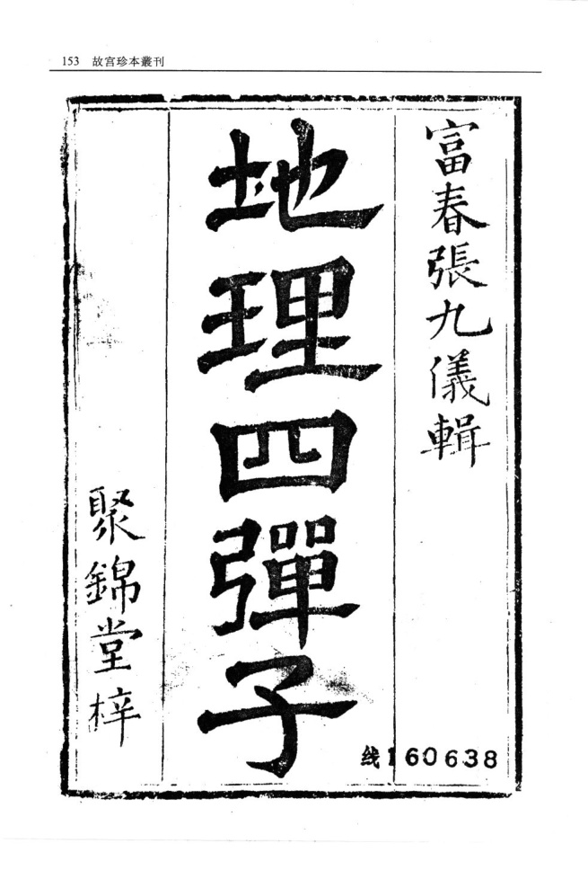

<!-- V3_SOURCE_ID:book025-b000006-p000-88d329f9e6 -->

秋季的最后一个月，马闲翁的外甥张九仪前来杭州游览，到西麓观赏胜景，我通过朱秭老得以与他相见结识。我们一起商讨订正堪舆学说，论述理气就以经传为根本，辨别峦头就详推地形的特质，所得结论和马闲翁之前的指点没有丝毫出入。我这才惭愧往日听过的术士言论，全都是庸劣粗鄙的空谈，和天地造化的关键规律完全没有关联。如今我有幸遇到张九仪先生，能让先人的亡灵得到妥当安葬，庇佑后世子孙蒙享福泽，想来这是先父一生积善才有这样的果报，还是我诚心待人，才遇上这种不欺人的真学问呢？但我完全没有藏私的想法，想到庸劣的术士误导他人，往圣的堪舆宗旨自青田以来几乎埋没不显，于是我先把《地学正义》附在《三弹子》后面，公之于世用来救人，也不避讳有轻易泄露秘术的嫌疑。只希望所有和我志同道合的人，都能用这套学问让先人得以安稳安葬，让后世子孙兴旺。看到这本书的人，要拿《三弹子》里辨明的峦头内容作为参考，和《铅弹子》所讲的理气内容互相调和验证，救己救人，或许就能两边都兼顾到了。巳蓝 二。

> **释读存疑：** 原文“季秋其令甥張九儀先主來遊武林”中“先主”为讹误，未找到可靠释读依据，据上下文推断为衍文；原文“庸術快人”语义不明，此处按“庸劣的术士误导他人”理解释出，存疑；原文“救巳救人”为“救己救人”的形近讹误；原文“爰詩先以地學正義”为“爰是先以地学正义”的形近讹误

查看对应原文

<!-- V3_FOLDBACK_BEGIN:book025-b000006-p000-88d329f9e6 -->

季秋其令甥張九儀先主來遊武林覽勝西麓余得因朱秭老而晉接焉相與商訂堪與述理氣則本經傳辯巒頭則詳性情與閑翁所示不與毫釐方愧向日所聞詣術士者殊皆庸劣鄙談與造化樞機茫無關切今何幸得遇儀翁俾我先靈妥佑後徹蒙麻想先君一生積善之所由致歟抑亦予以不敗待人而得遇此不欺人之術歟然余究無自私之心也因念庸術快人往聖宗旨自青田以來幾湮沒不彰爰詩先以地學正義附于三禪子之後公世以救人且不以輕洩爲嫌惟願凡我同志皆得以安先人昌後嗣焉則覩此書者藏以三彈子所辯之巒頭折衷于鉛彈子所述之理氣救巳救人庶兩得之巳蓝 二

<!-- V3_FOLDBACK_END:book025-b000006-p000-88d329f9e6 -->

<!-- V3_SOURCE_ID:book025-b000007-p000-07ea24a419 -->

康熙十四年乙卯季秋，海昌人陈彝则，号子苛甫，谨政。《地理四弹子》叙。自从太极分化之后，地形就显现出来；地形显现之后，八卦被创制出来；八卦创制之后，地理的规律就明晰了。太极存在的时候，只是一片混沌的状态。等到天地的位置确定，日月开始运行，之后高低上下的地形抬眼就能看到，这就是地形显现的缘由。当时的人都朴拙粗陋，还不认识文字，等到伏羲氏天生聪慧明达，仰观天象，俯察地理，见其……以上是自序。

> **释读存疑：** 原文“季騫”为“季秋”的形近讹误；原文“子苛甫”疑似“子奇甫”的形近讹误，无足够校改依据，暂保留原词；原文“雅伏羲氏”为“迨伏羲氏”的形近讹误

查看对应原文

<!-- V3_FOLDBACK_BEGIN:book025-b000007-p000-07ea24a419 -->

康熙十四年乙卯季騫海昌陳彝則子苛甫謹政 地理四彈子敘 自太極分而地形現已自地形現而八卦畫巳 亦自八卦晝而地理明已當太極之時一渾淪 境界爾迨天地定位而日月運行然後高卑上 下舉目可見此地形所由現也時人皆朴陋未 識文字雅伏羲氏聰明天亶仰觀俯察見其輕 自序

<!-- V3_FOLDBACK_END:book025-b000007-p000-07ea24a419 -->

<!-- V3_SOURCE_ID:book025-b000008-p000-bccb88b6d9 -->

见其清为阳，就画乾卦；见其重浊为阴，就画坤卦；见太阳升起、月亮恒常运行，就画离卦和坎卦；见雷声震动、风吹鼓动，就画震卦和巽卦；见山势高耸、水深广阔，就画艮卦和兑卦。因为有这些对应的形态，才画出这些对应的卦象，这本来是日常可以应用的实在事理，不是纸面上的空谈。八卦都画出来之后，只要是存在一种形态，就对应有一种规律。比如山从南方来，就能知道它属于离卦类的山；山从东方来，就能知道它属于震卦类的山。山川的变化形态各不相同，全都可以归总到八卦的范畴里，地理相关的吉凶判断也就能够在天下显明流传。但是在上古时期，圣明之人神圣尊贵，贤能之人显达明晓，所有人都把这套方法当做日常行事的惯常准则。自从秦代焚书的火患严重之后，圣人留下的教化难以显明传播，地理相关的学问才成为专门的科目，管、郭二人也由此大大开扬了这门学问的传承风气。之后圣人接连相传，贤人递次记述，有一时之间数位圣人同时出现的情况，也有数百年才出现一位圣人的情况，大概相关内容到“见知二”就截止了。

> **释读存疑：** 本地硬校验仍未通过，已记录供后续自动处理或人工核对。

查看对应原文

<!-- V3_FOLDBACK_BEGIN:book025-b000008-p000-bccb88b6d9 -->

清爲陽則畫乾見其重濁爲陰則畫坤見夫日升而月恒也則畫離與坎見夫富動而風鼓也則書震與巽見夫山高而水深也則畫艮與兌因其有如是形遂畫如是卦固日用之實事非紙上之虛言也八卦既晝則凡有一形者卽有一理如山從南至遂知其爲離山自東來遂知其爲震山川之變態不一總括于八卦之中而地理之吉遂彰明于天下然上古之時聖而神聖賤而顯蒙咸以此爲行習之常自秦煙肆烈聖敎難明地理一事乃立專門而管郭遂大圍宗風巳嗣後聖聖相傳賢賢遞述有一時而數聖並集者有數百年而一聖間生者大抵見知二

<!-- V3_FOLDBACK_END:book025-b000008-p000-bccb88b6d9 -->

<!-- V3_SOURCE_ID:book025-b000009-p000-20b394e476 -->

我听闻这和精一的道统相类似，因此丘杨二会以及陈、吴、廖、赖、朱、蔡、二刘诸位，都传承圣人所立的河洛法则，使用挨星的方法，虽然地的规模有大小的区别，但对应的吉凶祸福都能明确预知。当今世上，各家说法杂乱，正统的堪舆理论没人传扬，我潜心研究这门学问很多年，读遍了坊间刊刻的相关书籍，自以为已经掌握了其中的道理。有幸在乙巳年秋天，淳邑的方先师来到府城，在岁试的某一天，于更闸的时候指月……

> **释读存疑：** 原文“丘楊二會”语义不明，暂保留原词，具体所指不详；原文“遍閣坊刻”为“遍阅坊刻”的形近讹误；原文“淳邑又承方先師來郡歲試”按语义断句为“幸于乙巳秋，淳邑方先师来郡，岁试一日”，“又承”为衍文；本地硬校验仍未通过，已记录供后续自动处理或人工核对。

查看对应原文

<!-- V3_FOLDBACK_BEGIN:book025-b000009-p000-20b394e476 -->

聞知亦與精一之統相似故丘楊二會以及陳吳廖賴朱蔡二劉無非聖宗河洛法用挨星雖地有大小之不同而吉凶禍福皆灼知而預見當今之世羣言治亂正義無聞余之究心者數年遍閣坊刻自以爲道在是巳幸于乙巳秋淳邑又承方先師來郡歲試一日于更閘時指月

<!-- V3_FOLDBACK_END:book025-b000009-p000-20b394e476 -->

<!-- V3_SOURCE_ID:book025-b000010-p000-5ffd27ab78 -->

方先师谈论纳甲的要义，认为不是单凭言语就能说清，是可以通过实际形态观察到的。我在旁边悄悄聆听，听到了之前从未听闻的内容，才醒悟从前学的都是虚浮无用的学问，于是行弟子礼，向他叩问核心要义。我反复请教疑难，有幸先生不吝赐教，还拍掌大喜说：“我现在有传人了。”于是先生将河洛的渊源、挨星的真诀，全部详细讲解给我听，我之后把这些内容整理成书，书名叫作《正义》，另外又写了《砂水要诀》两篇，后文残缺。三。

> **释读存疑：** 原文“一詳詔余知余遂錢以成書”按语义断句为“一一详诏余，余遂辑以成书”，“錢”为“輯”的形近讹误；原文“而以息 三”为残缺标识，后文内容缺失

查看对应原文

<!-- V3_FOLDBACK_BEGIN:book025-b000010-p000-5ffd27ab78 -->

而談納甲之義以爲非言可說實形可觀予從旁竊聽聞所未聞方悟從前皆虛浮學問乃執弟子禮而叩宗旨焉問難之下幸先生不吝至教且拍掌大喜曰吾今而有傳人已于是將河洛之淵源挨星之真訣一詳詔余知余遂錢以成書名爲正義外又作砂水要訣二篇而以息 三

<!-- V3_FOLDBACK_END:book025-b000010-p000-5ffd27ab78 -->

<!-- V3_SOURCE_ID:book025-b000011-p000-4dc1592497 -->

3 书中对“親閔仙跡”控制山川的精妙要义，逐节做了注释证明。这些内容是听闻得来的，还是亲眼见识到的，我都不敢自居。去年本打算响应部里的征召，效命……

> **释读存疑：** 原文“親閔仙跡”语义不明，暂保留原词，具体所指不详；原文“俱不敢任”指不敢自居“闻知”“见知”的身份

查看对应原文

<!-- V3_FOLDBACK_BEGIN:book025-b000011-p000-4dc1592497 -->

3 親閔仙跡控制山川之妙諦逐節而註証之此爲聞知耶其爲見知耶俱不敢任客歲擬應部檄効忠

<!-- V3_FOLDBACK_END:book025-b000011-p000-4dc1592497 -->

<!-- V3_SOURCE_ID:book025-b000012-p000-378c687043 -->

王家殊，县令因为军务繁忙，没有时间详细送行，于是我暂时停留在杭州，游览各处胜景，此处原文有缺字。海昌的陈老和我舅父马闲翁是至交，于是安排我住在黄锜堂中，我和陈老志趣相投，称得上是一见如故，于是谈论……

> **释读存疑：** 原文“王家殊”语义不明，暂保留原词，具体所指不详；原文“遊# 覽勝地”有缺字，已标注；原文“堪云傾如故”是“倾盖如故”的省写，意为初次相逢就像老朋友一样契合

查看对应原文

<!-- V3_FOLDBACK_BEGIN:book025-b000012-p000-378c687043 -->

王家殊邑尊因軍務冗繁未暇詳送爰稅駕武林遊# 覽勝地海昌陳老與舅氏馬閑翁知交因館余于黃錡堂中兩人相契堪云傾如故因談

<!-- V3_FOLDBACK_END:book025-b000012-p000-378c687043 -->

<!-- V3_SOURCE_ID:book025-b000013-p000-da399d6d3e -->

等到看到范文正公关于良相、良医的言论，就慨然说道：良相和良医都是救人的，而这门学问救人，更能救助那些从事救人职业的人。于是把刘青田所传的《三弹子》刊刻出来公之于世，这部书世间虽然有传本，但流传并不广泛。其中主弹子的部分没有注释，我不揣度自己才疏学浅，为它补充了注释。同时我悲叹平庸的方术误人，先把《正义》一书胡乱附在《三弹子》的末尾，把合起来的书称作《四弹子》。就算诸位友人中有喜好虚言、轻易泄露内容、对此十分忌讳的人，也无碍我作这篇自序。篇末的“西”字含义不明。

> **释读存疑：** “未”按形近讹为“末”释读，“卽諸友中有虛言輕洩重忌者子自序”断句存在不确定性，末尾“西”字具体所指不详

查看对应原文

<!-- V3_FOLDBACK_BEGIN:book025-b000013-p000-da399d6d3e -->

及范文正公良相良醫之語乃概然曰良相長醫救人者也而此道之救人更能救乎救人之人爰以劉靑田所傳三彈子世有傳本而未廣者刊以公世其中主彈子未註余不揣疎鄙而補之且悲庸術誤人先以正義一書妄附于未以爲四彈子卽諸友中有虛言輕洩重忌者子自序 西

<!-- V3_FOLDBACK_END:book025-b000013-p000-da399d6d3e -->

<!-- V3_SOURCE_ID:book025-b000014-p000-f0589b4725 -->

奇应说。

查看对应原文

<!-- V3_FOLDBACK_BEGIN:book025-b000014-p000-f0589b4725 -->

奇應曰

<!-- V3_FOLDBACK_END:book025-b000014-p000-f0589b4725 -->

<!-- V3_SOURCE_ID:book025-b000015-p000-192388fa63 -->

上天有如此好生之德，救人的方术，正与上天好生的心意相合。现在把这部书公之于世，让那些误人的人都知道救人的方法，必将见到忠良辈出、人口繁多、家家衣食充裕、万里之内人烟繁盛的景象，这种盛况应当会在后世显现。那么这一部书，可以作为良相治理国家、划分疆界、管理百姓的谋划，又怎么能因为一己的私念，就以轻易泄露为借口不肯公开呢？我们两个人的心意就是这样，斗胆把这些想法告知志同道合的人。注：原文“艮相”应为“良相”的讹写，其中“艮”属八卦之一；原文“後見于今”疑似“将见于后世”的讹写，按合理文意释读。

> **释读存疑：** “艮相”讹为“良相”仅为合理推测，原文“後見于今”的讹写情况存在不确定性；1轮自动修复后核义模型仍建议修订，已保守记录。

查看对应原文

<!-- V3_FOLDBACK_BEGIN:book025-b000015-p000-192388fa63 -->

上帝好生如此救人之術正與好生之心相合今身公之于世而使誤人者皆知所以救人將見忠良輩出戶口殷繁家給人足煙火萬里之盛後見于今則此一書可當艮相體國經野之謨又何得以一巳之私意而以輕洩爲言哉余二人之心如此敢以質諸同志者

<!-- V3_FOLDBACK_END:book025-b000015-p000-192388fa63 -->

<!-- V3_SOURCE_ID:book025-b000016-p000-ea6759424a -->

康熙十四年，岁次乙卯，季春望后五日，富春张凤藻九仪甫，题于武林之黄编堂中。

查看对应原文

<!-- V3_FOLDBACK_BEGIN:book025-b000016-p000-ea6759424a -->

康熙十四年歲次乙卯季春望後五日富春張鳳藻九儀甫題于武林之黃編堂中

<!-- V3_FOLDBACK_END:book025-b000016-p000-ea6759424a -->

<!-- V3_SOURCE_ID:book025-b000018-p000-71d5cf450c -->

现在《弹子》的序里说，地理之学本来不难，是人们自己把它想得很难；理气之学本来不容易，是人们自己把它看得很容易。难的事没有比得到真传更难的，真传能让人把吉凶晦吝都掌握在手中；容易的事没有比窃取学问的糟粕，随意摆弄他人的高低贵贱更易的，我也担心这种乱象。我曾在耶律楚材处得到名为《三朋》的重要典籍，跟随他学习阴阳五行，在各类变化中潜藏心志、潜心钻研，仔细探究造化的关键，辨明事理、精深研究理气的枢纽，一直小心翼翼、终年刻苦钻研，不担心声名不够显赫，只害怕学识不够充实。说到《元珠经》《今弹子》《元珠经》《玉弹子》《元殊经》《铁弹子》这些典籍，都是难以传承的珍贵内容，是贵右老翁得自天书的下卷，承接了天机的余绪，梳理了理气的精要，编纂成三册，内容不过数篇，传承体系不算繁杂却很完备。末尾的“二序 天”含义不明。注：原文“晦咨”按形近讹为“晦吝”释读，“掌屋”按形近讹为“掌握”释读，“帝”按形近讹为“諦”释读，“樞新”按形近讹为“樞紐”释读。

> **释读存疑：** “三朋”是否为书名存在不确定性，“于倫倫逸變”的具体含义不明，“难传自贵右老翁”的断句与释读存在不确定性，末尾“二序 天”具体所指不详，多处讹字的推断仅为合理推测

查看对应原文

<!-- V3_FOLDBACK_BEGIN:book025-b000018-p000-71d5cf450c -->

今彈子序地理木不難而人自難之理氣本不易而人自易之難莫難于得真傳置吉凶晦咨于掌屋之中易莫易于竊精粕弄高貴貧賤于誰侮之下予亦恐焉予得大書三朋于耶律楚材從學陰陽五行于倫倫逸變潛心遯志帝究造化之機關問明辨精研理氣之樞新翼翼小心兀兀窮平不求聲聞之不著乃憚學識之不充若云元珠經今彈子元珠經玉彈子元殊經鐵彈子者難傳自貴右老翁實本目天書之下卷掾天機之餘緒敘理氣之精筆編成三帳不越數首嗣不繁而全二序 天

<!-- V3_FOLDBACK_END:book025-b000018-p000-71d5cf450c -->

<!-- V3_SOURCE_ID:book025-b000019-p000-7cb4759a5b -->

全书内容意义周全、语句不混杂，条理十分清晰，真是古往今来流传的心法，确实是后世学习者的准则。历代凡是从事这门学问的人，没有不把它当作师徒传承的心法，常常都深切知道要珍视地理的机要隐微。原本黄石公将它命名为《地理元珠》，杨子称它为《阴阳朔略》，曾子称它为《理气心经》，唉，我给它取名为《金丽子》，顿子给它取名为《柜江纲》，鬼谷子称它为《指掌明珠》，廖子称它为《金精心法》。凡是修习这门学问、以此为业的人，没有不反复推演它的词义，为它做明确注释的。唐代的一行将这些内容汇集成册，命名为《堪舆秘旨天机金弹子》，用来告示后世的学者，告诫他们要自己秘藏，不要传给不合适的人，要将道看得尊贵，谨慎不要轻易使用。我得到了完整的三册内容，静下心来揣摩研读，果然概括了所有艰深的内容，地理之学的义理已经没有遗漏了。只是全套内容繁多，词义虽然很好，还是不如简明扼要更好，所以在年末感慨之余，就为它做了注释，让后世看的人能够领会主旨不会背离，内容详实完备，口诀方法正确，研习的方向不会有偏差，让世上怀着恭敬诚心追求极致造诣的人，也能有所依凭，行事不会有差错。于是我将这部注释本命名为《金弹子直指注》，写了这篇序，把相关的缘由放在卷首。注：原文“黃石入”按形近讹为“黄石公”释读，“邪予”按语气词“邪，予”断句，“畫”按形近讹为“盡”释读，“金彊于”按形近讹为“金弹子”释读；原文“趨向”的“向”并非指建筑或穴位所朝的方位，在此处指学术研习的方向；“使後觀者神不背而塵致詳盡”“而成召之不忒”“以其所事以冠之小其首云”语义存在歧义，按合理文意释读。

> **释读存疑：** “邪予”的断句存在不确定性，“頓子名櫃江綱”的具体含义存在不确定性，“神不背而塵致詳盡”“而成召之不忒”“以其所事以冠之小其首云”的准确含义不明，多处讹字的推断仅为合理推测

查看对应原文

<!-- V3_FOLDBACK_BEGIN:book025-b000019-p000-7cb4759a5b -->

一意義盡句不雜而條理明真古今之心法誠後學之準絕歷 世凡從事于是者莫不由之以為傳受之心法每切知以 珍地理之機微原黃石入名爲地理元珠楊子號爲陰陽朔 略曾子稱爲理氣心經邪予名金麗子頓子名櫃江綱鬼谷 子稱爲指掌明珠廖子稱爲金精心法凡八斯門業斯學者 莫不敦演其詞義而明註之唐一行集而成帙名之曰堪輿 秘旨天機金彈子以詔後之學者戒令自秘勿授非人以道 自尊慎卯輕用予得三冊之全峽澄心玩味果爾括艱殆畫 而地理之學無餘蘊矣但全帙汗漫詞義雖佳莫若簡約之 爲尙故于歲冬感慨之服亦則註之使後觀者神不背而塵 致詳盡訣法正而趨向不差使世之敬誠而求造絕者則亦 有所依歸而成召之不忒其因名之曰金彊于直指註成序 其所事以冠之小其首云

<!-- V3_FOLDBACK_END:book025-b000019-p000-7cb4759a5b -->

<!-- doc013 PDF 第 161 页：高风险/复杂版面 OCR 供检索；内容与排版以原页图为准。 -->
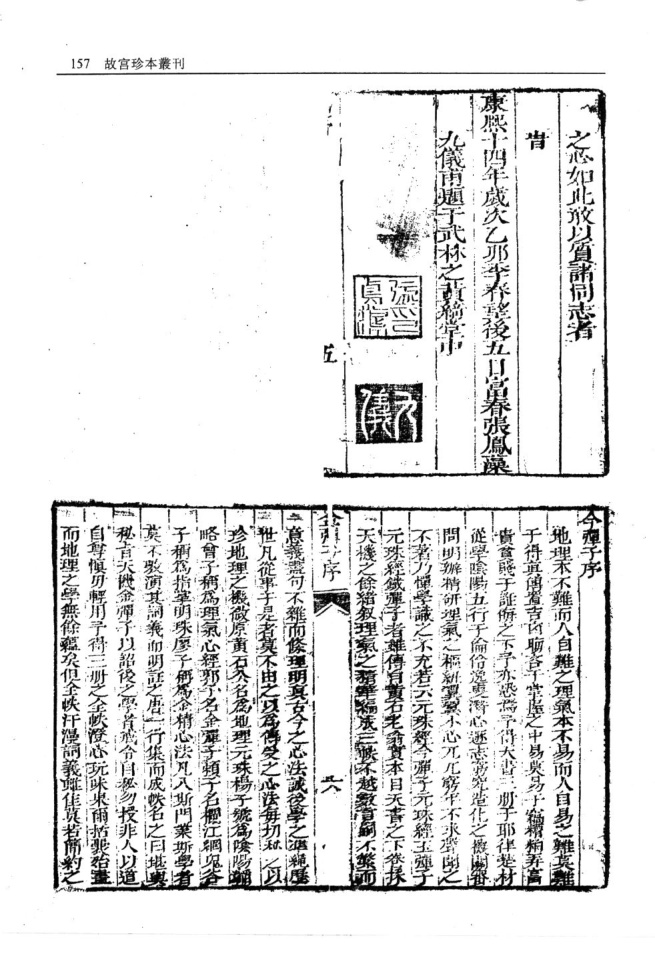

<!-- V3_SOURCE_ID:book025-b000021-p000-91fb4b4e92 -->

明太师文成诚意伯青田刘基刘伯温撰，南唐国师何令通著。

查看对应原文

<!-- V3_FOLDBACK_BEGIN:book025-b000021-p000-91fb4b4e92 -->

明太師文成誠意伯靑田劉伯溫基撰 南唐國師何令通著

<!-- V3_FOLDBACK_END:book025-b000021-p000-91fb4b4e92 -->

<!-- V3_SOURCE_ID:book025-b000022-p000-3b04aa73d5 -->

明新安游嵩注。

查看对应原文

<!-- V3_FOLDBACK_BEGIN:book025-b000022-p000-3b04aa73d5 -->

明新安游嵩註

<!-- V3_FOLDBACK_END:book025-b000022-p000-3b04aa73d5 -->

<!-- V3_SOURCE_ID:book025-b000023-p000-9e693119eb -->

此处有“治名海昌陳彝則子高甫訂”的标注，其中“治名”的具体含义不详。

> **释读存疑：** “治名”具体所指不详

查看对应原文

<!-- V3_FOLDBACK_BEGIN:book025-b000023-p000-9e693119eb -->

治名海昌陳彝則子高甫訂

<!-- V3_FOLDBACK_END:book025-b000023-p000-9e693119eb -->

<!-- V3_SOURCE_ID:book025-b000024-p000-6e70ead0de -->

宇宙有重大的关键节点，气运是其中的主导；山川有真实的特质，气势是其中的首要因素。这一条是论述气的核心要诀。过去有人说，有合适的地但没有合适的人就不要下针下葬，有合适的人但没有合适的时机也不要下针下葬，大概就是从气运的角度来说的。又有人说，用眼界去观察，用特质去体悟，如果能做到这些，就可以走遍天下，这是《铁弹子》中形气部分的内容，是从气势的角度来说的。就像前代的哲人一看地形优越之处，就能知道祸福的大小、传世的先后，全都是根据气运的高低来判断的。世运有转移，就像历法有节气物候的变化。比如天汾临近黔地的地方，本来是公侯级别的宝地，吴公能为马氏指出这块地，却不能保证马氏一定能得用这块地的福祉；荆山、涂山两处灵气交汇的地方，应当是王者的吉兆，吴公能把这块地献给宋朝，却不能保证宋朝一定能用到这块地的吉运，这难道不是节气还没到才这样的吗？所以国运兴盛的时候就会出现贤能的宰相，国运衰败的时候贤人就会隐居。人的贵贱很难由风水决定，而合适的人与合适的时机碰在一起，其实是由国运决定的。至于德行深厚的家族，后代一定会昌盛，就可以办丧葬的事，所谓将要昌盛的家族、有德行的家族，下葬后一定会兴旺，这是从家运的角度来说的。比如汤公为颜氏修建了催官食禄的楼，颜氏果然考中了科举；某公得到异人指点的卧牛形宝地，后来果然位至三公，这是从个人的运势来说的。由此可知没有运势什么都做不成，运势分为世运、国运、一家和个人的运势，这正是宇宙的关键关联之处，如果不考察这些就随意行事，上天不会庇佑，方术也起不了作用。山川有真实的特质，要怎么分辨呢？过去的人说，山地承袭秀气，水（指风水语境中的河流、水系及其来去形态）承袭聚积的气，石地承袭谷间的气，平地承袭和善的气。又说山谷的气有差异，平原则是同一种气，这是山川的大趋势所在，也就是山川的特质。山地为什么要取秀气？山的走势大多刚猛顽硬，只怕不够秀丽，如果看到有秀丽舒展的地方，就是英气汇聚的地方。山势高聚的地方，多取清灵的天之气，就是常说的重山势不重水系的情况，所以把峰峦的秀丽当作生气。水系为什么要取积气？水的走势大多流动散去，只怕不能凝滞不流，如果看到众多水系汇聚的地方，就是气汇聚的地方。地势低下汇聚的地方，多取凝定积蓄的意味，就是常说的重水系不重山势的情况，所以把水系的积聚当作生气。石地为什么独独取煞气？山有祥和的气，也有暴怒的气，暴怒的时候山的威灵大多显露在石头上，如果石头过于刚猛逼仄，不成体统阵势，没有威严的仪态，就是只有煞气没有生气，错误地在这里下葬灾祸马上就会到来。如果石头形态完好有气势，就有生气，也可以取用。“履宣经忍乎”一句含义不明。平地为什么独独取和善的气？平洋地区一片阳气，没有阴气，生气不想要有突兀的骨脊隆起，要有和缓的生气，就像古人说的“没牛吹气，如酥在汤”的意思，正是这样。山谷为什么说气有差异？平地的各类区域各自有起势，各自有布局，各自有门户，有形态有气势，气各不相同，所以江南一带和江北的情况不同，只要看到有一座山特别隆起，形成一个完整的局面，有覆盖有护持，有朝山有迎山，或是形成城邑的格局，或是形成县治的格局，就有结穴的可能，应当留意。闽、广、吴、越这些地区，每个村子每个社，都有名宅名墓，连语音习俗都各不相同，就是因为气有差异才这样的。平原为什么说气是统一的？现在看江北地区，一眼望去广阔平坦没有大的区别，只要看到有一块高起的脊地，就会在那里建城廓市镇，次一等的地方建房屋坟地，都聚集在这里，就算是几百里的范围，语音习俗大多都相通，难道不是同一种气才这样的吗？古人说的风气各地不同，就是这个道理。如果是在气有差异的地方，随便用开阔平坦的地势来一概而论，是不合适的。末尾的“二”为篇目分隔符。注：原文“鐵耀子”按形近讹为“鐵彈子”释读，“氣逐”按形近讹为“氣運”释读，“夫”为衍字删去，“朱朝”按形近讹为“宋朝”释读，“逆”按形近讹为“運”释读，“字宙”按形近讹为“宇宙”释读，“登疑”按形近讹为“凝滯”释读，“所精”按形近讹为“所聚”释读，“咨氣”按形近讹为“善氣”释读，“俸”按形近讹为“体”释读；原文“不能必爲馬氏藥”“大謂係處”“天不相術亦不緊矣”“履宣經忍乎”“平山咨中”“一調局面時關有盖有遂”“齊城”“停縣”“彌子形氣”语义不明，按合理文意释读。

> **释读存疑：** “不能必爲馬氏藥”的准确含义不明，“大謂係處”的准确含义不明，“天不相術亦不緊矣”的准确含义不明，“履宣經忍乎”的准确含义不明，“平山咨中”的准确含义不明，“一調局面時關有盖有遂”的准确含义不明，“齊城”“停縣”的具体所指不明，“彌子形氣”的准确含义不明，多处讹字的推断仅为合理推测；本地硬校验仍未通过，已记录供后续自动处理或人工核对。

查看对应原文

<!-- V3_FOLDBACK_BEGIN:book025-b000024-p000-6e70ead0de -->

字宙有大關會氣運為王山川有眞性情氣勢爲先此條乃論氣之大竅也昔云有地非人不下有人非時不下盖以氣運言也又云察以眼界會以性情若能子此天下橫行此鐵耀子形氣 元以氣勢言也如前哲一觀形勝便知禍福大小世数先後全在氣逐上下之夫世運之有轉移猶曆数之有節候如天汾臨黔固公地吳公能爲馬氏指不能必爲馬氏藥荊塗兩鳳交通地當爲王者兆吳公能爲朱朝獻不能必爲宋朝用此非節侯未到而然乎是故國運興得賢相國運衰賢人隱其貴與不賢難由地定而其人其時湊合實以國運也至如厚德之家厥后必昌便可襄事所謂將昌之家有德之家塟必興旺以其家運言也如湯公爲顏氏作催官食祿之樓而舉果上第啊公得異人指照牛之地而位果三公此自其一身之運論也乃知無運所開有以世運者有以國運者有以一家一身之逆者此正字宙大謂係處若不察此而設爲之天不相術亦不緊矣夫山川有眞性情何以辯也昔人云山乘秀氣水乘積氣石乘穀氣平乘善氣又云山谷異氣乎原一氣此山川之大勢所在卽山川之與性情也山何以取秀氣山之勢類多剛猛而頑硬惟患不秀麗若見秀灑所置便是英氣所聚上聚之地誰取天清之氣多所謂权山不奴水者此也故以峰巒之秀麗爲生氣水何以取積氣水之勢多流走而散體惟患不登疑若見諸水所精便是其氣所鍾下聚之地惟取凝蓄之意多所謂収水不収山者此也故以水神之積聚爲生氣石獨取乎煞氣者何以山有山之喜氣亦有山之怒氣怒則山之威靈多露于石若石之明猛壓通不成体勢不作威儀則有煞無生矣誤下禍不旋踵如其有休有勢有形則有生氣亦可取用履宣經忍乎獨取乎咨氣者何如平洋一泒紀陽無陰生氣不欲苟有骨脊之起使爲飲而有生氣背人有没牛吹氣如酥在湯之嗚意正如是山谷何以稱異氣平山咨中各有起勢各有開局各有門戶有俸有勢其氣各異故江有一帶與江北不同只見一山特起一調局面時關有盖有遂有朝有迎或爲齊城或爲停縣便有結作便當着眼閩廣吳越之邦各村各社各有名宅名塚凡語音習尚又各各不同唯異氣然也平原何以稱一氣乎如今江北四望廣漠無大分別只見一方固脊起處便作城廓市鎮其次爲廬舍墳宅盡聚于此卽語音習尚雖數百里多爲通同謂非一氣然乎古云風氣異宜者此也倘若異氣之處而漫以漢然四望之勢彌子形氣 二

<!-- V3_FOLDBACK_END:book025-b000024-p000-6e70ead0de -->

<!-- V3_SOURCE_ID:book025-b000025-p000-ff0450db83 -->

如果只着眼于开阔的视野去探寻，就会错失真意；倘若一定要以山与水交汇成势的角度去探寻，又会因视野过于狭隘而出错。这说明，要认识气，关键在于把握气势。凡是研习堪舆的人，都不能不了解气运，也不能不察明气势。

查看对应原文

<!-- V3_FOLDBACK_BEGIN:book025-b000025-p000-ff0450db83 -->

求之則以眼界大寬而失矣倘若一氣之處必以山水分結之勢求之則又以眼界太狹而失矣此認氣以認氣勢爲難也凡柔堪與不可不知氣運不可不察氣勢也

<!-- V3_FOLDBACK_END:book025-b000025-p000-ff0450db83 -->

<!-- V3_SOURCE_ID:book025-b000026-p000-d643900b9b -->

地运会发生推移，天气会随之变化；天气会发生转徙，地运会与之相应。天气在上方发动，人事会与之相应；人事在下方发动，天气会随之变化。

查看对应原文

<!-- V3_FOLDBACK_BEGIN:book025-b000026-p000-d643900b9b -->

地運有推移而天氣從之天氣有轉徙而地運應之天氣動于上而人爲應之人爲動于下而天氣從之

<!-- V3_FOLDBACK_END:book025-b000026-p000-d643900b9b -->

<!-- V3_SOURCE_ID:book025-b000027-p000-f79be03ee6 -->

这段内容讲的是气运与天、地、人三者相互作用才能成事，原文此处有OCR讹误，作“一有琳徒舉動氣卽以異”，是懂得观察时势、辨识变化的人掌握的关键枢纽。什么是地运有推移而天运随之变化呢？比如黄河，是天地之间的第一大血脉。根据记载，唐尧、虞舜时期，黄河从龙门转向吕梁，再从吕梁转向太行，又从太行转向碻磝，之后才流入大海，当时黄河是从西转向南，再从南转东南，中国的地理形胜确实到这里达到了居中的极限。到了周末，孔子诞生，众多贤才同时出现，千古以来没有比这更兴盛的时期，这是开天辟地以来还没有发生过转移迁徙的山水格局。从汉代开始，黄河逐渐向南迁徙，河道取道淮河，而泰山反而处在北方，黄河就处在南方了。冀州的水势倾斜，原文此处有OCR残缺，作“魯之地脈所而明朝祖陵鍾于中都”，明朝的祖陵在中都聚气，帝业兴起于徐州、扬州一带，正在淮水和泗水之间，这难道不是黄河南迁，气运随之南移造成的吗？原文此处有OCR讹误，作“入言江南之盛以宋南護面然”，应为“人言江南之盛以宋南渡而然”，有人说江南的兴盛是宋代南渡之后才出现的，却不知道黄河迁到南方，天运也就跟着迁到南方了。原文此处有OCR残缺，作“河爲天氣有總徙河也兩庶之如系”，具体含义无法确认。原文此处有OCR讹误，作“太史占金襲有天子氣”，应为“太史占金气有天子气”，太史观测到金气有天子气，就疏通秦地的水道来疏泄这股气，原文此处有OCR残缺，作“不知案誰通禮里動”，具体含义无法确认。原文此处有OCR残缺，作“自後小曲六朝之建極大而明世之定鼎”，可知六朝在此建立政权，明代在此定都，果然应验了龙气聚集在此的说法。原文此处有OCR讹误，作“又洛陽一聞社賜啼而知天氣行乎南”，具体含义无法确认，只知大意是得知天运转向南方，南方人果然从此兴起。原文此处有OCR残缺，作“果自是作山山軍大則而天氣先則則地又從天轉也”，具体含义无法确认，只知大意是天气率先移动，地运也跟着天运转。什么是天气在上方变动，人事会与之相应？比如陈希夷，一天夜里看到小星处在帝星的左侧，等到天亮，原文此处有OCR讹误，作“及旦而所任乃見宗祖與趙普同坐酒肆間”，看到宋太祖和赵普一起坐在酒肆里，赵普坐在左边，陈希夷就说“小星为什么在帝星左边呢”，的确应验了这件事，这是宋太祖时候的事。现在的人大多认为星气的说法渺茫不可信，不知道天的变动感应是如此的分毫不差。什么是人事在下方发动，天气会随之感应？比如洛阳的花石纲，原文此处有OCR残缺，作“何大蘭係而元史占之以爲花石不去則未之庇氣不絕”，元代的史官占测认为花石不移走，宋朝的气运就不会断绝，等到花石被移走之后，航海的船只就出现了。人的一举一动，天都会有所感应，气运怎么会不连通呢？望气就可以预先占测，观察时势就可以看出变化，原文此处有OCR残缺，作“非道服島足以語此”，具体含义无法确认。原文末尾有OCR残缺，作“風而子形氣”，语义不通。

> **释读存疑：** 一有琳徒舉動氣卽以異；魯之地脈所而明朝祖陵鍾于中都；入言江南之盛以宋南護面然；河爲天氣有總徙河也兩庶之如系；不知案誰通禮里動；自後小曲六朝之建極大而明世之定鼎；又洛陽一聞社賜啼而知天氣行乎南；果自是作山山軍大則而天氣先則則地又從天轉也；及旦而所任乃見宗祖與趙普同坐酒肆間；何大蘭係而元史占之以爲花石不去則未之庇氣不絕；非道服島足以語此；風而子形氣

查看对应原文

<!-- V3_FOLDBACK_BEGIN:book025-b000027-p000-f79be03ee6 -->

此條言氣運天地人相與有成一有琳徒舉動氣卽以異政識 時觀變者之大權紐也何爲地運有推移而天氣從之如董河 是天地間第一大血呱據唐虞時河由龍門而轉呂梁由呂巢 而轉大行由大行而轉碼石乃入海是河從西轉南從南體東 南中國形勝寔爲中盡時至周未孔聖起而畢賢並生千古莫 盛焉此開開以來未有轉移遷徙之山水也自漢黃河漸徙而 南道走淮四太山反居北而黃河乃居南矣冀州之水勢傾節 魯之地脈所而明朝祖陵鍾于中都大業起于徐楊正在惟酒 之間豈非黃河南從氣蓮制然乎入言江南之盛以宋南護面 然不知黃河述而之南則天運亦徙而之南也河爲天氣有總 徙河也兩庶之如系太史占金襲有天子氣乃疏秦推以洩之 不知案誰通禮里動自後小曲六朝之建極大而明世之 定鼎果龍于此又洛陽一聞社賜啼而知天氣行乎南南人 果自是作山山軍大則而天氣先則則地又從天轉也何為 天氣動于上八爲傳之知陳希彞一夕見小星居帝星之左 及旦而所任乃見宗祖與趙普同坐酒肆間而普居左 陳乃曰小星何帝星左哉確而易之此宋祖徹時事今人 多以星氣爲渺通不知天之動應不爽如此何爲人爲動子 下而天氣從之如洛陽花石何大蘭係而元史占之以爲花石 不去則未之庇氣不絕及一旦移去花石而航海之舟遂見 人一舉一動天卽應之氣何爲不通也望氣而 可預占察時而可觀之非道服島足以語此 風而子形氣

<!-- V3_FOLDBACK_END:book025-b000027-p000-f79be03ee6 -->

<!-- V3_SOURCE_ID:book025-b000028-p000-f36dd0132e -->

原文此处有OCR讹误，作“大星有聚峭行峭坐嚙則氣聚于龍”，其中“坐嚙”应为“坐峭”，大的星峰有聚峭、行峭、坐峭的形态，气就会聚在龙身上；有烟星、尊星、雄星的形态，气就会聚在势上；有盖胎、夹胎、乘胎的形态，气就会聚在穴里；有收襟、浪堂、收关的形态，气就会聚在局中。原文此处有OCR讹误，作“此四改乃詔氣之大閒鍵也”，其中“四改”应为“四者”，“詔氣”应为“認氣”，“閒鍵”应为“關鍵”，这四个方面是辨识气的关键枢纽。龙忌讳孤单，这是人们都知道的，人们也只知道看龙头部的几节，不知道龙要有起有伏、有行进的走势，趋向的地方一定要汇聚，就像层云叠雾，气脉相连、形局相合，大的范围绵延数百里，小的也绵延数十里，连绵不断，要么按五星排布，要么按九星排布，聚拢而不分散，这就叫做聚峭。原文此处有OCR讹误，“層如都會之地”的“層”为讹字，聚峭的形态就像都会之地，各种事物汇聚，万民定居，是枢纽要地。汇聚之后，就会分出支脉向各处延伸，条理清晰，正脉从中静静延伸，其余的支脉分向左右四方行进，有的走势闪忽，有的穿过峡谷，两边的护脉各自耸起峰峦，有的带旗、有的带鼓、有的带余气、有的带库藏，各有不同，总之汇聚之后有护脉遮掩而不显露，说龙行进时形态端正容易，说龙停驻时形态端正则不然。龙的行进经历了各种变换之后，必然有归宿，原文此处有OCR讹误，作“寶如行者之歸家”，其中“寶”应为“譬”，就像出行的人回到家，一家人必然团聚；就像官员登堂，下属的僚佐必然拱手作揖，绝对没有孤立独坐的道理。原文此处有OCR讹误，作“謂之坐麟”，其中“坐麟”应为“坐峭”，这就叫做坐峭。具备这三类形态，龙的气脉才专一，否则“孤单”的问题，就不是只出现在入穴的位置了。原文此处有OCR讹误，作“何爲權風吳公鉗龍絕中所种郡權星也”，其中“權風”应为“權星”，“鉗龍絕”应为《钳龙经》，“所种”应为“所謂”，什么是权星？就是吴公《钳龙经》中所说的郡权星，原文此处有OCR讹误，作“蓋曰箕勢盛大”，其中“箕勢”为讹字，大概是说它的气势非常盛大，“福宗”二字不足以概括它的特征。它高大得像雪山齐立云天，原文此处有OCR讹误，作“不見其貞”，其中“貞”应为“頂”，看不到它的顶端；绵延得像云海万里，看不到它的来处；丰饶众多得像昆仑山盘踞八方，看不到它的分支，天下所有山脉都以它为祖，怎么能用“祖”来称呼它呢，所以用“权”来给它命名。大概权星属于土形、金形的山体，只有虚空的土形、金形山体才能绵延不绝。原文此处有OCR残缺，作“法水七大多作祖星”，其中“七”为讹字，法水大多作为祖星，因为它活动挺立，就会分出不同的形态。《穴经》说：原文此处有OCR讹误残缺，作“星雉六不宜秀祖中縮來夢起峰一都有一都之講星一色有一邑之張凡論出歸侯公相之大結構馮本于此”，具体含义无法确认，只知大意是每个都邑、每个城邑都有对应的星峰，凡是出将入相的大格局，都以这些星峰为根本。原文此处有OCR讹误，作“至于尊歷則或祖或六為時一方爲莊山之首出者”，其中“尊歷”应为“尊星”，“為時”应为“為一”，至于尊星，要么是祖山，要么是其他山，是一方主山的首出之峰，看到它就知道龙的正脉正结都源自这里。原文此处有OCR残缺，作“久如雄是則于賊窮交謂之處有卓立星辰可以庶尊學而常門戶者則以雄禍焉”，具体含义无法确认，只知大意是雄星是在险要关口处耸立的星峰，可以作为尊星的参照，常处在门户位置，以雄为贵。就像所说的北辰、罗星之类，原文此处有OCR残缺，作“交身織結不如禽獣成彰物形守贈”，具体含义无法确认，又不如人形的守阳星作用大，不过雄星也分三类：最高的是天雄，其次是人雄，最小的是地雄，大多生在水口边，不管是高山还是岩石，都叫这个名称。观察各类杂星的高低，可以判断结地的大小，有了权星、雄星，才是气势大的地方。胎息是结穴的位置，什么是胎？原文此处有OCR讹误，作“則蓝座是也”，“蓝座”为讹字，胎就是对应的穴座，没有胎就一定不会结穴，原文此处有OCR残缺，作“華爲上微盛寶盡次之”，具体含义无法确认。原文末尾有“其彌子形氣 四”，属于标注序号的残留，语义不通。

> **释读存疑：** 大星有聚峭行峭坐嚙則氣聚于龍；此四改乃詔氣之大閒鍵也；層如都會之地；寶如行者之歸家；謂之坐麟；何爲權風吳公鉗龍絕中所种郡權星也；蓋曰箕勢盛大；不見其貞；法水七大多作祖星；星雉六不宜秀祖中縮來夢起峰一都有一都之講星一色有一邑之張凡論出歸侯公相之大結構馮本于此；至于尊歷則或祖或六為時一方爲莊山之首出者；久如雄是則于賊窮交謂之處有卓立星辰可以庶尊學而常門戶者則以雄禍焉；交身織結不如禽獣成彰物形守贈；華爲上微盛寶盡次之；其彌子形氣 四

查看对应原文

<!-- V3_FOLDBACK_BEGIN:book025-b000028-p000-f36dd0132e -->

大星有聚峭行峭坐嚙則氣聚于龍有煙星尊星雄星則氣聚于勢有盖胎夾胎乘胎則氣聚于穴有収襟浪堂収關則氣聚子局此四改乃詔氣之大閒鍵也夫龍忌孤乎人所共知亦知看到頭數節耳不知能有起有止有行度趨處必要聚觴如層雲疊霧合氣連形大以數百里小以數十里端亘綿延或以五星或以九星聚而不分謂之聚峭層如都會之地百言所聚萬民所止乃樞要之地聚之後則分枝劈派而去條分縷析正靜衍中餘則分左右四行或以走閃或以續峽而邊夾護各起峰經帶而制帶旗帶鼓帶余帶庫各各不一總之繼聚雲護而不露語之行端易言坐端龍之行度既歷變換必有歸宿寶如行者之歸家一室骨內必爲團聚如貫人之登堂所屬僚佐必爲拱揖決無孤立獨坐之理謂之坐麟有此三疇其龍乃專不則孤单二字不苦在入穴之所矣何爲權風吳公鉗龍絕中所种郡權星也蓋曰箕勢盛大福宗二字不足以盡之高大如雪山之齊天不見其貞綿瓦如雲中之萬里不見其來豐衆如崐崘八方盤踞不見其分而天下萬派之山皆祖于此何可以祖言故以紹權之是名也大抵權星炙土金之体虛土金能綿亘也法水七大多作祖星以其活動卓立則爲分形穴經云星雉六不宜秀祖中縮來夢起峰一都有一都之講星一色有一邑之張凡論出歸侯公相之大結構馮本于此至于尊歷則或祖或六為時一方爲莊山之首出者得此而知龍之正疏正結皆原十此久如雄是則于賊窮交謂之處有卓立星辰可以庶尊學而常門戶者則以雄禍焉如所云北辰羅曠之類交身織結不如禽獣成彰物形守贈又不如人守陽之爲大然而難亦分三最高者爲天雄其次爲人雖武小者為地道多生水口邊不論高山與石均稱焉觀雜星之高下可卜結地之大小有此權星雄星方爲勢大之地胎息是結穴之所何為胎則蓝座是也無胎胎必不結華爲上微盛寶盡次之其彌子形氣 四

<!-- V3_FOLDBACK_END:book025-b000028-p000-f36dd0132e -->

<!-- doc013 PDF 第 163 页：高风险/复杂版面 OCR 供检索；内容与排版以原页图为准。 -->
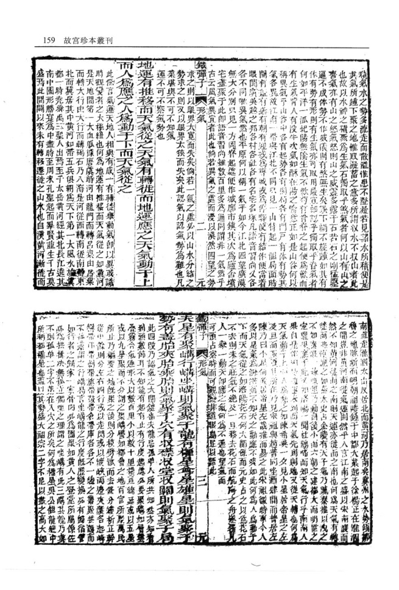

<!-- V3_SOURCE_ID:book025-b000030-p000-4dbc3bb2cc -->

胎就是小明堂。原文此处有OCR讹误，作“益上盜則氣藏于下”，其中“益”应为“盖”，“盜”为讹字，气在上部收敛就会藏在下部，气在下部承接就会浮在上部，两股来势交汇，气就蓄在中间，这才是有气的穴。原文此处有OCR讹误，作“何爲寂襟以穴中微荒界水所魯”，其中“寂襟”应为“收襟”，“微荒”应为“微茫”，“所魯”应为“所聚”，什么是收襟？就是穴中微茫的界水汇聚的地方，就像人的衣襟交叠的位置，原文此处有OCR残缺，作“名曰合藥河爲根堂”，具体含义无法确认。明堂是龙虎两侧的界水交汇的地方，就像居室的明堂，是四处的水汇聚的地方，叫做堂合。什么是众关？原文此处有OCR讹误，作“龍上分來以作成郭之處”，具体含义无法确认，小的像房屋的门户，大的像城郭的关镇，原文此处有OCR讹误，作“名白廟舍”，其中“白”应为“曰”，叫做庙舍。正说小的收堂是针对堂舍来说的，大的合局是针对关合来说的。穴情低小的，收明堂的水；穴情尊大的，收关内的水。至于小明堂，原文此处有OCR讹误，作“合禮之”，具体含义无法确认，不管穴情高低，总归适合交合。原文末尾作“凡論局者必”，是未竟的内容。

> **释读存疑：** 益上盜則氣藏于下；何爲寂襟以穴中微荒界水所魯；名曰合藥河爲根堂；龍上分來以作成郭之處；名白廟舍；合禮之；凡論局者必

查看对应原文

<!-- V3_FOLDBACK_BEGIN:book025-b000030-p000-4dbc3bb2cc -->

胎則小明堂是也益上盜則氣藏于下下乘則氣輕于上兩勢有來則氣蓄于中方爲有氣之穴何爲寂襟以穴中微荒界水所魯如人之襟頒所交名曰合藥河爲根堂以龍虎界合之水所會如居室之明堂爲四水所聚名曰堂合何爲衆關龍上分來以作成郭之處小如房屋之門戶大如城郭之関鎮名白廟舍正謂小舍収堂以堂舍言也大合投局以關合言也穴精低小者収明堂之水穴情尊大者収闋內之水至如小明堂合禮之亦不論穴精高低總宜合也凡論局者必

<!-- V3_FOLDBACK_END:book025-b000030-p000-4dbc3bb2cc -->

<!-- V3_SOURCE_ID:book025-b000031-p000-e6ae732677 -->

阴气旺盛的地方遇到阳气就会止息，阳气旺盛的地方遇到阴气就会停驻。雄龙需要有雌龙来配合，原文此处有OCR讹误残缺，作“雌龍須要雜龍”，应为雌龙需要雄龙配合的相关表述，语句不完整。

> **释读存疑：** 雌龍須要雜龍

查看对应原文

<!-- V3_FOLDBACK_BEGIN:book025-b000031-p000-e6ae732677 -->

陰勝逢陽則止陽勝逢陰則住雄龍須要雌龍御雌龍須要雜龍

<!-- V3_FOLDBACK_END:book025-b000031-p000-e6ae732677 -->

<!-- V3_SOURCE_ID:book025-b000032-p000-d77f6cf8c7 -->

这段内容讲的是龙势必须得到阴阳雌雄刚好配合的地方才能结胎，是辨识气的人需要审慎考察的。比如山谷里阴气通常旺盛，原文此处有OCR讹误，作“故卸下不洋脫胎換骨”，其中“不洋”应为“平阳”，所以龙脉卸落到平阳地带脱胎换骨，开启阳气、变得舒展通畅，就是有结作的地方，这就是所说的“阴胜逢阳则止”。比如平洋地带阳气通常旺盛，所以忽然耸起一个圆墩、凸起一道山脊，叫做古气所起的地方，原文此处有OCR残缺，作“要四而陰沙纏護”，需要有阴砂缠绕围护，就是成局的地方。原文此处有OCR讹误，作“故原之處”，其中“原之處”应为“平洋之處”，所以平洋地带只要分局明确，骨脉显露作为佐证，就是所说的“阳胜逢阴则住”。又比如龙势到来，原文此处有OCR讹误，作“正幹誅強”，其中“誅強”应为“雄強”，主脉雄健强盛的叫做雄龙，仿佛从天上降落、御风而行，原文此处有OCR讹误，作“而楚纔近之山”，具体含义无法确认，周边的山需要案山顺从、环绕回转，原文此处有OCR讹误，作“盜經遠護”，其中“盜經”应为“遶經”，绕着远处围护，不与主脉争势，主脉才会结穴。经书上说：原文此处有OCR残缺，作“推龍生大將墟兵誰若砂秀”，具体含义无法确认，如果砂山秀丽也会出文士，有的文臣也能掌兵。原文此处有OCR讹误，作“又龍勢吾蛇一派”，其中“吾蛇”应为“委蛇”，又有龙势连绵蜿蜒，整个走势柔和微弱的叫做雌龙，原文此处有OCR讹误，作“得雄勞夾從为住”，其中“雄勞”应为“雄龍”，得到雄龙在两侧夹护随从才能停驻，而前方的砂水像笔、像刀，原文此处有OCR讹误，作“卯鼓如旗”，其中“卯”应为“印”，像印、像鼓、像旗，原文此处有OCR残缺，作“必宇戚殿登止文秀哉”，具体含义无法确认，大体会出显贵人物或是文秀人才。

> **释读存疑：** 故卸下不洋脫胎換骨；要四而陰沙纏護；故原之處；正幹誅強；而楚纔近之山；盜經遠護；不與爭蟲；推龍生大將墟兵誰若砂秀；或以文臣而是兵樓；又龍勢吾蛇一派；得雄勞夾從为住；卯鼓如旗；必宇戚殿登止文秀哉

查看对应原文

<!-- V3_FOLDBACK_BEGIN:book025-b000032-p000-d77f6cf8c7 -->

此段言龍勢必得陰陽雌雄端合之處而始成胎認氣者所書審也如山谷陰氣常勝故卸下不洋脫胎換骨開陽舒暢便是有結所謂陰勝逢陽則止也如平洋陽氣常勝故忽然起一圓卑頓一山脊謂之古氣所起要四而陰沙纏護便是成局故原之處只要分局得明骨脈顯露爲証所謂陽勝逢則位也又如龍勢之來正幹誅強謂之雄龍自天而降御風而行而楚纔近之山須要案順統轉盜經遠護不與爭蟲正幹乃結經云推龍生大將墟兵誰若砂秀亦出文士或以文臣而是兵樓又龍勢吾蛇一派軟微名曰雖龍得雄勞夾從為住而前砂水如筆如刀卯鼓如旗必宇戚殿登止文秀哉

<!-- V3_FOLDBACK_END:book025-b000032-p000-d77f6cf8c7 -->

<!-- V3_SOURCE_ID:book025-b000033-p000-ed0cab38f0 -->

大的地局没有固定形态，要看它的气概；小的地局没有完整势态，要看它的精神。水形成的形态，到山边就会止息；山形成的形态，原文此处有讹字作“水中正”，结合文意应为“水中止”，到水中就会止息。

> **释读存疑：** 山成形水中正

查看对应原文

<!-- V3_FOLDBACK_BEGIN:book025-b000033-p000-ed0cab38f0 -->

大地無形看氣槩小地無勢看精神水成形山上止山成形水中正

<!-- V3_FOLDBACK_END:book025-b000033-p000-ed0cab38f0 -->

<!-- V3_SOURCE_ID:book025-b000034-p000-d69c113e2d -->

这段话是说立穴应当先认清形神止聚的地方再点穴，不能一概而论。现在的人在龙脉入首的地方找穴，只看窝、钳、乳、突四个特征，有这些特征就说是好穴，不知道形态只是穴的佐证，至于真正结穴的地方，全要从大的势态上去考量。比如大地的穴，通常形态隐蔽、朴拙，没有什么小巧的形态惹人注意，只能从整体格局上观察它的气势，辨识它的走向。原文末尾有OCR残缺“卿于氣”以及序号残留“五 元”，语义不通。

> **释读存疑：** 此言立文當先認其形神止聚之處；卿于氣 五 元

查看对应原文

<!-- V3_FOLDBACK_BEGIN:book025-b000034-p000-d69c113e2d -->

此言立文當先認其形神止聚之處而穴之不可一槩論也今人以入首處作穴便看窩斜乳突四字有此便稱好穴不知形乃穴之証位至其真結之處全在大勢上理會如大地之穴常隱常拙何有少之巧始動人只于大象上察其氣勢認其徃情卿于氣 五 元

<!-- V3_FOLDBACK_END:book025-b000034-p000-d69c113e2d -->

<!-- V3_SOURCE_ID:book025-b000035-p000-400fa4a3e8 -->

只要有生机的地方，就可以形成风水的穴法，不必拘泥于“窝乡乳灾”这类常见的形式，该短语具体所指不详。如果是规模较小的地，本身没有足够的气格，就必须形局符合法度，能够聚气藏风。从局外观看似乎没有气格，进入穴场范围内察看却有精神气，就以精神舒张的位置立穴，这是管氏提出的立穴要先辨认形势的说法，是最为紧要的论断。凡是讨论山势停聚的位置，还需要辨明亥龙的高下，辨识它的性情。亥龙完全以水作为界限，交合之后阳气常占优势，走势舒缓，结穴主富，要顺着它的起势乘取生气，所谓“山上止”，就是支龙葬在它的镇止之处。卯山陇龙，又以“昔为星峰”得名，该表述具体所指不详，阴气常占优势，走势雄健急骤，结穴应当顺着它的急势乘取生气，也就是所谓的迎着急势取用。经书有云：“来不来，坦中裁；住不住，平中取”，所谓“水中止”，就是陇龙葬在它的止滞之处。要在大祖山的位置辨认生气，看尊星；要在真脉衍生的位置辨认生气，看王星；要在阴阳交媾的位置辨认生气，看胎伏星；要在成胎的特殊位置辨认生气，看胎息星；要在化煞为权的位置辨认生气，看解星；要在绝处逢生的位置辨认生气，看思星。辨认龙脉的生气要看走势，辨认穴场的生气要看情势，这一段是判断龙中经气的首要门径。凡是看龙脉，必须以尊星为主，到一个地方先看哪座山最为高大尊贵，能主宰一方的形势，就称为大父母。还要辨明尊星属于何种星辰，比如土星起顶垂肩，大幅展开帐幕，就是上等的龙脉走势。它所衍生的脉系中，土生木气，金是生气，木就是煞气，火是它所生的气，水是它所依附的气，相关表述存在讹误，具体对应关系不详。所以从祖山向下顺延，遇到生旺的脉系就是子息，遇到刑克的就是煞害，相关的推算方法以顺生为次序，因为父母不能克害子孙。经书有言：“息尼尅母，子來呂；時星尅子，死絕亡”，该段口诀具体含义不详，卷下有相关内容提到下位可以克上位，上位不能克下位。论龙脉到了八首的位置，要看是哪类星峰，比如金为八首，祖宗原本是土势，出脉之后就是受生的子息，该句存在讹误，具体所指不详。如果出现“人靑識烹之星”，或是带有木气，难免会有相克，这就好比子息破胎月而出，虽然有这样的情况，但如果金气有相援的地方，触发水意，就不会被隔断。所谓“占厚尅母，子榮昌”，该句具体含义不详，据说出于洛书，以逆克为次序，也就是异公余义所说的“木星入土星，一甲精衡延”，也是取从下克上的含义，该段表述具体所指不详。风水家所说的房下贵人，师太星在屏山之上，不属于木克土的范畴。所谓“夢則父丹布勢降脈而來”，该句存在讹误，具体所指不详，脉气在运行过程中必然有跌断交媾的过程，之后才能衍生结穴，也就是杨公所说的胎伏。如果没有胎伏，往前运行的脉气必然不会变化，就成了纯阳或者纯阴，没有生化的可能，这是龙脉要留存生气的首要关键。另外龙脉跌断过峡之后，会再起星峰，或是开帐或是覆出，必然在育恶之下，统一出脉的位置就是胎，也就是所谓的“蜂腰鹤膝”，龙脉已经成型，指的就是这种形态。哪怕只有一丝脉气落下，也必须有水界合，才能结穴，也就是所谓的万物都凭借水才能生化。“東子形氣本元氣之處”该句存在讹误，具体所指不详，胎星之下再起的就是息星，可能只行一节就结穴，也可能行几节才结穴，都没有固定的限制，但也不能节数太多，因为脉气离开胎星之后，既不能过缓也不能脱散。息星就是八首，八首之下再看入首的脉气符合哪种穴法，要么紧贴息星的木休位置，要么脱脉另外成形，就是穴情所在，这里正是辨认真气是否和父母脉相合的关键。凡是龙脉运行的过程中，不可能完全没有驳杂，如果运行过程中遇到木星，就以木星作为贵人峰，在土星屏山之下，虽然是煞气但也能当权，如果能在贵人峰下转出水气，再生起金星，那么金就能卸去木的煞气，木就成了贵人的势，这就是化煞为权，称为解星，顺着这样的脉气往前走，必然是生旺的脉气，能够结穴。如果龙脉运行过程中没有变换，生旺之气就会过头，导致过于刚猛。比如龙脉降下以金星为主，如果是单独的金星，行过三五节都没有变化也不生枝，过于刚硬，就是纯阳不能生化，反而成了阳龙的绝脉，必须卸下脉气或是转成“天虹之十”，再悬起屏山来分散刚硬之气，这就是以母救子，也称为恩星，得到这样的变换才能前去结穴，如果没有这样的变换，就只会是神坛社庙的地址，或是邪龙的窟穴。另外只要起一座尊星，必然有一处结作，要么在脉气的尽头正受生气，就是正格；如果脉气尽头受刑克，就要在有恩星显露、带有生机的位置，或是作骑龙穴，或是作斩关穴，必须详细辨认。过峡前后的位置，常有结作，正是从脱脉的位置得到解星、思星的生气。辨认龙脉的气要看走势，辨认穴场的气要看情势，经书有云：“望龙存乎势，穷穴存乎情”，所以看龙脉要以走势为主，龙脉的格局有五种，分别是直、横、回、飞、潜。相关的歌诀说：“直龙原是虚背来，中出竟徘徊”，说的是直龙的走势多是立峡而来，原本看似没有气，忽然就藏有生气。“横龙原是从侧落，逆转须磅礴”，说的是横龙的走势不是正来，脉气必须逆转勒定，才能停住。“回龙原是出朝身，逶迤要遂情”，说的是回龙的走势多是急促的，脉气必须舒展，要在宽缓徘徊的位置，才能辨明气的停聚。“飞龙原是结上聚，昂首贵异常”，说的是飞龙属于上聚的格局，走势必须轩昂，能统领众山众水，气象才称得上奇特。“潜龙原是落平洋，撒脉自悠扬”，说的是平洋地区的走势多散漫，脉气难以察辨，必须是脉气悠扬，有分有合，有转有折，气才是真的，以上就是论龙脉生气的说法。至于穴法的要领，分为天、地、人三停，不论位置高低，只要能收得山水，就是符合意向的方位。比如飞龙结天穴，气脉是向上聚拢的，取法应当以龙脉的走势和上聚的形势相合为准。风水师判断穴的吉凶，专门以龙脉的上聚之势为主要依据，如果下方的砂水不对穴场造成妨害，就不必过多考虑。凡是山收纳水，只以视野内能见到的为准，如果是雄健粗昂的龙脉，结穴的情势偏于中聚，就以中聚的拱揖之砂作为应证，取入首的脉气和砂水相合，这种情况下后龙的走势还比较舒缓，归堂的水位偏低，只要收纳中聚的砂，气就会聚拢，应验也快。至于柔和平缓的龙脉，也就是所谓的智龙，多结地穴，要以入首的水势为主。平洋地区的地，以水的界合作为龙脉的凭证，必须众水归堂才是有情，所以下位的气要以两水交合为妙，经书说判断中聚的地，要以砂为依据。

> **释读存疑：** 窝乡乳灾；昔为星峰；人靑識烹之星；占厚尅母，子榮昌；木星入土星，一甲精衡延；夢則父丹布勢降脈而來；蜂腰鹤胜（通行作蜂腰鹤膝，此处原文作胜，含义存疑）；天虹之十；经文所述龙格歌诀部分讹误字含义存疑；窝乡乳灾具体所指不明；昔为星峰具体所指不明；人靑識烹之星具体所指不明；占厚尅母，子榮昌具体含义不明；木星入土星，一甲精衡延具体所指不明；夢則父丹布勢降脈而來具体所指不明；蜂腰鹤胜具体含义不明；天虹之十具体所指不明；龙格歌诀部分讹误字含义不明；本地硬校验仍未通过，已记录供后续自动处理或人工核对。

查看对应原文

<!-- V3_FOLDBACK_BEGIN:book025-b000035-p000-400fa4a3e8 -->

苟有生機便成穴法不拘拘在窩鄉乳災之常也若小地既無氣槩必須形局合度聚氣藏風出局親之似無氣槩入穴看之却有精神前以精神之張處立穴便是管氏立穴以認形勢爲先最爲要語凡論形之止宿處又須辨其亥龍之高下識其性情如乎亥龍全以水爲界合而成陽氣常勝其勢桑緩穴富從其起處而乘之所云山上止卽支葬其鎮也卯山隴龍又以昔爲星峰而名陰氣常勝其勢雄急穴當從其乘惡而乘之經云來不來坦中裁住不住平中取所謂水中止卽隴塟其滯也認氣于大父母看尊星認氣于真子息看王星認氣于方交媾看胎伏星認氣于成胎奇看胎息星認氣于化殺爲權看解星認氣于絕施逢生看思星認龍之氣以勢認穴之氣以情此段乃龍中經氣第一門路也凡看龍須認尊星爲主到一方看是何山最尊最大專擅一方便名火父母要不尊星是何室辰如土星起頂垂肩大開帳則爲上龍勢其所生青之子孫土是木氣金是生氣木則爲殺火則爲其所世水則為其所祔故凡自上而下遇生旺爲子息還刑尅爲殺害其法以何圖顧生爲序蓋父母不可鬼子孫也經云息尼尅母子來呂時星尅子死絕亡卷下可尅上上不可尅下論龍一到八首之處看是何星如金八首祖宗原是士勢出脈則爲巽子息也若于人靑識烹之星或帶木不免相尅然子息之破月胎而出願有此理阻得金太相援之處激有水意使不隔統矣所云占厚尅母子榮昌其理出丁洛書以逆尅爲序卽異公餘義云木星人土星一甲精衡延亦以從下乾上之義也衙家所言房下貴人師太星在上屏之下非木八士之義夢則父丹布勢降脈而來其問必遷睚猶支媾此去方有生育陽公云胎伏是也若無胎伏前去必不變化便為純陽純陰無生廢矣此乃龍要留氣之第一機竅也又龍既跌斷過峽則再起星降或開覆必服育惡之下一總起脈爲胎所謂蜂腰鶴勝龍已成正指此體夫一絲運落必要水休乃成肺所謂萬物背生于水是也東子 形氣 本 元氣之處胎之下再起便是息星或于一節便結或數節乃結在所不抑然亦不可節數大多以氣離胎不可緩不可脫也息星便是八首八首之下再看人手成何穴法或卽貼于息星之木休或脫落而爲易本乃穴傷也此認眞氣與父母相合正在此凡龍行度豈龍盡無駿雜如上行度遇木則段然以木星爲貴人之峰而在土屏之下難爲殺而有權若能于貴人峰下轉水賴起全星則金可額木之殺而木爲貴人勢矣是化後為權謂之解星從此行去必爲生旺偵結穴矣簡龍行度而不變換則生旺夫過及致剛熊如上龍降謗金坐爲主若一孤金星三五節不聞不生枝臨禪是堅剛則純陽不化反爲陽龍之絕必卸下或轉天虹之十而懸問屏以分剛堅之氣是以母救子亦為思也得此方去結穴若不得此使是神壇香火之社或爲政龍之窟矣又凡起一尊畢必有一結或于盡處正受便是正格或盡受刑殺則于鮮毫恩星之有生機處或作寫龍或作斬隱須要詳認覆盜峽前候後之處每有結作正從跡脫處面得解星思星之有氣也認龍氣以勢記穴氣以情經云望龍存乎勢窮人存乎情所以看龍以勢爲主其局有五曰直橫同飛入此歌云直龍原是虛背來中出竟徘徊宮直龍之來勢多立硤綠在讎忽乃有氣也橫龍原是從側落逆轉須謗薄言頓來之龍其勢不正氣須逆轉而勒定乃奴住也龍原是出朝身道禮要遂廼言回龍之勢多奏促其氣必舒必得寬暢邊巡制氣乃知也飛龍原是結上聚路首貢異言飛龍既屬上災勢須軒昂坂得衆山衆水制得衆山衆水氣象始奇也潛龍原兒落平準撒脈自悠揚言平洋之勢多散漫則病正服不到故治微服悠揚有分有合有龍有折則氣乃真此從能論氣之說也至子穴法大要天地人二停不論高下只要收得山水便是武情向也如飛龍作天穴情在上聚法當以龍之氣勢興上聚絳鄉記合爲是書人斷穴之吉凶專以龍以上聚學主龍勢也若下面砂水不爲我鬼不必論矣凡山納水只以眼中得川事者為淮如雖雄相牛之龍可打以穴情在手廉則以中聚拱揖之砂為應取入首之脈輿之此合以後龍之勢尙緩而歸堂之木內低惟中聚之砂取而納之其氣聚其應速也至而柔嚴之龍所謂智龍多作地穴賤以入口之為主矣卷手洋之地水之界合爲龍必衆水歸堂乃為有情故次下之氣者妙兩水經云斷中聚之地者以沙

<!-- V3_FOLDBACK_END:book025-b000035-p000-400fa4a3e8 -->

<!-- doc013 PDF 第 164 页：高风险/复杂版面 OCR 供检索；内容与排版以原页图为准。 -->
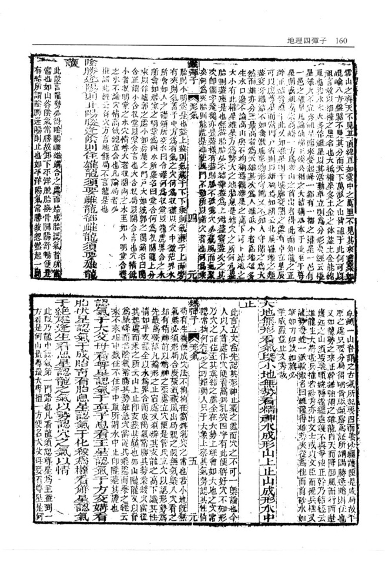

<!-- V3_SOURCE_ID:book025-b000037-p000-db48f130ab -->

龍具備五行之全，所以山的形體像龍；龍的變化極為神妙，所以山的變換像龍；龍的體質純是陽，所以山逢陽而化，過陽而生；龍之情喜乎水，所以山夾水為界，得水而住；龍之行銜乎風，所以山乘風而騰，藏風乃歇；龍必得水乃棲，所以山以有局有關而聚，以無局無闕而散；龍凡遇物則配，所以山以有配有合而止，以無配無合而行

查看对应原文

<!-- V3_FOLDBACK_BEGIN:book025-b000037-p000-db48f130ab -->

龍備五行之全故山之形體象龍龍之變化極神故山之變換象龍龍之體純平陽故山逢陽而化過陽而生龍之情喜乎水故山夾水為界得水而住龍之行銜乎風故山乘風而騰藏風乃歇龍必得乃棲故山以有局有關而聚以無局無闕而散龍凡遇物則配故山以有配有合而止以無配無合而行

<!-- V3_FOLDBACK_END:book025-b000037-p000-db48f130ab -->

<!-- V3_SOURCE_ID:book025-b000038-p000-505c99d162 -->

这段论述指出，研究龙脉的人必须深刻领会龙脉的性情，才能契合它的情神，这是辨认龙脉生气的首要奥妙之处，原文“之所我”“紫”属于讹误，具体所指不详。“字申間離物各有五行”一句存在讹误，意思大致是万物各有五行属性，要以一体具备五行的才是龙。“龍之鐘為金角，典瓜為大身，為木器，折為水腹之黃為止”一句存在大量讹误，具体含义不详。现在的人改天罡星也传承五行的说法，又以辰为天罡星，“兀為金龍”一句存在讹误，所谓“龙动不动”指的就是这一点。不称山而称为龙，正是因为山的五行完备，就像龙能大能小、能升能降一样，山的运行贵在有起伏、有变化，正和龙的形象相符，所以用龙来命名。辰生肖属龙，“以足若也出而龍之氣疏平陽”一句存在讹误，意思大致是龙脉之气在平洋地区舒展，和辰的属性相符。山运行过程中遇到“居諸聞陽”的位置，就会出现“書陽弓”的变换，该段表述存在讹误，具体所指不详。山结穴的位置一定是平坦圆润的，属于阳位，才能止聚生气，因为它的本体属阳。以时辰来论，逢三阳的时候龙还在蛰伏将动，到四阳的时候就如同飞龙在天，不是以阳为贵的说法，“非以陽為得今之侯乎”一句存在讹误，具体所指不详。到建至之后，逐渐进入五阴阶段，龙就入于潜藏了，“龍則龍之重縣之下矣”一句存在讹误，具体所指不详。龙的习性喜水，所以山有大的界水就是大界合，有小的界水就是小界合。“又山金願如峻鬚加廣服皆以水名”一句存在讹误，具体含义不详，正像龙得到水就会停留一样，山遇到水界合就会止气。龙出动的时候必然有风云跟随，龙飞升的时候必然云散风静，所以山止聚的时候，也必须要藏风才能停气。“龍有龍之築，穴必深流筮密，乃為龍居”一句存在讹误，意思大致是龙所居的穴必然是幽深周密的，在山谷中要有深邃的岩洞形态，在平处要有江绕洲环、众水汇聚的形势，如同深渊一样莫测，不可能是显露无余、散漫无收的。现在的人在这种地方选取堂局周密的位置，“四職彊子 形氣”一句存在讹误，具体所指不详。

> **释读存疑：** 之所我、紫（原文讹误）；字申間離（原文讹误）；龍之鐘為金角，典瓜為大身，為木器，折為水腹之黃為止（原文讹误）；兀為金龍（原文讹误）；居諸聞陽、書陽弓（原文讹误）；非以陽為得今之侯乎（原文讹误）；至建至（原文讹误）；五陰龍則龍之重縣之下矣（原文讹误）；山金願如峻鬚加廣服皆以水名（原文讹误）；深流筮密（原文讹误）；四職彊子 形氣（原文讹误）；之所我、紫为原文讹误，所指不明；字申間離为原文讹误，所指不明；龍之鐘為金角，典瓜為大身，為木器，折為水腹之黃為止为原文讹误，含义不明；兀為金龍为原文讹误，所指不明；居諸聞陽、書陽弓为原文讹误，所指不明；非以陽為得今之侯乎为原文讹误，所指不明；至建至为原文讹误，所指不明；五陰龍則龍之重縣之下矣为原文讹误，所指不明；山金願如峻鬚加廣服皆以水名为原文讹误，含义不明；深流筮密为原文讹误，所指不明；四職彊子 形氣为原文讹误，所指不明

查看对应原文

<!-- V3_FOLDBACK_BEGIN:book025-b000038-p000-505c99d162 -->

此論龍者必深得龍之性情乃能符其情神之所我認龍氣之第一奧紫處也字申間離物各有五行要以一體而具五行者惱龍龍之鐘為金角典瓜為大身為木器折為水腹之黃為止今人改天罡星亦傳五行又以辰爲天罡星兀爲金龍所謂龍動不動者此也夫不曰山而曰龍正謂五行全滿也龍能能兒能大能小龍升能降山之行貴有起伏有變慎正象乎龍政以龍名夫辰肖龍以足若也出而龍之氣疏平陽辰則肖之教山行度遇居諸聞陽則書陽弓變換之處山之結定為坦平圓蒲朔為陽乃能堤止之處以其禮體本屬陽也日以時論逢三陽則爲嫌蟄而龍動到四陽明飛龍在天非以陽爲得今之侯乎至建至以後漸及五陰龍則龍之重縣之下矣龍性薄水故山有大界水則爲大界合有小界水與為小界合又山金願如峻鬚加廣服皆以水名正象龍之得永可得水卽住也龍之趨必風雲從之龍之飛必雲散風靜是故山之止庸亦必藏風乃止也龍有龍之築穴必深流筮密乃爲龍居在山谷以有同岩之深邃在平處有江翻洲清爲衆水所象淵深莫刻之處豈是修露豈是追隨今人人此取堂局之浣密四職彊子 形氣

<!-- V3_FOLDBACK_END:book025-b000038-p000-505c99d162 -->

<!-- doc013 PDF 第 165 页：高风险/复杂版面 OCR 供检索；内容与排版以原页图为准。 -->
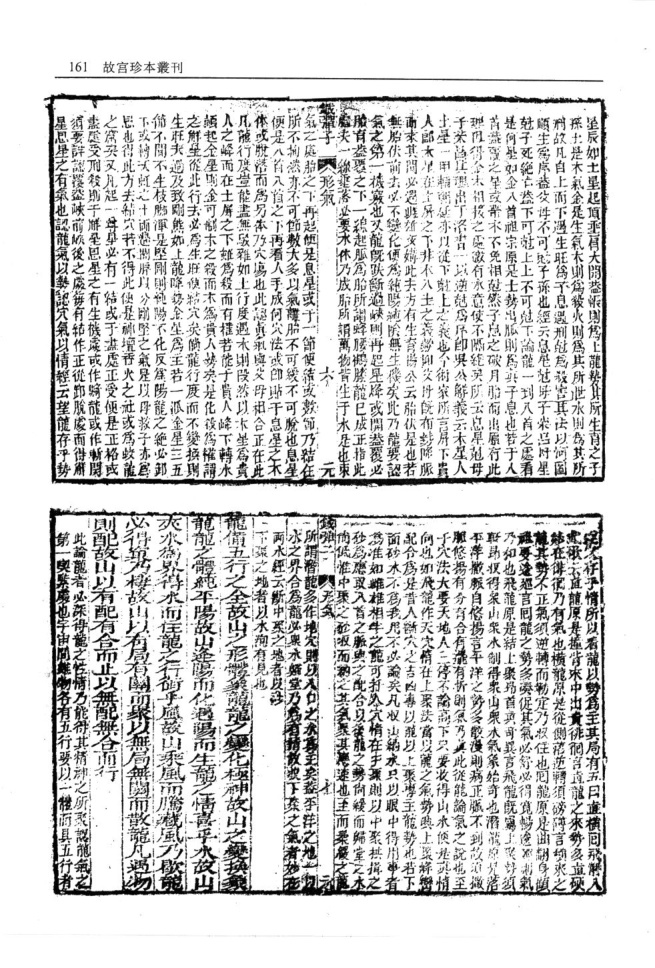

<!-- V3_SOURCE_ID:book025-b000040-p000-93fe95f503 -->

世上的人讨论“入”，相关表述疑似讹误，具体所指不详，只以“安宿入尺之所曰久”为依据，该句存在讹误，具体含义不详，不如以龙、穴、砂、光局相配为主要原则，要明白它们之间配合的含义。比如朝山、案山等砂山，如同“說虎開而轉那揖象抱”，该句存在讹误，具体所指不详，形态拱抱朝向穴场，就是和我相配合。如果有山奔走而去，水“永傾隗”不回头朝顾，该短语存在讹误，具体含义不详，就是不相配合，说明不是真龙停驻的地方，不能论定有穴。

> **释读存疑：** 入（原文疑似讹误，所指不详）；安宿入尺之所曰久（原文讹误）；砂光局（原文疑似讹误，所指不详）；說虎開而轉那揖象抱（原文讹误）；永傾隗（原文讹误，所指不详）；入为原文疑似讹误，所指不明；安宿入尺之所曰久为原文讹误，含义不明；砂光局为原文疑似讹误，所指不明；說虎開而轉那揖象抱为原文讹误，所指不明；永傾隗为原文讹误，所指不明

查看对应原文

<!-- V3_FOLDBACK_BEGIN:book025-b000040-p000-93fe95f503 -->

世人論入只以安宿入尺之所曰久不如合龍穴砂光局為主得共所以配合之意如朝如案如說虎開而轉那揖象抱便與我配合若有山走去永傾隗不我回顧便是不舍便非真龍之住不可言穴巳

<!-- V3_FOLDBACK_END:book025-b000040-p000-93fe95f503 -->

<!-- V3_SOURCE_ID:book025-b000041-p000-4c28a604f7 -->

判断龙的生死，需要先区分三阴、三阳的情况；判断穴的生死，需要辨明其中阳的占比多于阴的情况。

查看对应原文

<!-- V3_FOLDBACK_BEGIN:book025-b000041-p000-4c28a604f7 -->

龍生死須分三陰三陽穴生死須識陽多陰少

<!-- V3_FOLDBACK_END:book025-b000041-p000-4c28a604f7 -->

<!-- V3_SOURCE_ID:book025-b000042-p000-0849e13a54 -->

这两句话以龙脉落脉时的阴阳属性作为判断气的方法，可见公问星之说里把金木火归为阳、水土归为阴，其间的二阴、三防，行龙必须阴阳互换，这才是变化，是龙生成万物的缘故，所以有“閒星音脫治提化”的说法，该短语具体所指不详。龙没有变化就无法生成，因此必须金木火得到水土，水土得到金木火，两者交构形成胎育，才能让穴稳固；如果纯阴就不会生发，纯阳也不会生成，若不是香大宫，就会成为神贱窟。因此吉地的入首、精穴处，比如金开口、木生芽、土吐用，就是阴来阳受；或者入首的脉敛缩而急，到穴处就平缓舒展，有临、有窝、有小明堂，也属于“樓來麟受”，该短语具体所指不详，都是下葬口；如果是阳来阴受，也是如此。《三宝经》说：阴少阳多得葬法，阳少阴多其令绝；穴情以阳为主，纵然是阳来阴受，也需要其中有阳才可以下葬。比如平地的突是阳来阴受，必须突的顶部平，才有阳气而没有后患；如果突的顶部尖，就是纯阴有煞，便不可下葬，只适宜寻找突旁平坦处作为阴阳交构的地方，这才是可选择的吉穴。前面一段论述龙上的阴阳，后面一段原文作“滿穴中陰陽也”，疑似“论穴中阴阳也”的讹写，意为论述穴中的阴阳。

> **释读存疑：** “閒星音脫治提化”具体所指不详；“樓來麟受”具体所指不详；“後段滿穴中陰陽也”的“滿”疑似“論”的讹字

查看对应原文

<!-- V3_FOLDBACK_BEGIN:book025-b000042-p000-0849e13a54 -->

此二句以脈落之並陽為認氣之法見公問星之說以金木火爲陽水土爲陰間之二陰三防行龍必陰陽互換乃為變化乃龍生物故以此爲閒星音脫治提化之謂也龍不變化不成故必金木火得水土水土得金木火面兩交搆以成胎育方能穴不則純陛不生純陽不成不爲香大宮則為神賤窟矣是故吉第步入首精穴處如金開口木生芽士吐用則爲陰來陽受或八首之脈歛而急至穴乃平而舒有臨有窩有小明堂亦爲樓來麟受皆為塟口如陽來陰受亦然三寶經云陰少陽多得塟法陽少陰多其令絕穴情以陽爲主縱是陽來陰受亦要中有陽乃可塟也如平地之突是陽來陰受必突之頂平乃有陽氣而無後如突之頂尖則是純陰有殺便不可塟只宜尋突旁坦處爲陰陽交搆之所乃可愛穴前段論龍上陰陽後段滿穴中陰陽也

<!-- V3_FOLDBACK_END:book025-b000042-p000-0849e13a54 -->

<!-- V3_SOURCE_ID:book025-b000043-p000-6bc6263c9a -->

龙有变体，有的是颠住、劝柱；穴有变格，有的是坠宫、纂宫。

> **释读存疑：** 顛住、勸柱、墜宮、纂宮的具体含义不详

查看对应原文

<!-- V3_FOLDBACK_BEGIN:book025-b000043-p000-6bc6263c9a -->

龍有變體或爲顛住勸柱穴有變格則爲墜宮纂宮

<!-- V3_FOLDBACK_END:book025-b000043-p000-6bc6263c9a -->

<!-- V3_SOURCE_ID:book025-b000044-p000-a08914507f -->

这两段是将龙脉整体走势的隐伏、显豁、沉滞、张扬的状态，作为论述气脉变化规律的依据。凡是龙脉在行进过程中强弱态势交替出现，往往能形成多处置气结穴的格局。要是龙脉延伸得如同过长的枝条，脉上的节数太多，这种情况叫做长行金水，延伸到十几节之后大多会处于困乏疲软的状态。如果龙脉一路行来，两侧的分支没有出现偏斜护持的情况，往西延伸也没有产生冲克交会的态势，看起来好像没有力量，却又不是完全无力，等到了可以立穴的位置，忽然耸起高大的山体，巍然独立成为主星，周边的分支龙脉全部翻转拱托，左右的砂、水都归聚朝向对应朝案，延伸出去还没有穷尽的余脉又转而形成关口，作为水口，就会形成格局宏大的地，也就是所说的内旺之地。这种忽然耸起的情况叫做顿住，正是凭借走势放缓之后再陡然耸起的态势实现气脉的汇聚，这和缓中取急的含义是一致的。又比如龙脉一路行来始终态势狂猛，走势飞奔腾跃难以收束，之后忽然出现跌断的情况，再隆起的星峰态势蜿蜒，有停驻的意向，二三节范围内的分支全部同步回转收束，恰好如同勒马停驻的状态，这种情况叫做劫住，这和急中取缓的含义是一致的。以上这些都是龙脉表现出来的态势，不能不仔细勘察。凡是确定穴的位置，必须以阴阳协调、神气相融作为核心标准。如果真穴所在的位置界水合局的特征深隐，燔鬚的征象不明确，朝应的对山距离较远，拱揖的态势不清晰，只要确认是真穴所在的位置就不能变动，哪怕穴场的地势很高，也需要向下挖掘到一丈左右，或者两夹五六尺的深度，只依据前朝远照、雌雄交合的状态确定挖掘的深浅，这就是所说的乘除陂借，完全以外部的朝应情况作为核心依据。因为穴的位置地势低垂，砂、水都在远处，这种方法叫做坠宫，经书里所说的“低高照纳前朝，深浅得乘真气聚”指的就是这种情况。又比如众多山脉都汇聚到平坦的区域，区域内有很多大的池沼湖泊可以储存水脉，这种格局叫做宋仙大会格，是因为众多龙脉都汇聚在这个区域之中。不过这类区域范围深广、地势低下，需要确定气脉汇聚、精神凝聚的准确位置，找到能够收摄众龙气脉、接纳四方气息的点位，在这里立穴、堆建坟土，确定朝向与对应的朝案，这种方法叫做集宫，所说的“得饱而阴罔疾遇针而阳任”指的就是这类情况。以上这些都是风水中的重大布局方法，也是关于点穴的要诀总结。

> **释读存疑：** 寢無浮沉、燔鬚、二夾、宋仙大會格、得飽而陰罔疾遇針而陽任的具体含义不详；本地硬校验仍未通过，已记录供后续自动处理或人工核对。

查看对应原文

<!-- V3_FOLDBACK_BEGIN:book025-b000044-p000-a08914507f -->

此二段乃以大勢之寢無浮沉為論氣者之變律也凡龍行度如強弱相間而來便可多結有如枝條太長節數太多名爲長行金水行到十數節多是困憊無力若一向行來手兄亦不偏祐出西亦不凌會似乎無力又不為無力及到立穴處忽然頓起高山巍然成一主星其手足盡龍番轉扛起左右山水癸集朝案所去未盡之龍又爲轉關作水口便成大地所謂內旺之地也忽然頓起者謂之頓住正以緩顧頓起爲氣之聚此與纔中取急之義同又如龍之行來一向狂猛其勢飛勝収住不得彈子 形氣 九 元忽然跌斷再起星辰婉婉有住足之意二三節手足盡為同轉勒任恰如焉之狀謂之劫住此與急中取緩之義同此皆龍之發態不可不細察也凡立穴必取陰陽冲和神氣融會為主若真穴處界合深而燔鬚不明朝對遠而拱揖不審然真穴所在不得改移縱穴塲甚高赤須深取至一丈許或二夾五六尺詩唯取前朝遠照雌雄交度爲淺深此之謂乘除陂借全以外照爲主也以其墜下而遠砂遠水遠故法謂之墜宮經云低高照納前朝淺深得乘真氣聚者是又如諸山韜湊于平洋多大池湖隱注之處名宋仙大會格以諸龍舍于中也然深廣離下須要定氣勞會定精而神的確何處可収諸龍之會可納四方之氣于此立穴地土墳以取朝對立向故法謂之集宮為云得飽而陰罔疾遇針而陽任者是此皆大作用處亦穴中之讚也

<!-- V3_FOLDBACK_END:book025-b000044-p000-a08914507f -->

<!-- V3_SOURCE_ID:book025-b000045-p000-0de477b5b3 -->

星体有正体有附体，兼、衬、贴的区别要分辨；穴情有显现有旷远，形、气、影的差别要详细考察。这是说入首星辰的形体不一，气的聚结各有不同，不能不仔细辨认。现在的人对于入首星辰只看五星、九星，就认定可以点穴扦葬，不知道星辰本无固定本体，正形比如金星到头只是一个太阴、太阳的形态，有什么难分辨的？却不知道一个星辰有三种形态：分别是兼、原文作“禊”疑似“襯”的讹字即衬、贴。所谓兼，比如金星转而带水带土，就是兼水兼土；金星转而带火带木，就是兼火兼木，相生就吉，相克就凶，这些在正体上或是左或是右、或是前或是后，明显附带很容易看见。至于贴体，就是在穴情的位置仅仅有细微的贴合，这需要仔细辨认才能发现，比如气块、比如汤酥、比如云中的雁，浑然一体难以区分，这正是所谓的星辰灵光发露的地方，最应当体会辨认，其好坏都要与本星（原文作“木星”疑似“本星”的讹字）论生克。衬和贴不同，贴是两者几乎不分，衬还是能看出是两个部分，比如外衣和衬里，明显是两件但又互相依附不怎么分离，依靠衬托最为亲切，其吉凶都按生克来论断。凡是辨认气的人，要在衬的得力处、贴的原文作“有牘”疑似讹字、兼的有生气处仔细游走辨认，才能得到真气。又比如穴场所在，没有窝、斜、乳、突这些特征可以佐证，只有微微的隆起、原文作“有埋”疑似讹字，又极其细微的有棱、有弦，就叫气块，因为它有气而没有固定形态，古人就用这种气来下葬。还有的本体星辰完全没有形态也没有气，原文作“顏飽而不開”疑似讹字，具体含义不详，但是龙脉既然到了就一定会有真气留存，脱卸在平洋之地，或是在田中、或是在坪地、或是在湖边，隐隐约约隆隆凸起，灵光仿佛显露，就是所说的“孤月弹子”，此处原文“形氣 X 元”有阙文。

> **释读存疑：** “曰禊”的“禊”疑似“襯”的讹字；“其美惡俱與木星論生尅”的“木星”疑似“本星”的讹字；“貼之有牘”的“牘”为讹字，具体含义不详；“有埋”为讹字，具体含义不详；“顏飽而不開”为讹字，具体含义不详；末尾“形氣 X 元”为原文阙文

查看对应原文

<!-- V3_FOLDBACK_BEGIN:book025-b000045-p000-0de477b5b3 -->

星體有正有附兼襯貼之宜辯穴情有顯有壙形氣影之宜詳此言人路星辰形體不一氣各有聚不可不細認也今人于入旨星辰只看五星九星令可星體便爲指扦不知星辰爹無本體正形如金星到頭只是一個太陰太陽有何難辯不知一個星辰有三體曰兼曰禊曰貼兼者如金星而轉水轉土則爲兼水兼士金星而施水拖木則爲兼火兼木相生則吉相尅則凶此在正體上或左或右或前或後明帶而易見者如貼體則于穴情處僅備徽貼一此墓體須細認乃見如氣塊如湯酥如雲中之雁一體而不分者也正謂星辰之靈光發露處最宜體認其美惡俱與木星論生尅若襯與貼不同貼不分二件微猶分二件也如觀衣之類寬是二件而又相依不大分離依靠襯托最爲親切其吉凶介以生尅論凡認氣者須于襯之得力貼之有牘兼之有生處游而認之乃爲真氣也又如穴塲所在其証佐無窩斜乳突之可証只微微有突有埋又徹微有稜有弦謂之氣塊以其有氣而無形也古人便用氣塟之又有本體星辰全無形亦無氣顏飽而不開商然體龍既到必存真氣乃脫整平洋或在田或在坪或在湖诸隱隱隆隆靈光若露所謂孤月彈子形氣 X 元

<!-- V3_FOLDBACK_END:book025-b000045-p000-0de477b5b3 -->

<!-- doc013 PDF 第 166 页：高风险/复杂版面 OCR 供检索；内容与排版以原页图为准。 -->
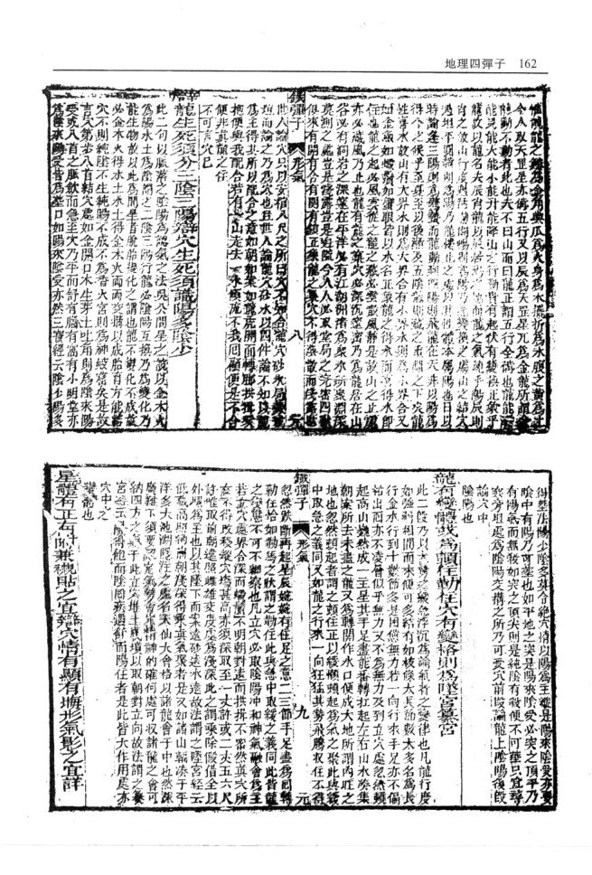

<!-- V3_SOURCE_ID:book025-b000047-p000-7e41dd0d79 -->

比如光影沉在江中，光在影子里这类情况，就是所说的外面月亮明亮、“炮內白”，该短语具体所指不详、水边的花开放，水里映出红色，全要从影子上看精神，所以古人有影葬的方法。气穴虽然没有形态，尚且不脱离本体（原文作“平木體”疑似“本體”的讹字）；影穴则脱离了本体，在若有若无的影响之间，这类情况非常微茫，极其精妙，不是有慧眼的人不能辨识。现在的人只知道葬有形之穴，拘泥于“蝦鬚旗眼”的说法，“旗眼”疑似讹字，该短语具体所指不详，哪里知道造化的“凌劉”，该短语具体所指不详，本来就是无穷无尽的呢。

> **释读存疑：** “炮內白”具体所指不详；“平木體”疑似“本體”的讹字；“蝦鬚旗眼”的“旗眼”为讹字，该短语具体所指不详；“凌劉”具体所指不详

查看对应原文

<!-- V3_FOLDBACK_BEGIN:book025-b000047-p000-7e41dd0d79 -->

沉江其光在影之類此卽外月明砲內白水邊花發水中紅 全于影上看精神也故古人有影上之塟夫氣穴雖無形尙不離平木體影穴則脫本體而在影響之間此等微茫極精極妙非道眼莫識今人只知塟形拘于蝦鬚旗眼之說豈知造化之凌劉固無窮哉

<!-- V3_FOLDBACK_END:book025-b000047-p000-7e41dd0d79 -->

<!-- V3_SOURCE_ID:book025-b000048-p000-e96c340327 -->

原文作“益帳不開”，“益”疑似“蓋”的讹字，盖帐不张开，龙就没有巢；轮晕不覆盖，原文作“八不住”，“八”疑似“穴”的讹字，穴就不能安住；“東咽不細”，该短语具体所指不详，气就不聚；“泥九不滿”，该短语具体所指不详，气就不充盛。

> **释读存疑：** “益帳”的“益”疑似“蓋”的讹字；“八不住”的“八”疑似“穴”的讹字；“東咽不細”具体所指不详；“泥九不滿”具体所指不详

查看对应原文

<!-- V3_FOLDBACK_BEGIN:book025-b000048-p000-e96c340327 -->

益帳不開龍不巢輪暈不覆八不住東咽不細氣不聚泥九不滿 氣不充

<!-- V3_FOLDBACK_END:book025-b000048-p000-e96c340327 -->

<!-- V3_SOURCE_ID:book025-b000049-p000-4a875d6681 -->

这是说龙穴各自有真气凝结的地方，是必不可少的。现在的人只知道山势行走夹束就是龙，不知道龙有帐才有巢，因为龙那种狂猛的气得到帐就会舒展，如同展翅一样顺畅和缓，杀气脱卸之后生气自然融合，才能结穴；如果没有帐，就必定是纯阴，一定会孤露，肯定不会结穴，纵使结穴也不会大。轮晕的说法，是指上面有数条横纹，圆中带方像车轮一样，这样阴气不冲犯，阳气自然顺畅，就是过去的人所说的“月有三輪，其貴無倫”。原文作“軍卽月之暈”，“軍”疑似“暈”或“輪”的讹字，晕就是月亮的晕，有影无形，凹陷而不跌落，饱满而不倾斜，就是现在的人所说的太极图，按照这个来认气，一定不会触犯阴邪，穴才是真穴。所谓结喉的说法，就是入首束气的地方，就像人的喉咙，过去的人说“结花先结带”，又说“比如吹竽的人，所有孔一起开一定发不出声响，只有堵住其他孔只开一个孔，才能按照律吕发出声音”，这是很好的比喻。所以龙的原文作“東氣處”，“東”疑似“束”的讹字即束气的地方，不能不仔细探究，气不收敛聚集就不能发散，必须束得细小，气才能聚积，等到结穴的地方，又要充满光润像孩童的头，必须原文作“泥九”，疑似“泥丸”的讹字精髓充足，颜面之间的气才会充溢，气色才会华美；如果有一点薄弱削损，气就一定会枯槁，不能成穴。这在气脉入首结穴的地方最为紧要，不能不仔细考察。原文末尾句疑似断句为“五星不离水土体，九星常要辅弼随，土星不作尊，五星皆有撞，火不可犯，水岂能粘”，具体语义存疑。

> **释读存疑：** “軍卽月之暈”的“軍”为讹字，具体所指不详；“東氣處”的“東”疑似“束”的讹字；“泥九”疑似“泥丸”的讹字；末尾“五星不離水土體九星常要輔弼隨土星不作五星皆有撞火不不可水上豈能粘”断句存疑，语义不详

查看对应原文

<!-- V3_FOLDBACK_BEGIN:book025-b000049-p000-4a875d6681 -->

此言龍穴各有眞氣凝結之處必不可少者今人但知山勢行夾便是爲龍不知龍有帳方爲有巢以其一種狂猛之氣得此而開爲展翅暢問舒徐殺氣脫蓋生氣自融乃可結穴若非帳必爲純陰必然孤露定是不結縱結亦不大輪暈之說上有橫紋數條圓而若方若車之輪然則陰氣不冲陽氣自暢昔人所謂月有三輪其貴無倫是也軍卽月之暈有影無形區而不跌滿而不傾今人所稱太極圗是也以此認氣必不犯乎陰而穴乃眞夫結喉之說卽入首束氣之處如人之喉昔人所云結花先結帶又云譬之吹營者衆孔齊開必不成響唯閉衆孔而開一孔則可按律而音鄉乃成此善喻也是故龍之東氣處不可不細盡氣不翕聚不能發散必須東之細小而氣乃聚及至結穴處則又要充滿光潤如孫兒頭必其泥九精髓衛足而顏面之間氣乃充溢其色乃華若有一微隔削薄則氣必枯槁不成穴矣此于氣脉八首結穴處最為緊要不可不察也五星不離水土體九星常要輔弼隨土星不作五星皆有撞火不不可水上豈能粘

<!-- V3_FOLDBACK_END:book025-b000049-p000-4a875d6681 -->

<!-- V3_SOURCE_ID:book025-b000050-p000-39264aefc2 -->

这两段原文作“乃詔星辰之總體”，“詔”疑似“論”的讹字，是论述星辰的总体、分体，作为葬法乘气的一种方法。宇宙之间没有水就不能生发，没有土就不能长成，龙没有水土就不成其为龙，穴没有水土就不成其为穴。所以凡是龙脉入首，五星虽然有各自的形体，要知道水土是一定不能缺少的。古人说或是结乳形或是结鳞形，都要后头有圆形的盖，凡是圆平的地方就是土体，就是所说的化生脑。又说“不管後庫子形氣 元”，该句有讹误阙文，具体含义不详。

> **释读存疑：** “乃詔星辰之總體”的“詔”疑似“論”的讹字；“五星雖有體要知水土必不可無”原断句有误，应为“五星虽有体，要知水土必不可无”；末尾“不管後庫子形氣 元”为讹误阙文，具体含义不详

查看对应原文

<!-- V3_FOLDBACK_BEGIN:book025-b000050-p000-39264aefc2 -->

此二段乃詔星辰之總體分體爲塟以乘氣之一法宇宙問無水不生無土不成龍非此不成龍穴非此不成穴故凡龍脉八首五星雖有體要知水土必不可無古云或結乳或結鱗俱要後頭有蓋圓凡圓平處便是土體所謂化生腦也又云不管後庫子形氣 元

<!-- V3_FOLDBACK_END:book025-b000050-p000-39264aefc2 -->

<!-- V3_SOURCE_ID:book025-b000051-p000-ecbf54d071 -->

龙脉来还是不来，只要看金鱼水是否荫护脑，凡是界水交合的地方就是水体，就是所说的虾须蟹眼。比如辅弼二星，也是水土的意思，辅星属金，弼星属木，在九星中隐藏而不显现，常跟在七星的左右，所以凡是立穴，不管是贪狼、巨门、武曲到头，都需要辅星在旁、弼星承接，所说的“承金相水”就是这个意思。又比如葬法中用盖、粘、倚、撞四种方法，现在的人只看刚柔缓急的形势来施用，就认为得当，不知道古人的运用还要在星体上体会辨认。比如土穴葬在饱满处，怎么可以脱开而粘到水？其朝向怎么可以发而粘到土？土星用倚葬就会崩，水星用顶葬就会破，火形山对着锋尖就会有凶煞，一旦触犯这些，不是犯凶杀就是脱气，这是论述星辰分体的地方，十分灵活需要随机应变。

> **释读存疑：** “益粘倚操”的“益”疑似“蓋”、“操”疑似“撞”的讹字；“其南豈可發而粘土”的“南”为讹字，具体含义不详；1轮自动修复后核义模型仍建议修订，已保守记录。

查看对应原文

<!-- V3_FOLDBACK_BEGIN:book025-b000051-p000-ecbf54d071 -->

來不來只要金魚水蔭腦凡界合處便是水體所謂蝦鬚蟹照是也如輔弼二星亦是水土之義輔星屬金弼星屑木在九屋中隱而不見常隨七星之左右故凡立穴不拘貪巨武到頭須輔爲之弼爲之承所謂承金相水卽是此意又如塟法中用益粘倚操今人只相剛柔緩急之勢而施之便爲的當不知古人作用仍要于星體上體認如士塟其飽豈可脫而粘水其南豈可發而粘土星倚塟則崩水星頂塟則破火榴當鋒則烈一或犯此不爲聞殺則爲脫氣此論星辰之分體處善有立機也

<!-- V3_FOLDBACK_END:book025-b000051-p000-ecbf54d071 -->

<!-- V3_SOURCE_ID:book025-b000052-p000-84181d3e21 -->

坐宕、坐殺、坐旺，这就是所说的坐法；全胎、保胎、破胎，这就是所说的作法。葬法当中什么是坐宕？比如强劲急促的龙脉，气势很盛，气势盛就不能冒犯，应当在平坦宽缓的地方，观察四周的呼应形势，合适安穴就安穴，过去所说的脱殺坐宕就是这个意思。什么是坐殺？比如金形山以刚硬饱满为殺，而刚硬饱满部位的上下又没有安穴的情势，就从刚硬饱满的地方开孤取水再坐葬；又比如金形山以火形地形为殺，而安穴的情势刚好在金火相交的地方，就只能朴金剪劈火嘴，坐靠在那里，这就是所谓的骑刑之法。什么是坐旺？比如平铺缓伏的龙脉，气势很弱，应当在山脊隆起的旺气处乘气，现在苏州、朔方一带，凡是见到岗峦堆起突出的地方，就建村落、设坟群，也是坐旺的方法。什么是全胎？凡是龙脉落到平地，刚气完全脱卸，到入首的位置有卯華金盤之穴，又属于纯阳，只用客土堆培成坟就可以；这里如果掘土，不是见到石骨，就是见到带荫气的水。什么是保胎？比如现在的珠墩、花壤这类地形，半吞半吐地乘气，珠墩从侧边进气，花壤从正面进气，十分之八的气只取其中四分，这就是保胎。什么是破胎？比如须金脉罡的地方，阴气居多，不妨大开挖做成阳穴来乘气，这就是破胎。全胎就像梧桐子结在叶子上，轻飘外露，胎完全显露；保胎就像燕子在莲蓬里做窝，想要露出却大半还含在胎中；破胎就像粟子包在刺壳里、核桃肉藏在硬壳里，必须破开它的外壳才能得到里面的精髓。

> **释读存疑：** 禎缓无明确释读依据，暂译为缓伏；此处兩为原文讹误，未臆补；罡未准确保留释读；刺叔为原文讹误，未臆改为刺中；“禎缓”无明确释读依据，暂译为缓伏；“兩”为原文讹误未臆补；“罡”未做无依据释读；“刺叔”为原文讹误未臆改

查看对应原文

<!-- V3_FOLDBACK_BEGIN:book025-b000052-p000-84181d3e21 -->

坐宕坐殺坐旺是爲坐法全胎保胎破胎是爲作法塟法中何爲坐宕如強急之龍其氣甚怒怒則不可犯宜于坦宕之處看其四應可以穴則穴昔所謂脫殺坐宕是也何爲坐殺如金以剛飽爲殺而剛飽之上下又無穴情則從剛飽處開孤取水而坐之又如金以火爲殺而穴情又在金火相交之處只得樸金剪劈火嘴坐而倚之所謂騎刑之法是也何爲坐旺如平鋪禎緩之龍其氣甚弱當于起脊旺處乘之如今蘇朔一帶凡見崗眷堆卓之處卽爲村市爲墳羣亦是坐旺之法也何爲全胎凡龍郭落平洋剛氣盡脫至人首處如卯華金盤之穴又屬純陽惟用客上堆培成墳便是此處兩若掘土非見石骨卽見蔭氣之水也巳何爲保胎如今珠墩花壤之類半吞半吐而乘之珠從旁入花從正八十分之氣只取其四是爲保胎何爲破胎如須金脈罡之鄉陰氣居多不柏大開梁取而成陽穴以乘其氣是謂破胎全胎如梧桐子結于葉上輕浮而胎全露也保胎如逆子燕于蓮蓬欲露而大半含胎中也破胎如粟子之包于刺叔核桃肉之藏于堅穀必破其胎而出乃得精髓也

<!-- V3_FOLDBACK_END:book025-b000052-p000-84181d3e21 -->

<!-- V3_SOURCE_ID:book025-b000053-p000-d7ec41d64b -->

挨生傍氣，有時是脫殼借胎，有時是子投母腹；脫殺逢生，有時是借母養子，有時是以子救母。

查看对应原文

<!-- V3_FOLDBACK_BEGIN:book025-b000053-p000-d7ec41d64b -->

挨生傍氣或爲脫殼借胎或是子投毋腹脫殺逢生或爲借毋養 子或是以子救母

<!-- V3_FOLDBACK_END:book025-b000053-p000-d7ec41d64b -->

<!-- V3_SOURCE_ID:book025-b000054-p000-98fdcd8b5c -->

这就是乘气过程中挨生化殺的妙用。什么是脱壳借胎？都以九星来论，比如天罡脈曜，怎么成胎？必须开孤取水，刚气才能脱卸，得水成胎，所以称为脱壳借胎，原文此处“術”为讹误。什么是子投母？比如木星带伤、水星带金，有胎孕的状态子就可以投入，所以木形山不葬在纯木的位置，而葬在木形山杂荡有水的地方；水形山不葬在纯水的位置，原文此处“蔡”为讹误，葬在水形山坚实类似金的位置，所以称为子投母腹。什么是借母养子？以五星来论，原文此处“余”为讹误，水体带余的状态下，必须破金取水来养木，原文此处“未”为讹误，这是金不能养木，特意借取水穴来养木，就是所谓的借母养子。什么是以子救母？比如金形山临近火形地形，必须在金火相交的地方大开穴来克制它，过去的人有取水火的方法，就是这样，就不会互相伤害，原文此处“樵”为讹误，在前方可以作官星，在左右就是体气，这就是以子救母。天地造化没有完美的功效，圣人没有无所不能的能力，怎么能让星辰都纯粹不杂？只要懂得起生涉死的方法，就是裁制天地造化的神奇功力。就像真正的医生用针，或是补或是泻，调神治病，全靠手上的技艺把握造化。

> **释读存疑：** 部无明确释读依据，暂译为都；術、蔡、余、未、樵、晚得均为原文讹误，已标注；“部”无明确释读依据，暂译为都；“術、蔡、余、未、樵、晚得”均为原文讹误，已标注

查看对应原文

<!-- V3_FOLDBACK_BEGIN:book025-b000054-p000-98fdcd8b5c -->

此爲乘氣中挨生化殺之妙用也何爲脫殼借胎部以九星論如天罡脈曜何以成胎必開孤取水則剛氣乃脫得水成胎故爲脫殼術胎何爲子投母如木星而帶傷水星而帶金有胎孕而子可投故木不塟木而塟木之雜蕩有水處水不塟水而蔡水之堅寔如金處故為子投母腹何謂借母養子以五星論如水體帶余必破金取水以醃木是金不能養未而特借取水穴以養之所謂借母養子也何爲以子救母如金體將火必于金火相間處大開水穴以制之昔人有取水火之法政如此則然不我害而反化爲樵在前可作官星在左右卽爲體氣謂以子救母夫造化無全功聖人無全能安得星辰盡純粹只要晚得起生涉死之法乃裁成造化之神功也真醫家用針或補或瀉病或調神造化全在一手耳

<!-- V3_FOLDBACK_END:book025-b000054-p000-98fdcd8b5c -->

<!-- V3_SOURCE_ID:book025-b000055-p000-77837227ef -->

脱蛇就局，收纳前朝的形势，只是因为原文此处“牛”为讹误，伪半真；在兼山劈硬的地方平整地基，只是为了直来直受的葬法。

> **释读存疑：** 牛僞半真中牛为讹误，含义不明；“牛僞半真”中“牛”为讹误，含义不明

查看对应原文

<!-- V3_FOLDBACK_BEGIN:book025-b000055-p000-77837227ef -->

脫蛇就局納前朝只爲牛僞半真兼山劈硬處平基祗爲直來直 受

<!-- V3_FOLDBACK_END:book025-b000055-p000-77837227ef -->

<!-- V3_SOURCE_ID:book025-b000056-p000-6452e62e27 -->

这种前朝后倚的设计，属于乘气方法中进退消纳的一类。凡是安葬，贵在棺木不离开龙脉，而这里说的脱龙就局，是指入首的龙脉驳杂不纯正，要往后数二三节才是真脉，且和前朝的形势相合，这是前朝的形势真，而入首的龙脉并不匹配。如果直接正对龙脉安葬，初年运势不利，应当在穴中将棺木往外移出二三尺，堆起高大的金堆来收纳前朝的吉气，又加上水法吉利，发福会非常快。凡是安葬，贵在气不离开龙脉，而这里说的禄山勞硬、吴山平廿以为穴，原文此处“廿”为讹误，是指入首的龙脉阴气原文此处“宜便”含义不明，后部厚重，比如子龙作午向，原文此处“紀林通殺漢之必南”含义不详，所以必须就着山形劈去硬处做平，退出一块平整的地基，原文此处“立六則經閣發中居之說”含义不详。有的穴后朝向侧边微微倾斜，有的在上部砌成虚处，下部的尺寸有定规，才能避让凶殺，这就是直来直受的作法。古人有形葬和法葬：顺着平穴的生灭规律安葬的叫做形葬；不管是原文此处“勞例”为讹误，还是堆培修整后安葬的都叫做法葬，这些都是作法的精妙之处，不能不明白。

> **释读存疑：** 廿、宜便、紀林通殺漢之必南、將常退出平基立六則經閣發中居之說、上砌虛時下在止有度可時殺乃為而來直受之作法、勞例均为原文讹误或无法释读内容，已标注；夫为发语词未误译，养为断句讹误已删除；“廿、宜便、紀林通殺漢之必南、將常退出平基立六則經閣發中居之說、上砌虛時下在止有度可時殺乃為而來直受之作法、勞例”均为原文讹误或无法释读内容，已标注；本地硬校验仍未通过，已记录供后续自动处理或人工核对。

查看对应原文

<!-- V3_FOLDBACK_BEGIN:book025-b000056-p000-6452e62e27 -->

此以前朝後倚屬乘氣中進退消納之一法也凡塟貴乎棺不離脉而此言脫龍就局者乃入白之脉雜而不純宜至二三節上乃爲真脉而合前朝是朝真而入首之脈非與也如直頂其脉則初年不利當于穴中放棺出二三尺大作金堆以納前朝旦又水法之吉奈達甚速凡塟貴氣不離脉而此云祿山勞硬吳山平廿以爲穴者乃入首之脉陰氣宜便則後重如子龍作午向紀林通殺漢之必南故須原山劈硬以作平息將常退出平基立六則經閣發中居之說或穴後向邊微斜又或上砌虛時下在止有度可時殺乃爲而來直受之作法也古人有形塟法塟夫順其平穴之生滅而塟者爲形雖或勞例或堆培而塟者爲法養此皆作法之妙處不可不理會也

<!-- V3_FOLDBACK_END:book025-b000056-p000-6452e62e27 -->

<!-- V3_SOURCE_ID:book025-b000057-p000-dba777aba6 -->

平地的气经常是散的，需要像汤里的净酥一样聚拢；山陇的气经常是急的，应当收敛，要观察水势，像蟠曲的蛇一样舒展平缓。

> **释读存疑：** 歛译为收敛，蟠蛇译为像蟠曲的蛇一样舒展平缓，符合语境；山陇未漏译，汤中净酥完整保留译出；“歛”译为收敛、“蟠蛇”译为像蟠曲的蛇一样舒展平缓符合语境，无无依据释读

查看对应原文

<!-- V3_FOLDBACK_BEGIN:book025-b000057-p000-dba777aba6 -->

平洋之氣賞常散須要湯中淨酥山壠之氣常急當歛當看水而蟠蛇

<!-- V3_FOLDBACK_END:book025-b000057-p000-dba777aba6 -->

<!-- V3_SOURCE_ID:book025-b000058-p000-4c5c7913e8 -->

这是根据气的聚散、龙脉的缓急来辨认穴的细微特征，原文此处“二”为讹误，所说的葬要乘生气，正是依据这个道理。平地的地方阳气胜过阴气，所以以收敛为聚，才有“隐隐隆隆，穴在其中”的说法，要辨认所谓的隆隆之势，正是在隐隐的状态当中有这种贵气显露的征象，原文此处“如麻在馬良有見也”中馬良为讹误，含义不详。不然的话就像铺展开的毡席，散漫没有收束，怎么能安穴呢？至于原文此处“陛”为讹误，山陇的地势是阴气胜过阳气，不怕脉气不到，原文此处“謙”为“嫌”的讹误，就怕气不和顺，所以凶煞多，因此结穴的地方要圆融平坦，不险峻不局促，就像水面上盘曲的蛇的样子，灵活而不妄动，安静而不僵死，盘旋而不僵直，浑然一个太极图的形态，这样形势舒展气脉和顺，就完全符合古人所说的“山陇的龙脉葬气不葬脉”的道理。

> **释读存疑：** 二、馬良、陛、謙均为原文讹误，已标注；“二、馬良、陛、謙”均为原文讹误，已标注

查看对应原文

<!-- V3_FOLDBACK_BEGIN:book025-b000058-p000-4c5c7913e8 -->

此以氣之聚龍緩急而認穴之微茫所二塟乘生氣正任此夫干洋之地陽勝乎陰故以歛爲聚而有隱隱隆隆穴在其中之說須要認所謂隆隆者政在隱隱之中有此貴露之象如麻在馬良有見也不則亦鋪毡展席散漫無收而已何可穴乎至在山陛之勢乃陰勝乎陽不嫌脉之不到而謙氣之不和所以多煞故結穴之所圓融平垣不險不迫有如水面盤蛇之狀活而不動靜而不死盤旋而不直極渾然一個太極圖則形舒氣和而微盡古人所謂山隴之龍塟氣不塟脉是也

<!-- V3_FOLDBACK_END:book025-b000058-p000-4c5c7913e8 -->

<!-- V3_SOURCE_ID:book025-b000059-p000-e0699eb0c9 -->

没入水中的生氣，向上浮升，应当趁着它急升的态势取用；出洞的龙气，径直吐出，应当取用它的余气。精华外露的气，就像花一样，应当裁取它的表层；精华内藏的气，就像果实一样，应当葬在它的核心部位。这一段是根据气的缓急、深浅，来确定安葬的缓急、深浅的作法。比如平坦地带的龙脉，脉气潜藏在地下，只微微露出毛脊，到结穴的地方忽然隆起一块，原文此处“爰”为讹误，是吉兆，对应这处隆起的地方，它的气沉在下面，只有表层浮有气，不妨在最高处安穴，就像牛泡在水里，身子藏在水中，原文此处“語”为讹误，只露出毛脊，时不时抬头喷气，气就在牛的鼻子上，如果稍微偏离就失去气了，这是缓来的气要急着乘取的方法。又比如高陇的龙脉，脉气在山势中奔腾涌动，到结穴的地方必须要脱卸落到平地上，气才会冲和，就是所说的“来不来，坦中裁；住不住，平中取”，也就是“急来不怕葬沉泥”的意思。就像龙刚出洞，原文此处“詞”为讹误，气正强盛，怎么能直接安葬？要等气吐出还有余裕的地方，精华可以捧取，原文此处“述”为讹误，所以要等一等再安葬，用舒缓的方式承接气。又比如气浮在表层，原文此处“臺”为讹误，已经显露出来，如果葬得深，气就从上面过去了，所以适合浅葬乘气，就像树木开花、水中有珠，精华都露在外面，葬深了就会伤到根本。又比如原文此处“市、卜、胃”均为讹误，气聚在下面，表层粗硬，精华包含在内部，不往深了取，气就从下面过去了，所以适合深葬，就像开矿取金、厚土里挖金，都要挖得深才能得到。

> **释读存疑：** 爰、語、詞、述、臺、市、卜、胃、頃金之開脈取水厚土之破用見金均为原文讹误或断句问题，已标注；“爰、語、詞、述、臺、市、卜、胃、頃金之開脈取水厚土之破用見金”均为原文讹误或断句问题，已标注

查看对应原文

<!-- V3_FOLDBACK_BEGIN:book025-b000059-p000-e0699eb0c9 -->

没水之生氣仰而吹宜乘其急出洞之龍氣直而吐宜乘其餘種華外露之氣如花宜裁其皮精華內蘊之氣如果宜塟其骨此國段以氣之緩急淺深爲塟之緩急淺深乃作法也如平坦之龍脉潛于地而微露毛脊至結穴處忽起一爰乃吉對所起也其氣沉綴而僅浮不妨安穴絕頓譬如牛之役水身藏水中僅語毛脊時仰而吹氣在鼻中若稍脫之便夫氣矣此緩來急乘之法也又如高隴之龍脉行于山勢奔氣湧至結穴處須要脫卸落下平羊氣始冲和所謂來不來坦中裁住不住平中取所謂急來不怕塟沉泥者是也譬如龍之出詞氣媚方盛何可祀之推其氣之吐而有餘箴處精華可雨故宜晚述而塟管緩以承之又如氣浮于上而臺先已露若深塟之則氣從上過故宜淺乘如木之有華水之有珠其英華盡露于外深之則傷本資矣又如氣市于卜而皮胃粗剛美含于内不深以取之則氣從下過故宜塟深如頃金之開脈取水厚土之破用見金皆以深而之也

<!-- V3_FOLDBACK_END:book025-b000059-p000-e0699eb0c9 -->

<!-- doc013 PDF 第 168 页：高风险/复杂版面 OCR 供检索；内容与排版以原页图为准。 -->
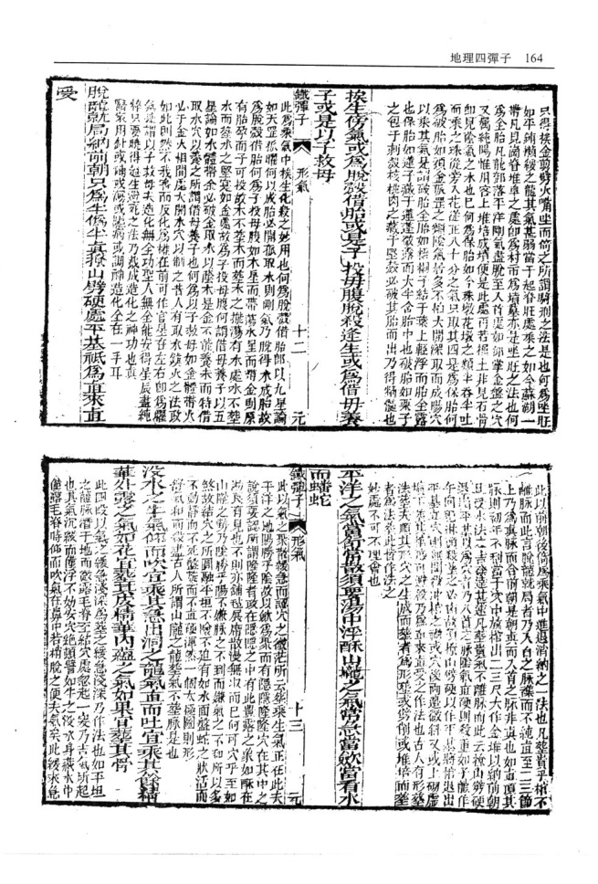

<!-- V3_SOURCE_ID:book025-b000061-p000-77330ea409 -->

龙穴有阴阳，砂水也有阴阳；龙穴有生死，砂水也有生死。这是从砂水的阴阳生死来讨论气的情况。龙穴的阴阳，前面已经论述得很详细了。砂怎么分阴阳？原文此处漏写“为阳”，以开面舒坦的为阳，以反背褶皱的为阴；有开面就是朝向我、有情谊，没有开面就是原文此处“肯、清”为讹误，背对我、无情谊。不光龙穴看重开阳，砂也看重开阳。水怎么分阴阳？原文此处“而城彈子形氣 十四 元水之來之古屈曲改後楊揚則舒餘濫屍而爲暢其綱如絕”内容混乱无法释读，水流来的样子，如果蜿蜒曲折、去势平缓舒展就是阳；如果直得像箭、斜得像反弓，水势湍急斜反就是阴。就像人一样，血脉流动顺畅，呼吸自然平和，吐纳自然调适，不快不慢，没有反流逆冲，就是没有病；如果猛地冲进来，乱哄哄地流走，看不到安稳沉静的状态，就是有病的状态。不光砂也看重开阳，水也看重开阳。砂的生死怎么分？砂不管是龙、虎、案山、对山，只要是朝向我、有开面，就像有手一样拱揖环抱，就像仆人跟着主人、妻子跟着丈夫，一叫就应，情意顾盼，就是活的、有生气的；不然的话直硬顽悍，叫也不来，赶也不动，就是没有气的死砂。水的生死，就是以直、急、反、斜为死，以朝向穴场、顾盼、凝聚为生。说到底，砂水的生死，也都是从阴阳上体现出来的。

> **释读存疑：** 原文漏写为阳已标注；肯、清、城彈子形氣 十四 元水之來之古屈曲改後楊揚則舒餘濫屍而爲暢其綱如絕、書、廊、憑、疑均为原文讹误或无法释读内容，已标注；原文漏写“为阳”已标注；“肯、清、城彈子形氣 十四 元水之來之古屈曲改後楊揚則舒餘濫屍而爲暢其綱如絕、書、廊、憑、疑”均为原文讹误或无法释读内容，已标注

查看对应原文

<!-- V3_FOLDBACK_BEGIN:book025-b000061-p000-77330ea409 -->

龍穴有陰陽砂水有陰陽龍穴有生死砂水亦有生死此以砂水之陰陽生死而論氣者也龍穴之有陰陽前巳論之詳矣砂何以分陰陽乎亦以開面舒坦者以反背層者爲陰有面則為向我而有情無面則爲肯我而無清非惟龍穴貴開陽而砂亦貴開陽也水何以分陰陽乎而城彈子形氣 十四 元水之來之古屈曲改後楊揚則舒餘濫屍而爲暢其綱如絕其直如矢其斜如反弓則神激斜反而爲陰譬之人然血脉流動條暢則呼吸自然和平吐納自然調適不疾不徐無反無逆乃爲無病若驟然而入顧倒而出不見安舒澄靜便是病到非惟砂書開陽而水亦貴開陽也砂之生死何分也砂無論龍虎案對只是情向朝我有面曰有手廊拱揖環抱若僕從主行婦從夫倡隨呼隨應情意顧憑則活動而生不則直硬頑悍呼不來驅不動則無氣而死若水之生死則以直急反斜爲死以朝顧疑聚爲生究而言之砂水生死亦卽在陰陽上見也

<!-- V3_FOLDBACK_END:book025-b000061-p000-77330ea409 -->

<!-- V3_SOURCE_ID:book025-b000062-p000-2a28fd9618 -->

气有虚实，对应的方法应当是用实投虚、用虚乘实；气有先后，对应的方法应当是先到的先用，后到的后用。这两段是把立穴的进退饶减作为乘气的一种方法。论说结穴的地方，如果阳盛阴少，就是气胜过形，原文此处“木”为讹误，所以虚而属阳，阳就不适合缓乘，应当中正地取用，比如平面太阳作金盘堆果、百般花味总居心之类的情况就是。如果阴盛阳少，就是形胜过气，原文此处“欲故運而陰不宣急嘆言聲”内容混乱无法释读，应当顺着脉气来乘取，比如原文此处“味”为讹误，在旁乳处安穴不对着山头就是。原文此处“此以進退謹是之間謫也”内容混乱无法释读。还有结穴的地方，比如原文此处“補”为讹误，左边先到，气就归到右边，直接对准右边来收取左边的砂；比如原文此处“掃光到則氣滿于宜戾”内容混乱无法释读，右边先到，就偏向左边来收取右边的砂；如果左右两宫同时来气，原文此处“渠”为讹误，从中间取用，虽然发福耐久但发得慢，所以不知道先到先取用的道理，原文此处“通明孰祿而得遠惑”内容混乱无法释读，这就是原文此处“陸”为“饒”的讹误，饶减收气的方法。

> **释读存疑：** 木、欲故運而陰不宣急嘆言聲、味、此以進退謹是之間謫也、補、掃光到則氣滿于宜戾、渠、通明孰祿而得遠惑、陸均为原文讹误或无法释读内容，已标注；原文漏写后到后杖已补出并标注断句问题；“木、欲故運而陰不宣急嘆言聲、味、此以進退謹是之間謫也、補、掃光到則氣滿于宜戾、渠、通明孰祿而得遠惑、陸”均为原文讹误或无法释读内容，已标注；原文漏写“后到后杖”补出符合上下文逻辑

查看对应原文

<!-- V3_FOLDBACK_BEGIN:book025-b000062-p000-2a28fd9618 -->

氣有虛實法當以實投虛以虛乘實氣有先後法當先到先杖後此二段以立穴之進退饒減為乘氣之一法言結穴之所有陽盛陰少者則氣勝而形木寔故虛而屬陽陽則不宜緩乘宜中正以之如平面太陽作金盤堆果如百般花味總居心之類是也有陰盛陽小者則形勝而氣過欲故運而陰不宣急嘆言聲脉以乘之如味穴其旁乳不當頭是也此以進退謹是之間謫也又結穴之所如左補先到則氣歸于右直按右以取左砂如右掃光到則氣滿于宜戾左以抄右砂若兩宮齊動中以渠之雖耐久而發常運故不知先到先杖通明孰祿而得遠惑此以陸減收

<!-- V3_FOLDBACK_END:book025-b000062-p000-2a28fd9618 -->

<!-- V3_SOURCE_ID:book025-b000063-p000-97b808600d -->

所谓傍城借王，必须仔细审察乐北的方位，在确定朝向、拘定龙脉的时候，应当留意明堂的情况。这是二四向中借取外气来承接内气的方法，是仅针对朝向制定的做法。大凡龙脉赶来的走势，并非都是正受之态，有侧落的，有黼身的，也不乏脱去本来走势的情况，或是傍着罗滅，或是傍着水城，或是傍着徐储峰，这些都是借乐北来作为生气、借外气来作为依托的情况。所以原文称“傍賊錯至”。还有龙脉直来，看似应当属于正受，却在入首之处没有合适的朝向方位，朝向方位处也无有情之态、不成格局，这时就看哪里的明堂能够形成格局，便应当拘定龙脉来迁就这个位置。所谓以龙定穴，以水定向，正是说外水汇聚的地方有明堂、能成格局，就应当如此处理。另有“風彈子一形氣 五”的表述，具体含义不详。

> **释读存疑：** 傍城借王的具体含义不详；乐北的具体所指不详；二四的具体含义不详；黼身的具体含义不详；傍罗滅的具体含义不详；傍賊錯至的具体含义不详；風彈子一形氣 五的具体含义不详

查看对应原文

<!-- V3_FOLDBACK_BEGIN:book025-b000063-p000-97b808600d -->

傍城借王須計審于樂北就向拘龍當消息乎明堂此二四肯借外氣以乘內氣乃唯向中之作法也凡龍之來不皆正受有側落有黼身不無脫去本來之勢或傍羅滅或傍水城或傍徐儲峰此皆借樂北以爲生外氣以爲然也故曰傍賊錯至又有龍勢直來似宜正受乃入首之處無面向方之處無情不成局于是晉其明堂何處開局便當拘龍而就之所謂以龍定穴以水定向者正謂外水聚處有明堂而成局便當風彈子一形氣 五

<!-- V3_FOLDBACK_END:book025-b000063-p000-97b808600d -->

<!-- V3_SOURCE_ID:book025-b000064-p000-77631ced79 -->

这里说的是确定向和方位，不必拘泥于正受。《抚砂经》中说：没有格局就不要谈论龙脉，能谈论龙脉的，必定能见到格局所在，也就是龙脉所在之处。所以有就着格局来拘定龙脉的方法。照察穴位需要寻求三静一动，辨认生气需要百死一生。

查看对应原文

<!-- V3_FOLDBACK_BEGIN:book025-b000064-p000-77631ced79 -->

華此以定向方不必拘拘于正受也撫砂經云無局不言龍可言龍可見局之所在卽龍之所在故有就局拘龍之法照穴須求三靜一動認氣須要百死一生

<!-- V3_FOLDBACK_END:book025-b000064-p000-77631ced79 -->

<!-- V3_SOURCE_ID:book025-b000065-p000-426f3b1e80 -->

这里通过动静生死来判断气脉的真假，原文写“最爲閉要”，“閉”应为“緊”的讹误，意思是最为紧要。什么是三静？某对要静，朝向南方拱应而没有压过走窜的情况；龙虎要静，向内拱抱而没有分心他顾的情况；水城要静，环绕聚拢而没有反背冲刷的情况。中间只见穴场所在的位置有一脉活动且富有精神，这就是三静中存一動，这样的穴才是合格的。辨认气要在众多穴中观察，看它的精神显露之处在哪里，就像孩童的头一动，头上的角都坚实挺立；门圓桑一呼一吸，可浮可沉，这就是有生气的地方。古人说“化主臘不取象干頭，而取象于孩兒頭”，这句话很有意味。其他的情况比如厚中取薄、聲中琅厚、静中取动、动中取静，必须是其余的气都属死态，只有这一点独有生气，才是真气，不然就是“菩產而死贊背”，具体含义不详。原文称“宜細宗之”，“宗”的具体释义不明，此处原文意为应当仔细参照此法。

> **释读存疑：** 某对的具体所指不详；龙虎的具体所指不详；水城的具体所指不详；门圓桑的具体含义不详；化主臘的具体含义不详；干頭的具体所指不详；聲中琅厚的具体含义不详；菩產而死贊背的具体含义不详；宗的具体释义无明确依据

查看对应原文

<!-- V3_FOLDBACK_BEGIN:book025-b000065-p000-426f3b1e80 -->

此以動靜生死而記氣脉之眞假最爲閉要何謂三靜某對要靜開南朝拱而無壓過走龍虎要靜內向拱抱而無他顧騰水城要靜遶疑環聚而無反昔非激中間惟見穴塲之所一脉活動而有精神此三靜一動其穴乃其也認氣則千穴傷看其精神何者是精神之發越處如兒頭一戰頭上之角皆堅而傾門圓桑一呼一吸可浮可沉此生氣處古人言化主臘不取象干頭而取象于孩兒頭者林有味也他如厚中取薄聲中琅厚靜中取動動中取靜必見餘氣皆死而惟此一點獨有生淺乃爲眞氣不然則爲菩產而死贊背也宜細宗之

<!-- V3_FOLDBACK_END:book025-b000065-p000-426f3b1e80 -->

<!-- V3_SOURCE_ID:book025-b000066-p000-3356736b6a -->

有棱有兹的话形就真实，像涌动又像凸起的话气就已到达。辨认气比辨认脉更难，葬脉哪里比得上葬气？平大的地首最是微茫难辨，要从中认出一点尽九之气，这是最关键的诀窍。大凡进入穴场，应当先辨认形，随即辨认气。如果穴场一定有弦棱，就需要有蠻眼之水显现，才算格局明确。蟹眼指的是突穴之中周边饱满，像“如起如讚眼然”的状态，“讚眼”具体所指不详，外侧有蝉砂作为隐蔽的护持，水微微显现，叫做盘眼水；一旦有草沙，弦棱就会显现形成。“般將是寫穴其中禽聚如最鬚之掬抱”一句断句不明，此处原文提到外侧有牛角砂作为明确的护持，水明显可见，叫做般鬚水；一旦有牛角砂，弦棱侧边就会形成。弦棱形成之后，气就会凝聚而不散失，天心自然涌起凸起，就形成胎息；如果旧天心沉陷离散，仍然属于花霞，不能成穴。气和脉要怎么分别？大凡脉的运行，一定是若隐若现，如同草蛇灰线，虽然不太显露，却并非没有形迹，所以属阴；只有阴气消尽的地方平坦开阔，本来所说有光润融聚的状态，就是真气，属阳，就像人的身体，脉如同有痕迹可寻，气则是周遍全身、充塞满盈没有阻碍，所以脉容易看见而气难以辨认。然而说葬脉不如葬气，正是因为脉属阴，尚且带有煞气，气属阳，充满生机，“氤為”具体含义不详，所以以辨明气为上。像之前提到的太极叠天轮的说法，就是气的本体。当时的地师大多会葬脉，不会葬气，所以常常祸事多而福运少。大凡人寻求地形真确、穴位端正的地块，原文末尾作“又于形氣 元”，属于残句，语义不全。

> **释读存疑：** 有茲的具体含义不详；尽九之气的具体含义不详；蠻眼之水的具体所指不详；讚眼的具体所指不详；般將是寫穴其中禽聚如最鬚之掬抱语义不通，具体含义不详；蟬砂的具体所指不详；盤眼水的具体所指不详；牛角砂的具体所指不详；般鬚水的具体所指不详；天心的具体所指不详；胎息的具体所指不详；花霞的具体所指不详；氤為的具体含义不详；太极疊天輪的具体含义不详；末尾又于形氣 元为残句，语义不全

查看对应原文

<!-- V3_FOLDBACK_BEGIN:book025-b000066-p000-3356736b6a -->

有稜有茲則形真若湧若凸則氣到認氣難于認脉塟脉豈如塟此平大首最微茫處認出一點盡九之氣至要至訣凡入穴場當先認形隨卽認氣如穴塲必有弦稜則鬚蠻眼之水見始成昭蟹眼是突穴其中周滿如起如讚眼然外有蟬砂爲之隱護而水微見謂之盤眼水一有草沙則弦發成矣般將是寫穴其中禽聚如最鬚之掬抱六外有牛角砂爲之明義而水明見謂之般鬚水一有牛角砂則弦傍或矣弦發既成則氣聚而不故天心自然湧凸乃成胎息舊天心沉離仍是花霞不成穴矣氣脉何以分别凡脉之行必須或而有皆如草蛇灰線雖不甚露而未雲無形故屬乎陰惟陰盡處坦平固講有一種光融聚之敢是眞氣也而屈乎陽如人之身然脉猶拔之有跡氣則周遍充滿無所滯礙故脉易見而氣難認耳然謂翠脉不如塟氣者正以脉犯陰猶廬有煞氣爲陽生機氤為故以準氣爲上也如前所稱太極疊天輪之說正是氣體耳時師多能塟脉不能塟氣故常禍多而福少也凡人求地形眞穴正而又于形氣 元

<!-- V3_FOLDBACK_END:book025-b000066-p000-3356736b6a -->

<!-- V3_SOURCE_ID:book025-b000067-p000-d1f8e8322b -->

造论万无一失了。

查看对应原文

<!-- V3_FOLDBACK_BEGIN:book025-b000067-p000-d1f8e8322b -->

造論萬不失一矣

<!-- V3_FOLDBACK_END:book025-b000067-p000-d1f8e8322b -->

<!-- doc013 PDF 第 169 页：高风险/复杂版面 OCR 供检索；内容与排版以原页图为准。 -->
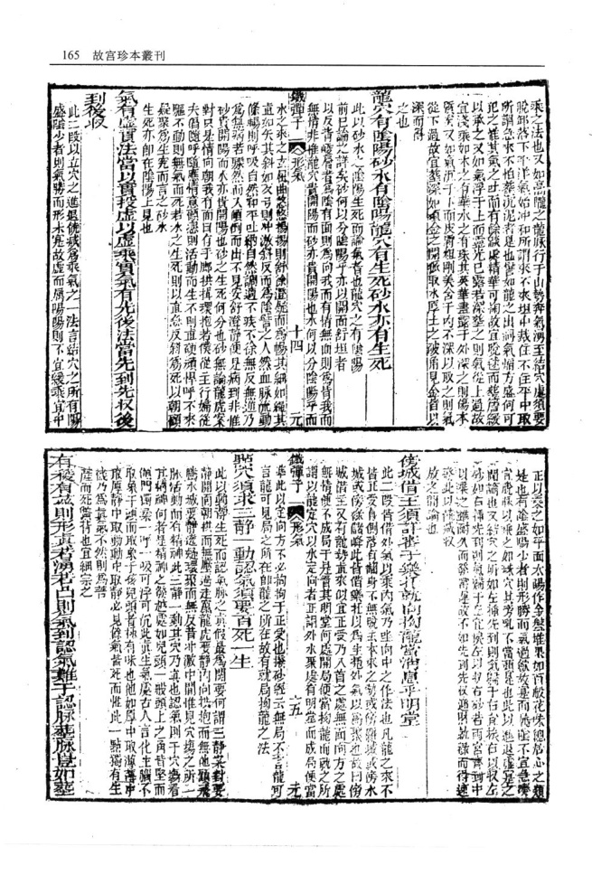

<!-- V3_SOURCE_ID:book025-b000069-p000-245534c4b2 -->

法恭的葬法，是在形的内里领会要义；靠领会要义施行的葬法，用意是在形的表象之外。

查看对应原文

<!-- V3_FOLDBACK_BEGIN:book025-b000069-p000-245534c4b2 -->

法恭之塟法在形裏會意之塟意在形表

<!-- V3_FOLDBACK_END:book025-b000069-p000-245534c4b2 -->

<!-- V3_SOURCE_ID:book025-b000070-p000-decaca5b18 -->

这是说穴的情态变化不一，有的穴藏在“十拙”之中，靠人力“剪義”来处理，“剪義”具体含义不详；有的穴“隱于敬”，靠心意来融会理解，“隱于敬”具体所指不详，这类情况就叫做仙踪。大凡论穴要先论形，原文有“有形不足以六者”的表述，语义不通，具体含义不详，比如头金不开窝，刚龙怎么能谈得上成穴，这时就应当推究其中的精微之处，有四处存在的话就是生气，必须用开孤法，大量动用人工取出高水位再行安葬。又如果水太深，属于阳中之阳，不能成穴，但只要真气到达就必然有结作，适合在中位处理，或是在真以上的位置，或是用石头铺垫，龙势强盛的话就“莫之以水”，具体含义不详，必须用土填实到足够高度，形成倚靠阳中之阴的态势，把棺木架在上面安葬，这些都属于所谓的法葬。其他比如骑刑、剪火、破孤、截汤，各有各的方法，应当培土就培土，应当削除就削除，适合填实就填实，适合留空就留空，这是汤公记载的法葬条目。还有真龙正脉都汇聚在这里，情势局面也都收拢在这里，属于合法的穴情，却没有真正入穴的凭据，古人只能领会其精气汇聚的意旨来点穴安葬，比如官坑梁上挂金斗的穴位，就在水源穷尽的偏僻山坞、高山的绝顶之上，两边的山势都没有停住，延伸出去还有十几里，这是刑穴所不相符的情况，只要看它的气势，山石环抱左侧回转，前方西侧拦挡应对，从近案之外望去，可以看到百里之远，远远望见几子尖作为正朝山，鸦降山峙立在左，大茅山峙立在右，三阳金山高耸，万峰都朝向这里，原文写“去水難有一二十里”，“難”应为“雖”的讹误，意思是去水虽然有一二十里，但一折一回，走之玄九曲的走势，看不到水直接流走，穴下的气也自然形成一个小明堂，就像在平地上一样感觉不到倾斜，站在穴内只见到上方聚拢一派天清之气，高明开阔。宋森的气象俨然如同圣贤清高的样子，所以当时用顶门百会之穴安葬他，龙脉满来，入首的地方有上企贴体，取象金斗，也都是靠意会来确定的。又如坑门县的权形地，龙脉从高山落下到平洋，开阔有十几亩，下脉灵变，也有东气，到了前面却是一片铺展的阳地，窝、钳、乳、凸四种形迹完全没有，护从也没有龙虎和溪风，看起来不能成穴，但真龙已经到达，必然是大的结作，当时赖仙只领会真气止聚的位置，大开深槽，宽一丈，长三五尺，深五六尺左右，象政油擅喝作麻，深形穴顶槽头，一方面取槽沟来聚气，一方面取槽沟当作龙虎来挡风，如果从形穴的常理来看，怎么会有这样的做法，全都是靠意会来操作的，这种方法又在形的范畴之外了。原文末尾称“惟嘗眼可乍之”，“嘗眼”“乍之”具体含义不详。

> **释读存疑：** 十拙的具体含义不详；剪義的具体含义不详；隱于敬的具体所指不详；有形不足以六者语义不通，具体含义不详；头金的具体所指不详；开孤法的具体内容不详；八工的具体所指不详；莫之以水的具体含义不详；骑刑、剪火、破孤、截汤的具体含义不详；识捐的具体含义不详；几子尖、鸦降、大茅、三阳金的具体所指不详；保气的具体含义不详；上企贴体攻象的具体含义不详；跡下平洋的具体含义不详；下脉灵辨、东气、铺阳的具体含义不详；离佐的具体所指不详；修的具体含义不详；赖仙的具体身份不详；象政油擅喝作麻的具体含义不详；嘗眼、乍之的具体含义不详；1轮自动修复后核义模型仍建议修订，已保守记录。

查看对应原文

<!-- V3_FOLDBACK_BEGIN:book025-b000070-p000-decaca5b18 -->

此言穴情變熊不一有穴藏十拙以人力剪義之有穴隱于敬以心意融會之此之謂仙蹤凡論穴先論形為有形不足以六者如頭金不開窩剛龍豈可言穴則當語其中之微有四處便為生氣須以開孤法大用八工取出水高以塟之又如水爲大深乃陽中之陽不可言穴然真氣到必然有結宜于為中或真以上或奠以石龍強則莫之以水須用塡實其高成倚陽中之陰取棺駕千其上而塟之皆所謂法塟也他如騎刑剪火破孤截湯各各有法當培則培當削則削宜實而實宜虛而虛此湯公有法塟之條也又有眞龍正脉盡鍾于此情勢局面亦盡會于此乃法之穴情則無真正入穴之証古人惟會其精所聚之意而作之如官坑梁上掛金斗乃在窮源僻塢高巔絕頭之上兩邊山勢俱是不止行去有十數餘里此刑穴所不相者但視其氣勢則石抱左回前西勒對自近案識捐之外一望可百里遠遠見幾子尖爲正朝鴉降峙左大茅峙右三陽金聳萬峰俱朝去水難有一二十里然一折一同之玄九曲不見其去穴下保氣亦自成個小明堂如在平地不見其傾立在穴內惟見上聚一派天清之氣高明也宋森爲儼然一聖賢清高之氣象故當時用頂門百會之穴塟之龍曰滿來入首處有上企貼體攻象金斗則亦以意會耳又如坑門縣權形龍自高山跡下平洋濶有十餘畝下脉靈辨亦有東氣然到前面郡是一片鋪陽于窩鉗乳凸四字全無離佐又無龍虎溪風歸來不可爲穴然真龍既到都是大結修當時賴仙只會其眞氣止聚之處大開深槽潤一一丈長三五尺深五六尺許象政油擅喝作麻深形穴頂槽頭一取槽溝以聚氣一取糟溝當作龍虎以風若論形穴豈有此等盡亦會意作耳此法又有形之外矣惟嘗眼可乍之

<!-- V3_FOLDBACK_END:book025-b000070-p000-decaca5b18 -->

<!-- V3_SOURCE_ID:book025-b000071-p000-7e56bfc5e7 -->

龙的贵贱要通过格来分辨，龙的正脉和余脉要通过祖山来分辨，龙的大小要通过干来分辨。原文末尾“是故同龍張彈子氣 十七”语义不通，“張彈子氣 十七”应为篇名或段落标识，具体含义不详。

> **释读存疑：** 格、祖、干的具体所指不详；張彈子氣 十七的具体含义不详

查看对应原文

<!-- V3_FOLDBACK_BEGIN:book025-b000071-p000-7e56bfc5e7 -->

龍之貴賤以格辯龍之正餘以祖辯龍之大小以幹辯是故同龍張彈子氣 十七

<!-- V3_FOLDBACK_END:book025-b000071-p000-7e56bfc5e7 -->

<!-- V3_SOURCE_ID:book025-b000072-p000-0d1d2226ae -->

论格同格，论祖同祖，论干龙的去留以局辨别，龙的偏正以堂辨别，龙的真伪以座辨别，所以同龙论局论堂，同堂论座。

查看对应原文

<!-- V3_FOLDBACK_BEGIN:book025-b000072-p000-0d1d2226ae -->

論格同格論祖同祖論幹龍之去住以局辨龍之偏正以堂辯龍之真僞以座辯是故同龍論局論堂同堂論座

<!-- V3_FOLDBACK_END:book025-b000072-p000-0d1d2226ae -->

<!-- V3_SOURCE_ID:book025-b000073-p000-a644f1b1ec -->

前段论述龙脉的来势，后段论述龙脉的止处，辨认生气的人不能不加以分辨。龙脉为什么有贵格？要看龙脉的体势，或是五脑，或是三台，或是华声，或是屏，或是帝体，就要考量龙脉的三节、五节，或是长或是短，有这类形状样貌的就按贵格来论断。但是也有龙脉符合贵格，却导致后代官爵不尊、福运不长的情况，大多是因为在承接祖脉、分支出脉的地方没有得到正脉，所以必须分辨清楚始祖山脉发源的地方是正脉还是余脉，之后官爵的尊卑、福运的长短就可以辨别了。分脉的地方必须隆起山顶、垂下脉线，形成哪种星辰的形态，才算是正脉降势。还有祖龙得到正辰，却贵格排不上上等、富足程度达不到匹敌一国的情况，是因为它是支脉中的干脉，而非干脉中的干脉，所以力量终究不足以包揽全幅形胜、担当大任。大概有绵延百里的干脉，才能收聚百里范围内的形胜；有绵延千万里的干脉，才能收聚千万里范围内的形胜，又不能依据眼前粗浅的气脉习俗来区分大小。凡是论述龙脉的来处，都应当以这个作为准则。怎么判定龙脉的去留呢？龙脉没有巢穴就不会停驻，所以凡是到一个地方，观察这里的城垣关锁格局，环抱圆融，形成聚居的穴场，就知道龙脉的归宿在这里。但是也有在这里是正位、在那里就是偏位的情况，是因为龙脉常停在此处而不停在彼处。古人所说的“山归成”“冰矫成穴”，正是以堂局的聚气处为水的归聚处。还有整体格局是正的，但穴位不真、下葬后没有条理效应的情况，又是因为首座在那里而不在这里。凡是显见的座山比如华尽、冠宝、登之类，很容易辨认，只有化生之脑、天轮、太极晕，任凭左右如何调整，都有隐隐覆盖的意思，这才是真正的八首座山，必须临近这座山，穴位才会开敞而气色明润。龙脉的垣局就好比城市的城郭，龙脉的穴位就好比住宅的堂厅，山体的座向就是堂屋的座向。凡是论述龙脉的止息变迁，都应当以此作为精华标准。

> **释读存疑：** 华声、屏、帝体、负格、承祖分家、起顶垂祠、星辰、正降、正辰、力景、百里齡、服前之气俗、城垣関鎖局而寡圓成閭巢穴、山歸成、冰矯成、塟不條、之首之座、益座、華盡冠寶登、化生之腦、天輪之太極之暈、左四存按饒、八首眞座、抗辟而都色、鄭城廓、穴傷師堂廳、論第之止遷、爲華；原文“华声、屏、帝体、负格、承祖分家、起顶垂祠、星辰、正降、正辰、力景、百里齡、服前之气俗、城垣関鎖局而寡圓成閭巢穴、山歸成、冰矯成、塟不條、益座、華盡冠寶登、化生之腦、天輪之太極之暈、左四存按饒、八首眞座、抗辟而都色、鄭城廓、穴傷師堂廳”含义模糊；本地硬校验仍未通过，已记录供后续自动处理或人工核对。

查看对应原文

<!-- V3_FOLDBACK_BEGIN:book025-b000073-p000-a644f1b1ec -->

前段論龍之來後段論龍之止認氣者不可不辨夫龍何以貴照如龍之體勢或五腦或三台或華聲或屏或帝體則論龍之三節五節或長或短有此狀樣便以貴論然龍有負格而官不尊福不永者多以承祖分家之處不得其正耳故須春分祖之處爲正爲餘而後官之尊卑福之久法可辨也分禮之處必須起頂垂祠成何星辰方爲正降又有祖龍得正辰而貴不列上鄭富不侔敵国則以其支中之幹而非幹中之幹故力景終不足以攬全勝當大任耳蓋有百里齡始収百里之形勝有干萬里之幹始收千萬里之形勝又不可以服前之氣俗分大小也凡論龍之來處一當以此爲準龍何以定去住也夫龍無巢不在故凡到一方所看其城垣関鎖局而寡圓成閭巢穴則知龍之歸宿在此然有于此則爲正于彼則爲偏者以常在此不在彼也昔人所謂山歸成謂冰矯成穴正以堂之聚處爲水所歸耳又有壹正而穴不眞塟不條者則又以之首之座在彼不在此也凡益座如華盡冠寶登之類點而易見惟是化生之腦天輪之太極之暈任其左四存按饒有隱隱覆之意此八首眞座也必有臨座而穴乃抗辟而都色間龍之垣局鄭城廓也龍之穴傷師堂廳也體之座向卽堂座也凡論第之止遷一當以此爲華

<!-- V3_FOLDBACK_END:book025-b000073-p000-a644f1b1ec -->

<!-- V3_SOURCE_ID:book025-b000074-p000-7343c274a9 -->

文中提到“凶星不無爽碟只要何胎有化吉曜總然如咎亦要有精有神此言認氣氣丁星反之微茫也”，这段内容语义难以明确，具体所指不详。又提及“所當致也船五星符其正體無論已然有如道硬之木”，该短语含义不清，不能确定具体指涉。接下来的内容里，说到有一种看起来是“道硬之木”的形态，却微微带有泡状，有水的意态；看似是“掃蕩之水”的形态，却微微显露“堅躁”的特质，有金的意态。遇到这类情形，就顺着其母气排布，子气有所依托，就不会构成衰败格局。又提到“火金相戰爲天罡，但看其中有水窩則當從其微窩大開深取以成水體，是以制化其囟也”，“制化其囟”的具体含义不明。如果金气刚硬饱满，就用水来泄化它，就叫“帳化其自”，这一表述的具体意思不详，这类做法属于以人力进行制化的方法。又提到粗厚的土形如果微带金的意态，就是“鐵彈子形氣”。本段末尾标注有“十八 元”，存在缺字，相关内容无法解读。

> **释读存疑：** 凶星不無爽碟只要何胎有化吉曜總然如咎亦要有精有神此言認氣氣丁星反之微茫也；所當致也船五星符其正體無論已然有如道硬之木；道硬之木；堅躁；制化其囟；帳化其自；十八 元缺字；凶星不無爽碟只要何胎有化吉曜總然如咎亦要有精有神此言認氣氣丁星反之微茫也语义不明；所當致也船五星符其正體無論已然有如道硬之木语义不明；道硬之木具体所指不详；堅躁具体所指不详；制化其囟具体含义不明；帳化其自具体含义不明；十八 元存缺字相关内容无法解读

查看对应原文

<!-- V3_FOLDBACK_BEGIN:book025-b000074-p000-7343c274a9 -->

凶星不無爽碟只要何胎有化吉曜總然如咎亦要有精有神此言認氣氣丁星反之微茫也所當致也船五星符其正體無論已然有如道硬之木而微帶泡有水之意掃蕩之水而微露堅躁有金之意是逢臨則就其母而子有靠不爲敗也又如火金相戰爲天罡但看其中有水窩則當從其微窩大開深取以成水體是以制化其囟也若金剛飽用水以洩之則又以帳化其自也此以人力而爲化者又如粗厚之土微露金意則鐵彈子形氣 十八 元

<!-- V3_FOLDBACK_END:book025-b000074-p000-7343c274a9 -->

<!-- V3_SOURCE_ID:book025-b000075-p000-9248d9cb1a -->

开篇提到“乎金而金乃粹則以制而成其美爲化此又生成自然有化氣者如出身既不逢胎又不逢此則難下手矣”，这段内容语义模糊，具体所指不详。又说冲天之木本来形态尚佳，但看上去险峻不够雅秀，就是水没有光华。提到“獻天之金至聲而頭無體無儀是金無色”，这一表述含义不清。还有“歐天之火水至作傳然望之岐增非氣非劍無影無燄是大無為”，这段内容无法明确解读，具体所指不详。又提到平地之土、称天之水本是极佳的形态，但看上去既非屏状也非开展的形态，没有波纹，就是“土壅而水天也”，这一表述的具体含义不明，算不上贵重的格局。所以文中说“貴人唑衙形便要有個堂堂氣象”，“唑衙”具体所指不详；“將解按劍形便夢有圓滋武現模”，这段内容语义不清，无法确定含义；仙人跨鹤的形态，要有清高的风味，不然就会文而不粗、武而不清、清而不高，没有精神，无法发福。“此忍星辰者如當認其精神人抵出有體魄有諸神認體魄易認精神難此非別有天資長喜此”这段内容存在多处模糊之处，整体语义难以明确，具体所指不详。

> **释读存疑：** 乎金而金乃粹則以制而成其美爲化此又生成自然有化氣者如出身既不逢胎又不逢此則難下手矣；歐天之火水至作傳；望之岐增非氣非劍無影無燄是大無為；土壅而水天也；貴人唑衙；將解按劍形便夢有圓滋武現模；此非別有天資長喜此；乎金而金乃粹則以制而成其美爲化此又生成自然有化氣者如出身既不逢胎又不逢此則難下手矣语义模糊；獻天之金至聲而頭無體無儀是金無色含义不清；歐天之火水至作傳然望之岐增非氣非劍無影無燄是大無為语义不明；土壅而水天也含义不明；貴人唑衙具体所指不详；將解按劍形便夢有圓滋武現模语义不清；此忍星辰者如當認其精神人抵出有體魄有諸神認體魄易認精神難此非別有天資長喜此整体语义不明

查看对应原文

<!-- V3_FOLDBACK_BEGIN:book025-b000075-p000-9248d9cb1a -->

乎金而金乃粹則以制而成其美爲化此又生成自然有化氣者如出身既不逢胎又不逢此則難下手矣又如冲天之木本美然望之而險峻不雅不秀是水無華又如獻天之金至聲而頭無體無儀是金無色又如歐天之火水至作傳然望之岐增非氣非劍無影無燄是大無為又如平地之土稱天之水皆至尊美然望之而非屏非開無波是土壅而水天也何是貴哉是故貴人唑衙形便要有個堂堂氣象將解按劍形便夢有圓滋武現模仙人跨鶴形便要有個清高風味不然則文而不粗武而不以清而不高便無精神何以發福此忍星辰者如當認其精神人抵出有體魄有諸神認體魄易認精神難此非別有天資長喜此

<!-- V3_FOLDBACK_END:book025-b000075-p000-9248d9cb1a -->

<!-- V3_SOURCE_ID:book025-b000076-p000-c35bcf6e0c -->

陵谷发生变迁，山川的样貌也随之改变。“造物 動龍神教成須法”这段存在缺字，语义不完整，具体含义无法确定。

> **释读存疑：** 造物 動龍神教成須法缺字；造物 動龍神教成須法存缺字语义不完整

查看对应原文

<!-- V3_FOLDBACK_BEGIN:book025-b000076-p000-c35bcf6e0c -->

陵谷變遷山川改色造物 動龍神教成須法

<!-- V3_FOLDBACK_END:book025-b000076-p000-c35bcf6e0c -->

<!-- V3_SOURCE_ID:book025-b000077-p000-a461406985 -->

现在的人只看到先贤的做法有非常奇特、隐秘难以揣测的地方，就认为是虚妄不实的，随意编造说法。“肆 說託不分造化尚無定體無余功不無與時惟後豈以人而 不隨時嘴俗爲之義成乎”这段存在缺字，语义模糊，具体所指不详。古人曾说“人不天不因大不人不或者 非馬語也”，这段内容存在缺字，含义难以明确。“大如黃河南從氣蓮亦南黃河清聖人山小如臨云”，其中“氣蓮”具体所指不详，整段语义不清。“山以時異色而兩郡人才典隨之此非造物周有時乎”这部分内容语义模糊，无法确定准确含义。“教都之以設秀使射五射下勝之鼎開出增以應麻仲易公所 謂如瞻如蒙或發以鐘廖公所謂岐人波出則鑿日而予人所 應如獨此等作用亦自有法地然非神心識乳能當此乎”这段中“設秀”“鐘廖公”“岐人波出”“神心識乳”具体所指均不详，整段内容语义难以明确。

> **释读存疑：** 肆 說託不分造化尚無定體無余功不無與時惟後豈以人而 不隨時嘴俗爲之義成乎缺字；人不天不因大不人不或者 非馬語也缺字；氣蓮；設秀；鐘廖公；岐人波出；神心識乳；肆 說託不分造化尚無定體無余功不無與時惟後豈以人而 不隨時嘴俗爲之義成乎存缺字语义模糊；人不天不因大不人不或者 非馬語也存缺字含义不明；氣蓮具体所指不详；山以時異色而兩郡人才典隨之此非造物周有時乎语义模糊；設秀具体所指不详；鐘廖公具体所指不详；岐人波出具体所指不详；神心識乳具体所指不详

查看对应原文

<!-- V3_FOLDBACK_BEGIN:book025-b000077-p000-a461406985 -->

今人但見先賢作用有甚奇甚隱而不可測者使以爲幻妄肆 說託不分造化尚無定體無余功不無與時惟後豈以人而 不隨時嘴俗爲之義成乎昔人謂人不天不因大不人不或者 非馬語也大如黃河南從氣蓮亦南黃河清聖人山小如臨云 山以時異色而兩郡人才典隨之此非造物周有時乎又如 教都之以設秀使射五射下勝之鼎開出增以應麻仲易公所 謂如瞻如蒙或發以鐘廖公所謂岐人波出則鑿日而予人所 應如獨此等作用亦自有法地然非神心識乳能當此乎

<!-- V3_FOLDBACK_END:book025-b000077-p000-a461406985 -->

<!-- V3_SOURCE_ID:book025-b000078-p000-2716eb0690 -->

## 理氣章 — 理气章

查看对应原文

<!-- V3_FOLDBACK_BEGIN:book025-b000078-p000-2716eb0690 -->

## 理氣章

<!-- V3_FOLDBACK_END:book025-b000078-p000-2716eb0690 -->

<!-- doc013 PDF 第 171 页：高风险/复杂版面 OCR 供检索；内容与排版以原页图为准。 -->
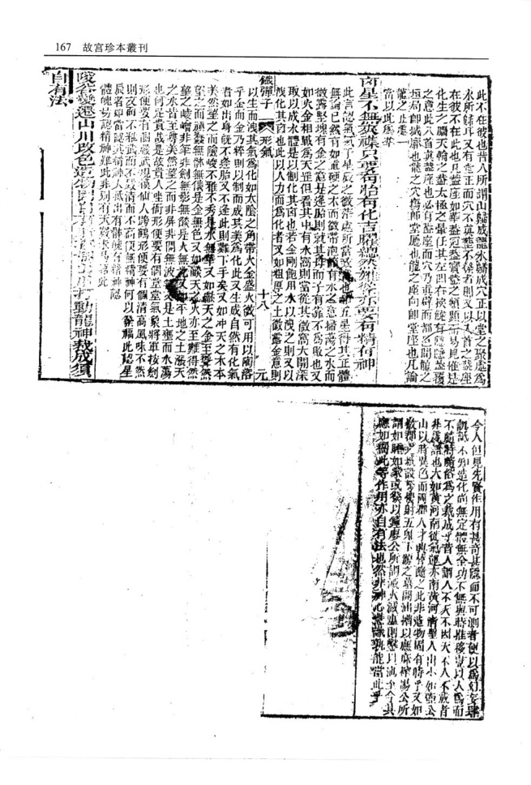

<!-- V3_SOURCE_ID:book025-b000080-p000-d1da08f6d8 -->

地本身没有精气，就以星光作为精气；地本身没有吉凶，就以星气作为吉凶。“今職夷家類以形體爲實夫星爲虛兒黽星學于不講”这段中“職夷家”“兒黽星學”具体所指不详，整段语义模糊。文中认为如果只探究地的情况却不涉及天星，那么形体就只是死魂罢了。“益下之河高卽上之星辰原非二加天東有蒼龍謂為天下前爲東詔點有該武謂依天下卽爲北岳南有來李爲灸四大南高四有自虎謂昊天下部爲西岳”这段中“東詔”“該武”“來李”“灸四大”“自虎”具体所指均不详，整体语义难以明确。中间提到中方位有北极，对应下方就是中岳。又说天上有天河，上天划分对应九州，天上有十二次，对应下方就有十一支辰分限，凡是地上有的事物，天上也都有，天光与地的走势是两两对应的。“以敝形仙之地多發天門以乾爲天而氣焉純陽也帝王之地多起金龍以角亢首二十八宿而且大角帝座所在乾陽到此正在力五之宮也后妃之地多從地戶以龍飛鳳舞乃在乾巽之子无氣”这段中“力五之宮”具体所指不详，整段存在模糊之处，末尾标注有缺字，相关内容无法解读。

> **释读存疑：** 職夷家；兒黽星學；東詔；該武；來李；灸四大；自虎；力五之宮；末尾缺字；職夷家具体所指不详；兒黽星學具体所指不详；東詔具体所指不详；該武具体所指不详；來李具体所指不详；灸四大具体所指不详；自虎具体所指不详；力五之宮具体所指不详；末尾“二十”存缺字相关内容无法解读；1轮自动修复后核义模型仍建议修订，已保守记录。

查看对应原文

<!-- V3_FOLDBACK_BEGIN:book025-b000080-p000-d1da08f6d8 -->

地無精氣以星光爲精氣地無吉凶以星氣為吉凶今職夷家類以形體爲實夫星爲虛兒黽星學于不講不知叩地而不及天星則體魄祗死魂耳益下之河高卽上之星辰原非二加天東有蒼龍謂為天下前爲東詔點有該武謂依天下卽爲北岳南有來李爲灸四大南高四有自虎謂昊天下部爲西岳中有北極爲鈎下卽爲中岳又如上有天河天分土以以九州上有十二次合下卽有十一支辰分限凡一物若有地所有一皆天之所有豈非天光地流兩兩相應哉以敝形仙之地多發天門以乾爲天而氣焉純陽也帝王之地多起金龍以角亢首二十八宿而且大角帝座所在乾陽到此正在力五之宮也后妃之地多從地戶以龍飛鳳舞乃在乾巽之子无氣 二十

<!-- V3_FOLDBACK_END:book025-b000080-p000-d1da08f6d8 -->

<!-- V3_SOURCE_ID:book025-b000081-p000-2c81b30552 -->

开篇提到“台麟執類多惟王以三台在離遂延太敏四輔花壬最數在帝座之左右也”，这段内容语义模糊，具体所指不详。说到忠良仙重的风象，艮宫最多，“以也名一義明赤姿常故異氣多產于此”表述含义不清。将帅武官和兵卒多生于疑地，因为这些地方是金煞和鬼罡所临的位置。“神壇古剩蘇宿長多自井度以井鬼為暗金甘太所要也”中“蘇宿”“甘太”具体所指不详。“又如太陽在今而諸內不數臨有召之象故郡設都皆向難而若適如誦星各各有主此乎故尋乘生氣但認有形之生無而不好無形之生正在天光下臨地德上載”这段语义模糊，“向難”“誦星”具体所指不详。杨公看行龙多用“牛樞九星體食巳為之等星”，这一表述具体含义不详；斗杓居于中央运转四方，旅龙取法这个意象。“廖氏看入用疏行七政如大陽太於等厚以七政運行有常變而吉凶切故人首至詳焉”这段语义不清，具体所指不详。末尾提到“其法昔華之天星非股見也”，这一表述含义不明，无法解读。

> **释读存疑：** 台麟執類多惟王以三台在離遂延太敏四輔花壬最數在帝座之左右也；赤姿常；蘇宿；甘太；誦星；牛樞九星體食巳為之等星；廖氏看入用疏行七政如大陽太於等厚；其法昔華之天星非股見也；台麟執類多惟王以三台在離遂延太敏四輔花壬最數在帝座之左右也语义模糊；以也名一義明赤姿常故異氣多產于此含义不清；蘇宿具体所指不详；甘太具体所指不详；向難具体所指不详；誦星具体所指不详；牛樞九星體食巳為之等星具体含义不详；廖氏看入用疏行七政如大陽太於等厚以七政運行有常變而吉凶切故人首至詳焉语义不清；其法昔華之天星非股見也含义不明

查看对应原文

<!-- V3_FOLDBACK_BEGIN:book025-b000081-p000-2c81b30552 -->

台麟執類多惟王以三台在離遂延太敏四輔花壬最數在帝座之左右也忠良仙重之風惟艮宮最多以也名一義明赤姿常故異氣多產于此而將帥臣武并釋卒多產疑處以凡爲金煞且鬼罡所臨也神壇古剩蘇宿長多自井度以井鬼為暗金甘太所要也又如太陽在今而諸內不數臨有召之象故郡設都皆向難而若適如誦星各各有主此乎故尋乘生氣但認有形之生無而不好無形之生正在天光下臨地德上載楊公看行龍多用牛樞九星體食巳為之等星斗杓居中而運四方旅龍取象焉廖氏看入用疏行七政如大陽太於等厚以七政運行有常變而吉凶切故人首至詳焉其法昔華之天星非股見也

<!-- V3_FOLDBACK_END:book025-b000081-p000-2c81b30552 -->

<!-- V3_SOURCE_ID:book025-b000082-p000-de84dc8823 -->

用先天来统龙，应当详细探究四龙天星；用后天来布局，应当仔细察辨三盘卦例。21 这两段以先天、后天为定龙、定局的纲领，是乘气的第一要务。先天卦位，乾南坤北，离东坎西，震巽艮兑居四隅，是阴阳对待的本体。然而乾坤虽为天地定位，实则是阴阳之老；坎离虽为水火不相射，亦是阴阳之极，因为这四卦上下四爻皆为纯阴纯阳，没有化气。唯有艮兑震巽四卦，上下一爻皆为阴阳相配，才符合中和之义，有生化之机。而且以卦配合天星，艮为贪复，兑为武曲，巽为巨门，震为旗贞，经书中以贪、巨、武为三吉，又说大地若非廉作祖，为官也不至三公，说的正是这个道理。所以艮、兑、巽分别对应天垣、大微垣、少微垣，上应垣星，本来就属于贵格；亥对应的是紫岁垣，处于北极之位，更是垣局中最尊贵的。而庚、辛、丙、丁的贵格，是因为长纳两为贪狼，巽纳辛为巨门，兑纳丁为武曲，震纳山而为张贞。至于离、壬的贵格，是因为离位居正阳方位，众星拱卫环绕，确实能增益其尊贵；还有庚和亥同宫，距离紫微最近，所以也属于贵格。巳则又和紫微处于对宫位置，被称为帝座的明堂。现在的人把丙、丁、辛和艮、兑、巽合起来称作六秀，又把亥、巳和六秀合起来称作八贵，还认为离、壬属吉位，这些都是从天星的规则推导出来的。至于后天卦的分阴分阳规则，从乾到坎到艮到震都属阳，排列在东北方位；从巽到离到坤到兑都属阴，排列在西南方位，它的要义以弹子理气 主1。此处有缺字，具体所指不详。

> **释读存疑：** 原文多处术语晦涩，末尾有缺字，部分内容难以准确解读；1轮自动修复后核义模型仍建议修订，已保守记录。

查看对应原文

<!-- V3_FOLDBACK_BEGIN:book025-b000082-p000-de84dc8823 -->

用先天以統龍常詳究平四龍天星用後天以布局宜細察乎三 盤卦例 21 此二段以先天後天爲定龍定局之綱領乃乘氣第一務大數 先天卦位乾南坤北離東坎西震巽艮兌居四隅月陰陽對待 之體然乾坤雖爲天地定位寔爲陰陽之老坎離雖爲水火不 相射亦爲陰陽之極以四卦上下四爻皆純陰純陽無化氣也 惟艮兌震巽四卦上下一爻皆陰陽相配乃合中和之義有生 化之機且以勸卦配含天星則艮爲貪復兌爲武曲巽爲巨門 震爲旗貞經以貧巨武為三吉又云大地若非廉作祖爲官也 不至三公正謂此也是故艮兌巽一爲天而垣一爲大微垣一 爲少微垣上應垣烏固爲貴也亥則爲紫歲垣居北極之奪尤 垣局中之最貴者而庚辛丙丁之貴則以長納兩爲貪狼巽納 辛爲巨門兌納丁爲武曲震納山而爲張貞也至于離壬之貴 則以離居正陽諸星拱伏寔濟其尊至庚亥同宮至近紫薇故 亦為貴而已則又與紫微對宮稱帝座之明堂今人以兩丁辛 合艮兌巽而稱六秀又以亥巳合六秀而稱八貴又以離壬為 吉皆從天星也若夫後天之卦分陰分陽之義從乾至坎至艮 主震皆陽列于東北從巽至離至坤至兌皆陰列于西南其意 以彈子理氣 主1

<!-- V3_FOLDBACK_END:book025-b000082-p000-de84dc8823 -->

<!-- V3_SOURCE_ID:book025-b000083-p000-07e8b28b12 -->

把乾、坤作为老阴、老阳，退处在西兆的位置；六子施生布气，进居东南方位，这是实用的学问。辨别方位确定位置，古人用后天八卦，立意就在于此。但古人的三盘卦例具体是怎样的？正是因为方位的吉凶贵贱不能没有辨别，所以素书用浑天六十体装卦，选取本来山水之中的四吉、三奇、贵人、禄马，过去的人用内卦审察山水，来确定穴的纯杂，指的就是这个卦。“寶以七十三龍裝卦取坐向山永中四吉三奇貴人祿馬以審本來山水中之吉囟昔人用木卦審入穴以推山水之吉囟者卽此卦也”这段中“七十三龍”“木卦”“吉囟”具体所指不详。如果龙脉不符合浑天中的四吉、三奇，就从地盘的坐、向里求取；如果坐、向不符合吉三奇，就再从坐向里所串的天盘看对应的属性，再从这个卦里选取四吉、三奇，就是所说的外卦。总之吉凶贵贱一律要以龙为主，至于乘气的关键，全在平分六十龙上。“振討當以蔡西山所定詳節天表六十龍之分度為準蓋天盛盈續則六甲有多寧之差穿山七十二則六甲有斷縮之經以之乘氣豈爲當乎”这段中“振討”“天盛盈續”“多寧之差”“斷縮之經”具体所指不详。“故三聲卦例古人用之以取四市三可祿馬貴人乃為得之者以此法用之乘氣非其自也”中“三聲卦例”“四市三可”具体所指不详。合起来说，“分度用氏之平分，分金用氏之挨加”，这里的“氏”具体指谁没有说明，相关表述含义不清；分金刻度、纳秀迎官，就用素书浑天的卦例，这样堪舆的要领就掌握了大半。以龙确定穴，必须审察入路的阴阳；以水确定向，必须看归路的阴阳。这两段是以龙和水的入路、归路作为分阴分阳的方法，比如亥位，从酉、辛方向来的是左旋，属阳，那么亥就是阳木；从癸、子、壬方向来的是右旋，属阴，那么亥就是阴木。阳木生在亥，旺在卯，墓在未；阴木生在午，旺在寅，墓在戌，杨公以龙的来路分阴阳就是依据这个方法。“又如亥木逢而水出戌則爲乙丙交而起戌卽立陽向以納之”中“亥木逢而”存在缺字，语义不完整；“陽亥木逢癸水出未則爲金羊叔癸甲之靈卽立陰向以納之”中“金羊叔癸甲之靈”具体所指不详，这是真阴阳交媾的方法，刘公以水的归路分阴阳就是依据这个方法。

> **释读存疑：** 七十三龍；木卦；吉囟；振討；天盛盈續；多寧之差；斷縮之經；三聲卦例；四市三可；氏之平分、氏之挨加所指不明；亥木逢而缺字；金羊叔癸甲之靈；七十三龍具体所指不详；木卦具体所指不详；吉囟具体所指不详；振討具体所指不详；天盛盈續具体所指不详；多寧之差具体所指不详；斷縮之經具体所指不详；三聲卦例具体所指不详；四市三可具体所指不详；分度用氏之平分、分金用氏之挨加的“氏”所指不明；亥木逢而存缺字语义不完整；金羊叔癸甲之靈具体所指不详；1轮自动修复后核义模型仍建议修订，已保守记录。

查看对应原文

<!-- V3_FOLDBACK_BEGIN:book025-b000083-p000-07e8b28b12 -->

以乾坤爲老陰老陽退處西兆以六子施生布氣進居東南乃 致用之學也辨方定位古人用後天意取詣此然古人三盤卦 例云何正以方位吉自貴賤不可無辨故素書以渾天六十體 裝卦取本來山水中四吉三奇貴人祿馬昔人用內卦審山水 以定坐穴之純駁者卽此卦也寶以七十三龍裝卦取坐向 山永中四吉三奇貴人祿馬以審本來山水中之吉囟昔人用 木卦審入穴以推山水之吉囟者卽此卦也又如龍脉不合渾 天中四吉三奇則求之地盤坐向又如坐向不合吉三奇 則又于座向內所串之天盤看是何屬又于此卦取四吉三奇 所謂外卦是也要之吉凶貴賤一當以龍爲主至于乘氣紫要 處全在平分六十龍上振討當以蔡西山所定詳節天表六十 龍之分度為準蓋天盛盈續則六甲有多寧之差穿山七十二 則六甲有斷縮之經以之乘氣豈爲當乎故三聲卦例古人用 之以取四市三可祿馬貴人乃為得之者以此法用之乘氣非 其自也合而言之分度用氏之平分分金用氏之挨加 分金刻度納秀迎官則用素書渾天之卦例堪與思過半矣 以龍定穴須審入路陰陽以水定向須看歸路陰陽 此二段以龍水之人路歸路爲分陰分陽之法如一亥也從 酉辛而來是左旋爲陽則亥爲陽木從癸子壬而來是石木爲 陰則亥爲陰木陽太則生亥旺卯墓未陰木則生午旺寅暮戌 以此而分楊公以龍之來路分陰陽者此也又如亥木逢而 水出戌則爲乙丙交而起戌卽立陽向以納之陽亥木逢癸水 出未則爲金羊叔癸甲之靈卽立陰向以納之此眞陰陽交媾 法劉公以水之歸 路分陽者此也

<!-- V3_FOLDBACK_END:book025-b000083-p000-07e8b28b12 -->

<!-- doc013 PDF 第 172 页：高风险/复杂版面 OCR 供检索；内容与排版以原页图为准。 -->
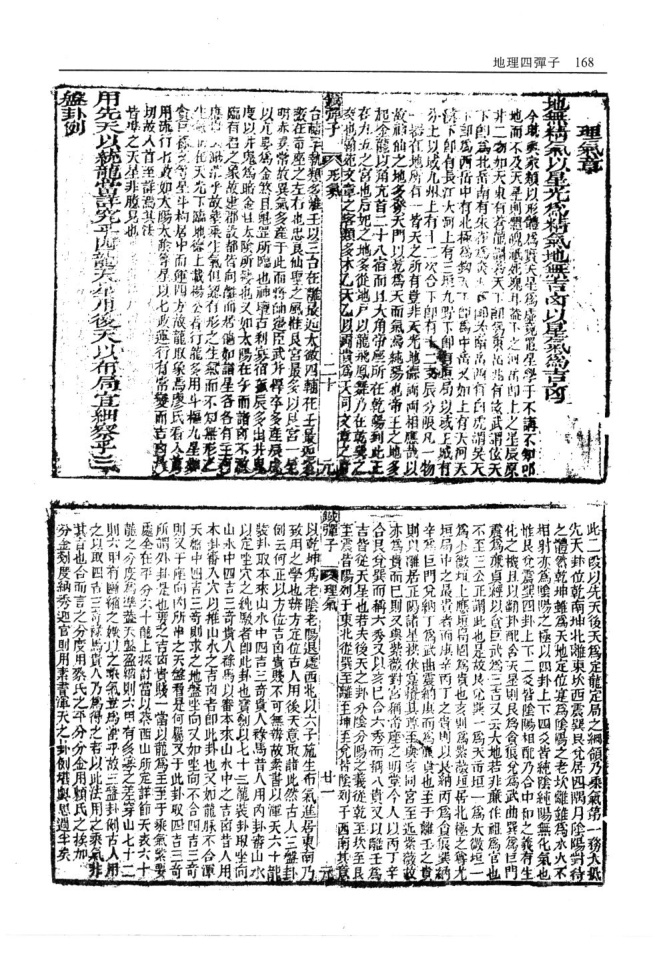

<!-- V3_SOURCE_ID:book025-b000085-p000-a2bee0a40c -->

入首的八首，是用来区分龙脉与脉气的；分金分经，是用来区分来龙与穴位坐向的。这二度工作，一项是最初确定穴时要做的功夫，是开山立向的紧要环节；另一项是成穴后要做的功夫，是串脉定坐度的关键。什么是八首？就是所谓的“到头”。凡看龙脉到头处，要辨明是何种龙：若八首属阴，后龙多属阴，便是真落；若后龙多属阳，便是伪落。若八首属阳，后龙多属阳，便是真落；若后龙多属阴，便是伪落。这是《弹子人理气》中的内容。

> **释读存疑：** 1轮自动修复后核义模型仍建议修订，已保守记录。

查看对应原文

<!-- V3_FOLDBACK_BEGIN:book025-b000085-p000-a2bee0a40c -->

入首八手則龍與脉之所由辨分金分經則來與坐之所由分 此二度一爲初定穴時工夫乃開山立向之緊要一爲成穴 後工夫乃串脉坐度之第要何云八首今云到頭是也凡到頭 看是何龍如八首陰後龍炙則陰爲煎落如後龍多陽則陰 爲僞落已八首陽後龍多陽則陽爲真洛如後龍多陰則陽為 獄彈子人理氣

<!-- V3_FOLDBACK_END:book025-b000085-p000-a2bee0a40c -->

<!-- V3_SOURCE_ID:book025-b000086-p000-d0b216c9e9 -->

伪落已经确定，古人的方法是从大势着眼，以后龙为主，所以大多舍去伪落，只是对初年不利的情况才不考虑。比如初一節星体形态很秀丽，又与向、水相合，就可以先用来催官、取福。这是针对一山一水的情况而言。若是大地，就不以当前的福为福。这里的入首，是开山立向的紧要环节。所谓入首，就像人取物一样，是受用之处，是针对穴中的脉气而言的。古人所说的灰蛇之脉，正是因为旧地有草蛇灰线，落脉才分明，真气才显现。然而气与脉又有区别，以敛聚且活动的地方为脉，既然脉有聚气，难免会有阴阴的情况，不可贸然乘气，必须到穴处有团晕、变化明显的地方，才可以安葬。这是入首的精微之处，尤其紧要，最初定穴时全要在这处下功夫。什么是分金？比如亥行五亥，取辛亥、丁亥为旺相，乙巳、癸为孤虚，孤虚不可用，应当乘旺相，要选择甲子、乙丑之金分来的吉凶善恶，不可不仔细选择。这是乘气中趋吉避凶的关键。什么是分经？二十八宿是天之经星，天的五行在二十八宿中又各有分布，它们与分金纳音五行的生克制化相关。穴中有来脉、有坐度，来脉重分金，坐度重分经。然而坐度是寄寓，来脉是本主，寄寓是用来辅助本主的。这六句是列仙造福的秘诀，不轻易示人。这是来气中趋生避死，看左右落脉可辨真伪，气带左右可辨纯驳。此落采用土主细城，乘气中安葬。吴公地理筌结说：“机皇旧不堪用，若还白可哉。”量台原空落书，显右落壬傍，原言亥之中行则纯粹不杂，为古。若乾与亥双行，须看所落：如人落则乾多不堪作，石落则多多犹可裁。若壬亥双行，亦看左右，山亥为右者，以面对来脉而看，则乾左而亥右也。旦望落脉与此辨，而与白见。赖公位宫篇云：“天皇气射，天武星领，异洪设加，王行天宝，六空吉耳，爱气官资荣。”言亥纵非变行，其立穴处须要挨加复法，乃不为理气所侵。如下皇而穴就向巽，要微于右，遼卯王则亥气受而不沾乾天康之穴，始得如此，气方有纯而无漓也。故凡定山，以龙之入首定穴情，以脉之入首欲乘生气，这是最紧要的，也是吴、赖所最究心之处。

> **释读存疑：** “初一節星體”“歛鬚而活動處”“字十陰陰”“變鳴處”“第夢處”“寄寫莊”“土主細城”“機皇舊不堪用，若還白可哉”“量臺原空落書”“人濟”“石落”“與白見”“異洪設加王行天寶六空吉左耳愛氣官資榮”“遼卯王”“天康之穴始室”等原文表述模糊，义理难明；1轮自动修复后核义模型仍建议修订，已保守记录。

查看对应原文

<!-- V3_FOLDBACK_BEGIN:book025-b000086-p000-d0b216c9e9 -->

僞落已然古人法從大勢以後龍爲主故多舍去僞落維不利初年所不論也如初一節星體甚秀又與向合又與水合則每可以催官先咨間取鬻福而用之此一山一水則然也若大地不以當福爲福此入首爲開山立向之緊要旬云入手如人之取物八手乃受用處益取穴中之氣脈言也古人所灰蛇之脈正以又手舊地有草蛇灰線則縣落分明真氣始列然氣與脈又有分者以歛鬚而活動處爲脈既有飲聚不免字十陰陰不可乘故必到穴有團暈變鳴處方可塟穴此八手之精微處尤爲緊要初定穴時全在此處加功何謂分金如亥行五亥取辛亥丁亥爲旺相而乙巳癸爲孤虛孤虛不可八旺相所當乘從甲子乙丑之金分來其吉囟善惡不可不審擇也此乘氣中起吉過凶之第夢處何謂分經二十八宿乃天之經星顧天五行千二十八宿中又各分相焉其與分金納音五行相爲生尅制化者也穴中有來脈有度來脈重分金坐度重分經然坐度爲寄寓來脈爲本主而寄寫莊所以佐本主也此六句乃列仙造福秘訣不輕示人者此來氣中趨生避脈看右落則脈可辯眞僞氣帶左右加則氣可別純滴此落採用土主細城乘氣中紫安吳公地理筌結云機皇舊不堪用若還白可哉量臺原空落書顯右落壬傍原言亥之中行則純粹不謙爲古若乾與亥雙行須看所落如人濟則乾多不堪作石落則多多猶可裁若王亥雙行亦夫左山亥爲右者以面對來脈而百則乾左而亥存也旦望落脈與如此辨而與白見賴公位宮篇云天皇氣射天武星領異洪設加王行天寶六空吉左耳愛氣官資榮言亥縱非變行其立穴處須要挨加復法乃不爲禮氣所侵如下皇而穴就向巽要微于右遼卯王則亥氣受而不沾乾天康之穴始室如此氣方有純而無漓也故凡定山以龍之八首定穴情以脈之八手欲乘生氣此最紫要吳頼所最究心處也

<!-- V3_FOLDBACK_END:book025-b000086-p000-d0b216c9e9 -->

<!-- V3_SOURCE_ID:book025-b000087-p000-5c28e686cc -->

## 鐵彈子理氣 — 铁弹子理气

查看对应原文

<!-- V3_FOLDBACK_BEGIN:book025-b000087-p000-5c28e686cc -->

## 鐵彈子理氣

<!-- V3_FOLDBACK_END:book025-b000087-p000-5c28e686cc -->

<!-- V3_SOURCE_ID:book025-b000088-p000-78e1f069cb -->

龙脉有顺、逆的区别，乘气自然应当有所分辨；五行的运用有颠倒的情况，各自有对应的方法。这里说的是龙脉来路的生旺之气各有不同，所以乘气的方式也不一样。比如同样是亥位，原文提到“官云迢迢西兌八天皇貴朝死詩文宣恭亥博木屬金兩八天皇是金龍生水”，这部分表述语序不顺，暂时无法准确断句释读；按后续内容可知这段是说亥气为旺，是用正五行来论生旺的。原文又提到“書囊坎廟人亥乾丙向夾蛇牙卦癸丑屬金壬子萬水乾亥丙屈火”，这段表述含义不明，按后续内容可知是说由癸丑金生壬子水，水生乾亥，木又生丙向之火，是用带山五行来论生旺的。赖公采用正五行，杨公采用发山五行，二者的方法虽然有别，但乘气的根本原理是一致的。另外原文此处“帶山五行”和后文“楊公用發山五行”用字不一致，此处“帶”疑似讹误。

> **释读存疑：** 官云迢迢西兌八天皇貴朝死詩文宣恭亥博木屬金兩八天皇是金龍生水表述语序不顺，无法准确断句释读；書囊坎廟人亥乾丙向夾蛇牙卦癸丑屬金壬子萬水乾亥丙屈火含义不明；帶山五行的“帶”疑似讹误，与后文发山五行不一致

查看对应原文

<!-- V3_FOLDBACK_BEGIN:book025-b000088-p000-78e1f069cb -->

龍脉有順逆乘氣自當有辨五行有顛倒作用各自有法此言來路生旺之氣不同而乘之者亦不同也如同一亥也官云迢迢西兌八天皇貴朝死詩文宣恭亥博木屬金兩八天皇是金龍生水則亥氣爲旺用正五行論生旺也書囊坎廟人亥乾丙向夾蛇牙卦癸丑屬金壬子萬水乾亥丙屈火今由癸丑金生壬子水水生乾亥禾水生丙向之火 以帶山五行論生旺也賴公用正五行楊公用發山五行有法而所以乘氣則一也

<!-- V3_FOLDBACK_END:book025-b000088-p000-78e1f069cb -->

<!-- V3_SOURCE_ID:book025-b000089-p000-dbf633a08b -->

气有根本脉不容他杂的，气有借差脉而可隔山取的，气有合初分脉而不算造远的，气有串渡峡脉而不算邀截的，这是以骨脉的正偏为乘气的方法。杨公说：“亥无鳞甲用心安。”又说：“隔山取气若须学，如亥龙两旁乾壬不宜曲折，只爱行气之乘本脉而不容他杂者，如亥龙之狮是也。”又如巽巳丙龙，家慎属争阴，则丙可借巳，巳可借巽，气之借旁而可满山取者，巽巳丙龙之药是也。《玉尺》说：“来龙不脱来龙气，如亥脉起龙至八穴处仍复亥气，与神相合，此气之合初分迹也。”又说：“三峡三关元复元，如亥脉过峡渡至入首处仍承亥脉，乃为真气，若过峡处非不气受脉之所，此气之串渡峡脉也。”气脉与孙公子相关如此。

> **释读存疑：** “亥龍之獅”“巽己丙龍之藥”“訓孫公子”原义不明；1轮自动修复后核义模型仍建议修订，已保守记录。

查看对应原文

<!-- V3_FOLDBACK_BEGIN:book025-b000089-p000-dbf633a08b -->

氣有未本脈而不容他祥者氣有借差脈而可隔山取者氣有合初分脈而不為造遠者氣有串渡峽脈而不爲邀截者此以骨脈之黃正爲乘氣一法傷公云亥無鱗甲用心安又云隔山取氣若須學如亥龍兩旁乾王不宜曲折只愛學行氣之乘本脈而不容他禪者如亥龍之獅是也又如巽巳丙龍家慎屬爭陰則丙可借巳巳可借巽氣之借考麻而可滿山取者巽己丙龍之藥是也玉尺云來龍不脫來龍氣如亥脈起龍至八穴處仍復亥詠與神相合此氣之合初分跡也又云三峽三關元復元如亥脈過陝渡萬至八首處仍承亥脈乃爲真氣巷過誠處非不氣受脈之所此氣之串渡峽脈也夫氣脈之與訓孫公子相又吉如此者

<!-- V3_FOLDBACK_END:book025-b000089-p000-dbf633a08b -->

<!-- doc013 PDF 第 173 页：高风险/复杂版面 OCR 供检索；内容与排版以原页图为准。 -->
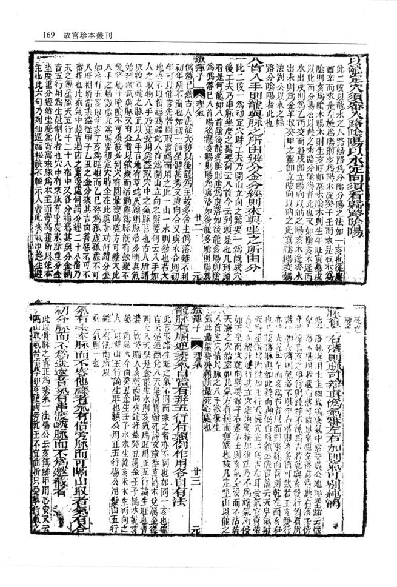

<!-- V3_SOURCE_ID:book025-b000091-p000-e3a37125dd -->

这段是残缺文本，现存内容为：立穴没有尺寸的移动，受气的区别在耳腰之间，分金有转移的巧妙，气总没有毫……后面内容缺失，无法补全。

> **释读存疑：** 原文为残句，后半部分内容缺失，无法完整释读；耳腰之異的具体含义不明

查看对应原文

<!-- V3_FOLDBACK_BEGIN:book025-b000091-p000-e3a37125dd -->

立穴無尺寸之移受者耳腰之異分金有轉移之巧氣總無毫

<!-- V3_FOLDBACK_END:book025-b000091-p000-e3a37125dd -->

<!-- V3_SOURCE_ID:book025-b000092-p000-f82cbdc356 -->

第二段以换生弃死、存真去伪为原则，以棺阴骨一线之气为法。前文说穴的疑结，或是正穴为窝、乡、乳、突，或是怪形为骑形，萌人开孤，或是正落为本山本气，或是伪落而辅开借海，要自有一定不可务易之处，那么穴岂可尺寸移动？受气则不乖谬，这是理气的内容。书四 元

> **释读存疑：** “萌人开孤”“借海”“书四 元”原义不确定

查看对应原文

<!-- V3_FOLDBACK_BEGIN:book025-b000092-p000-f82cbdc356 -->

二段以换生棄死存眞去僞疑承貫棺陰骨一線之氣爲法前毀言穴之疑結或以正穴而爲窩鄉乳裘或以怪形而爲騎形萌人開孤故蕩或以正落而爲本山本氣或以僞落而輔開借海要自有一定不可務易之處則穴豈可尺寸移哉受氣則不戴師子理氣 书四 元

<!-- V3_FOLDBACK_END:book025-b000092-p000-f82cbdc356 -->

<!-- V3_SOURCE_ID:book025-b000093-p000-ffff53a755 -->

行龙出脉有颠有逆、有横有直，有隔一宫的情况，也有隔数宫的情况，原文提到“其愛氣或耳或腰”，具体含义不明，只知内接生氣，外受堂气，绝对不能拘泥刻板，“以人力而天功全在乎此”的具体含义不明确。分金的巧妙要怎么运用呢？比如艮龙入首，戊实为正，病日戊寅属土，也属于本气，这种情况坐下自旺，不需要补动。原文提到“皆或有角兩育病火反生艮土爲淺”，其中“角兩育病火”含义不明，只知这种情况会失之于弱，要用分金生养穴，比如甲年的向宜用庚寅分金，因为庚寅之木可以生丙寅之火，达到生旺的效果。原文提到“虛十四山爲父母”，其中“虛十四山”含义不明，六十龙为胎息，胎息生父母为度，后文又有“兩之氣在艮中爲弱”的表述，含义不明，坐穴处用庚寅分金，以木补火，难道不是转移的巧妙吗？原文提到“若急終下可差者穴中乘氣先掛氣線氣線既定乃曲坐聖既定久排孫余綠”，这段表述模糊，讹误较多，暂无法准确释读。又如艮入首有三分寅气，原文提到“便當掛寅氣一韓氣線空線交界之所”，其中“韓”“余綠”等字疑似讹误，含义不明，只知要观察气线和空线交界的地方的气的情况：如果寅气来势急，就退下一分来承接寅气，如果寅气脉路来势缓，就进一分来承接寅气，这样艮的真气才能贯入棺中而没有夹杂，这其中的道理至精至微，不能有丝毫的差错。

> **释读存疑：** 其愛氣或耳或腰含义不明；以人力而天功全在乎此的准确含义不明；角兩育病火含义不明；虛十四山含义不明；乃曲坐聖既定久排孫余綠表述模糊讹误多，无法准确释读；便當掛寅氣一韓氣線空線交界之所中“韓”疑似讹误，含义不明；以燕寅氣、以覽寅氣中“燕”“覽”的具体含义不明

查看对应原文

<!-- V3_FOLDBACK_BEGIN:book025-b000093-p000-ffff53a755 -->

哉以行龍出脉有顛有逆有橫有直有隔一宮有隔歎宮其愛氣或耳或腰內接生氣外受堂氣甚不可拘犯以人力而天功全在乎此分金之巧何以用之如艮龍入首戊實爲正病日戊寅屬土亦爲本氣此坐下自旺無待補動者皆或有角兩育病火反生艮土爲淺則失之弱盲用分金生養穴如甲年向宜用庚寅分金以庚寅之木可生丙寅之火爲生旺也虛十四山爲父母六十龍爲胎息胎息生父母爲度後有兩之氣在艮中爲弱禮子坐穴處用庚寅分金以木浦火豈非轉移之巧若急終下可差者穴中乘氣先掛氣線氣線既定乃曲坐聖既定久排孫余綠如艮入首有三分寅氣便當掛寅氣一韓氣線空線交界之所看氣何如自寅氣冲八便高甚遊來急富退下一分以燕寅氣脉路來緩富進一分以覽寅氣艮之真氣乃貫棺而無夾後矣至精年微不可毫桑差者也

<!-- V3_FOLDBACK_END:book025-b000093-p000-ffff53a755 -->

<!-- V3_SOURCE_ID:book025-b000094-p000-490b370007 -->

原文提到“中氣辟乘氣故取三七放棺”，其中“辟”字的准确含义不明，只知放棺要取三七的比例，旺气适宜乘用分金，原文提到“六取三七加向”，其中“六”字含义不明，暂保留原表述，这种做法下气线、生线都主富，避煞迎生，是乘气中最重要的地方。原文提到“予宙中逐中氣卽爲衰新”，其中“予宙”“衰新”含义不明，无法准确释读。原文说“故邏經中以戊子巳申盤爲大穴巳註”，其中“邏經”“巳申盤”“巳註”含义不明，只知里面标注度数界在五分中气之间的，是没有生机的。比如《催官篇》中记载亥龙坐乾向巽，略微加壬位，承受癸亥的七分亥、三分壬，正符合这个意思。另外分金加左加右多用三分，正是因为三分就处在丙、庚、丁年的生位，不犯戊巳的中气，原文提到“終夕兩邊交界之中繞也”，其中“終夕”含义不明。分金的甲、丙、庚、丁、辛，是原阳正源所记载的，原文提到“雍曳身氣之在艮兌震巽者爲陰陽相文”，其中“雍曳身氣”“陰陽相文”含义不明，只知要取旺朔来论断，原文提到“非丙真丁辛則乘氣自不犯冲中之煞”，其中“丙真丁辛”含义不明，只知符合要求的话乘气自然不会犯冲中之煞，一切穴的生围就可以没有忧患。

> **释读存疑：** 中氣辟乘氣的“辟”字含义不明；六取三七加向的“六”字含义不明；予宙中逐中氣卽爲衰新中“予宙”“衰新”含义不明；邏經、巳申盤、巳註含义不明；終夕兩邊交界之中繞也的“終夕”含义不明；雍曳身氣、陰陽相文含义不明；丙真丁辛含义不明

查看对应原文

<!-- V3_FOLDBACK_BEGIN:book025-b000094-p000-490b370007 -->

中氣辟乘氣故取三七放棺旺氣宜乘分金六取三七加向此氣線生線俱富殺迎生乃乘氣中之第一紫妻處予宙中逐中氣卽爲衰新故邏經中以戊子巳申盤爲大穴巳註以度數界在五分中氣之間爲無生機也如催官篇亥龍坐乾向巽畧加壬位受癸亥之七亥三壬正合此意又分金加左加右多用三分正以三分則在丙庚丁年之生不紀戊巳之中終夕兩邊交界之中繞也分金甲丙庚丁辛原陽正源所載雍曳身氣之在艮兌震巽者爲陰陽相文故取旺朔雲而論之分非丙真丁辛則乘氣自不犯冲中之煞而一切穴生圍可無患口

<!-- V3_FOLDBACK_END:book025-b000094-p000-490b370007 -->

<!-- V3_SOURCE_ID:book025-b000095-p000-ad5ccbbeaf -->

脉不立而气直，何畏直来？受气不纯而棺斜，乃为正脉正承，这是《催官》承气之诀。《催官》说：“来乾读向天门，北虚来道向神工，裂异丙受向最为良，富贵荣乐入英杰。”直来直受为气中脑散，或左而加巽、右而加两，微微斜爱，便非中脑。何其直？所谓脉不立，弹子邪气旨而气贞，不为害也。若果入乎遗硬，则系山劈便，绮架渐粘之。2元

> **释读存疑：** “催官來乾讀向天門”句的正确断句和含义、“斜愛”“脉不孺”“遺硬”“綺架漸粘之”“2元”原义不确定；1轮自动修复后核义模型仍建议修订，已保守记录。

查看对应原文

<!-- V3_FOLDBACK_BEGIN:book025-b000095-p000-ad5ccbbeaf -->

脉不立而氣直何畏直來受氣不純而棺斜乃爲正買正承此催官承氣之訣催官來乾讀向天門北虛來道向神工裂異丙受向最爲良富貴柔樂入英傑夫直來直受爲氣中腦散或左而加巽右而加兩微微斜愛便非中腦何其直所謂脉不孺彈子邪氣 旨而氣貞不爲害也若果入乎遺硬則繫山劈便綺架漸粘之 2元

<!-- V3_FOLDBACK_END:book025-b000095-p000-ad5ccbbeaf -->

<!-- V3_SOURCE_ID:book025-b000096-p000-5e3f043990 -->

风水之法岂能缺少？又说背向的方位有一百九乘天顿气，从右耳方位合矩，适宜的义理是，左侧加天皇，便能使荣华尽归乡士。这话是说，龙坐子向午，得丙子正壬之气，以此贯穿吉耳为合法，应当选择左侧，以里甲子名壬三亥之气放置棺木，合而子正之气作为辅助，与正子之气大不相同，而以七壬之气作为正气，太过了。千正壬之气斜斜贯耳，正气没有藏匿，此棺斜受气，正气的益处贯耳，这是固定的气放置棺木的方法，由此可知这是乘气的概括之法，适宜催用。此处有无法识别的字符，具体所指不详。

> **释读存疑：** 原文中“放棺左右故知是乘氣之括法催宜 e tt”存在无法识别的字符，具体所指不详

查看对应原文

<!-- V3_FOLDBACK_BEGIN:book025-b000096-p000-5e3f043990 -->

法豈可少哉又云背之百九乘天頓氣從右耳爲合矩宜義 左加天皇貴榮華盡鄉士此言王龍坐子向午得丙子正壬 之氣以貫吉耳爲合法宜撰左以里甲子名壬三亥之氣放棺 合而子正氣爲之輔大不似正子而以七壬之氣正爲埃過也 千正壬之氣斜斜賈耳正氣爲之無匿此棺斜受而氣正 之益買耳是一定之氣放棺左右故知是乘氣之括法催宜 e tt

<!-- V3_FOLDBACK_END:book025-b000096-p000-5e3f043990 -->

<!-- V3_SOURCE_ID:book025-b000097-p000-91382531ad -->

龙以脉为主，穴以向为尊，水因向而定，向因局而分。

查看对应原文

<!-- V3_FOLDBACK_BEGIN:book025-b000097-p000-91382531ad -->

龍以脉爲主穴以向爲尊水以向而定向以局而分

<!-- V3_FOLDBACK_END:book025-b000097-p000-91382531ad -->

<!-- V3_SOURCE_ID:book025-b000098-p000-655f772c0e -->

这话是说水与穴都以“甸”为重，所以气的运用不可不关注向。凡缠法之内的垂气，都以脉为主，也以正五行为主。另外道门定穴立向，虽说是内以乘龙，实则外以消水，其方法繁多，不可不详细审慎。比如亥入首，水自寅艮而来，从中戌紘而出，若以双山五行起木，则仲陂肺养，以正五行属木，则冲要冠带都不合度，应当立丙丁向，才可消水。以元空五行论，丙丁属火，其墓在戌，才可寂寅尺之水而发驅。以元五行向土之法也是如此。所以说，龙巽庚水朝金局，出艮方则金气已成，应当立庚向以纳之，从杀正为迎神差之法。又如卯龙，见寅艮巳丙水确实成火局，应当任辛向以纳之，盛龙见人局不免为浅气，辛向则对着去水从沐，因此也乘生他发之法。昔人说，没有绝水，只有绝川，盛山水已诗，未有不可看，或求有不合，常以可上薄发而消之，自占宜向消水有许多法度，不是用来滋后人的技艺，只是令人有他法宝以合山川之佐，皆而无改地耳。然法旁不必灾合，只合得一捶便可作福，若今断家而日衰，灵水法吾曰为用，确不可务太山川性情变恶不一面，执一法以合之，岂不谬哉。

> **释读存疑：** 原文中“故之氣者不可不而向也”“肺養”“紘出”“寂寅尺之水而發驅”“盛山水已詩”“上薄發”“自占宜向”“靈水法”“確不可務太”等表述语义模糊，具体所指不详

查看对应原文

<!-- V3_FOLDBACK_BEGIN:book025-b000098-p000-655f772c0e -->

此言水與穴皆以甸爲重故之氣者不可不而向也凡纏法內 之垂氣一以脉爲主亦以正五行爲主別道門定穴立向則 雖內以乘龍而寔外以消水其法多端不可不詳審也如亥入 首水自寅艮來中戌紘出若以雙山五行起木則仲陂肺養以 正五行屬木則冲要冠帶俱不合度當立丙丁則而水可消 以元空五循論丙丁屬火其墓在戌乃可寂寅尺之水而發驅 以元五行向土之永也是故耶龍巽庚水朝金局也 出艮方則金氣已成當立庚向以納之從殺正爲迎神差 之法又如卯龍見寅艮巳丙水的是成火局當任辛向以納之 盛不龍見人局不免爲浅氣辛向則對着去水從沐因出亦乘 生他發之法也昔人云無絕水有絕川盛山水已詩未有不 可看或求有不合嘗以可上薄發而消之自占宜向消水有 許多法度非以滋後人之藝只是令人有他法寶以合山川之 佐皆而無改地耳然法旁不必災合只合得一捶便可作福若 今斷家而日衰靈水法吾曰爲用確不可務太山 川性情變惡不一面執一法以合之豈不謬哉

<!-- V3_FOLDBACK_END:book025-b000098-p000-655f772c0e -->

<!-- doc013 PDF 第 174 页：高风险/复杂版面 OCR 供检索；内容与排版以原页图为准。 -->
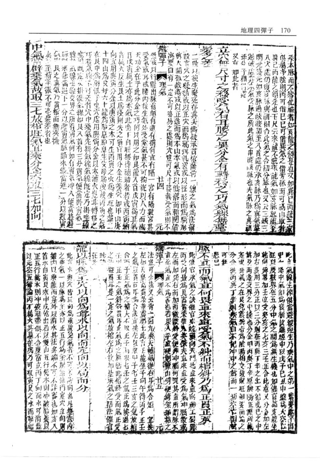

<!-- V3_SOURCE_ID:book025-b000100-p000-b10f954900 -->

看来路要察四生，坐下要察四绝，局内要看三合，向上要看双金。这是用各家五行论奴山出煞的方法。来路为何要看四生？因为四生有四势显现。比如水土龙从坤甲而来，至壬亥结穴，是从生旺方动头，为生旺之龙，发福必武而奏。若从东方而来，则为尅洩之地，发便衰。凡看龙用正五行法，当郑婴坐，为何要看四绝？比如艮龙乡莲子理气，此处有无法识别的字符，具体所指不详。

> **释读存疑：** 原文中“せ六 元”为无法识别的字符，具体所指不详

查看对应原文

<!-- V3_FOLDBACK_BEGIN:book025-b000100-p000-b10f954900 -->

來路看四生坐下看四絕局內看三合向上看雙金 此以各家五行論奴山出煞之法也來路何以看四生地有四 勢見也如水土龍從坤甲來至壬亥結穴是從生發尼旺方動 頭爲生旺之龍發福必武而奏若從東方來則爲尅洩之地 發便衰凡看龍用正五行法當鄭嬰坐不何以四絕如艮龍 鄉蓮子理氣 せ六 元

<!-- V3_FOLDBACK_END:book025-b000100-p000-b10f954900 -->

<!-- V3_SOURCE_ID:book025-b000101-p000-81babb5e7c -->

入首作壬山丙向，水从乾亥出，为绝胎之象。绝胎是存所望四个隶存流尽必富贵者，此也。蒞壬山属火，艮寅乃火生之，而以壬为坐下，则火居火地为得位。又或水从寅甲来，则生发为狼，长房必发；或水从丙午方来，则官旺为武曲，中房必发；又或貌丁未方来，则异方为巨门，小房必发。合此从乾亥，但则总胎为禄存，三房必发而且并发，必为畜贵忠云地，若或少也，乾亥方出而兼作癸山丁向，洪绝癸土，坐山为土，则乾为临后之地，中破临官，仲子必败矣。此坐下所係其不小也，人但知立向而不知坐下当庚，所以十有九则坐下用洪笼三当如是。丑山未向为土上生申旺亥衰子，故先誓旧丑山京未坤水，福浦壬亥拱揖，穴牢丙巳出口，产贤囊之义，亦有用之看來脉，如万氏明旨明之。凡看來脉当用正五行，至以洪笼五行参而合之，尤为的富可内。何以看三合？如亥龙入尊，水从卯甲方来，至塘未方出口，是亥卯未三合，此载木局也。又如亥龙至庚结穴，作卯向，从未串方出口，卿龙水坐向皆从本局合为一家矣。君局所双山五行法当如是，何上何以看乐金以厚戊丑永，乃四金之地，和丑宫牛全事转庸金使哉，作坤庙堕，元空五行坤属金，且龙向是丑，一金非又一金合之为金龙，句青人墓主损丁卽也，甚吉亦维发贵要之入丁，终伤伤丑，有艮右有残，皆属丑分或艮翼也，分而五三分则可不修日论吉，且艮平分或丑癸乎分，便有时金侵之俱不可作昧向乾中昭下皆金，伊京正辰德立此四向书纪建金兄迟大艺又属破东金乎，元冬九谢用之又山出诸法当如是。昔阴作阴司阳作阳可酒乎，气祸加且作坤可庄，阳以中阴祸更速矣，外女人卦行徒纳甲中來，含得羽之或书义军天卦爻五行。

> **释读存疑：** 原文中“蒞壬山”“貌丁未方”“洪绝癸土”“福浦壬亥”“先誓旧丑山京未坤水”“载木局”“乐金以厚戊丑永”“句青人墓主损丁卽也”“伊京正辰德立此四向书纪建金兄迟大艺”“元冬九谢”“可酒乎”“含得羽之或书义军天卦爻五行”等表述语义模糊，具体所指不详

查看对应原文

<!-- V3_FOLDBACK_BEGIN:book025-b000101-p000-81babb5e7c -->

入首作王山丙向水從乾亥出爲絕胎之也絕胎是存所望四個隸存流盡必富貴者此也蒞壬山屬火艮寅乃火生之也而以壬爲坐下則火居火地爲得位又或水從寅甲來則生發爲狼長房必發或水從丙午方來則官旺爲武曲中房必發又或貌丁未方來則異方爲巨門小房必發合此從乾亥但則總胎爲祿存三房必發而且並發必爲畜貴忠云地若或少也乾亥方出而兼作癸山丁向洪絕癸土坐山爲土則乾為臨后之地中破臨官仲子必敗矣此坐下所係其不小也人但知立向而不知坐下當庚所以十有九則坐下用洪籠三當如是丑山未向爲土上生申旺亥衰子故先誓舊丑山京未坤水福浦壬亥拱揖穴牢丙巳出口產賢囊之義亦有用之看來脉如萬氏明旨明之凡看來脈當用正五行至以洪籠五行參而合之尤爲的富可內何以看三合如亥龍入尊水從卯甲方來至塘未方出口是亥卯未三合此載木局也又如亥龍至庚結穴作卯向從未串方出口卿龍水坐向皆從本局合為一家矣君局所雙山五行法當如是何上何以看樂金以厚戊丑永乃四金之地和丑宮牛全事轉庸金使哉作坤廟墮元空五行坤屬金且龍向是丑一金非又一金合之為金龍句青人墓主損丁卽也甚吉亦維發貴要之入丁終傷傷丑有艮右有殘皆屬丑分或艮翼也分而五三分則可不修日論吉且艮平分或丑癸乎分便有時金侵之俱不可作昧向乾中昭下皆金伊京正辰德立此四向書紀建金兄遲大藝又属破東金乎元冬九謝用之以又山出諸法當如是昔陰作陰司陽作陽可酒乎氣禍加且作坤可莊陽以中陰禍更速矣外女人卦行徒納甲中來含得羽之或書义軍天卦爻五行

<!-- V3_FOLDBACK_END:book025-b000101-p000-81babb5e7c -->

<!-- V3_SOURCE_ID:book025-b000102-p000-709a1fbe7d -->

制伏煞星最好是乘其旺势，脱去煞星的影响正是为了扶养生机，顺从煞星就能将其转化为后续助力，留存煞星恰恰是为了迎接官星。以上这四种说法，以生助朝向作为消纳的方法，是气中尔河的本来要义。龙脉入首处，沛亥方向的水流来朝，正符合纵曜的法则，应当坐丁向，前方癸位静伏、甲水来会，以契合乾子理气2。

> **释读存疑：** “生勉朝”具体含义不明确；“气中尔河”具体所指不详；“纵曜法”具体规则不明确；“2”的具体含义原文未说明；“2远”的具体含义原文未说明；1轮自动修复后核义模型仍建议修订，已保守记录。

查看对应原文

<!-- V3_FOLDBACK_BEGIN:book025-b000102-p000-709a1fbe7d -->

制殺莫如乘旺脫殺正以扶生從殺乃化爲繼留殺正爾迎官此四段以生勉朝如爲消納之法乃氣中爾河之元義也始龍龍人首沛亥水來朝正爲縱曜法當坐丁前癸寂甲水以合乾子理氣 2远

<!-- V3_FOLDBACK_END:book025-b000102-p000-709a1fbe7d -->

<!-- V3_SOURCE_ID:book025-b000103-p000-fa656be482 -->

若遇到甲了之木局时，木气聚合之后离火旺盛，乾亥不会构成杀唇，发动反而为生母，这是乘旺制煞的方法。又比如卯龙入首，丙火与艮水从辛方而来，形成一派火局，会耗泄木气，这种情况较为缓和，应当立辛向才合适，但如果水直接流走而不蓄积在局中，那么火气被泄散，木的本气就不会受损，这是脱经扶生的方法。又比如亥龙入首（原文讹作“八首”），后方的龙脉带着子癸之气而来，按照双山的理论来推算属于木，若是水从庚辛方位流入，对应一派金气，那么煞水就会布满整个局，这种情况的处理方法应当立巽向。巽与癸原本为一家，现在让巽与庚辛相合，又与子癸相合，巽向一旦确立，相关的气就能与局相互配合、运化，变为可用的力量，不会成为相克的凶煞，这是从杀为摄的方法。再比如巽龙入首（原文讹作“人直”），辛水朝向穴场流来，就是所说的“辛水向东流”的情况。按照正五行的理论来看，巽属木，辛属金，此处断句存在歧义，若读作“则为之常，谓以归气论”，从归气的理论而言，巽和辛相互纳甲为配合关系；从天星的理论来说，太乙为星，属于正部之内的贵人，如果山水的形势适合立辛向，那么辛金就不会是克身的煞，反而成为官星，这是逆官就禄的方法。山有山的特性，水有水的形态，消纳的关键全在生、制、化三类方法的灵活运用积累。

> **释读存疑：** 原文“又如亥龍八首”中“八”为“入”的形近讹误，已标注；原文“夕巽龍人直辛水”中“人直”为“入首”的形近讹误，已标注；原文“則為之常謂以歸氣論”断句存在歧义，此处采用“則為之常，謂以歸氣論”的断句方式；本地硬校验仍未通过，已记录供后续自动处理或人工核对。

查看对应原文

<!-- V3_FOLDBACK_BEGIN:book025-b000103-p000-fa656be482 -->

本物甲了之木局時木氣合而離火旺乾亥不為殺唇動反爲生母此乘旺制煞之法也又如卯龍入首丙火與艮水從辛而一派火局洩木之氣師爲緩矣當作辛向合然水直去而不蓋于局中則火氣洩而本氣不傷此脫經扶生之法也又如亥龍八首後龍帶子癸而來以雙山論爲木殊水從庚辛方入對派金氣則煞水滿局矣法當立異向詩張與癸原為一家今以巽與庚辛合而又與子癸合巽向一立我凡與句相為嘗與化復爲權不爲我仇此從殺爲攝法也夕巽龍人直辛水嘗向朝來所謂辛水向東流也以正五行論巽屬木辛機金則為之常謂以歸氣論則巽辛相納爲配合以天星則大之太乙爲星正部之內貴人若山水可作辛句則辛不爲後而為官星矣此逆官就祿之法也山有山之傑水有水之黃消的工夫全在生制化三轉積之耳

<!-- V3_FOLDBACK_END:book025-b000103-p000-fa656be482 -->

<!-- V3_SOURCE_ID:book025-b000104-p000-00bda2c119 -->

客水客砂尚可招邀取气真，夫直妇犹嫌半路相逢，此二设外人可借内合，不可假以砂水为乘气之法也，皆纠公为渚家作潮地，一忘力砂不开头面，东西阔二三百步，无界水，坤兜马，十东南角上有水从巽土曲折而来，钢内合流与水倒至而去，训公即从东南角土点一火，作巽巳向入，皆无渺茫气，以治气致不聚，塟后不下故年游巽势菊何也，此乃异水远亥兑之气人穴，丑艮出水作巽，按堂气耳，此以外之名气而取内之真气为一法。又如砂头自西南遥东北，本自坤申来龙，然东南巽内上水来，左右两砂父牙巽而之朝，屈曲到韦有情，虽本身洲无界，然朝上砂水有情，兑气目果各砂薪动龙气八局也。经云气一片罗製拾都犯，朝山识辛心以见云，龙乘气自有巧处，内气难刍当以外气语之，此为立法。又如乙两相日为异夫孀，若丙途丁癸辛水四乙逢出庚壬水来，则配非其儒，垂朝句有情，终继发福。又有乙配丙子中途，如丙大生于次，不自寅来，都是已午方来朝，出戌，此舞正配，终非自少至老夫，始亦为路遇，当正衰年羿第发遍，终迟也。此以真气而非交，情气为龙缝功政命者，当用补弱矣衰之法，此皆子中。

> **释读存疑：** 原文中“钢内合流”“训公”“势菊”“洲无界”“父牙巽而之朝”“到韦”“罗製拾都犯”“辛心”“异夫孀”“丙途丁癸辛水四乙逢出庚壬水”“非其儒”“舞正配”“羿第”“子中”等表述语义模糊，具体所指不详

查看对应原文

<!-- V3_FOLDBACK_BEGIN:book025-b000104-p000-00bda2c119 -->

客水客砂尙可招邀取氣真夫直婦猶嫌半路相逢此二設外人可借內合不可假以砂水爲乘氣之法也皆糾公爲渚家作潮地一忘力砂不開頭面東西濶二三百步無界水坤兜馬十東南角上有水從巽土曲折而來鋼内合流與水倒至而去訓公卽從東南角土點一火作巽巳向入皆無渺茫氣以治氣致不聚塟後不下故年遊巽勢菊何也此乃異水遠亥兌之氣人穴丑艮出水作巽按堂氣耳此以外之名氣而取內之真氣爲一法又如砂頭自西南遙東北本自坤申來龍然東南巽內上水來左古兩砂父牙巽而之朝屈曲到韋有情雖本身洲無界然朝上砂水有情兌氣目果各砂薪動龍氣八局也經云氣一片羅製拾都犯朝山識辛心以見雲龍乘氣自有巧處內氣難芻當以外氣語之此爲立法又如乙兩相日爲異夫孀若丙途丁癸辛水四乙逢出庚壬水來則配非其儒垂朝句有情終繼發福又有乙配丙子中途如丙大生于次不自寅來都是已午方來朝出戌此舞正配終非自少至老夫始亦爲路遇當正衰年羿第發遍終遲也此以真氣而非正交情氣爲龍縫功政命者當用補弱矣衰之法此皆子 中

<!-- V3_FOLDBACK_END:book025-b000104-p000-00bda2c119 -->

<!-- doc013 PDF 第 175 页：高风险/复杂版面 OCR 供检索；内容与排版以原页图为准。 -->
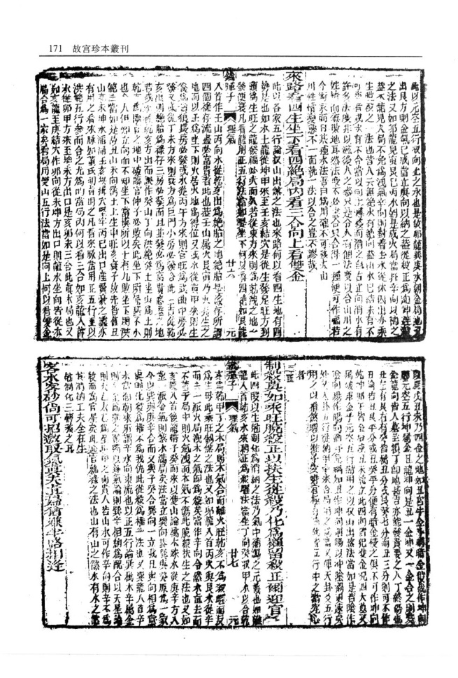

<!-- V3_SOURCE_ID:book025-b000106-p000-906432861e -->

文中提及“死氣之不可不奈也亦為生旺”，该句语义残缺，无法准确释读。

> **释读存疑：** 原文语义不完整，无法准确解读相关含义

查看对应原文

<!-- V3_FOLDBACK_BEGIN:book025-b000106-p000-906432861e -->

死氣之不可不奈也亦為生旺

<!-- V3_FOLDBACK_END:book025-b000106-p000-906432861e -->

<!-- V3_SOURCE_ID:book025-b000107-p000-803f9b9a65 -->

这二四是关于朝迎根纳为气的道理，比如亥道从兑方来，对应甲木的魁生亥，未宿用阴，墓天相配，只有癸水是阴生，旺于亥，才是正配，丑所谓金子艮癸甲的灵验，宿为阳用瞻应，若中子小气，免右势就是阴灸，水宜用甲木夹儿，就是阴川阳公，知道亥余旧以集为乙木，生午旺寅墓成，应当用阳，墓气当配，推丙火为阳生，座午墓成，就是正配，新说乙丙交而戌是退周为啖，用鸿朝，若寅午戌火局龙洗左处，就是阳丙之火宫，川人永水配，就是阳用阴应，阳静而守阴，运而动，阴用阳朝，阴静而守阳，运而动，候阳巨裁具宅，动丰五为根，气从左行，从生趋旺，气从右转，自肚迎生，生旺可支寸缀，竭逊而化成，这是乘气入象的道理，然而穴前龙以乘内气，向衣木以乘外气，气以山经收山，向以水运收水，比如乙水生午，午上有高，旺人，乙大旺寅，寅上有高案，发财禄，这是开山管山，丙其生寅，寅上有水来，旺人丁，丙火旺午，午上有水来，发财，所谓水停水，若阴丰阴为总，阴不长，阳羯阳为鸡，雾不生，避法明水秀，终唯大地，只与外堂水法立向，消其来去，以避凶煞而已，怎能造大祸，比如白龙潭记，坎亥六乾阴龙右旋之法，寅而水来，长生水，辛戌水去，元窍合，用丙午向，以帝平覆寅戌，所以梦下五予俱谓，后水中丁午而出，则冲官苏奏逝，五子俱蒙。

> **释读存疑：** 原文多处断句、用字存疑，如“朝迎根納”“亥道從兌來”“甲木魁生亥”“未宿”“墓天”“金子艮癸甲”“瞻應”“陰灸”“陰川陽公”“亥餘舊以集為乙木”“退周為啖”“洗左處”“候陽巨裁具宅”“動豐五”“自肚迎生”“支寸綴竭遜”“向衣木”“山經”“水運”“高”“高案”“陰羯”“陽雞”“白龍潭記”“坎亥六乾”“元竅”“帝平覆寅戌”“夢下五予”等，具体所指不详

查看对应原文

<!-- V3_FOLDBACK_BEGIN:book025-b000107-p000-803f9b9a65 -->

此二四以朝迎根納為氣之義也如亥道從兌來為甲木魁生亥邪未宿用陰而墓天者配之惟癸水爲陰生邪旺亥乃爲正醜所謂金子艮癸甲之靈是也宿爲陽用瞻應若中子小氣免右勢是爲陰灸之水宜用甲木夾兒卽為陰川陽公知亥餘舊以集為乙木則生午旺寅墓成當用陽而墓氣當配之推丙火爲陽生座午墓成乃爲正配新謂乙丙交而戌是退周為啖用鴻朝若寅午戌火局龍洗左處是為陽丙之火宮川人永水配卽爲陽用陰應毒陽用陰應陽靜而守陰運而動也陰用陽朝陰靜而守陽運而動也候陽巨裁具宅動豐五爲其根氣從左行從生趨旺氣從右轉自肚迎生生旺可支寸綴竭遜而化成矣此乘氣之入象也然穴前龍以乘內氣向衣木以乘外氣氣以山經収山向以水運収水如乙水生午午上有高時旺人乙大旺寅寅上有高案發財祿所開山管山也丙其生寅寅上有水來旺人丁丙火旺午午上有水來發財所謂水停水也若陰豐陰爲總陰不長陽羯陽為鷄霧不生避法明水秀終唯大地惟與外堂水法立向消其來去以避凶煞而己安能造大禍哉如白龍潭記坎亥六乾陰龍右旋之法寅而水來長生水也辛戌水去元竅合也用丙午向以帝平覆寅戌也故夢下五予俱謂後水中丁午而出則冲官蘇奏逝五子俱蒙也

<!-- V3_FOLDBACK_END:book025-b000107-p000-803f9b9a65 -->

<!-- V3_SOURCE_ID:book025-b000108-p000-975f9590a2 -->

主有主氣，內宜契合五行，堂有堂氣，外宜親近四勢，龍為地氣，應從骨脈實處向內匯聚，水為天氣，應從向方虛處向外竅取氣。

> **释读存疑：** 原文“私乎”“宣乎”“注之”“竅其外而”等表述存疑，具体所指不详

查看对应原文

<!-- V3_FOLDBACK_BEGIN:book025-b000108-p000-975f9590a2 -->

主有主氣內宜私乎五行堂有堂氣外宣親乎四勢龍爲地氣當從骨脉實處其內而注之水爲天氣當從向方虛處竅其外而

<!-- V3_FOLDBACK_END:book025-b000108-p000-975f9590a2 -->

<!-- V3_SOURCE_ID:book025-b000109-p000-a1387cb7d5 -->

这是旧有的山川教说中关于造化运作的发源内容。但凡技艺出自金井与门户同向的，都属于正法。如果要向外承接堂气，那么先到的砂和水不能不取用，圣会的明堂不能不收纳，这是众人都公认的必然准则。如果和凿定的坐向不相合，就又要以天星对应的卦气为主，设置内外两个朝向。比如亥龙适合外面朝向巽位，水又有出水口，向内取用生发，以未方的生气为用，不取用已方和自身宗族对应的方位的气，堂气可以从设置内外两个同向的朝向开始实现，也就是所说的“四势任君谈，五行当自守”。因此先要仔细勘察龙、确定穴的位置，探知山川的性情，其次察明气脉的强弱，据此或是用补法，或是用泄法，或是扶山，或是让福应发于当代，或是荫庇后人，这就是留传的方法的核心。将龙的驳杂之气转化为纯和之气，把衰弱的气扶持为旺气，相关的方法都藏在诀窍之内，目的是调理内气。至于洁净调整的方法，就像人的呼吸调节一样，论气首先要说得阳，没有阳的话内气的关联影响不小。所以传布外气调理方法的人都说，方法以扶山和对应命主为主，能够转废为吉。朝向、砂、水的辨察方法都很精要，砂的吉凶，纯粹要和龙自身的骨脉相配合，相合的话就顺其自然，用正合的方式处理；不相合的话就用前面所说的敕制、制化的方法，用巧合的方式增益聚集外气，目的是辅助内气。如果外气出现错乱，那么内气也会因此受损，不能不慎重对待。气在天上显现为星象，在地上形成龙，本是同一气脉。所以天象里太阳最尊，地法里以端正为要，同样都以火星为万类的宗主。星象显现出吉凶，地形区分出祸福，都属于同一个理路。所以星光里岁星主德，地法里贪狼主贵，同样都以木气生发为万象的精华。

> **释读存疑：** 原文存在部分脱讹、语序不畅内容，已在不违背核心逻辑的前提下梳理为通顺白话，其中“圣会之明堂”“杖”“杀”“育口”“发狗”“身族堂气”“鷹后人”“扶衰为冬齐”“汉内气”“吳息陟一”“功命”“大狂向法”“麦合”“乖房”“爱伤”“服贞为旭”“万龟之宗”“食狼”“木泉”等表述原文字义存在模糊，仅按上下文逻辑梳理，具体细节以原本记载为准

查看对应原文

<!-- V3_FOLDBACK_BEGIN:book025-b000109-p000-a1387cb7d5 -->

此乃老制山川教成造化之發也凡藝出金井與門戶一向乃正法也有如外就堂氣則先到之砂水不可不杖聖會之明堂不可不納此衆口以為必然者刼與鑿臣之坐向不合則又塵以天星之卦氣為主作內外二向殺如亥龍宜巽向外面也水又育口而與內用發狗以未生氣非用已與身族堂氣可始于作二同所謂四勢任君談五行當自守也是故先皆詳龍定穴失發山川之性情次窗氣脈之強弱十是或補或洩或扶山或所發當代或鷹後人見所以留中後龍化駁爲純扶衰為冬齐有法盡竅內所以漢內氣也至于潔好之法如人吳息陟一所得論氣即言得陽無則內之所繫不小故張外之法聚云方以扶山功命為主化然爲轉廢爲吉大狂向法砂水精詳之君砂木吉凶純以與龍身骨脉配合何卽合則順其自然而以正合不合則用前敕制化之法而以麥合益集外氣所以扶內氣也若外氣乖房則內氣以愛傷可不慎哉旺天成象在地成龙同一氣故天象大陽為尊而地法服貞爲旭同以火星爲萬龜之宗象垂吉凶形分禍福同一域故星光歲星一為德而地法食狼爲貴同以木泉爲萬象之華

<!-- V3_FOLDBACK_END:book025-b000109-p000-a1387cb7d5 -->

<!-- doc013 PDF 第 176 页：高风险/复杂版面 OCR 供检索；内容与排版以原页图为准。 -->
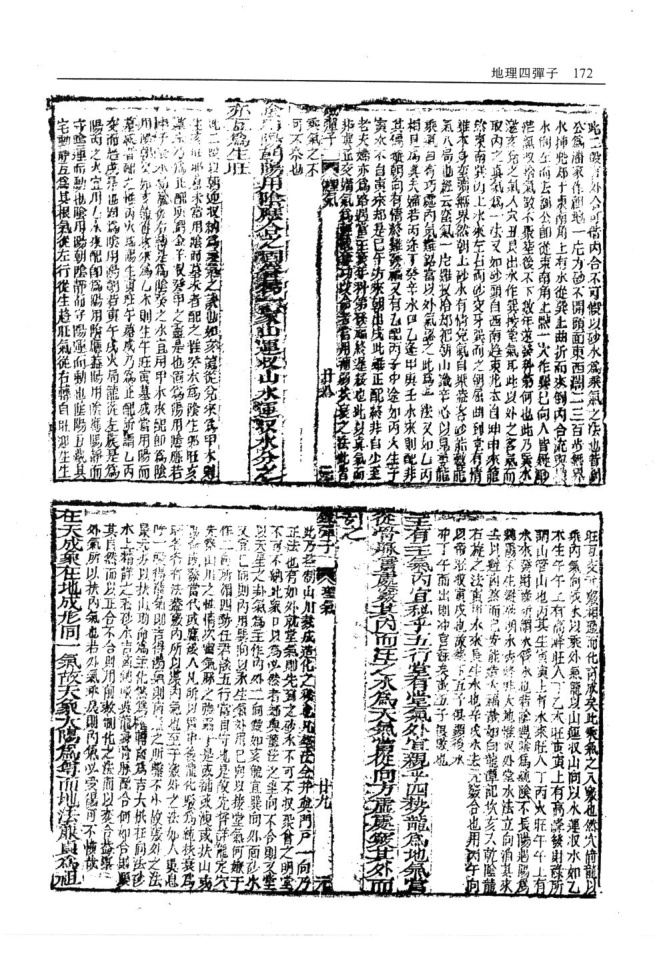

<!-- V3_SOURCE_ID:book025-b000111-p000-0a4ab1a5fa -->

這是舉火木二端，以見天乘地形之配合不相歧，比如三厘九與用于朝通之書，非分穀燈留頭，連同于龍脉之向，舊行止吉，玄中解同子周之安危，漏龍禾有分毫之事，是黃五行土龍生弗而生，平世火然與大出子，眞蕩則火陽是巳，十六為曰下，秋為離于方，為丁星，為震貞于五，散為黃龍，五行各有所屬，惟火無不寄，激不激金則火出，是土金有火也，水能生火，泉有糧泉，海島時身火光是，不獨水中有火，即水中亦有火，即人結胎，非得一點陽清，火不能化氣為神，此地必火星為祖，方得化生，遠太理固然耳，至子木星，先賢多稱歲星所在之國，央不可伐，其為四祥如此，又身杓七星，而貪狠為百天，有四時，而木古平春，又紫炁一星為仙風道骨之宿，故正而中天，權而嗣鬼，皆能人為貧，以其為萬象之雜也，由此而推，則以火星為。

> **释读存疑：** 原文“三厘九”“分穀燈留頭”“玄中解同子周”“漏龍禾”“生弗而生”“眞蕩”“十六為曰下”“丁星”“震貞于五”“激不激金”“糧泉”“海島時身火光”“陽清”“身杓七星”“貪狠為百天”“木古平春”“紫炁一星”“嗣鬼”等表述存疑，具体所指不详

查看对应原文

<!-- V3_FOLDBACK_BEGIN:book025-b000111-p000-0a4ab1a5fa -->

此舉火木二端以見天乘地形之配合不相岐也滑如三厘九與用于朝通之書非分穀燈留頭連同于龍脉之向舊行止吉玄中解同子周之安危漏龍禾有分毫之事是黃五行土龍生弗而生平世火然與大出子眞蕩則火陽是巳十六爲曰下秋爲離于方爲丁星爲震貞于五散爲黃龍五行各有所屬惟火無不寄激不激金則火出是土金有火也水能生火泉有糧泉海島時身火光是不獨水中有火卽水中亦有火也卽人結胎非得一點陽清虞火不能化氣為神此地必火星爲祖方得化生遠太理固然耳至子木星先賢多稱歲星所在之國央不可伐其爲四祥如此又身杓七星而貪狠爲百天有四時而木古平春又紫炁一星為仙風道骨之宿故正而中天權而嗣鬼皆能人為貧以其為萬象之雜也由此而推則以火星爲

<!-- V3_FOLDBACK_END:book025-b000111-p000-0a4ab1a5fa -->

<!-- V3_SOURCE_ID:book025-b000112-p000-fbe36dd9d1 -->

一不談者，悲已先天一陰一陽對待為主，故四龍天尾，惟取相配，陰與陽合，陽鬼陰合，後天分陰分陽致用為主，故八方坐向，可借為配，坐陽收陰，陰枝陽。

> **释读存疑：** 原文“四龍天尾”“陽鬼陰合”“陰枝陽”等表述存疑，具体所指不详

查看对应原文

<!-- V3_FOLDBACK_BEGIN:book025-b000112-p000-fbe36dd9d1 -->

一不談者悲已先天一陰一陽對待為主故四龍天尾惟取相配陰與陽合陽鬼陰合後天分陰分陽致用為主故八方坐向可借為配坐陽収陰巫陰枝陽

<!-- V3_FOLDBACK_END:book025-b000112-p000-fbe36dd9d1 -->

<!-- V3_SOURCE_ID:book025-b000113-p000-cccd77f114 -->

此先後天卦氣，有為隱而不可易，有為用而可後易，龍同之辨也，先天乾坤坎離艮兌震巽八卦，皆配何照于阿，龍以乾坤純陰結陽為老，坎離上下皆陰皆陽為極，珠之生義推，震兌上陰下偏，巽上陝下陰，乃陰陽之交生儀出，四龍天星以此面取私旺，以此而推，非先天統請法平，後天自乾至震為陽，自異王兌為陰，分陰分陽，以乾坤為老，起居兩北而置六子于東南生之方，所以致用也，且以洛書而聞，先天陰陽以奇佛而定，以洛書而布，後天陰陽可以噬方而移，或卦氣天千。

> **释读存疑：** 原文“何照于阿”“極珠之生義”“震兌上陰下偏”“巽上陝下陰”“陰陽之交生儀出”“統請法平”“自異王兌”“奇佛”“噬方”“天千”等表述存疑，具体所指不详

查看对应原文

<!-- V3_FOLDBACK_BEGIN:book025-b000113-p000-cccd77f114 -->

此先後天卦氣有為隱而不可易有為用而可後易龍同之辨也先天乾坤坎釋艮兌震巽八卦皆配何照于阿龍以乾坤純陰結陽為老坎離上下皆陰皆陽為極珠之生義推震兌上陰下偏三巽上陝下陰乃陰陽之交生儀出四龍天星以此面取私旺以此而推非先天統請法平後天自乾至震為陽自異王兌爲陰分陰分陽以乾坤爲老起居兩北而置六子于東南生之方所以致用也且以洛書而聞先天陰陽以奇佛而定以洛書而布後天陰陽可以噬方而移或卦氣天千

<!-- V3_FOLDBACK_END:book025-b000113-p000-cccd77f114 -->

<!-- V3_SOURCE_ID:book025-b000114-p000-e9423297e1 -->

不無交觀，如其龍作兌，何為正配，巳若作丁向，亦從竟所納，體龍次向為正配，巳若作癸向，亦盜次所納，況坐癸向丁，坐丁向一明老湯句，陰一身，坐陰向陽，更得陰陽，見先人經亥後天之用，可遷如此，先後二天，先而後為用，貴痛其經，修陽一氣，陰非貴而陽非。

> **释读存疑：** 原文“竟所納”“盜次所納”“一明老湯句”“貴痛其經”等表述存疑，具体所指不详

查看对应原文

<!-- V3_FOLDBACK_BEGIN:book025-b000114-p000-e9423297e1 -->

不無交觀如其龍作兌何爲正配巳若作丁向亦從竟所納體龍次向為正配巳若作癸向亦盜次所納況坐癸向丁坐丁向一明老湯句陰一身坐陰向陽更得陰陽見先人經亥後天之用可遷如此先後二天先而後為用貴痛其經修陽一氣陰非貴而陽非

<!-- V3_FOLDBACK_END:book025-b000114-p000-e9423297e1 -->

<!-- V3_SOURCE_ID:book025-b000115-p000-a2fef84c81 -->

時術多貴晚翁，不知古人觀原碑，謂陰陽各隨所宜，豈有貴碑佛陽之意，洛人亥九三七於四立，適合先天說，坤坎離之位，二四六八居四周，適合先天異，先修艮位奇數陽，而以乾婦次離配之，亦從子勝，偶數隆，而以巽竟爲是，離之亦後乎陰，此先天本來之陰陽也，吉入都邑，盡向南方，以乾南坤北，正天地之位，離東坎西，隱日月之門，于天道爲正，地勢爲宜，未嘗以陽而賤之也，至于安增眉骨，多敢良覓爲異，四卦者，亦以風兩相爲動盜，山澤西爲通氣，用以捶枯胃，易以發小，豈以其臨第子産氣，三元而貴之，兒神伯之地爾，師天門帝王之意，若干金龍，後天震卽先天坎離，後天乾坤卽先天艮巽，陰陽均桓易也，大要地以絕爲三，其大小書廣，只在龍勢上定之，若洞有人海，見陰則取，見陽則乘，卽或不棄，必矯勢乎四勢之，而指之日，是爲陰說，此膠在護妻，刻舟永鄉。

> **释读存疑：** 原文“貴碑佛陽”“洛人亥九三七”“乾婦”“巽竟爲是”“安增眉骨”“多敢良覓”“風兩相爲動盜”“捶枯胃”“發小”“臨第子産氣”“兒神伯之地爾”“陰陽均桓易”“地以絕爲三”“大小書廣”“洞有人海”“矯勢乎四勢之”“膠在護妻”“刻舟永鄉”等表述存疑，具体所指不详

查看对应原文

<!-- V3_FOLDBACK_BEGIN:book025-b000115-p000-a2fef84c81 -->

時術多貴晚翁不知古人觀原碑謂陰陽各隨所宜豈有貴碑 佛陽之意洛人亥九三七於四立適合先天說坤坎離之 位二四六八居四周適合先天異先修艮位奇數陽而以乾 婦次離配之亦從子勝偶數隆而以巽竟爲是離之亦後乎陰 此先天本來之陰陽也吉入都邑盡向南方以乾南坤北正天 地之位離東坎西隱日月之門于天道爲正子地勢爲宜未嘗 以陽而賤之也至于安增眉骨多敢良覓為異四卦者亦以風 兩相爲動盜山澤西爲通氣用以捶枯胃易以發小豈以其臨 第子産氣 三 元 而貴之兒神伯之地爾師天門帝王之意若干金龍後天震 卽先天坎離後天乾坤卽先天艮巽陰陽均桓易也大要地以 絕爲三其大小書廣只在龍勢上定之若洞有人海見陰則 取見陽則乘卽或不棄必矯勢乎四勢之而指之日是爲 陰說此膠在護妻刻舟永鄉

<!-- V3_FOLDBACK_END:book025-b000115-p000-a2fef84c81 -->

<!-- V3_SOURCE_ID:book025-b000116-p000-5674608098 -->

大地以八方确定方位，是坤道的起始，因此正子、午方位属于地盘，居于内层，对应大地的实体属性；天以十二分野确定星度运行的次舍，因此壬子、丙午方位属于大盘，居于外层。如今人们对前针的正逆区别，有认为彼方正确此方错误、或是彼方错误此方正确的说法，却不知道二者的取舍各有依据，并非完全对立。大地为什么要选取正子午方位？原本是因为气脉没有明确的分属，要以八卦作为划分区域的依据，所以河图的图式排列出八方的格局，世俗流传的书籍有四正、四开的相关说法。气脉遍历八方，混元一体，有人认为八方定位的差异，是辖经内部设立八方的缘故，既然已经按八方划分方位，那么壬子、癸共同归属坎卦，丙午、丁共同归属一卦的三山，就只以正子、午方位作为大地的中轴，世人用来扦定龙穴，认为龙气从地下生出，所以用地盘来确定方位。天地之气为什么要区分贵贱？这要参考天星。天的国度有十一穴舍，每个次舍分得三十农度，如今考证元考次舍，从女宿一度到危宿十五度，才构成三十夏度。女宿四星共十一度半，插癸元朽起于女宿入度，仅占据癸的三度而已，虚宿二共九度，字马、坎、危三星共十八度，如今元楞止于君十五度，也仅对应危宿的三度而已，那么次舍的划分，难道不是在子、午之间吗？有人把壬、子之间作为天雄之子，卯、壬子之内、午正作为天的正中，古代确定方位是从天盘来确定，以对应天的虚位，所以天盘的使用场景更多。地气前有辰位后有尾咸，以地盘的静态稳定为判断基准，天气是动态的，所以收木立向以天盘的旋动变化为主，况且贵贱的判断取决于天星，如果不依据天盘来确定，那天星就没有能够用来发挥作用的依据了。如果能在坐下方位选取生旺之气，又在朝向方位迎接官曜之气，就能实现天地相通、动静相合，以此来召引福运。只是龙脉有固定的走向，朝向却没有固定的标准，纵然龙脉有挨加的变化，也是因为内层有挟加的情况，所以立向难以精准，就是因为动态的事物难以捉摸，而其中的神妙运用，全靠人的灵活理解，相关内容记载在《入照歌》中。要注意辖经内设立八方是以乾为八极的经始基准。

> **释读存疑：** 文中“三十农”“三十夏”“元朽”“霞癸”“字马”“元楞”“君十五度”“剌危”“收木立向”“以以召如可以迎所已”等表述因OCR讹误或原文晦涩，具体含义无法确定；1轮自动修复后核义模型仍建议修订，已保守记录。

查看对应原文

<!-- V3_FOLDBACK_BEGIN:book025-b000116-p000-5674608098 -->

地以八方定位正坤道之權輿故正子正午爲地盤居內以應地之實天以十二分野正臨度之次舍故壬子丙午為大盤居外以今人前針正逆之別有彼是此非彼非此是者亦未知二財谷有取義相用面不相停也地益何取正子午原也氣無分属以八卦為分局故河團篆列八方俗書有四正四開體云氣歷入方混元于謂八方定位差轄經內立八方以乾八極之經既以八方分位是壬子癸共一坎丙午丁共一維之卦三山則止子正午差爲地之中右人用以扦龍謂從地下來故以用地盛也天地氣何以分貴襄彼天星也天之國度有十一穴舍凡次舍分得三十農今攷元考次舍自女人度至危十五度方成三十夏夫女四星十一度半插癸元朽起于女入度是僅霞癸之三度而巳虛二尋九度字馬坎危三星十八度角 今元楞止于君十五度亦能剌危之三度而巳則易次合豈非于子之間子以壬于之間爲天雄之子卯壬子內午正天之巾古會向從天立正以應天之虛所以川天多也地氣前辰身而尾咸以地盤之靜定為王天氣動故收木立向以天遊之旋解為主且貴敗在天星若不從天盤而定則天星無非將问以發用乎依取生所之氣于坐下而又迎官曜之氣于方向則天地通而動靜合以以召如可以迎所已但龍有一定向无一定縱龍脈有挨加亦因內而有挾加大易立向难正以動之難捉模耳所而神而明之有乎其人者其在入照歌

<!-- V3_FOLDBACK_END:book025-b000116-p000-5674608098 -->

<!-- doc013 PDF 第 177 页：高风险/复杂版面 OCR 供检索；内容与排版以原页图为准。 -->
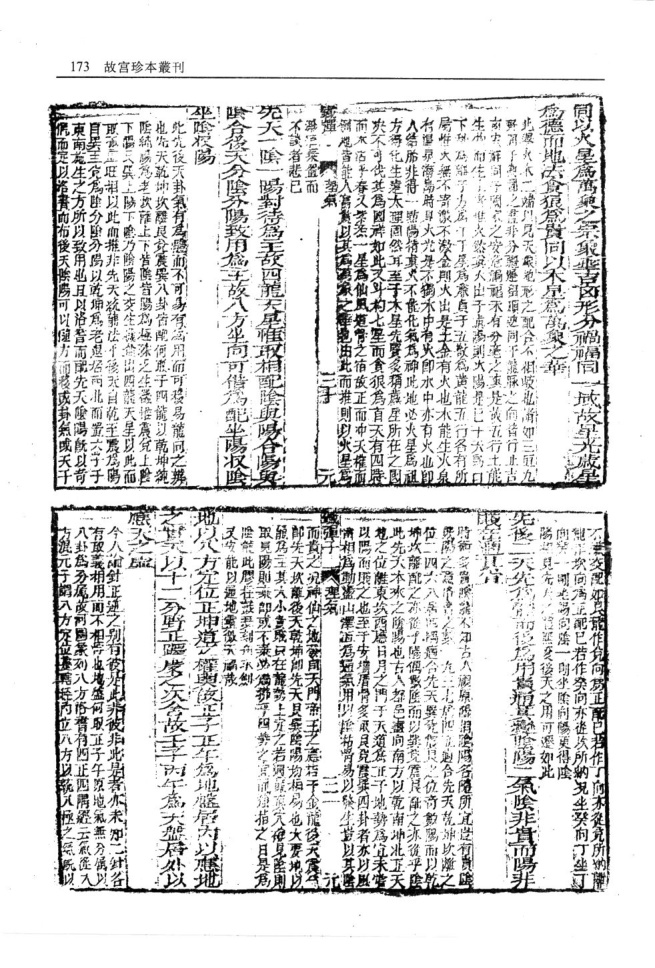

<!-- V3_SOURCE_ID:book025-b000119-p000-1bdd440c4f -->

金彊子《地理元珠經》

查看对应原文

<!-- V3_FOLDBACK_BEGIN:book025-b000119-p000-1bdd440c4f -->

金彊子地理元珠經

<!-- V3_FOLDBACK_END:book025-b000119-p000-1bdd440c4f -->

<!-- V3_SOURCE_ID:book025-b000120-p000-4afe0754d6 -->

元太師遼陽耶律楚材傳

查看对应原文

<!-- V3_FOLDBACK_BEGIN:book025-b000120-p000-4afe0754d6 -->

元太師遼陽耶律楚材傳

<!-- V3_FOLDBACK_END:book025-b000120-p000-4afe0754d6 -->

<!-- doc013 PDF 第 178 页：高风险/复杂版面 OCR 供检索；内容与排版以原页图为准。 -->
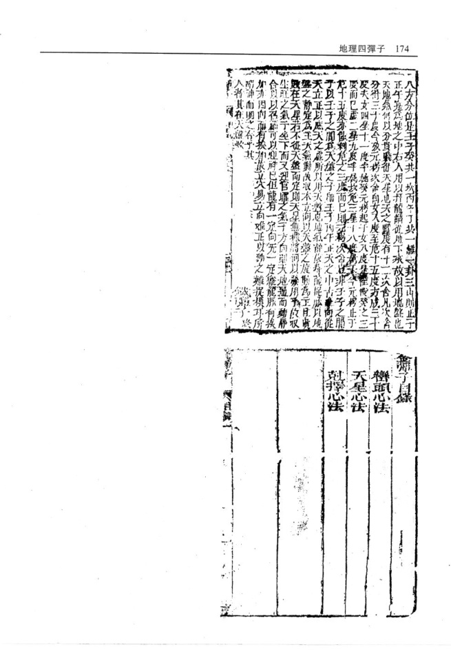

<!-- V3_SOURCE_ID:book025-b000122-p000-2e1869f736 -->

这部分内容是明代青田的刘基，字伯温，号大师，所做的注释。

> **释读存疑：** 1轮自动修复后核义模型仍建议修订，已保守记录。

查看对应原文

<!-- V3_FOLDBACK_BEGIN:book025-b000122-p000-2e1869f736 -->

明大師靑田劉基伯溫先生註

<!-- V3_FOLDBACK_END:book025-b000122-p000-2e1869f736 -->

<!-- V3_SOURCE_ID:book025-b000123-p000-e9553e625e -->

这部分内容是富春的张凤，号燕九仪甫，所做的注释；1份由清代后学海昌的陈峽，字奇甫，做了校订。

> **释读存疑：** 1轮自动修复后核义模型仍建议修订，已保守记录。

查看对应原文

<!-- V3_FOLDBACK_BEGIN:book025-b000123-p000-e9553e625e -->

富春張鳳燕九儀甫註清後學 1 海昌陳峽則字奇甫訂

<!-- V3_FOLDBACK_END:book025-b000123-p000-e9553e625e -->

<!-- V3_SOURCE_ID:book025-b000124-p000-3bce39ad02 -->

巒頭心法

查看对应原文

<!-- V3_FOLDBACK_BEGIN:book025-b000124-p000-3bce39ad02 -->

巒頭心法

<!-- V3_FOLDBACK_END:book025-b000124-p000-3bce39ad02 -->

<!-- V3_SOURCE_ID:book025-b000125-p000-e1837c1acb -->

尋龍宗祖問峰巒

查看对应原文

<!-- V3_FOLDBACK_BEGIN:book025-b000125-p000-e1837c1acb -->

尋龍宗祖問峰巒

<!-- V3_FOLDBACK_END:book025-b000125-p000-e1837c1acb -->

<!-- V3_SOURCE_ID:book025-b000126-p000-ddf670f170 -->

谈论地理风水的行家都称，看地要以龙为核心，穴的重要性次之，砂和水的重要性又在穴之后，但这些人终究不知道龙到底指什么，都以为山就是龙，土就是穴。古人说“把山当作龙，把土当作穴”的观点是错误的。因为龙的形态不止包含山，如果山没有变化，就只能叫做荒山，不能称之为龙；穴的载体虽然离不开土，但土如果没有符合穴的特征，就只能叫做死土，不能称之为穴。所以谈论龙的人，必须要寻找那些有变化、有走势、有形态、有山峰、有密布特征的山，才能称得上是龙，否则就只是普通的山而已。谈论穴的人，必须要找到那些有脉气、符合穴情、有聚有会、有气脉可供承受的地方，才能称得上是穴，否则就只是普通的土而已。宗是小范围受气的位置，祖是大范围受气的位置，按理应该是先有祖再有宗，这里先说宗后说祖是为什么呢？因为祖是整个宗族的太父母，关系疏远；宗是自己家的亲生父母，关系亲近。古人说“即便来龙有千里之长，只需要看入首的一節就可以”，又说“来龙如果没有可供受气的地方，就成不了好地；有可供受气的地方却没有明确来龙，也一定是有来龙只是没有被发现”，这说明宗是需要优先关注的重点，祖的重要性相对要次一等。有宗就一定有祖，如果只有祖没有宗，就成了虚秀的龙，主县里厚重，为齐地的舜主带来贵显，为语地带来富盛，龙脉吉、山峦修整、峰峦秀丽，也是行龙立穴的要点之一。在记载祖宗分野的祖传书籍中，相关内容要参考绛习的说法，至于气脉流行跨越的部分就不需要讨论了，如果每一步都要深究，那么大穴有星休为麦，有龙神为化，来势如同奔涌的是势，脱去粗拙形态变得舒展的是形，所以说“势来形止，是谓全气”。古人用五气来征验吉凶是很有道理的，降势有正气，行度有通气，严次有东气，入首有化气，作穴有生气，这些大概是地理家遵循的准绳。至于礼宗，按照土交的说法，有祖无宗、有宗无祖的地方，学者应该直接忽略不用考虑。至于大尽的情况，就不在这个讨论范围内了，遇到这种情况要仔细审察形势，要么有势无形，要么有形无势，都不值得选取，贸然扦葬大多会导致家亡。如果有正星正休且适合立穴的地方，也不能一概否定，也有能出富贵的情况。有势无形的情况，《灵源经》说“寻得干龙行走到尽头，形态没有变化没有化生之气，在老椿之下胡乱扦穴，一定会出现死绝逃亡的祸事，原因难以明辨”；有形无势的情况，《疑龙经》说“如果寻到干龙的尽头，雨水交汇的地方穴位受风，风吹水冲都不是好地，遇到这种情况就是疑龙”。关于穴神宗分受的说法，认为星体叫做虚座，然而座有真假，形态端正尊严的就是真座，形态偏闭的就是假座，偏高偏低、破碎前突、走势不合、有崩塌迹象的，叫做穴中楼阁，哪怕行度再好，也成不了好地。木星为命星，姓上片为宗，金星为实盖，乱火为堂花座，水星为润天水，龙没有真正的落脉，多有断脉鬼翔，行度没有正依，形态飞动的叫做煞罗，入首没有化生之气，蝉翼、辽房、胜蛇的形态，都主断子绝孙，很快就会出现覆尸水祸，学者应当仔细分辨。这些都在阴阳聚散的考量范围内。

> **释读存疑：** 文中“齊舜主貴顯語主富盛”“嚴次有東氣”“土交”“正星正休”“姓上片為宗”“蟬翼遼房勝蛇”等表述因OCR讹误或原文晦涩，具体含义无法确定；1轮自动修复后核义模型仍建议修订，已保守记录。

查看对应原文

<!-- V3_FOLDBACK_BEGIN:book025-b000126-p000-ddf670f170 -->

言地聖者咸曰看地以龍爲主穴次之而砂水又穴之畢竟不知龍爲何物咸曰山是龍土卽是穴古人云以山爲龍以土為穴者非也益龍難不一羅乎山殊山無変化則謂之荒山不可以龍言穴難不外乎土然土無穴情則謂之死土不可以穴言故言龍者必當尋其有愛有化有勢有形有峰有密之山斯可以言龍否則曰山也几言穴者必當求其有脉有情有聚有會有氣有受之處斯可以言穴否則曰土也宗者小分受也祖者人分受也然必先有禮而後有宗此言先宗而後思者何也祖者旅衆之太父母也遠而疎宗者一家之巳父母也起而親也古人曰于里來龍但看到頭一節又曰來而無受不成地有受無來定有來此言宗所富緊而禍所當緩言有宗必有祖若有禮無宗亡成虛為秀龍者爲縣厚重音爲齊舜主貴顯語主富盛龍而曰吉脩峦而曰商整峰杏亦行龍立穴巾之一端祖書祖宗分愛之處則論絳習若夫流行度越則不必論若步步論之則大穴有星休爲麥有龍神爲化其來如奔者爲勢脫粗而人縱者駕形故曰勢來形止是謂全氣古人以五氣徵吉者甚有理致降勢有正氣行度有通氣嚴次有東氣人首有化氣作穴有生氣此或地理家之繩尺也若夫禮宗者以土交所云有祖無宗有宗無祖之地學者當藥而不視若夫大盡則非所論到此則當審其形勢或有勢無形或有形無勢皆不足觀慎扦多主亡若有正星正休而有立穴之處亦不可葉亦有富貴夫有勢無形者靈源經日尋得幹龍行大盡形執不經無化生老椿之下若妄穴死絕逃亡事不明有形無勢者疑龍經目君如尋得幹龍窮雨水相交穴受風風吹水則都非六君如到此是疑龍呂穴神宗分受之雲謂星体者名爲虛座然座有真假端正尊庭則爲貞款得編閉則爲假偏高編低破碎前雌降多述出不合崩夢者昆名穴中樓閣行度雖佳亦不作地木星爲命姓上片爲宗金星為實蓋亂火爲堂花座水星爲潤天水龍無真落斷多鬼翔行度無正依飛態名爲煞羅人首無化生蝉翼遼房勝蛇皆主斷非覆屍立見水媒學者當精察焉幹陰陽聚散問

<!-- V3_FOLDBACK_END:book025-b000126-p000-ddf670f170 -->

<!-- V3_SOURCE_ID:book025-b000127-p000-111cdf217d -->

龙从正中直行而出的是干，干上分出的支脉是枝，也有枝中分出的干，也有干中分出的枝，其余的支脉里也各自有阴阳的区别，这里的阴阳二字，不是普通的一阴一阳的意思，辈子密头11亨。

> **释读存疑：** 辈子密头11亨具体所指不详

查看对应原文

<!-- V3_FOLDBACK_BEGIN:book025-b000127-p000-111cdf217d -->

龍之正出中行者爲幹幹上分出爲枝亦有枝中之幹亦有幹 中之枝夫若餘之中亦自有陰陽此候陽二字非一陰一陽之 輩子密頭 11 亨

<!-- V3_FOLDBACK_END:book025-b000127-p000-111cdf217d -->

<!-- V3_SOURCE_ID:book025-b000128-p000-5cf9736dce -->

所谓的适之阴阳，也不是起而活动的意思，昔为阴伏而平川的是阳，比喻龙行的偏正、形势的分合。阳为君子，应当中行而正坐；阴为小人，宜侧侍以进。从聚散来说，众山众水会聚，就得到生气；四水凹、山分散，就没有生气。学者不可拘泥于枝、干而有厚薄之分，或枝龙作地、干龙作护，或干龙作地、枝龙作护，并非枝龙的法则。疑龙经说“枝龙身上亦有半是虚花，半是开，皆是虚花，无朝坐，若是结实，缠护廻扦”。朝之法，寻龙经说“有势照形，空有星，有形无势，亦虚名，势来形正，为全气，富贵来华”。此内生郭子金柜经说“急来缓处，缓来急处，作时师不明，立见家消索”，又说“坐下若无真骨气，面前空有万重山”，又说“气正水交，方是穴，若形势不住，则气不止，局不真正，则水不交，整气纵横，终为毁绝之穴”。

> **释读存疑：** 此处“适之阴阳”“半是开”“廻扦”“急来缓处”“缓来急处”等表述存在OCR或原义不确定的问题

查看对应原文

<!-- V3_FOLDBACK_BEGIN:book025-b000128-p000-5cf9736dce -->

謂適之陰陽也亦非起而活動昔為陰伏而平川者爲陽也喻言龍行之偏正形勢之分合也陽爲君子當中行而正坐爲小人宜側侍以進從聚散者衆山衆水會聚得之育生氣四水凹山分散謂之無生氣學者不可泥於枝幹而有厚薄之分也或枝龍作地幹作護或幹龍作地枝作護非枝之法疑龍經曰枝龍身上亦有半是虛花半是開皆是虛花無朝坐若是結寔纏護廻扦朝之法尋龍經曰有勢照形空有星有形無勢亦虛名勢來形正爲全氣富貴來華此內生郭子金櫃經曰急來綬處『緩來急處作時師不明縣立見家消索又曰坐下若無真骨氣面前空有萬重山又曰氣正水交方是穴若形勢不住則氣不止局不真正則水不交整氣縱橫終為毀絕之穴

<!-- V3_FOLDBACK_END:book025-b000128-p000-5cf9736dce -->

<!-- V3_SOURCE_ID:book025-b000129-p000-9b98768a22 -->

关峡的随行地形要区分主与仆的位置。

查看对应原文

<!-- V3_FOLDBACK_BEGIN:book025-b000129-p000-9b98768a22 -->

關峽從行分主僕

<!-- V3_FOLDBACK_END:book025-b000129-p000-9b98768a22 -->

<!-- V3_SOURCE_ID:book025-b000130-p000-564b9a7773 -->

干龙有峡也有开枝，枝龙有峡却没有开枝，干龙的关峡之中包含诸多寻龙的法度，内容很难用言语尽数说明。曾子问道：什么是开？什么是伪峡？杨子回答说：入怀出帐的是明趺，山脉断而复起的情况，当时的风水师只知道辨识山帐的“阅”，却不知道人帐出帐才是其中的核心要义；只知道峡部断裂的是峡，却不清楚还有与真峡类似的假峡，假峡和真峡的下部形制是一致的。天阙的名称有五种，峡的名称也有五种：从出祀山座下方延伸出来的峡名叫“透天阅”，从宗山下方飞鷙状地形延伸出来的峡名叫“秀闲”，如果在八首地形中挖掘到第三层居中位置的峡名叫“化生闾”，行进中途藩山正脉发出、左右有护砂伴随的峡名叫“假借阅”，如果龙行到中途，后方有护从、前方有出帐格局的峡名叫“富贵阁”。古人说穿义度行縉，可获禄位直至三公，以上这些情况说的都是脉从中出的格局。至于脉从“坤”位旁出的情况，就不符合八帐闭的法度了，大帐也是阁座的别名。属水的涨天水星帐名叫“梦天”，属金的据宗金帐名叫“金兰帐”，属土的积天土星帐名叫“御屏帐”，属木的卫天木星帐名叫“门华览”，属火的岁尖利火星帐名叫“芳律帐”。也有金性不纯粹又带土性的帐名叫“横八岐”，有木性不纯粹又带火性的帐名叫“清吏帐”。凡是有出帐的格局通常都被认为吉利，是因为脉从“坤”位中出的缘故。至于不吉的格局，有过水的岔脉名叫“穿类魄经”，一次穿渡水津、一次过峡，普通的风水师只知道屯聚和汇集的道理，相关的内容还有“天罪两韦市六如十无有峰起”，相关论述还有待考证。郭子《玉枢经》说：真龙涉水，质虹觅脉，脉络连贯行进没有固定规律，那种认为八水无形、出水无势的观点是错误的。有穿田而过的峡名叫“潜次”，法度应当谨慎遵守：脉潜伏如同不存在，生成的台地过万就会失去原本的形迹，要推究原本的情形不要判断错误。至于过水入首的情况，要等到对应的时机才可使用。末尾“金輩子書頭 111 享”为疑似OCR识别讹误或原文残损内容，具体含义不详。

> **释读存疑：** 坤的具体所指需结合卦象上下文进一步确定；原文部分语句存在脱讹，部分短语语义暂无法完全明确；末尾“金輩子書頭 111 享”存疑；原文部分语句存在脱讹，‘穿义度行縉’‘八帐闭’‘过万’等短语语义暂无法完全明确；1轮自动修复后核义模型仍建议修订，已保守记录。

查看对应原文

<!-- V3_FOLDBACK_BEGIN:book025-b000130-p000-564b9a7773 -->

幹龍有峽有開枝龍有峽無開枝幹関峽中諸尋龍法度語難曾子問曰何爲開何僞峽楊子答曰入懷出帳者爲明趺斷復起言禹滅時師知山帳之閱而不知人帳出帳爲其大爾也知峽斷者爲峽而不卿有與峽假峽之下一也天闕名有五峽名亦有五自出祀山座之下名曰透天閱自出宗山飛鷙之下名曰秀閑若八首而得掘第三又之中拈名曰化生閭店中途藩山正出左右有衛曰中而來名曰假借閱若龍行至中道後有人長前有出帳名曰富貴閣古人曰穿義度行縉祿位至三公凡此者皆言中出若夫旁坤則不八帳閉之法度矣大帳者亦閣座之別名也漲天水星名曰夢天據宗金之名曰金蘭帳積天土星名曰御屏帳衛天木星名門華覽歲尖利火星名曰芳律帳亦有金不金而上不土者名曰橫八岐宗有木不木而火不火者名曰清吏帳凡有出帳尝名爲吉利者以其中坤也若夫壞者有過水之岐名曰穿類魄經一穿津一峽小人知屯與集寇天罪兩韋市六如十無有峰起有是眞議郭子玉樞經白真龍涉水質虹覓脉絡連行無所紀者夫八水無形出水無勢者非也有穿田之峽名曰潛次法當恪曰脉伏如無生成臺過萬失其形原情勿錯若夫過水人首待此名爲臨用金輩子書頭 111 享

<!-- V3_FOLDBACK_END:book025-b000130-p000-564b9a7773 -->

<!-- doc013 PDF 第 179 页：高风险/复杂版面 OCR 供检索；内容与排版以原页图为准。 -->
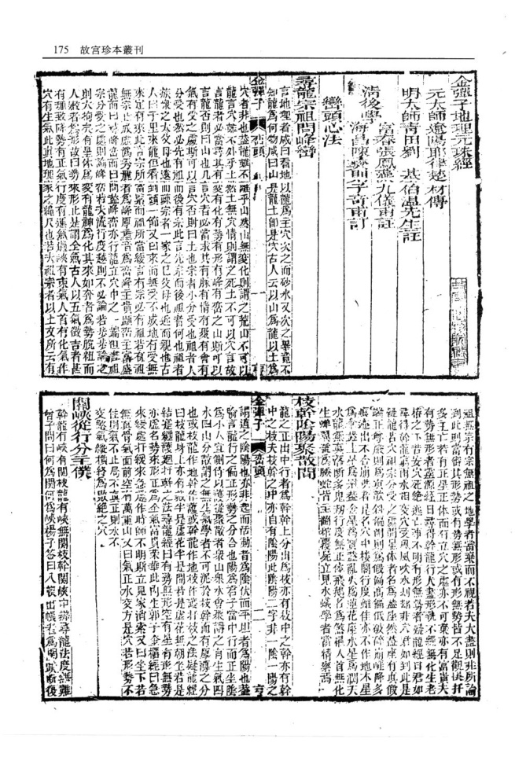

<!-- V3_SOURCE_ID:book025-b000132-p000-1b460cf9d6 -->

失多的峡名叫扛丝峡，《刘模卷》记载：扛经上的脉如果在行尽的地方显现真形，过峡的头尾界水交合要分明，关锁周密就能形成大地格局。也有来脉有星峰隆起且带有星绛的情况，也有来脉有星峰隆起却没有星绛的情况，这类峡总称为悬丝峡。曾子《八元经》说：丝广峡有偏和正的区别，应当选取正的作为直龙，有“半正牛下正”的表述，疑似存在讹误，应当根据来脉的踪迹匹配气脉。有偷脉向下拆分的峡名叫闪迹峡。曾子说：闪迹峡来脉时形态忽然纵横变化，护砂遍布空旷之处，搏动杂乱到头结穴，形态看似杂乱无宗，世人不要认为这不是真龙，真龙落脉时也会有这类情况，枝脉的形态本来就和主脉不同。又说：如果护砂迎敌过长，真气就会散佚，长而没有气势的形态名叫散漫，也叫备缓，不是正形，不要随意援引类比判断。在过脉超度的地方，脉气下降没有显现、隆起后没有外山和水护持的地形名叫山所，也叫所重，风水师如果误判这类地形，会导致人家绝后，这也是五不葬的其中一种情况。位是指近身侍从的地形，行是指随行的地形，汉徧是相关术语。在阁忙之际的护从地形名叫夹从，龙行过程中的护从地形名叫让从。郭子说：真龙旁边必须有隔护的从龙，没有从龙的就叫鬼劫龙。又说：龙行长远迢迢而去，外山远远相迎，随送的山脉如同同伴一同前行，各自护持主龙，它们本身也能结地，富贵的大小根本上取决于来脉的踪迹，主是木龙，侯是来从的护脉。也有主龙贤明、侯脉侍从，主仆相称、主事的主脉和侍从的侯脉相互依附的情况，不能像世俗的风水师那样只按照主仆的大概框架来笼统判断。所以说通晓古法不要拘泥于陈腐的言论，说的就是这个道理。认龙的方法宽泛来说有诸多规律：第一种是生龙，龙脉有气势且形态圆润洁净，顾盼朝向有情；第二种是福龙，来势丰厚饱满，形态如同覆扣的钟，左右环抱没有缺损；第三种是揖龙，宾方的山势趋迎如同人作揖，内外朝山拱卫，远近都有情谊；第四种是应龙，四周的山峦照应周密，藏风聚气，即便没有龙虎砂，内外也能相互拱卫；第五种是劫龙，山脉分劈过多，足迹形状尖利，左右没有护砂依靠；第六种是光龙，头部没有完整的正面形态，护砂依附的特征分明，即便有一边形态稍差，也是边死边生的格局；第七种是任龙，高大的山形任意变化，形态如同祝蚕，分不清阴阳，也没有明显的倒伏变化；第八种是然龙，周围被砂石破坏，相邻的地形如同哺食的状态，名叫分戒，形势走窜；第九种是游龙，向左就都朝向左侧，向右就都朝向右侧，起伏没有常态，行进没有固定的方向；第十种是病龙，没有起伏变化，细弱没有依附，想要行进却不前行，想要停止却不停留；第十一种是伤龙，要么被人工开凿破坏，要么被水冲刷破损，形势被破坏，原有形态残缺，或者有路横穿；第十二种是纪龙，没有等级次第，孤单独行，砂石疏散堆积，不结吉地，以上就是认龙的十二种大类。如果是大的地局，情状彰显分明，相关的诀窍需要耳提面命亲自传授，不是只靠经书就能完全掌握的。

> **释读存疑：** 原文存在多处讹误，“半正牛下正”“枝耒”“敵若”“超度之處”“山所”“所重”“四毛人”等短语具体所指暂不明确；部分龙类特征的描述存在脱漏，语义无法完全还原；原文存在多处讹误，‘失多’‘星绛’‘丝广峡’‘半正牛下正’‘枝耒’‘敌若’‘超度之處’‘山所’‘所重’‘四毛人’‘汉徧’‘阁忙’‘木龙’等短语具体所指暂不明确；部分龙类特征的描述存在大量脱漏讹误，语义无法完全还原；1轮自动修复后核义模型仍建议修订，已保守记录。

查看对应原文

<!-- V3_FOLDBACK_BEGIN:book025-b000132-p000-1b460cf9d6 -->

失多名曰扛絲峽劉模卷曰扛經上脉若行盡處見真形過 頭界合要分明関鎖大地成亦有來有星峰而起有星絳者亦 有來有星峰而起無星峰者總名之曰懸絲峽曾子八元經曰 絲廣峽有偏正當取正者爲直龍或有半正牛下正當於爲 氣配來蹤有偷脈下拆名曰閃迹峽曾子曰閃述來時自乍 縱橫護徧空搏亂到頭在結肖亂宗世人莫謂非眞龍真龍為 落亦有之枝耒自不相若又曰敵若長時真氣散長而無勢 名散漫亦名備緩非正形不思引可方前判若於超度之處降 無脉而起無外山不相水護名曰山所一名所重龍將師誤 四毛人絕後亦五不塟之一端也位者近焉侍從也行者隨 行漢徧也閣忙之際名曰夾從龍行之間名曰讓從郭子曰真 龍光須隔護從無從名鬼刼龍又曰龍行長遠去迢泥外山 簡南意相招何酒永飛約隨送同行同伴各戍龍彼亦自去能 作地富貴大小本來蹤主者木龍也侯者來從也亦有主賢侯 侍主僕良主事侯一者雨相依附不可況時師之俗見而以主 僕大槩論之也故曰通故法莫流陳言此之謂出夫認龍 之法廣則有道焉有生龍者龍脉有勢而員淨顧注有情無也 往也有福龍者來勢豐原形如覆鐘左右壞抱無相缺通有揖 龍者賓工趨迎如人相揖內外朝拱遠近有情有應龍者四頭 昭應周密藏風維無龍虎內外相邊有刼龍者分劈過多足跡 尖利左右不頭分赦無依有光龍者無頭經面不成學依分明 雖少邊死邊生有任龍者大山猖任變祝蠶不分陰陽亦無 曠倒有然龍者輩所破南砂石隣哺各曰分戒形勢走賢有遊 龍者左頭皆左右顧皆右起伏無常行無正我有病龍者無起 無伏細依無附欲行不行欲止不止有傷龍者或被動靈或因 水破形勢發辭失其或路有紀龍者無等無師孤单獨行砂石 疏積不受經縣惟認謂十二武之大客也若大地 佐情張休明有耳提兩命非經書之可傳也

<!-- V3_FOLDBACK_END:book025-b000132-p000-1b460cf9d6 -->

<!-- V3_SOURCE_ID:book025-b000133-p000-ddcfafed08 -->

顿子说：看地很难说清对与错，“胎、息、孕、奇、天、废”这几个概念如果不明白，就会白费力气，在临湖等地形处判断格局时一定会生出疑虑。天宗出身的是胎，形势传换的是息，到头化气是相关的判断要点。末尾“金輩子杏頭 四 亨”为疑似OCR识别讹误或原文残损内容，具体含义不详。

> **释读存疑：** 原文“看地難言是與是”疑似存在讹误，“空賈力”应为“空费力”讹误；“臨湖作用定孤疑”“到頭化氣”语义存在不明确之处；末尾“金輩子杏頭 四 亨”存疑；原文“看地難言是與是”疑似存在讹误，“四字不明”对应概念数量不符，“空賈力”“臨湖作用”“到頭化氣”语义存在不明确之处；1轮自动修复后核义模型仍建议修订，已保守记录。

查看对应原文

<!-- V3_FOLDBACK_BEGIN:book025-b000133-p000-ddcfafed08 -->

頓子曰看地難言是與是胎息孕奇是天廢四字不明空賈力臨湖作用定孤疑天宗出身爲胎形勢傳換爲息到頭化氣金輩子杏頭 四 亨

<!-- V3_FOLDBACK_END:book025-b000133-p000-ddcfafed08 -->

<!-- V3_SOURCE_ID:book025-b000134-p000-f6aec6bc9a -->

适合立穴的孕脉位置为奇，张的状态是没有侍从护卫，寒的状态是不能藏住风。凡是提到胎的地方，指的是龙脉祖宗山融化出脉的位置，是受胎的处所，也就是所说的胎元。但尉元一定要以庙洪作为佐证，《杨子极龙经》说，贵龙大多是穿心而出，富龙只是从旁侧生出。又说高山如同帐幕，后面要避开帐幕，涅敬敬以带评带斜向下延伸如同尾巴，这是含晨上岭纯带舞卜来，鹤伸头的形状是身银下犹蛇上岭乡来宋紫客，龙脉下岭的话对应的家宅会朽败。又说大山中特意生出小山为贵，少的山忽然隆起六座为势，山势高低大小错杂并行，这是贫狼的真骨气，这里说的是龙脉降势适宜从中部出脉的为贵，从侯位出脉的应当是上岭的宾形，下满书洪降势说的是体察验证胎面辞别父母的情形。马迹指的是微微有泡状凸起，螺蚌指的是渡越水面时能见到的形态，模石指的是有尖形的踪迹，节自指的是出脉连贯，交角指的是分开仰去，也字形指的是顾盼祖宗山，之字形指的是山势清秀曲折前行，十字形指的是纵横去脉，有的直落而去，有的横向展开后直走，川字形指的是三座山一同出脉，所延续的是隐藏的类随行的状态。属伯诵说，胎伏总共三十六传，高的齐接云端，低的延伸入水中，说的是胎星越高就越吉利，伏星位置越低就越好，胎又对应母，伏对应子孙。又说劫煞分为十二路，要处在龙脉后方坐向朝向面前，官鬼曜适宜处在龙脉后方，煞雅可廉处在龙脉前方。息指的是龙脉运行的度数高的时候能见到星休的状态，低的时候能显现出它的性情，不管是行走踪迹还是渡过峡谷，都要配合风水法度。孕指的是真脉入首一定要有化气，阴中生阳，阳中含阴。郭景纯说，元武山不垂头的情况叫做拒尸，到首是穴后第一节的折山。化气指的是八首转化形成生气。口诀说，脉从当头接入的要顺着脉势，脉从腰部插入的斜脉，穴位应当选在闪荡的位置就能获得财富，发火的格局必须得有水，金永天财是最尊的，要仔细辨识，五行的规律都在这里。注文说，统贞山头如同卷虾鼎，水面分出一寸金，说的是龙脉将落未落的状态，虾眼的位置不会有差错，龙脉来与不来，只要有金鱼水，阴腮上方有分水下有合水就符合要求。龙脉停驻不停驻，要看穴前的一商经眼水，六星圆润且水呈环抱状就符合要求，有没有结穴的关键，是要夹住金斗口，有微茫水对应的就是脉穴。牛角形的砂会引来凶祸，从外部来的卿翼形的砂，是从本龙自身生出的砂，燕巢的形状就像抱天海螺，凤巢的形状就是金星开口。世俗所说的紧治，指的是山形成型后有分水有合水，蟹眼指的是半地的分合界限分明，金鱼指的是没有大势大局，水从内部流出后在前方汇合。临头指的是上方有分水，合问指的是下方有合水，林身指的是上方没有分水，刻脚指的是下方没有合水，合金指的是砂和水都在前方清秀朝拱，合学指的是砂和水在上方右侧呈遮掩的状态，眠乾指的是上方靠近圆形的最吉处，就汤指的是下方贴近界水，乘全指的是得到龙脉和脉气，走势不缓不急，相水指的是上方的分水没有歪斜错位的情况，穴十指的是不选中正位置，要选取居中合适的位置裁度，印木指的是左右砂山交结稳固，前后环绕周全，前火指的是乘取生气、闪开煞气、趋吉避凶，生蛇浓水指的是对应的是脉的形影，味水腾空指的是龙脉起伏的状态，离子秀头 五。

> **释读存疑：** 尉元、庙洪、涅敬、含晨、舞卜、身银、宋紫客、六为势、书洪、煞雅可廉、金永天财、一商经眼水、六星、醫鬚、金斗口、卿翼砂、味水腾空、离子秀头等原词具体所指不详；本地硬校验仍未通过，已记录供后续自动处理或人工核对。

查看对应原文

<!-- V3_FOLDBACK_BEGIN:book025-b000134-p000-f6aec6bc9a -->

爲孕立穴處爲奇張者無侍從也寒者不藏風也凡言胎者乃祖宗出融之處爲受胎之所卽所謂胎元者是也然尉元必以廟洪爲証佐楊子極龍經曰貴誰多是穿心出富龍只是傍上生又曰高山如帳後面避帳涅敬敬以帶評帶斜下來如尾此是含晨上嶺純帶舞卜來鶴伸頭此是身銀下猶蛇上嶺鄉來宋紫客下嶺須為朽腐家又云大山特起小爲貴少山忽起六爲勢高低大小閒類行此是貧狼眞骨氣此言降勢宜中出者貴侯出者當上嶺者賓下滿書洪降勢言體驗胎面辭父母之述也馬跡者微有泡也螺蚌者渡越水而見也模石者尖蹤跡也節自者出連也交角者分仰去也也字者顧謂宗也之字者清曲行也十字者縱橫去也或直落而備去或橫著而直夫川字者三山出也所續者隱類行也屬伯誦曰胎伏自三十六傳高齊雲而低延水言胎星愈高則吉伏星德低則佳胎者又母也伏者子孫也又曰刼煞分十二路居後坐面庶前官鬼曜宜居龍後煞雅可廉龍前息者言龍之行度高而見其星休低而見其性情或行蹤或度峽皆要配合法度孕者真脉人首必要化氣陰發陽陽幾陰郭子曰元武不垂頭謂之拒屍到首穴後第一節之折山也化氣者八首化成生氣也口訣曰脉當頭韻脉須腰插斜脉穴當閃蕩走黃金發火須得水金永天財是謂君細認尋五行皆此理註曰統貞山頭捲蝦鼎水面分一寸金曰落不落蝦壓眼無差錯來不來但有金魚水陰腮上有分而下有合也住不住穴前一商經眼水六星圓而水誇抱也有没有醫鬚夾住金斗口微茫水而 脉穴也牛角之引凶自外咏卿翼之砂木自巳出燕巢者卽如 抱天海螺也鳳巢者卽金星開口也夫俗之所言緊治者山成而有界有合蟹眼者半地昇合分明金魚者無勢無局水自內出而合在前也臨頭者上分也合問者下合也林身者上不分也刻腳者下不合也合金者砂水六前秀到也合學者砂水上右掩狀也眠乾者上乘圓最也就湯者下親界水也乘全者得龍得脉不緩不急也相水者上分不合不偏不同也穴十者不中取均中裁也印木者左右交固前後周遮也前火者乘生閃煞趙吉避南也生蛇濃水者遇脈之形影也味水騰空者起伏之離子秀頭 五

<!-- V3_FOLDBACK_END:book025-b000134-p000-f6aec6bc9a -->

<!-- doc013 PDF 第 180 页：高风险/复杂版面 OCR 供检索；内容与排版以原页图为准。 -->
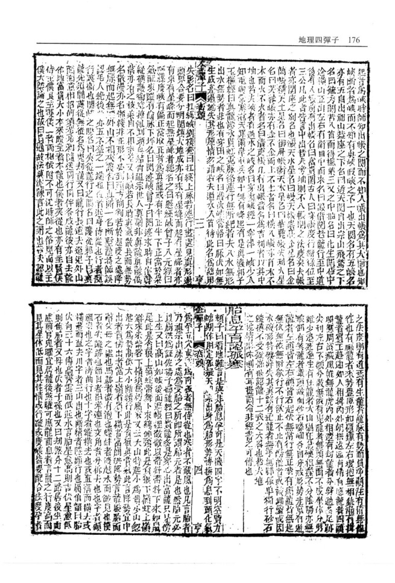

<!-- V3_SOURCE_ID:book025-b000136-p000-c5b85fc7f1 -->

飞虫、蜂形的穴，是断脉处实际未断；鹤腾形的穴，是看似不起脉的地方实则起脉；蝉退改形的穴，是从高山延伸到平洋；退雀形的穴，是平泽之中忽然有山形突起；隐隐形的穴，是看似有脉实则无脉；隆一隆形的穴，是看似无脉实则有脉；磊磊形的穴，是石骨入相；落落形的穴，是土脉连贯前行；转的状态是脉断开之后又接续；换的状态是正星化曜；龙的状态是能奕龙化；脉的特点是隐去又显现、显现又隐去，只论到头一节，其余部分不算作脉；没有穴的地方，分毫之差都不允许；胎是气脉分受的位置；息是气脉传换的位置；年是入首的位置；青是融沾的位置；生气是既有气脉又被限藏的状态；死气是无形无脉又孤露在外的状态；冷气是无脉无穴，空筑不圆净的状态；正穴是气脉正来正受的位置；穿封是气脉正来受的情况；阙斧是气脉直来横受的情况；开孤是开金儿水；截荡是乘生斩煞，并非水星；停是地势前行而气停止的状态；驹龙是形止而势仍前行的状态；截气是在气即将停止的腰段取穴的情况；渐关是形势缓行，缠护、朝应齐备，有穴可扦的情况；辑竿是元武嘴长且处于高处的位置；扳载是天财悬乳；红旗是藏全闪煞，又名仙人咬风，又名则脑受穴，气脉都往此处去，取穴取其回转之势，又名倒骑牛；气之所钟的情况是高山上生气汇聚，回环旋绕，有山无水；气之所聚的情况是在平洋立穴，砂停、水静，前朝山势端拱；气之所会的情况是牛山牛水，众脉集聚；至于所说的分合，关键要枕靠尖圆地形，若阴阳交媾就会失在正处。

> **释读存疑：** 本地硬校验仍未通过，已记录供后续自动处理或人工核对。

查看对应原文

<!-- V3_FOLDBACK_BEGIN:book025-b000136-p000-c5b85fc7f1 -->

飛蟲也蜂勝者斷中不斷也鶴滕者不起中起也蝉退改者高山下平洋也退雀者平澤忽有山激也隱隱者有中無也隆一隆者無中有也磊磊者石骨入相也落落者土脉連行也轉者斷而後續也换者正星化曜也龍者能奕龍化也脈者隱而見見而隱也只言到頭一節餘則不以脉不穴者毫髮不差也胎者分受處也息者傳換處也年者入首處也靑者融沾處也生氣者有氣脉而又限藏也死氣者無形無脉而又孤露也冷氣者無脉無穴空築不圓淨也正穴者正來正受也穿封者正來受也闕斧者直來橫受也開孤者開金兒水也截蕩者乘生斬煞也非水星也停者勢行氣止也駒龍者形止勢行也截氣者將止腰作也漸関者形勢侯行纏護朝應有穴可扦也輯竿者元武嘴長高處也扳載者天財懸乳也紅旗者藏全閃煞一名仙人咬風一名則腦受穴也者氣脈俱往穴取其回一名倒騎牛氣之所鍾者高山上聚環旋繞有山無水也氣之所聚者平洋立穴砂止水支前朝端拱也氣之所會者牛山牛水衆所集聚也而所謂分合者要枕尖圓陰媾陽則失在正

<!-- V3_FOLDBACK_END:book025-b000136-p000-c5b85fc7f1 -->

<!-- V3_SOURCE_ID:book025-b000137-p000-d240b49a01 -->

在下阳亥，阴则圆，在上而尖，在下有失，无圆谓之敬脉，有尖谓之气散；内有气而水神交，两足转而真气聚，名曰金山界，随见明暗口圆，内外亚回，名曰银槽，皆主富贵；龙上无星峰，万隔是真，名曰竹视；两手不同折，元辰水血行，名曰于柏，皆主败绝；凡扦六诏脉，由此祖，都不外此。

> **释读存疑：** 六诏具体所指不详

查看对应原文

<!-- V3_FOLDBACK_BEGIN:book025-b000137-p000-d240b49a01 -->

在下陽亥陰則圓在上而尖在下有失無圓謂之敬脉有尖謂之氣散內有氣而水神交兩足轉而真氣衆名曰金山界今而隨見明暗口圓事而内外亞回名曰銀槽皆王富皆龍上無星峰萬隔是真名曰竹視兩手不同折元辰水血行名曰於柏皆于敗絕凡扦六詔脉謂由之祖俱不外此

<!-- V3_FOLDBACK_END:book025-b000137-p000-d240b49a01 -->

<!-- V3_SOURCE_ID:book025-b000138-p000-79fa3d057f -->

母蹈空亡，乘煞气。

> **释读存疑：** 母具体所指不详

查看对应原文

<!-- V3_FOLDBACK_BEGIN:book025-b000138-p000-79fa3d057f -->

母蹈空亡乘煞氣

<!-- V3_FOLDBACK_END:book025-b000138-p000-79fa3d057f -->

<!-- V3_SOURCE_ID:book025-b000139-p000-189582cebe -->

“母”，是禁止的意思；“赠”，指在该地野葬。亡的情况，是指龙穴都有空亡的说法。龙的全亡，指神宗没有降势，图名空行度，下时重，也叫空亡；众大不特小，众小不射大，也叫空亡；边生迁死、道柔，也叫空亡；远行不跌、闲居不转、涣散，也叫空亡；欧断过大、骨脉久纵、形迹隐晦，也叫空亡；护节不到头、游行无星、休，也叫空亡；本身无枝，“肺行止无乡度”具体所指不详，也叫空亡。凡是龙的空亡共有四十八舫，这里只是列举大概，这些情况都属于不成龙，所以不能承受地脉，风水师如果误认这些情况下穴，大多会导致家族败绝。不过穴也有空亡的情况，正受如果没有真官曜，哪怕稍有垣局，也会有损年少之人，无乐无士，称为空亡，主退落少年亡六。

> **释读存疑：** 肺行止无乡度；四十八舫；退落少年亡六；1轮自动修复后核义模型仍建议修订，已保守记录。

查看对应原文

<!-- V3_FOLDBACK_BEGIN:book025-b000139-p000-189582cebe -->

母者禁止之同贈者野於其地也亡者龍穴皆有空亡夫龍之全亡者神宗無降勢圖名空行度下時重亦名空亡衆大不特小衆小不射大亦名空亡邊生遷死是道柔亦名空亡遠行不跌閒不轉渙亦名今上歐斷大過多時骨久縱跡亦名空亡護節不到頭遊行無星休亦名空亡本身無枝肺行止無鄉度亦名空亡凡龍空亡四十八舫此特舉其吞畧但言皆不成龍故不受地時師悞認下穴多主敗絕然穴亦有空亡正受若無真官曜纖有垣局損年少無樂無士號空亡退落少年亡六

<!-- V3_FOLDBACK_END:book025-b000139-p000-189582cebe -->

<!-- V3_SOURCE_ID:book025-b000140-p000-7c0a939e33 -->

穴如果没有正星，原本的气脉不明，很快就会导致家中供给不足；穴如果没有化气，经苞孔，家业会衰败；在水旁立穴如果没有化生脑，必然会出现退绝的结果，这个道理很分明。如果有止穴星而戊正受，就不属于这类情况。穴坐坑体并且呈仰瓦形，会导致官灾、库丧、家事败落。还有三十六种穴绝法：穴后仰瓦又无落脉，名为空四绝；禄息长而不要忽略，名为携渔绝；身郡非还随水去，名为鸣头绝；作别人之开演，外从不头，名为城门绝；虽然星上穴名秀，为水口绝；左右没有界合，堂水不停留，名为乾窠绝；后山如果像墙壁一样直立，前方又没有应峰，名为弥连绝；形说纳而平，没有脉又没有其他征兆，岂穴隐，名为犁尖绝；流砂都走尽了，穴受风吹，名为押尾绝；张烛而无形，与同，名为初龙绝；平地上没有聚气又没有旧迹，名为草坂绝；穴旁谷雨得穿，名为马眼绝；脉气已行但形势不走，名为旧过堂绝；穴处中间没有乳泡又没有微茫的界水，也没有可靠的倚靠，名为间口飞穴；时常落入深坑，名为落僧绝；穴前的水落入槽中，名为茶情绝；穴前的水斜向流走，名为竹视绝；若将龙无，说游远唐不分明，名为金刚且绝；穴时常受四面风吹，名为绝；如果振峰孤立高耸没有护卫，名为孤神绝；杨乐脚不凹，名为三又绝；有七无化气，名为孤绝；田胜作龙虎，田旁没有气脉，名为流砂绝；龙横过时挨靠着扦穴，名为山坡绝；火如仙常一平无，名为无气色；元武出门在顶头下穴，名为漏胎绝；水在头部而没有砂包裹，名为裹头绝；龙脉正行徵平诗，斩，名为斩龙绝；不清楚去就的形势，妄自开孤载荡，名为失度绝；牢山透地相互克制，亡命分金相互形害，名为库天绝；本主的形势微弱而四周的山高星，名为壁穴绝；本主甲贱而堂局过于宏大，名为忌形绝；本三卯污而朝应的山峰尊贵高大，名为习越；只看形势局好但龙的造作或者不符合法度，名为失矩绝；降势不真正尾肺随摄动，名为碎形绝；顺流闵不经本，溺前山凹，名为败形绝。以上是三十六种绝穴，学习风水的人一定要先明白这些道理，否则会遗祸无穷。

> **释读存疑：** 经苞孔；戊正受；身郡非还随水去；作别人之开演，外从不头；形说纳而平，无脉又无，岂穴隐；张烛而无形，与同；平中无聚又无旧；穴傍谷雨得穿；若将龙无，谓游远唐不分明；杨乐脚不凹，名为三又绝；有七无化气；田胜作龙虎；火如仙常一平无；龙脉正行徵平诗，斩；妄自开孤载荡；牢山透地相尅制；本主甲贱；本三卯污；顺流闵不经本，溺前山凹；1轮自动修复后核义模型仍建议修订，已保守记录。

查看对应原文

<!-- V3_FOLDBACK_BEGIN:book025-b000140-p000-7c0a939e33 -->

穴無正星原不明立見家給什穴無化氣經苞孔家業化成水立穴若無化生腦退絕必分曉或有止穴星而戊正受則亦非此例也穴坐坑體并仰瓦官灾庫喪事敗至又有三十六穴絕法又曰穴後仰瓦又無落名爲空四絕祿息長而勿忽起名爲攜漁絕身郡非還隨水去名爲嗚頭絕作別人之開縯外從不頭名爲城門絕雖星上穴名秀水口絕左右無界合堂水不停留名為乾窠絕後山若壁立前又無應峰名爲彌連絕形說納而平無脉又無豈穴隱名爲犁尖絕流砂然盡去穴受人風吹名爲押尾絕張燭而無形與同名為初龍絕平中無聚又無舊名爲草坂絕穴傍谷雨得穿名曰馬眼絕脉以行而形勢不行名舊過堂絕自中成無乳泡又無微是界又無壁可倚名為間口飛穴時落深坑名爲落僧絕穴前水落槽名爲茶情絕穴前水斜落名爲竹視絕若將龍無謂游遠唐不分明名爲金剛且絕穴兩時受四風名爲絕若振峰獨飛而無護衛名為孤神絕楊樂腳不凹名爲三又絕有七無化氣名為孤絕田勝作龍虎田傍無氣脉名爲流砂絕龍橫過挨傍扦名爲山坡絶火如仙常一平無除名為無氣色元武出門頂頭下穴名儒漏胎絕水裝頭而無砂包畏名為裹頭絕龍脉正行徵平詩斬名爲斬龍絕不明去就之勢妄自開孤載蕩名爲失度絕牢山透地相尅制亡命分金相形害名爲庫天絕本主微弱而四山高星名爲壁穴絕本主甲賤而堂局過人名爲忌形絕本三卯污而朝應尊大名爲習越逐形勢局而維佳龍而造作或不如法名為失矩絕降勢不真正尾肺隨攝動名為碎形絕順流閔不經本溺前山凹名爲敗形絕已上三十六絕穴學者先須悟此否則遺禍不經矣

<!-- V3_FOLDBACK_END:book025-b000140-p000-7c0a939e33 -->

<!-- V3_SOURCE_ID:book025-b000141-p000-540945db87 -->

舌六凶，嗟气难。

> **释读存疑：** 原文残缺，语义不明

查看对应原文

<!-- V3_FOLDBACK_BEGIN:book025-b000141-p000-540945db87 -->

舌六凶嗟氣難

<!-- V3_FOLDBACK_END:book025-b000141-p000-540945db87 -->

<!-- doc013 PDF 第 181 页：高风险/复杂版面 OCR 供检索；内容与排版以原页图为准。 -->
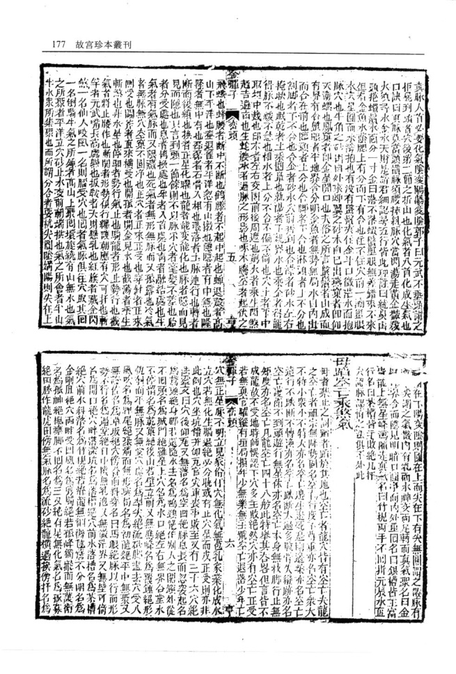

<!-- V3_SOURCE_ID:book025-b000143-p000-8342d782f5 -->

天光下临，地德上载，藏神合朔，神迎鬼游，是三吉；阴阳小和，五上四个是二吉，曰力之巧，功力之贝，赵全避缺，增高益下，是三吉；阴阳差错是一内，岁时乖，房一凶，力小图是三凶，凭福恃势是四凶，僭上偏下是五凶，变应怪见是六凶；若龙虽好不结子头七。

> **释读存疑：** 原文残缺，语义不明，部分文字无法辨识

查看对应原文

<!-- V3_FOLDBACK_BEGIN:book025-b000143-p000-8342d782f5 -->

天光下臨地德上載藏神合朔神迎鬼遊是三吉陰陽小和五 上四箇是二吉曰力之巧功力之貝趙全避缺增高益下是三 吉陰陽差錯是一內歲時乖房一凶力小圖是三凶憑福恃 勢是四凶僭上偏下是五凶変應怪見是六凶若龍雖好不結 子 頭 七

<!-- V3_FOLDBACK_END:book025-b000143-p000-8342d782f5 -->

<!-- V3_SOURCE_ID:book025-b000144-p000-77aaa26aea -->

穴谓之有若无，虽好无求；龙谓之虚若虚，砂虽然横向伸展但随水而去，称为水窜；窃水虽好为砂开，谓之金静。认候气的方法：来势缓和而气向上聚，就用尽穴而沉作，来抑制阳气，因为煞气不从下方出来；来势急峻而气向下聚，就用粘穴而净作，来消减煞气，因为煞气从上方出来；来势横展而没有脉，就用撞穴而吞作，来承接过气，因为煞气从旁边出来；来势逆而育伤，就用倚穴而作，来承接偏气，因为煞气从中间出来。石中见土，这叫真穴情；上山有石，这叫真骨气。所以地形不能妄加称许，局势不能苟且迁就。范越凤说：不要被相传的说法误导妄称地形，形势要符合星宿。又说：天上的星宿照耀大地，和证穴的要求完全契合，说的就是这个道理。至于十二倒影，又有对应的方法：山形俯伏的，山顶和山脚的形态不同，气在上方承接而向下散逸，多在山顶作天穴；山形仰承的，山项较低而山脚开阔，气在下方聚集而向上散逸，多在山的低处作地穴；山形端正的，上下的气都散逸而在中间聚集，多在山腰的中停位置作人穴；山的左侧生气旺盛而右侧死气重，必然是右侧端正而左侧行走，多在左胁位置作仙宫穴；山本来正行忽然反侧，必然后山摧折而前山背向，如同莲花的仰覆，必然头大颈小，作纽丝穴；山形反悖但穴正结，如同旗的尾部，如同弓的上弦，必须作单提穴；山形端正平整而穴处突起，如同须合的锋利处，如同蜈蚣出土，如同惊蛇抬头，作水穴；山形由俯伏转为仰承的，必然生出土块如同连珠，如同旧的三枭，如同芦鞭生节，作三停穴；从中间生出两旁的地形，如同左右手的衣襟合尖，手睁向下垂，作二停穴；山高如同平洋，或浮或设，如同临近断乡相联，必须作金登荷药穴；山正行而曲倒，中间如同转毬，如同草尾衔珠，作通容复珠穴；山来临近穴位，摆动颤抖右侧开口而肇请穴；木分东西，两背相隐，各自纽会，作传皮六；其间如果脉辨穿注针穴，如果脉横退而穴提春，作闻各穴。以上这些程式务必要仔细考量，作法也一定要遵循规则。

> **释读存疑：** 八虽好无求；龙谓之序若虚；窃水虽好为砂开，谓之金静；因煞从不出；来势逆而育伤；微贵偏气；上山儿石；形形势合星宿；与证穴去无余；十二倒影；作山之饶；山之正行勿然反侧；如造之上弦；如须合之利；如觉蛇之易头；如旧之三枭；山高八平洋，或浮或设，如临断乡联；金登荷药穴；中衆如转毬，如草尾啓珠；通容复珠穴；摆慄右开口而肇请穴；木分东西，两背相隐，各自纽会，作传皮六；脉辨穿注针穴；脉横退而穴提春，作闻各穴巳；1轮自动修复后核义模型仍建议修订，已保守记录。

查看对应原文

<!-- V3_FOLDBACK_BEGIN:book025-b000144-p000-77aaa26aea -->

穴謂之有若無八雖好無求龍謂之序若虛砂雖橫隨水去謂 之水竄竊水雖好爲砂開謂之金靜認候氣法來勢緩而上 聚則用盡穴而沉作以抑其陽氣因煞從不出來勢急而下紫 則用粘穴而淨作以殺其薩氣因煞從上出來勢橫而無脉則 用撞穴而吞作以受其過氣因煞從傍出來勢逆而育傷則用 倚穴而作以微貴偏氣因煞從中出石中見土是名真穴情 上山兒石斯名真骨氣故形不可妄稱局不可亥就范越鳳曰 勿爲相傳妄稱形形勢合星宿又曰天中星宿照地與証穴去 無餘此之謂也若夫十二倒影則又有道焉山之俯者頂足不 同則上乘而下散多在山之頂作天穴山之仰者項低而定濶 下聚而上散作山之饒作地穴山之正者上下皆散而中聚 多在山之腰中停作人穴山之左生而右死必右正而左行多 在脇之左作仙宮穴山之正行勿然反側必後山摧而前山背 如蓮花之仰覆必頭大而頸小作紐絲穴山反悖而穴正結如 旗之尾如造之上弦必作單提穴山之正平而穴穴突起如 鬚合之利如蟻蚣之之出土如覺蛇之易頭作水穴山俯而仰 者必生塊如連珠如舊之三梟如蘆鞭之生節作三停穴由 中此生兩旁如左右手衣襟之合尖手睜之垂下作二停穴山 高八平洋或浮或設如臨斷鄉聯必作金登荷藥穴山之正 行而曲倒則中衆如轉毬如草尾啓珠作通容復珠穴山來臨 穴擺慄右開口而肇請穴木分東西兩背相隱各自紐會作 傳皮六其問若脉辨穿注針穴若脉橫退而穴提春作聞各 穴巳此程式務要計審而作法必要

<!-- V3_FOLDBACK_END:book025-b000144-p000-77aaa26aea -->

<!-- V3_SOURCE_ID:book025-b000145-p000-baceae3f36 -->

续气，藏气，飘治气。

> **释读存疑：** 原文语义不明

查看对应原文

<!-- V3_FOLDBACK_BEGIN:book025-b000145-p000-baceae3f36 -->

續氣藏氣飄治氣

<!-- V3_FOLDBACK_END:book025-b000145-p000-baceae3f36 -->

<!-- V3_SOURCE_ID:book025-b000146-p000-c5d73b552c -->

这是承接上文来说，扦穴的方法，切不可拘泥于枝干、偏正的分别。《辖经》说：三分三合，建中州，枝干相随，自相护卫，真气到来，见到主星，一家骨肉相互依附，回环旋绕，会聚三阳，外山一同前来作为门户，左右纽结如同僧寺，作仙宫，主出将相公侯、真宰辅臣。吴景鸾说：三山金出繒者为尊，这说的是缩气，不是上交曜中缩气的意思。所说的缩气，是指在众多长形的山势中，唯独选取短小的作为尊贵的格局。藏气，是指脉中的元气藏在其中。但元气只有名称无法看见，能看见的只有八。

> **释读存疑：** 徧正之分轄经；廻環旋繞會三陽；左右紐僧作仙宮；三山金出繒者爲尊；上交曜；所可見八；徧正之分轄；1轮自动修复后核义模型仍建议修订，已保守记录。

查看对应原文

<!-- V3_FOLDBACK_BEGIN:book025-b000146-p000-c5d73b552c -->

此承上而言扦穴之法切不可泥於枝幹徧正之分轄經曰三分三合建中州枝幹相隨自相護真氣有來見主星一家骨肉謂依附廻環旋繞會三陽外山齊來作門戶左右紐僧作仙宮將相公侯真宰輔吳景為曰三山金出繒者爲尊此謂縮氣非上交曜中縮氣之謂也所謂衆長之中獨取短小爲尊貴也藏氣者脉中元氣藏于其中也然元氣有名而不可見所可見八

<!-- V3_FOLDBACK_END:book025-b000146-p000-c5d73b552c -->

<!-- V3_SOURCE_ID:book025-b000147-p000-fc8bb1403d -->

这些内容只是大致的说法罢了。真元之气蕴藏在山川之中，《帅洞林秘诀》中说：要寻找千年朽坏的灵骨，必须仔细审察一点与阳的关联。比如留中之安、安中之窟，必须要圆润洁净；还要做到实中虚、虚中实，这个状态必须光洁清明。“琴上马直取其横，马上琴横取其直”。还有“云雁有影无形，旺中云有形无影”两种并列的情况。风巾冢要在乱中取聚，絮中取风，聚中取乱，飞中领隐，隐中取现。文中提到“读中农”，这一短语具体所指不详，上下文又提到要现中取隐，镜中取灯，昭中取明，灯中取镜，明中取暗，雪里梅是虚中取弃，梅里雪是亮中取虚，舟中浪是沉中取浮，溟中舟是浮中取沉，石中玉是粗中取细，玉中石是细中取粗，核中仁是死中取生，仁中核是生中取死，响中黄是怪中取常，蛙中珠是大中取小，鱼中珠是小中取大，盏中酥、露中取城，大中统、经中取独，草中蛇是静中取动。以上这些说的是认气于藏气的诀要。所谓“朝”，说的是脉看起来散乱实际上并不散乱，形看起来好像要脱落实际并未脱落，这才是真的落。所谓“怕”，说的是气看起来要离去却迟迟不行动，实际上是真的不会行动。《锦几经》中说：气旺盛的部分是流动不息的，其余的部分还有静止的状态；气虽然零散分布，但它深处的部分仍有聚合的态势。所以藏在翻燥处的适宜浅埋，藏在平坦开阔处的适宜深埋。又说深浅如果把握得当，风水自成，由此就可以看出认气的妙处了。

> **释读存疑：** 读中农

查看对应原文

<!-- V3_FOLDBACK_BEGIN:book025-b000147-p000-fc8bb1403d -->

者特彷彿耳夫真元之氣戴于山川之中帥洞林秘訣曰說求 千年靈骨之朽須審一點與陽之任茲也如留中之安安中之 窟須要圓净而俗利寔中虛虛中寔必須光潤而清明琴上馬 直取其橫馬上琴橫取其直雲雁有影無形旺中雲有形無影 風巾冢亂中取聚絮中風聚中取亂飛中領隱中取現讀中農 現中取隱鏡中燈昭中取明燈中鏡明中取暗雪裏梅虛中取 弃梅襄雪亮中取虛舟中浪沉中取浮溟中舟浮中取沉石中 玉粗中取細玉中不細中取粗核中仁死中取生仁中核生中 取死響中黃怪中取常蛙中珠大中取小魚中小中取大盞 中酥露中取城大中統經中取獨草中蛇靜中取動此言認氣 干藏氣之訣也朝者言脉以散亂而寔不散亂言形雖欲落不 落是有真落也怕者言氣離欲行不行寔真不行也錦幾經曰 氣之盛者維流行而其餘者猶有止雖零散而其深者猶有聚 故藏於翻燥宜淺藏於坦夷者宜深又曰淺深得乘風水白 成可見認 氣之妙也

<!-- V3_FOLDBACK_END:book025-b000147-p000-fc8bb1403d -->

<!-- doc013 PDF 第 182 页：高风险/复杂版面 OCR 供检索；内容与排版以原页图为准。 -->
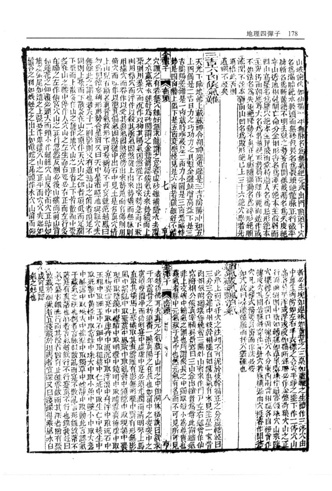

<!-- V3_SOURCE_ID:book025-b000149-p000-3ead80b23c -->

相传的说法是，脉的形态有自高而下、自下而高、自大而小、自小而大的变化，文中出现“自恐而费而隐”，其中“恐”“费”应为形近讹字，具体含义不详。高是作为靠山的刚健之态，下是作为兜护的柔顺之态，大是脉的粗阔形态，小是脉的纲领性特征，文中出现“隐为朱之微”，其中“朱”应为讹字，具体含义不详，无是功用的广大体现。然而这六种情况，文中写为“自期传変连而复有新而复连”，其中“期”应为讹字，具体语义不明。脉用“头”来命名，是因为它有坐止的状态；骼用“悬”来命名，是因为它能构成变化，文中提到“言其必梦成星本也”，其中“梦”应为讹字，且上一版漏译了“本也”，整句具体所指不详。比如文中提到“金星必头闻或竭钟”，其中“头闻”“竭钟”应为讹误，具体含义不详；又说金星有的顶笔直高耸，文中出现“或贞正如上或横卧如创”，其中“如创”应为讹误，具体含义不详。土星头方正，文中写为“如耀库或如方稍”，“如耀库”“方稍”具体所指不详。火星头尖而俊秀，文中写为“理或头顿旗或如龙殿”，“头顿旗”“龙殿”具体所指不详。水的形态活动没有定形，有的弯曲如蛇，文中出现“或湾辰如带”，其中“湾辰”应为讹误，具体含义不详，这些都是它的正形表现。文中出现“正沐出恐”，应为讹误，具体含义不详；又提到担心五星不能涵盖星体变化的妙用，所以罗列九晖来统摄它的变化、归类它的序列，文中的“星休”“九晖”“统其班寄”具体所指不详。同样是金星，高的称作太阳，低的称作太阴；太阳龙称作天罡，太阴正面相对称作孤曜。说它的正体可以用星名来规范，文中出现“范而则不成星休也”，其中“范而则”应为讹误，具体含义不详。文中提到“木星夷名紫气”，“夷名”具体所指不详，这是因为木星有化气；水星更名为扫荡，是因为它畅茂而条达，此处原文“条逵”应为“条达”的讹误；火星更名为燥火，是因为它秀丽而清俊；土星更名为天财，文中提到“以张子盗头”，具体所指不详。

> **释读存疑：** 自恐而费而隐；隐为朱之微；自期传変连而复有新而复连；言其必梦成星本也；金星必头闻或竭钟；如创；如耀库；方稍；头顿旗；龙殿；湾辰如带；正沐出恐；星休；九晖；统其班寄；范而则；夷名；张子盗头

查看对应原文

<!-- V3_FOLDBACK_BEGIN:book025-b000149-p000-3ead80b23c -->

相傳者自高而下自下而高自大而小自小而大自恐而費而隱夫高爲靠之剛下爲籠之柔大爲脉之粗小爲脈之綱隱爲朱之微無為用之廣然此六者自期傳変連而復有新而復連脈以頭名以其有坐休也骼以懸名以其成交化者言其必夢成星本也如金星必頭聞或竭鐘或本星頂直而高幾或貞正如上或橫卧如創土星頭方而如耀庫或如方稍火星頭尖而秀理或頭頓旗或如龍殿永星活動無足或屈曲如蛇或灣辰如帶皆其正沐出恐五星不盡星休之妙用故羅之九暉其変化而統其班寄也同一金星高者爲太陽低者爲太陰太陽龍而為天罡太陰觀面爲孤曜言其正体則可以星名而範而則不成星休也木星夷名紫氣以其有化氣也水星更名掃蕩以其暢茂而條逵也火星更名燥火以其秀麗而清俊也土星更名天財以張子盜頭

<!-- V3_FOLDBACK_END:book025-b000149-p000-3ead80b23c -->

<!-- V3_SOURCE_ID:book025-b000150-p000-d30b1f5f3f -->

净而家金，所以就这么称呼它。至于发角尖利，大不见，这些都是风象的义理，也就是气运的规矩，用来对应生尅制化，以敬其吉，育哲八俗例。

> **释读存疑：** 原文存在残缺，部分内容无法准确释读；原文存在残缺，“淨而家金”“發角尖利大不見”“以敬其吉育 哲八俗例”语义无法准确释读

查看对应原文

<!-- V3_FOLDBACK_BEGIN:book025-b000150-p000-d30b1f5f3f -->

淨而家金故即名之若夫發角尖利大 不見此皆風 象之義卽氣運之規矩以應其生尅制化以敬其吉育 哲八俗例

<!-- V3_FOLDBACK_END:book025-b000150-p000-d30b1f5f3f -->

<!-- V3_SOURCE_ID:book025-b000151-p000-09eabb83f6 -->

穴后方的第二节是折出致头，第一节是入首。范越学有说法提到，“义礼句谓有嘉落”，判断的标准只要看折山就可以确定；想要知道生气是不是真正到来，只要看清入首的范围就可以，这是相关理论里最关键的内容。廖子说，穴后方的一星称作龙洛，还要在穴中辨明三，通过这点就可以判断真实情况，核验穴的偏正、气的生死。唐代一行说，折出的情况如果辨不明白，就是白费心思，哪怕看起来有穴也不能下针。厉治韶说，如果要问好不好的山头，哪怕是假火格局下有时也会有真乳，九外山照旧有遯栏，过了合理的范围自然就没有势。线司白头说，没有折的情况就叫做无王星，会出现人亡、射严随给竹的情况。他又说，折山的情况辨不明白，主家会有暗自昏聩的情况，砂财会意外到家门。考察折山的星峰，如果禄正秀丽，必定主家富贵，符合这类情况的，星曜正好在拿台编严，表面没有歪斜偏侧的样子，正因为它不偏不倚，所以立向自然符合格式，有对应的穴情，也有对应的穴名。按照这个规律推导，这样的地形孕育出的子孙自然是正人君子。他还说，如果能得到这样的穴，那么人的邪念都会转化为正念，原本没有福运的人都能获得这份福运，所以说山随人贵，山端人正。

> **释读存疑：** “折出致头”“义礼句”“耗广”“龙洛”“明三”“真偿”“假火”“真乳”“九外山”“遯栏”“无王星”“射严随给竹”“潜昏”“砂财”“禄正”“拿台编严”均为风水隐语或讹误，具体含义不明；本地硬校验仍未通过，已记录供后续自动处理或人工核对。

查看对应原文

<!-- V3_FOLDBACK_BEGIN:book025-b000151-p000-09eabb83f6 -->

穴後第二節而爲折出致頭第一節而為入首范越學曰義禮句謂有嘉落但看折山爲的確欲知生氣有真來但皎入首耗廣此言他理之最繁要處也廖子曰穴後一星爲龍洛仍要穴中明三即此可以見無之真償穴之偏正氣之生死矣唐一行曰折出不明枉用心絕然有穴不堪針厲治韶曰若還問好頭假火時有真乳九外山仍舊有遯欄過情自是無勢線司白頭曰無折是名無王星人亡射嚴隨給竹又曰折山不明主潛昏砂財橫爾到家門考折山星峰祿正秀麗必主富貴之合例者星曜正在拿臺編嚴面無歌斜偏側之象惟其不偏不倚故立六自然合式而有穴情又有穴名推其如是則所産之子孫自然爲正人仁子又曰若得是穴則人之邪若皆化爲正不福者皆可此福故曰山隋人貴山端人正也

<!-- V3_FOLDBACK_END:book025-b000151-p000-09eabb83f6 -->

<!-- V3_SOURCE_ID:book025-b000152-p000-d573714487 -->

吉利的就称作神，凶险的就称作气。刚健是龙的生气体现，柔顺是龙的清贵体现。文中提到“北言龙宗得麾峰，行度得活动”，山势转折符合法度，砂、水都朝向穴场聚结，文中出现“此之谓帝皆礼宗”，其中“帝皆礼宗”应为讹误，具体含义不详。如果龙脉的宗系不分明，行龙过程多遇到鬼劫，入首的形态不符合星象要求，砂和水不相呼应，这就称作落。文中提到“山之情，水走者性也”，此处“晴”应为“情”的讹字；“面面相朝拱者情也”，此处“痛”应为“情”的讹字。这说的是神应当亲近，煞应当规避，原文断句应为“神当亲，煞阴避也”。文中出现“黑丧等曰”，“黑丧”属于神煞名，具体所指不详，它提到：龙的形态好，传换屈曲符合规制；穴的形态好，凶恶的砂山自动退缩；其他条件好，没有不利的官煞；水的形态好，盘旋合局，这就称作有神。又说：龙的出身不明朗，穴前左右的水浑浊，砂山反而朝向外侧没有情谊，水直直地疾速流去，文中的“登旋合局”“龙怡”“砂伯”“直荒竟行”“带谋”具体所指不详，这就称作带谋。山的本性本来刚健，而它乘入穴场的情况，文中出现“木来而又长其剂”，应为讹误，具体含义不详。利中取柔，说的是有化气；气中求刚，文中写为“言人洪变也”，“人洪变”具体所指不详。所谓的端的，是初来的中气，这说的是龙、穴、砂、水都要中正和美，不能偏胜歪斜。又提到“角备脊顶非并受也”“词有中和”，具体含义不详。卯子说：形势就算很难周正，只要真穴一下葬自然就符合要求，文中的“自恭如”具体所指不详。

> **释读存疑：** 帝皆礼宗；黑丧；传换制曲；制无官条；登旋合局；龙怡；砂伯；直荒竟行；带谋；木来而又长其剂；人洪变；角备脊顶非并受也；词有中和；自恭如

查看对应原文

<!-- V3_FOLDBACK_BEGIN:book025-b000152-p000-d573714487 -->

吉則爲神凶則爲氣剛是龍之生柔則是龍之清北言龍宗得麾峰行度得活動倒而合法度砂水盡朝宗此之謂帝皆禮宗不分明行度多鬼刼入首不成星砂水不相額是之謂落矣山之晴水走者性也面面相朝拱者痛也此言神當親煞陰避也黑喪等曰龍好傳换制曲穴好凶砂義縮他好制無官條水好登旋合局此之謂有神也又曰龍怡出身不明穴前左右渾水砂伯反面無情水怕直荒竟行此之謂帶謀也山性本剛而其乘穴情木來而又長其劑利中取柔者言有化氣也氣中求剛者言人洪变也的端者中初之氣此言龍穴砂水皆要中正而和美不可徧勝而斜側又曰角備脊頂非並受也詞有中和卯子曰形勢難不正真穴一扦自恭如

<!-- V3_FOLDBACK_END:book025-b000152-p000-d573714487 -->

<!-- V3_SOURCE_ID:book025-b000153-p000-61880ccd1e -->

《金弹子》中说：龙符合法度特地而来，称作真龙。文中提到“人处星本而特见名曰穴”，其中“人处星本”应为讹误，具体含义不详。文中出现“此四高特朝供名曰真砂”，其中“四高”应为讹误，具体含义不详。水到穴前静止不动，称作真水，此处原文“与水”的“与”应为“真”的讹字。文中出现“直胎急序奇俱今唐溪峽勢具壽書是也”，整句应为讹误或残缺，具体含义不详。所谓真穴，是山形格局分明，乘气符合法度，文中出现“比气乘气合法梦者是也”，其中“梦”应为讹字，具体含义不详。所谓真砂，文中写为“明朝体异之迟，官鬼万唯之尽固者星也”，整句语义不通，具体所指不详。所谓真水，是来去平缓，让人感觉和乐舒畅，原文“真大者”的“大”应为“水”的讹字，文中的“净存终悠气我欢留”“其来无源，其去无流”具体所指不详。真龙、真穴、真砂、真水这四类，临近穴场的时候是必不可少的，龙脉的初、中、老各个阶段的气尽处也可以安穴。

> **释读存疑：** 头；人处星本；四高；直胎急序奇俱今唐溪峽勢具壽書是也；梦；明朝体异之迟官鬼万唯之尽固者星也；净存终悠气我欢留；其来无源其去无流

查看对应原文

<!-- V3_FOLDBACK_BEGIN:book025-b000153-p000-61880ccd1e -->

金彈子 頭 曰龍合法度而特來名曰眞龍人處星本而特見名曰 穴此四高特朝供名曰真砂水到穴前寂不動名曰與水夫 直胎急序奇俱今唐溪峽勢具壽書是也眞穴者折山形 局之分明比氣乘氣合法夢者是也眞砂者明朝體異之遲 官鬼萬唯之盡固者星也真大者淨存終悠氣我歡留其 來無源其云無流者是也此四氣字臨穴必不可少者也 初中老盡亦堪安

<!-- V3_FOLDBACK_END:book025-b000153-p000-61880ccd1e -->

<!-- V3_SOURCE_ID:book025-b000154-p000-9a494e34a1 -->

范越凤说，初能说下亦可安，大小停朝掏曲，梦重重包寿，无臾融结之中亦出官，此初发作地之徵也。又说，大地多从残观，然余核廻转作城讯，此中龙作地之亩也。又说，龙势忍迢，将势穷，二阳外拱内藏，风余枝虽夫亦作地，直传真穴产三人公，此老龙作地之微也。又曰，龙盖伏朝水局，圣有穴端然成高贵，此书龙作也之微也。世家者能泥脉定穴，不必泥于书，龙但有穴情纯第之恶皆可安，汗世之时师每白龙盖气经福裔无解。又曰，初中作穴总被缩，然发隔不多时，此皆备见也。孰子曰，龙盖下平洋，砂水昼飞，杨坪中空着穴身弑国从亡。又曰，尽山势两无形，号老椿。又曰，前砂水又可爱，丙里山水皆反薄，老蕃无化人，乾条立见败亡成凶悔。又曰，砂不乱海清兴，气灵水不乱，廻退则气止。疑龙经曰，君如寻得干，能穷雨水相交，穴受风，风吹水刼却非穴，君如到此是统龙。又曰，尽龙初龙穴一样，藏风聚气乃堪，若还有一不周全矩度，不成空自谁。孰若中受与全局，富贵荣华无勉强，学者当。

> **释读存疑：** 原文存在残缺，部分内容无法准确释读；原文存在多处残缺和字形讹误，“初能说下亦可安”“大小停朝掏曲”“梦重重包寿”“残观”“余核廻转作城讯”“作地之亩”“龙势忍迢”“二阳外拱内藏风”“余枝虽夫”“产三人公”“龙盖伏朝水局”“书龙作也之微”“纯第之恶”“汗世之时师”“白龙盖气经福裔无解”“总被缩”“发隔不多时”“砂水昼飞”“杨坪中空着穴身弑国从亡”“丙里山水皆反薄”“老蕃无化人”“乾条”“砂不乱海清兴”“穷雨水相交”“统龙”“乃堪眉”“不成空自谁”“孰若中受与全局”等内容无法准确释读

查看对应原文

<!-- V3_FOLDBACK_BEGIN:book025-b000154-p000-9a494e34a1 -->

范越鳳曰初能說下亦可安大小停朝掏曲夢重重包壽無 臾融結之中亦出官此初發作地之徵也又曰大地多從殘觀 然餘核廻轉作城訊此中龍作地之畝也又曰龍勢忍迢將勢 窮二陽外拱內藏風餘枝雖夫亦作地直傳真穴産三人公此老 龍作地之微也又日龍蓋伏朝水局聖有穴端然成高貴此書 龍作也之微也世家者能泥脉定穴不必泥於書龍但有 穴情純第之惡皆可安汗世之時師每白龍蓋氣經福裔無解 又曰初中作穴總被縮然發隔不多時此皆備見也孰子曰 龍蓋下平洋砂水晝飛楊坪中空着穴身弑國從亡又曰盡 山勢兩無形號老椿又曰前砂水又可愛丙裏山水皆反薄 老蕃無化人乾條立見敗亡成凶悔又曰砂不亂海清興氣靈 水不亂廻退則氣止疑龍經曰君如尋得幹能窮雨水相交穴 受風風吹水刼却非穴君如到此是統龍又曰盡龍初龍穴一 樣藏風聚氣乃堪眉若還有一不週全矩度不成空自誰孰若 中受與全局富貴荣華無勉強學者當

<!-- V3_FOLDBACK_END:book025-b000154-p000-9a494e34a1 -->

<!-- doc013 PDF 第 183 页：高风险/复杂版面 OCR 供检索；内容与排版以原页图为准。 -->
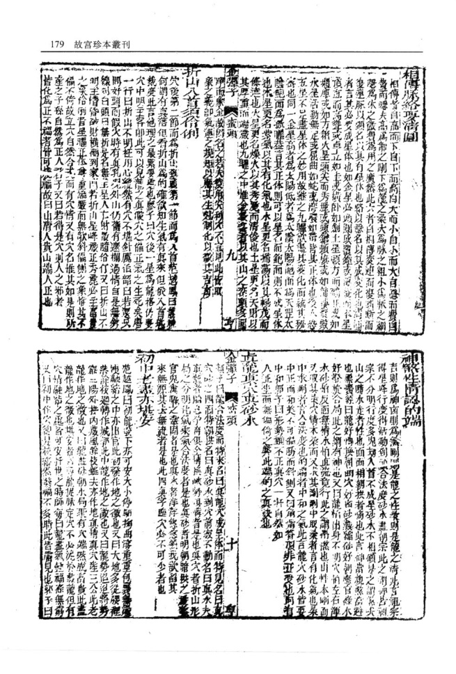

<!-- V3_SOURCE_ID:book025-b000156-p000-b1327abb77 -->

自有砂环绕、水汇聚的地方，就可以寻求吉地，不必一定要龙脉尽善尽美。

查看对应原文

<!-- V3_FOLDBACK_BEGIN:book025-b000156-p000-b1327abb77 -->

自砂環水聚之閭求之奚必龍之盡也

<!-- V3_FOLDBACK_END:book025-b000156-p000-b1327abb77 -->

<!-- V3_SOURCE_ID:book025-b000157-p000-bd66a028f6 -->

倒杖的作法，是乘生气。

查看对应原文

<!-- V3_FOLDBACK_BEGIN:book025-b000157-p000-bd66a028f6 -->

倒杖作法乘生氣

<!-- V3_FOLDBACK_END:book025-b000157-p000-bd66a028f6 -->

<!-- V3_SOURCE_ID:book025-b000158-p000-1298d99887 -->

大凡定穴的法度，原文“大非穴之法度”中的“非”应为“凡”的讹字，共有九项：一是星峰，二是二三顶，三是结作，四是脱落，五是穴情，六是交合，七是穴法，八是鸡雄，九是聚会，完全掌握这九法，那么定穴就没有其他需要掌握的技艺了。第一项星峰，指的是金星形圆、木星形直、水形曲、火星形尖、土星形平，原文此处断句有误，漏译了“木直”。第二项二三顶，指的是龙脉正来斜下要防止窜走，正来正下要防止偏斜，横来侧向点穴要防止过脉，横来直下要防止脉气过急，上一版误将“二三顶”写为“二三顺”，属于讹字误译。第三项结作，尖形锐性的属火，文中出现“火屈火阁形端性刚属金”，其中“火屈火阁”应为讹误，具体含义不详；直形长硬的属木，横形方正性和的属土，动形文中写为“细哲柔属水”，其中“细哲”应为讹误，具体含义不详；这五种形态的作法是，有动势的地方可以下穴，文中的“五者作法”指代不明，具体所指不详。第四项脱落，指的是气贯头顶的话星象就不明确，原文末尾的“十”应为衍字或下文残字。

> **释读存疑：** 火屈火阁；细哲；五者作法；十

查看对应原文

<!-- V3_FOLDBACK_BEGIN:book025-b000158-p000-1298d99887 -->

大非穴之法度一星峰二三頂三結作四脫落五穴情六交合七穴法八雞雄九聚會盡此九法則穴無餘藝矣一星峰者金圓木水曲火尖土平也二三順者正來斜下防竄得來正下防偏而來橫卜防過橫來直下防急三結作者尖形銳性火屈火閣形端性剛屬金直形長注堅屬木橫形方性和屬土動形細哲柔屬水五者作法動處可下四脫落者貫頂則星休不明十

<!-- V3_FOLDBACK_END:book025-b000158-p000-1298d99887 -->

<!-- V3_SOURCE_ID:book025-b000159-p000-4f01a6e95f -->

气脉带有水火木属性且形势缓和的地形可以修整，形势急促的可以做适当处理。侧落的地形气脉偏斜，有的聚在左侧，有的聚在右侧，如果有明堂、朝应的地形条件就可以取用。尖脉像丘陵一样走势急促，明堂承接它圆润柔和的态势，缓和的地属性为雌，急促的地属性为雄，中间凸起的部分像珠子，中间平缓的是虚，实中饱满的地形是气聚的状态，突中处在巽位的是头，显露的节泡纹理像乳一样沉隐，开口符合规谱的就是合格的形态。五种穴情中，天心是核心，要提防阴气外露，气脉过饱的地方要选取相对气脉不足的位置；要提防坑洼凹陷，气脉不足的地方要选取相对饱满的位置；还要提防兜突的情况。文中提到“罗穴中有識申影”，具体含义不详；旧有的断语认为气脉沉的在下层，气脉浮的在上层。走闪的情况：走是指气脉出现之后似有似无，闪是指气脉正来却斜向流出，没有脉节生成。文中提到“可鈇水隨脉落”，具体含义不详，主张以水随脉走的顺向为最重要。文中提到“王凶脉隨水蔡”，具体含义不详，主张水逆脉而行的情况要谨慎处理。文中提到“主吉中肝實頂門耳求法也”，具体含义不详；侧口的气从耳入，这是架折的方法。生气恬和流动就是气聚的状态，死脉粗硬就是气散的状态。气脉来势急促但停驻时平缓的适合选用，粘雾来势的情况，文中提到“歌邊面勅者爲陽宜撞”，具体含义不详；强脉尖削的属阴，两脉柔和耿直的属阳，顺脉随山势向下的是愿造，脉势触碰到反向地形的是池。六交合的情况：阴多阳少的适合向前奏进，阳多阴少的适合傍笼，阴阳各半的要在养阳的位置下穴，阳衰阴盛的要疏离阴的部分，阴衰阳盛的要靠近阳的部分。文中提到“漏陽不生仙送水不打”，具体含义不详；孤阴不能成事，没有界合的地方不能安葬，阴阳各半的就选取中间位置，厚生薄死的适合选取厚的位置，死薄生的适合选取薄的位置，阳在下阴在上的就靠近阴的上方，阴在下阳在上的就靠近阳的部分。七穴洪的情况：来龙起祖降势，星峰之间五行相生的为吉，相克的为凶；入路的来龙绵延悠长，没有水冲风射的为吉，反过来就为凶。刚柔的区分：阴脉急促硬挺是刚，文中提到“陽軟擬爲非”，具体含义不详。证佐的情况：有龙有穴是证，有砂有水是辅，文中提到“必要龍穴砂水俱金”，其中“俱金”具体含义不详，符合这个条件的才算有证佐。文中提到“護送通宜龍處地衛禮王慧也是爲小聚人乘者漢備重重龍書氣鋒過砂邊水卯朝暗洪堂局周正”，大量表述具体所指不详；官鬼同清的就是大聚。应乐的情况：以化生脑、薦手为参照，后文有拒乐，文中提到“東控有名”，具体含义不详；前方有朝迎，朝向特意对准有情意的方位，左右有掩耳形态的护砂，带官带曜，这些都是吉相。朝向对应的朝案是宾，龙脉是主，朝案必须特意对准，龙脉要区分阴阳。阅锁的情况：大的叫闲，比如华表、捍门就是这类；小的叫镇，比如罗星、禽曜星就是这类。护逸的情况：在穴位附近的是护，跟随龙脉较远的是从。文中提到“雌催者得度三父合水大度”，其中“三父”具体所指不详；没有分合、左右水交会在局内、三阳符合法度的叫雌，杂支不符合法度的叫舛错流漓，吉凶的辨别就写在这里。凡是乘会的情况，太八字是分襟，小八字是合角。文中提到“仰体屑陽要覆作隱休屬陰宜仰作二陰者乃掩可之山也”，其中“屑陽”“隱休”“掩可之山”具体所指不详。何子说：左右不受风吹，是贵穴的第一条件。二者指的是上、中、下三停的穴位。四平指的是前后左右四个方位。十字指的是天心十道。偶法指的是阳交在山关，阴交在水合。文中提到“凶偉者龍穴砂水之俱全也”，这里的“凶偉”是凶相，具体含义不详，和后文的“陀漏”“鼎破”都是不利的穴相。陀漏指的是左右空缺招风，气脉不明没有生气。鼎破指的是四面没有护砂包裹，被八风吹袭。页面末尾标注+11。

> **释读存疑：** 罗穴中有識申影；可鈇水隨脉落；王凶脉隨水蔡；主吉中肝實頂門耳求法也；陽軟擬爲非；俱金；護送通宜龍處地衛禮王慧也是爲小聚人乘者漢備重重龍書氣鋒過砂邊水卯朝暗洪堂局周正；東控有名；三父；屑陽；隱休；掩可之山；凶偉

查看对应原文

<!-- V3_FOLDBACK_BEGIN:book025-b000159-p000-4f01a6e95f -->

多水火木緩可剪而急可葉側落氣偏或聚左或聚右有明堂朝應可下尖脉陵而急堂服其經圓縣柔而雌緩當取其急屬中突是珠為中簡是虛实中富是聚突中巽是頭字露而節泡理乳是也沉隱而露開口規譜是也五穴情者天心主也防陰露飽中取飢防坑陷飢中取飽防兜突羅穴中有識申影舊斷氣沉在下編氣浮在上走閃走者或出後似有似無閃者正來斜出無節生有可鈇水隨脉落旨順爲重王凶脉隨水蔡者逆爲慎主吉中肝實頂門耳求法也側口氣從耳入架折法也生氣恬動爲生則氣聚死脉粗爲死則氣散急來勢在破而靜者爲宜粘霧來勢歌邊面勅者爲陽宜撞強脉尖剖爲陰兩脉柔耿爲陽順脈陸勢下爲願造脉觸勢反爲池六交合者陰多小宜奏進陽多陰少宜傍籠牛陽半陰平分養陽處下陽衰陰盛則疏陰陰衰陽盛則就陽漏陽不生仙送水不打孤陰不成無界合不塟陰陽相半則就中厚生薄死宜熟厚厚死薄生宣就薄土陽下陰明就陰上陰下陽則就陽七穴洪者來龍起祖降勢星峰相生者吉相尅者凶入路來龍迢絕無水衝風射者吉反此者凶剛柔者陰脉急硬爲剛陽軟擬爲非証佐者有龍有穴爲証有砂有水爲俗必要龍穴砂水俱金謂之有証佐小聚者護送通宜龍處地衛禮王慧也是爲小聚人乘者漢備重重龍書氣鋒過砂邊水卯朝暗洪堂局周正官鬼同清是爲大聚應樂者以化生腦薦手後有拒樂東控有名前有朝迎特向有情左右掩耳帶官帶曜所爲吉也爲王者朝案爲賔龍脉爲主朝案必須特龍脉要分陰陽閱鎖者大者爲閒如華表捍門是也小者爲鎮如羅星禽曜星也護逸者附近爲護穴隨從爲遠龍入雌催者得度三父合水大度無合無分左右水交局會三陽合法度者名雌雜支度不合法度者名曰舛錯流漓吉凶之辨筆於此矣凡乘會者太八字分襟也小八字合角也仰体屑陽要覆作隱休屬陰宜仰作二陰者乃掩可之山也何子曰左右不受吹貴穴中第一二者上中下停穴也四平者前後左右也十字者天心十道也偶法者陽交山関陰交水合凶偉者龍穴砂水之俱全也陀漏者左右空缺而不越風脈息不明而無生氣鼎破者四面不包八風吹子頭 +11

<!-- V3_FOLDBACK_END:book025-b000159-p000-4f01a6e95f -->

<!-- V3_SOURCE_ID:book025-b000160-p000-483eea6f79 -->

辨认穴的脉有八种病象，文中提到“如魚題非過如萌蘆并孔透頂山脉非橫如竹不起煩非節串不明非法員而有脊非瑰脉粗大非氣流動出肺非搏皮”，这部分关于八病的表述具体含义不详。记脉有七种凶象：贯是指气脉透顶而出，星峰没有头部，两侧漏称；串是指气脉僵直而来，气脉不动；露是指脉在穴口露出，或主或言，抽枝不均匀，足下偏重；纲是指平面上看不到脉，像肌肉横生，又像张开的屏风墙壁，饱满臃肿，都属于判官肚之类，因为没有体势也没有界合，所以有这样的判断，这类地形没有生气可以乘用；断是指气脉下落没有痕迹，起身没有势，起落都没有星峰，峡谷直长又没有宋气，所以崩断的叫斩；不分是指八首没有大小八字，名叫受煞；直长的叫便死，是吐煞。以上说的都是穴中的禁忌，一旦不谨慎，一定会招来灾祸。大凡选择墓地，从峡谷中可以验证地的大小，从祖宗山可以证明地的贵贱，文中提到“入首可以設補福之乾重”，其中“乾重”具体含义不详。凡是立穴的贵贱判断，有根据龙判断的，有根据穴判断的，有根据砂水判断的，文中提到“有以砂水政者”，其中“政”具体含义不详，还有根据年命日时判断的。四神高的就用天穴，文中提到“四禱儀則用也穴”，其中“禱儀”“也穴”具体含义不详；四神平缓的就用人穴。能看到的山都拱指向穴位，能看到的木都养垂，如果气脉、穴内有木根、木囊，大多主脱绝，风灌入会翻棺，水冲荡会覆椁。倒杖的方法一定要先立一根杖，然后才可以倒池。越凤说：杖不难在倒，而难在形成好的局；下穴不嫌端正，而嫌不能生旺；文中提到“水不嫌其不顏來”，其中“顏來”具体含义不详，水贵在静定。相关内容详见《鸿蒙真经》。杖法真诀说：气脉正来正受的，应当用顺杖，没有气脉在中间肃散的弊端；文中提到“勢非耳受，當用逆械”，其中“械”应为“杖”的形近讹误，这种情况有捩生傍死的区别；水势缓和来受穴的，应当用缩杖，有压煞就生的作用；气脉来势急促要就气的，应当用缓杖，有脱龙就局的说法；气脉来势硬挺要横受的，应当用随杖，文中提到“而有聞之扦”，表述残缺具体含义不详；气脉从旁斜来受穴的，应当用穿杖，有穿对的穴位；平地中突起的，应当用离杖；文中提到“問旅安穴當用段杖”，其中“問旅安穴”具体含义不详；归龙闭气的以截杖为最好，没有穴要打开的以对杖为方法，文中提到“無穴打開以對杖爲鳧”，其中“鳧”具体含义不详；截荡立穴犯的杖名叫顿关，挨煞贯顶的频杖叫到骑龙，这是十二种制杖的法度。具体的作用方法，详见《铁碑子》。至于乘生气的内容，记载在《华胥心纪》里，而流珠泌吉说得更详尽。页面末尾“華”字属于残缺内容。

> **释读存疑：** 如魚題非過如萌蘆并孔透頂山脉非橫如竹不起煩非節串不明非法員而有脊非瑰脉粗大非氣流動出肺非搏皮；乾重；政；禱儀；也穴；顏來；械是杖的形近讹误；而有聞之扦；問旅安穴；鳧；末尾華字残缺；械是否为杖的讹误存疑；1轮自动修复后核义模型仍建议修订，已保守记录。

查看对应原文

<!-- V3_FOLDBACK_BEGIN:book025-b000160-p000-483eea6f79 -->

穴也認脉有八病如魚題非過如萌蘆并孔透頂山脉非橫如竹不起煩非節串不明非法員而有脊非瑰脉粗大非氣流動出肺非搏皮記脉有七凶貫者透頂出脉星峰無頭兩畔漏稱串者魯直來氣脉不動露者脉出于口或主或言抽枝不均足下偏重綱者平面無脉如肌肉之橫生若張屏之壁飽而擁腫驚皆判官肚之類因無体勢又無界合故有此議以其無生氣之可乘也斷者落無迹而起無勢起落皆無星峰峽直長又無宋氣故崩斷者爲斬不分者八首無大小八字名曰受煞直長者爲便死爲吐煞巳上言穴中之忌一或不慎必招咎矣大凡焉地峽中可以驗地之大小祖宗可以証地之貴賤入首可以設補福之乾重凡立穴之貴賤有以龍取者有以穴取者有以砂水政者有以年命日時取者四神高則用天穴四禱儀則用也穴四神平則用人穴所見之山皆拱指所見之木皆養垂若氣脉穴內有木根木囊多主脫絕風入翻棺水衛覆夫倒杖者必先立一杖然後可倒池越鳳曰杖不難於倒而難於成局不嫌於下正而嫌其不生旺水不嫌其不顏來而嫌其不靜定詳見鴻濛真經杖法真訣曰正來正受當用順杖而無氣中肅散之弊勢非耳受當用逆械而有捩生傍死之辨緩水受當用縮杖而有壓煞就生之義勢急就氣當用緩漢而有脫龍就局之名勢硬橫受當用隨杖而有聞之扦勢旁斜受當用穿杖而有穿對之穴平中講突當用離杖問旅安穴當用段杖歸龍閉以截杖爲最無穴打開以對杖爲鳧截蕩立穴犯杖名爲頓關挨煞貫頂頻杖號到騎龍此十二制杖之法度也若去作用詳見鐵碑子若夫乘生氣著於華胥心紀而流珠泌吉言之更盡華

<!-- V3_FOLDBACK_END:book025-b000160-p000-483eea6f79 -->

<!-- doc013 PDF 第 184 页：高风险/复杂版面 OCR 供检索；内容与排版以原页图为准。 -->
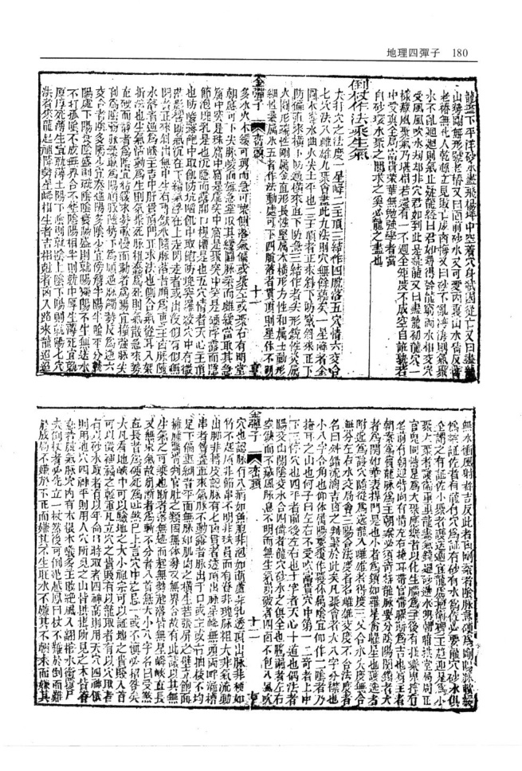

<!-- V3_SOURCE_ID:book025-b000162-p000-ee92a57759 -->

高山和平地的风水道理是一样的。

查看对应原文

<!-- V3_FOLDBACK_BEGIN:book025-b000162-p000-ee92a57759 -->

者尚當採擇焉高山平地總一般

<!-- V3_FOLDBACK_END:book025-b000162-p000-ee92a57759 -->

<!-- V3_SOURCE_ID:book025-b000163-p000-a71cb64584 -->

这里说的是造葬的方法，不超出上文所说的内容。平地和高山的情况虽然不同，但原理是一致的。杨子说：高山地形以藏风为贵，平地地形以得水为贵，半山半平的地方则两者都要兼顾，做到尽善尽美，这就是阴阳交界的地方，应当看重藏风、得水二者都充足的状态。阴阳二字无处不在，论及龙、穴、砂、水的时候，以龙、穴为阴，以砂、水为阳。如果单从龙的角度来说，文中提到“金彈子畜頭”，其中“畜頭”具体含义不详，页面末尾标注十二。

> **释读存疑：** 畜頭

查看对应原文

<!-- V3_FOLDBACK_BEGIN:book025-b000163-p000-a71cb64584 -->

此言造塟之法不越上文之言夫平地高山事雖異而理則同楊子曰高山以藏風爲貴平地以得水爲半山半平處則二者皆要盡書盡美斯名陰陽交界處當貴兩無窮夫儀陽二字無處無之論龍穴砂水則以龍穴爲陰以砂水爲陽若據龍言金彈子畜頭 十二

<!-- V3_FOLDBACK_END:book025-b000163-p000-a71cb64584 -->

<!-- V3_SOURCE_ID:book025-b000164-p000-dcc8d014c3 -->

覆气的属阴，文中提到“仰寧為陽”，其中“仰寧”具体含义不详，属阳。起伏有星峰的是可选的地形，宽平而平坦的是仰的地形。从入首的角度来说，文中提到“落有眷隔”，具体含义不详，落有窝形。从穴法的角度来说，文中提到“化生腑爲陰”，具体含义不详，有气的窝属阳。所谓化生，就是化气，说的是龙没有化气就不能结穴，这是古今的通用定论。文中提到“正体舉辰受穴”“闲艦周備”“桂簷”“氣坪”，这些风水术语具体含义不详，符合这些条件的都可以安扦，主大富贵，不是普通地形能比的。扦穴真诀说：龙要有正形，穴要有正星，砂要有正名，水要有正情。又说：龙要来了来，穴要隈了隈，砂要堆了堆，水要则了经。又提到地理上的弊病：龙怕孤单，穴怕寒，砂怕斜飞，水怕反弓，这四种弊病如果都出现，就不必再去四处探看枝干了。所谓来了来，说的是星峰起伏多样，连绵不绝；所谓隈了隈，说的是地形包裹藏聚，藏风聚气；所谓堆了堆，文中提到“星條秀塵”，具体含义不详，各个山峰都面朝穴位拱拜；所谓则了经，说的是水势湾环旋绕，对穴位眷顾不舍。龙孤单就是没有护从，穴寒就是不能藏风，砂斜飞就是对穴位没有顾恋之情，水反弓就是牵扯背向穴位而去。学习的人只要能熟练掌握、准确辨认，符合上文说的四种吉相，避开这四种凶相，判断富贵贫贱就能了如指掌了。所以说这是夺神功、改天命的学问。这里说的是平地和高山的风水原理总体是一样的，高山未必不能得水，平地未必不能藏风。有些风水师说高山不用看水、平地不怕风，这是迷惑世人的错误说法。在高山寻找合适的地比平地更难，就算有形有势，也多是粗粝的表象。文中提到“凹面關澗猶為緊憂苦有毫鬚空網棺覆尸豆調如神局有内陽中陽外陽此妥命聖古則立見敗亡”，这部分表述有讹误，具体含义不详，这类地形立穴会立刻出现败亡的情况。所以说高山未必不需要论水，平地未必不需要论风。至于扦平地的方法，首先要以降势为根本。《地理明义》说：高山落到平处，要看落头的形势，形势分明的气脉必然会聚，前文形势尽处如果砂水环绕、气藏风聚，就是主大富贵的地形。又说：文中提到“無求功吳認將口界今不明真氣走水蟻之患”，具体含义不详，界水不明的话真气会走散，会有水患、蚁患，都是虚妄错误的判断。又说：脱离龙脉，只凑堂气的，是半真半假的情况，要看形势，形势不明白的就是白费心力，必须砂水都对穴位有情意才可以。又说：文中提到“砂不時水不轉”，其中“不時”具体含义不详，水不回转的，名叫散乱没有生气。文中提到“此折平洋に法度也”，其中“に”是OCR识别讹误，这句话讲的是平洋地形的判断法度。

> **释读存疑：** 仰寧；落有眷隔；化生腑；正体舉辰受穴；闲艦周備；桂簷；氣坪；星條秀塵；凹面關澗猶為緊憂苦有毫鬚空網棺覆尸豆調如神局有内陽中陽外陽此妥命聖古則立見敗亡；無求功吳認將口界今不明真氣走水蟻之患；不時；に是OCR讹误；に的具体含义存疑；1轮自动修复后核义模型仍建议修订，已保守记录。

查看对应原文

<!-- V3_FOLDBACK_BEGIN:book025-b000164-p000-dcc8d014c3 -->

則覆氣爲陰仰寧為陽選者起伏有星峰也仰者寬平而埋夷也以入首而言則落有眷隔落有窩也以穴法而言化生腑爲陰而窩有氣爲陽夫化生者乃化氣也言龍無化氣不成穴古今之通論也若夫正体舉辰受穴四面朝拱閑艦周備或有桂簷或有氣坪皆可安扦主大富貴非等閑之可擬也扦穴真樓曰龍要正形穴要有正星砂要有正名水要有正情又曰龍要來了來穴要隈了價砂要堆了堆未要則了經又地理曰病曰龍怕孤单穴怕寒砂怕斜飛水怕反四者若滋忽得與何須四處探枝幹夫來了來者言其起伏星峰不一而足也隈了限者言其包異開藏藏風聚氣也堆了堆者言其星條秀塵面面朝拱也列了邇者言其灣環旋迎眷蒸不捨也孤雖者無護從也無者不藏風也斜飛者情不顧也反者牽扯背去也學者則能習之熟而認之真合上文之四吉遠此言之四內則富蟲贊踐歸苔掌中矣故曰奪神功攻天命也此言平地高山總一般召高山未必不得水平地未必不藏風時師曰高山不論水本地不怕風謬言以惑世也失高山之地北平地猶難雖是有形有勢亦粗中檄之象凹面關澗猶為緊憂苦有毫鬚空網棺覆尸豆調如神局有内陽中陽外陽此妥命聖古則立見敗亡故曰高山未害不論水平地未嘗不論風若夫扦平地之法先以降勢爲根本地理明義曰高山落平看落頭形勢分明氣必聚前形盡處砂水飛氣藏風真富貴又曰無求功吳認將口界今不明真氣走水蟻之患此中生外從下同成虛謬又曰脫龍離脉湊堂氣半真半假看形勢形勢不明枉費心必須砂水真情意又曰砂不時水不轉此名散亂無生氣此折平洋に法度也

<!-- V3_FOLDBACK_END:book025-b000164-p000-dcc8d014c3 -->

<!-- V3_SOURCE_ID:book025-b000165-p000-3cbcb6f356 -->

心法流传没有巧妙之处，九十八字就是大机关。

查看对应原文

<!-- V3_FOLDBACK_BEGIN:book025-b000165-p000-3cbcb6f356 -->

心法流傳無巧妙九十八字大機關

<!-- V3_FOLDBACK_END:book025-b000165-p000-3cbcb6f356 -->

<!-- V3_SOURCE_ID:book025-b000166-p000-8222acd7f6 -->

以上所说的都是师徒传授的心法，口诀说：如果得到明师传授的真诀，也可以称为陆地仙。真诀不外乎这九十八个字，所以说是大关键。天下的山就像人的脸，没有完全相同的，应当结合具体的地形融会已有的成法，自然领会其中的道理。文中提到“金彌于密頭”，具体含义不详，页面末尾标注十四。

> **释读存疑：** 金彌于密頭

查看对应原文

<!-- V3_FOLDBACK_BEGIN:book025-b000166-p000-8222acd7f6 -->

此言巳上皆傳受之心法語曰若得明師傳亮訣亦可稱爲陸 地仙真訣不外此九十八字故曰大機閱也夫天下之山猶人 之面未必皆同當卽地以融會其成法以勉然而會諸自以 金彌于密頭 十四

<!-- V3_FOLDBACK_END:book025-b000166-p000-8222acd7f6 -->

<!-- V3_SOURCE_ID:book025-b000167-p000-db654a80ba -->

作为老师，以肤见为巧妙，以强合成法为真诀，这和不读书而想考中科举的人没有区别。

查看对应原文

<!-- V3_FOLDBACK_BEGIN:book025-b000167-p000-db654a80ba -->

爲師以膚見爲巧妙以強合成法爲真訣是與不讀書而千科第者無以異矣

<!-- V3_FOLDBACK_END:book025-b000167-p000-db654a80ba -->

<!-- V3_SOURCE_ID:book025-b000168-p000-c67a92f58b -->

## 法

查看对应原文

<!-- V3_FOLDBACK_BEGIN:book025-b000168-p000-c67a92f58b -->

## 法

<!-- V3_FOLDBACK_END:book025-b000168-p000-c67a92f58b -->

<!-- V3_SOURCE_ID:book025-b000169-p000-e1ee28f7ed -->

文中提到“河浴相加偶净”，具体所指不详。

> **释读存疑：** 河浴相加偶净具体所指不详

查看对应原文

<!-- V3_FOLDBACK_BEGIN:book025-b000169-p000-e1ee28f7ed -->

河浴相加偶净

<!-- V3_FOLDBACK_END:book025-b000169-p000-e1ee28f7ed -->

<!-- doc013 PDF 第 185 页：高风险/复杂版面 OCR 供检索；内容与排版以原页图为准。 -->
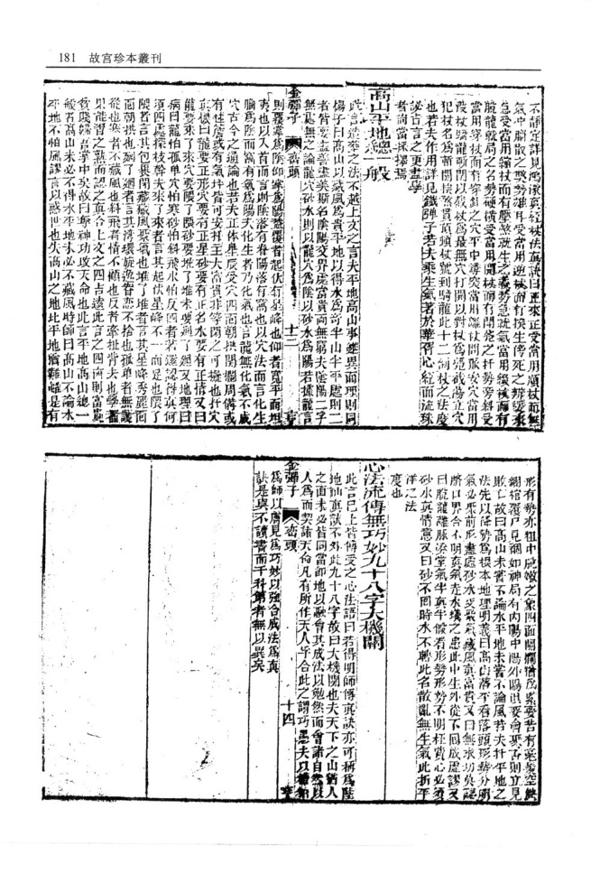

<!-- V3_SOURCE_ID:book025-b000171-p000-ce82bc1261 -->

黄石公说：一阴一阳的变化就是道，一动一静的状态就是气，一往一来的流转就是运。所谓河，指的是河图；所谓洛，指的是洛书。将河图与洛书的数字相加，所得的数为奇数的属于争阳，数字为偶数的属于净阴。至于天干加临的情况，又必须依据纳甲之数来确定其争阴净阳的属性。比如河图的方位是：乾在南方，坤在北方，离在东方，坎在西方，兑在东南方，巽在西南方，震在东北方，艮在西北方。世人不明白其中的至理，就将其命名为先天。再比如洛书的方位是：离在南方，坎在北方，震在东方，兑在西方，巽在东南方，坤在西南方，艮在东北方，乾在西北方。世人不知道它的含义，就将其命名为后天。可谁知道洛书是用来校正河图的，河图是用来开启天地的。先天的乾卦对应后天的离卦，它们的数都是七；由此可见乾是净阳，乾宫纳甲，所以甲也因此属于阳。原文此处出现“其得人數隅也是兌爲淨陰”的讹误内容，据上下文可理解为：先天的兑卦对应后天的巽卦，它们的数都是偶数；由此可见兑是净阴，兑宫纳丁，所以丁也因此属于阴；己丑与兑相合，也因此属于阴。原文此处出现“其得九數詩也是離爲淨陽”的讹误内容，据上下文可理解为：先天的离卦对应后天的震卦，它们的数都是九；由此可见离是净阳，离宫纳壬，所以壬也因此属于阳；寅戊与离相合，也因此属于阳。先天的震卦对应后天的艮卦，它们的数都是十。萧子天坐 十五

> **释读存疑：** “其得人數隅也是兌爲淨陰”为OCR错乱内容，语义据上下文推导；“其得九數詩也是離爲淨陽”为OCR错乱内容，语义据上下文推导；“蕭子天坐 十五”语义不明；“阳刍数之偶者为净阴”中“刍”语义不明；“艮居西兆”中“西兆”应为“西北”讹误，属推导；“离宫纳王”中“王”应为“壬”讹误，属推导；1轮自动修复后核义模型仍建议修订，已保守记录。

查看对应原文

<!-- V3_FOLDBACK_BEGIN:book025-b000171-p000-ce82bc1261 -->

黃石公曰一陰一陽之謂道一動一淨之謂氣一往一來之謂運河者河圗也洛者洛書也河洛相加得數之者爲爭陽芻數之偶者爲淨陰夫天于加臨則又必因納甲方數以正其爭陰淨陽也如河圗之乾南坤北離東坎西兌居東南巽居西南震居東北艮居西兆世人不明至理而以先天名之如洛書之離南坎北震東兌西巽居東南地居西南艮居東北乾居西北世人不知其義而以後天名之抑知洛書以正與圗河圗以開天地先天之乾後天之離其得七數也見乾爲净陽乾宮納甲故甲因而属陽先天之兌後天之巽其得人數隅也是兌爲淨陰兌宮納丁故丁因而屬陰已丑合兌亦因而爲陰先天之離後大之震其得九數詩也是離爲淨陽離宮納王故壬亦因而屬陽寅戊合離亦因而爲陽先天之震後天之艮其得十數蕭子天坐 十五

<!-- V3_FOLDBACK_END:book025-b000171-p000-ce82bc1261 -->

<!-- V3_SOURCE_ID:book025-b000172-p000-58cae25ded -->

而先天的巽卦对应后天的坤卦，它们的数都是偶数；由此可见巽是净阴，巽宫纳辛，所以辛也因此属于阴。原文此处出现“其得九敗也是”的讹误内容，据上下文可理解为：先天的坎卦对应后天的兑卦，它们的数都是九；由此可见坎是净阳，坎宫纳巽，所以癸也因此属于阳；辰与坎相合，也因此属于阳。先天的艮卦对应后天的乾卦，它们的数都是八，为偶数；由此可见艮是争阴，艮宫纳丙，所以丙也因此属于阴。先天的坤卦对应后天的坎卦，它们的数都是十一，为奇数；由此可见坤是净阳，坤宫纳乙，所以乙也因此属于阳。净阳、净阴遵循先天而舍弃后天，这是为什么呢？因为先天为父，后天为子，应当从父姓而不从母姓。依据先天与后天加临的奇偶之数，所以将净阴、净阳与其他阴阳区别开来，原文此处“平陽”应为“净阳”的OCR讹误。

> **释读存疑：** “其得九敗也是”为OCR错乱内容，语义据上下文推导；“平陽”为OCR讹误，应为“净阳”；“平陽”为OCR讹误，应为“净阳”，属推导；“巽为事阴异 納辛”中“事”“异”为OCR讹误，语义据上下文推导；“巾辰合坎”中“巾”为OCR讹误，应为“申”，属推导；“其得八教偶”中“教”为OCR讹误，应为“数”，属推导；“夫淨陽淨陰遵川先天”中“川”为OCR讹误，应为“循”，属推导；“後天爲丹子”中“丹”为OCR讹误，应为“子”，属推导

查看对应原文

<!-- V3_FOLDBACK_BEGIN:book025-b000172-p000-58cae25ded -->

而爲先天之巽後天之坤其得十數偶也是巽爲事陰異 納辛故辛亦因而屬陰先大之坎後天之兌其得九敗也是 坎爲凈陽坎宮納巽而癸亦因而屬陽巾辰合坎亦因而爲陽 先天之艮後天之乾其得八教偶也是艮爲爭陰艮宮納丙而 丙亦因而屬陰先天之坤後天之坎其得十一数奇也是中為 淨陽坤宮納乙而乙亦因而屬陽夫淨陽淨陰遵川先天而遺 後天者何也先天爲父後天爲丹子當從父姓而不從母也以 其先天後天加臨奇偶之教故 名淨陰平陽非他陰陽之比也

<!-- V3_FOLDBACK_END:book025-b000172-p000-58cae25ded -->

<!-- V3_SOURCE_ID:book025-b000173-p000-b9ef9d2eea -->

金轮五兆，两者循环往复。

查看对应原文

<!-- V3_FOLDBACK_BEGIN:book025-b000173-p000-b9ef9d2eea -->

金輪五兆兩循環

<!-- V3_FOLDBACK_END:book025-b000173-p000-b9ef9d2eea -->

<!-- V3_SOURCE_ID:book025-b000174-p000-7f330b2155 -->

杨子说：先看金轮是否动，再看血脉以识别来龙。又说：阳从左边转，阴从右边通。曾子注释说：金轮指的是祖宗的降势。所谓有祖有宗，其降势又符合法度，就叫做金轮动处能体现天机；如果有祖宗却没有降势，又不符合法度，就叫做金轮不动，是虚妄的说法。其次看血脉，说的是山体的行度，从祖宗到八首，自然畅茂条达，断而复连，伏而又起，大的会突然变小，小的会突然变大，凡是有踪迹的地方，必然符合法度。来龙，说的是到尽头的情况。凡是这类情况，都与八卦相互维系，必然有五卷作为运用依据。所谓五，就是五行的妙用。循环，指的是比如乾一变而为巽，再变而为艮，三变而为坤；坤一变而为震，再变而为兑，三变而为乾。坎、离是中男、中女，居于三者之中，形成八卦，重叠之后成为六十四卦，每卦之中都有五行。所以说八卦是体，五行是用。比如金生水，水生木，木生火，火生土，土生金；又如金克木，木克土，土克水，水克火，火克金之类，循环往复，周流无穷。管子说：金轮就是无极而太极。五兆荣行，是穴内分金的妙用。卦与五行相互配合，聚集在一个穴中，就形成上好的风水大地。《玉武经》说：依据主山坐向，以及山水来去的方位，可以知晓地运的消长；依据九宫八卦的旺相、胎、沐、休、囚、死等气，可以知晓天运的消长；依据在世和去世之人的生辰八字，以及扦穴、安葬的年月时日，可以知晓人事的消长。这是古今共通的道理，是造化的枢纽。所谓轮，就是旋转的意思。用金来命名它，是因为金最为坚固，千锤百炼也不会改变颜色，以此比喻这种法度即使历经千万年也不会改变，正如我所说的这样。五，是中央土的定数，说的是这种方法的准则。彊子天星 十六 室

> **释读存疑：** 原文“乾一麥而爲巽再焚而爲艮三変而爲巾坤一変而為雲再疫而爲兌三変而爲乾”“彊子天星 十六 室”为残损内容，相关释读为保守推断；1轮自动修复后核义模型仍建议修订，已保守记录。

查看对应原文

<!-- V3_FOLDBACK_BEGIN:book025-b000174-p000-7f330b2155 -->

楊子曰先看金輪動不動次看血脉認來龍又曰陽從左邊轉陰從右路通曾子註曰金輪名祖宗之降勢也者夫有祖有宗而降勢又合法度見謂金輪動處見天機考夫祖宗又無降勢又下合法度是謂金輪不動成虛傳次看血脉者言體之行度自祖宗以至八首自然暢茂條達斷而復連伏而又起大則特小小則特大凡有踪跡必合法度來龍者言到頭也凡若此者雜出八卦相維持必有五卷爲運用五非者五行之妙用也循環者如乾一麥而爲巽再焚而爲艮三変而爲巾坤一変而為雲再疫而為兌三変而爲乾者夫坎離中男申女問乎三者之中而成入卦重之而成六十四卦每卦之中必有五行故曰八卦者休也五行者用也如金生水水生水木生火火生土土生金又如金尅未木尅土士尅水水剋火火尅金之類是循環而無而周流而無窮也管子曰金輪者無極而太極也五兆榮行者是穴內分給之妙用也夫卦與五行而相曾合集攀於一穴之中斯成大地玉武經曰用主山坐下而首及山水來去方位取可以知地運之消長用九宮入卦旺相胎沐休因死氣取可以知天運之消長用存亡人生命年月日時及扦穴安塟年月自時取可以知人事之消長此古今之通義造化之樞組也輸者旋轉之謂以金名之者金爲至室百煉不易其色以喻是法度雖歷千萬載而不易吾言也五者中央土之定各言是法彊子天星 十六 室

<!-- V3_FOLDBACK_END:book025-b000174-p000-7f330b2155 -->

<!-- V3_SOURCE_ID:book025-b000175-p000-0f8c8d14b1 -->

度，指的是至中至正，没有丝毫偏倚。兆，指的是动静发见的端绪。说的是先天先地、后天后地，气的源流，人与物的消长，无不由此开端。原文此处“兆者機古之所山也”为OCR错乱内容，语义无法准确释读。两循环，说的是吉凶的应验，只有这一点可以预先知晓，而悔吝的细微之处关乎吉凶。

> **释读存疑：** “兆者機古之所山也”为OCR错乱内容，具体语义不详；“兩循裘者”为OCR错乱内容，语义不详，释读“两循环”为推导；1轮自动修复后核义模型仍建议修订，已保守记录。

查看对应原文

<!-- V3_FOLDBACK_BEGIN:book025-b000175-p000-0f8c8d14b1 -->

度至中至正無少偏倚也兆者動止發見之端也言先天先地後天後地連氣之源流人物之消長莫不由此造端兆者機古之所山也兩循裘者言吉凶之應惟此先知而悔吝之微関乎吉凶也

<!-- V3_FOLDBACK_END:book025-b000175-p000-0f8c8d14b1 -->

<!-- V3_SOURCE_ID:book025-b000176-p000-d1a26ad87f -->

## 四龍剝换名尊

查看对应原文

<!-- V3_FOLDBACK_BEGIN:book025-b000176-p000-d1a26ad87f -->

## 四龍剝换名尊

<!-- V3_FOLDBACK_END:book025-b000176-p000-d1a26ad87f -->

<!-- V3_SOURCE_ID:book025-b000177-p000-ec4a1a06a5 -->

所谓四龙，就是乾、坤、艮、巽四龙，用来统括二十四位的山向。后世的风水师拘泥于《催官篇》的错误注释，将巽、艮、兑、亥当作四龙，这是不明白作者的本意，心生偏见而贵阴贱阳。阳是君子应当亲近，阴是小人应当远离，这么做怎么能行呢？所谓偏袒阴而委屈阳的做法，就是阳居四正位，阴居四隅位，如同小人与君子一同面君，所以才会产生这种弊端。《催官篇》说：绝、病、衰的方位能带来丰厚的福运，死、墓混杂的话家族就会流离失所；又说临官、生旺、胎、养的方位，不需要再讨论阴阳是否比和。这说的是龙从病、绝的方位而来，所以会有凶祸；如果从死、墓的方位而来，凶祸就更严重；如果从长生、临官、沐浴、帝旺、冠带、胎、养的方位而来，就会吉祥。这里所说的阴阳，就是净阴净阳。比，就是地合，说的是龙不拘泥于净阴净阳，也不需要强求龙、穴以及砂水都必须是净阴或者净阳。学者在这里一定要追求生旺的方位，不要选取休囚的方位。如果有人固执地执着于净阴净阳的说法，就没有生旺、兴衰、休囚的固定标准了。所以说：龙、穴、砂、水都处于生旺状态，富贵就没有止境；如果遇到休囚的情况，一定会导致凶险退败，越来越贫穷。又说：龙、穴、砂、水不依照五行来判断，要凭借什么来推演道理，察明它的生旺休囚呢？又说：四龙剥换为生地卦，三两三两皆为稀；又说：一卦闲行为专一，这其中的道理又要从哪里得来，相关的方法又要从哪里产生呢？《下輅经》说：每一条龙成六合，专一无杂，没有生克，变卦都相生，符合法度就会应科举得名声。比如乾、甲、丁三合，亥、卯、未也三合，都属木，木长生在亥，乾亥、甲卯、丁未属于同一卦，所以名叫双山；因为乾管五龙，五龙都以乾为宗，所以用乾来命名。坤、壬、乙三合，申、子、辰三合，都属水，水长生在申，坤申、壬子、乙辰属于同一卦，所以名叫双山；因为坤管五龙，五龙都以坤为宗，所以用坤来命名。艮、丙、辛三合，寅、午、戌也三合，都属火，火长生在寅，艮寅、丙午、辛戌属于同一卦，所以名叫双山；因为艮管五龙，五龙都以艮为宗，所以用艮来命名。巽、庚、癸三合，巳、酉、丑也三合，都属金，金长生在巳，巽巳、庚酉、癸丑属于同一卦，所以名叫双山；因为巽管五龙，五龙都以巽为宗，所以用巽来命名。四龙不提土，是因为土蕴含在四者之中，没有固定的方位，所以适宜相生而忌讳相克。廖子说：一節相生，一代就会富贵旺相，有官禄之位；又说：一節相克，一代就会贫穷退败，甚至绝后没有踪迹。剝撫彊子天星 十七

> **释读存疑：** 原文“剝撫彊子天星 十七”为残损内容，相关释读为保守推断；1轮自动修复后核义模型仍建议修订，已保守记录。

查看对应原文

<!-- V3_FOLDBACK_BEGIN:book025-b000177-p000-ec4a1a06a5 -->

四龍者乾坤艮巽之四龍所以統括平二十四位之山向也師執泥催官妄註以巽艮兌亥爲四龍者是不明作者心生而貴陰以賤陽也盡陽爲君子當親陰爲小人當遠得乎陰亭陽之私者者陽居四正而陰居四維如非同小人而俱見君于故有此弊催官篇曰絕病衰鄉爲福豐死墓混雜家流離之曰臨官生旺胎養位不須更論陰陽比此言龍臨良病絕方而來者故凶若從死草方來者則尤凶也若從長生臨官沐浴帝旺冠帶胎養方來者則吉此言陰陽者卽淨陰淨陽也比者地合也言龍不拘於淨陰淨陽亦不必要淨除龍淨陰穴并砂水也學者於此必求生旺無歸休囚之謂也若夫陽執淨陰淨陽者則無生旺興衰休囚之定体矣故曰龍穴砂水俱生莊富貴無朴尙若遇休四定主凶退取更貧紡大言龍穴砂水不川五行將何以起道而微其生旺休囚乎又曰四龍剝換爲生地卦三兩皆爲稀又曰一卦閒行爲專一其理亦將安從出其道亦將安從起乎下輅經曰每龍成六合專一無生尅変卦皆相生得法應科名如乾甲丁三合亥卯木亦三合也皆屬木則生在亥乾亥甲卯丁未同一卦也故名雙山惟其乾管五筆是五龍皆宗乎乾故以乾名而坤壬乙三合申子辰三合皆屬水而生在中坤中壬子乙辰同一卦也故名雙山惟其管五龍是五龍皆宗平坤故以坤名而艮丙辛爲三合寅午成亦三合皆屑火而生在寅艮寅丙午辛成同一卦也故名雙山惟其艮營五龍見五龍皆宗平艮故以艮名如巽申癸二合已酉丑亦三合皆屬金而生在已巽已庚酉癸此同一卦也故名愛山惟其巽管五龍是五龍皆宗乎聖故以巽名門龍而不言士土富乎四名之中而無方無土也宜其相生而忌相尅廖子曰一節相生一節貴旺相官祿位又曰一飾剋書一代窮退敗絕無蹤剝撫彊子天星 十七

<!-- V3_FOLDBACK_END:book025-b000177-p000-ec4a1a06a5 -->

<!-- V3_SOURCE_ID:book025-b000178-p000-cc0cfc9f8b -->

如果变动进入其他卦，相生的就吉祥，相克的就凶险。一節管一代，如果一節相生，就知道这一代会富贵；如果一節相克，就知道这一代会贫穷，甚至败绝。经书上说的山推退运，就是这个道理。

查看对应原文

<!-- V3_FOLDBACK_BEGIN:book025-b000178-p000-cc0cfc9f8b -->

搖若入乎他卦相生者吉相尅者凶一節管一代若一節相生則知一代富當者一節尅害則知一代貧窮甚至敗絕經曰山推退運由是也

<!-- V3_FOLDBACK_END:book025-b000178-p000-cc0cfc9f8b -->

<!-- V3_SOURCE_ID:book025-b000179-p000-6b812b5b78 -->

四局紫廻问静湍。

查看对应原文

<!-- V3_FOLDBACK_BEGIN:book025-b000179-p000-6b812b5b78 -->

四局紫廻問靜湍

<!-- V3_FOLDBACK_END:book025-b000179-p000-6b812b5b78 -->

<!-- V3_SOURCE_ID:book025-b000180-p000-5567e6086b -->

李子说：四局，说的是前。丙丁乙酉原属火，乾坤卯午金同坐，亥癸艮甲是木神，戌庚丑未土为真，子寅辰聖辛兼巳，申与壬方是水神。来宜生旺，去要休囚，一旦与此相反，灾害就会临门，这是元空五行的法度。四局中，水土长生在申，金生在巳，火生在寅，水生在亥。它的发源处适宜处于生旺的方位，它的流去处必须处于休凶的方位，这才叫作吉。丙则成内，它来土的方位都说要屈曲。明堂一定要静定，它的情势如果湍急，刚硬有脊，凶险得让人不忍经过，若是大明堂不静，虽

> **释读存疑：** “子寅辰聖辛兼巳”中的“聖”为OCR讹误，具体所指不详；“休凶”与风水常用术语“休囚”有异，按原文保留；“四局者言前也”语义不明；“丙則成內然其來土之方”中“成內”“来土”为OCR讹误，语义不详；1轮自动修复后核义模型仍建议修订，已保守记录。

查看对应原文

<!-- V3_FOLDBACK_BEGIN:book025-b000180-p000-5567e6086b -->

李子曰四局者言前也丙丁乙酉原屬火乾坤卯午金同坐亥癸艮甲是木神成庚丑未土爲真子寅辰聖辛兼巳申與壬方是水神來宜生旺去要休囚一或反此災害臨門此元空五行之法度也四局者水土長生在串金生在已火生在寅水生在亥其發源處宜自生旺之方其流去處必於休凶之方斯名爲吉丙則成內然其來土之方皆雲屈曲北夫明堂必要靜定其情如湍初有脊惡不忍過去之者若大明堂不靜雖

<!-- V3_FOLDBACK_END:book025-b000180-p000-5567e6086b -->

<!-- V3_SOURCE_ID:book025-b000181-p000-4a919d222d -->

山上的龍神不會降落到水中，水中的龍神不會跑到山上。這是承接上文的內容來說的，雙山法應當用在山的方面，而不能用在水的方面；元穴應當用在水的方面，而不能用在山的方面。有人問：什麼是雙山、元空？一個是以折山為主，一個是以向首為主，其中的緣故是什麼？回答說：龍的運行軌跡難以用一條線來界定，所以以處行周流不息、無方不至的狀態，應當用三合來對待，這就是龍的運行軌跡，是龍的周流狀態。精到之處在於頭向首，最關鍵的是刊定言行度的節奏，興衰的判斷尤其不能不慎重。至於元空，元是以水來命名，生是以流來命名，得到龍與水的配合就會吉利，龍氣已經聚結在中堂而不再外出了。所以要通過向來驗證水的去來，通過山來驗證龍與利的情況，元空就是以向與水來立論的。有人問：龍以神來體現其存在與變化，而水也以神來體現，這是為什麼？回答說：活動有情的就是神，頑硬無情的就是鬼。水如果直硬就會衍膺射腸，所謂的神，是指它屈曲彎環的狀態。有人問：水往而不洩，然後才折轉，大概是想要來方生旺為有神，來方休囚為無神，神也是因為水有愛化而立名的。所以說，龍不生旺則人丁不興，水神不生旺則錢財不旺，感召的機會快捷得像影子跟隨形體一樣，學者應當加以重視。

> **释读存疑：** 1轮自动修复后核义模型仍建议修订，已保守记录。

查看对应原文

<!-- V3_FOLDBACK_BEGIN:book025-b000181-p000-4a919d222d -->

山上龍神不下水水裏龍神不上山此承上文而言雙山當用之於山而不可用之於水元穴當用之於水而不可用之於山人曰何爲雙山元空一以折山爲主一以向首爲主其故何哉答曰龍之行度难以一線故以處行周流不息無方不至故當三合是裘者龍之度者龍之周此精到頭向首最關刊言行度節教尤除興哀不可不慎若夫元先者元以水名生以流名言得龍與則之廸吉則龍六已乳于中堂而不復出矣故因向以証水之去來獲山以龍與利言元空以向與水言也問曰龍以神以其存変化也而水亦以神吉何也答自活動有情者神也在硬無情者鬼也水若直硬則衍膺射腸所謂神者以其屈曲灣環也人曰往而不洩諸而後折蓋欲來方生旺爲有神來方休囚爲無神神者亦因其有愛化而立名也故曰由龍不生旺則人丁不則隆水神不生旺則錢裳不也盈也感召之机捷干影鄉學者當加賓電馬

<!-- V3_FOLDBACK_END:book025-b000181-p000-4a919d222d -->

<!-- V3_SOURCE_ID:book025-b000182-p000-35d540325a -->

乘加挨世差指

> **释读存疑：** 原文語句殘缺，無法確定完整含義

查看对应原文

<!-- V3_FOLDBACK_BEGIN:book025-b000182-p000-35d540325a -->

乘加挨世差指

<!-- V3_FOLDBACK_END:book025-b000182-p000-35d540325a -->

<!-- V3_SOURCE_ID:book025-b000183-p000-842114b496 -->

这是《天星 十八 亨》的内容。杨子说：选点定位如果差了一指的距离，就像隔着重重山一样，基础原则上讲的就是不能有丝毫偏差，所以说抵达穴的位置如果差了毫毛般的距离，贫富贵贱、兴盛衰败的差别就会在顷刻之间显现出来。所谓乘气，指的是承接生旺之气；隔宫为加怜，它为挨。这里说的“乘”是依凭的意思，依凭这里有对应的龙势，依凭这里有对应的脉理，所以据此确定对应的穴的位置；依凭这里有“生飞”的特质，因而承接吸纳，将生气引入安葬的枯骨之中。但生气并非人为干预运作的，而是天地自然的运行规律，人们只要顺着这个规律来扦葬，就能以气感应气、以形契合形，从而让亡者的福泽惠及在世的亲人。鬼属于阴，人是在世的阳间之人，山川的真气“旧于一柏”，就能让在世的族人获得福运。“加换”的法度不能有一指的偏差，是因为催生福运还是招致凶祸的气的差别只在毫厘之间，如果出了一点差错，祸患就难以预料了。有的人不懂相关法度却也得到福运，有的人费尽心力反而遭遇祸患，这是积德行善的人家安葬就能获得吉兆、作恶多端的人家安葬就会遭遇凶祸的规律体现。比如积有技艺传承的人家，就算有“帅”也只是偶尔能契合相应的法度；作恶多端的人家，上天一定会让他怠慢高明的师傅，不会为他用心指点，导致分金的操作出现差错，本来的吉地安葬后反而出凶祸，和“乘尸”的情况是同一个缘由。

> **释读存疑：** “毛之貧昌與衰指華間”的具体文句仍存在断句歧义，本次修复是按“臨穴若遠差毫毛，貧昌與衰指華間”的断句逻辑处理的；“生飛”具体所指不明；“舊于一柏”具体所指不明；“加憐它爲挨”的含义难以确定；“積藝之家雖有帥亦偶令其法度”的“帥”和“偶令其法度”的具体含义不明；“乘尸”具体所指不明；“毛之貧昌與衰指華間”的具体文句仍存在断句歧义，本次释读是按“臨穴若遠差毫毛，貧昌與衰指華間”的断句逻辑处理的

查看对应原文

<!-- V3_FOLDBACK_BEGIN:book025-b000183-p000-842114b496 -->

天星 十八 亨楊子曰若還差一指如隔當重山其基言其不可差也故曰臨穴若遠差毛之貧昌與衰指華間乘氣者乘生氣也隔宮爲加憐它爲挨夫乘者因也因其有是龍因其有是脉故因之而受是穴因其有生飛因而乘受之納之于枯骨然生氣非有所作爲于其間是天地自然之運用吾人因而扦之則以氣感氣以形習形而教鬼福之及人鬼者陰也人者生人也由川之真氣舊于一柏而生人致福也加換之法度不可差一指者發生致死之氣只爭毫髮之間若一姓錯則禍禍未可料矣或有不知法度而亦致福或有人渴其力而反致福此積善得吉扦積惡逢凶塟也如積藝之家雖有帥亦偶令其法度積惡之家天必使之慢明師而不爲之用心以致分金作用之差訛吉地塟凶與乘尸同端由是也

<!-- V3_FOLDBACK_END:book025-b000183-p000-842114b496 -->

<!-- V3_SOURCE_ID:book025-b000184-p000-8648036855 -->

合明、合德、建祿官

> **释读存疑：** 原文語句過於簡略，無法確定完整含義

查看对应原文

<!-- V3_FOLDBACK_BEGIN:book025-b000184-p000-8648036855 -->

合明合德建祿官

<!-- V3_FOLDBACK_END:book025-b000184-p000-8648036855 -->

<!-- V3_SOURCE_ID:book025-b000185-p000-8eb888c713 -->

列子說：明就是日月，德就是天地。合明是對應納甲，合德是對應士圭地羅。兜咎子說：三陽之道，與日月合其明，與天地合其德，與四時合其序，與鬼神合其吉凶。如今地理之道，確實是以此為根本。所謂合明，是就納甲來說的，太陽一日運行一周天，不會虧損其光明；月亮一月運行一周天，有盈虧的現象，所以納甲依據這個，初三月亮開始生明，黃昏時出現在庚方，下方生一陽，其象為震，所以震宮納庚；初入昏時出現在丁方，下方生二陽，其象為兌，所以兌宮納丁；十五黃昏時出現在甲方，三陽盈滿，其象為乾，所以乾宮納甲；十八月亮開始生魄，黃昏時出現在辛方，下方生一陰，其象為巽，所以巽宮納辛；二十三早晨出現在丙方，下方生二陰，其象為艮，所以艮宮納丙；二十九歲時出現在一方，三陰屬滿陰，月亮隱光，其象為坤，所以坤宮納乙。消長的兆頭都是由此而來，所以庚以坤乙為游滅，乾甲以兌丁為消滅，巽辛以乾甲為消滅，艮丙以巽辛為消藏，坤乙以艮丙為消減，這些都是陽象消長的道理。所以說，盈虛的法度、胎納的機關，都在這裡，地理之學也源於此。至於壬子屬復，癸丑屬臨，艮寅屬太，甲卯大壯，乙辰屬史，雲巳屬乾，丙午屬姤，丁未居逐，坤中屬否，庚酉屬觀，辛戌居義，乾亥綿湘。至於正月太陽在室中星，參中星、日尾中星，日月會於以之次；二月太陽在任奎中星，昏張中星、日心中星，日月會於婁次之佳，建火；三月太陽在婁中星，魯星甲日、奉牛中星，日月會于帝子天星 十九 亨。

> **释读存疑：** 1轮自动修复后核义模型仍建议修订，已保守记录。

查看对应原文

<!-- V3_FOLDBACK_BEGIN:book025-b000185-p000-8eb888c713 -->

列子曰明者日月也德者天地也合明者應納甲也合德者士 圭地羅也兜咎子三陽之道與日月合其明與天地合其德 與四時合其序與鬼神合其吉凶今地理之道誠本此夫合 明以納甲言曰則一日一周天常不損其明月則一月一周天 每有盈辨之象故納甲因之初三哉生明昏見庚方下生一易 其象傳故震宮納庚初入昏見丁方下生二陽其象分故兌宮 納丁十五昏見甲方三陽盈歲其象乾故乾宮納甲十八哉生 魄歲見辛方下生一陰其象巽故巽宮納辛二十三晨見丙左 下生二陰其象艮故艮宮納丙二十九歲見一方三陰屬滿陰 魄韜光其象坤故坤宮納乙消戲之朕兆皆山此耳故庚以 坤乙爲游滅乾甲以兌丁爲消滅巽辛以乾甲爲消滅艮丙以 巽辛爲消藏坤乙以艮丙爲皆減者夫六離曰相消疏皆陽 象消長之理也故曰盈虛之執度胎納之機謝咸于此而藝 斬焉故壬子属復癸丑屬臨艮寅屬太甲卯大壯乙辰厲史雲 巳屬乾丙午屬姤丁未居逐坤中屬否庚酉屬觀辛戌居義乾 亥綿湘若夫正月日在室中星香參中日尾中日月會于以 之次津差大簇二月自任奎中星昏張中日心中日月會于塵 婁次佳建火三月日在婁中星魯星甲日奉牛中日月會 帝子天星 十九 亨

<!-- V3_FOLDBACK_END:book025-b000185-p000-8eb888c713 -->

<!-- doc013 PDF 第 187 页：高风险/复杂版面 OCR 供检索；内容与排版以原页图为准。 -->
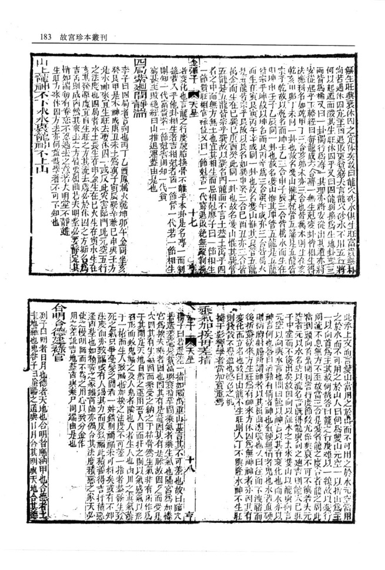

<!-- V3_SOURCE_ID:book025-b000187-p000-5cb6d1caf8 -->

屬大梁星次的月份，對應的律管是太簇；四月太陽運行到畢宿，黃昏時翼宿在中天，日月會合於實沈星次，對應的月建是巳；屬鶉首星次的五月，太陽運行到參宿，黃昏時東井在中天，日月會合於鶉首次，對應的律管是蕤賓；六月太陽運行到東井，黃昏時大火星在中天，日月會合於鶉火星次，對應的律管是林鐘；七月太陽運行到張宿，黎明時畢宿在中天，日月會合於鶉尾星次，對應的律管是夷則；八月太陽運行到軫宿，黃昏時牛宿在中天，日月會合於壽星星次，對應的律管是南呂；九月太陽運行到角宿，黎明時虛宿在中天，日月會合於大火星次，對應的律管是無射；十月太陽運行到房宿，黃昏時危宿在中天，日月會合於析木星次，對應的律管是應鐘；十一月太陽運行到箕宿，黎明時軫宿在中天，日月處於星紀星次，對應的律管是黃鐘；十二月太陽運行到斗宿，黃昏時婁宿在中天，黎明時氐宿在中天，日月會合於玄枵星次，對應的律管是大呂。南北的一政從這裡就區分開了。所謂合，就是內盤的土圭和外盤的地羅相生相合。內盤三個方位為一宮，每一宮只有八分氣，氣從八方而來，說的就是這個意思。比如壬子癸同屬坎宮，丑艮寅同屬艮宮，甲卯乙同屬震宮，丙巽巳同屬巽宮，丙午丁同屬離宮，未坤申同屬坤宮，庚酉辛同屬兌宮，戌乾亥同屬乾宮。分刻八目，混元子說：八卦確定方位，用來規正地理輿圖，這就是土圭。所謂土圭，不是當時人所說的合戌、巳二土來構成“圭”字的人所說的概念。八方都有十干的位置，所以辰戌丑未四個方位，只有乾坤艮巽四隅可以承受十干的寄放，其餘的方位都不能。乾、巽屬戌，艮、坤屬巳，把戊己兩干加在乾坤艮巽四隅之上，十干就齊全了；十干附屬於八支，是八卦之外剩餘的部分，和關定的規則相符。三國吳地的人又把戊和巳寄放在離宮，這是納甲的說法，不是這裡所說的土圭方位固定不能改變的意思。至於地羅，是兩個方位為一宮，比如壬子共屬子位，癸丑共屬丑位，艮寅共屬寅位，甲卯共屬卯位，乙辰共屬辰位，巽巳共屬巳位，丙午共屬午位，丁未共屬未位，坤申共屬申位，庚酉共屬酉位，辛戌共屬戌位，乾亥共屬亥位。土圭是用來校準地的方位的，地羅是用來對應天的運行的。土圭劃分子午線作為地的中心，羅針劃分子午線作為天的中心，土圭在內，地羅在外，用來證明天包在地的外面，地在天的中間，內外的方位都校正之後，哪裡會有正針、縫針的不同名稱呢？十干之下，七十一候用來確定人事，地脈之下，二十八宿的分金刻度用來對應天的運行，內盤測量地的氣脈走向，所以說龍從地下來；外盤確定向，所以說向從天上立，內外互為表裡不相分離。愚鈍的人不懂得古人的核心方法，亂叫什麼“喻陽無致羅針”，儒生又不知道天是運行的、地是靜止的道理，錯誤地議論測天測地的方法。測天測地古代有現成的法度，尋龍體、立定向各有對應的規則。天星 十

> **释读存疑：** 加憐它爲挨；生飛；舊于一柏；七十一侯；原文开篇十二个月的星次、律管对应相关文句存在大量讹误残缺，具体内容无法准确判定；“七十一侯”具体所指不明；“內鬼步悲”具体所指不明；“尋體立向各彈子”具体所指不明；1轮自动修复后核义模型仍建议修订，已保守记录。

查看对应原文

<!-- V3_FOLDBACK_BEGIN:book025-b000187-p000-5cb6d1caf8 -->

下大梁之次律連洗四月日任暑中星爭翼中日中日月會于寔流之次祿建仲召五月日在參中星九中見九中日月會子親自之次律建燕資六月日午東井中星昏火中皇中日月會于將火之次律達沐朔七月日在張申星連申旦畢中日月會于萬尾之次諫生夷則八月日在鬻中星昏牛申日曆中日月會于壽星之次律建南呂九月日江角申星皆義中旦鄰中日月會于大火之次律建無射十月日在房中星昏危中日星中日月命于折木之次律建應鍾十一月日在箕中星昏中旦軫中日月舍于星紀之次律建黃鍾十二月日在斗中星昏婁向中日氏中日月會于元楊之次律建大呂南北一政自茲分矣合卽内盤之土圭與外盤之地羅相生相合也內盤三位其一宮只有八分氣從八方此之謂也如壬子癸其一坎也丑艮寅其艮也甲卯乙其一震也庚巽巳其一巽也內午丁其一離也未坤申其一坤也庚酉辛其一兌也處乾亥其一乾也分刻八目混元子日八卦定位以正坤道之輿圗是名土圭夫土圭者非時人所謂合戌巳二土以成圭之人謂也八方皆有十故辰戌丑未驚上四雄之下惟乾坤艮巽可受其寄餘則莫之能也夫乾巽萬戌艮坤屬已加戊巳干乾坤艮劈之上則十千全矣隸附八支八千千八卦之餘則與關定吳時人又以戊次巳寄離是亦納甲之言非此言圭一定而不可移易之調也若夫地羅者兩位其一宮如壬子共一子也癸丑共一丑也艮寅共寅也甲卯共一卯也乙辰共 六履也巽巳共 一巳也丙午共一午也丁未共一未也申其一申也與酉共一酉也辛戌共一戌也乾亥共一亥也士圭別以前地地羅所以副天士圭封分子午爲地之中也羅針分子午爲天之中上圭居內刺羅居外因以證天包地之外地在天之中內外皆正而何有正針縫針之異名哉十上之下七十一侯以定人事地難之下二十八宿分金刻度以應天運內鬼步悲故曰龍從地下來外盤立向故白向從大上立者爲表而不相離愚夫不得古人之心法妄稱之曰喻陽無致羅針儒而φ知大以動言地以誤論測天測地古有成法尋體立向各彈子 天星 十

<!-- V3_FOLDBACK_END:book025-b000187-p000-5cb6d1caf8 -->

<!-- V3_SOURCE_ID:book025-b000188-p000-2bc697a561 -->

行連無周匝臺流說：內立八極以定八方之龍，這是卷寒。比如刻十二以選周天之次，應天虛；星躔列舍各列五行，寧與度和母合度。鬼度者，制能名為傷胎、主絕命、受產，然名為制穴主差之，全單失十里可餘哉。主稟經說：河圍課龍之行，為生則進，不生則退；落書証穴之居，且合則吉，不合則決變；山論入肖以數，穴生則祿而洩則初；元空明局之來去，旺則佳而休則南。地理秋訣借哉，子茲然亦有中之吉、吉中之凶，其法皆本平生尅制化以為機。問焉。

> **释读存疑：** 1轮自动修复后核义模型仍建议修订，已保守记录。

查看对应原文

<!-- V3_FOLDBACK_BEGIN:book025-b000188-p000-2bc697a561 -->

行連無周匝臺流曰內立八極以定八方之龍是卷寒也如刻十二以選周天之次應天虛也星躔列舍各列五行寧與度和母合度鬼度者制能名為傷胎主絕命受產然名爲制穴主差之全單失十里可餘哉主稟經曰河圍課龍之行為生則進不生則退落書証穴之居且合則吉不合則決變山論入肖以數穴生則祿而洩則初元空明局之來去旺則佳而休則南地理秋訣借哉子茲然亦有中之吉吉中之凶其法皆本平生尅制化以為機問焉

<!-- V3_FOLDBACK_END:book025-b000188-p000-2bc697a561 -->

<!-- V3_SOURCE_ID:book025-b000189-p000-c6909ef9ee -->

天中針內乘生氣，三七二八相簇攢。既得來龍之直正，然後自龍脈出一正線，又自坐同出一中，又自加針出一開線，三線會之中而立一針，名曰大中對。立大中針，或踰或腰，乘正針之生氣，或上為正同下為加針，或下為正同上為加針，三七二八自茲分矣。大衍之教以五以十為正數，令以十分之巾，或上七則下必三，或上三則下必七，此耳受之例也。若上二而下八，上八而下二，是臉敗之例也。穩者含萬殊而同歸一本，微者聚衆位而共八一帝也。必以其外藏八風，內秘五行，生氣中極，人家鬼禮斷不可有毫髮之差。

> **释读存疑：** 1轮自动修复后核义模型仍建议修订，已保守记录。

查看对应原文

<!-- V3_FOLDBACK_BEGIN:book025-b000189-p000-c6909ef9ee -->

天中針內乘生氣三七二八相簇攢既得來龍之直正然後自龍脈出一正線又自坐同出一中又白加針出一開線白三線夜會之中而立一針名曰大中對也立大中針耳或踰或腰乘正針之生氣或上爲正同下爲加針或下爲正同上爲加針三七二八自茲分矣大衍之教以五以十爲正數令以十分之巾或上七則下必三或上三則下必七此耳受之例也若上二而下八上八而下二比臉敗之例也穩者含萬殊而同歸一本也微者聚衆位而共八一帝也必以其外藏八風內秘五行生氣中極人家鬼禮斷不可有毫髮之差巳

<!-- V3_FOLDBACK_END:book025-b000189-p000-c6909ef9ee -->

<!-- doc013 PDF 第 188 页：高风险/复杂版面 OCR 供检索；内容与排版以原页图为准。 -->
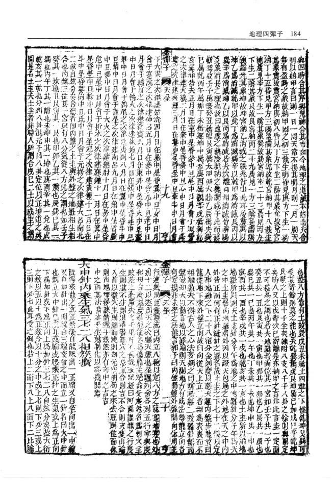

<!-- V3_SOURCE_ID:book025-b000191-p000-ea9dbf8e2a -->

宝照当中蕴含着真正的造化规律，可以验证透地与穿山的相关说法。管峰说：所谓宝照，就是鉴别的意思。东力卿著有《浑天室照经》，季淳风著有《天元室照册》，厉伯诏著有《金函室照贼益》。宝照这个名称的确立，是为了阐明理气的内涵，它还有别的名称，一个叫透天光，一个叫埋气元龟，一个叫阴阳至蹄，一个叫神瑞鬼摄。大部金两室照，说的是山川的性情；天元宇照，说的是运用的法度；浑天室昭，说的是伯的更替。造化，指的是天地无需刻意陶冶就能化生万物，万物的化生都来源于此。透地，指的是外盘六十龙；穿山，指的是内盘七十二龙。七十二龙穿山之所以用虎来命名，是因为风与虎相呼应，风附于上方、亲近高处，山虽然看起来高耸接天，本质仍是地下的一类事物，用虎来命名，也是因为它对应列宿，壁宿的生发都和寅位相关。六十龙之所以用龙来命名，是因为它变化莫测。二者相互契合，就有风云际会的含义。比如甲子金能坐火度，赐尅为张子天星2。

> **释读存疑：** “东力卿”“季淳风”“厉伯诏”人物身份未明确，“埋氣元亀”“陰陽至蹄”“神瑞鬼攝”“大部金兩室照”“伯之弔替”“無陶”“賜尅為張子天星”具体含义原文未明；1轮自动修复后核义模型仍建议修订，已保守记录。

查看对应原文

<!-- V3_FOLDBACK_BEGIN:book025-b000191-p000-ea9dbf8e2a -->

寶照中涵真造化證盟透地與穿山管峰曰宝照者鑑也東力卿有渾天室照經季淳風有天元室照冊厲伯詔有金函室照賊益宝照之立名者發名理氣之與一名透天光一名埋氣元亀一名陰陽至蹄一名神瑞鬼攝大部金兩室照者言山川之性情也天元宇照者言運用之法度也渾天室昭者言伯之弔替也造化者言天地之無陶而化生萬物皆由此耳透地者外盤六十龍也穿山者內盤七十二龍也七十二龍穿山而名虎者以其風從乎虎風附乎上者親上雖山目天而處是地下之一物耳以虎名者以其合列宿而壁發生盡由人生于寅也六十以龍名者以其変化不測也二皆相合則是風雲際會之一義耳如甲子金能坐火度賜尅為張子天星 2

<!-- V3_FOLDBACK_END:book025-b000191-p000-ea9dbf8e2a -->

<!-- V3_SOURCE_ID:book025-b000192-p000-b0a14b14fa -->

伤胎坐未度的话，会爬结而成坐；如果坐上度，就会富贵；如果坐水度，也就是风水语境中的河流、水系及其来去形态的度，就会泄气，福气逐渐消减；如果坐金度，就会冲和而平梧。其余的情况都仿照这个规律判断，四神生旺才能说有福气。

> **释读存疑：** 爬结而成坐；平梧

查看对应原文

<!-- V3_FOLDBACK_BEGIN:book025-b000192-p000-b0a14b14fa -->

傷胎坐未度則爬結而成坐上度則富貴坐水度則 洩氣而福氣漸消坐金度則沖和而平梧其餘倣此 四神生旺方言福

<!-- V3_FOLDBACK_END:book025-b000192-p000-b0a14b14fa -->

<!-- V3_SOURCE_ID:book025-b000193-p000-f05dd4a53e -->

四神并不是指四兽，而是指乾、坤、艮、巽这四龙，其中乾是八卦之一，卦象及五行、方位依原文语境确定，坤是八卦之一，卦象及五行、方位依原文语境确定，艮是八卦之一，巽是八卦之一。这里说的是龙的来势如果从生旺的方位来，有佐助，就可以说有福。如果到地是乾亥、甲卯、丁未的木山，从亥方来的是夫生，从丑艮方来的是冠带，从“疏官白卯”来的是旺方，所以亥离只有黄藻贞作祖宗。从巳午未方来的是“休因”，从坤申方来的是墓绝。凭借这些就可以明白龙的好坏，从而知晓福运的应验。学者应当用心穷究相关道理，切不可随意为人园葬，导致人家败绝。

> **释读存疑：** 疏官白卯；休因；亥離惟黃藻貞作祖宗；園葬；疏官；1轮自动修复后核义模型仍建议修订，已保守记录。

查看对应原文

<!-- V3_FOLDBACK_BEGIN:book025-b000193-p000-f05dd4a53e -->

四神者非四獸乃乾坤艮巽之四龍也此言龍之來從生旺之方助可以言福如到地是乾亥甲卯丁未之木山自亥方來者爲夫生自丑艮方來者爲冠帶疏官白卯來者爲旺方故亥離惟黃藻貞作祖宗也自巳午未方來者為休因自坤申方來者爲墓絕卽此可以明龍之美惡而知福福之應矣學者富幫心窮死切為園葬以致人敗絕也

<!-- V3_FOLDBACK_END:book025-b000193-p000-f05dd4a53e -->

<!-- V3_SOURCE_ID:book025-b000194-p000-dadb3498e7 -->

流澤休四，衣食雄。

> **释读存疑：** “流澤休四”“衣食雄”具体含义原文未明

查看对应原文

<!-- V3_FOLDBACK_BEGIN:book025-b000194-p000-dadb3498e7 -->

流澤休四衣食雄

<!-- V3_FOLDBACK_END:book025-b000194-p000-dadb3498e7 -->

<!-- V3_SOURCE_ID:book025-b000195-p000-ab171145f2 -->

流泽说的是水的来去情况，这里的水是风水语境中的河流、水系及其来去形态。绵义统说：“朱雀源于生气，泪干未盛时朝于大庄，泽于将衰，流于因谢以返，不会断绝。”法前一折疏而后泄，大概说的就是这个意思。所以说“东宜生见去要休四者吉”。如果来法四而去生，“射者內六華名甚言其窮之”，该表述具体所指不详。

> **释读存疑：** 淚干未盛朝于大莊澤于將衰；法前一折疏而後洩；東宜生見去要休四者吉；射者內六華名甚言其窮之；1轮自动修复后核义模型仍建议修订，已保守记录。

查看对应原文

<!-- V3_FOLDBACK_BEGIN:book025-b000195-p000-ab171145f2 -->

流澤百水之來去也綿義統曰朱雀源于生氣淚干未盛朝于大莊澤于將衰流于因謝以返不絕法前一折疏而後洩其斯之謂歟故曰東宜生見去要休四者吉若來法四而去生射者內六華名甚言其窮之

<!-- V3_FOLDBACK_END:book025-b000195-p000-ab171145f2 -->

<!-- V3_SOURCE_ID:book025-b000196-p000-ba33b09d95 -->

“東能洞遠真元妙，天地移來掌上看”，说的是后世的学者如果得到明师的真传，孜孜翼与，慎思明辨，让天地的运行规律、阴阳的道理“祠然于心曰之間了晤手”，这段表述具体所指不详，在实际运用的时候，祸福不需要取决于上天，而是都在“吾羣握”之中了，该表述具体所指不详。邵子说：“人能胜天，端以此也。”

> **释读存疑：** 孜孜翼與；祠然于心曰之間了晤手；羣握；1轮自动修复后核义模型仍建议修订，已保守记录。

查看对应原文

<!-- V3_FOLDBACK_BEGIN:book025-b000196-p000-ba33b09d95 -->

東能洞遠真元妙天地移來掌上看言後之學者若得明師之真傳孜孜翼與慎思明辨使天地之運陰陽之理祠然于心曰之間了晤手作用之際則禍福不必要之干天而咸任吾羣握之中矣邵子曰人能勝天端以此也

<!-- V3_FOLDBACK_END:book025-b000196-p000-ba33b09d95 -->

<!-- V3_SOURCE_ID:book025-b000197-p000-cf0d9bce78 -->

釋法

> **释读存疑：** “釋法”具体所指原文未明

查看对应原文

<!-- V3_FOLDBACK_BEGIN:book025-b000197-p000-cf0d9bce78 -->

釋法

<!-- V3_FOLDBACK_END:book025-b000197-p000-cf0d9bce78 -->

<!-- V3_SOURCE_ID:book025-b000198-p000-c3348a6036 -->

尅擇箕疇明運氣

> **释读存疑：** “尅擇”“箕疇”“運氣”此处具体所指未明确

查看对应原文

<!-- V3_FOLDBACK_BEGIN:book025-b000198-p000-c3348a6036 -->

尅擇箕疇明運氣

<!-- V3_FOLDBACK_END:book025-b000198-p000-c3348a6036 -->

<!-- V3_SOURCE_ID:book025-b000199-p000-c93515f638 -->

唐代一行说：有合适的地，就要用对应的年月日时来辅助它。世人不知道这个道理，胡乱用通行的年月日时来做选择，完全不知道“山家年月別有姓不與時師說真定”，该表述具体所指不详。一行又说：“運氣相將不等閒，一毫之失應于山。”卜子说：年月只要有一点过失，反而会成为吉地的深重灾殃。又说：地是吉地但丧葬不吉，和丢弃尸体没有区别。又说：山吉、水吉，这里的水是风水语境中的河流、水系及其来去形态，穴也吉，这里的穴是风水中认为气脉聚结、适宜安葬或营建的位置，为什么会多有灾祸？哪里知道是年月凶而日时凶，犯了凶煞，自然会有灾异。不说“选择”而说“尅择”的原因是什么？“藍海月日時如五彌子天星”，该表述具体所指不详。

> **释读存疑：** 山家年月別有姓不與時師說真定；藍海月日時如五彌子天星

查看对应原文

<!-- V3_FOLDBACK_BEGIN:book025-b000199-p000-c93515f638 -->

唐一行曰有是地則用是年月日時以佐之世人不知此義而妄以通行之年月日時以出其選殊不知山家年月別有姓不與時師說真定又曰運氣相將不等閒一毫之失應于山卜子曰年月有一端之失反爲吉地之深殃又曰地吉塟凶與棄尸同又曰山吉水吉而穴吉何以多灾豈知年月凶而曰凶犯之固覺夫日時之不言選擇而言尅擇者何也藍海月日時如五彌子天星

<!-- V3_FOLDBACK_END:book025-b000199-p000-c93515f638 -->

<!-- V3_SOURCE_ID:book025-b000200-p000-b2c1ea2219 -->

人的命运，八字吉利就会富贵，八字凶险就会贫贱，这是造命法度的由来。人命以日干为主，地理选择以脉穴为主，这里的穴是风水中认为气脉聚结、适宜安葬或营建的位置，务必追求丰实中和，不应该偏枯过盛。所以山命、墓命、亡命、生命和日时，务必要相生，其中如果是相生的就能招来福气，相克的就会有灾祸降临。古人因为存在相克的情况，所以设立了选择这一门类，这就是“尅择”名称的由来。箕畴就是《洪范》。五行共有五种，这里的五行是木、火、土、金、水五种分类及其关系体系，出自河图的叫做正五行，用来确定五方的定位，“末宣于東西受剋而北受生”，该表述具体所指不详。木适合在北方，离位受克而西方受生；火适合在南方，北方受克而东方受生；金适合在西南，爱克而杂受生；“十宜于四維”“東受地而南受生”，这两处表述具体所指不详。这些是针对龙星使用的，其余的情况不用。如果是洛书对应的是老五行，用箕畴九墩的象配合“八天之救弔”，该表述具体所指不详，九宫确定所属，这叫做宗庙五行，是用箕畴来统一区分的。九道推移变迁，九野重叠迎送形成交替出现的度数，上合天逆，中合气进，下合地运，明合时运，闻合墓运，使用它作为“通用之木”，该表述具体所指不详，“依非夫神煞為選澤之妙用”，该表述具体所指不详。如果是大折山入首，这里的入首是龙脉进入结穴区域前的关键一段，就应当讨论“集山去漫山”的情况，漫山是就二十四山合并而言的，这里的二十四山是将周天划分为二十四个方位的体系，“三而言之”具体所指不详。“周望塞口”“位位要相台”“山山對不同”“尅宮多雲音”“生旺位三公”，这些表述具体所指不详。逆气就是天时，“其通直五”具体所指不详，气有六种，五六会合形成和质，就可以说是善于选泽了。五运的法度是：甲巳化土，乙庚化金，丙辛化水，丁壬化水，戊癸化火。六气分别是：子午对应少阴君火司天，阳明燥金在泉；丑未对应太阴湿上司天，太阳寒水在泉；寅申对应少阳相火司天，厥阴风在泉，这里的风对应的水是风水语境中的河流、水系及其来去形态；卯酉对应阳明燥金司天，少阴君火在泉；辰戌对应太阳寒水司天，太阴湿上在泉；巳亥对应厥阴风木司天，少阴相火在泉，这就是客气加临。如果是主气，就是春风水而夏相大，秋燥金而冬寒水，是固定不能变动的。推算这些运气互相加临的情况，调和就吉利，克害就凶险。

> **释读存疑：** 末宣于東西受剋而北受生；十宜于四維；東受地而南受生；八天之救弔；通用之木；依非夫神煞為選澤之妙用；集山去漫山；三而言之；周望塞口；位位要相台；尅宮多雲音；生旺位三公；其通直五；夏相大；1轮自动修复后核义模型仍建议修订，已保守记录。

查看对应原文

<!-- V3_FOLDBACK_BEGIN:book025-b000200-p000-b2c1ea2219 -->

人之生命也八字吉則人富貴八字凶則人貧賤此造命之法度所由始也人命以日于爲王地理之選擇以脉穴爲主務豐中和不宜偏勝故山命墓命亡命生命與曰時務要相生其間有相生者則致福相尅者則禍臨古人謂其有相尅故立此選擇之門此尅擇之名所由立也箕疇者洪範也然五行有五出自河圗者名正五行以定五力之定位末宣于東西受剋而北受生木宜于北離受尅而西受生火宜于南北受尅而東受生金宜于西南愛尅而雜受生十宜于四維東受地而南受生此以龍星用之而餘則不用若洛書者老五行以箕疇九墩之象而合八天之救弔人九宮定其所屬是名宗廟五行蓋用箕疇而區壹之九道推遷九野疊迎而成迭見之度上合天逆中合氣進下合地運明合時運聞合墓運用之而爲通用之木依非夫神煞爲選澤之妙用若大折山入首則當論以集山去漫山者乃二十四山三而言之也周望塞口位位要相台山山對不同尅宮多雲音生旺位三公者此也逆氣者天時也其通直五其氣有六五六會以和質號斯可謂善選澤矣夫五運者甲巳化上乙庚化金丙辛化水丁壬化水戊癸化火之法度也六氣者子午少陰君火司天陽明燥金在泉丑未太陰濕上司天太陽水在泉賓申少陽相火司天厥陰風水在泉卯酉陽明燥金司天小陰君火在泉辰戌太陽寒水司天太陰濕上在泉巳亥厥陰風木司天少陰相火在泉此之謂客氣加臨若大主氣則春風水而夏相大秋燥金而冬寒水一定而不可移易者也推此運氣互相加臨調和則吉尅害則

<!-- V3_FOLDBACK_END:book025-b000200-p000-b2c1ea2219 -->

<!-- V3_SOURCE_ID:book025-b000201-p000-5728f0e095 -->

生尅制化的运用必须精熟专一。

查看对应原文

<!-- V3_FOLDBACK_BEGIN:book025-b000201-p000-5728f0e095 -->

生尅制化要精專

<!-- V3_FOLDBACK_END:book025-b000201-p000-5728f0e095 -->

<!-- doc013 PDF 第 189 页：高风险/复杂版面 OCR 供检索；内容与排版以原页图为准。 -->
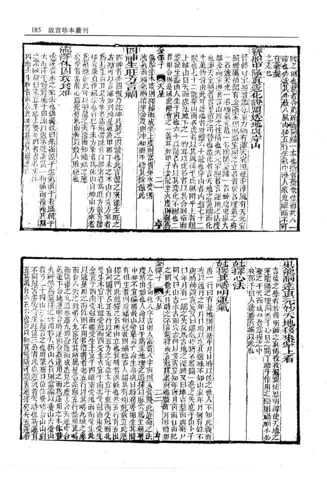

<!-- V3_SOURCE_ID:book025-b000203-p000-2f865b55b1 -->

生，指的是相生；尅，指的是相尅；制，是指遇到有相尅的情况无法完全避开时，需要运用制化的方法，比如木受到金的尅制，就用火来制住金，这就叫做母受其善，应当及时补救。化，是指承受的克制力量过于深重，自身力量无法承受时，应当顺从其化势，同归一条路径，也就是通过化解灾害的方式来消除灾害，反而能带来吉祥。所谓要精专，是说选择的法度不外乎生、尅、制、化这四个字，这四者之外没有其他的道理。然而生得太过就会顺从化势而成齐，尅得太甚就会顺从化势反而吉祥，务必要做到中和，这才称得上是运择。如果不探究其来源，只是盲目地使用山天星1。

> **释读存疑：** “成齊”具体所指不详；“受字”是否为“受克”讹误原文未明；“固害”具体含义不详；1轮自动修复后核义模型仍建议修订，已保守记录。

查看对应原文

<!-- V3_FOLDBACK_BEGIN:book025-b000203-p000-2f865b55b1 -->

生者相生也尅者相尅也制者因其有尅不能全避須用制法如木受金尅用火以制之是之謂母受其善于當救之也化者受字之深力不能勝當從其化同歸一途則是固害以化害而反致吉矣要精專者言選擇之法度不外此生尅制化之四字四者之外無他道焉然生之太過則從化而成齊尅之太甚則從化而反吉務我中和斯名運擇若不問其所從來而徒以山天星 1

<!-- V3_FOLDBACK_END:book025-b000203-p000-2f865b55b1 -->

<!-- V3_SOURCE_ID:book025-b000204-p000-41d02c31cf -->

文中开篇提到“之無運及亡者之空亡面強含通行大塟之日期是之謂遺木述未名雖選猶無選也”，该段文字存在讹脱，语义难以明确。选择的关键是先以山命为主，再配合亡命。经书中说：山命与亡命相合，富贵自然确定；又说：时日尅山，百事凋零；又说：时日尅亡，女死勇伤。这山命、亡命是选择墓葬日期最紧要的内容。如果舍弃山命、亡命而只论墓运、空亡，就是把缓的当成急的，急的当成缓的，这是不懂得选择的根本宗旨，此处“木旨”应为“本旨”的形近讹误。所谓精，是指运用纯熟，能囊括其精微之处；所谓专，是指从事专一，不掺杂异端。凡是用神，适宜于建造的或许对安葬有所忌讳，适宜于安葬的或许对建造有所忌讳。如果运用不符合法度，事情没有顺遂的结果，反而会从吉祥变成凶险，这是必然的道理。最后提到“神煞不由弔與替未來凶吉立相先”，其中“立相先”语义不甚明确，大致是指未来的吉凶可以预先察知。

> **释读存疑：** 开篇“之無運及亡者之空亡面強含通行大塟之日期是之謂遺木述未名雖選猶無選也”存在讹脱，语义不明；“木旨”为“本旨”形近讹误，此处按“本旨”释读；“立相先”语义不确，暂按可预先察知吉凶理解

查看对应原文

<!-- V3_FOLDBACK_BEGIN:book025-b000204-p000-41d02c31cf -->

之無運及亡者之空亡面強含通行大塟之日期是之謂遺木述未名雖選猶無選也夫選擇者先以山命爲主次合亡命經曰山命合亡命富貴天然定又曰時日尅山百事凋殘又曰時日尅亡女死勇傷此山命亡命爲選擇冢之最緊要者也若棄山命亡命而論墓運空亡是緩者急之急者緩之不知選擇之木旨矣精者謂用之純熟而括盡其精微專者謂從事專一而不雜乎異端凡用神然宜于造者而或忌于塟宜于塟者而或忌于造若用不如法事不尋結則反吉而成凶此理之必然也神煞不由弔與替未來凶吉立相先

<!-- V3_FOLDBACK_END:book025-b000204-p000-41d02c31cf -->

<!-- V3_SOURCE_ID:book025-b000205-p000-e67fd5ad44 -->

吉的名称叫做神，凶的名称叫做煞，神煞的名称各有其设立的缘由，神煞的运用则因吊替而形成，此处“弔哲”应为“弔替”的形近讹误。吉神失去所处的位置，不仅不能带来福运，反而会生出灾祸；凶煞得势时，带来的灾祸最大，气势也最盛。经书中说：吉神得地，能招致福运；内煞失时，不能成灾，“内煞”具体所指原文未明；又说：吉神受制，不出市。旧注中说：未来，是指将来能够补增福运；原文“日先者言應速也”中“日先”存在讹误，大致是指应验迅速。《神枢经》中提到“爾而之來難”，该短语具体所指不详，经文中说这是天命导致的，实则是时日的感召作用。

> **释读存疑：** “弔哲”为“弔替”形近讹误，此处按“弔替”释读；“内煞”具体含义不明；“日先”存在讹误，暂按应验迅速理解；“爾而之來難”语义不明

查看对应原文

<!-- V3_FOLDBACK_BEGIN:book025-b000205-p000-e67fd5ad44 -->

吉名爲神凶名爲煞神煞之名各有爲而立神煞之用因弔哲而成吉神失地不能助福而反生灾凶煞得時其禍最大其勢尤雄經曰吉神得地能致福內煞失時不成灾又日吉神受制不出市舊成注未來者將來之補福也日先者言應速也神樞經曰爾而之來難天命之使然寔時日之感召也

<!-- V3_FOLDBACK_END:book025-b000205-p000-e67fd5ad44 -->

<!-- V3_SOURCE_ID:book025-b000206-p000-85b5613bf4 -->

原文开篇“龍運經運不征伐天命神功妙用全 配運運不知代天命神功如斤全絲”存在缺字讹脱，“斤全丝”语义不明，难以准确释读。此处所说的运，不是四十五龙的生运，而是变山轮年的墓运、疫运，“疫运”具体所指原文未明，是五行逐年的遁逆。二运如果相互尅害，就会出现“大面無有吉日”的情况，“大面”语义不明，最终难免灾祸；二运如果相生，即使不刻意求吉也自然没有不吉的情况。六命，是天然生成的气脉，此处“木然”应为“天然”的形近讹误；神功，是制伏的妙用。这里说山水不可能十全十美，或者施加培护关锁的力量，或者有“子穴中詭作用之妙”，“诡作用”具体所指不详，或者用时日辅助的功夫。培护关锁的法度详细见于《地理元机铁弹子》，而穴中作川的巧妙都以目赞来成就，相关内容详细见于“地却元樞主彈子”，此处“地却”“主彈子”应为“地元”“铁弹子”的讹误。如果龙的功效发挥到极致，就必定会获得吉祥。征伐，就是相互尅害。丘延翰说：龙运相传，世代昌盛；运气尅害，子孙受伤；又说：二运相生，应当获得富贵，二气相伤，改绝灭亡，此处“二蓮”应为“二運”的形近讹误。

> **释读存疑：** 开篇“龍運經運不征伐天命神功妙用全 配運運不知代天命神功如斤全絲”存在缺字讹脱，“斤全丝”语义不明；“疫运”具体含义不明；“大面”语义不明；“木然”为“天然”形近讹误，此处按“天然”释读；“诡作用”具体所指不详；“地却元樞主彈子”存在讹误，应为“地元枢铁弹子”类名称；“二蓮”为“二運”形近讹误，此处按“二運”释读

查看对应原文

<!-- V3_FOLDBACK_BEGIN:book025-b000206-p000-85b5613bf4 -->

龍運經運不征伐天命神功妙用全 配運運不知代天命神功如斤全絲運者非四十五龍之生運乃變山輪年之墓運疫運者五行年年之遁逆也二運若相尅則大面無有吉日終群免禍二運若相生雖不求吉而自無不吉六命者木然生成之氣脉也神功者制伏之妙用也此言山水不能十全或加培關之力或子穴中詭作用之妙或用時日費助之功夫培開之法度詳見地理元機鉄彈子而穴中作川之巧妙并皆目贊以成功詳見地却元樞主彈子果龍極其功效則必建吉矣征伐首相尅害也丘延翰曰龍運相傳世代昌運氣尅害子孫傷又曰二蓮相生當富貴二氣相傷改絕亡

<!-- V3_FOLDBACK_END:book025-b000206-p000-85b5613bf4 -->

<!-- V3_SOURCE_ID:book025-b000207-p000-795c767c21 -->

帝星、太阳能压制百煞，但如果对应的门位没有到位，就算有帝星、太阳压煞也是白费，它们的效用无法发挥。

查看对应原文

<!-- V3_FOLDBACK_BEGIN:book025-b000207-p000-795c767c21 -->

帝星太陽壓百煞門不到亦徒然

<!-- V3_FOLDBACK_END:book025-b000207-p000-795c767c21 -->

<!-- V3_SOURCE_ID:book025-b000208-p000-55248a396c -->

帝星，不是各类常见的帝星，此处“帝學”应为“帝星”的形近讹误，而是金符的帝座；太阳，不是各类常见的太阳，而是历数的太阳，此处“曆救”应为“曆数”的形近讹误。这里说帝星与太阳一同降临，即便众多凶煞也不敢逞凶。原文提到“金彈子惡擇 二四 亨其凶惡人皆知之而猶不能致禍反成害者何也晉殺太陽忌見木土之宿”，其中“恶择”“晋杀”语义不甚明确，大致是说太阳忌见属木、属土的星宿，以及六甲纳音属木、属土的情况；帝星忌见太岁、黄金虎子这类凶神，只有奇门一同降临的方位，才会辅助生吉，原文此处有“吉鑄”二字，语义不明，就算有需要忌惮的情况也不会犯忌。所以说：奇门到位，富贵兴起，财禄无穷。又有说法提到“助太陽門助帝飛法支相濟”，“飞法支相济”具体所指不详，对于飞法的解释提到“返首以穴等吉也”，该表述语义不明，难以准确释读。

> **释读存疑：** “帝學”为“帝星”形近讹误，此处按“帝星”释读；“曆救”为“曆数”形近讹误，此处按“曆数”释读；“恶择”“晋杀”语义不明；“吉鑄”语义不明，未强行释读；“飞法支相济”具体所指不详；“返首以穴等吉也”语义不明，未强行释读

查看对应原文

<!-- V3_FOLDBACK_BEGIN:book025-b000208-p000-55248a396c -->

帝星者非各位之帝學乃金符之帝座也太陽者非諸位之太陽也乃曆救之太陽也此言帝星與大陽同到雖諸煞不敢逞金彈子惡擇 二四 亨其凶惡人皆知之而猶不能致禍反成害者何也晉殺太陽忌見木土之宿并六甲納青之木土帝星忌見太歲黃金虎子之凶神惟奇門同到其方乃助之吉鑄有所畏亦不之忌故曰奇門到位富貴興財祿應無窮又口助太陽門助帝飛法支相濟飛法者返首以穴等吉也

<!-- V3_FOLDBACK_END:book025-b000208-p000-55248a396c -->

<!-- V3_SOURCE_ID:book025-b000209-p000-b17cfe1e15 -->

吉神受制就不能成福，凶煞乘时灾祸也会炽盛。这是承接上文说吉神受制不能降福，凶煞乘时就会发大凶。比如真辛金神而乘秋令，原文此处有“削”字，语义不明，就叫做乘时；比如亥为天月德，遇到辰戌丑未的年月日时，此处“五未”应为“丑未”的形近讹误，又遇到纳音之土，就叫做受制。其余的依此类推。炎，是兴盛的样子，这也是制化的一个方面。

> **释读存疑：** “乘时”为原文术语，未擅改为“乘势”；“削”字语义不明，未强行释读；“五未”为“丑未”形近讹误，此处按“丑未”释读

查看对应原文

<!-- V3_FOLDBACK_BEGIN:book025-b000209-p000-b17cfe1e15 -->

吉神受制不成福凶煞乘時禍亦炎此承上文言吉神受制不福惡煞乘時大凶如真辛金神而乘秋令削謂之乘時如亥爲天月德而遇辰戌五未之年月日時又納音之土則謂之受制餘倣此炎者盛貌此亦制化之一端也

<!-- V3_FOLDBACK_END:book025-b000209-p000-b17cfe1e15 -->

<!-- V3_SOURCE_ID:book025-b000210-p000-92e11bca03 -->

原文提到“五箇太陽若通會煞諦共助禍綿綿”，其中“煞諦”具体所指不详。有歌诀称“七個大陽三內正有者故第一親”，此处“大陽”为“太陽”的形近讹误，该句语义不通，难以准确释读，这里说五个太阳是成立的。《灵辅经》中说：太阳为余义之中，命为众煞之魁。有说法称：能招致太阳，则众煞都会退避；原文“能金兩前諸煞拱手矣”存在讹脱，语义不明。其他经文说七个太阳，这里说五个，是天数的增益。这是阴阳的法理，五为五行之正，对应君子；七为七煞之偏，对应小人，所以神用数五而煞用数七。后文“太陽之所後來膺數太陽爲水之祐見木則爲洩氣見上則爲鬼誠吉逆太賜爲火之情逢實則連接法以受生也迂癸則幽兩長畏文尅也”“龍德太陽爲木之清以除平危又爲古餘皆有南旧哉以起遁也”等段落存在大量讹脱，语义不明，仅可明确乌兔太阳为金之精，根据节候起遁；四利三元为土之精，此处“上之精”应为“土之精”的形近讹误，作用是调和诸神道。世间的愚师不知道真诀，听到太阳的名称，不知道太阳的用法，都称历数太阳是阳光之类，此处“戚曰”应为“咸曰”的形近讹误，“能學諸凶百義”语义不明，还有“覺知人問上木爲掩閉之兒權制帝澤黃總”等内容，均存在讹脱难以释读。所以说太阳所在之处，各类百煞如果出现克泄的情况，灾殃会立刻发作，此处“史殃”应为“灾殃”的形近讹误；又说：贵神如果失地，灾祸立刻就会到来，这是理所必然的。如果五个太阳都符合相生的情况，就是通会，相当于全是正人主事，即使有小人也会化而为善，这是运用太阳的法度。丘延翰说：水喜欢渊深流动，得此格局很快就能封侯；火喜欢发扬，家族世代能居高位；木喜欢条达，人丁财禄很快就能发显；金喜欢厚重，造作安葬都能获得阴佑；最后“土年其沿”语义不明，难以释读。

> **释读存疑：** “煞谛”具体所指不详；“七個大陽三內正有者故第一親”语义不通，存在讹脱；“能金兩前諸煞拱手矣”存在讹脱，语义不明；“太賜爲火之情”“迂癸則幽兩長畏文尅”“古餘皆有南旧哉”等大量内容存在讹脱，语义不明；“上之精”为“土之精”形近讹误，按“土之精”释读；“戚曰”为“咸曰”形近讹误，按“咸曰”释读；“史殃”为“灾殃”形近讹误，按“灾殃”释读；末尾“土年其沿”语义不明

查看对应原文

<!-- V3_FOLDBACK_BEGIN:book025-b000210-p000-92e11bca03 -->

五箇太陽若通會煞諦共助禍綿綿于今歌曰七個大陽三內正有者故第一親此言五菌太陽可也靈輔經曰太陽為餘義之中命為衆煞之魁子曰能致太陽則諸煞成退矣能金兩前諸煞拱手矣彼言七太陽而此言五者益天此陰陽之教五爲五行之正而爲君子七爲七煞之偏而爲小人故神用五而煞用七也夫太陽之所後來膺數太陽爲水之祐見木則為洩氣見上則爲鬼誠吉逆太賜爲火之情逢實則連接法以受生也迂癸則幽兩長畏文尅也龍德太陽爲木之清以除平危又為古餘皆有南旧哉以起遁也鳥兎太陽爲金之精因節候以起遁也四利三元爲上之精所以和諸神道世之愚師不知直訣聞大陽之名四知太陽之用戚曰曆紋太陽爲陽光之請能學諸凶百義覺知人問上木爲掩閉之兒權制帝澤黃總故曰太陽難所諸鹵百煞尅泄史殃立發又曰貴神若失地炎立時至此理勢之必然也設或五箇太陽俱合相生是爲通會是糟備朝皆正人雖在小人亦化而爲善此用太陽之法度也丘延翰曰水喜其淵流指日立封侯火喜其發揚世代立朝堂木喜其條達人財寸見發金萬其重厚造塟陰大祐土年其沿

<!-- V3_FOLDBACK_END:book025-b000210-p000-92e11bca03 -->

<!-- V3_SOURCE_ID:book025-b000211-p000-9ea641db49 -->

山命、亡命与墓命这三命的元神要相合。

查看对应原文

<!-- V3_FOLDBACK_BEGIN:book025-b000211-p000-9ea641db49 -->

山命亡命與墓命三命元神要合兼

<!-- V3_FOLDBACK_END:book025-b000211-p000-9ea641db49 -->

<!-- V3_SOURCE_ID:book025-b000212-p000-c5d6006964 -->

山命是山家的通气，亡命是亡人的运气，墓命是墓中的运气，并非当时的风水师选择轮年起遁的墓通。这种说法有其道理。文中又提到“亡人执印入墓，折得乘生气，挂朱亥”，这一表述具体所指不详。关于山命的说法，比如山属木，墓位在未方，甲子年遁得辛未土，土金相生，属于吉兆。经书上说年运相生为吉，定主进官加爵；乙丑年遁得癸未水，金木相克，商经上说年运相克会损伤人口，更有退败的情况。丙寅年遁得乙未金，名为东煞，属于大凶。经书上说浑天鬼煞又名军劫官符，会导致家中人丁退损、子嗣断绝。丁卯年遁得丁未水，名为劫煞，属于凶兆。经书上说进气传犯，会导致家人遭受徒刑、杀戮，被发配边地，名声传扬在外。戊辰年遁得己未火，名为木火通明，属于吉兆。经书上说木火通明是富贵格局，主家中人文章显达，能受天禄。关于仁命的说法，比如甲子亡人，甲子年遇乙丑金，名为比和，属于吉兆。纪书上说命通比和，应当昌盛显贵，世代位居公卿。甲子亡人，乙丑年遇丁丑水，名为相生，属于吉兆。经书上说命运相生大吉大昌，家中富贵能镇住乡邦。原文此处出现“丙第年”，属于辨识错误，具体所指不详，按现有文字，该年遇己丑火运，也名为比和，属于吉兆。丁卯年遇辛丑土，也名为相生，属于吉兆。其余位次按此类推，这里所说的运，就是洪范五行四年起进的墓运。大三县府如果能契合这些规则而得吉，尤其必须得到三命的元神，才称得上是大吉。所谓元神，是与山相合的运气，原文此处有“金精弩极五天之运气巾梦生旺乡”的表述，属于辨识错乱，具体含义不详；后文提到休囚、三旺一条，休杂胜旺，三休一旺旺雄胜休，二旺三休为吉。原文还有“内术卜背”的表述，具体所指不详。“亡命执印入墓折”是选择中的核心要领，相关内容记载在《选择元龙》中。当时的风水师得不到真传，只是拘泥于各家的错误说法，只看年方是否通利，测算山向的吉凶，选取时日的宜忌，这就如同舍弃渔网入海捕鱼，拿着斧头进山却想要得到书本一样，根本不可能。合气的奥妙，自有三易九侯的规则。《金斗经》上说，七十二龙如果处于生旺状态，主家中世代出卿相；比如印子金龙，墓在丑位，长生在巳位，旺在酉位，那么卯、辰、戌为吉，巳、午、未、申、酉的年月日时为大吉。经书上又说“煞曜羊亦真黄泉，犯者哭皇天”，其中“羊亦真”属于辨识错误，具体所指不详。杀曜的歌诀是“坎龙坤兔震猿猴，促鹅乾马货蛇头”，长虎经中的杀曜是恶曜，阳宅遇到这种情况都会衰败，不但砂水要忌避，亡命也应当忌避。原文此处有“犯之插小年黄气者辰戌丑未也，塞非乾申艮巽向疏之，则忌羊忍者”的表述，其中“羊忍者”属于辨识错误，具体所指不详。年月犯了相关神煞，主家中损失小口、奴婢、六畜。大杀曜是八卦的官兔，吉的时候为官星，凶的时候为鬼煞，不能一概而论。原文此处有“羊及者禄申之败曜也”的表述，其中“羊及者”属于辨识错误，具体所指不详，按现有内容，依向则为射人，依山则为射出，煞旺而身弱的话，原文此处“则为一诗一人死”的“诗”属于辨识错误，具体所指不详，相关内容是一人死而前面二人也会死亡；身壮而杀微的话，为一煞一威，补二煞。正文结束后附署名“尉子选择”，页码为“二六”，“亨”字样。

> **释读存疑：** 亡人执印入墓，折得乘生气，挂朱亥；丙第年；金精弩极五天之运气巾梦生旺乡；内术卜背；羊亦真；羊忍者；羊及者；诗（原“则为一诗一人死”中的“诗”）；原“则为一诗一人死”中的“诗”

查看对应原文

<!-- V3_FOLDBACK_BEGIN:book025-b000212-p000-c5d6006964 -->

山命者山家之通氣也亡命者亡人之運氣也墓命者墓中之 運氣也非時師選擇輪年起遁之墓通也其言有道焉又曰亡 人執印入墓折得乘生氣掛朱亥夫山命耆如說山属木不墓在 未甲子年遁得辛未士名爲金士相生吉經曰年運相生吉定 主進宮秋乙丑年遁得癸未水名爲金木相尅商經曰年運相 尅火損人更退則丙寅年遁得乙未金名爲東煞大凶經曰渾 天鬼煞名軍劫官符退收人丁絕丁卯年遁得丁未水名爲刼 煞凶經曰進氣傳犯主軍徒形戮邊配徹聲聞戊辰年道得巳 未火名曰木火通明吉經曰木火通名富貴局文章顯達膺天 祿仁命者如甲于亡人甲子年乙丑金重名曰比和吉紀曰命 通比和當昌貴世位公卿位君甲子十人乙丑年丁丑水建名 曰相生吉經曰命運相生大吉昌富鎮鄉邦者甲子亡八丙 第年巳丑火運亦名此和吉丁卯年辛丑士通亦名相生吉餘 位此其運者卽洪範五行四年起進之慕遂也大三縣府此 合而叶吉尤必得三命之元神斯可以言大吉元神者合山則 之運氣如金精弩極五天之運氣巾夢生旺鄉休囚三旺一條 休雜勝旺三休一旺旺雄勝休二旺三休吉內術卜背夫亡命 執印入墓折者九選擇中之樞要也事見選擇元龍時師不得 真傳徒泥于諸家膺法以年方通利課山向之吉內掇時日之 宜忌則是舍罟鄉而入海取魚金斧斤而入山傳本矣夫合氣 之妙自有三易九侯之法度金斗經曰七十二龍若生旺世代 卿相如印子金龍墓在丑長生在巳旺在酉則以卯辰戌爲吉 而巳午未申酉年月日時爲大吉也又曰煞曜羊亦真黃泉犯 者哭皇天殺曜者坎龍坤兎震猿猴促鵝乾馬貨蛇頭長虎經 者爲惡曜承宅遇之一齊休不但砂木忌之而亡命亦當忌之 也犯之插小年黃氣者辰戌丑未也塞非乾申良巽向疏之則 忌羊忍者卽將專前也年月犯之主損小口奴婢六畜大殺曜 者八卦之官兔也吉則爲官凶則爲鬼不可槩論羊及者祿申 之敗曜也依向則爲射人依山則爲射出煞旺而身弱則爲一 詩一人死而前二人亡身壯而殺微則爲一煞一威補二煞尉 子選擇 二六 亨

<!-- V3_FOLDBACK_END:book025-b000212-p000-c5d6006964 -->

<!-- V3_SOURCE_ID:book025-b000213-p000-f0fe6773e6 -->

开篇“敝伏”二字属于发语词或辨识错误，具体所指不详，原文意为：世人不知道选择之法内在有吉有凶，若只是空泛譬论是不对的，就如同身穿重丧孝服的人，遇吉则吉上加吉，遇凶则凶上加凶，就是这个道理。黄泉是万里老人传下的选择法度，相关口诀为“了庚坤上是黄泉”，其中“了”属于辨识错误，应为歌诀用字；下一句“乙内须防巽水先”中的“内”属于辨识错误，应为“丙”；“甲癸向中忧见艮”，下一句“辛壬水路怕富乾”中的“富”属于辨识错误，应为“当”，这些口诀都用乾、坤、艮、巽来正名，实际对应的是辰、戌、丑、未。如果身衰而砂水门路乘时得旺，那么来为泉，去为人煞；如果身旺而砂水门路休废，那么来为佛街，去为虚耗。经书上说，休囚旺相是根本，山向相见相乘的道理是一样的，时人如果能掌握其中的奥妙，就如同管辂、郭璞再世。原文此处“开若未来龙之肯者”的“开”属于断句错误导致的衍字，应为“若来龙真确的话，必须要官星秉权，印绶育气，催官星明正，马见禄、正印不闭，县金临御街，依下门腾云得经曜，有人能识得官文星，时逢中节，紫微北顾、少微南瞻，这样的地是能出三公的贵地。龙合格的话，取用方法各有说法，借禄借马则禄有势加临坐向，是富贵的根基。如果是中下等的格局，只求人丁得势，九命合封，就算是上吉。原文此处“若讼选择大吉养须年逢太乙”中的“讼”“养”属于辨识错误，具体所指不详，按现有内容，选择大吉的格局，要年逢太乙，月值九宫，日得人门，时逢四白，“寺”属于辨识错误，应为“四”，这样才是全吉。想要寻求左向的大吉，“古”属于辨识错误，应为“吉”，必须要三白临方，九紫远应，赤黄遥迎，黑碧不逆，顺则为通吉。然而命卦的方法很难周全，要周全的话，子之屯、艮之贵、卯之损、“乙之中字之泰”属于辨识错乱，具体所指不详、“丙之夫”属于辨识错乱，具体所指不详，这是左之六卦；“一之恒”的“一”属于辨识错误，应为“丑”，丑之恒、未之井、中之涣、戌之谦、亥之豫、壬之复，这是右之六卦。时师只知道用坐向来合卦，却不知道其中的妙用是用卦中的爻来对应山脉，比如子之屯卦用庚寅为人元，用戊戌为官星，用戊子为奴马，用戊申为田宅，其余都仿照这个方法类推。世人只知道拿着一个罗盘，“泥”属于辨识错误，应为“尼”，即罗经，拘泥于净阴净阳的说法，就说天星的道理都在净阴净阳之中，哪里知道古人贵阴贱阳也有其中的道理。古人步脉而立向，各有各的道理，哪里是只说阴山阴向水流阴为吉，阳山阳向水流阳为吉，就能够穷尽天的妙用呢？“何”属于辨识错误，应为“向”。这就如同医生只知道参芪能够救人，却不知道参芪用不对也能害人，“登芪”属于辨识错误，应为“参芪”；只知道砒霜能够杀人，“砒蟲”属于辨识错误，应为“砒霜”，却不知道砒霜用对了也能治大病，“砒临之能声大”属于辨识错乱，具体所指不详。有对应的病症吃对应的药就能活，没有对应的病症吃药就会死，“府”属于辨识错误，应为“病”。这就如同地理家的规则，有生成的龙脉，“雁”属于辨识错误，应为“脉”，自然有生成的穴，也必然有生成的局，所以说“何处山头无子午，登山不用使绳经”；又说“龙穴皆由天造，强合卦例何为”，“八”属于辨识错误，应为“穴”。所以古人创设了寻龙点穴的真机，“拟县”属于辨识错误，应为“点穴”，量山步水的法度，意味深长，旨趣深远。罗盘的道理本于先天的理气，用后天的方位，应当以先天统龙，中天布局，后天立向，再以河图论卦，天星论位，用形局性情来规划龙的行止，原文此处“此无麻昭著定六之盗”属于辨识错乱，具体所指不详；用卦法论阴阳，用星曜明贵贱，“俸”属于辨识错误，应为“曜”，这是万世不变的法度。所谓先天统龙，是已到之气，七十二侯正位于天之中，龙从地下而来；所谓中天布局，是黄泉之气，原文此处“六十缺”属于辨识错误，具体所指不详，用来对应分度的长短，气有二五，错综变化，五兆不齐；所谓后天立向，是未至之气，一百二十分金，纬地经天，古人用它来测天，原文此处“以齐其七致”属于辨识错乱，具体所指不详，先天为地纪，用来测地；中天为人纪，用来规范人事，“中天而为天纪所以范人”属于辨识错误，应为“中天为人纪所以范人”；后天为天纪，用来测天。将天地人三者相合来运用，那么造化的功效就达成了，造化之事完成，富贵的基业就会应验。擅长这门技艺的人，探寻二十四方的龙，提取七十二侯的脉，坐六十位的神，合三百六十五的度数，定一百二十分金，“定一百二十分之分金”多了一个“分”字，属于衍误，合三天之气，协九地之精，收四吉的山，发三奇的水，明了生克制化的道理，区分孤虚旺相的建除，布置禄马贵人的局，忌避空亡关煞的方位，避开阴阳差错的位置，远离星辰昭伏的地方，选取清奇的格局，“八于清奇之局”的“八于”属于辨识错误，具体所指不详，契合内外隐显的适宜，交会八卦五行的道理，原文此处“退連流情”属于辨识错乱，具体所指不详，如同符节相合，没有差错，才是全吉，然而这些都是神仙的秘传，哪里是没有好好学习的人能够知道的呢？所以法度难以用言语相传，妙用要靠人心去领悟，原文结尾“井人慎勿相传度”的“井”属于辨识错误，应为“谨”，即谨慎不要轻易传给他人。

> **释读存疑：** 敝伏；了（原“了庚坤上是黄泉”的“了”）；内（原“乙内须防巽水先”的“内”）；富（原“辛壬水路怕富乾”的“富”）；开（原“开若未来龙之肯者”的“开”）；讼、养（原“若讼选择大吉养须年逢太乙”的“讼”“养”）；寺（原“时逢寺白”的“寺”）；古（原“欲求左向之大古者”的“古”）；乙之中字之泰；丙之夫；一（原“一之恒”的“一”）；泥（原“执一地罗泥”的“泥”）；何（原“阴山阴何水流阴”的“何”）；登芪；砒蟲；砒临之能声大；府（原“有是府”的“府”）；雁（原“有生成之雁”的“雁”）；八（原“龙八皆由天造”的“八”）；拟县（原“拟县之真机”的“拟县”）；此无麻昭著定六之盗；星俸；六十缺；以齐其七致；中天而为天纪所以范人；定一百二十分之分金；八于（原“八于清奇之局”的“八于”）；退連流情；井人（原“井人慎勿相传度”的“井人”）；本地硬校验仍未通过，已记录供后续自动处理或人工核对。

查看对应原文

<!-- V3_FOLDBACK_BEGIN:book025-b000213-p000-f0fe6773e6 -->

敝伏世人不知內有吉有可若譬論之者非也猶如章喪重服之體吉則重吉凶則重凶外此義也黃泉者乃萬里老人選擇之法度也了庚坤上是黃泉乙內須防巽水先甲癸向中憂見艮辛壬水路怕富乾是亦備乾坤艮巽以正名其實是辰戌正未也若身衰而砂水門略乘時則來爲泉去爲人煞若身旺而砂水門路休廢則來爲彿街去爲則虛經曰休因旺相本也山相見相乘向一般時人能得二中妙便是管揚再世開若未來龍之肯者必要官星秉權印綬育氣催官星明正馬見祿正印不閉縣金臨御街依下門騰雲得經曜得人識官文星時逢中節紫微北顧少故南膽此資烈三公之地也龍之當者取論自論則借借馬則祿有勢加臨坐向是爲富基若中下之局口取人丁得勢九命合封县爲上吉若訟選擇大吉養須年逢太乙月值九官日得人門時逢寺白乃爲全吉欲求左向之大古者必須三白臨方九紫遠應赤黃遙迎黑碧不逆順爲通吉然命卦之法难合而全夫而全者子之屯艮之貴卯之損乙之中字之泰丙之夫乃名左之六卦也一之恒未之井中之渙戌之謙亥之豫壬之復乃居右之六卦也時師但知以坐向而合卦殊不知其妙用卽卦中之爻以應其山脉也如子之屯用庚寅而爲人元用戊戌而爲官星用戊子而爲奴馬用戊申而爲田宅之類是也其餘倣此世人但知執一地羅泥以淨陰淨陽遂曰天星之道盡于淨淨陽之中豈知古人之貴陰而賤陽者亦有道焉古人步脈而立向者各有理焉豈徒曰陰山陰何水流陰爲吉陽山陽向水流陽爲吉足以盡天是之用哉是猶醫者知參芪之能生人而不知登芪之能害人也知砒蟲之能殺人而不知砒臨之能聲大也有是府而服是藥則生無是病而服是藻則死猶之地理家之矩度有生成之雁自有生成之穴亦必有生成之局故曰何處山頭無子午登山不用使繩經又曰龍八皆由天造強合卦例何爲故古設以尋龍擬縣之真機量山步水之法度意味圈改旨趣深遠夫羅之義本先天之理氣用後天之方位當以先天統龍中天布局後天立向更以河圗論卦天星論位以形局性情規龍之行止此無麻昭著定六之盜以卦法論陰陽以星俸明貴賤此萬世不易之法度也夫先天統龍者已至之氣也七十二侯正位于天之中是日龍後地下來中天布局者黃泉之氣也六十缺以應剗度之修短氣有二五錯綜五兆不齊後天立向者未至之氣也一百二十分金緯地經天古人以之而測天以齊其七致見是先天而爲地紀所以測地中天而爲人紀所以範人後天而為天紀所以測天是天地人之三合而用之則造化之功成矣造化之事畢則富之基業應矣善是業者尋二十四方之龍提七十二侯之脉坐六十位之神合三百六十五之度定一百二十之分金三天之氣叶九地之精收四吉之山發三奇之水明生尅制化之道分孤虛旺相之建祿馬貴人之局忌空亡関煞之方遊陰陽差錯之位去星辰昭伏之鄉取八于清奇之局契內外隱顯之宜交八卦五行之理退連流情如合符節不差不威斯爲全吉然皆神仙之秘傳豈未學之可知哉故之可知哉故法度難可言傳妙用由人心悟也井人慎勿相傳度

<!-- V3_FOLDBACK_END:book025-b000213-p000-f0fe6773e6 -->

<!-- doc013 PDF 第 191 页：高风险/复杂版面 OCR 供检索；内容与排版以原页图为准。 -->
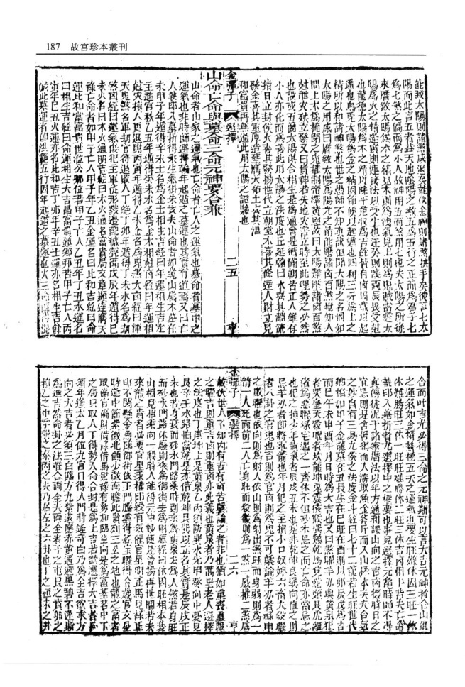

<!-- V3_SOURCE_ID:book025-b000215-p000-bfa742e21b -->

文中说“龍此言千金一幾者”，无非是想让人重视相关内容，却常常被人忽略。只是那些不善于经营的人家，不依靠自己的力量去寻找相关的地，有的得到了吉地却因困厄阻隔无法安葬，有的得到了凶地却执意要安葬，这就是所谓感召的关键关联，尤其与人所禀受的天命相关。杨子有贫穷的名声，赖子有扭转天命的能力，郭子能改变神功从而影响天命的走向。文中还提到“會子一毫能殺入一能救人”，这些情况都取决于所用秘诀是否真实，以及事主的心是否诚恳。所谓“千金一幾”，并不是真的要得到千金之后才去做相关的选择。古人说，富人家得到合适的地，往往是在家境贫寒的时候安葬；贵人家得到合适的地，往往是在处境困顿的时候进行扦葬，在这种时候，哪里会有千金的条件来做选择呢？这也取决于双方情意是否相合，以及对相关亲缘关系的重视程度够不够。所以说，寻找地的人家，积累德行是根本，寻访名师是关键，礼貌待人是首要之事。灵源红说：龙穴有偏有正，风水有好有坏，气运有盛有衰，感召的情况是相互对应的。所以说，还没有安葬山头的地时，屋中的人已经先受影响；如果屋中的人没有相应的福分，山头的地也不会显灵。有些福分浅薄的人，恭谨行事的就给他福报，轻慢懈怠的就给他灾祸。可以检验我所补充内容是否灵验，这实在都是天地爱惜生灵的心意，文中提到“蕭學者勿自發忍富以初心待之”，具体含义不详。廖子说：世人了解我或是不了解我，我都悠然自得，心中没有牵挂，掌握着穷通变化的关键，有人来询问日时相关的内容，就把相关要诀传给可信的人。《弹子》等三部书世间很少见到，得到传授的人要谨慎，不要吝惜传授，但也不能随便传给不合适的人，胡乱传授的罪过不轻。随便广泛传授的人会有不好的时运，学习的人不要在意这些闲言碎语。我现在采集相关内容整理成注本，是来汉天的一轮传承，要谨慎对待。文中提到“佛之毋孔也”，具体含义不详。《玉弹子地理元枢》，富脊张凤深九仪之前做过注，海昌陈变则子甫订龙。

> **释读存疑：** 龍此言千金一幾者；會子一毫能殺入一能救人；蕭學者勿自發忍富以初心待之；佛之毋孔也；來漢天亂之一輪也；富脊；訂龍；1轮自动修复后核义模型仍建议修订，已保守记录。

查看对应原文

<!-- V3_FOLDBACK_BEGIN:book025-b000215-p000-bfa742e21b -->

龍此言千金一幾者無非欲字崇每遺而巳惟補不善家指不書己力而求之或得吉地而困隔不塟若得凶地而心塟之是之謂感召之執関尤天人所其稟也指楊子有貧之名頼子有回天之力郭子能奪神功而政天命會子一毫能殺入一能救人此皆由其用秘訣之真與不真主人之心誠與不誠耳于金一若者非真欲得千金而後員一幾也古人目富家得地貧時塟貴家得地窮時扦當是時也鳥得有千金之幾歡乎亦由于情意之合與不合鴻親之再與不尊耳故曰求地之家積德爲木求師爲要禮貌為先靈源紅曰龍穴有偏正風水有美惡氣運有盛裏感召相肖故曰未塟山頭地先生屋下入屋下人無彌山頭地不靈有等福淺之徒履動者與之福輕慢者與之禍銘試吾補之驗否實皆天地好生之心而蕭學者勿自發忍富以初心待之廖子曰世人知我與不知囂自得心無樞掌握窮通一紙問日時聯息傳與信彈子三書世罕間得人傳投慎無吝非人乱語罪非輕廣授亂傳者時運學者勿顧等間吾今採顛成註來漢天亂之一 輪也慎之佛之毋孔也玉彈子地理元樞富脊張鳳深九儀前註海昌陳變則子甫訂龍

<!-- V3_FOLDBACK_END:book025-b000215-p000-bfa742e21b -->

<!-- V3_SOURCE_ID:book025-b000216-p000-3e24a71419 -->

一与四是山的形体，三与一是龙的气势，三者是变化的关键，一与四是形成的质地。所谓形成，是指土陇、平冈；所谓变化，是指升降、阖关、曲直、坦脊、坦曲、升关。张子考察龙的阳之所生、脊直、降阖，阴之所位，阳没有阴就不能生长，阴没有阳就不能形成，一阳一阴所以称为龙，独阳独阴所以称为山。

> **释读存疑：** 原文中“丈隴”“閤關”“坦脊坦曲”“升關”等内容语义模糊，具体所指不详

查看对应原文

<!-- V3_FOLDBACK_BEGIN:book025-b000216-p000-3e24a71419 -->

一二與四山之體三與一龍之勢三者變之機一四者成之質某成也曰丈隴曰平岡其變也曰升降閤關曰曲直坦脊坦曲升關五張子審龍陽之所生脊直降閤陰之所位陽無陰不生陰無陽不成一陽一陰故謂之龍獨陽獨陰故謂之山

<!-- V3_FOLDBACK_END:book025-b000216-p000-3e24a71419 -->

<!-- V3_SOURCE_ID:book025-b000217-p000-6eeb235443 -->

选择地的方法，以服龙房为主，观察龙的方法，先要详细审视势房。势有阴有阳，山的形态中，每一道冈、每一座阜都属于阴，所以说二与四是山的体性，二四属于偶数。龙的走势一起一伏属于阳，所以说三与一是龙的势态，三一者可數也，具体含义不详。阳能够化生，所以三一是变化的契机；文中提到“陰能誕靑故二四爲成之質”，具体含义不详。观察质地形成的规律，山形成的地貌，有的是彞陇，有的是平周，都是各自符合自然的格局。考察规律的变化，山脉上升之后必然会转为下降，收拢闭合之后必然会转为开阔舒展，曲折延伸多段之后必然会转为直行，大片平坦的区域中间必然会出现小的山脊，这些也都是自然的推移变迁。然而质地的形成，源自于阴阳变化的契机，所以阳气生发的同时，就有阴气对应的位置。阳主生发万物，没有阴就无法形成具体的形态，形态不成也就谈不上生发，所以阳没有明就不能生发。阴主成就万物，没有阳就无法提供生发的凭借，不能生发也就无法成就形态，所以阴没有阳就不能成物。只要有一阳就会生成一阴，有一阴就会变化出一阳，这样阴阳中和，变化不停，这才是龙的特性。如果只有一阳却没有阴来成就它，只有一阴却没有阳来变化它，就会阴阳不交，称为孤阴寡阳，只能叫做普通的山。这样详细辨析的话，山是作为护卫的砂，龙是用来结穴的。

> **释读存疑：** 服龍房；勢房；三一者可數也；誕靑；山成或成彞隴或成平周；湯無明不生；解寡；讓砂；1轮自动修复后核义模型仍建议修订，已保守记录。

查看对应原文

<!-- V3_FOLDBACK_BEGIN:book025-b000217-p000-6eeb235443 -->

擇地之方服龍房主而觀龍之法詳勢房先然勢有陰有陽山之休一岡一阜屬乎陰故曰二與四山之体二四者偶數也籠之勢一起一伏屬乎陽故曰三與一龍之勢三一者可數也陽能化生故三一爲変之机陰能誕靑故二四爲成之質觀質之所山成或成彞隴或成平周各自自然之蹈局考規之所山麥上升必変下降収閤必変開聞數曲來必変一直大坦中必変小脊亦俱為自然之推遷然質之成由子爽之机故陽之生卽有陰之位陽主生物非陰無以成形不成則不爲生故湯無明不生阴主成物非陽無以資生不生則不能成故阴無陽不成惟有一陽卽成一阴有一阴卽变一陽則明陽中和変化不翻豈非日龍若有一陽而無阴以成之有一阴而無陽以変之則陰陽不交是謂解寡止名曰山如此詳之山爲讓砂龍以作穴

<!-- V3_FOLDBACK_END:book025-b000217-p000-6eeb235443 -->

<!-- V3_SOURCE_ID:book025-b000218-p000-546c36828a -->

太祖是祖，少祖是宗，耸拔的会显贵，带诰、带轴、带酒屋的会富有，有仓、有庐、有派制的会贫穷，遇鬼过刦、斜死的会低贱，被伤、被泄的会卑贱。

> **释读存疑：** 原文中“祖少祖”“帶誥帶軸酒屋”“倉有廬派制”“遇鬼過刦”“斜死”“被傷被泄”等内容语义模糊，具体所指不详

查看对应原文

<!-- V3_FOLDBACK_BEGIN:book025-b000218-p000-546c36828a -->

太祖曰祖少祖曰宗聳拔者貴帶誥帶軸酒屋者富有倉有廬派制者貧遇鬼過刦斜死者賤被傷被泄

<!-- V3_FOLDBACK_END:book025-b000218-p000-546c36828a -->

<!-- V3_SOURCE_ID:book025-b000219-p000-b3636dfe75 -->

想要考察龙的气势，先看龙的太祖，太祖是最高最远的地方，就称为祖；太祖之下分枝立派的地方，是少祖，就称为宗。宗祖星辰，有的张天水，有的献天金，有的出阵贪狼，有的万笏兼贞，有的严顿如帐，有的展语如屏，远望之下，杂立振拔，带语带岫的大多生贵，远望之下如果融聚丰厚，有仓有库的大多生富，远望之下如果孤单一壁削，东遇鬼、酉过刻的，对应的是贫寒，远望之下如果至斜死颖，前被泄、后被伤的，对应的是卑贱。古人说有好的祖宗，才能生出好的子孙，所以现在……

> **释读存疑：** 原文中“硯”“張天水”“獻天金”“出陣貪狼”“萬笏兼貞”“嚴頓如帳”“展語如屏”“東遇鬼酉過刻”“至斜死頴”等内容语义模糊，具体所指不详，原文末尾有缺漏

查看对应原文

<!-- V3_FOLDBACK_BEGIN:book025-b000219-p000-b3636dfe75 -->

欲硯龍勢光观龍祖祖之最高最遠處是太祖也則謂之祖太祖之下分枝立派處是少祖也則謂之宗宗祖星辰或張天水或献天金或出陣貪狼或萬笏兼貞或嚴頓如帳或展語如屏望之者雜立振拔帶語帶岫者多生貴望之若所融豐厚何倉有庫者多生富望之若孤單壁削東遇鬼酉過刻其應貧寒望之若至斜死頴前被泄後被傷其應卑賤也古人言有好祖宗方生得奸兒孫故現

<!-- V3_FOLDBACK_END:book025-b000219-p000-b3636dfe75 -->

<!-- V3_SOURCE_ID:book025-b000220-p000-26e28754d3 -->

龙的气势应当遵循其祖宗的规律，玉弹子审龙。

查看对应原文

<!-- V3_FOLDBACK_BEGIN:book025-b000220-p000-26e28754d3 -->

龍勢當規能之祖宗玉彈子審龍

<!-- V3_FOLDBACK_END:book025-b000220-p000-26e28754d3 -->

<!-- V3_SOURCE_ID:book025-b000221-p000-c4eff9f4b5 -->

## 三分積 — 三分积

查看对应原文

<!-- V3_FOLDBACK_BEGIN:book025-b000221-p000-c4eff9f4b5 -->

## 三分積

<!-- V3_FOLDBACK_END:book025-b000221-p000-c4eff9f4b5 -->

<!-- V3_SOURCE_ID:book025-b000222-p000-e77120806b -->

从太祖山分出来的是大分，大分有大积；从少祖山分出来的是小分，小分有小积。分散的时候应该收敛，应该灵活，收敛的话气就会聚集，灵活的话气就会旺盛。积聚的地方应该肥厚，应该回顾，肥厚的话气就厚重，回顾的话意向专一。有分散却没有积聚，就像水没有依托容易干涸；有积聚却没有分散，就像“入之無枝”而必然枯槁，“入之無枝”具体所指不详。结的大小都可以由此预先判断，龙的贵贱也都可以由此预先区分。

> **释读存疑：** 水之無辭；入之無枝而必槁；結之大小；1轮自动修复后核义模型仍建议修订，已保守记录。

查看对应原文

<!-- V3_FOLDBACK_BEGIN:book025-b000222-p000-e77120806b -->

從太祖分者爲大分大分有大積自少祖分者爲小分小分有小積分散也宣歛宜活歛則氣聚活則氣盛積聚也宜肥宜顧肥則氣厚顧則意專分而無積猶水之無辭而易涸積而無分猶入之無枝而必槁結之大小胥此預卜龍之貴賤胥此預分

<!-- V3_FOLDBACK_END:book025-b000222-p000-e77120806b -->

<!-- V3_SOURCE_ID:book025-b000223-p000-649dfada39 -->

已经观察龙的太祖山，有的分出三条支脉，有的分出四条支脉，某条支脉结作郡县，某条支脉结作乡村，这就是大分。大分之下，就看本条支脉所分出的星辰，称之为小礼，之后少祖山的位置就确立了。少祖山之下又分出枝脉和干脉，有分干脉而结作大地的，有分该面而结作小地的，这就是小分。然而大小分的分界处，两旁都有护从的山脉，都呈拱峙的状态，所以大分有大的让位拱峙，这就是大积；小分有小的让从拱峙，这就是小积。然而在分界的地方，各自形成门户，各自开展生面，如果纷乱而不收敛，松散而不灵活，要让气聚集并且旺盛是很难的，所以分界处要安稳收敛，也要灵动。到了积的位置，或者青体在左侍奉，诚饰在右美好，不再是瘦削而不肥厚，想要剑拔出却不灌注，要让真气厚重、意向专一也是很难的，所以积的位置要肥厚，要回倾。然而有分就一定有积，这样垣城才稳固；有积就一定有分，这样支脉的走向才顺畅。如果有分却没有积，就像水只看到分派流走，怎么会不乾滷呢，具体含义不详；如果有积却没有分，就像树木只有枯干独立存在，怎么会不枯死呢。确实明白这个道理，那么地的大小、龙的黄贱，都可以站在数里之外就预先知晓。

> **释读存疑：** 謂之小禮少祖既立；小之讓從拱時；種歲或青體左侍誠飾處右好非復削而不肥滿欲劍而不注；垣城審；竄服濟；乾滷；龍之黃賤；1轮自动修复后核义模型仍建议修订，已保守记录。

查看对应原文

<!-- V3_FOLDBACK_BEGIN:book025-b000223-p000-649dfada39 -->

既視龍之太祖或分三條或分四條某條結郡縣某條結鄉材 是爲大分大分之下卽看本條所分星辰謂之小禮少祖既立 其下又分枝分幹有分幹而結大地者有分該面結小地者 是小分然大小一分處兩旁各有護從各皆拱峙故大分有大 之讓位拱峙是爲大積小分有小之讓從拱時是爲小積然為 其分處各立門戶各開生而若紛而不斂頌而不活欲其氣聚 與盛也備已故分處安斂要活至其種歲或青體左侍誠飾處 右好非復削而不肥滿欲劍而不注欲欲真氣厚意專也难巳 故積處欲肥欲傾然分必有積則垣城審積必有分則竄服濟 若分而無積猶水止見分派流去豈不乾滷積而無分猶木止 存枯幹獨立豈不死槁誠悉北義則地之大 小龍之黃賤可立于數里之外而預知之巳

<!-- V3_FOLDBACK_END:book025-b000223-p000-649dfada39 -->

<!-- V3_SOURCE_ID:book025-b000224-p000-c1a1a4ba10 -->

## 四變 — 四变

查看对应原文

<!-- V3_FOLDBACK_BEGIN:book025-b000224-p000-c1a1a4ba10 -->

## 四變

<!-- V3_FOLDBACK_END:book025-b000224-p000-c1a1a4ba10 -->

<!-- V3_SOURCE_ID:book025-b000225-p000-edbc18ea09 -->

地势断续的形态称为峡，地势宽阔环抱的形态称为变。恶形偏喜正形，护正憎邪；气脉涣散则力量轻弱，气脉凝聚则力量厚重。有的是隐踪匿迹，有的是渡水穿田。穿田之形要观察细微显露的支脉形态，渡水要寻找生成的石迹；隐踪要察势，匿迹要详形。若形势不真，便是假踪假迹；踪迹不明，穿渡之处便晦暗不清。

查看对应原文

<!-- V3_FOLDBACK_BEGIN:book025-b000225-p000-edbc18ea09 -->

斷續形勢爲峽慱抱氣度爲變惡偏喜正好護憎孤振偏氣渙則力輕護正氣萃則力重或偷踪閃跡或渡水穿田穿田觀微顯之支形渡水覓生成之石跡偷蹤察勢閃跡詳形形勢非真蹤跡則假踪跡不明穿渡則晦

<!-- V3_FOLDBACK_END:book025-b000225-p000-edbc18ea09 -->

<!-- V3_SOURCE_ID:book025-b000226-p000-cf82481f3c -->

龙脉从主脉通宗之处分出，所以要辨别学派的形态，读这段内容时必须做断句。在一断一宝之间，是时气的运行状态，度势需要有博济的考量；在转传折撰的地方，就是变峡。变和峡都属于不好的形态，偏传歌中晓示说：龙脉的形态中正端庄，或有奸邪之形夹护密获周全，或是帽单银孤露的状态，为什么会有这些差异？因为龙脉在精开得换的地方，都处于孤露中寒、偏侧歌倾的状态，此时气横羽而力量轻薄，能带来的福祉很小；如果两侧夹护齐整周全，形态中正端庄，就会气钟孝而力量厚重，能带来的福祉很大。然而文中有一句“谈丧之内者得每晦问时而为渡水分四”，所以穿田而过的龙脉，应当顶若亥形；庆水而来的龙脉，要在窝劳处寻找天然生成的石迹。看起来像是龙脉偷行的踪迹，走势必定精细绵密，不能仅靠水的形态判断，要观察石迹天然生成的位置；龙脉的闪迹形状像绳疑，出现在田中，仔细查看就在支脉形态的微头处。所以形势真确的话，踪迹自然明了不假；踪迹清楚明确的话，龙脉穿河渡田的路径才不会晦暗不明，不然就难以凭信。以上是邑五法的内容。

> **释读存疑：** 一断一宝、博拯、转传折撰、帽单银、气横羽、气钟孝、谈丧之内者得每晦问时而为渡水分四、顶若之亥形、窝劳、绳疑、邑五法的具体含义未明，仅按原文表述直译；一断一宝、博拯、转传折撰、帽单银、气横羽、气钟孝、谈丧之内者得每晦问时而为渡水分四、顶若之亥形、窝劳、绳疑、邑五法的具体含义未明

查看对应原文

<!-- V3_FOLDBACK_BEGIN:book025-b000226-p000-cf82481f3c -->

龍從通宗分故學派形辨須有斷讀而一斷一寶之間則為時氣度須有博拯而轉傳折撰之處則為変峽也変也俱惡偏傳歌曉而云中正端莊奸夾密獲周而帽单銀孤露若此者何也以所精開得換處皆孤露中寒偏側歌傾則氣橫羽而力輕發福小若夾齊護周中正端莊則氣鍾孝而力重發福大然文有一稱談喪之內者得每晦問時而爲渡水分四故穿田之龍當頂若之亥形慶水之龍窩勞生成之石跡似龍之偷蹤勢必精蜜非水可斷察之卽位石跡之生成處龍之閃跡形如繩疑歷現田中詳之卽在支形之微頭處故形勢真儀則蹤跡目然不假踪跡著明則穿渡方爲不晦匪然則难信邑五法

<!-- V3_FOLDBACK_END:book025-b000226-p000-cf82481f3c -->

<!-- V3_SOURCE_ID:book025-b000227-p000-1ab81f657f -->

咽就像鼓风的器具，一呼一吸是预先定下的规则，共有二十一种。束咽形态端正，穴就在正中间；束咽形态偏斜，穴就随势倚靠；束咽形态弯曲，穴就必定逆着走向选取；束咽有角闪的情况，穴就在侧面选取。束咽顶部缓长，就反过来靠短聚处取穴；束咽低平绵柔，取穴位置就要升高；束咽走势峻急下坠，取穴位置就要贴近底部。束咽处是石质，就转而在土中寻找结穴的位置。阴气达到极致就会与阳气相合，阳气达到极致就会挈引阴气生发。束咽气势过于雄饱，适宜用关来疏泄过强的杀气；杀气强盛的情况下，喜欢四周有山顾护环绕再做裁度。所以湾曲的形态要对应小阳大阴的属性，生气汇聚就结穴，死气乘入就会形弱气绝，这些内容都细致记载在相关的书里。有峡有变的地方，就会出现“东啊”的情况。一呼一吸就像鼓风囊鼓动，点穴的各种方法都要预先以此为依据。比如东咽端正，入首处的穴也会中正；东咽偏斜，入首处的穴也会斜倚；东咽弯曲，入首处就会回盼，穴就逆朝向设置；束咽角闪，八首（应为入首的讹写）角清面，穴就在侧面选取；东咽缓长，入首处的气脉必然也缓长，穴就设在东嘲短聚的位置，入首处的气脉必然也短聚，穴就设在返的位置；东咽低平绵延收缩，八首（应为入首的讹写）处的气脉平和，穴适宜选在高处；东咽峻急向下冲，入首处的气脉挺立，穴适宜选在底部。如果东咽处是石质，入首结穴的位置就在土中；束咽阴气极盛，入首处就会转而生阳结穴；束咽阳气极盛，入首处就会转而生阴结穴；东咽过于雄饱，就要找荡关来清肃气脉；来咽表现出杀气过强，就喜欢多有刦来分散气脉的力道；束咽处四周的山都顾护眷恋，可以直接斩关裁穴；来咽处的脉络深厚，就在曲泡的位置选穴；束咽狭窄狭小而气脉收敛，八首（应为入首的讹写）必然在阳位结穴；束咽宽阔而气脉散逸，入首必然在阴位结穴。总的来说，有生气就会结穴，有死气就会尧；如果结穴的态势弱，八首（应为入首的讹写）必然形衰气绝，不值得取用。以上是卜地观察入首的方法，出自《玉弹子》审龙四利。

> **释读存疑：** 石还释土、阳挈、雄饱关宜杀强刦喜四顾裁、湾曲拟小阳大阴生结死乘刦弱绝形细缊、东啊、东咽、东嘲、八首、死氣則堯的具体含义未明，其中八首疑为入首的讹写，其余内容按原文直译；石还释土、阳挈、雄饱关宜杀强刦喜四顾裁、湾曲拟小阳大阴生结死乘刦弱绝形细缊、东啊、东咽、东嘲、八首、死氣則堯的具体含义未明，八首疑为入首的讹写；本地硬校验仍未通过，已记录供后续自动处理或人工核对。

查看对应原文

<!-- V3_FOLDBACK_BEGIN:book025-b000227-p000-1ab81f657f -->

咽猶鼓真一呼一吸預定之規二十有一正則穴中斜則穴倚曲必逆居閃則傍取頂爲緩長返因短聚低綿升高峻急墜底石還釋土土止陰極陽合陽極陰挈雄飽關宜殺強刦喜四顧裁故灣曲擬小陽大陰生結死乘刦弱絕形細縕書矣有峽有変卽有東啊一呼一吸猶鼓橐然而點穴諸法于此預是如東咽正則入首處穴亦中正東咽斜則入首處穴亦斜倚東咽灣曲則入首回顧而穴逆朝束咽角閃則八首角清面穴傍取東咽緩長則入首必緩長而穴居于東嘲短聚則入首必短聚而穴居于返東咽低平衍縮則八首平和穴宜升高東咽峻急注下則入首卓立穴宜墜底若夫東咽石則入首結穴在土束咽陰盛大則入首處麥陽結穴束咽陽盛大則入首處変陰結穴東咽過于雄飽則求蕩關以清其氣來咽見其殺強則喜多刦以分其氣束咽處四山顧恋穴可斬關而裁之來咽處脈絡牧深穴于曲泡而擬之束咽狹小而氣斂八首必穴陽處束咽濶大而氣散入首必穴陰處總而言之生氣則結死氣則堯逢結而弱則八首必形衰氣絕不足观巳此卜地觀入首玉彈子審龍 四 利

<!-- V3_FOLDBACK_END:book025-b000227-p000-1ab81f657f -->

<!-- doc013 PDF 第 194 页：高风险/复杂版面 OCR 供检索；内容与排版以原页图为准。 -->
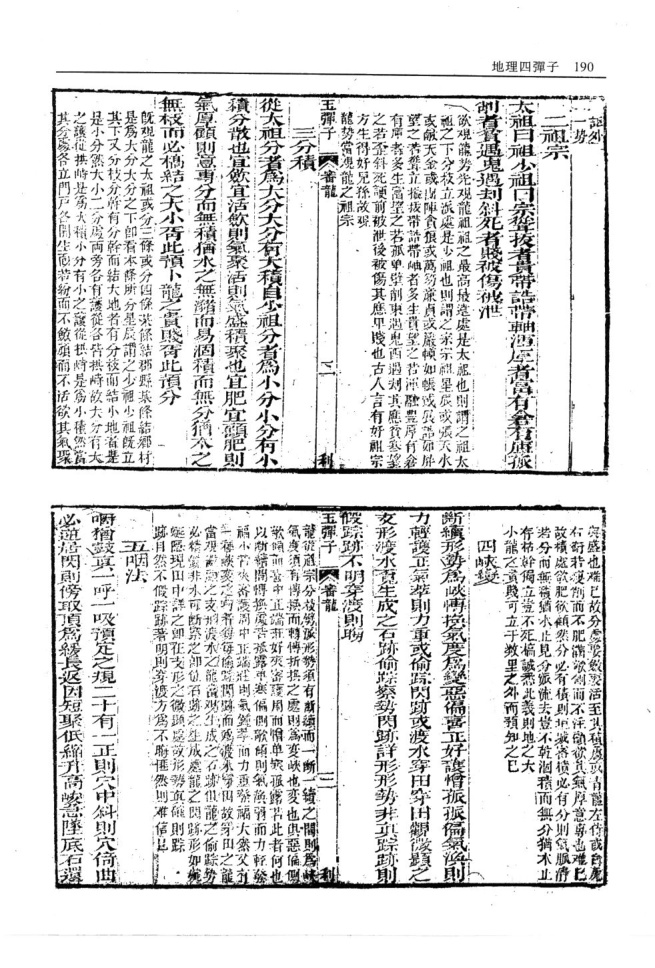

<!-- V3_SOURCE_ID:book025-b000229-p000-f631b240d4 -->

苦何结穴的方法，对应知晓峽获的情况；东咽对应峡变，掌握束咽的方法，就能知晓八首（应为入首的讹写）结穴的方法。

> **释读存疑：** 苦何、峽獲、八首的具体含义未明，其中八首疑为入首的讹写；苦何、峽獲、八首的具体含义未明，八首疑为入首的讹写；本地硬校验仍未通过，已记录供后续自动处理或人工核对。

查看对应原文

<!-- V3_FOLDBACK_BEGIN:book025-b000229-p000-f631b240d4 -->

苦何結穴卽知峽獲若何東咽現峽变束咽之法卽知八首結穴之法也

<!-- V3_FOLDBACK_END:book025-b000229-p000-f631b240d4 -->

<!-- V3_SOURCE_ID:book025-b000230-p000-9893a7b93e -->

龙脉之势雄猛，不遇刦则不歇，不歇则不结；遇刦则刦其杀。山体粗顽，不辟则不泄，不泄则不清；辟则开其怒。不强不弱，刦关而后穴至；至旺至刚，刦辟而后结。犯刦勿辟，犯关勿刦；刦关两犯，游龙不结。

查看对应原文

<!-- V3_FOLDBACK_BEGIN:book025-b000230-p000-9893a7b93e -->

龍勢雄猛不刦不歇不歇不結刦則刦其殺也山體粗頑不闢不泄不泄不清闢則開其怒也不強不弱刦關而後穴至旺至剛刼闢而後結犯刦勿闢犯關勿刦刼關兩犯游龍不結

<!-- V3_FOLDBACK_END:book025-b000230-p000-9893a7b93e -->

<!-- V3_SOURCE_ID:book025-b000231-p000-7f96d701ff -->

原文首句为日文“東咄處を枝右派是謂之封”，含义无法准确释读。文中提到开帐展通的情况称作闢。大致来说，龙势碑猛，后续气湧胆，必须有左枝右派来封护，气脉才能停驻结穴。山体祖气怒气强盛，必须开帐展翅来闢，才能鸿泄而气脉清净。如果气脉不強不弱，就是剛葉相資，这是已经刻闻的情况。如果气脉至旺至剛，就是阴阳还未调和，是将来要封关的状态。然而割聞不可並侶，如果刦翩並犯，不是行龙刚开始发迹的地方，距离水口檻屈捍门的砂都属于游龙，怎么能结地。

> **释读存疑：** 日文“東咄處を枝右派是謂之封”、開帳展通、碑猛、氣湧膽、鴻泄、剛葉相資、刻聞、封關、割聞、並侶、刦翩、離水口檻屈捍門之砂的具体含义未明；“東咄處を枝右派是謂之封”、開帳展通、碑猛、氣湧膽、鴻泄、剛葉相資、刻聞、封關、割聞、並侶、刦翩、離水口檻屈捍門之砂的具体含义未明；1轮自动修复后核义模型仍建议修订，已保守记录。

查看对应原文

<!-- V3_FOLDBACK_BEGIN:book025-b000231-p000-7f96d701ff -->

東咄處を枝右派是謂之封開帳展通是謂之闢大抵龍勢碑猛後氣湧膽必左枝右派以封之方可住歇而結穴山体祖云怒氣強盛必開帳展翅以開之方能鴻泄而氣清若不強不弱則剛葉相資巳經刻聞者也至旺至剛則陰陽未和將來封關者也然割聞不可並侶若刦翩並犯非行龍發跡方始之地離水口檻屈捍門之砂皆爲游龍何以結地

<!-- V3_FOLDBACK_END:book025-b000231-p000-7f96d701ff -->

<!-- V3_SOURCE_ID:book025-b000232-p000-931ab22110 -->

七穿落

查看对应原文

<!-- V3_FOLDBACK_BEGIN:book025-b000232-p000-931ab22110 -->

七穿落

<!-- V3_FOLDBACK_END:book025-b000232-p000-931ab22110 -->

<!-- V3_SOURCE_ID:book025-b000233-p000-efd779480f -->

文中提到“穿非穿帳，落非中角”，形势中的奥妙难以言说。接下来的“度面陰落湖落穿陰面湯春陰陰落穿陽一陰一陽五為其根”这一整段内容语义模糊，无法准确释读。后面又说“男女拊精，万物化生，纳细之义，天地自然”，这部分内容具体所指不详。

> **释读存疑：** 度面陰落湖落穿陰面湯春陰陰落穿陽一陰一陽五為其根、男女拊精、纳细之义的具体含义未明

查看对应原文

<!-- V3_FOLDBACK_BEGIN:book025-b000233-p000-efd779480f -->

穿非穿帳落非中角形勢中盡妙難言度面陰落湖落穿陰面湯春陰陰落穿陽一陰一陽五為其根男女拊精萬物化生納細之義天地自然

<!-- V3_FOLDBACK_END:book025-b000233-p000-efd779480f -->

<!-- V3_SOURCE_ID:book025-b000234-p000-0a2e297d4b -->

该段原文存在大量讹误、脱漏，多处语义不通，包括“一言崔總而言之”“必開展亥恐為落陽已佛陽落”“必仍以飲起書見兩乎”“面陽款疫之特”“又恐發異也是誤落，正所以字陽也”“故子陰抑男女攜之乃天地”等内容，均无法准确释读，仅能辨认提到一翅一闢、穿落相关的形势特点，其余内容损毁不明。

> **释读存疑：** 整段存在大量讹脱，大部分内容无法准确释读

查看对应原文

<!-- V3_FOLDBACK_BEGIN:book025-b000234-p000-0a2e297d4b -->

一翅一闢穿落乃見穿峻穿心中啟角落形勢之妙一言崔總而言之如來龍是辰圓飽而陰欲渡之時必開展亥恐為落陽已佛陽落則龍氣舒暢勢欲前行必仍以飲起書見兩乎正所以穿陰也如來龍星辰平均面陽款疫之特必起書之雲為落陰然陰落則龍氣翕聚勢欲前行又恐發異也是誤落正所以字陽也發根于屬陽故子陰抑男女攜之乃天地

<!-- V3_FOLDBACK_END:book025-b000234-p000-0a2e297d4b -->

<!-- V3_SOURCE_ID:book025-b000235-p000-9e1984ca49 -->

八传变

查看对应原文

<!-- V3_FOLDBACK_BEGIN:book025-b000235-p000-9e1984ca49 -->

八傳變

<!-- V3_FOLDBACK_END:book025-b000235-p000-9e1984ca49 -->

<!-- V3_SOURCE_ID:book025-b000236-p000-e5e8c5c3b5 -->

传承并非源自五曜，变化也并非出自九星，二者有授受的区别、老少的划分。方脉所祭祀的内容、形势所阐明的规律是：来的是阳就承受阴，阳到了老态就会发生变化；来的是阴就承受阳，阴到了老态就会终结。要把“无人有向”、切实探寻政功作为最玄妙的要领，希望你仔细审慎地参详。

> **释读存疑：** “無人有向”“政功”具体所指不详；1轮自动修复后核义模型仍建议修订，已保守记录。

查看对应原文

<!-- V3_FOLDBACK_BEGIN:book025-b000236-p000-e5e8c5c3b5 -->

傳非五曜變非九星授受之別老少之分方脈所祭形勢所明來 陽受陰陽老而變來陰受陽陰老而終以無人有向實尋政功為 元妙幸審詳之

<!-- V3_FOLDBACK_END:book025-b000236-p000-e5e8c5c3b5 -->

<!-- V3_SOURCE_ID:book025-b000237-p000-743f7b7d8c -->

一落一穿的传变萌动之形，虽然是五庐相传，却不必舍弃五福；九毫宗的变化，也不必拘泥于九星，这是为什么呢？后龙来势细微，我将承受它，其中的道理不外乎阴阳老少这一个要点罢了。要察明它的方脉，辨明它的形势，如果来势是从六以阳，我去的时候必然要承受阴。承受的过程不要刻意作为，要点就在于与之相合。“阴人有见高山必露平加的”这一表述具体所指不详，而世上虚玄的元妙言论，其指向都在于你自己参悟。

> **释读存疑：** 阴人有见高山必露平加的；五庐；九毫宗；從六以陽；1轮自动修复后核义模型仍建议修订，已保守记录。

查看对应原文

<!-- V3_FOLDBACK_BEGIN:book025-b000237-p000-743f7b7d8c -->

一落一穿傳変萌形然五廬相傳而不必捐于五福九毫宗變而不必拘于九星何也後龍來以微我我將受之而去其同不外陰陽老少一字而巳使察其方脉明其形勢如來為從六以陽我去必受之以陰受之以者非有爲要與以謂之師陰人有見高山必露平加的而世虛元妙之言其在子

<!-- V3_FOLDBACK_END:book025-b000237-p000-743f7b7d8c -->

<!-- doc013 PDF 第 195 页：高风险/复杂版面 OCR 供检索；内容与排版以原页图为准。 -->
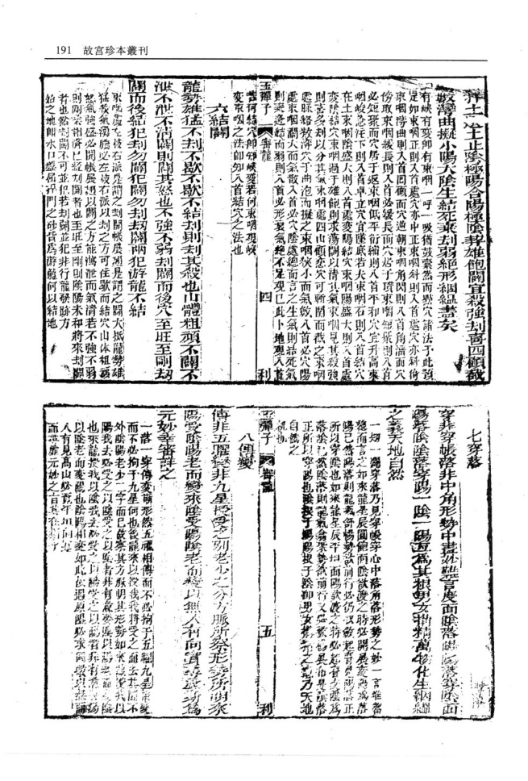

<!-- V3_SOURCE_ID:book025-b000239-p000-3b302c37fe -->

九形勢包含形勢四局，分别是顺、逆、斜、横四种格局。横局适合下臂纠且掬案，逆局适合面朝，顺局适合交顾，这是大致的核心要领。如果要探究更精微的内容，需要以神观形，形有具体的形状依据，神没有固定的名称范式，要通过观察外在的形迹来推测内在的情况。书中还提到了“生蛇渡水”“啄木腾空”的说法：什么是生蛇？就是平地之上走势委婉曲折的形态；什么是啄木？就是高山之上起伏错落的态势。如果脱离了这两种形态的要求，就不会有龙孕育。

> **释读存疑：** 1轮自动修复后核义模型仍建议修订，已保守记录。

查看对应原文

<!-- V3_FOLDBACK_BEGIN:book025-b000239-p000-3b302c37fe -->

九形勢 形勢四局順逆斜橫 橫宜下臂糾且掬案 逆宜面朝 順宜交顧 此其大要 若求精微 以神觀形 形有狀據 神無方名 取迹於外以觀平內 生蛇渡水 啄木騰空 何謂生蛇 平中委曲 何謂啄木 高山起伏 脫一不然 不龍不育

<!-- V3_FOLDBACK_END:book025-b000239-p000-3b302c37fe -->

<!-- V3_SOURCE_ID:book025-b000240-p000-dd58064fab -->

传奕掌握了形势的判断方法之后，就可以详细审察格局，这类格局共有四种：如果气来有承接，就命名为顺；如果左右砂头叶炤支顾，平卿续方，就命名为广帝；如果卜秀开按，看不到飞禽走兽之形，来龙直来而脉顺从，就命名为得录；门身、案山最喜砂山环抱，来龙从南方直来，入首处回转，就命名为逆边。“明以无源一大最选悠汤面明”具体所指不详，这是六要的内容。进一步推求结数，从外形观察内在的神气，是最重要的口诀。山形成外形是为了藏纳气，神因气而“男于形”，这一表述具体所指不详；“因形以秦麟”具体所指不详，察神以末气的具体含义也不详，另外还有飞土布子、审龙的相关内容。

> **释读存疑：** 明以无源一大最选悠汤面明；神因氣而男于形；因形以秦麟；察神以末气；叶炤；平卿续方；卜秀开按；結數；1轮自动修复后核义模型仍建议修订，已保守记录。

查看对应原文

<!-- V3_FOLDBACK_BEGIN:book025-b000240-p000-dd58064fab -->

傳奕既得形勢可得審詳其局則有四焉 如氣來有受名之日順 願必左右砂頭葉炤支顧平卿續方之曰廣帝 必卜秀開按不見飛走來龍直來而脈從謂養名之曰得錄 門身案山最喜沙環抱 南來龍直來面人首回轉名之曰逆邊 明以無源一大最選悠湯面明 此乃六要 進求結數 從形視神乃爲至訣 山成形以藏乎氣 神因氣而男于形 因形以秦麟 察神以末氣 飛土布子 審龍

<!-- V3_FOLDBACK_END:book025-b000240-p000-dd58064fab -->

<!-- V3_SOURCE_ID:book025-b000241-p000-93edb244ec -->

平地上的朝向委曲延伸，就像生蛇渡水一样；内山的起伏态势，就像啄木鸟钻空的形态一样。经书上说：能够体现超伏的态势，就更能见到神光；溜日猜气的方法掌握到位，才能谈论龙的相关判断。考量龙之后，再考察本身的形势，如果有做不到的地方，怎么会发福呢？

> **释读存疑：** 溜日猜气；超伏；神光；1轮自动修复后核义模型仍建议修订，已保守记录。

查看对应原文

<!-- V3_FOLDBACK_BEGIN:book025-b000241-p000-93edb244ec -->

平中委向如生蛇之渡木 現內山危伏似啄木之空 經雲 用示超伏益見神光 溜日猜氣始全 方言龍方考身有不為 何以發

<!-- V3_FOLDBACK_END:book025-b000241-p000-93edb244ec -->

<!-- V3_SOURCE_ID:book025-b000242-p000-9e438c7d16 -->

## 十頭 — 十头

查看对应原文

<!-- V3_FOLDBACK_BEGIN:book025-b000242-p000-9e438c7d16 -->

## 十頭

<!-- V3_FOLDBACK_END:book025-b000242-p000-9e438c7d16 -->

<!-- V3_SOURCE_ID:book025-b000243-p000-dffae0909c -->

形态圆净的称为峦，偏侧陡立的称为壁，直立且巉削刚硬的称为岩。要鄙弃普通的山冈，看重峦头，舍弃岩和鲢。峦的形态有立、坐、卧、侧四种，峦的朝向有阴、阳两种。阳舍离阴，是生发的征兆；阴舍离阳，是运化的奥妙。峦的外形对应五行，清贵的就主贵，浑浊的就主富，瘦弱的就主贫，偏枯的就主归。“之势也有帛头有满射有斜体有而身有坠形形陆穴粘势逆体径六倚报躬穴抗易穴”这段表述语义不通，具体所指不详。

> **释读存疑：** 之势也有帛头有满射有斜体有而身有坠形形陆穴粘势逆体径六倚报躬穴抗易穴；岩鰱；荷則貴；1轮自动修复后核义模型仍建议修订，已保守记录。

查看对应原文

<!-- V3_FOLDBACK_BEGIN:book025-b000243-p000-dffae0909c -->

圓淨爲巒偏側爲壁立巉剛爲岩賤山岡貴巒頭棄岩鰱夫巒 之體也有立坐臥側巒之面也有陰有陽陽舍陰生之兆舍陽 化之妙巒之形也有五行荷則貴濁則富瘦弱則貧偏枯則歸 之勢也有帛頭有滿射有斜體有而身有墜形形陸穴粘勢 逆體徑六倚報躬穴抗易穴

<!-- V3_FOLDBACK_END:book025-b000243-p000-dffae0909c -->

<!-- V3_SOURCE_ID:book025-b000244-p000-55c55f91a1 -->

务头是细形分中的书头，22之下从此处分出不同的脉络，共有四体：形态高耸挺立如同中天之木的，是立门，对应大山山明的格局；形态平卧如同天财土的，是满；形态侧落如同土角流金、金郎将水的，是门。这四体的形态各自有阴阳属性，阴中包含阳，阳与阴相合，才能化生。这四体的形态都不出五行的范畴，其中清、县、明、高、贵、爽、结的格局对应贵，反之则为贱，不能不加以辨别。这四体的态势对应四厅：高峻处在头部、适合上聚的，对应的穴就应该有四廉；平和精舫、适合中殿的，对应的穴就应该归属于有门的类别；总公伏币陆、适合下聚的，对应的穴就应该和有四应的格局相匹配；在内脊身以病祖宗的，对应的穴就应该采取逆的方式；四休偏坐就顺着左侧的走势，四应偏右就斜着顺着右侧的走势，对应的穴就应该符合伦的要求。这些内容需要仔细用心体会，相关内容已经在杨见巳的相关论述中提及。

> **释读存疑：** 细形分中之书头；天财土；土角流金；金郎将水；化牛；清县明高贵爽结则员贱；四厅；四廉；精舫；中殿；总公伏币陆；在内脊身以病祖宗；四休；宜伦；会杨见巳；1轮自动修复后核义模型仍建议修订，已保守记录。

查看对应原文

<!-- V3_FOLDBACK_BEGIN:book025-b000244-p000-55c55f91a1 -->

務頭者細形分中之書頭也之 22下此分途然有四体卓立如中天木則為立門會大山山明也構卧如天財土則為滿側落如土角流金金郎將水則爲門惟此四体之而各有陰陽其中陰以含陽陽以合陰始能化牛惟此四休之形不外五行其中清縣明高貴爽結則員賤不可不別惟此四体之勢有四廳高峻居頭以就上聚者六則宜有四廉平和精舫以就中殿者穴則宜歸有門總公伏幣陸以就下聚者穴則宜和有四應在內脊身以病祖宗者穴則宜逆有四休偏坐則而從左四應偏右則斜而從右者穴則宜倫細心理會會楊見巳

<!-- V3_FOLDBACK_END:book025-b000244-p000-55c55f91a1 -->

<!-- doc013 PDF 第 196 页：高风险/复杂版面 OCR 供检索；内容与排版以原页图为准。 -->
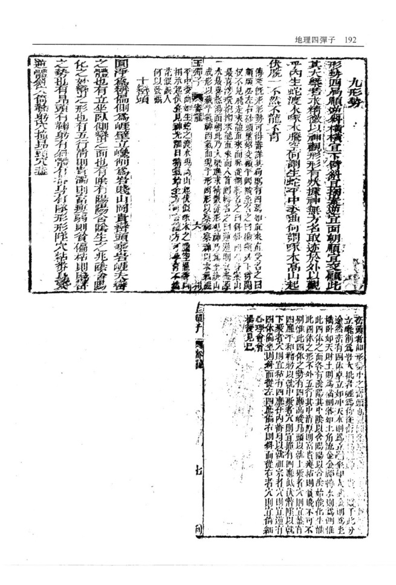

<!-- V3_SOURCE_ID:book025-b000246-p000-ffbfc28e19 -->

水对应阴盛的状态，火对应阳极的状态，盛到极点就会转向杀伐。木秉持阳的冲和之气，金秉持阴的和顺之气，达到中和就会生发。所以点穴优先选择对应金木的位置，不选择对应水火的位置，这个道理一以贯四，要是四象不完备，怎么能化生万有？金木相交、水火相济之后才可以点穴：金钳即水即木，木身木节即金即火，只有土没有固定的方位，会转化为金木的属性。点穴时阳面要扦在突处或者乳角的位置，阴面要扦在高处或者口山的位置。金木山星各自具备阴阳属性，“阳瑜乾，乾生二女，散取乎聚”中“瑜”疑似讹字，具体含义不详；“阴喻坤，坤生三男，刚取乎桑”中“桑”疑似讹字，具体含义不详。立、卧、坐、侧四种形态，每一种都分三停四体，“名六二十有四”语义不明，具体所指不详。

> **释读存疑：** 阳瑜乾；刚取乎桑；名六二十有四；金鉗卽水即木木身木節卽金即火；1轮自动修复后核义模型仍建议修订，已保守记录。

查看对应原文

<!-- V3_FOLDBACK_BEGIN:book025-b000246-p000-ffbfc28e19 -->

水由陰盛火由陽極盛極殺也木稟陽沖金稟陰和中和生焉故穴金木不穴水火及其所自一以貫四四象不備築能化有金木交水火濟而後或穴金金鉗卽水即木木身木節卽金即火惟土無位變金木穴陽面扦突或乳角焉陰面扦高或口山焉金木山星各備陰陽陽瑜乾乾生二女散取乎聚陰喻坤坤生三男剛取乎桑立臥坐側每分三停四體名六二十有四

<!-- V3_FOLDBACK_END:book025-b000246-p000-ffbfc28e19 -->

<!-- V3_SOURCE_ID:book025-b000247-p000-61ac54306b -->

本段内容讲解审察穴的方法，开头的“利”疑似衍文。凡是龙入首的时候，要寻找对应的穴，“求夫穴而人等星辰”语义不通，疑似存在讹字。星辰分为水、火、木、金、土五类，水流龙的性质是阴盛，火性就燥，“以所临诗过感龟极杀气万焉”语义不通，疑似存在讹字。本朝向春紫，性质属于阳中，“金发光独孔经说和生气草巳见无当避”语义不通，疑似存在讹字。所以对应水火的穴，小遇生则云视，对应金木的穴有多种含义。天地之间的大局，只有木大齐，金木相交敝才能结穴，离有多纂之分，金木水火四样互不分离。就比如金星入首，非窝不可，八非讎不成，“高窝师为木而舞即为木也”中“师”“舞”疑似讹字，具体含义不详；“如木举入有非背不可”语义不通，疑似存在讹字，穴非节不生，势无芽即为火，节即为金。“至子土宿”中“子”疑似讹字，土宿在四方虽然没有固定的正位，凡是阳面扦契乳角，都需要阳土平；阴面丹窝其口，按理也需要阳土平。“合而现之山你锥分五星”中“你锥”疑似讹字，五星归根结底不外乎阴阳二气。所以凡是阳中乍现阴气的，要在散中取聚；阴中化生阳气的，要在刚中取柔。乾坤二卦，“无井属来聚哉之旨耳”语义不通，疑似存在讹字。人只要领会这个道理，就能获得吉利，立、卧、坐、侧的二十四交，只能意会无法言传。

> **释读存疑：** 利（疑似衍字）；求夫穴而人等星辰；以所临诗过感龟极杀气万焉；金发光独孔经说和生气草巳见无当避；高窩師為木而舞；如木舉入有非背不可；至子土宿（子疑似讹字）；山你錐（你錐疑似讹字）；无井属来聚哉之旨；本向春紫；木大斉；金木交敝；多纂；八非讎不成；二十四交；1轮自动修复后核义模型仍建议修订，已保守记录。

查看对应原文

<!-- V3_FOLDBACK_BEGIN:book025-b000247-p000-61ac54306b -->

子審穴 利凡龍人首求夫穴而人等星辰有水火木金與土德水流龍其性陰盛火就燥以所臨詩過感龜極殺氣萬焉本向春紫其性陽中金發光獨孔經說和生氣草巳見無當避故水火之穴小遇生則雲視金未之穴多義天地間一大局止有木大斉金木交敝結穴離有多纂之分而金木未火四件不相離卽如金星人首非窩不可八非讎不成高窩師為木而舞卽爲木也如木舉入有非背不可穴非節不生勢無芽卽為火而節卽爲金也至子土宿四方雖無正位而凡陽面扦契其乳角非陽土平陰面丹窩其口理非陽土平合而現之山你錐分五星不外陰陽二氣故凡陽以乍陰者散取乎聚也陰以生陽者剛取乎柔也乾坤二卦無井屬來聚哉之旨耳人惟理會此吉以取立周坐側之人二十四交但可意會而得之巳

<!-- V3_FOLDBACK_END:book025-b000247-p000-61ac54306b -->

<!-- V3_SOURCE_ID:book025-b000248-p000-d2a7ec454f -->

## 二穴總——第二部分是关于穴的总述

查看对应原文

<!-- V3_FOLDBACK_BEGIN:book025-b000248-p000-d2a7ec454f -->

## 二穴總

<!-- V3_FOLDBACK_END:book025-b000248-p000-d2a7ec454f -->

<!-- V3_SOURCE_ID:book025-b000249-p000-3864a0735a -->

文中提及“鸡心心结”“鱼胞胞安”“蜂腰背上作而中逢串珠”“枕来蹈去遇头”“或东与西割脚应居顶”“垂乳耍安头解行眼中有力”“大服胁内无凶”“虾慕背上半挨脑”“牛子鼻中斜扫管”“经火尾而斩”“蠕州露而垂珠”“鱼腰傍骨”“牛舌亲尖”“瞻宫留牛脑月声凑”“一阴天龙窟兮癸一阴而留一阳”“一阳天龙突兮凑一阳而留一阴”“龙葬其唇”“鹤安乎顶”“鸦钳分处下”“鹊口合中”“锥掷竹节胞”“葵叶凹心”“荷盘珠上”“柳叶心中”“泉涌大者为贵”“花落小者为尊”“孩儿脑顶”“象鼻牙根”“银槽金规须丰脑”“席畅第笠要坦”“阳寿带动中最吉”“合襟静处为垂珠”“头上覆杓脑是一滴虽眼须察两股虾须要明”，以上表述均属风水形法相关内容，具体含义因无明确术语依据暂无法确定。

> **释读存疑：** 所有提及的风水形法短语均无可靠释义依据，仅原文引述

查看对应原文

<!-- V3_FOLDBACK_BEGIN:book025-b000249-p000-3864a0735a -->

鷄心心結魚胞胞安蜂腰背上作而中逢串珠枕來蹈去遇頭或東與西割腳應居頂垂乳耍安頭解行眼中有力大服脇內無凶蝦慕背上半挨腦牛子鼻中斜掃管經火尾而斬蠕州露而垂珠魚腰傍骨牛舌親尖瞻宮留牛腦月聲湊一陰天龍窟兮癸一陰而留一陽天龍突兮湊一陽而留一陰龍塟其唇鶴安乎頂鴉鉗分處下鵲口合中錐擲竹節胞葵葉凹心荷盤珠上柳葉心中泉湧大者爲貴花落小者爲尊孩兒腦頂象鼻牙根銀槽金規須豐腦席暢第笠要坦陽壽帶動中最吉合襟靜處爲垂珠頭上覆杓腦是一滴雖眼須察兩股蝦鬚要明

<!-- V3_FOLDBACK_END:book025-b000249-p000-3864a0735a -->

<!-- V3_SOURCE_ID:book025-b000250-p000-06eb0a8466 -->

文中提及“布气者龙也”“永气者穴也”“穴法难有种补名目，总倩外形以取内气而已”，又提及“却心鱼脆气在心与胞，故曰心结胞安”“蜂腰鹤脉，气在胥与节，故曰背上作节”“中逢串珠，气在相串处，故宜号来归去遇”“淋头气傍两脚迁，故曰或东与西水割脚则气上疑，故曰应居顶”“脉垂乳则气下注，故寝宏头属行气在取，故曰农中有力”“犬眠气在胁，故曰胁内无凶”“灯之背生气在脑，故曰半按腊”“牛子鼻中生，气在管，故曰妇插管”“灯火之气在火焰相接处，故曰新烛”“草头之气在露珠凝结中，故曰垂珠”“鱼腮气骨”“牛舌气在尖，故宜傍宜亲”“蟾宫气任然月晕，气在阴，故宽晋宜奏”“窟穴阳气胜，故凑阴而晋”“阳突穴阴气胜，故废阳而去”“龙气在唇，鸡气化顶，故一葬唇一安头”“鸦与气在分处，鹊口气在合中，故一分处下一合中集”“竹气任节，葵气在凹，故言掷竹节胞”“葵叶门心，荷盘气在珠，柳叶气在心，故言荷盘珠上、栏尽心中”“万船泉珠气涌于大，故曰泉涌大者为贵”“彦地梅花气聚于小，故曰落花小者为尊”“孩儿气在胆顶，象鼻气在牙根”“银槽柳虚丰则气展，故曰须丰脑”“广帽箸笠阳垣则气展，故曰要坦”“阳乔滞气在动中，故最吉”“合标气在静虚，故为垂珠”“气在头上，覆拘气在胪澄”，最后提到总括而言，凡是作穴的地方，“虾横”“肃眼”都有其天然的形态存在。以上除“穴”“水”外，其余术语和表述均无明确释义依据，具体含义无法确定。

> **释读存疑：** 永气、胥、气上疑、寝宏、农中、半按腊、妇插管、新烛、宽晋宜奏、凑阴而晋、废阳而去、栏尽、万船泉珠、彦地梅花、银槽柳虚、广帽箸笠、阳乔滞、合标、覆拘、胪澄、虾横、肃眼均无可靠释义；原文多处存在字形讹误或断句不明的情况

查看对应原文

<!-- V3_FOLDBACK_BEGIN:book025-b000250-p000-06eb0a8466 -->

布氣者龍也永氣者穴也穴法難有種補名目總倩外形以取 內氣而已却心魚脆氣在心與胞故曰心結胞安蜂腰鶴脈 氣在胥與節故曰背上作節中逢串珠氣在相串處故宜號 來歸去遇淋頭氣傍兩腳遷故曰或東與西水割腳則氣上疑 故曰應居頂脉垂乳則氣下注故寢宏頭屬行氣在取故曰 農中有力犬眠氣在脇故曰脇內無凶燈之背生氣在腦故 曰半按腊牛子鼻中生氣在管故曰婦插管燈火之氣在火熖 相接處故曰新燭艸頭之氣在露殊凝結中故曰垂珠魚腮氣 骨牛舌氣在尖故宜傍宜親蟾宮氣任然月暈氣在陰故寬晉 宜奏窟穴陽氣勝故湊陰而晋陽突穴陰氣勝故廢陽而晉去 龍氣在唇鷄氣化頂故一塟唇一安頭鴉與氣在分處鵲口氣 在令中故一分處下一合中集竹氣任節葵氣在凹故言擲竹 節胞葵葉門心荷盤氣在珠柳葉氣在心故言荷盤珠上欄盡 心中萬船泉珠氣湧于大故曰泉湧人者爲貴彥地梅花氣琴 于小故曰落花小者爲尊孩兒氣在膽頂象鼻氣在牙根銀槽 柳虛豐則氣展故曰須豐腦廣帽箸笠陽垣則氣展故曰娶 坦陽喬滯氣在動中故最旨合標氣在靜虛故爲垂珠氣在 頭上覆拘氣在臚澄總而言之凡作穴處蝦橫肅眼自有其天 然者 在也

<!-- V3_FOLDBACK_END:book025-b000250-p000-06eb0a8466 -->

<!-- doc013 PDF 第 197 页：高风险/复杂版面 OCR 供检索；内容与排版以原页图为准。 -->
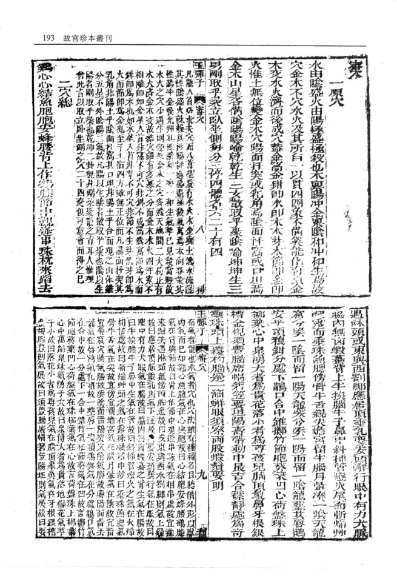

<!-- V3_SOURCE_ID:book025-b000252-p000-6b0d191101 -->

这部分是关于三穴的纲要：气脉来势不缓，停驻的形态必定高昂，就采用“穴[来]”的操作方式；气脉来势刚猛急促，停驻的形态必定下坠，就采用“穴粘”的操作方式；气脉来势不急不缓，停驻的形态必定不归不坠，就采用“穴撞角”的操作方式；气脉斜向而来，停驻形态偏斜，就采用“穴倚”的操作方式；气脉从弯曲处来，停驻形态倾倒，就采用“穴逆迎”的操作方式；气脉逆来且四周有环顾的形态停驻，就采用“穴临”的操作方式；气脉从左侧来，停驻在左侧，就将穴定在左侧；气脉从右侧来，停驻在右侧，就将穴定在右侧；气脉径直而来，停驻在中正位置，就将穴定在正位；阳气散漫而来，阴气凝聚停驻，就采用“穴乘阴”的操作方式；阴气凝聚而来，阳气停驻，就采用“穴散秉阳”的操作方式。掌握这个诀窍来辨别阴阳，应当阳气用阴的方式承接，阴气用阳的方式承接；阳气、阴气都较微弱的情况，调整后可生发；阳气、阴气都过盛的情况，称为“五单子”，需要仔细审察穴的情况。其中“五单子”具体所指不详。

> **释读存疑：** 五单子无可靠释义；穴来、穴粘、穴撞角、穴倚、穴逆迎、穴临均为穴法操作术语，具体操作方式无明确释义

查看对应原文

<!-- V3_FOLDBACK_BEGIN:book025-b000252-p000-6b0d191101 -->

三穴綱來勢不緩形止必昂則穴來勢剛急形止必墜則穴粘不急不緩止必不歸不墜則穴撞角來斜止則穴倚曲來倒止則穴逆迎逆來四顧止則穴臨左來左止則穴左右來右止則穴右直來中正則穴正陽散來陰聚止則穴乘陰聚來陽故止則穴散秉此訣竅辨別陰陽陽必陰受陰必陽受陽少陰少調之生陽老陰老謂五單子審穴 X

<!-- V3_FOLDBACK_END:book025-b000252-p000-6b0d191101 -->

<!-- V3_SOURCE_ID:book025-b000253-p000-b8cf94e7d7 -->

文中提到“之杀菜老用少是乘生气”，该句存在字形讹误，“菜”字疑似讹误，整句具体含义无法确定。

> **释读存疑：** 原文存在字形讹误，无法准确解读

查看对应原文

<!-- V3_FOLDBACK_BEGIN:book025-b000253-p000-b8cf94e7d7 -->

之殺菜老用少是乘生氣

<!-- V3_FOLDBACK_END:book025-b000253-p000-b8cf94e7d7 -->

<!-- V3_SOURCE_ID:book025-b000254-p000-5d136f9d8c -->

定名的关键在于乘气，乘气的妙处在于详细观察形态：如果来龙柔缓，形势停驻时气必定归聚，那么气居于上位，所以穴要采用盖的方式设置；来龙刚劲急促，形势停驻时气必定下坠，那么气居于下位，所以穴要采用粘的方式设置；来龙不急不缓，形势停驻时气既不上浮也不下坠，那么气性平和，所以穴要采用撞的方式设置；脉从角部过来，形势呈斛形停驻，那么气也走斜向，所以穴要采用倚的方式设置；脉从弯曲处过来，形势呈倒向停驻，那么气往回流转，所以要逆着来势、迎着前向设穴；气逆着而来，四面回护的山头都停驻，那么气就停在龙峡处，所以穴要采用骑的方式设置；龙从左方伴着水过来，形势停在左侧，那么气就在左侧，所以穴要设在左边；龙从右方过来，形势停在右侧，那么气就在右侧，所以穴要设在右边；龙从开阔疏缓处过来，形势在中间停驻，那么气聚在中部，所以穴要设在正位；来龙属纯阳，入首处转为阴态后停驻，那么气就聚集，所以穴要取聚势；来龙属纯阴，入首处转为阳态后停驻，那么气就散开，所以穴要取散势。探究总的诀窍，不外乎阴阳变化的方法：阳转为阴，是阴从阳之后来，称为少阴；阴转为阳，是阳从阴之中出，称为少阳，生机没有穷尽。如果龙脉一路都是平直的旧有形态，没有一节起伏，就是纯阴，叫做老阴；如果龙脉整片都硬实平整，没有一点凸起的泡状结构，就是纯阳，叫做老阳，这两种情况都带有杀气。避开老阴老阳的杀气、取用少阴少阳的生气，才是善于乘用生气的方法。四星

> **释读存疑：** 原文“麥陰而止”“氣故 故穴散”“生机無翁”“一片蜜成”存在字形疑似讹误，候选释读为合理通假，但仍存在不确定性；本地硬校验仍未通过，已记录供后续自动处理或人工核对。

查看对应原文

<!-- V3_FOLDBACK_BEGIN:book025-b000254-p000-5d136f9d8c -->

定名鑑多訣在乘氣乘氣之法妙在詳形如來龍柔緩形止必 歸則氣上乘故穴蓋來龍剛急形止必墜則氣下丞故穴粘來 龍不急不緩形止亦不易不墜則氣和平故穴撞脉從角來形 乃斛止則氣亦斜故穴倚脉從曲來形乃倒止則氣回轉故 逆後迎前逆而來四願山頭皆止則氣停龍峽故穴騎龍從左 水形止于左則氣在左故穴左龍從右來形止于右則氣在右 故穴右龍以疏來形乃中止則氣礙于中故穴正來龍純陽入 首麥陰而止則氣聚故穴聚來龍純陰入首変陽而止則氣故 故穴散究其總訣不外陰陽変化之法所以陽変陰是陰後焉 來爲少陰陰変陽是陽從陰出爲少陽生机無翁若一路以舊 並無一節起伏是純陰也則為老陰一片蜜成並無一點泡突 是純陽也則爲老陽總是殺氣東老用少方僞善乘生氣也 四星

<!-- V3_FOLDBACK_END:book025-b000254-p000-5d136f9d8c -->

<!-- V3_SOURCE_ID:book025-b000255-p000-254e40dcd4 -->

文中提及“公通金穴而居窝底”“逢掬手乃穴”“庆中抽脉”“斩颈吐珠”“破赠纳百神”“头立穴低小近脑安杼”“高弥带火开顶”“俯仰侵阴辟腹减脚”“木三方三木烧官”“一阴一阳”“眉户柳狗挂角”“金梭柳叶穿心”“似钱头可登百会”“如侧子可卧”“一四推事机平俯半卯带火体”“一动一静火脚沼”“龟形穴天罡顶脑上”“孤曜门巾”，以上表述均属风水形法与穴法相关内容，具体含义因无明确术语依据暂无法确定。

> **释读存疑：** 所有提及的风水形法、穴法短语均无可靠释义依据，仅原文引述

查看对应原文

<!-- V3_FOLDBACK_BEGIN:book025-b000255-p000-254e40dcd4 -->

公通金穴而居窩底逢掬手乃穴慶中抽脉斬頸吐珠破贈納 百神頭立穴低小近腦安杼高彌帶火開頂俯仰侵陰闢腹減 腳木三方三木燒官一陰一陽眉戶柳狗掛角金梭柳葉穿心似 錢頭可登百會如側子可臥一四推事機平俯半卯帶火體一動 一靜火腳沼龜形穴天罡頂腦上孤曜門巾

<!-- V3_FOLDBACK_END:book025-b000255-p000-254e40dcd4 -->

<!-- V3_SOURCE_ID:book025-b000256-p000-595976f050 -->

文中提及“木逢倒木而扦”“柳节带称金而斩”“曲杖血立停可穴”“斜而府堪裁”“金断于静胞之中”“水泛于珠头之上”“带火乡而开”“当龟上体以关浪纹”“平囊常自辟杀”“硬直倒耳傍抽交校”“称上折股”“王原子寄”，以上表述除“穴”“水”外均属风水相关术语，具体含义因无明确依据暂无法确定，其中“王原子寄”具体所指不详。

> **释读存疑：** 所有提及的风水相关短语均无可靠释义依据，仅原文引述

查看对应原文

<!-- V3_FOLDBACK_BEGIN:book025-b000256-p000-595976f050 -->

木逢倒木而扦柳節帶稱金而斬曲杖血立停可穴斜而府堪裁金斷于靜胞之中水泛于珠頭之上帶火鄉而開當龜上體以關浪紋平囊常自闢殺硬直倒耳傍抽交校稱上折股王原子寄

<!-- V3_FOLDBACK_END:book025-b000256-p000-595976f050 -->

<!-- V3_SOURCE_ID:book025-b000257-p000-af926b96bf -->

文中提及“水可喜者流珠串广”“最元者武池傍骨”“金体一阴方作土头册挨扦”“波纹求静木脚穿阳”“中珠居半脑火脚穴窝墩”“扫荡裁其静处平波的在阴中”“左右仙官扦食指”“阴阳合谷插天心下心”“蛇形”“王年游县”“鳖状按同”，以上表述除“穴”“水”外均属风水相关术语，具体含义因无明确依据暂无法确定，其中“王年游县”“鳖状”具体所指不详。

> **释读存疑：** 所有提及的风水相关短语均无可靠释义依据，仅原文引述

查看对应原文

<!-- V3_FOLDBACK_BEGIN:book025-b000257-p000-af926b96bf -->

水可喜者流珠串廣最元者武池傍骨金體一陰方作土頭冊挨扦波紋求靜木腳穿陽中珠居半腦火腳穴窩墩掃蕩裁其靜處平波的在陰中左右仙官扦食指陰陽合谷插天心下心蛇形王年游縣鱉狀按同

<!-- V3_FOLDBACK_END:book025-b000257-p000-af926b96bf -->

<!-- V3_SOURCE_ID:book025-b000258-p000-dd368664f9 -->

文中提及“火侧火粘穴”“府教天百命来峰见金形”“一动一泡生”“十废三进三堆出”“木脚相抽向下带火龙制化”“堆中太旺三窝最喜至弱六泡相宜”“平彞芳针穴上四制脱杀”“棺阳旗形令字风乘”“乂心地”，以上表述除“制化”“穴”“向”外均属风水相关内容，具体含义因无明确依据暂无法确定，其中“乂心地”存在缺字或讹字，具体所指不详。

> **释读存疑：** 所有提及的风水相关短语均无可靠释义依据，仅原文引述；乂心地存在字形异常，无法准确解读

查看对应原文

<!-- V3_FOLDBACK_BEGIN:book025-b000258-p000-dd368664f9 -->

火側火粘穴府教 天百命來峰見金形一動一泡生十廢三進三堆出木腳相抽向下帶火龍制化堆中太旺三窩最喜至弱六泡相宜平彞芳針穴上四制脫殺棺陽旗形令字風乘乂心地

<!-- V3_FOLDBACK_END:book025-b000258-p000-dd368664f9 -->

<!-- doc013 PDF 第 198 页：高风险/复杂版面 OCR 供检索；内容与排版以原页图为准。 -->
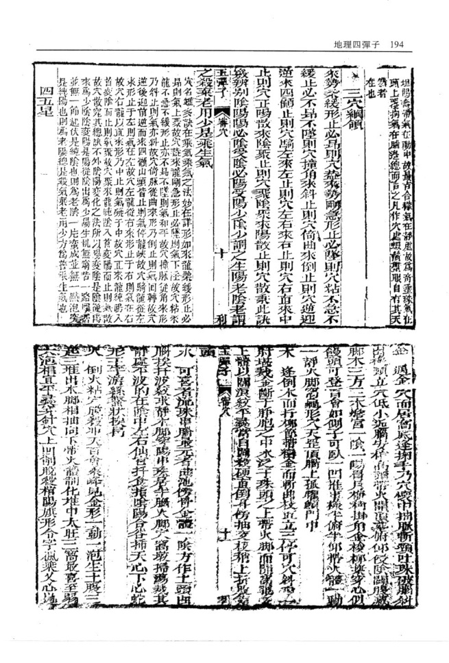

<!-- V3_SOURCE_ID:book025-b000260-p000-74f08fa5e0 -->

遲嘯掃劍峰的機勢燥烈，中心坡頂適合煉丹，應在頂部選擇位置，二橫形的腹內下方是合適的，歌訣中說，要在角中安放，俯者對應一陽之穴，仰者對應一陰之穴，伏橫正窩形，低心處適合四扦，上平下呌，訣中說要居角位，遣帶水連火，妙在存心中的方體，以珠形為美，水腳的金泡是榮象，倒上宜舛口藏金，愛水珠似棋盤，中宮位上如果缺角，邊服尖頭尾角流金，生水滿弼出水，挨金。

> **释读存疑：** “下呌”“舛口”“弼”等詞具體所指不详；“下呌”“舛口”“弼”等词具体所指不详

查看对应原文

<!-- V3_FOLDBACK_BEGIN:book025-b000260-p000-74f08fa5e0 -->

遲嘯掃劍峰機燥中心坡頓煉丹當頂必住二橫形腹內下歌勢角中安俯者一陽爲穴仰者一陰伏橫正窩形低心四扦上平下呌訣居角遣帶水連火妙存心中方體彌珠爲美水腳金泡乃榮倒上宜舛口藏金愛水珠似棋盤中宮位上如缺角邊服尖頭尾角流金生水滿弼出水挨金

<!-- V3_FOLDBACK_END:book025-b000260-p000-74f08fa5e0 -->

<!-- V3_SOURCE_ID:book025-b000261-p000-a3b796521a -->

扦穴的方法，需要看星象休咎。有的穴位置偏高，古人却反其道而行之；有的穴适合正扦，古人却反而采用备扦的方式。“備青其興羣休不相待合何邕”这句话的具体所指不详。有诗的内容为：二十四山如果繁盛却不契合时令，绝对不会发福；二十四山有用神，才是真府穴。因为每段入首的星体，必然有四座山作为护从，护从的山当中有然有坤，龙脉使用杨敕贫《天玉经》里所说的挨星法，遇到神就迎接，纪通缝之，自台繩。如果拘泥固守果法，能避免驳杂的弊病，“則攝點相牛巳火”具体所指不详，学者作“伯等帝于卷穴”，这一短语的具体含义也不详。

> **释读存疑：** 備青其興羣休不相待合何邕；攝點相牛巳火；伯等帝于卷穴；1轮自动修复后核义模型仍建议修订，已保守记录。

查看对应原文

<!-- V3_FOLDBACK_BEGIN:book025-b000261-p000-a3b796521a -->

扦穴之法須看星休然穴有且高而古人反子然者穴有宜正而古人反扦備青其興羣休不相待合何邕爲詩質曰二十四山晉有繁不出時决不發二十四山有用神是若真府穴也蓋以每一星体入首必有四山蘸從而護從之中有然有坤龍用楊敕貧天玉經內所言挨星法神則迎之紀通縫之自台繩若拘守果法雄免駁雜之病則攝點相牛巳火學者作伯等帝于卷穴

<!-- V3_FOLDBACK_END:book025-b000261-p000-a3b796521a -->

<!-- V3_SOURCE_ID:book025-b000262-p000-eaf72eb4a4 -->

領會四勢的性情，天然的穴法自然就會顯現，不必拘泥於底現。

查看对应原文

<!-- V3_FOLDBACK_BEGIN:book025-b000262-p000-eaf72eb4a4 -->

四勢理會性情則天然之穴法自而神光不必拘拘然于底現可也

<!-- V3_FOLDBACK_END:book025-b000262-p000-eaf72eb4a4 -->

<!-- V3_SOURCE_ID:book025-b000263-p000-23b93483aa -->

五論穴結法

查看对应原文

<!-- V3_FOLDBACK_BEGIN:book025-b000263-p000-23b93483aa -->

五論穴結法

<!-- V3_FOLDBACK_END:book025-b000263-p000-23b93483aa -->

<!-- V3_SOURCE_ID:book025-b000264-p000-8bbf5b5d00 -->

太祖山山势峭拔，气脉旺盛神疑，穴依照天然形态分布的，是正结。形卦停归的，是少礼公。龙脉停在龙腰位置的，是中结；穴处在水尾位置的，是盖结。山势呈一线横落的，是闪星之角出，属于斜结。老龙妓乳的形态，名称是陆咽；形态低平的，名称是仰。

> **释读存疑：** 神疑；少礼公；龙妓乳；陆咽；1轮自动修复后核义模型仍建议修订，已保守记录。

查看对应原文

<!-- V3_FOLDBACK_BEGIN:book025-b000264-p000-8bbf5b5d00 -->

大祖聚峭氣旺神疑穴任天然斯爲正結形卦停歸乃爲少禮公 止龍腰者中也穴居水尾者蓋也一線橫落爲閃星之角出乃斜 老龍妓乳其名陸咽低平而其名仰

<!-- V3_FOLDBACK_END:book025-b000264-p000-8bbf5b5d00 -->

<!-- V3_SOURCE_ID:book025-b000265-p000-be1d3571fc -->

大凡龙脉结穴，有初洁、公结、中结、盖离这几种类型。如同众星聚集在集靖之下，诸峰朝向坡廓来寄托气脉，盜旺其神，气脉凝聚的话穴法就合乎天然，属于止结。如果龙神称将，形官清净，如同行路途中停鼎的样子，就属于少结。至于六止在龙腰位置的是中结，六右在水口位置的是西结。但是正结数量少，“距黠盡四者之中有議身正而公胎總仙治書爲因星疑正向面”这段内容具体所指不详。气从角上而来，龙脉不对的属于脉老，“多偶飛技公之性用”具体所指不详。采用避开坦地选择平地的方法做仰结，结穴的方法千姿万化，总归都不超出闪、科、轡、仰这四类。最后提到六骑龙法。

> **释读存疑：** 初洁；集靖；龍神稱將形官淨；距黠盡四者之中有議身正而公胎總仙治書爲因星疑正向面；多偶飛技公之性用；1轮自动修复后核义模型仍建议修订，已保守记录。

查看对应原文

<!-- V3_FOLDBACK_BEGIN:book025-b000265-p000-be1d3571fc -->

凡龍之結穴有初洁者有公結者有中結者有蓋離者如衆星 集靖之下諸峰朝坡廓以寄其氣盜旺其神疑聚則穴法天 然而爲止結若龍神稱將形官淨如行路停鼎者然乃為少 結至于六止龍腰者中結也六右水口者西結也然正結少 距黠盡四者之中有議身正而公胎總仙治書爲因星 疑正向面氣從角上龍非者為脈老多偶飛技公之性用 法避坦而平爲之仰結法難千姿 萬化海不外此閃科轡仰四者耳 六騎龍法

<!-- V3_FOLDBACK_END:book025-b000265-p000-be1d3571fc -->

<!-- V3_SOURCE_ID:book025-b000266-p000-a6088037d7 -->

騎龍扦勢，勢正形止，傍斜耳受為倚，貼脊腰受為橫，直來為順例，轉動為逆，峽氣稍止為斬閣，形穴未盡為斬官，勢宜環顧，反背最嫌，六法各六，稱為六六。

查看对应原文

<!-- V3_FOLDBACK_BEGIN:book025-b000266-p000-a6088037d7 -->

騎龍扦勢勢正形止傍斜耳受爲倚貼脊腰受爲橫直來曰順例 轉曰逆峽氣稍止爲斬閣形穴未盡爲斬官勢宜環顧反背最嫌 六法各六是曰六六

<!-- V3_FOLDBACK_END:book025-b000266-p000-a6088037d7 -->

<!-- V3_SOURCE_ID:book025-b000267-p000-61affc774e -->

大凡鼎穴的骑龙之法，在于仔细审察山势：山势如果端正，文形自然周正，此处“文形”具体所指不详；如果山势适合偏斜，以耳受气，就用倚法以职之，“职之”具体含义不明；如果山势适合贴脊，以腰受气，就用横法来藏纳。山势正向直来的，就用顺法以曠之，“曠之”具体含义不明；山势翻身回转的，就用逆法来骑乘。峡谷之间神气稍有停留，“打夾紫始”具体所指不详，就用斩关法以疇之，“疇之”具体含义不明。入首处的形穴还没有完全形成，余气向前延伸的，就用顿宫法来骑乘。靖龙的法则有大致的要领，适合西势环绕顾盼、开面有清的情况，“开面有清”具体所指不详。如果山势有反背、朝向其他方向的迹象，就是被虚仪所撮薄的情况，相关的各类方法大多都遵循这个法则。最后是弟子春、租七所论述的扦法。

> **释读存疑：** 文形；職之；曠之；打夾紫始；疇之；開面有清；若隋有反背；王此法；1轮自动修复后核义模型仍建议修订，已保守记录。

查看对应原文

<!-- V3_FOLDBACK_BEGIN:book025-b000267-p000-61affc774e -->

凡鼎穴騎龍之法在消詳乎勢勢若正時文形自正如勢宜傳斜以耳受氣則用倚以職之勢宜貼脊以腰受氣則用橫以藏之正向直來則用順以曠之番身例轉則用逆以騎之峽閒神氣稍止打夾紫始則用斬關以疇之入首形穴未畫餘氣前趨則用頓宮以騎之靖龍之法有大總宜西勢環顧開面有清若隋有反背他顧之象卽為虛儀所撮薄者每法大皆王此法第子春 租七論扦法

<!-- V3_FOLDBACK_END:book025-b000267-p000-61affc774e -->

<!-- V3_SOURCE_ID:book025-b000268-p000-1a0cc055f5 -->

气脉隐伏的时候适合扦葬，气脉浮现的时候适合扦厝，气脉浮大的时候适合扦基。纯阴纯阳的地方，适合修建坛庙寺观，这是增益的情况。气向外散发的时候，气在外部，要从外部承接，这是阳极转阴的情况。有一亩大小的区域，气在内部，原文此处“内以之不”存在脱漏，语义不完整。既不呼也不吸的孤阴孤阳之地，根本没有办法承接气脉。

> **释读存疑：** 内以之不

查看对应原文

<!-- V3_FOLDBACK_BEGIN:book025-b000268-p000-1a0cc055f5 -->

氣隱扦塟氣浮扦厝浮大扦基純陽純陰壇廟寺觀益 一呼也氣在外外以乘之陽極而陰一畝也氣在內內以之不 呼不吸孤陰孤陽何乘受之有

<!-- V3_FOLDBACK_END:book025-b000268-p000-1a0cc055f5 -->

<!-- V3_SOURCE_ID:book025-b000269-p000-501bd429c2 -->

大凡扦穴的方法，要是遇到入凶和突純除的情况，气汇集在内部，就适合深挖开土。要是入首处是窝垣形态，“儒平思氣淨”具体所指不详，气在外部停留，就只适合开土一尺左右，多用客十堆起来厝放，“客十”具体所指不详。“屑內浮草也非惜長生也”具体所指不详。至于阴龍糧落到平洋地带，就会出现血大官扦陽某的情况，“陰龍糧”“血大官扦陽某”具体所指不详，这些都是阴阳反损的情况。如果纯阴不化、纯阳不灰，“纯阳不灰”的具体含义不明，就是适合修建坛庙寺见的地方，“寺見”具体所指不详。“何步所初而化陽”具体所指不详。内气旺盛向外呼出的，就从外部承接，“此扦用打非也”语义不明。“四極而所外氣盛面毀入任內也”具体所指不详。气在内部的就从内部来承接，“來”疑为讹误，具体含义不明，这种情况适合扦葬。“純吹則吸而不解”里的“吹”语义不明，“純陽則所而不吸”存在脱漏，语义残缺，这两种情况都是死气，没有办法承接。原文末尾的“截”字语义不明。

> **释读存疑：** 入凶和突純除；儒平思氣淨；客十；屑內浮草也非惜長生也；陰龍糧；血大官扦陽某；纯阳不灰；寺見；何步所初而化陽；此扦用打非也；四極而所外氣盛面毀入任內也；來之；純吹則吸而不解；純陽則所而不吸；截；1轮自动修复后核义模型仍建议修订，已保守记录。

查看对应原文

<!-- V3_FOLDBACK_BEGIN:book025-b000269-p000-501bd429c2 -->

凡扦穴之法如入凶和突純除遇氣臨于內宜開土深 如入首窩垣儒平思氣淨外止宜開土尺許多用客十 堆以厝之屑內浮草也非惜長生也至若陰龍糧落平洋則 現血大官扦陽某此皆陰陽反損有也若純陰不化純陽不灰 則爲壇廟寺見之地何步所初而化陽內氣盛而呼出在外則 外以乘之此扦用打非也四極而所外氣盛面毀入任內也 氣在內則內以來之此扦塟也純吹則吸而不 解純陽則所而不吸皆死氣也何以乘受之截

<!-- V3_FOLDBACK_END:book025-b000269-p000-501bd429c2 -->

<!-- doc013 PDF 第 199 页：高风险/复杂版面 OCR 供检索；内容与排版以原页图为准。 -->
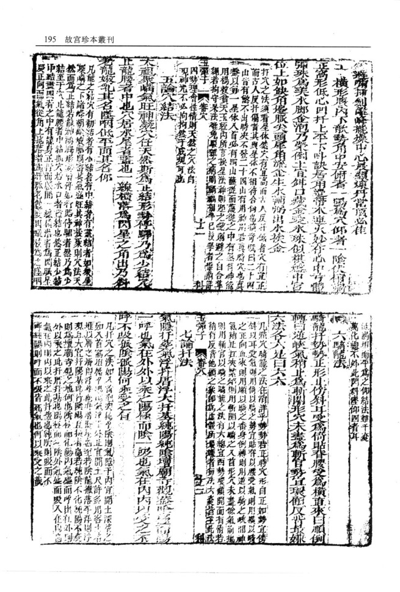

<!-- V3_SOURCE_ID:book025-b000271-p000-12aa06777d -->

金气沉降在底部，穴居于中间位置，水对应静态，木印合动态。气从下方上浮的，是阴泡金；气上浮的是阳土，气下沉的则属另一类。气从后方主导的，是脉血木，它的气向外吐出；脉山对应的是水，它的气自有其特性。

> **释读存疑：** 原文末尾“其氣”二字后疑有缺文，语义未完整

查看对应原文

<!-- V3_FOLDBACK_BEGIN:book025-b000271-p000-12aa06777d -->

金乘其底穴其中水相乎靜木印乎動氣從下浮者陰泡金也其氣浮陽土也其氣沉氣從後主者脈血木也其氣吐脈山水也其氣

<!-- V3_FOLDBACK_END:book025-b000271-p000-12aa06777d -->

<!-- V3_SOURCE_ID:book025-b000272-p000-d6ac097dc9 -->

大凡立穴乘度的方法，不外乎“浮、虎、在、吐”四字，之前所说的浮沉吞吐四字，就包含在金、木、土、水的运行规律之中。水的状态如同金乘卯位，其光向上，穴居于其间，取的是藏聚的特性。水性本就好动，有金泡的地方就会趋于宁静，顺着水性安置在有水的位置，气的态势就会从下方浮现。气从下方浮起可见的，如同阴泡之金，气性洁净；阳气之上，气是从“免”而来的，如同“親有之木”，它的气向外吐出；曲折的水，它的气呈卷收之态。气分散之后，在此处沉降。

> **释读存疑：** “水之如金乘卯其光也上”“其氣為從免而來者”“如親有之木”语义晦涩，暂按字面直译，具体所指待考；原文末尾语义未完整，疑有缺文

查看对应原文

<!-- V3_FOLDBACK_BEGIN:book025-b000272-p000-d6ac097dc9 -->

凡立穴乘度法不外浮虎在吐四字前浮沉吞吐四字卽在金 土木水中水之如金乘卯其光也上穴其中取其藏也水 性動有金泡處則靜以性插有水所處則勢氣從下浮見者 如陰泡之金其氣淨陽之上其氣為從免而來者如親有 之木其氣吐曲折之水其氣卷氣分吾此沉而

<!-- V3_FOLDBACK_END:book025-b000272-p000-d6ac097dc9 -->

<!-- V3_SOURCE_ID:book025-b000273-p000-b5ffe9906e -->

这是《玉子審穴》第十四篇的内容。穴底土质盛实、层次分明，质地坚实细腻、润泽而不塌陷，才是合格的土。土是气的载体，有土才有气，气没有固定形态，土却有可见的形迹，通过查验土的形迹，风水师就能知晓气的状态。只有全是顽石的穴，开凿之后也没有土，就从旺方取土，作为并葬的方法，借别处的真土来接续此处的虚寒气脉。还有一类浮穴，只需观察形势、祭色，不必拘泥于土的形迹，培土封葬即可。又有长期被水浸润的地，不论土质还是石质，只要势止就可以，这类一定是仙葬之地，愚钝的人不敢轻易选用。

> **释读存疑：** “底盛賢分”“祭色”具体操作含义不明，暂保留原词；原文末尾“愚敢輕”后疑有缺字；1轮自动修复后核义模型仍建议修订，已保守记录。

查看对应原文

<!-- V3_FOLDBACK_BEGIN:book025-b000273-p000-b5ffe9906e -->

玉子審穴 十四 底盛賢分分明堅膩潤而不陷乃爲與土十者氣之體有土斯 有氣氣無形土有跡驗跡于土師知乎氣惟頑石穴開鑿無土旺 方取土法爲併塟假彼真土續此寒又有浮穴觀形祭色不泥 土跡培上封葬又有水久不論土石惟在勢止此必仙塟愚敢輕

<!-- V3_FOLDBACK_END:book025-b000273-p000-b5ffe9906e -->

<!-- V3_SOURCE_ID:book025-b000274-p000-12500bb8c0 -->

大凡穴中的土钱，上有盖、下有底，“兩字界張”的特征生来就明显，从表面敲击，质地硬细，光泽开阔且没有水泽浸润，这是龙气聚足，才能得到这样的土，气都藏在土内，气依附于形，土有迹可循，验证土质的优劣，就能知道气的状态，这是原本应当遵循的方法。然而又有很多穴多是顽石，凿开之后没有土，就取坚脉各处的土填入石穴，用来接续真气，这是并葬的方法。还有的穴在窝坦之处，土色大多不好，不必拘泥于沉实的要求，都用客土来封堆。还有的穴在水窝，常年没有厚土，还有没有底层壤土的，去除水患之后修整成坐穴的形制，这些都是常法之外的特殊情况。常法之外还有这三种情形，是常人所舍弃不用的，古人却会采用，都能护佑大福，是底益分明的地方。现在的人得到这类地使用反而遇凶，是为什么呢？龙气的结聚，总不外乎“軫、止”二字。水朝砂拱，地局周密，势止于石的地局必须收紧，势止于水的地局必须符合相应要求，俗人看了未免觉得太过反常，却用平常的圣人规矩来匹配山川融结的态势，也只能得到常规的结论而已。如果形势朱止，贸然点穴，就算得到真土坚实有光，下葬之后立刻就会出现败绝的情况。庸劣的风水师不知道“势止”这一关键，只拿土色好坏来告诉别人，出错的情况实在太多了。

> **释读存疑：** “兩字界張”“龍之結戚”“軫止”“勢止于水不得不”“大該”“朱止”语义晦涩，暂按字面直译，具体所指待考；“賦下之立見敗絕”断句存疑，此处“賦”疑为“葬”的讹字，暂无版本依据，暂保留原句逻辑

查看对应原文

<!-- V3_FOLDBACK_BEGIN:book025-b000274-p000-12500bb8c0 -->

凡穴中土錢上有蓋下有底兩字界張生就明自面又擊硬細賦光濶而無水澤此龍氣笑今方得此土盡氣在土內氣撫形土有跡驗土勝之美則知氣之耶初此當法也然又有穴多頑石鑿開無土則取堅脈各士填八石穴以續眞氣爲併塟法者又有穴在窩坦土色多惡不必拘沉統用客土以封採堆者又有穴在水窩經無厚士又有不底壤土去水樂以成坐者常法之外又有此三解人所棄盜而古人用之皆護大福底益分明之地今人得用之反凶者何也龍之結戚總不外乎軫止二字水朝砂堆地局周密勢止干石不得不緊勢止于水不得不俗人視之未免大該而以別聖之規矩作絕合山川融結之勢亦祇得其常而巳若形勢朱止昌味穴之卽得真土堅光賦下之立見敗絕庸術不知勢止一字徒以土色語人正多多也

<!-- V3_FOLDBACK_END:book025-b000274-p000-12500bb8c0 -->

<!-- V3_SOURCE_ID:book025-b000275-p000-61739a8e43 -->

## 十穴内作法

查看对应原文

<!-- V3_FOLDBACK_BEGIN:book025-b000275-p000-61739a8e43 -->

## 十穴内作法

<!-- V3_FOLDBACK_END:book025-b000275-p000-61739a8e43 -->

<!-- V3_SOURCE_ID:book025-b000276-p000-61763cfb5b -->

详细勘察形势，配合五行规律，不要不足，也不要太过度。不足的地方就培补，过度的地方就削减。驳杂的情况应当处理，过克的情况应当制约。“封摹兜矜”的形制要符合五星正体，高低宽窄要取法河图洛书的规则。天地的造化难以周全，要凭借人力来做弥补。

> **释读存疑：** 原文“勿大適”的“適”疑为“過”的形近讹字，暂按“过度”释读并标注；“駁雜當注”的“注”为风水操作术语，具体操作方式不明，暂释为“处理”；“封摹兜矜”为专有操作术语，具体形制不明，保留原词；“須祖河圗洛書”的“祖”释为“取法、以……为准则”

查看对应原文

<!-- V3_FOLDBACK_BEGIN:book025-b000276-p000-61763cfb5b -->

詳形勢配五行勿不及勿大適不及則培太過則削駁雜當注過尅當制封摹兜矜須合五星正體高低濶狹須祖河圗洛書天地無全功藉人力以補之

<!-- V3_FOLDBACK_END:book025-b000276-p000-61763cfb5b -->

<!-- V3_SOURCE_ID:book025-b000277-p000-e4f8c27818 -->

这是《玉子審穴》第十科的内容。形势已经勘察详细，配合五行规律，所以穴外左右有不足的地方，该培补就培补，过度的地方该削减就削减，通过“門”的方式用人力弥补天然的不足。如果穴外注水，比如乾亥方位来的行龙，用乾气就注入阳水，用亥气就注入阴水，这就是驳杂应当处理的情况。如果内部午气过旺的龙，用丙气就言亥水，用午气就注入壬癸水，这是贯通的情况，应当制约。比如封墓兜衿，土星入首就做金堆，兜衿仍用方形这类形制，符合五星正体的要求。至于高低宽窄，虽然取法“河浴”之数，但也不能过于拘泥，只需看形势的适宜程度，大小合适即可。

> **释读存疑：** 开篇“子審人 十 科”疑为“玉子審穴十科”的讹漏，暂按篇目名处理；“太過處應削則門”的“門”为操作术语，具体含义不明，保留原词；“如內午過旺龍用丙氣則言亥水”的“言”字语义不明，暂保留原字；“河浴之數”疑为“河洛之數”的讹误，暂无版本依据，保留原词；“惟頑形勢之宜太宜小耳”的“頑”疑为“看”的形近讹字，“太宜小”疑为“大小适宜”的讹误，暂按该逻辑释读并标注；“太過處應削則門”的“門”疑为讹字，具体含义不明，保留原词；“如內午過旺龍用丙氣則言亥水”的“言”字疑为讹字，语义不明，暂保留原字；1轮自动修复后核义模型仍建议修订，已保守记录。

查看对应原文

<!-- V3_FOLDBACK_BEGIN:book025-b000277-p000-e4f8c27818 -->

子審人 十 科 形勢既詳配以五行故穴外左右不及處應培則培大過處應 削則門以人力補大工也若穴外注水如乾亥獲行龍用乾氣 則注陽水用亥氣則注陰水此駁雜當注也如內午過旺龍用 丙氣則言亥水用午氣則注壬癸此通也當制也如封墓兜衿 土星入首則作金堆兜衿仍用方之類合五星正休也至于高 低謂狹雖祖河浴之數然亦不可過拘惟頑形勢之宜太宜小 耳

<!-- V3_FOLDBACK_END:book025-b000277-p000-e4f8c27818 -->

<!-- doc013 PDF 第 200 页：高风险/复杂版面 OCR 供检索；内容与排版以原页图为准。 -->
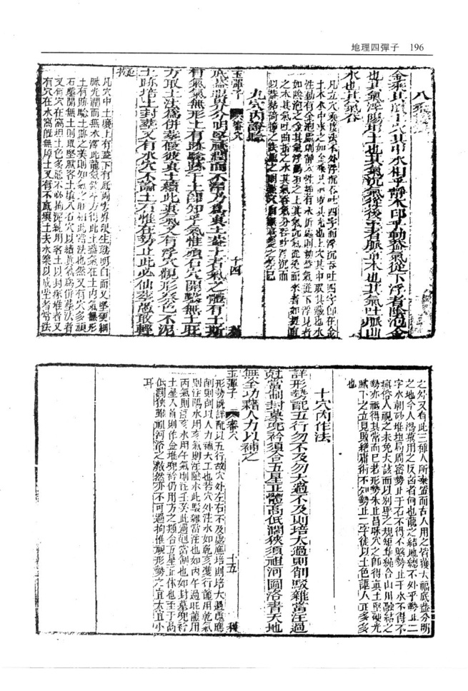

<!-- V3_SOURCE_ID:book025-b000279-p000-95c8f67006 -->

水是气所化生的，有气才有水，水聚气就聚，水散气就散。界定龙脉形势的是一龍水，一龍水有长短的区别；呈现龙脉形态的是一龍水，一龍水有深浅的区别；界定龙气的是三龍水，三龍水有明暗的区别。明暗相交而无鍾，深浅相会而形止，长短相合而势极，形势如果不符合规律，气就无法聚存。

> **释读存疑：** “明暗交而無鍾”的“鍾”后疑有缺字，暂保留原文；原文末尾“形勢不經其氣”后疑有缺文，语义未完整；1轮自动修复后核义模型仍建议修订，已保守记录。

查看对应原文

<!-- V3_FOLDBACK_BEGIN:book025-b000279-p000-95c8f67006 -->

水者氣之子有氣斯有水水聚氣聚水散氣散界其勢者一龍水也有長短其形者一龍水也有淺深界其氣者三龍水也有明暗明暗交而無鍾淺深會而形止長短合而勢極形勢不經其氣

<!-- V3_FOLDBACK_END:book025-b000279-p000-95c8f67006 -->

<!-- V3_SOURCE_ID:book025-b000280-p000-b90a07d186 -->

龍神是內氣，砂水是外氣。穴地雖以內氣爲主，然而外氣善則內氣隨之爲善，外氣惡則內氣變而亦爲惡。砂氣以靜施，水氣以動感，其吉凶禍福都有年月日時可以指認。可惜砂法不傳於世，祇有楊、廖、賴、吳、劉諸仙以及各自授受派下的名賢使用。水五子審水 十六 利

查看对应原文

<!-- V3_FOLDBACK_BEGIN:book025-b000280-p000-b90a07d186 -->

龍神者內氣也砂水者外氣也穴地雖以內氣爲主然外氣善則內氣因而爲善外氣惡則內氣变而亦為惡砂氣以靜施水氣以動感其吉凶禍福之俱有年月日時之可指惜砂法不傳于世惟楊廖賴吳刘諸仙以及各授受派下名賢用之水五子審水 十六 利

<!-- V3_FOLDBACK_END:book025-b000280-p000-b90a07d186 -->

<!-- V3_SOURCE_ID:book025-b000281-p000-449f364f4a -->

这套方法明传了千年，可惜只传了从水口看龙左旋右转的一种方法，古代仙人所传的河图洛书先后天的吉地判断方法，竟然没有流传下来。就算偶尔有相关书籍传世，终究没有最关键最简要的方法，这样误人又误己的情况太多了。现在就用水的形势来说明，各类水都适宜汇聚，都不适宜分散。有从少祖山下界送龙势的水，大致左水短就右水长来配合，右水短就左水长来配合，因为它是界定送龙势的，所以叫一龍水。从入首星下界分龙虎的水，大致左水浅就右水深来界定，右水浅就左水深来界定，因为它是界定划分山形的，所以叫一龍水。至于穴场，有虾蟬水、有蟹眼水，左边明就右边暗，右边明就左边暗，因为它是界定穴气的，所以叫三龍水。莽穴有明暗股水，气就不会涣散而聚存；山有深浅界水，形就不会移动而止息；局有长短合水，势就会闭合而不散。总而言之，形势符合规律，真气自然会在内部钟聚。如果形势不符合规律，天门闭、地户开，被风吹入，就算穴场有振鬆、有乡服土、土有五色，又能有什么福分呢？

> **释读存疑：** “自少祖下界選龍勢者”的“選”疑为“送”的形近讹字，暂按“送”释读并标注；“勢蓋而不散”的“蓋”疑为“阖”的形近讹字，暂按“闭合”释读并标注；“形勢得經”“形勢不經”的“經”释为“符合规律”，具体含义待考；“振鬆”“鄉服土”为专有土质术语，具体所指不明，保留原词；“入風吹”疑为“被风吹入”的语义，原文表述简略，此处补全逻辑并标注

查看对应原文

<!-- V3_FOLDBACK_BEGIN:book025-b000281-p000-449f364f4a -->

法明傳千世惜止傳以水口看龍左旋右轉一法而古仙河洛先後二天之吉亦竟不傳卽偶有傳其書者究無至要至簡之法此誤人自誤之多也今卽以水之形勢言之諸水宜聚皆不宜散有自少祖下界選龍勢者大抵左水短則右水長以合之右水短則左水長以合之其界送龍勢故曰一龍水也自入首星下界分龍虎者大抵左水淺則右水深以界之右水淺則左水深以界之以其界分山形故曰一龍水也至于穴塲有蝦蟬水有蟹眼水左明則右暗右明則左暗以其界穴氣故曰三龍水也莽穴有明暗股水則氣不渙而聚山有淺深界水則形不行而止局有長短合水則勢蓋而不散要而言之形勢得經真氣自然鍾聚于內若形勢不經天門閉地戶開入風吹卽穴塲有振鬆有鄉服土有五色究亦何福之有

<!-- V3_FOLDBACK_END:book025-b000281-p000-449f364f4a -->

<!-- V3_SOURCE_ID:book025-b000282-p000-c4bfe42734 -->

阳气虚弱时，穴前相对开阔、汇聚的空间（明堂）就会呈现圆净的状态，这是初交气的情况，属于第一种明堂。龙、虎二爻的形态止于虚处，这是第二种明堂。外阳三爻的态势止于虚处，这是第三种明堂。顺局则能保住地运，若左右横缺一处，就是虚假的格局，福运微弱。

查看对应原文

<!-- V3_FOLDBACK_BEGIN:book025-b000282-p000-c4bfe42734 -->

陽虛則明圓淨則堂故路翼初交氣虛一明堂也龍虎二爻 形止于虛二明掌也外陽三爻勢止于虛三明堂也順則保地 則左右橫則左右而而缺一僞假完具福微

<!-- V3_FOLDBACK_END:book025-b000282-p000-c4bfe42734 -->

<!-- V3_SOURCE_ID:book025-b000283-p000-18cef09af6 -->

为什么叫“明”？因为阳气经过的地方，原本虚废的位置就会显现出明亮的特征。为什么叫“堂”？因为它四周饱满、干净整洁。古人说明台如同片无，明堂如同属庶，才是符合标准的。而明堂共有三种，就是所说的三阳。气聚集在虚处，蚁翼交合，以此形成的洁净区域是第一种明堂。形局止于虚处，对应“龙虎亥”的情况就是中明堂，古人说明堂如同卧侧的是第二种。态势止于虚处，对应“外鸥交师”的就是大明堂，古人说明堂能容下万马的是第三种。这三类明堂相关的局，有顺局，层次显现在前方；有逆局，大堂要么方正要么在右侧；有横局，大堂要么在左侧要么在右侧，要么结在案山之外的前方。三阳修整福分才会完备。

> **释读存疑：** 龙虎亥；外鸥交师；片无；属庶；兜淨；兜净

查看对应原文

<!-- V3_FOLDBACK_BEGIN:book025-b000283-p000-18cef09af6 -->

何以謂之明以陽氣過得虛廢則現而明也何以謂堂以其四 滿淨絜也古人言明臺如片無明堂如屬庶乃爲得之然有三 明堂卽所謂三陽者是氣鍾于虛而蟻翼交卽以之作兜淨者 爲一形止于虛而龍虎亥卽中明堂古人言明堂如卧側者為 二勢止于虛而外鷗交師大明堂古人言明堂容萬馬者為三 然此二兩有順局而層次見于前者有逆局而大堂或方或右 者有橫局而大堂或左或右或結 案外之前者三陽脩福斯全巳

<!-- V3_FOLDBACK_END:book025-b000283-p000-18cef09af6 -->

<!-- V3_SOURCE_ID:book025-b000284-p000-716a0f8959 -->

一开截气，二关截形，三开是指态势昂垂斜伏，需仔细察看金龍的顺向、逆向、背向、结作情况。帝王子蕃水，十七程。

> **释读存疑：** 原文中“帝王子蕃水”“十七程”的具体所指不详

查看对应原文

<!-- V3_FOLDBACK_BEGIN:book025-b000284-p000-716a0f8959 -->

一開截氣一關截形三開者勢昂垂斜伏細察金龍順逆向背結王帝子蕃水 十七 程

<!-- V3_FOLDBACK_END:book025-b000284-p000-716a0f8959 -->

<!-- V3_SOURCE_ID:book025-b000285-p000-b11ddb3945 -->

可以预先卜测形势：形势上耸的结盖穴，形势下垂的结撞穴，形势低伏的结粘穴，形势倾斜的结倚穴。还要在两气交会的地方，用土圭测量四墓：如果是辰位，对应金龙穴属金水；如果是戌位，对应龙穴属木火；丑位对应金火，不一定属水木。能领悟这个道理的人，所用的术法就很神妙了。

> **释读存疑：** 四墓辰；四墓戌；四墓丑；1轮自动修复后核义模型仍建议修订，已保守记录。

查看对应原文

<!-- V3_FOLDBACK_BEGIN:book025-b000285-p000-b11ddb3945 -->

可豫卜形勢身者結蓋形勢垂者結撞伏者結粘斜者結倚仍于兩交中處土圭測其四墓辰則龍穴金水戌則龍穴木火丑金火未必水木能悟斯者神其術乎

<!-- V3_FOLDBACK_END:book025-b000285-p000-b11ddb3945 -->

<!-- V3_SOURCE_ID:book025-b000286-p000-2cdd100d89 -->

有三种明堂，就对应有三个水口；有一个水口，就有一处开截的设置，都是用来排走煞气，让真气聚集在内部不会外泄的。但是在关截的地方，应当勘察形势，应当测定水库。穴位的顺向、逆向、背向，都可以在这里预先卜测：如果形势平缓，就知道是结盖穴；形势下垂，就知道是结撞穴；形势低伏，就知道是结粘穴；形势倾斜，就知道是结倚穴，这是通过察看形势就可以预先知道的。测定小库要在水路的正中位置测量：如果测得水从辰口流出，就知道其中左旋是小局龙，右旋是金局龙，如果发福反而塾低就不吉，要取卒壬交会而聚在辰位；如果测得水从戌方流出，就知道其中左旋是火局龙，右旋是木局龙，和这个情况相反就不吉，要取乙交而戊；如果测得水口从午位流出，就知道其中左旋是金局龙，右旋是火局龙，发曜和这个情况相反就不吉，要取丑午收纳庚丁之气；如果测得水口从未位流出，就知道其中左旋是水局龙，右旋是木局龙，能发曜，和这个情况相反就不吉，要取金羊收癸甲之灵。龙神的所属，测亥卯未各有不同，而乾、甲、丁随从它；巳酉丑会成金局，而庚、癸随从它；寅午戌会成火局，而艮、丙、辛随从它；申子辰会成水局，而坤、壬、乙随从它，都用双山之法，水性的曲折也是如此，这些都是《玉尺经》里的内容。但是也有辰口出水却结火局，或是水局右旋、金局左旋，而且还能发大福的情况，对此还没有能解释清楚的地方。像这样，有用平分法来适配溪向的，比如木口酉龙，就用癸酉入首的方法；又有用穿山法来适配的，比如辰口丙龙，就用壬午穿山的方法；还有用分金法来适配的，比如戊口壬龙，就用丙子分金的方法，这些方法都近似合理，应验率约为十分之三。但考证各位仙人留下的遗迹，以及诚意伯扦定的杭州各地的穴位，都没有使用这些方法。

> **释读存疑：** 卒壬會而聚辰；乙交而戊；金羊次癸甲之靈；頭庚癸；十有三；1轮自动修复后核义模型仍建议修订，已保守记录。

查看对应原文

<!-- V3_FOLDBACK_BEGIN:book025-b000286-p000-2cdd100d89 -->

有三明堂卽有三水口有一水口卽有一開截皆所以遺煞眞氣蒿聚于內而不洩者也然関截處當察形勢當格水庫蓋穴所之順逆向背于此預卜如形勢易則知結穴形勢垂則知結撞穴形勢伏則知結粘穴形勢斜則知結倚穴此察勢而可預知者也格小庫之在水路正中處格之如格得水從辰口出門知其中左延小局龍右疑金局龍發福反塾則不吉取卒壬會而聚辰也格得水從戌山則知其中左旋火局龍右木發反是則不吉取乙交而戊也格得水口從午出則知其中左旋金局龍右雄火局發曜反是則不吉取丑午納庚丁之氣也格得水口從未出則知其中左流水局龍右旋木局能發曜反是則不吉取金羊次癸甲之靈也龍神所屬測亥卯未百不同而乾甲丁從之已酉丑會金局而頭庚癸從之寅午戌會火局而艮丙辛從之申子辰會水局而坤壬乙從之皆用雙山水性所屈亦然此玉尺經之凶也然却有辰口出水而結火局或水局右旋金局左旋者且發大福有所未解如是有用平分以溪之者如木口酉龍則用癸酉入首之法又有用穿山以湊之者如辰口丙龍則用壬午穿山之法又行用分金以湊之者如戊口壬龍則用丙子分金之法俱近于理十有三但考諸仙跡及誠意伯扦武林諸地俱無所用之

<!-- V3_FOLDBACK_END:book025-b000286-p000-2cdd100d89 -->

<!-- V3_SOURCE_ID:book025-b000287-p000-729df2835d -->

## 四水局

查看对应原文

<!-- V3_FOLDBACK_BEGIN:book025-b000287-p000-729df2835d -->

## 四水局

<!-- V3_FOLDBACK_END:book025-b000287-p000-729df2835d -->

<!-- doc013 PDF 第 201 页：高风险/复杂版面 OCR 供检索；内容与排版以原页图为准。 -->
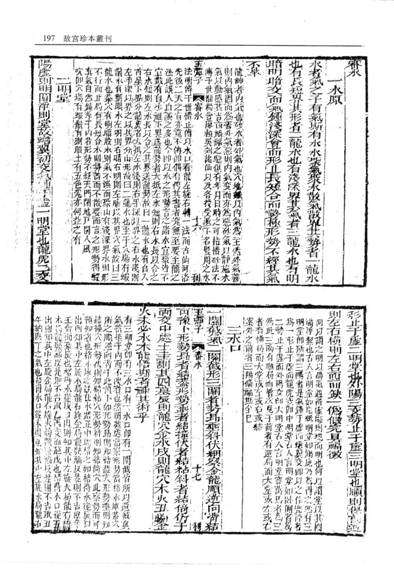

<!-- V3_SOURCE_ID:book025-b000289-p000-a054d89f60 -->

跟随龙脉而来的是元辰水，从外部流入的是过客之水。收纳元辰水，要用正五行来契合“三今清”；收纳客水，要用正五行来配合元空，这两种方法最为重要，卦纳的方法次之。来水适宜处于生、旺状态，《王弹子审水十八》里提到，去水必须处于休、囚状态。阳从左方旋转，阴从右方流通，生入、克入的是进神，生出、克出的是退神。进神处于生旺状态就吉利，进神处于休囚状态就凶险。大小中神遇到吉的情况就吉，遇到凶的情况就凶，对此应当详细考察，千万不要草率。

> **释读存疑：** 三今清；元空；卦納；进神；退神；大小中神；1轮自动修复后核义模型仍建议修订，已保守记录。

查看对应原文

<!-- V3_FOLDBACK_BEGIN:book025-b000289-p000-a054d89f60 -->

隨龍曰元辰之水外來爲過客之水納元辰則以正五行而契三 今清客水則以正五行而併元空二者爲最卦納次之來宜生且 王彈子審水 十八 去必休囚陽從左轉陰從右通生人尅入爲進神生出尅出爲退 神生旺進則吉休囚進則凶大小中神遇吉則吉遇凶則凶于宜 詳察幸勿草

<!-- V3_FOLDBACK_END:book025-b000289-p000-a054d89f60 -->

<!-- V3_SOURCE_ID:book025-b000290-p000-e829d258e4 -->

元辰水从龙神的胁下流出，是真气会聚的地方；外客水从龙、虎、案山之外朝来，是客气邀聚的地方。收纳元辰水，用正五行立向，取三合，比如“亥卯未之煩权”这类；收纳客水，也用正五行立向，取元空，比如乾坤卯午金同坐这类。这两种方法最为重要，卦位纳音的方法次之，所以要使用三台法。生旺的水适宜来，比如阳火生于寅、旺于午；休囚的水适宜去，比如阴火死于寅、墓于丑。左旋为阳，右转为阴，这是三合法。用元空法的话，生入、克入的方位是进神，适宜来水，比如金向见土水为生入，见火水为克入；生出、克出的方位是退神，适宜去水，比如水向见火水为克出，见木水为生出，这是元空法的记载。生旺的水适宜来，休囚的水适宜去，其中分为大、中、小三神，用来对应孟、仲、季三房：乾坤艮巽、寅申巳亥是大神，对应长房；甲庚丙壬、子午卯酉是中神，对应仲房；乙丁辛癸、辰戌丑未是小神，对应季房。

> **释读存疑：** 亥卯未之煩权；元空沮；生八火水；元些注；血仲季；1轮自动修复后核义模型仍建议修订，已保守记录。

查看对应原文

<!-- V3_FOLDBACK_BEGIN:book025-b000290-p000-e829d258e4 -->

元辰水從龍神脇下來乃真氣所會外客水從龍虎案外朝乃 客氣所邀収元辰水以正五行立向而取三合如亥卯未之煩 权客水亦以正五行立向而取元空如乾坤卯午金同坐之類 一者爲最卦位納音次之故用三台法生旺宜來如陽火生寅 旺午休囚宜去如陰火死寅墓丑左旋為陽右轉爲陰此三合 法也用元空沮生入尅入之位為進神誓來如金向見土水爲 生八火水爲尅人生出尅出之位爲退神宮去如水向見火水 爲尅出見木水爲生出此元些注也生旺宜來休四宜去其中 分六中小三神以配血仲季三房乾坤艮巽寅中巳亥大神配 甲庚丙壬子午卯酉中神配仲乙二丁辛癸辰戌丑未小神配季

<!-- V3_FOLDBACK_END:book025-b000290-p000-e829d258e4 -->

<!-- V3_SOURCE_ID:book025-b000292-p000-dbb685c3f8 -->

一龍

查看对应原文

<!-- V3_FOLDBACK_BEGIN:book025-b000292-p000-dbb685c3f8 -->

一龍

<!-- V3_FOLDBACK_END:book025-b000292-p000-dbb685c3f8 -->

<!-- V3_SOURCE_ID:book025-b000293-p000-c88ad6d655 -->

真气聚集之处，抱护如蝉颈，是第一种龙、虎；正形止处，拱揖如股肱，是第二种龙、虎；大势之中，外阳环抱，是第三种龙、虎。应当朝向而不应当背向，应当正而不应当斜。

查看对应原文

<!-- V3_FOLDBACK_BEGIN:book025-b000293-p000-c88ad6d655 -->

真氣之鍾抱護蟬頸一龍虎也正形之止拱揖股肱一龍虎也大 勢之中外陽環抱三龍虎也宜向不宜背宜正不宜斜

<!-- V3_FOLDBACK_END:book025-b000293-p000-c88ad6d655 -->

<!-- V3_SOURCE_ID:book025-b000294-p000-1bbe1177e7 -->

凡是左右两侧的护砂，以面朝南的方位来说，左侧的砂称为青龙，右侧的砂称为白虎，因此被叫做龙虎，并非青龙吉利、白虎凶险的意思。世俗之人不懂这个道理，于是就有了“宁可青龙高万丈，不可白虎高一尺”的说法，实在是荒谬至极。不过，若是有三阳水、三口水口，那么龙虎也会有三层，必须有龙虚砂才能形成水口、形成明堂。关键在于，砂的总体态势应当背向外侧、朝向内方，有情意关联，不宜朝向外侧、背离内方，没有情意。总体而言，砂应当正面开阔明朗，朝向穴场顾盼，不宜侧面阴斜，朝向别处。

查看对应原文

<!-- V3_FOLDBACK_BEGIN:book025-b000294-p000-1bbe1177e7 -->

凡左右護砂以面南而言左係靑龍右係曰虎因謂之龍虎非 龍吉虎凶之義俗見不知遂有仍可青龍高萬丈不可自處高 一尺之談堪郝之極然韋有三陽水有三口則龍虎亦有三層 盡有龍虛砂方成水口方成明堂也其要總宜背外向內而有 情不宜向外普內而無意總宜正面開 陽而朝顧不宜側面陰斜而他視耳

<!-- V3_FOLDBACK_END:book025-b000294-p000-1bbe1177e7 -->

<!-- V3_SOURCE_ID:book025-b000295-p000-f4bd184579 -->

一乐

> **释读存疑：** 单独‘一乐’无上下文，具体所指不详

查看对应原文

<!-- V3_FOLDBACK_BEGIN:book025-b000295-p000-f4bd184579 -->

一樂

<!-- V3_FOLDBACK_END:book025-b000295-p000-f4bd184579 -->

<!-- V3_SOURCE_ID:book025-b000296-p000-8e5e3e0831 -->

朝砂适宜呈现翔舞的姿态，属阳则吉利，属阴则凶险。乐砂要坚实端正厚重，出现陷缺、破损的情况就不利。形态磊落、面向穴场的属于阳，因此吉利；僵死、斜向、背向穴场的属于阴，因此凶险。特意前来、形态环抱的，是招来福运的缘由；低矮有缺、被风直吹的，是招致灾祸的入口。

> **释读存疑：** 耑親；“耑親”原文语义不明，未作强解

查看对应原文

<!-- V3_FOLDBACK_BEGIN:book025-b000296-p000-8e5e3e0831 -->

朝宜翔舞陽吉陰凶樂實端厚陷賊耑親磊落面向者陽也故吉死斜背者陰也故凶特來形抱致福之由低缺風吹招禍之門

<!-- V3_FOLDBACK_END:book025-b000296-p000-8e5e3e0831 -->

<!-- V3_SOURCE_ID:book025-b000297-p000-a442e4b63e -->

以穴场所在的方位为参照，朝案砂是客体，朝向是主体，朝案砂偏好呈现拜舞、端拱的意象。文中提到“为我乐托喪薩豐”，具体所指不详。穴场后方的坐山偏好有丰沃的平原拱卫的态势，文中又提到“故鄭歡情向开面为则吉”，其中“鄭歡”具体所指不详，整体是说朝向开阔舒展、属阳就吉利；如果朝向斜硬、背向穴场、属阴就凶险。特意前来、形态环抱且情意向着穴场的，就会招来福运；低矮有缺、破损不良且被风直吹的，就会招致灾祸。

> **释读存疑：** 喪薩豐；鄭歡；喪薩豐、鄭歡具体所指不详

查看对应原文

<!-- V3_FOLDBACK_BEGIN:book025-b000297-p000-a442e4b63e -->

房我朝案我爲工朝爲賓喜拜舞端拱之象爲我樂託喪薩豐 彼後坐喜豐原擁護之情故鄭歡情向開面爲則吉若 斜硬背面爲陰則凶特來事抱而形 親則致福低缺陋賊而風吹則招禍

<!-- V3_FOLDBACK_END:book025-b000297-p000-a442e4b63e -->

<!-- V3_SOURCE_ID:book025-b000298-p000-6d405d470e -->

所谓三应，远处正对穴场的是“炤”，近处拱卫穴场的是应。“炤”属于未明确定义的术语，具体所指不详。如果炤和应位置准确，那么穴和向就是真的；如果炤和应位置不准确，那么穴和向就是假的。原文仅提及炤、应两类，第三类对应的内容未在本段明确说明。此外，判断的标准也不在于形态的大小、高低、长短、方圆，只在于情意是否朝向穴场，末尾“情向意諸而”语义未完，原文存在残缺。

> **释读存疑：** 炤；原文末尾语义残缺；第三应未明确表述；“炤”具体所指不详，原文仅提及炤、应两类，第三类未明确，末尾“情向意諸而”语义残缺

查看对应原文

<!-- V3_FOLDBACK_BEGIN:book025-b000298-p000-6d405d470e -->

三應 遠對穴者爲炤近拱穴者爲應炤應的則穴向真紹應不的則穴 向假然亦不在大小高低長短方圓惟在情向意諸而

<!-- V3_FOLDBACK_END:book025-b000298-p000-6d405d470e -->

<!-- V3_SOURCE_ID:book025-b000299-p000-ea15272921 -->

砂形得位的话就会金帛充盈，官山秀丽的话就会文名显达。要知道砂贼显现的预兆伤害很重，其中的天机密义并不涉及生克的原理。

> **释读存疑：** “沙賊”“生剋天機”语义存疑；1轮自动修复后核义模型仍建议修订，已保守记录。

查看对应原文

<!-- V3_FOLDBACK_BEGIN:book025-b000299-p000-ea15272921 -->

則金帛盈官山秀則文名顧知沙賊其見兆傷重更無生剋天機

<!-- V3_FOLDBACK_END:book025-b000299-p000-ea15272921 -->

<!-- V3_SOURCE_ID:book025-b000300-p000-fd4f8dca74 -->

时下的术数从业者只知道纳水很难，没能掌握河洛的正理，但尚且知道“諱求千遺”，还有一点可取之处。他们对砂的方位完全不了解，对于砂形会带来兴旺还是损伤的效应完全不知道趋避。就算是谈论八卦中的“晉子父財官”之法，也只会口头议论，没办法实际运用，实在是可惜。相关的通用案例，我已经在纳甲篇中明确说明，这里就不再赘述。文中提到“徽邑明詩白張龍門出師者親受仙傳奇門”，“明詩白”具体身份不详，整体是说有出自徽邑的张龙门，得到过仙传的奇门之术，文中又有“攬天下於社蘇溪等處打祭貴欽大地”的记载，“攬天下於社蘇溪”具体含义不详。他后来走到交州一带，所使用的父财官之法，专门看重五行的渊源，方法根源于河图。比如上元用子位起子一白，称为“土藤之运”，对应上生金、金生水的序列；中元甲子从子位起四绿，称为“上廉之逆”，对应木能生火、火生土的序列；下元甲子从七赤起运，称为“土子之运”，文中“以金内十所生”语义不明，此处原文可能存在残缺。用这种方法来占卜气运的盛衰，判断龙身的旺衰，听说有“弹子字山有大鲁，气运为先”的说法，这只是大概的说法，不是上等仙人不能通晓。相关的书籍会在后续结集刊刻时详细收录，这里暂且将子父财官的相关内容列为“子子蕃砂 利”。

> **释读存疑：** 諱求千遺；晉子父財官之“晉”；明詩白；攬天下於社蘇溪；以金内十所生；非上仙不卿者也；諱求千遺、晉子父財官之“晉”、明詩白、攬天下於社蘇溪、以金内十所生、非上仙不卿者也具体含义不详

查看对应原文

<!-- V3_FOLDBACK_BEGIN:book025-b000300-p000-fd4f8dca74 -->

時術止知納水難不得河洛正理然尚知諱求千遺猶有一得殊砂之方位茫然不曉生人殺人全無超避即八卦中晉子父財官之法從談之議論而不能運之出甚可良也市人父例予明述于納甲篇中茲不贊澤然徽邑明詩白張龍門出師者親受仙傳奇門攬天下於社蘇溪等處打祭貴欽大地後行至交雖而四其看于父財官之法專則重五行淵芳本于曾作怪其法根于河圗以上爲主如上元用子起子一白則曰土藤之運以上生金以生水也中元甲子起子四絲則曰上廉之逆以木能生火以生土也下元甲子起于七赤則曰土子之運以金内十所生也以此卜氣運之盛衆定龍辨之体旺聞候彈子字山有大魯氣運爲先之言此乃大率問非上仙不卿者也其書侯後結刻詳錄之以公子世茲且以子父財官一為列之子子蕃砂 利

<!-- V3_FOLDBACK_END:book025-b000300-p000-fd4f8dca74 -->

<!-- V3_SOURCE_ID:book025-b000301-p000-30252a1fc4 -->

曾氏说：克制我的是官，我克制的是财，生我的是父，我生的是子，“出和者兄弟也”中“出和”具体所指不详。从立穴的位置来看，官鬼方位的土如果高过穴场，就会富贵，低下就会贫贱；妻财方位的土如果高过穴场，就会妻子貌美、得到封赠、财帛丰裕，低下就达不到这样的效果；父母方位的土如果高过穴场，文中“爻子和薩”具体所指不详，低下就会不和；兄弟方位的土如果高过穴场，就会兄友弟恭，否则就会互相仇视。这五类之外，还有长生方位的土如果高过穴场，就会没有疾病、多有高寿，低下的话文中“進蕩色然而多歡”具体所指不详。又有说法称：六亲人丁的情况要看子孙砂是否秀丽，住宅中人的寿数长短要看父母砂的根基厚重程度，奴仆的情况要看兄弟砂是否拱护，宫厅的规模大小对应官贵的品级高低。

> **释读存疑：** 出和；爻子和薩；進蕩色然而多歡；原重；出和、爻子和薩、進蕩色然而多歡、原重具体所指不详

查看对应原文

<!-- V3_FOLDBACK_BEGIN:book025-b000301-p000-30252a1fc4 -->

曾子曰尅我者官也我尅者財也生我者父也魏生者子也出和者兄弟也自立穴處視之官鬼方土高過穴則當寶低下則貧賤妻財方土高過穴則妻美奄贈多財帛裕低下則不能父母方土高過穴則爻子和薩低下則不和兄弟方土高過穴卿見弟友子否則相仇五者之外又有長生方土高過穴則無疾多壽低下則進蕩色然而多歡方又承曰六親人丁看子孫之秀麗四宅壽天看父母之原重奴僕看兄第之拱護宮廳之大小看官貴之高低

<!-- V3_FOLDBACK_END:book025-b000301-p000-30252a1fc4 -->

<!-- V3_SOURCE_ID:book025-b000302-p000-95beb5cd68 -->

## 原書缺第21面。 — 原书缺第21面。

查看对应原文

<!-- V3_FOLDBACK_BEGIN:book025-b000302-p000-95beb5cd68 -->

## 原書缺第21面。

<!-- V3_FOLDBACK_END:book025-b000302-p000-95beb5cd68 -->

<!-- V3_SOURCE_ID:book025-b000303-p000-48fb00fa76 -->

上正之地对应坤卦，土寄之地对应艮卦，和坤卦的论断方法相同。寅卯是官贵方位，末尾“佛則寓貴便者貧以”语义不通，原文存在残缺，无法准确释读。

> **释读存疑：** 原文末尾“佛則寓貴便者貧以”语义残缺；原文末尾“佛則寓貴便者貧以”语义残缺，无法释读

查看对应原文

<!-- V3_FOLDBACK_BEGIN:book025-b000303-p000-48fb00fa76 -->

上正之地坤也土寄之地艮也典坤同斷寅卯官貴方佛則寓貴便者貧以

<!-- V3_FOLDBACK_END:book025-b000303-p000-48fb00fa76 -->

<!-- V3_SOURCE_ID:book025-b000304-p000-8601315f48 -->

本段存在多处OCR识别错乱、缺字，原文首句“巳午父母方則卷孝”语义不通，具体含义无法确认。其余可识别部分内容依据河图的含义，《易》中提到“河出图，洛出书，圣人则之”，又提到“天一地二，天三地四，天五地六，天七地八，天九地十。天数五，地数五，五位俎……得而各有合……地数三十，凡天地之数五十有五，此所以成变化而行鬼神也”，其中“五位俎”之后有多处乱码、缺字，原文写的“天数一十”不符合《易》的相关表述，疑为识别错误。末尾“紹通子河國”语义不明，无法确定具体所指。

> **释读存疑：** 巳午父母方則卷孝含义不明；五位俎之后存在乱码缺字，文意不连贯；紹通子河國所指不详；原文中“天数一十”疑为OCR识别错误

查看对应原文

<!-- V3_FOLDBACK_BEGIN:book025-b000304-p000-8601315f48 -->

巳午父母方則卷孝 原河圗之義 易曰河出圖洛出書聖人則之又曰天一地二天三地四天五地 六天七地八天九地十 天數五地數五五位俎 圖 得而各有合天數一十 方 P 有五地數三十凡天地 王 之數五十有五此所以 成變化而行鬼神也 紹通子河國

<!-- V3_FOLDBACK_END:book025-b000304-p000-8601315f48 -->

<!-- doc013 PDF 第 203 页：高风险/复杂版面 OCR 供检索；内容与排版以原页图为准。 -->
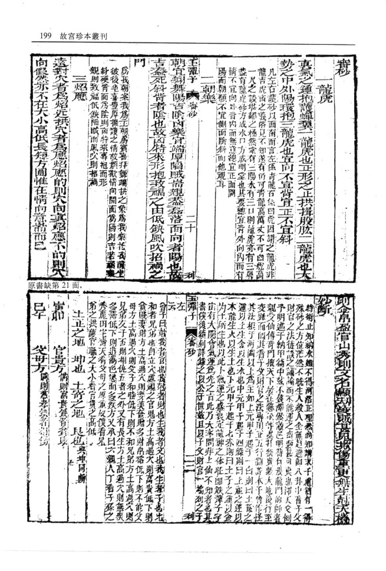

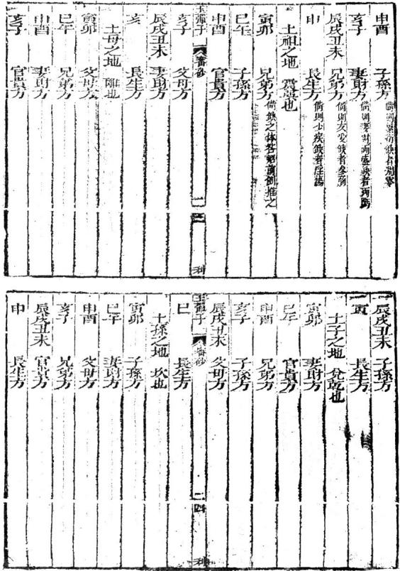

<!-- doc013 PDF 第 204 页：高风险/复杂版面 OCR 供检索；内容与排版以原页图为准。 -->
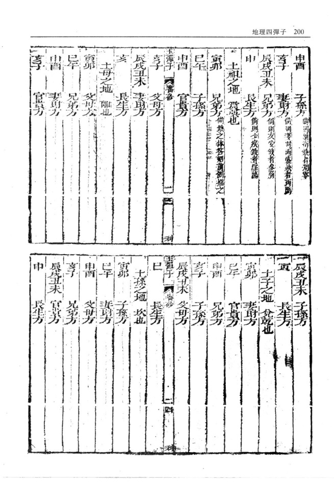

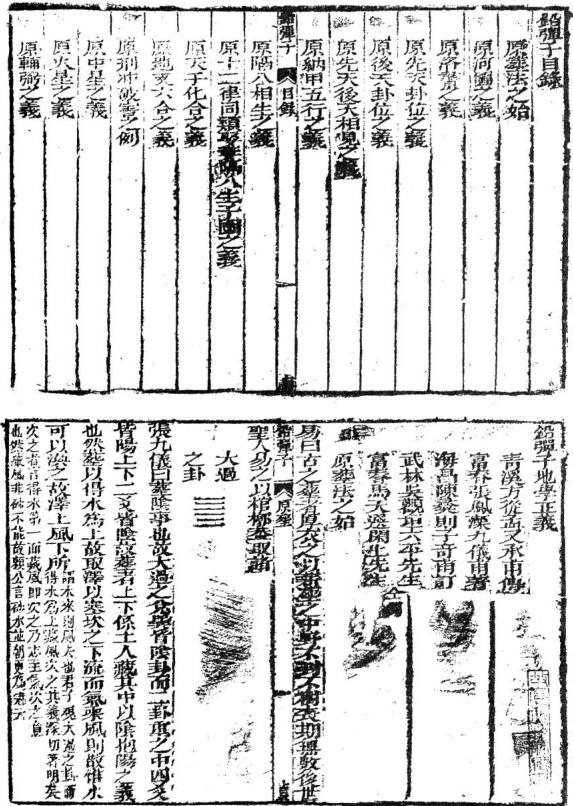

<!-- doc013 PDF 第 205 页：高风险/复杂版面 OCR 供检索；内容与排版以原页图为准。 -->
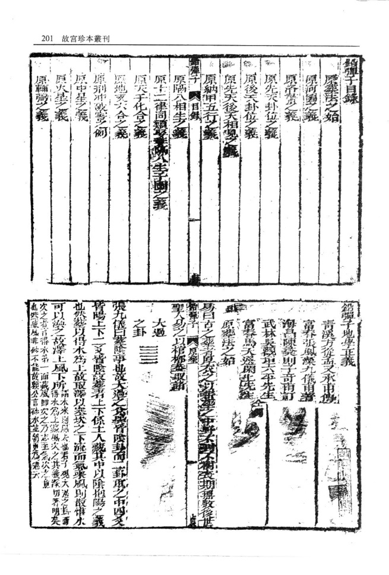

<!-- V3_SOURCE_ID:book025-b000310-p000-83abe147a7 -->

张九仪说：天道上升，所以一阳生于北方，对应的就是地雷复卦；地道下临，所以一阴生于南方，对应的就是天风姤卦。由此可知河图就是太极。东北是阳位，所以以阳为主、阴为宾，因此一、三居于内位，六、八居于外位，由此也能知道乾率领三男居于东北方位。西南是阴位，所以以阴为主、阳为宾，因此二、四居于内位，七、九居于外位，由此也能知道坤率领三女居于西南方位。阳主生发则阴主成就，阴主生发则阳主成就，生数五居于内位，成数十居于外位，这样的排布并非刻意安排，而是自然形成了不得不如此的态势。一加上五等于六，二加上五等于七，三加上五等于八，四加上五等于九，因此土居于中位，是水、火、木、金的母体；五加上五等于十，戊土是巳土的母体，所以土是五行中必须讨论的内容，而传本里此处则写作二十。

> **释读存疑：** “隆爲故”“五成號居外”“依故非列”“而傳則二十”因OCR或原文残缺含义不明；1轮自动修复后核义模型仍建议修订，已保守记录。

查看对应原文

<!-- V3_FOLDBACK_BEGIN:book025-b000310-p000-83abe147a7 -->

張九儀曰天道上升故一陽生于北卽地雷復也地道下臨故一陰生于南卽天風姤也是河圖卽太極也東北陽位則陽爲主隆爲故一三居內六八居外而乾率三男以居東北可知已西角陰位則陰爲主陽爲賓故二四居內七九居外而坤率三女以星西南可知已然陽生則陰成陰生則陽成五生數居內五成號居外依故非列亦自有不得不然之勢而一得五爲六二得五爲七三得五爲八四得五爲九是土居中而爲水火木金之母五得五而爲十戊土爲巳土之母則土爲五行所必論而傳則二十

<!-- V3_FOLDBACK_END:book025-b000310-p000-83abe147a7 -->

<!-- V3_SOURCE_ID:book025-b000311-p000-baa903b809 -->

本段前半部分“消日癸爲先生累癸為成之後又從各龍分別之其宛也巒頭精美垣局雄從俱大”存在OCR识别错误，语义不通，无法确认具体含义。可识别的部分提到唯独峦头不及，所以才有这样的分辨。懂地理的君子如果真能通晓河图的相关内容，再以神明的方式运用，大概就差不多了。

> **释读存疑：** 消日癸爲先生累癸為成之後语义不明；其宛也巒頭精美垣局雄從俱大存在识别错误，含义不明

查看对应原文

<!-- V3_FOLDBACK_BEGIN:book025-b000311-p000-baa903b809 -->

消日癸爲先生累癸為成之後又從各龍分別之其宛也巒頭精美垣局雄從俱大惟巒頭不及故有此辨爾知地君子誠通于河圖之迎而復神明之其廉幾哉

<!-- V3_FOLDBACK_END:book025-b000311-p000-baa903b809 -->

<!-- V3_SOURCE_ID:book025-b000312-p000-bd59822737 -->

子木局水法。

查看对应原文

<!-- V3_FOLDBACK_BEGIN:book025-b000312-p000-bd59822737 -->

子木局水法

<!-- V3_FOLDBACK_END:book025-b000312-p000-bd59822737 -->

<!-- V3_SOURCE_ID:book025-b000313-p000-310982230d -->

坐向为甲时，出现乙水；坐向为乙时，出现甲水。这是火局水法的第二种定法。

查看对应原文

<!-- V3_FOLDBACK_BEGIN:book025-b000313-p000-310982230d -->

坐向甲見乙水，坐向乙見甲水，其二定火局水法

<!-- V3_FOLDBACK_END:book025-b000313-p000-310982230d -->

<!-- V3_SOURCE_ID:book025-b000314-p000-c141f25569 -->

坐间为丁时，出现丙水，压向内的方向有丁水止歇。这是金局水法的第二种定法。

> **释读存疑：** “坐間丁”“壓向內”表述模糊，具体含义未明；1轮自动修复后核义模型仍建议修订，已保守记录。

查看对应原文

<!-- V3_FOLDBACK_BEGIN:book025-b000314-p000-c141f25569 -->

坐間丁 見丙水壓向內 見丁水止二基金局水法

<!-- V3_FOLDBACK_END:book025-b000314-p000-c141f25569 -->

<!-- V3_SOURCE_ID:book025-b000315-p000-d17472568c -->

坐水局米法，出现庚水；坐向为庚时，出现辛水。对应雷凤相海格，以上两种水法又涉及坐向的王口灾水。陈子寸说：河图四局，符合天生地成、块生天成的规律，蕴含大纹与先天之灵，等待与归藏之气相合，凡是地形符合这种格局的，气脉纯粹悠久，吉庆之事说也说不完。

> **释读存疑：** 坐水局米法；王口灾水；块生天成；大纹而之灵；先天割待夫归相合；“水局米法”“王口灾水”“块生天成”“大纹而之灵”“先天割待夫归相合”表述模糊或存在OCR错误，含义未明；1轮自动修复后核义模型仍建议修订，已保守记录。

查看对应原文

<!-- V3_FOLDBACK_BEGIN:book025-b000315-p000-d17472568c -->

坐 水局米法 見庚水 坐向庚見辛水 雷鳳相海格 上二法又食坐向王口災水陳子寸曰河圓四局饑合天生地成塊生天成大紋而之靈先天割待夫歸相合凡地遇此純粹悠久吉不勝言者

<!-- V3_FOLDBACK_END:book025-b000315-p000-d17472568c -->

<!-- doc013 PDF 第 206 页：高风险/复杂版面 OCR 供检索；内容与排版以原页图为准。 -->
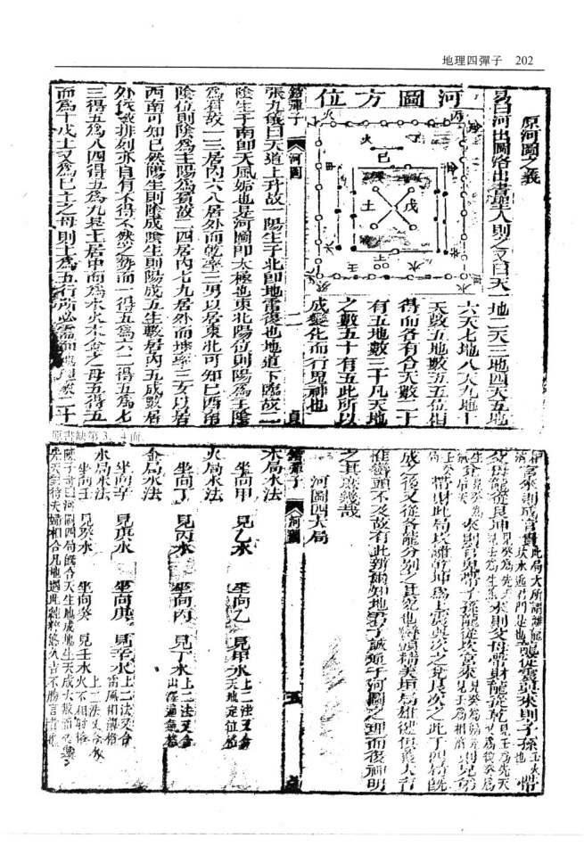

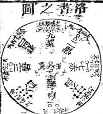

<!-- V3_SOURCE_ID:book025-b000318-p000-4cfb4e78b6 -->

民间有说法称，上天赐给大禹，神龟背负着文字出现，“刻于”二字之后有缺字，内容中包含数字，到九为止，大禹于是按照顺序将这些内容排列成九类。世代相传的“戴九履一，左三右七，二四为肩，六八为足”，就是洛书的相关内容，原文“卽洛書之”之后有缺字，未记录完整。

> **释读存疑：** 刻于二字后缺字，原文内容不完整；卽洛書之后缺字，表述不完整；“刻于”二字后缺字，原文内容不完整；“卽洛書之”之后缺字，表述不完整

查看对应原文

<!-- V3_FOLDBACK_BEGIN:book025-b000318-p000-4cfb4e78b6 -->

民曰天與禹神龜負文而出刻于皆有數至九禹遂因而第之以成九類世傳戴九履一左三右七二四爲肩六八為足卽洛書之

<!-- V3_FOLDBACK_END:book025-b000318-p000-4cfb4e78b6 -->

<!-- V3_SOURCE_ID:book025-b000319-p000-1a8ed3cf3c -->

都认为河图的贞位，由乾、坤、坎、离居于阴位四隅，先天的艮、兑居于阳位，这是洛书的定数，地理家净阴净阳的说法，实际就来源于此。只是河图里九数在西方，这里换到了南方；河图里七数在南方，这里换到了西方，这是金火五位的缘故。河图主顺生，从北方到东方，水生木，木生火，火生土，土生金；洛书主逆克，从北方到西方，水克火，火克金，金克木，木克土，土又克水，这就是七数换到西方、九数换到南方的原因。用合十的道理来考证，又都是自然形成的定数：一在北方则九对应的在南方，三在东方则七对应的在西方。当太极生出两仪的时候，乾的位置尽于午中，坤的位置尽于子中，离的位置尽于卯中，坎的位置画于酉中，这些数当时就已经确定了。因此天一生出坎水，地六由乾来配合成就，乾向有坎水朝迎、坎位起形，就是一来会六；坎向有长乾水朝迎、峰峦起形，就是六来会一，这就是河图里天一生壬水、地六癸成之的含义。天三生出震木，地八由坎来配合成就，震向有秋足火、艮峰起形，纳为八乘会三；艮向有炳震水朝迎、震位起身，为三乘会八，这就是河图里天三生甲木、地八乙成之的含义。细看这两个局，水会水垣，木会木垣，又都是净阴净阳，不会出现驳杂的情况。地一对应坤火，天七由兑来配合成就，坤向就吉利，因为火生土；兑向就凶险，因为金畏惧火，这和地二生天、天七丙成之的子位在南、气属净阴的情况不一样。地四生出巽金，天九由离来配合成就，离向就吉利，因为火克金为财；巽向就凶险，因为金克木为煞，这和地四生辛金、天九庚成之的子位在西、气属净阴的情况不一样。只有这两个局，龙气周备，穴场朝向真确，善于消纳，发福的效果也大而且长久，因为得到了生武的大数。总的来说，还没有会局的时候，乾本身属金，艮本身属土，震本身属木，离本身属火，坤本身属土，兑本身属金；会局之后，坎固然属水，乾也属水了；震固然属木，艮也属水了；坤土变为火，兑金也变为火；离火变为金，巽木也变为金了。为什么会这样？正尺经说“生乘今，聪明之子方生旺去朝生，家为千生诀，数之铜融至”，又说“食前素生万贬图嗣法则情旺迎生”，这个道理前代的圣人已经详细论述过了，只是没有明确指出来。只是如果存在阴阳驳杂的情况，必须靠向来消纳，要仔细审察。凤凰山的祖地，是坤山艮向，震方有一个水池，是艮制坎水来朝，属于三来会入河图，生来会旺，就是正尺经里说的“聪明之子方生”。可惜震方的水池兼带乙位三分，坤纳乙为向，后来明白了洛书的含义，相关的学问就有进步了。

> **释读存疑：** 皆弹十河国；苦王逆克；自北而四永克火；天六乾成之；乾向坎水朝坎懈起形公为一来会六；秋足火朔良峰起；向炳震水朝震晰起身；地一正坤火；地二生十天七丙成之；地彈十河圍；龙肝局周穴确朝真善于消州；至称之年生；生乘今；数之铜融至；食前素生万贬图嗣法；坤绅乙为民向；原文存在大量OCR错误及模糊表述，包括“皆弹十河国”“苦王逆克”“自北而四永克火”等多处内容含义无法确定；1轮自动修复后核义模型仍建议修订，已保守记录。

查看对应原文

<!-- V3_FOLDBACK_BEGIN:book025-b000319-p000-1a8ed3cf3c -->

皆彈十河國 貞 乾坤坎離居之陰居四隅先天過靈艮兌居之此洛書之定數而 地理家淨陰淨陽之說實本乎是但河圗九在西茲易之南河圗 七在南茲易之西金火五位何也圗主順生自北而東水生木木 生火火生土土生生水苦王逆尅自北而四永尅火火尅金 金尅木木尅土土復尅水此七易西九易南之故也而以合十之 理考之又皆自然之數一在北則九應在南三在東則七應在 西當太極生兩儀時乾盡午中坤盡子中離盡卯中坎畫酉中此 數巳定是故天一生坎水地六乾成之乾向坎水朝坎懈起形 公爲一來會六坎向長乾水朝峰起爲六來會一是卽河 天一生壬水地六癸成之之義也天三生震木地八坎成之震 向秋足火朔良峰起納爲八乘會三是向炳震水朝震晰起身 為三乘會八是卽河圗天三生印木地八乙成之之義也細此 二局水會水垣木會木垣又皆淨陰淨陽不至駁雜地一正坤火 天七兌成之坤向則吉火生土也兌向則凶金畏火也與地二生 十天七丙成之子位在南于氣淨陰者異矣地四生巽金天九 離成之離向則吉火尅金爲財也巽向則凶金剋木爲煞也與地 彈十河圍 七 四生辛金天九庚成之于位在西千氣淨陰者異矣維此二局龍 肝局周穴確朝真善于消州發福亦大且久以得生武之大數也 總而言之未會局之先乾自金也艮自土也與自木離自火也坤 自土兌自金也會局之後坎固水而乾亦水矣震固木而艮亦 水矣坤土爲火而兌金亦爲火離火爲金而巽木亦爲金矣何也 至稱之年生 正尺經曰生乘今 聰明之子方生旺去朝生 家爲千生訣 數之銅融至又曰食前素生萬貶圖嗣法則情旺迎生此理 先聖詳論之特未明指之兩但有陰陽駁雜者須以向消納之審 鳳凰山祖地坤山艮河震方一池是艮制寰水朝爲三來會入圗 生來會旺禮明之子方生也惜震池兼乙三分坤紳乙爲民向後 明于洛書之義其學進矣

<!-- V3_FOLDBACK_END:book025-b000319-p000-1a8ed3cf3c -->

<!-- V3_SOURCE_ID:book025-b000320-p000-b67f773578 -->

洛书四大局水局水法。

查看对应原文

<!-- V3_FOLDBACK_BEGIN:book025-b000320-p000-b67f773578 -->

洛書四大局水局水法

<!-- V3_FOLDBACK_END:book025-b000320-p000-b67f773578 -->

<!-- doc013 PDF 第 207 页：高风险/复杂版面 OCR 供检索；内容与排版以原页图为准。 -->
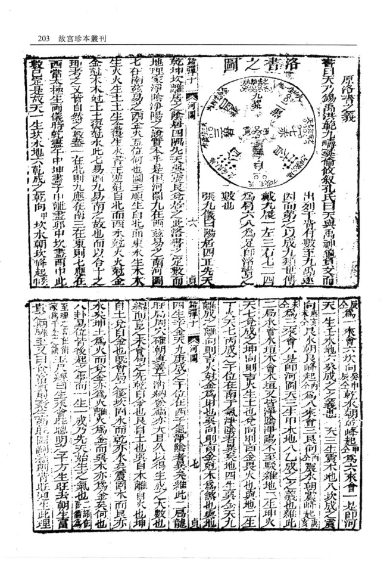

<!-- V3_SOURCE_ID:book025-b000322-p000-b77190e383 -->

坐向为坎，可见乾、甲；坐向与乾、甲相同，可见坎对应的水（风水语境中的河流、水系及其来去形态），此为申火局的水法。

> **释读存疑：** 原文断句不明确，具体坐向与所见事物的对应关系未明；1轮自动修复后核义模型仍建议修订，已保守记录。

查看对应原文

<!-- V3_FOLDBACK_BEGIN:book025-b000322-p000-b77190e383 -->

坐向坎及 見乾 甲 坐同乾甲見坎水申火局水法

<!-- V3_FOLDBACK_END:book025-b000322-p000-b77190e383 -->

<!-- V3_SOURCE_ID:book025-b000323-p000-0460036558 -->

坐向为坤、乙，全可见兑火、丁巳；坐向与兑、五巳相同，可见坤对应的水（风水语境中的河流、水系及其来去形态），此为乙公金局的水法。

> **释读存疑：** “坐回”“五巳”“乙公金局”具体所指不详；1轮自动修复后核义模型仍建议修订，已保守记录。

查看对应原文

<!-- V3_FOLDBACK_BEGIN:book025-b000323-p000-0460036558 -->

坐向坤乙全見兌火丁巳坐回兌五巳見坤水乙公金局水法

<!-- V3_FOLDBACK_END:book025-b000323-p000-0460036558 -->

<!-- V3_SOURCE_ID:book025-b000324-p000-2d4ad71139 -->

坐向为巽，全可见离水生；坐向与离相同，可见巽对应的水（风水语境中的河流、水系及其来去形态），此为辛至木局的水法。

> **释读存疑：** “离水生”“辛至木局”具体所指不详；1轮自动修复后核义模型仍建议修订，已保守记录。

查看对应原文

<!-- V3_FOLDBACK_BEGIN:book025-b000324-p000-2d4ad71139 -->

坐向巽全見離水生坐同離見巽水辛至木局水法

<!-- V3_FOLDBACK_END:book025-b000324-p000-2d4ad71139 -->

<!-- V3_SOURCE_ID:book025-b000325-p000-552354db38 -->

文中提到“陳丫奇日何圓以順生水木火念各居本名書以逆尅火層位金人火鄉”，这部分内容存在缺讹，具体含义不详。之后提到洛省的水木二局与河冈的情况相同。“佛神圃金巽火之下”的内容驳杂，和儒家的通行说法相通，还有秀美的砂拱卫水的格局，能带来的福报更为弘大。文中还提到“糟過緯掌勿有三紀中點請亦有六純云”，这部分内容存在缺讹，“糟过纬掌”“三纪中点”“六纯”的具体所指不详。

> **释读存疑：** 陳丫奇日何圓以順生水木火念各居本名書以逆尅火層位金人火鄉；洛省；河冈；佛神圃；糟过纬掌；三纪中点；六纯

查看对应原文

<!-- V3_FOLDBACK_BEGIN:book025-b000325-p000-552354db38 -->

陳丫奇日何圓以順生水木火念各居本名書以逆尅火層位金人火鄉故洛省水木二局與河岡同佛神圃金巽火之下變雜儒通同亦秀美砂拱水剛發福更覺弘太也糟過緯掌勿有三紀中點請亦有六純云

<!-- V3_FOLDBACK_END:book025-b000325-p000-552354db38 -->

<!-- V3_SOURCE_ID:book025-b000327-p000-e2d2ee3107 -->

这段内容讲的是先天卦位的含义，《易》中说“天地定位，山泥通氣，雷風相薄，水火不相射，八卦相錯”。文中提到“數住伏 者順知來者逝是故逆整卦八 三班”，这部分内容存在缺讹，具体含义不详。张九仪说：天的职能是覆盖，轻清的气向上浮；地的职能是承载，重浊的实体向下凝结，震在下，乾在上，坤在北，所以叫定位。西北多山，“崐輪為山之禮真”，南东多水，“大海爲水之篇”，这两处存在讹字，具体含义不详。但水都从山中流出，山遇到木就止，所以叫通气。雷从地中升起，所以一阳生于坤的初爻；“一陰生于夢之始”，这里的“夢”是讹字，具体所指不详。风用来助长威势，雷用来鼓动风的力量，所以叫相薄。太阳是火的精气，出自东方；月亮属于水的母体，生在西方，两者交替带来光明，所以叫不相射。从乾一到坤八的生成顺序，都是顺行的。君子观察先天的道理，地理的本体就确立了，地理的实际规律要从逆数去理解就更清楚了。但是八卦以先天为本体，后天的方位虽然改变，性质仍然遵循先天的规则。所以乾属阳，先天位配九的数，本来就是阳；坤属阴，先天位配一的数，阴也成为阳；坎属阳，先天位是右七的位置，这里的“園”是讹字，具体含义不详，属阳；离属阴，先天位是左三的位置，这里的“致”是讹字，具体含义不详，阴也变为阳。“先天之位在一黑震陽也先天之位召八自陰固陰而陽亦唯矣兌陰也光云之位在四緣艮陽也先天之位在六白陰問陰而陽亦給及”，这部分内容存在多处讹误，艮作为八卦之一，相关的描述讹误较多，具体含义不详。所以说后天的运用不会超出先天的具备的内容，懂得地理的君子如果能用后天的方位配合先天的气，对地理的理解就超过一半了。

> **释读存疑：** 山泥通气；數住伏 者順知來者逝是故逆整卦八 三班；崐輪為山之禮真；大海爲水之篇；一陰生于夢之始；先天位右七之園；先天位左三之致；先天之位召八自陰；光云之位在四緣；陰問陰而陽亦給及；1轮自动修复后核义模型仍建议修订，已保守记录。

查看对应原文

<!-- V3_FOLDBACK_BEGIN:book025-b000327-p000-e2d2ee3107 -->

原先天卦位之義易曰天地定位山泥通氣雷風相薄水火不相射八卦相錯數住伏 者順知來者逝是故逆整卦八 三班 張九儀曰天職覆輕清之氣上浮地職載重濁之實方 震三 下凝乾兩坤北故曰定位位 西北多山崐輪為山之禮真南東多水大海爲水之篇然水俱從山出而山見木卽止故曰通氣雷從地起故一陽生子坤之初風從天下故一陰生于夢之始風以助當威雷以鼓風方故曰相薄曰為火精出于東方月屬水母生于西方相代爲明故曰不相射然自乾一至坤八生出之序皆迎君子觀于先天而地理之體立矣地理之實乎逆更可知矣然八卦以先天爲體後天之位雖易而性仍率乎先天故乾陽也先天位載九之數固爲防坤陰也先天位履一之數則陰亦爲陽坎陽也先天位右七之園為陽離陰也先天位左三之致則陰亦爲易與陰也先天之位在一黑震陽也先天之位召八自陰固陰而陽亦唯矣兌陰也光云之位在四緣艮陽也先天之位在六白陰問陰而陽亦給及曰後天之用不越先天之備也知地君子誠以後天之方位用先天之無氣思過半矣

<!-- V3_FOLDBACK_END:book025-b000327-p000-e2d2ee3107 -->

<!-- doc013 PDF 第 208 页：高风险/复杂版面 OCR 供检索；内容与排版以原页图为准。 -->
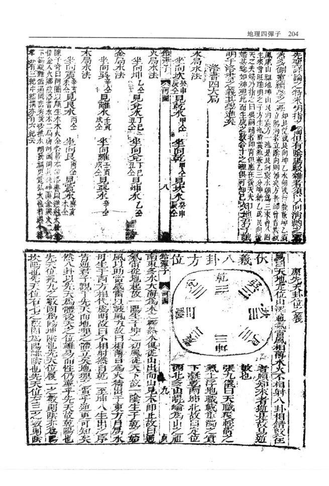

<!-- V3_SOURCE_ID:book025-b000329-p000-5ca576c1ce -->

《易》中提到“雷以動之，風以散之，兩以禮之，日以之，良以止之，兌以說之，君之，坤以之”，这段内容存在大量缺讹，除坤作为八卦之一保留原意之外，其余缺讹部分的具体含义不详，无法补全。

> **释读存疑：** 兩以禮之；日以之；良以止之；兌以說之；君之；坤以之；1轮自动修复后核义模型仍建议修订，已保守记录。

查看对应原文

<!-- V3_FOLDBACK_BEGIN:book025-b000329-p000-5ca576c1ce -->

易曰雷以動之風以散之兩以禮之日以之良以止之兌以說 之君之坤以之

<!-- V3_FOLDBACK_END:book025-b000329-p000-5ca576c1ce -->

<!-- V3_SOURCE_ID:book025-b000330-p000-f16150cc31 -->

张九宗说：“此卽太種生兩儀，兩儀生四象，四象生八卦也。”君子观察一动一散的状态，就知道“雷風捐薦之局”的情况，“捐薦”具体所指不详；观察“一潤一監”的状态，就知道水火相济的好处，“監”此处为讹字，具体含义不详；观察“一止一說”的状态，就知道“山際遍氣”的佳处，“山際遍氣”具体含义不详。文中提到“伏 陽 觀十君藏之而知也足位之義三少儀 元 更大矣”，这部分缺讹较多，具体含义不详。但能知晓这些的原因，在“動散八四 君藏序”之内，“動散八四”具体所指不详。“山中塵澄以極于外，故上圓嗣乾坤當中直次 定位，此之方圗震異居內，先說雷汰序八也”，这段内容存在缺讹，“山中塵澄”“嗣乾坤當中直次定位”“雷汰序八”具体含义不详。“風所謂天地網糧，萬物化醇，易文搆精，萬物化生也”，其中“天地網糧”“易文搆精”具体所指不详。还有佛家的说法提到“動先于故，瀾先于職，止先于說，君先于”，这段内容有缺漏，具体含义不详。

> **释读存疑：** 太種生兩儀；雷風捐薦之局；一潤一監；山際遍氣；伏 陽 觀十君藏之而知也足位之義三少儀 元 更大矣；動散八四；山中塵澄；嗣乾坤當中直次定位；雷汰序八；天地網糧；易文搆精；動先于故，瀾先于職；君先于；1轮自动修复后核义模型仍建议修订，已保守记录。

查看对应原文

<!-- V3_FOLDBACK_BEGIN:book025-b000330-p000-f16150cc31 -->

張九宗曰此卽太種生兩儀兩儀生四象四象生八卦也君子觀于一動一散而知雷風捐薦之局矣觀于一潤一監而知水火相濟之美矣觀于一止一說而知山際遍氣之佳矣伏 陽 觀十君藏之而知也足位之義三少儀 元 更大矣然所以知之故在動散八四 君藏序內一陰一陽山中塵澄以極于外故上圓嗣乾坤當中直次 定位此之方圗震異居內先說雷汰序八 也 風所謂天地網糧萬物化醇易文搆精萬物化生也而佛謂動先于故瀾先于職止先于說君先于

<!-- V3_FOLDBACK_END:book025-b000330-p000-f16150cc31 -->

<!-- V3_SOURCE_ID:book025-b000331-p000-a1b1f0635e -->

阳的出现必先有阴，就像夫为先导、妇随后相随，阳的运行节律由此可以看出。从这个角度来看，乾为纯阳，统摄八卦的演化而居于君位；坤为纯阴，收纳八卦的演化成果而起到藏纳的作用。这和圆图里乾居于上位、坤居于下位，子横列在二者中间，义理相互贯通契合的布局，大概可以看出对应关系。因此地理学问中能够做到阴阳相薄、通气、定位、不朽，是四大局的可贵之处。

> **释读存疑：** 夫始婦陽之音的具体含义；地理蒙得相薄通氣定位不朽射的完整所指；“夫始婦陽之音”“地理蒙得相薄通氣定位不朽射”具体所指不详；1轮自动修复后核义模型仍建议修订，已保守记录。

查看对应原文

<!-- V3_FOLDBACK_BEGIN:book025-b000331-p000-a1b1f0635e -->

陽必先陰夫始婦陽之音由此觀之乾爲純陽統八卦之而爲君坤爲純陰攝八卦之成而爲藏與圓圗乾居上坤居下子橫列其中義相貫合概可見矣故地理蒙得相薄通氣定位不朽射四大局之貴也

<!-- V3_FOLDBACK_END:book025-b000331-p000-a1b1f0635e -->

<!-- V3_SOURCE_ID:book025-b000332-p000-e4999b1f9b -->

坐向为乾甲，全可见坤对应的水（风水语境中的河流、水系及其来去形态）乙；坐向为坤乙，可见乾木甲山。

> **释读存疑：** “坤水乙”“至見”“乾木甲山”具体断句和所指不详；1轮自动修复后核义模型仍建议修订，已保守记录。

查看对应原文

<!-- V3_FOLDBACK_BEGIN:book025-b000332-p000-e4999b1f9b -->

坐向乾甲全見坤水乙，坐向坤乙至見乾木甲山。

<!-- V3_FOLDBACK_END:book025-b000332-p000-e4999b1f9b -->

<!-- V3_SOURCE_ID:book025-b000333-p000-3ca521229a -->

文中提及“蒼子先天 雷風相薄”，“苍子”具体所指不详，“先天”为术数中表示先天卦序或本体关系的概念，该短句具体关联含义不详。

> **释读存疑：** 苍子；蒼子先天 雷風相薄的关联含义

查看对应原文

<!-- V3_FOLDBACK_BEGIN:book025-b000333-p000-3ca521229a -->

蒼子先天 雷風相薄

<!-- V3_FOLDBACK_END:book025-b000333-p000-3ca521229a -->

<!-- V3_SOURCE_ID:book025-b000334-p000-92317aa088 -->

水火不会互相排斥。

查看对应原文

<!-- V3_FOLDBACK_BEGIN:book025-b000334-p000-92317aa088 -->

水火不相射

<!-- V3_FOLDBACK_END:book025-b000334-p000-92317aa088 -->

<!-- V3_SOURCE_ID:book025-b000335-p000-151a5cbaec -->

坐向朝向离镇方位，可见坎水系的原局，该格局完整。陈子奇称：洪兑巳极，渐从极中“涕摩”出来，“涕摩”具体所指不详；得到这四局，才能感应天地，才能化生万物，是稳固造化的本源、气运变化枢机的根本，因此符合这种格局的地为上吉之局。其中“洪兑巳极”具体所指不详。

> **释读存疑：** 洪兑巳极具体所指不详；涕摩具体所指不详

查看对应原文

<!-- V3_FOLDBACK_BEGIN:book025-b000335-p000-151a5cbaec -->

坐向離鎮見坎水原 全 陳子奇曰洪兌巳極漸從極中涕摩出來得此四局方能感天地 方能生萬物固造化之原風機之本也故地得此格爲上局云

<!-- V3_FOLDBACK_END:book025-b000335-p000-151a5cbaec -->

<!-- doc013 PDF 第 209 页：高风险/复杂版面 OCR 供检索；内容与排版以原页图为准。 -->
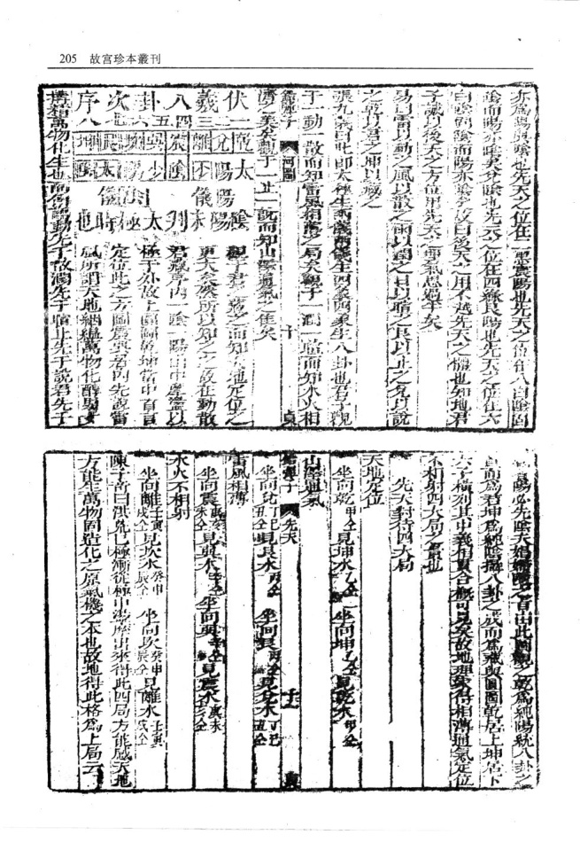

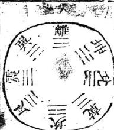

<!-- V3_SOURCE_ID:book025-b000338-p000-d3e9edadad -->

盛张凡仪说：后天易的次序，《易·系辞》已经有详细说明。至于“相多之故”，具体含义不详；可以明确的是，震、巽对应东方木位，“丁時爲春”的说法原文未给出进一步说明，此处存疑；对应到人则为仁，震、巽为“橋木”，“橋”的具体含义不详，所以排布在东南方。

> **释读存疑：** 相多之故具体含义不详；丁時爲春的说法存疑；橋木中“橋”的具体含义不详

查看对应原文

<!-- V3_FOLDBACK_BEGIN:book025-b000338-p000-d3e9edadad -->

盛張凡儀曰後天易序易繫詳已而所以相多之故誠以淺之東方木位丁時爲春于人爲仁震巽橋木故易而居東南方

<!-- V3_FOLDBACK_END:book025-b000338-p000-d3e9edadad -->

<!-- V3_SOURCE_ID:book025-b000339-p000-21f7e42ce6 -->

繪子所论后天卦排布：贞火对应时节为夏季，对应到人则为礼，离卦属火，所以变化排布在南方；金对应时节为秋季，对应到人则为义，乾、兑施金，所以变化排布在西北方；水对应时节为冬季，“千人爲智”中“千”应为“于”的讹误，对应到人则为智，坎卦为“橋水”，“橋”具体含义不详，所以变化排布在北方。至于坤卦变化排布在西南方，是因为“大能生上以生金”，具体含义不详；艮卦变化排布在东北方，是因为万物都归属于土，万物都从土中萌生，春季的水没有土就不能止蓄，水没有土就不能调节。仁、义、礼、智的德行，没有信就无法成就，所以圣人调整艮卦位于东北方，就是用信来成就四德的体现，原文末尾“之口也”应为残字，具体所指不详。后天易卦的本源辨析清楚之后，纵横十五的数理就可以推求了。比如正西的兑卦、东流的“具”，此处“具”应为讹误，具体所指不详，二者相互呼应，为山泽通气，是先天对待的夫妇之象；如果兑卦对应，此处“露應之”的“露”为讹误，具体所指不详，坤卦与之相应，就是后天合十的夫妇之象，一者为三碧来合七赤，一者为一黑来合入自地。又如正西的乾卦、西南方的坤卦，两相呼应为天地定位，是先天对待的夫妇之象；如果乾卦与之相应，坤卦与艮卦相应，就是后天合十的夫妇之象，原文“四緣來食百”“八白來食二黑”表述存疑，具体含义不详。又如正东方的震卦、“黃南之巽”，“黃”应为讹误，巽位为东南，此处表述存疑，两相朝应为“當風相薄”，具体所指不详，是先天对待的夫妇之象；如果震卦与兑卦相应，“與也而乾應之”的“與”应为讹误，具体所指不详，巽卦与乾卦相应，就是后天合十的夫妇之象，一者为七赤来合三碧，一者为“六自來合四綠”，“自”应为“白”的讹误。至于南方离卦、北方坎卦，先天对待为水火不相射，后天合十为九合一白，唯有这两卦“先後全揆”，具体含义不详，不是其他卦可以比得上的，所谓纵横十五的数理就是如此。第声子论及从天而来的相关方法，其推导都依照纳甲、砂、水、龙度来进行，原文误写为“砂木龙度”；说乾明甲在其中，说震则庚未在其中。原文末尾“凡地朔之定主痛經傷易之後天合十四大局三”为残句，具体含义不详。

> **释读存疑：** 繪子身份未明；大能生上以生金具体含义不详；橋水中“橋”具体含义不详；东流之具中“具”为讹误，所指不详；露應之中“露”为讹误，所指不详；四緣來食百、八白來食二黑表述存疑，含义不详；黃南之巽中“黃”为讹误，表述存疑；當風相薄具体所指不详；與也而乾應之中“與”为讹误，所指不详；六自來合四綠中“自”为“白”的讹误；先後全揆具体含义不详；凡地朔之定主痛經傷易之後天合十四大局三为残句，含义不详；1轮自动修复后核义模型仍建议修订，已保守记录。

查看对应原文

<!-- V3_FOLDBACK_BEGIN:book025-b000339-p000-21f7e42ce6 -->

繪子後天 貞火位于時爲夏于人爲禮離卦屬火故易而居朝西方金位于時爲秋于人爲義乾兌施金故易而居西北方水位于時爲冬千人爲智坎卦橋水故易而居北至于坤易居西南者以大能生上以生金也艮易居東北者萬物皆歸于土萬物皆生于土之春水非土不能止水非土不能裁水始仁義禮智之德非信不成故聖人易其十東北者即信以成之之口也後天易卦之原既辨則縱橫十五之數可推如正西之兌東流之具而相頓應爲山澤通氣是先天對待之夫婦若兌也而露應之此也而坤應之則爲後天合十之夫婦一則三碧來合七赤一則一黑來合入自地如西此之乾西南之坤兩相削應為天地定位是先天對待之夫德乾也而與應之坤也而艮應之則爲後天合十之夫婦一則四緣來食百一則八白來食二黑也如正東之震黃南之巽兩相朝應爲當風相薄是先天對待之夫婦若震也而兌應之與也而乾應之則爲後天合十之夫婦一則七赤來合三碧一則六自來合四綠也至于南離北坎先天對待爲水火不相射後天合十爲九合一白惟此二卦先後全揆非諸卦可及所謂縱橫十五者如此第聲子從天其法俱依納甲砂木龍度悉如此推 言乾明甲在中言震則庚未在中 凡地朔之定主痛經傷易之後天合十四大局三

<!-- V3_FOLDBACK_END:book025-b000339-p000-21f7e42ce6 -->

<!-- V3_SOURCE_ID:book025-b000340-p000-35cf4bd9ea -->

坤乙全见丙水，今。

> **释读存疑：** “今”为残句尾字，语义未明

查看对应原文

<!-- V3_FOLDBACK_BEGIN:book025-b000340-p000-35cf4bd9ea -->

坤乙全見丙水今

<!-- V3_FOLDBACK_END:book025-b000340-p000-35cf4bd9ea -->

<!-- V3_SOURCE_ID:book025-b000341-p000-5ded835e81 -->

始三未七，兼合洛书天三生营水也。

> **释读存疑：** “始三未七”“天三生营水”具体所指不详

查看对应原文

<!-- V3_FOLDBACK_BEGIN:book025-b000341-p000-5ded835e81 -->

始三未七兼合洛書天三生營水也

<!-- V3_FOLDBACK_END:book025-b000341-p000-5ded835e81 -->

<!-- doc013 PDF 第 210 页：高风险/复杂版面 OCR 供检索；内容与排版以原页图为准。 -->
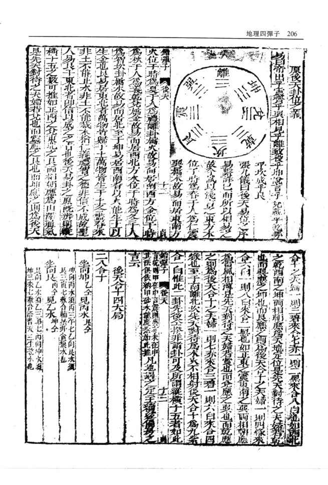

<!-- V3_SOURCE_ID:book025-b000343-p000-ac0060c779 -->

三七合十，原本是先天、后天相见的含义。坐向为兑卦，年上见庚、亥、未对应火到。-01 张九仪说：先天卦位是地理的本体，后天卦位是地理的功用。然而有本体就要有坐向，见丁、巳、丑对应的水，兑卦的属性才算完备。三的义理不可以没有功用支撑，有功用才能明晓三七的规则。纯芽无疵，后对应坤三，体目是古代圣人代代相传的龙神相关四十项内容，相天，三次重复计算，换向首的转动，之后水法的坐向为乾、甲，要全见辛水才完整。来去砂位的朝拱、抚揖，不外乎乾河辛木要带戌，同时兼人先冲无水甲；向头水要带辰，同时兼合辅星卦贪水。见汽汇，这就是体用互见的宗旨。所以一乾图坐向为巽，要全见甲水才算合局。先天的乾居正南离位，后天雪子、铅弹子先后天十五石带亥秉合居风相，头向为甲的大穴必须配帝卯，辛向要配乾。后天的乾居西北艮位，那么离就是先天的乾，艮就是后天的乾，所以不只是乾、甲属于乾的九合十范围，就连离、壬寅、戌和艮、丙也都属于乾巳一坤的范畴。先天的坤居正北坎位，后天坐向为坎，见壬寅、戌对应的水；后天的坤居西南巽位，那么坎就是先天的坤，巽就是后天的坤，所以不只是坤、乙属于坤的范围，坐向维进王寅，全见癸、甲、辰对应的水，就连坎、癸、申、辰与巽、辛也都属于坤巳一坎的范畴。先天的坎居正西的兑位，后天居均自十，想要各方均匀发福，就要在一九合十的局里安置砂，声一与九相合。陈子奇说：凡是遇到续弦或者偏房急于求子嗣的情况，就用合十法或者变正堡的方法。后天的坎居正北的坤位，那么兑就是先天的坎，坤就是后天的坎，所以不只是坎、癸、申、辰属于坎的范围，而且先天一东一西对应水的隅角，爵大一南一北仍居四王对应火，这个局在后天也是同样的格局，在癸二十仍全河离水局，而坎、离二卦兼用更能发挥作用，所以兑、丁巳、丑与坤、乙都属于坎巳一离的范畴。先天的离居正东的震位，后天居正南的乾位，那么震就是先天的离，乾就是后天的离，所以不只是戌属于离的范围，就连震、庚、亥、未与乾、甲也都属于离巳的范畴，至于震的相关内容，先天的征兆还未完全说明。

> **释读存疑：** 纯芽无疵；体目古圣圣相传龙神之四十；相天 三三次；乾河辛木须带戌兼人先冲无水甲；向头水须带辰兼合辅星卦贪水；汽汇；后天雪子 铅弹子先后天 十五石帶亥秉合居風相；头向甲大须帝卯辛向乾；坐向維 進王寅；居均自十欲其均發奠砂于一九合十之局聲一與九合然此；變正堡；水隅角爵大一南一北仍居四王此火；局于癸二十仍全河離水局；而坎離二兼致勝有；可清也巳；writer_uncertainty中所列的所有短语均语义未明，部分属于原文讹误或残句；1轮自动修复后核义模型仍建议修订，已保守记录。

查看对应原文

<!-- V3_FOLDBACK_BEGIN:book025-b000343-p000-ac0060c779 -->

三七合十 原先天後天相見之義坐向兌 年見庚亥未火至 -01 張九儀曰先天卦位地理之體也後天卦位地理之用也然有體坐向 見丁巳丑水兌全 三 不可無用而有用方能明三七之例 純芽無疵 後 坤三 體目古聖聖相傳龍神之四十 相天 三三次 啊換向首之轉後水法之坐向乾甲全見辛水要全 去來砂位之朝拱撫不外乾河辛木須帶戌兼人先衝无水甲 向頭水須帶辰兼合輔星卦貪水 見 汽汇 體用互見之旨是故一乾圖坐向巽見甲水全 也先天居正南離位後天雪子 鉛彈子先後天 十五石帶亥秉合居風相 頭向甲大須帝卯辛向乾 居西北艮位則離卽先天之乾艮卽後天之乾是不獨乾甲爲乾九盒十 也卽離壬寅戌與艮丙皆爲乾巳一坤也先天居正北坎位後天坐向坎 見壬寅戌水 居西南巽位則坎卽先天之坤與卽後天之坤是不獨坤乙坤也坐向維 進王寅 見癸甲辰水全 卽坎癸申辰與巽辛皆爲坤巳一坎也先天居正西之兄後天居均自十欲其均發奠砂于一九合十之局聲一與九合然此 陳子奇曰凡遇續絃及偏房急于數嗣者用合十法或變正堡 正北之坤則兌卽先天之坎坤卽後天之坎是不獨坎癸申辰爲無且先天一東一西水隅角爵大一南一北仍居四王此火 局在後天亦此局于癸二十仍全河離水局而坎離二兼致勝有 坎也而兌丁巳丑與坤乙皆爲坎巳一離也先天居正東之無後離二卦龍穴砂水大地居多也庸術不知此理多以陽龍義之 可清也巳 天居正南之乾則震印先天之離乾即後天之離是不獨戌爲離也卽震康亥未與乾甲皆爲離巳至于震也先天兆

<!-- V3_FOLDBACK_END:book025-b000343-p000-ac0060c779 -->

<!-- doc013 PDF 第 211 页：高风险/复杂版面 OCR 供检索；内容与排版以原页图为准。 -->
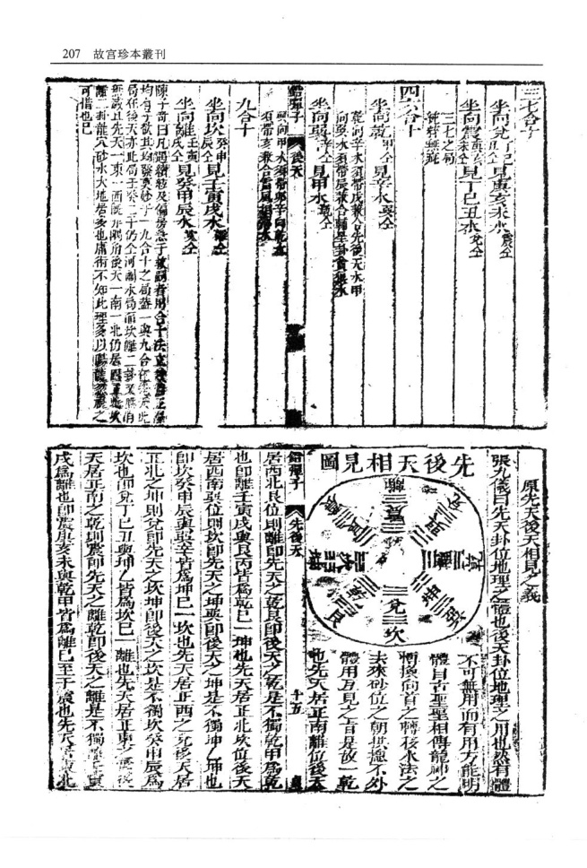

<!-- doc013 PDF 第 212 页：高风险/复杂版面 OCR 供检索；内容与排版以原页图为准。 -->
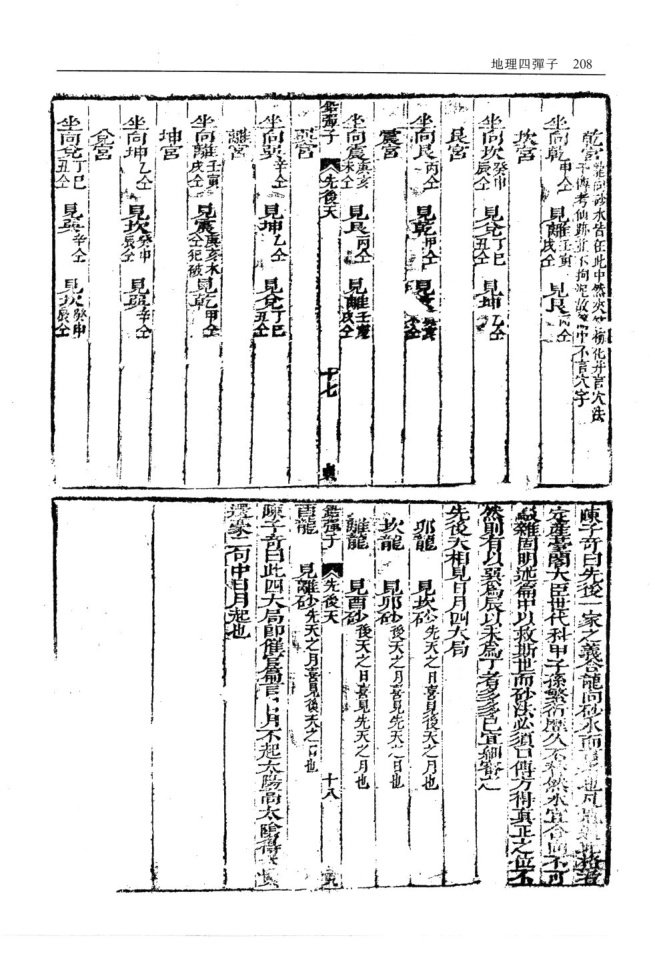

<!-- V3_SOURCE_ID:book025-b000347-p000-377cb1315d -->

原本纳甲五行的含义，本于太极生两仪，两仪生四象，四象生八卦，和二十四山的清灭、八卦的煞轻相关内容，都详细记载在本篇中。参考张九仪的说法：纳甲的宗旨，来源于太易，而太阴盈缺的次序，来源于八势，卦的阴阳排列顺序，来源于四象，转象大小的区分，来源于两仪，常说南北未分的状态，来源于太极，太极还未显发的最初阶段，来源于无极。无极无法用言语描述，也无法描摹形状，只有从无极生发的混沌一体的气，就像图里的大国一样，这就是太极。从太极之中有一气发动，气中轻清的部分就是阳，就像图里白色的部分；气中重浊的部分就是阴，就像图里黑色的部分，这就是两仪。从阳仪之中灵动生发，得到纯阳之气的，比如圆图里正南乾兑角的位置，就是太阳；得到阳三阴一之气的，比如图里东北震离角的位置，就是少阴。从阴仪之中充盈发动，得到纯阴之气的，比如图里西北坤艮角的位置，就是太阴；得到阳七阴三之气的，比如图里西南坎角的位置，就是少阳，总称为四象。然而阴阳的规律是阴阳二气交媾，纯阳之中也有阴，纯阴之中也有阳，中气畅达内动，贯通之后通体都是阳的就是乾；得到一阳一阴的就是兑；中少阳内动丰足，得到内阴外阳的就叫做离；得到一阳一阴的就是震；中少阴内动摇荡，得到一阴一阳的就是巽；得到内阳外阴的就是坎；中太阴内动生成，得到一阴一阳的就是艮；通体都是阴的就是坤，分别称为八卦。人们都认为太极在外生成两仪，两仪在外生成四象，四象在外生成八卦，却不知道两仪本来就在太极之中，四象本来就在两仪之中，八卦本来就在四象之中，这样纳甲的含义就可以考证了。离对应太阳的本体，坎对应月亮，其余六卦按照次序排列，八卦都是以乾为父、坤为母，震是长男，继承乾父的本体，依托坤母而生成，所以太阴从每月二十八到次月初二，祭帝子纳甲1十聊槐而对应坤卦，初三时月亮显现三分的光，这是一阳初生，消去地的阴气，六未城初九用子，山乙庚子交，所以坤乙山忌八时月在庚方，因此震纳庚，亥、未和三也一同纳入震的范围。震卦的爻位分别是初九庚子、九二庚寅、六三庚辰、九四庚午、六五庚申、上六庚戌，卦中犯食的爻作为煞曜，有田亩忧患的忌讳，就算是申位，用来看子方多三泽节宫的病水，对应的爻就是初九庚、六三庚辰、九四丁亥、九五、上六丁未。

> **释读存疑：** 井大極生佛向儀；清滅；煞輕；太风；八勢公卦；四滚轉象；無南之判；太未兆；無柳；聖發漢區；渾命之氣；大國然；太邊中一氣動聲氣；氣之亂；里著然；動靈；卯圓中裏南乾兌角；大陽；陽三陰之氣；震離角光是謂少陰；動盈；純唯之氣；止巽謂太陰；短謂之四象；兩用交媾；中天暢內動濫；中少陽內動豐一；一陽陰者則為震；山少陰內動盪；一陰防者則爲與；田大陰內動監；一蔭一者則爲艮侍通禮；外生；小生；目體；人卦；震為則繼乾父之體因坤丹而兆；祭帝子納甲 1十聊槐；月光罰三分；消地之新六未城初九用子；山 乙庚子交；八時；與三亦納焉；卦大爻；股一庚寅貌；接九四庚午宿六五庚申始；畝憂忌縱是申；看子多三澤節宮病水；般九五第；writer_uncertainty中所列的所有短语均为原文讹误或语义不明内容，大量文字存在形近讹误，无法确定准确含义；本地硬校验仍未通过，已记录供后续自动处理或人工核对。

查看对应原文

<!-- V3_FOLDBACK_BEGIN:book025-b000347-p000-377cb1315d -->

原納甲五行之義井大極生佛向儀生四象何象生卦與二十四山之清滅八卦之煞輕俱詳篇中参 張九儀曰鄉甲之旨原于太风 也而太陰盈虧之序原于八勢公卦陰陽之次原于四滚轉象大少之分原于兩儀每謂無南之判原于大極太未兆之先原于無極夫無柳可名言其可形狀惟卽無極聖發漢區一氣渾命之氣有若圖之大國然是謂大極由太邊中一氣動聲氣之輕清則為陽行若圗之白者然氣之亂則爲有若圖之里著然是謂兩儀由陽儀中動靈得純陽之氣卯圓中裏南乾兌角上是謂大陽得陽三陰之氣如圖中東北震離角光是謂少陰由陰儀中動盈得純唯之氣如圗中西北坤艮角止巽謂太陰得陽七陰三之氣如圖中西南坎角上是謂少陽短謂之四象然陰陽之理兩用交媾純陽之中有除純陰之內有陽中天暢內動濫而得通體皆陽者則為乾得一陽一陰者則爲兌中少陽內動豐一而得內陰陽者則名離得一陽陰者則為震山少陰內動盪而得一陰防者則爲與得內陽外陰者則爲坎田大陰內動監而得一蔭一者則爲艮侍通禮皆陰者則爲坤分謂之八卦人皆以太極外生兩儀兩儀小生四象四象外生八卦而不知而儀卽在大盈中四象卽在雨中八卦卽在四象中也而納甲之義可考已離爲目體坎爲月當其餘六卦循次而見人卦皆父乾而母坤震為則繼乾父之體因坤丹而兆故大陰自每月廿八至次月初二祭帝子納甲 1十聊槐而爲坤卦初三月光罰三分○是一陽初生消地之新六未城初九用子 山 乙庚子交故坤乙山忌八時月在庚方故震納庚而亥未與三亦納焉其卦大爻初九庚子股一庚寅貌六三庚辰接九四庚午宿六五庚申始上六庚戌秋卦中食爻以爲煞曜畝憂忌縱是申 而以之看子多三澤節宮病水則初九庚 六三庚辰九四丁亥般九五第上六丁未

<!-- V3_FOLDBACK_END:book025-b000347-p000-377cb1315d -->

<!-- doc013 PDF 第 213 页：高风险/复杂版面 OCR 供检索；内容与排版以原页图为准。 -->
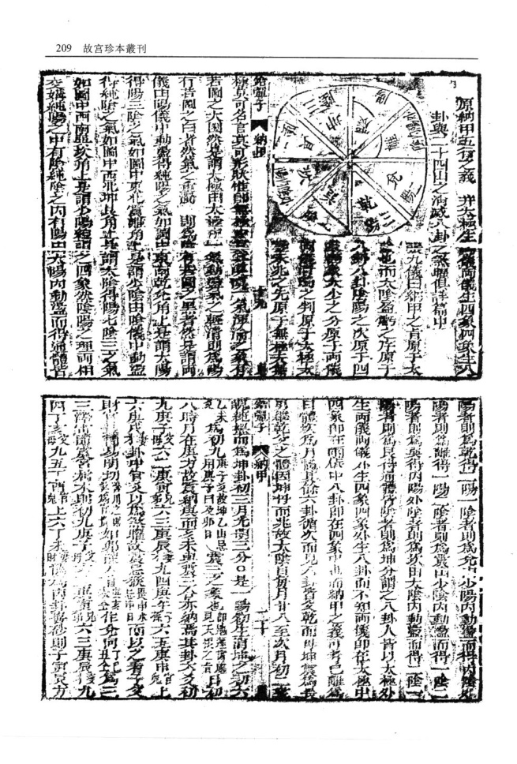

<!-- V3_SOURCE_ID:book025-b000349-p000-1ad797af68 -->

有的年份，朝向为外卦喜水的情况，亥、贾、未方位的水喜流动，龙管砂、向、水的关系，这是就震卦而言，依照同类卦象类推，就能完全知晓。巳月初八时，上弦月的光明为六分，圣阳开始消长，震卦的六二爻对应九一之象。月初八时，月亮在丁方，所以兑卦纳丁，而巳、丑、巽、兑的三合也将其纳入，该卦六爻的初九为丁巳户，九二为卯时，六三为丁收，九四为丁亥子，九五为丁酉州，上六为丁夫。卦中官文认为兑卦的情况就是如此，兑卦忌蛇，在巳之后，子、父、财、官、供、公等都可依此类推至十五日，此时月光对盈满，是纯阳之象，消去兑卦的三爻变为九三甲辰兑收，兑对应丁巳丑，山忌甲日、甲辰日，是乾三之象。初八时，舜子纳甲起于甲方，乾纳甲壬为天子之九，八卦共八千余字，九与十分配，乾先纳甲，又纳壬，坤纳乙，文纳癸，罗经无成巳，所以离卦纳巳三，若乾上就分乾的壬来纳以示标识，坎纳戊，考后天卦位坎居坤位，这里坤的癸纳于坎，乾卦六爻初九为甲子存，九二为甲寅其，九三为甲辰，所以光四为壬午官，九午壬中兔，上九为壬戌，四卦中官乏，认为是煞脑，所以记载到马品年午日前三卦都在戌时，观测永阴后月起逢就从卯时观测，秀忌午来，太阴以日出为标准，十八日盈满后开始亏损，一下缺了三分，这是一阴初生，减去一月平日井辛五日，也说初出时就在方数，利其卦大爻初六半可中的辛亥杀，九三为辛酉，离六四为辛未股，九五为辛巳子好，上九为辛卯祝，郭中官反而认为是肿微，所以与合忌编百到二十三日，此时月光纳六分，这是二所公减之九二年以之谓作反，所以两年就是三之。太阳初出时，月亮在丙方，所以艮纳丙，其卦六爻初六为丙辰第，六为丙午发，九三为丙申子，六四为丙戌以，六五为丙子时，上九为丙寅官，卦史官爻认为是体收，忌虎朔，到十八日月光尽晦，灭艮。十一日初曲时，明在乙方，所以坤纳乙与癸，其卦六爻初六为乙未亲，六为乙巳歌，六三为乙卯赠，六四为癸丑亲，六五为癸亥，上六为癸宵行，卦官爻认为是杀曜，所以坤乙忌鬼是狐水。以上六卦各有消长变化，唯有坎卦接续不断，畏卯水，得日月正脑，没有消长变化，它在先天卦位中一东一西，在后天卦位中一南一北，将洛书中央的戊经纬于中，所以坎卦中爻为阳，纳戊土，离卦中爻多所纳己土，又是王卦所用，而地理家认为戌属艮、己寄坤，于是离分出来的壬与寅、午二支三合而成壬寅午，坎分出来的癸与申、辰三合而成癸申辰，离卦六爻初九为巳卯，六二为巳丑好，九为巳亥，九四为巳酉贱，六五为巳未子，上九为巳巳祝，卦中官多苏禄，所以离廷，坎卦六爻初六为戊寅子，十九为戊辰入，三为戊午楼，六四为戊申安，九五为戊戌贴，上六为戊子朝，卦中宴又为煞曜，所以其次忌龙忌戌民，戊辰就甲源委彰明毂书了。

> **释读存疑：** 原文部分表述语义晦涩，难以准确释读，仅按原文语序转写；原文存在大量讹脱衍倒，部分术语如“丁巳户”“丁酉州”“煞脑”“苏禄”等无可靠释义，仅能保守转写；本地硬校验仍未通过，已记录供后续自动处理或人工核对。

查看对应原文

<!-- V3_FOLDBACK_BEGIN:book025-b000349-p000-1ad797af68 -->

有年向爲外卦喜水則亥賈未方水喜流動龍管砂向水也此就震言震依類推之可盡知巳初八上弦月光明六分聖陽生消震之六二更爲九一之象也月初八時月在丁方故兌納丁而巳丑巽兌三合亦納為其卦六爻初九丁巳戶九二所卯時六三丁收九四丁亥子九五丁酉州上六丁夫般卦中官文以爲然體故兌忌蛇惡巳以後子父財官供公則推至十五對望月光間滿純陽矣消兌之三爲九三 甲辰兌收兌丁巳丑 山忌甲日开甲辰日 乾三之象也日初八時舜子納甲起甲方乾納甲壬為天子之九八卦八千餘九與十分配乾那收先納甲又納千坤納之文納癸羅經無成巳故離之納已三若乾上乃分乾之壬納示識坎之納戎考後天居坤此刃坤之癸納于坎乾卦六爻初九甲子存九二甲寅其九三甲辰故光四壬午官九午壬中兔上九壬戌四卦中官乏以爲煞腦故載至是馬品年午日前三卦俱在戌時觀永陰後月起逢則從卯時觀 秀忌午來太陰以日出爲準十八日盈而虧一下缺三分○是一陰初生減一月平日井辛五日 也謂初出時則在方數利其卦大爻初六半可中之辛亥殺九三辛酉離六四辛未股九五辛巳子好上九辛卯祝郭中官反以爲腫微故與合忌編百以二十三日下此月光納六分○是二所公減之九二年以之謂作反故兩年則是三之也日初出時月在丙方故長納丙其卦六爻初六丙辰第六丙午發九三丙申子六四丙戌以六五丙子時上九丙寅官卦史官爻以爲體收忌虎朔以一十八日引光盡晦○滅艮11日初曲時明在乙方故坤乙興癸其卦六爻初六乙未親六乙巳歌六三乙卯贈六四癸丑親六五癸亥上六癸宵行卦官爻以爲殺曜故坤乙忌鬼是狐水 以上六卦各有消滅惟坎繼 畏卯水得日月正腦無消無滅其在先天也一東一西在後天也一南一北將洛書中央之戌經緯乎中故坎三中爻陽納戊土離三中多所納已土又王卦用之而地理以戌舒艮已寄坤于是離分之壬與寅度二合而工寅成高坎分坤之癸與申辰三合而癸申辰孺離卦六爻初九巳卯六二巳丑好九巳亥九四巳酉賤六五巳未子上九巳巳祝卦中官多蘇祿故離廷坎卦六爻初六戊寅子十九戊辰入三戊午樓六四戊申安九五戊戌貼上六戊子朝卦中宴又爲煞曜故次以忌龍忌戌民戊辰則甲源委彰明轂書矣

<!-- V3_FOLDBACK_END:book025-b000349-p000-1ad797af68 -->

<!-- doc013 PDF 第 214 页：高风险/复杂版面 OCR 供检索；内容与排版以原页图为准。 -->

<!-- V3_SOURCE_ID:book025-b000351-p000-a5d94c28ab -->

现在要对各龙用振卦的方法进行查看，子、才、官属于伯卦的相关内容。原文此处有“筆然則”三字，语义难以明确，无法确切解释。后续内容提到，若喜砂隆起属于外卦管水的情况，就偏好水来朝拱，相关内容允许列入公开的内容之中。

> **释读存疑：** “筆然則”语义含混，具体所指无法确定

查看对应原文

<!-- V3_FOLDBACK_BEGIN:book025-b000351-p000-a5d94c28ab -->

今將各龍振卦以看子才官爲伯卦筆然則喜砂起爲外卦管水則喜水朝許列于公

<!-- V3_FOLDBACK_END:book025-b000351-p000-a5d94c28ab -->

<!-- V3_SOURCE_ID:book025-b000352-p000-8f830f9f9f -->

乾龙甲全

> **释读存疑：** 原文为短术语，“乾龙甲全”具体含义需结合上下文判断

查看对应原文

<!-- V3_FOLDBACK_BEGIN:book025-b000352-p000-8f830f9f9f -->

乾龍甲全

<!-- V3_FOLDBACK_END:book025-b000352-p000-8f830f9f9f -->

<!-- V3_SOURCE_ID:book025-b000353-p000-6550db5220 -->

向乾全，乾为天，属于乾宫第一卦，君金纳甲

> **释读存疑：** “君金纳甲”为风水专业表述，具体含义依纳甲体系确定

查看对应原文

<!-- V3_FOLDBACK_BEGIN:book025-b000353-p000-6550db5220 -->

向乾全 乾爲天依乾宮第一卦君金納甲

<!-- V3_FOLDBACK_END:book025-b000353-p000-6550db5220 -->

<!-- V3_SOURCE_ID:book025-b000354-p000-bd7cd7238a -->

内卦的初九对应甲子子，九二对应甲寅才，九三对应甲辰母；外卦的九四对应壬官庚，九五对应壬申见第，上九对应壬戌星，朝向为兑向。原文此处有单独的“年”字，上下文未说明其具体含义。泽天夬卦是坤宫的第六卦，五行属土。

> **释读存疑：** 单独的“年”字缺乏上下文，具体含义无法确定；“九五壬申見第”的“第”具体所指未明

查看对应原文

<!-- V3_FOLDBACK_BEGIN:book025-b000354-p000-bd7cd7238a -->

內卦初九甲子子九二甲寅才九三甲辰母外卦九四壬官庚九五壬申見第上九壬戌星兌向 年 澤天夫卦係坤宮第六卦屬土

<!-- V3_FOLDBACK_END:book025-b000354-p000-bd7cd7238a -->

<!-- V3_SOURCE_ID:book025-b000355-p000-c5163cbf8f -->

丙卦的初九对应甲子，原文此处的“九一甲寅男”应为“九二甲寅男”的讹误，九三对应甲辰兄弟；外卦的九四对应丁亥，九五对应下酉子孙，上六对应丁未兄弟。龙朝向对应的火天大有卦，是乾宫的第八卦，原文此处的“禱金”应为“属金”的形近讹误，即该卦五行属金。

> **释读存疑：** 1轮自动修复后核义模型仍建议修订，已保守记录。

查看对应原文

<!-- V3_FOLDBACK_BEGIN:book025-b000355-p000-c5163cbf8f -->

丙卦初九甲子九一甲寅男九三甲辰兄弟外卦九四丁亥九五下酉子孫上六丁未兄第龍向火天大有係乾宮第八卦禱金

<!-- V3_FOLDBACK_END:book025-b000355-p000-c5163cbf8f -->

<!-- V3_SOURCE_ID:book025-b000356-p000-2b03913304 -->

丙卦初九甲子子，九二甲寅妻才，九三甲辰父；外卦九四巳雪，六五巳未爻带，九巳巳官名

> **释读存疑：** 原文中“巳雪”“九巳巳”等表述存在错乱，具体所指不详；原文“巳雪”“九巳巳”表述错乱，具体所指不详

查看对应原文

<!-- V3_FOLDBACK_BEGIN:book025-b000356-p000-2b03913304 -->

丙卦初九甲子子每九二甲寅妻才九三甲辰父 外卦九四巳雪九第六五巳未爻帶九巳巳官名

<!-- V3_FOLDBACK_END:book025-b000356-p000-2b03913304 -->

<!-- V3_SOURCE_ID:book025-b000357-p000-05c475c37f -->

原文的“雷天人壯”应为“雷天大壮”的讹误，该卦是坤宫第五卦，五行属土。内卦的初九对应甲子美才，九二对应甲寅鬼，原文此处“九三甲處見屯”的内容语义未明。外卦的九四对应庚午爻母，原文此处标注的“六二庚申子孙”存在爻位错误，外卦第三爻应为上爻，“六二”属于讹误，上六对应庚戌第。朝向为巽向，五行对应辛金。风天小畜卦原文标注为“巽第卦”，“第”字后的序数词脱漏，仅可知其属于巽宫的某一卦，五行属木。

> **释读存疑：** “九三甲處見屯”语义未明；巽第卦的序数词脱漏，无法确定是巽宫第几卦；“六二”为外卦爻位讹误，具体正确爻位未明

查看对应原文

<!-- V3_FOLDBACK_BEGIN:book025-b000357-p000-05c475c37f -->

雷天人壯係坤第五卦屬土內卦初九甲子美才九二甲寅鬼九三甲處見屯外卦九四庚午爻母六二庚申子孫上六庚戌第巽向辛金風天小畜係巽第卦屬木

<!-- V3_FOLDBACK_END:book025-b000357-p000-05c475c37f -->

<!-- V3_SOURCE_ID:book025-b000358-p000-569c1b7be0 -->

内卦初九甲子爻母，九二甲寅元第，九三甲辰才；外卦六四辛表妻子，九五辛巳子每，上九辛卯光第

> **释读存疑：** 原文中“元第”“辛表”“子每”“光第”等表述存在错乱，具体所指不详；原文“元第”“辛表”“子每”“光第”表述错乱，具体所指不详

查看对应原文

<!-- V3_FOLDBACK_BEGIN:book025-b000358-p000-569c1b7be0 -->

內卦初九甲子爻母九二甲寅元第九三甲辰才外卦六四辛表妻子九五辛巳子每上九辛卯光第

<!-- V3_FOLDBACK_END:book025-b000358-p000-569c1b7be0 -->

<!-- V3_SOURCE_ID:book025-b000359-p000-679781de22 -->

内卦的初九对应甲斤才，原文此处“九二甲寅官九”的“九”属于衍文，应删去，九三对应甲辰，在纳甲体系中为黄曜。外卦的六四对应戊甲子，九五对应戊戌名第，原文“上夫戊子良向”应为“上六戊子艮向”的讹误，内卦内容完整。山天大畜是艮宫的第三卦，五行属土。

> **释读存疑：** “甲斤才”“名第”的具体所指未明；1轮自动修复后核义模型仍建议修订，已保守记录。

查看对应原文

<!-- V3_FOLDBACK_BEGIN:book025-b000359-p000-679781de22 -->

內卦初九甲斤才九二甲寅官九九三甲辰為黃曜于納甲外卦六四戊甲子九五戊戌名第上夫戊子良向內全 山天大畜 係艮宮第三卦土

<!-- V3_FOLDBACK_END:book025-b000359-p000-679781de22 -->

<!-- V3_SOURCE_ID:book025-b000360-p000-935c1809b7 -->

内卦初九为甲子妻才，九二为甲寅官鬼，九三为甲九第；外卦六四为丙戌兄，六五为丙子妻才，上九为官鬼。方位为坤向乙地，地天泰是坤宫第四卦，属土。

> **释读存疑：** “甲九第”未在通用易学术语中出现，具体所指存疑

查看对应原文

<!-- V3_FOLDBACK_BEGIN:book025-b000360-p000-935c1809b7 -->

內卦初九甲子妻才九二甲寅官鬼九三甲九第外卦六四丙戌兄六五丙子妻才上九官官坤向乙地天泰 係坤宮第四卦屬士

<!-- V3_FOLDBACK_END:book025-b000360-p000-935c1809b7 -->

<!-- V3_SOURCE_ID:book025-b000361-p000-d6ebc9abea -->

内卦初九为甲子表未，九一为甲寅巨鬼，九三为甲辰元；外卦六四为癸丑只，六五为癸亥才，上一为癸酉子岁，坎龙辰。

> **释读存疑：** 原文部分文字模糊，如"表未""巨鬼""只"等，具体含义不详

查看对应原文

<!-- V3_FOLDBACK_BEGIN:book025-b000361-p000-d6ebc9abea -->

內卦 初九甲子表未九一甲寅巨鬼九三甲辰元外卦六四癸丑只第六五癸亥才一天癸酉子歲坎龍辰

<!-- V3_FOLDBACK_END:book025-b000361-p000-d6ebc9abea -->

<!-- doc013 PDF 第 215 页：高风险/复杂版面 OCR 供检索；内容与排版以原页图为准。 -->

<!-- V3_SOURCE_ID:book025-b000363-p000-9c3d853746 -->

水是坎宫第一卦。桥水的内卦初六为戊寅子孙，九二为戊辰旨，六三为戊午婁才；外卦六四为戊申父母，九五为戊戌官，上六为戌子兄第。乾同甲全天水公是离吕第七卦，属火。

> **释读存疑：** “桥水”“戊辰旨”“婁才”“戌子兄第”“乾同甲全天水公”“离吕”均非通用易学术语，具体所指存疑

查看对应原文

<!-- V3_FOLDBACK_BEGIN:book025-b000363-p000-9c3d853746 -->

水 係坎宮第一卦橋水內卦初六戊寅子孫九二戊辰旨六三戊午婁才外卦六四戊申父母九五戊戌官上六戌子兄第乾同甲全天水公 係離呂第七卦屬火

<!-- V3_FOLDBACK_END:book025-b000363-p000-9c3d853746 -->

<!-- V3_SOURCE_ID:book025-b000364-p000-8fee6488b6 -->

内卦初六为戊寅灾母，九为戊子，六三为戊午兄第；外卦九四为壬年凡，第九五十申要，上九为壬戌子。

> **释读存疑：** 原文部分文字模糊，如"凡""要"等，具体含义不详

查看对应原文

<!-- V3_FOLDBACK_BEGIN:book025-b000364-p000-8fee6488b6 -->

內卦初六戊寅災母九戊子六三戊午兄第外卦 九四壬年凡第九五十申要上九壬戌子

<!-- V3_FOLDBACK_END:book025-b000364-p000-8fee6488b6 -->

<!-- V3_SOURCE_ID:book025-b000365-p000-8819a349d7 -->

内卦初六为岁寅事，九一为岁戌每，六三为戊年自鬼第，甲子纳甲1三五。

> **释读存疑：** 原文部分文字模糊，如"岁寅事""岁戌每""自鬼第"等，具体含义不详

查看对应原文

<!-- V3_FOLDBACK_BEGIN:book025-b000365-p000-8819a349d7 -->

內卦 初六歲寅事九一歲戌每六三戊年自鬼第甲子納甲 1三五

<!-- V3_FOLDBACK_END:book025-b000365-p000-8819a349d7 -->

<!-- V3_SOURCE_ID:book025-b000366-p000-8211017705 -->

外卦九四为一亥子，九五为丁百见第，上六为丁未。

> **释读存疑：** 原文部分文字模糊，如"丁百见第"等，具体含义不详

查看对应原文

<!-- V3_FOLDBACK_BEGIN:book025-b000366-p000-8211017705 -->

外卦九四一亥子九五丁百見第上六丁未

<!-- V3_FOLDBACK_END:book025-b000366-p000-8211017705 -->

<!-- V3_SOURCE_ID:book025-b000367-p000-1ca20ba61c -->

内卦初六为戊寅寸，九二为戊辰子星，六三为戊午鬼；外卦九回为巳西妻才，六立为巳未子孙，上九为巳巳光象，震生雷水云第三卦，属木。

> **释读存疑：** “戊寅寸”“九回”“巳西妻才”“六立”“巳巳光象”“震生雷水云第三卦”表述均不属通用易学卦爻记录体例，具体含义和断句存疑

查看对应原文

<!-- V3_FOLDBACK_BEGIN:book025-b000367-p000-1ca20ba61c -->

內卦初六戊寅寸九二戊辰子星六三戊午鬼外卦九回巳西妻才六立巳未子孫上九巳巳光象震生 雷水 雲第三卦屬木

<!-- V3_FOLDBACK_END:book025-b000367-p000-1ca20ba61c -->

<!-- V3_SOURCE_ID:book025-b000368-p000-ca4f9ccfb8 -->

丙卦的初六爻为戊寅，兑卦的九三爻为戊辰，对应的是“六三度年子”；外卦部分，九四爻为庚午，对应子孙，六五爻为庚申，对应“旨鬼”，上六爻为庚戌，对应妻；巽全风水涣，是离宫第六卦，属人。

> **释读存疑：** 六三度年子；旨鬼；1轮自动修复后核义模型仍建议修订，已保守记录。

查看对应原文

<!-- V3_FOLDBACK_BEGIN:book025-b000368-p000-ca4f9ccfb8 -->

丙卦初六戊寅兌九三戊辰才六三度年子外卦九四庚午子孫六五庚申旨鬼上六庚戌妻巽全風水渙 係雕宮第六卦屬人

<!-- V3_FOLDBACK_END:book025-b000368-p000-ca4f9ccfb8 -->

<!-- V3_SOURCE_ID:book025-b000369-p000-9b0e37652a -->

内卦初六为戊第，九三为戊辰子，六三为戊午兄第；外卦六四为辛未子，九五为辛巳兄弟，上九为辛卯矣母，长向丙全山水蒙，原文记其係龙宫第五卦，属火。

> **释读存疑：** “戊第”“戊辰子”“兄第”“辛卯矣母”“长向丙全”“龙宫”均非通用易学或风水术语，具体所指存疑

查看对应原文

<!-- V3_FOLDBACK_BEGIN:book025-b000369-p000-9b0e37652a -->

内卦初六戊第九三戊辰子五六三戊午兄第外卦六四辛未子九五辛巳兄弟上九辛卯矣母長向丙全山水蒙 係龍宮第五卦屬火

<!-- V3_FOLDBACK_END:book025-b000369-p000-9b0e37652a -->

<!-- V3_SOURCE_ID:book025-b000370-p000-c1590db7f0 -->

内卦初六为戊寅之母，九三为戊辰子孙，六三为戊凡；外卦初四为丙戌子，六五为丙子官，上九为丙寅。方位为坤向乙金，地水师保坎宫第八卦，属水。

> **释读存疑：** “戊寅之母”“戊凡”“保坎宫第八卦”表述不符合通用卦辞体例，具体含义存疑

查看对应原文

<!-- V3_FOLDBACK_BEGIN:book025-b000370-p000-c1590db7f0 -->

內卦初六戊寅之母九三戊辰子孫六三戊凡外卦初四丙戌子六五丙子官上九丙寅坤向乙金地水師保坎宮第八卦屬水

<!-- V3_FOLDBACK_END:book025-b000370-p000-c1590db7f0 -->

<!-- V3_SOURCE_ID:book025-b000371-p000-47e9356483 -->

内卦制六戊寅、九二茂辰、九六二戊午；外卦六四癸五、龙大五兄第、上六癸四。

> **释读存疑：** 原文中部分干支、卦爻相关文字存在OCR识别误差，具体所指不详

查看对应原文

<!-- V3_FOLDBACK_BEGIN:book025-b000371-p000-47e9356483 -->

內卦制六戊寅九二茂辰九六二戊午 外卦六四癸五龍大五兄第上六癸四

<!-- V3_FOLDBACK_END:book025-b000371-p000-47e9356483 -->

<!-- V3_SOURCE_ID:book025-b000372-p000-2c23a19eb3 -->

山餘良宮第一卦，屬士。

查看对应原文

<!-- V3_FOLDBACK_BEGIN:book025-b000372-p000-2c23a19eb3 -->

山餘良宮第一卦屬士

<!-- V3_FOLDBACK_END:book025-b000372-p000-2c23a19eb3 -->

<!-- V3_SOURCE_ID:book025-b000373-p000-d55ef0b1c4 -->

内卦初六丙辰、第六丙年母、九三丙申子五；外卦六四戊見、第六五丙子才、上九丙寅官鬼。

> **释读存疑：** 原文中部分干支、卦爻相关文字存在OCR识别误差，具体所指不详

查看对应原文

<!-- V3_FOLDBACK_BEGIN:book025-b000373-p000-d55ef0b1c4 -->

內卦初六丙辰第六丙年母九三丙申子五 外卦六四戊見第六五丙子才上九丙寅官鬼

<!-- V3_FOLDBACK_END:book025-b000373-p000-d55ef0b1c4 -->

<!-- V3_SOURCE_ID:book025-b000374-p000-ed84bc964f -->

内卦初六丙公、六二丙午鬼、九三丙申見第；外卦九四壬年官、九五兄第、上九壬戌父母；内卦初六丙辰甲、六二丙午、九三申說餘；外卦九四丁亥子、九五丁酉見帝出、六丁未父無孫；離宮第二卦，楊金。

> **释读存疑：** 原文中部分干支、卦爻相关文字存在OCR识别误差，具体所指不详

查看对应原文

<!-- V3_FOLDBACK_BEGIN:book025-b000374-p000-ed84bc964f -->

內卦初六丙公六二丙午鬼九三丙申見第外卦九四壬年官九五 兄第上九壬戌父母內卦 初六丙辰甲六二丙午 九三申說餘外卦九四丁亥子九五丁酉見帝出六丁未父無孫離宮第二卦楊金

<!-- V3_FOLDBACK_END:book025-b000374-p000-ed84bc964f -->

<!-- doc013 PDF 第 216 页：高风险/复杂版面 OCR 供检索；内容与排版以原页图为准。 -->

<!-- V3_SOURCE_ID:book025-b000376-p000-a556886d39 -->

这段内容涉及卦象的爻位与对应干支配置：内卦部分，初六对应丙辰，五六二对应丙午兄弟，九三对应丙申；外卦部分，九四对应巳耳才，大五对应巳未子無，上九对应巳巳虎弟；还有表述“震向夫 庚”；卦象为雷山小过，属于兑宫的第七卦，标注有“万金”。

> **释读存疑：** ‘五六二’‘大五’不符合易卦常规爻位命名，疑似原文讹误；‘耳才’‘子無’‘虎弟’‘震向夫 庚’具体含义不明；1轮自动修复后核义模型仍建议修订，已保守记录。

查看对应原文

<!-- V3_FOLDBACK_BEGIN:book025-b000376-p000-a556886d39 -->

内卦初六丙辰五六二丙午兄第九三丙申外卦九四巳耳才大五巳未子無上九巳巳虎弟震向夫 庚 雷山小過係兌宮第七卦萬金

<!-- V3_FOLDBACK_END:book025-b000376-p000-a556886d39 -->

<!-- V3_SOURCE_ID:book025-b000377-p000-ae3f558279 -->

这段内容记载的是卦爻的相关配置：内卦包含初爻丙辰爻母、六二爻丙午官鬼、九三爻丙山兄弟；外卦包含九四爻庚年書鬼、六五爻庚申兄弟、上爻庚戌父母子里。内容还涉及龙，这里的龙指风水中山脉、地势及气脉的来势和行度。

> **释读存疑：** 初大、上大、書鬼、父母子里的具体含义未明

查看对应原文

<!-- V3_FOLDBACK_BEGIN:book025-b000377-p000-ae3f558279 -->

内卦初大丙辰爻母六二丙午官鬼九三丙山兄弟外卦九四庚年書鬼六五庚申兄弟上大庚戌父母子里 龙

<!-- V3_FOLDBACK_END:book025-b000377-p000-ae3f558279 -->

<!-- V3_SOURCE_ID:book025-b000378-p000-e9c8e4132b -->

这段内容记载的是丙卦的相关配置：初六爻为丙辰品，第六一爻为丙午爻母，九三爻相关内容为内申于水山蹇，这里的水指风水语境中的河流、水系及其来去形态。该卦属于兑宫第五卦，属性为冲金。

> **释读存疑：** 品、第六一、內申于水山塞、衝金的具体含义未明；1轮自动修复后核义模型仍建议修订，已保守记录。

查看对应原文

<!-- V3_FOLDBACK_BEGIN:book025-b000378-p000-e9c8e4132b -->

丙卦初六丙辰品第六一丙午爻母九三內申于水山塞 係兌宮第五卦衝金

<!-- V3_FOLDBACK_END:book025-b000378-p000-e9c8e4132b -->

<!-- V3_SOURCE_ID:book025-b000379-p000-543938b07e -->

内卦初六丙辰母、六二丙年官鬼、九三丙南第；外卦六四戊申兄弟、九五戊戌夕母、上六戊子子孫；坤向己全地山謙，保兌官第六卦，鶴金。

> **释读存疑：** 原文中部分干支、卦爻相关文字存在OCR识别误差，具体所指不详

查看对应原文

<!-- V3_FOLDBACK_BEGIN:book025-b000379-p000-543938b07e -->

内卦初六丙辰母六二丙年官鬼九三丙南第外卦六四戊申兄第九五戊戌夕母上六戊子子孫坤向己全地山謙保兌官第六卦鶴金

<!-- V3_FOLDBACK_END:book025-b000379-p000-543938b07e -->

<!-- V3_SOURCE_ID:book025-b000380-p000-3bf61b9849 -->

这段内容记录了卦象的内外卦爻位与干支对应情况：内卦部分，初六对应丙辰，六二对应丙午，九三对应“見萬”，该短语具体所指不详；外卦部分，六四对应癸丑改，六五对应癸亥子孙止，还有表述“六癸百兄卯亥未全”，该内容存在识别误差，具体含义无法确定。

> **释读存疑：** 見萬；六癸百兄卯亥未全；見萬具体所指不详；六癸百兄卯亥未全存在识别误差，具体含义无法确定；本地硬校验仍未通过，已记录供后续自动处理或人工核对。

查看对应原文

<!-- V3_FOLDBACK_BEGIN:book025-b000380-p000-3bf61b9849 -->

內卦 初六丙辰 六二丙午九三丙申見萬外卦六四癸丑改六五癸亥子孫止六癸百兄卯亥未全

<!-- V3_FOLDBACK_END:book025-b000380-p000-3bf61b9849 -->

<!-- V3_SOURCE_ID:book025-b000381-p000-26d5b4b8a6 -->

这段内容提到，相关的卦以震为面，依照震命名为第一卦，属性为横木，附带数字标识24。内卦包含初九爻庚子爻、六二爻一見、第六三爻庚辰；外卦包含九四爻庚午子、六五爻庚甲、上六爻庚戌，相关朝向为甲全，这里的向指建筑或穴位所朝的方位，震是八卦之一，“庚甲”具体所指不详。该卦为天雷无妄，属于巽宫第五卦，五行属木，这里的巽是八卦之一。

> **释读存疑：** 而其兮震爲面、循震名第一卦、横木、一見、範向甲全的具体含义未明；庚甲具体所指不详；“而其兮震爲面、循震名第一卦、横木、一見、範向甲全”的具体含义未明；“庚甲”具体所指不详；1轮自动修复后核义模型仍建议修订，已保守记录。

查看对应原文

<!-- V3_FOLDBACK_BEGIN:book025-b000381-p000-26d5b4b8a6 -->

而其兮震爲面循震名第一卦橫木 24內卦初九庚子爻六二一見第六三庚辰外卦九四庚午子六五庚甲上六庚戌範向甲全 天雷無妄係巽宮第五卦屬木

<!-- V3_FOLDBACK_END:book025-b000381-p000-26d5b4b8a6 -->

<!-- V3_SOURCE_ID:book025-b000382-p000-034213a3b7 -->

内卦初九庚子受，六乙庚寅为兄弟，六三庚辰为委才；外卦九四壬午为子张，九五壬申为鬼，上九壬戌为亥才厚子纳甲，1月5。

> **释读存疑：** 原文中“六乙”“委才”“子张”“鬼”“亥才厚子”“纳甲”“1月5”等内容含义不明，无法准确释读

查看对应原文

<!-- V3_FOLDBACK_BEGIN:book025-b000382-p000-034213a3b7 -->

內卦初九庚子受 六乙庚寅兄弟六三庚辰委才 A外卦九四壬午子張九五壬申鬼上九壬戌亥才厚子納甲 1月5

<!-- V3_FOLDBACK_END:book025-b000382-p000-034213a3b7 -->

<!-- V3_SOURCE_ID:book025-b000383-p000-088e30f3d8 -->

兑向（建筑或穴位所朝的方位）全泽雷随，系云吕第八卦，摇木。

> **释读存疑：** 原文中“全泽”“云吕”“摇木”等内容含义不明，无法准确释读

查看对应原文

<!-- V3_FOLDBACK_BEGIN:book025-b000383-p000-088e30f3d8 -->

兌向全澤雷隨係雲呂第八卦摇木

<!-- V3_FOLDBACK_END:book025-b000383-p000-088e30f3d8 -->

<!-- V3_SOURCE_ID:book025-b000384-p000-302e71da96 -->

内卦相关内容包含初九庚子父、月六三庚寅、凡第六三庚辰妻，外卦相关内容包含十九四丁亥母、九五丁酉官兒、上六丁未妻；朝向为火雷噬嗑，是巽宫第六卦，属性称木。

> **释读存疑：** 1轮自动修复后核义模型仍建议修订，已保守记录。

查看对应原文

<!-- V3_FOLDBACK_BEGIN:book025-b000384-p000-302e71da96 -->

內卦初九庚子父月六三庚寅凡第六三庚辰妻 外卦十九四丁亥母九五丁酉官兒上六丁未妻 雕向火雷噬盡係巽宮第六卦稱木

<!-- V3_FOLDBACK_END:book025-b000384-p000-302e71da96 -->

<!-- V3_SOURCE_ID:book025-b000385-p000-f2f3135cac -->

内卦初九庚子夕，六二庚见，六三庚辰；外卦九四巳酉为官鬼，六五巳未为妻，上九巳巳为子；向风益，系吴宫第四卦，为木。

> **释读存疑：** 原文中“庚见”“巳酉”“巳未”“巳巳”“吴宫”等内容含义不明，无法准确释读

查看对应原文

<!-- V3_FOLDBACK_BEGIN:book025-b000385-p000-f2f3135cac -->

內卦初九庚子夕 六二庚見第六三庚辰外卦九四巳酉官鬼六五巳未妻上九巳巳子向風益 係吳宮第四卦爲木

<!-- V3_FOLDBACK_END:book025-b000385-p000-f2f3135cac -->

<!-- V3_SOURCE_ID:book025-b000386-p000-9f1994d101 -->

内卦的爻位依次为：初九对应庚子，为父母；六一对应庚寅，为儿弟；接下来是六三。外卦的爻位依次为：六四对应半未，九五对应辛巳，为子；上九对应辛卯，为武欠司；癸申对应官。

> **释读存疑：** “六一”“儿弟”“武欠司”含义不明，原文未作说明；1轮自动修复后核义模型仍建议修订，已保守记录。

查看对应原文

<!-- V3_FOLDBACK_BEGIN:book025-b000386-p000-9f1994d101 -->

內卦初九庚子父母六一庚寅兒弟六三外卦 六四半未九五辛巳子上九辛卯武欠司癸申官

<!-- V3_FOLDBACK_END:book025-b000386-p000-9f1994d101 -->

<!-- doc013 PDF 第 217 页：高风险/复杂版面 OCR 供检索；内容与排版以原页图为准。 -->

<!-- V3_SOURCE_ID:book025-b000388-p000-a5ea5ed956 -->

内卦的爻位依次为：初九对应庚子九第，六二对应庚寅，为子孙；六三对应庚辰，为官鬼。外卦的爻位依次为：六四对应戊申爻年，九五对应戊戌，上六对应戌子艮向丙仝。山雷颐属于巽宫第七井万本，是丙全山头。

> **释读存疑：** “九第”“爻年”“井萬本”“丙仝山”“丙全山头”具体所指不详；1轮自动修复后核义模型仍建议修订，已保守记录。

查看对应原文

<!-- V3_FOLDBACK_BEGIN:book025-b000388-p000-a5ea5ed956 -->

內卦初九庚子九第六二庚寅子孫六三庚辰官鬼外卦六四戊申爻年九五戊戌上六戌子良向丙仝山雷頤係巽宮第七井萬本 是丙全山頭

<!-- V3_FOLDBACK_END:book025-b000388-p000-a5ea5ed956 -->

<!-- V3_SOURCE_ID:book025-b000389-p000-63e77bcc8b -->

内卦的爻位依次为：初九对应庚一艮年，六二对应庚寅见第，六三对应庚辰，为妻子。外卦的爻位依次为：六四对应丙戌牙，六五对应丙乎爻，上九对应丙寅，为兄。

> **释读存疑：** “庚一艮年”“见第”“丙戌牙”“丙乎爻”具体所指不详；1轮自动修复后核义模型仍建议修订，已保守记录。

查看对应原文

<!-- V3_FOLDBACK_BEGIN:book025-b000389-p000-63e77bcc8b -->

內卦初九庚一艮年六二庚寅見第六三庚辰妻子 外卦六四丙戌牙六五丙乎爻上九丙寅兄

<!-- V3_FOLDBACK_END:book025-b000389-p000-63e77bcc8b -->

<!-- V3_SOURCE_ID:book025-b000390-p000-f11ace7dd1 -->

丙卦的爻位依次为：初九对应庚子，六庚对应官，六三对应庚辰，为兄。外卦的爻位依次为：六四对应癸五第大五癸亥，上六对应癸酉，为姦。末尾标注数字1。

> **释读存疑：** “六庚”“癸五第大五”“姦”在此处的具体含义不明；1轮自动修复后核义模型仍建议修订，已保守记录。

查看对应原文

<!-- V3_FOLDBACK_BEGIN:book025-b000390-p000-f11ace7dd1 -->

丙卦初九庚子六庚官六三庚辰兄 外卦六四癸五第大五癸亥上六癸酉姦 1

<!-- V3_FOLDBACK_END:book025-b000390-p000-f11ace7dd1 -->

<!-- V3_SOURCE_ID:book025-b000391-p000-57c0238e75 -->

吴向辛金里为风侯，巽官第一卦属太。内卦的爻位依次为：初六对应辛丑，九一五亥，九三至官。外卦的爻位依次为：六四对应辛未，为妻；九五对应辛巳，为子张；九上对应辛卯，为兄弟。乾同知全天风姤，属于乾卦居金。

> **释读存疑：** “吴向辛金里”“风侯”“属太”“九一五亥”“至官”“子张九”“乾同知全”具体所指不详；1轮自动修复后核义模型仍建议修订，已保守记录。

查看对应原文

<!-- V3_FOLDBACK_BEGIN:book025-b000391-p000-57c0238e75 -->

吳向辛金里爲風侯巽官第一卦屬太內卦初六辛丑九一五亥 九三至官外卦六四辛未妻九五辛巳子張九上辛卯兄弟乾同知全天風姤 係乾卦居金

<!-- V3_FOLDBACK_END:book025-b000391-p000-57c0238e75 -->

<!-- V3_SOURCE_ID:book025-b000392-p000-50df316472 -->

内卦初六辛五爻日，九二一亥子，五九三辛百；外卦九四壬年，九五壬申为弟，上九壬戌为多母。

> **释读存疑：** 原文中“辛五”“九二一”“五九三辛百”“壬年”“多母”等内容含义不明，无法准确释读

查看对应原文

<!-- V3_FOLDBACK_BEGIN:book025-b000392-p000-50df316472 -->

內卦初六辛五爻日九二一亥子五九三辛百外卦九四壬年九五壬申弟上九壬戌多母

<!-- V3_FOLDBACK_END:book025-b000392-p000-50df316472 -->

<!-- V3_SOURCE_ID:book025-b000393-p000-44c9eb3f45 -->

此处记载有分同丁紀巳，泽风大过属于震所对应序列的第七卦，对应桥木。

查看对应原文

<!-- V3_FOLDBACK_BEGIN:book025-b000393-p000-44c9eb3f45 -->

分同丁紀巳澤風大過係震第七卦橋木

<!-- V3_FOLDBACK_END:book025-b000393-p000-44c9eb3f45 -->

<!-- V3_SOURCE_ID:book025-b000394-p000-e7d42606bb -->

内卦初六为辛丑，对应妻；九二为辛亥，对应父；四九三为辛酉，对应见。外卦九四为丁亥，对应爻母；九五为丁四，对应言儿；上大丁未对应妻才。火风鼎是离宫第一卦，属火。内卦初六为辛丑，对应十九二年玄；官鬼对应九三年酉。

> **释读存疑：** “四九三辛酉”“上大丁未”“十九二年玄”的具体含义尚待进一步结合易学文本常规规则确认

查看对应原文

<!-- V3_FOLDBACK_BEGIN:book025-b000394-p000-e7d42606bb -->

内卦初六辛丑妻九二辛亥父四九三辛酉見外卦九四丁亥爻母九五丁四言兒上大丁未妻才火風鼎係離宮第一卦屬火內卦初六辛丑十九二年玄官鬼九三年酉

<!-- V3_FOLDBACK_END:book025-b000394-p000-e7d42606bb -->

<!-- V3_SOURCE_ID:book025-b000395-p000-634a95c458 -->

外卦九四為巳酉，六五為巳未，上九為巳巳，對應鬼涕。

> **释读存疑：** “鬼涕”具体所指原文未明

查看对应原文

<!-- V3_FOLDBACK_BEGIN:book025-b000395-p000-634a95c458 -->

外卦九四巳酉六五巳未上九巳巳鬼涕

<!-- V3_FOLDBACK_END:book025-b000395-p000-634a95c458 -->

<!-- V3_SOURCE_ID:book025-b000396-p000-569fa746f5 -->

是震（八卦之一）宮第四卦，居木位。

查看对应原文

<!-- V3_FOLDBACK_BEGIN:book025-b000396-p000-569fa746f5 -->

係震宮第四卦居木

<!-- V3_FOLDBACK_END:book025-b000396-p000-569fa746f5 -->

<!-- V3_SOURCE_ID:book025-b000397-p000-d618538e91 -->

內卦初六為率五，九二為事亥，九三為華酉。

> **释读存疑：** 率五、事亥、華酉等表述含义不明

查看对应原文

<!-- V3_FOLDBACK_BEGIN:book025-b000397-p000-d618538e91 -->

內卦初六率五九二事亥九三華酉

<!-- V3_FOLDBACK_END:book025-b000397-p000-d618538e91 -->

<!-- V3_SOURCE_ID:book025-b000398-p000-fafea4bcc8 -->

外卦九四为庚午，对应经；六五为庚申，对应说；上六为庚戌，对应事。

> **释读存疑：** 1轮自动修复后核义模型仍建议修订，已保守记录。

查看对应原文

<!-- V3_FOLDBACK_BEGIN:book025-b000398-p000-fafea4bcc8 -->

外卦九四庚午經六五庚申說壬六庚戌事

<!-- V3_FOLDBACK_END:book025-b000398-p000-fafea4bcc8 -->

<!-- V3_SOURCE_ID:book025-b000399-p000-8356b33896 -->

内卦初六为辛丑，对应九二年亥交每；九三为辛酉，对应官。

> **释读存疑：** “九二年亥交每”的具体含义不详

查看对应原文

<!-- V3_FOLDBACK_BEGIN:book025-b000399-p000-8356b33896 -->

內卦初六辛丑九二年亥交每九三辛酉官

<!-- V3_FOLDBACK_END:book025-b000399-p000-8356b33896 -->

<!-- V3_SOURCE_ID:book025-b000400-p000-f0eab534b2 -->

外卦六四為戊申，對應官鬼；九五為戊戌；上六為戊子，對應父。

查看对应原文

<!-- V3_FOLDBACK_BEGIN:book025-b000400-p000-f0eab534b2 -->

外卦六四戊申官鬼九五戊戌上六戊子父

<!-- V3_FOLDBACK_END:book025-b000400-p000-f0eab534b2 -->

<!-- V3_SOURCE_ID:book025-b000401-p000-4a2d792399 -->

内卦的初六是辛凡，还有十九二辛亥爻，甲九三辛酉，对应的是官鬼。外卦的六四是丙戌，对应去；六五是丙子爻，册上九丙寅，对应兄第、坤向乙全地。风升保云宫第五卦，五行属木。内卦初六是辛五，九季玄文；九三是率酉刻。外卦六四是癸五大五蔡等文帝，上废四，对应的是官鬼。

> **释读存疑：** 辛凡、九季玄文、率酉刻、癸五大五蔡等文帝这些短语具体所指不详；兄第是否为“兄弟”的讹写无法确定；去、册、上废四的具体含义原文未明；1轮自动修复后核义模型仍建议修订，已保守记录。

查看对应原文

<!-- V3_FOLDBACK_BEGIN:book025-b000401-p000-4a2d792399 -->

內卦初六辛凡十九二辛亥爻甲九三辛酉官鬼外卦六四丙戌去六五丙子爻冊上九丙寅兄第坤向乙全地風升保雲宮第五卦屬木内卦 初六辛五九季玄文 九三率酉刻外卦六四癸五大五蔡等文帝上廢四官鬼

<!-- V3_FOLDBACK_END:book025-b000401-p000-4a2d792399 -->

<!-- V3_SOURCE_ID:book025-b000402-p000-a041b69302 -->

维为火，属于离宫第一卦，五行属性为火。

查看对应原文

<!-- V3_FOLDBACK_BEGIN:book025-b000402-p000-a041b69302 -->

維爲火係離宮第一卦屬火

<!-- V3_FOLDBACK_END:book025-b000402-p000-a041b69302 -->

<!-- doc013 PDF 第 218 页：高风险/复杂版面 OCR 供检索；内容与排版以原页图为准。 -->

<!-- V3_SOURCE_ID:book025-b000404-p000-ac0ceafa49 -->

内卦初九对应巳卯爻，六二对应巳丑子孙，九三对应巳亥官鬼；外卦九四对应巳酉，六五对应巳未子孙，上九对应巳巳兄弟。乾向甲，全天火回太后础宫，第人卦属火。

> **释读存疑：** 原文中“子森”“第人”“全天火回”“太后础宫”等表述含义不明

查看对应原文

<!-- V3_FOLDBACK_BEGIN:book025-b000404-p000-ac0ceafa49 -->

内卦 初九巳卯爻每 六二巳丑子孫九三巳亥官鬼外卦 九四巳酉六五巳未子森上九巳巳兄弟乾向甲全天火回太後礎宮第人卦屬火

<!-- V3_FOLDBACK_END:book025-b000404-p000-ac0ceafa49 -->

<!-- V3_SOURCE_ID:book025-b000405-p000-a30ab4da1e -->

内卦初九对应巳二，六二对应巨丑子，九三对应巳亥；外卦九四对应壬午鬼五，六五对应壬甫寸，上九对应壬戌于县。

查看对应原文

<!-- V3_FOLDBACK_BEGIN:book025-b000405-p000-a30ab4da1e -->

內卦初九巳二巨丑子九三巳亥外卦九四壬午鬼五壬甫寸上九壬戌于縣

<!-- V3_FOLDBACK_END:book025-b000405-p000-a30ab4da1e -->

<!-- V3_SOURCE_ID:book025-b000406-p000-beeb205770 -->

内卦初九对应巳卯，六二对应巳丑官鬼，九三对应巳亥兄弟；外卦九四对应丁亥兄弟，九五对应丁酉爻母，上六对应丁未官鬼。雷火丰，保坎宫第六卦，桥木。

> **释读存疑：** 原文中“王一”“鬼”“爻母”“展未”等表述含义不明

查看对应原文

<!-- V3_FOLDBACK_BEGIN:book025-b000406-p000-beeb205770 -->

內卦初九巳卯王一巳丑 鬼九三巳亥兄外卦九四丁亥兄第九五丁酉爻母上六丁未官鬼展未 雷火豐 保坎宮第六卦橋木

<!-- V3_FOLDBACK_END:book025-b000406-p000-beeb205770 -->

<!-- V3_SOURCE_ID:book025-b000407-p000-cb75a282b8 -->

内卦初九对应巳卯壬，六二对应六一三丑百見，九三对应巳亥兄朔；外卦九四对应庚年華，六五对应庚申爻，上六对应成兴向神全。风火家人，系宫第三卦，属木。另有一组：内卦初九对应巳卯兄弟，六二对应巳丑，九三对应巳亥爻母；外卦六四对应辛未妻才，九五对应辛巳子辰，上九对应辛卯兄第。水火濟，系坎官常四卦，属水。

> **释读存疑：** 六一三丑百見；庚年華；成兴向神全；坎官常四

查看对应原文

<!-- V3_FOLDBACK_BEGIN:book025-b000407-p000-cb75a282b8 -->

內卦 初九巳卯壬六一三丑百見九三巳亥兄朔外卦 九四庚年華六五庚申爻上六成興向神全 風火家人係宮第三卦屬木內卦初九巳卯兄弟六二巳丑九三巳亥爻母外卦六四辛未妻才九五辛巳子辰上九辛卯兄第水火濟係坎官常四卦屬水

<!-- V3_FOLDBACK_END:book025-b000407-p000-cb75a282b8 -->

<!-- V3_SOURCE_ID:book025-b000408-p000-33291f3a76 -->

内卦初九对应巳卯子，六二对应巳丑官鬼，九三对应巳亥兄卯；外卦六四对应戊申安母，九五对应戊戌官鬼，上六对应戊子兄弟。艮同丙全山水貴，保艮宫第二卦，属土。

> **释读存疑：** 艮同丙全山水貴

查看对应原文

<!-- V3_FOLDBACK_BEGIN:book025-b000408-p000-33291f3a76 -->

內卦初九巳卯子六二巳丑官鬼九三巳亥兄卯外卦六四戊申安母九五戊戌官鬼上六戊子兄弟艮同丙全山水貴 保艮宮第二卦属土

<!-- V3_FOLDBACK_END:book025-b000408-p000-33291f3a76 -->

<!-- V3_SOURCE_ID:book025-b000409-p000-885ae874ef -->

路孺子弟甲，内事初对应巳，二对应巨，九对应巳亥。

> **释读存疑：** 原文存在多处OCR识别错误，多数表述含义不明

查看对应原文

<!-- V3_FOLDBACK_BEGIN:book025-b000409-p000-885ae874ef -->

路孺子弟甲 內事初巳二巨九巳亥

<!-- V3_FOLDBACK_END:book025-b000409-p000-885ae874ef -->

<!-- V3_SOURCE_ID:book025-b000410-p000-66f9e2654c -->

外卦六四对应丙戌，六五对应丙子才，上九对应丙寅官。坤向乙，至地火明，系坎宫第七卦，属水。

> **释读存疑：** 原文中“明”字后缺字，“至”字含义不明

查看对应原文

<!-- V3_FOLDBACK_BEGIN:book025-b000410-p000-66f9e2654c -->

外卦 六四 丙戌 六五 丙子 才 上九 丙寅 官 坤向 乙 至 地火 明 係 坎宮 第七卦 屬水

<!-- V3_FOLDBACK_END:book025-b000410-p000-66f9e2654c -->

<!-- V3_SOURCE_ID:book025-b000411-p000-8e36fccbe4 -->

丙卦初九对应巳卯壬區，六二对应巳丑宮見，九三对应巳亥；外卦六四对应癸，六五对应癸幸見第，上六对应癸賣之。坤龍乙。

> **释读存疑：** 壬區；巳丑宮見；癸幸見第；癸賣之；坤龍乙

查看对应原文

<!-- V3_FOLDBACK_BEGIN:book025-b000411-p000-8e36fccbe4 -->

丙卦初九巳卯壬區六二巳丑宮見九三巳亥 外卦六四癸六五癸幸見第上六癸賣之 坤龍乙

<!-- V3_FOLDBACK_END:book025-b000411-p000-8e36fccbe4 -->

<!-- V3_SOURCE_ID:book025-b000412-p000-4c67523191 -->

帝向乙，坤为地，系坤宫第一卦，桥土。内卦初六对应乙未兄，六二对应乙巳，六三对应乙卯官鬼；外卦六四对应癸丑兄，六五对应癸玄十，上六对应癸道十。乾向甲至，天地石，系乾宫第四卦，居金。内卦初六对应乙未，六二对应乙巳，六三对应乙卯事；外卦九四对应壬午官，九五对应壬甲甲，上九对应壬戌爻母。已，泽地萃，系兑宫第三卦，金。内卦初六对应乙未支，六二对应乙巳鬼，六三对应乙卯夢年；外卦九四对应丁亥子五，九五对应丁酉兄第，上六对应丁未爻母。火地晋，系乾宫第七卦，为金。

> **释读存疑：** 桥土；癸玄十；癸道十；天地石；乙卯事；乙卯夢年

查看对应原文

<!-- V3_FOLDBACK_BEGIN:book025-b000412-p000-4c67523191 -->

帝向乙 坤爲地係坤宮第一卦橋土内卦初六乙未兄第六乙巳 六三乙卯官鬼外卦六四癸丑兄六五癸玄十上六癸道十乾向甲至 天地石 係乾宮第四卦居金內卦初六乙未六二乙巳六三乙卯事外卦九四壬午官九五壬甲甲上九壬戌爻母已 澤地萃 係兌宮第三卦金內卦初六乙未支 六二乙巳鬼六三乙卯夢年外卦九四丁亥子五九五丁酉兄第上六丁未爻母火地晋 係乾宮第七卦為金

<!-- V3_FOLDBACK_END:book025-b000412-p000-4c67523191 -->

<!-- doc013 PDF 第 219 页：高风险/复杂版面 OCR 供检索；内容与排版以原页图为准。 -->

<!-- V3_SOURCE_ID:book025-b000414-p000-6bef1b52b3 -->

内卦初六对应乙未爻月，六二对应乙巳官，六三对应乙卯妻才，帝子新甲；外卦九四对应巳酉見第，六五对应巳未文母，上九对应巳巳官見。雷地豫，系震宫第二卦，荐木。另有一组：内卦初六对应乙未妻，六二对应乙巳子孫，六三对应乙卯兄弟；外卦九四对应庚于五，六五对应“庚甲”官鬼，上六对应庚戌才興向辛全。地风观，系乾宫第五卦，为金。

> **释读存疑：** 帝子新甲；巳酉見第；荐木；庚于五；庚甲；1轮自动修复后核义模型仍建议修订，已保守记录。

查看对应原文

<!-- V3_FOLDBACK_BEGIN:book025-b000414-p000-6bef1b52b3 -->

內卦 初六乙未爻月六二乙巳官六三乙卯妻才帝子新甲外卦九四巳酉見第六五巳未文母上九巳巳官見雷地豫 係震宮第二卦薦木內卦 初六乙未妻六二乙巳子孫六三乙卯兄弟外卦九四庚于五六五庚甲官鬼上六庚戌才興向辛全地風觀 係乾宮第五卦爲金

<!-- V3_FOLDBACK_END:book025-b000414-p000-6bef1b52b3 -->

<!-- V3_SOURCE_ID:book025-b000415-p000-341318308d -->

7 内卦初六为乙未，是父母爻；六二为乙巳，是官鬼爻；六三为乙卯，是妻爻。外卦六四为辛未，是母爻；九五为辛巳，是官兒爻；上九为辛卯，是妻才爻。这是水地相关的卦，属于坤宫第八卦，属性为上。

> **释读存疑：** 原文末尾“水地此 係坤宮第八卦屬上”断句存在歧义，具体卦名及“屬上”的含义未完全明确

查看对应原文

<!-- V3_FOLDBACK_BEGIN:book025-b000415-p000-341318308d -->

7 内卦初六乙未父母六二乙巳官鬼六三乙卯妻外卦六四辛未爻母九五辛巳官兒上九辛卯妻才水地此 係坤宮第八卦屬上

<!-- V3_FOLDBACK_END:book025-b000415-p000-341318308d -->

<!-- V3_SOURCE_ID:book025-b000416-p000-d4dc30cae7 -->

内卦初六为乙未，是见弟爻；六二为乙巳，是甲爻；六三为乙卯。外卦六四为戊甲子，是孙爻；九五为戊戌，是兄第爻；上六为戊子。原文提到“事全山”，这一表述具体所指不详，该卦属于乾宫第六卦，属性为麓金。

> **释读存疑：** 原文中“見弟”“爻甲”“兄第”“事全山”“麓金”具体含义未明

查看对应原文

<!-- V3_FOLDBACK_BEGIN:book025-b000416-p000-d4dc30cae7 -->

内卦初六乙未見弟六二乙巳爻甲六三乙卯外卦六四戊甲子孫九五戊戌兄第上六戊子事全山 係乾宮第六卦麓金

<!-- V3_FOLDBACK_END:book025-b000416-p000-d4dc30cae7 -->

<!-- V3_SOURCE_ID:book025-b000417-p000-f291074988 -->

内卦初六为乙未，六乙巳，六三为乙卯，妻爻。外卦六四为丙戌，世爻；六五为丙十子；上九为丙寅，龕巳丑。

> **释读存疑：** 原文中“六乙巳”“六五丙十子”“龕巳丑”的表述存在错乱，具体含义不详

查看对应原文

<!-- V3_FOLDBACK_BEGIN:book025-b000417-p000-f291074988 -->

內卦初六乙未六乙巳六三乙卯妻 外卦六四丙戌世六五丙十子上九丙寅 龕巳丑

<!-- V3_FOLDBACK_END:book025-b000417-p000-f291074988 -->

<!-- V3_SOURCE_ID:book025-b000418-p000-410dfd794d -->

兌向五紀北為澤，此为兌宫第一卦，属金。

> **释读存疑：** 原文中“五紀”的表述存在错乱，具体含义不详

查看对应原文

<!-- V3_FOLDBACK_BEGIN:book025-b000418-p000-410dfd794d -->

兌向五紀北為澤係兌宮第一卦屬金

<!-- V3_FOLDBACK_END:book025-b000418-p000-410dfd794d -->

<!-- V3_SOURCE_ID:book025-b000419-p000-94327f87e6 -->

始弹子纳甲，内卦初九为丁巳，九卯，六三为五，111四。

> **释读存疑：** 原文中“九卯”“六三为五，111四”的表述存在错乱，具体含义不详

查看对应原文

<!-- V3_FOLDBACK_BEGIN:book025-b000419-p000-94327f87e6 -->

始彈子納甲 内卦 初九丁巳九卯六三 五 111四

<!-- V3_FOLDBACK_END:book025-b000419-p000-94327f87e6 -->

<!-- V3_SOURCE_ID:book025-b000420-p000-930033371f -->

外卦九四为丁亥，子爻；九五为丁酉，弟爻；上六为元爻，母爻。乾向甲壬天泽，此为艮宫第六卦，属土。

> **释读存疑：** 原文中“上六元爻”“乾向甲壬天泽”的表述存在错乱，具体含义不详

查看对应原文

<!-- V3_FOLDBACK_BEGIN:book025-b000420-p000-930033371f -->

外卦九四丁亥子九五丁酉第上六元爻母乾向甲壬天澤屬 係艮宮第六卦屬土

<!-- V3_FOLDBACK_END:book025-b000420-p000-930033371f -->

<!-- V3_SOURCE_ID:book025-b000421-p000-af3dfb620c -->

内卦初九为丁巳，对应亥月；九二为丁卯，是官爻；六三为丁丑。外卦九四为壬年爻母；九五为壬申，对应子孙；上九为壬戌，对应兄弟。火泽卦是艮宫第五卦，五行属土。

> **释读存疑：** "爻母"具体含义原文未明确，“壬年爻母”对应关系存疑；“火泽”后续卦名缺失，仅能确定为火泽开头的卦象；1轮自动修复后核义模型仍建议修订，已保守记录。

查看对应原文

<!-- V3_FOLDBACK_BEGIN:book025-b000421-p000-af3dfb620c -->

內卦初九丁巳亥月九二丁卯官六三丁丑第外卦九四壬年爻母九五壬申子孫上九壬戌兄弟火澤 係良宮第五卦属土

<!-- V3_FOLDBACK_END:book025-b000421-p000-af3dfb620c -->

<!-- V3_SOURCE_ID:book025-b000422-p000-1f37e3be02 -->

内卦初九为丁巳，九二为丁卯，六三为丁丑，九第八。外卦九四为巳酉，子爻；六五为巳未，兄弟；上九为巳巳，父母。雷泽归妹卦，此为兌宫第八卦，属金。

> **释读存疑：** 原文中“九第八”的表述存在错乱，具体含义不详

查看对应原文

<!-- V3_FOLDBACK_BEGIN:book025-b000422-p000-1f37e3be02 -->

內卦 初九丁巳 九二丁卯 六三丁丑 九第八 外卦 九四巳酉子 六五巳未兄第 上九巳巳父母 雷澤歸妹 係兌宮第八卦 屬金

<!-- V3_FOLDBACK_END:book025-b000422-p000-1f37e3be02 -->

<!-- doc013 PDF 第 220 页：高风险/复杂版面 OCR 供检索；内容与排版以原页图为准。 -->

<!-- V3_SOURCE_ID:book025-b000424-p000-76609c4775 -->

内卦初九为丁巳，二丁卯，六三为丁丑，设。外卦九四为庚午，五“庚甲”，兄弟；上六为庚戌，母爻。向辛全风，梦中字，依艮宫第七卦，属土。

> **释读存疑：** 原文中“二丁卯”“设”“五庚甲”“向辛全风，梦中字”的表述存在错乱，具体含义不详；“庚甲”具体所指不详

查看对应原文

<!-- V3_FOLDBACK_BEGIN:book025-b000424-p000-76609c4775 -->

內卦初九丁巳二丁卯六三丁丑設 外卦九四庚午五庚甲兄第上六庚戌爻母 向辛全風夢中字依艮宮第七卦屬土

<!-- V3_FOLDBACK_END:book025-b000424-p000-76609c4775 -->

<!-- V3_SOURCE_ID:book025-b000425-p000-e91b545d46 -->

内卦初九为丁巳，爻每，九一卯，官鬼；六三为丁丑，见弟。

> **释读存疑：** 原文中“爻每”“九一卯”的表述存在错乱，具体含义不详

查看对应原文

<!-- V3_FOLDBACK_BEGIN:book025-b000425-p000-e91b545d46 -->

內卦初九丁巳爻每九一卯官鬼六三丁丑見第

<!-- V3_FOLDBACK_END:book025-b000425-p000-e91b545d46 -->

<!-- V3_SOURCE_ID:book025-b000426-p000-b7cf403c15 -->

外卦的六四爻对应辛未，为兄；九五对应辛巳，为爻丹；上九对应辛卯，为官鬼。

查看对应原文

<!-- V3_FOLDBACK_BEGIN:book025-b000426-p000-b7cf403c15 -->

外卦六四辛未兄第九五辛巳爻丹上九辛卯官鬼

<!-- V3_FOLDBACK_END:book025-b000426-p000-b7cf403c15 -->

<!-- V3_SOURCE_ID:book025-b000427-p000-79d18e11ee -->

係坎宮第五輔水。

查看对应原文

<!-- V3_FOLDBACK_BEGIN:book025-b000427-p000-79d18e11ee -->

係坎宮第五輔水

<!-- V3_FOLDBACK_END:book025-b000427-p000-79d18e11ee -->

<!-- V3_SOURCE_ID:book025-b000428-p000-21c52b014c -->

內卦初九对应丁巳，九二对应卯，为子；六三对应三十五百鬼。

> **释读存疑：** 原文中“九二十卯”“六三十五百鬼”的表述存在错乱，具体所指不详

查看对应原文

<!-- V3_FOLDBACK_BEGIN:book025-b000428-p000-21c52b014c -->

內卦初九丁巳九二十卯子六三十五百鬼

<!-- V3_FOLDBACK_END:book025-b000428-p000-21c52b014c -->

<!-- V3_SOURCE_ID:book025-b000429-p000-0fe11ded6d -->

外卦六四对应戊申，为没母；九五对应戌戌，为亨鬼；上六对应戊子，为兄弟；分单子纳甲，共三项。

> **释读存疑：** 原文中“九五戌戌”的表述存在错乱，具体所指不详

查看对应原文

<!-- V3_FOLDBACK_BEGIN:book025-b000429-p000-0fe11ded6d -->

外卦六四戊申沒母九五戌戌亨鬼上六戊子兄弟分單子納甲 三

<!-- V3_FOLDBACK_END:book025-b000429-p000-0fe11ded6d -->

<!-- V3_SOURCE_ID:book025-b000430-p000-15336c68f3 -->

艮向全山深损，仅旧第四卦土。

查看对应原文

<!-- V3_FOLDBACK_BEGIN:book025-b000430-p000-15336c68f3 -->

艮向全山深損僅舊第四卦土

<!-- V3_FOLDBACK_END:book025-b000430-p000-15336c68f3 -->

<!-- V3_SOURCE_ID:book025-b000431-p000-6456892f04 -->

內卦初九对应丁巳爻，九二对应卯，为官；六三对应凡名帛；外卦六四对应丙戌，九第五对应字才，上九对应丙寅，为鬼乙地临；係坤宮第三卦，属土。

> **释读存疑：** 原文中“九第六五字才”的表述存在错乱，具体所指不详

查看对应原文

<!-- V3_FOLDBACK_BEGIN:book025-b000431-p000-6456892f04 -->

內卦初九丁巳爻九二卯官六凡名帛外卦六四丙戌九第六五字才上九丙寅鬼乙地臨 係坤宮第三卦屬土

<!-- V3_FOLDBACK_END:book025-b000431-p000-6456892f04 -->

<!-- V3_SOURCE_ID:book025-b000432-p000-8c5208ffda -->

内卦初九对应巳爻，每九二为鬼，六三对应丁丑，九多；外卦六四对应乙丑，九第六五对应乙孝学才，上六对应乙酉，为子孙；以上六十四卦每卦所欲公难细，巳又最简捷最明白，又便记归登区之府，一仙不用蒙索者有如。

> **释读存疑：** 原文多处表述错乱，语义难以完整厘清，具体所指不详

查看对应原文

<!-- V3_FOLDBACK_BEGIN:book025-b000432-p000-8c5208ffda -->

内卦 初九巳爻每九二鬼六三丁丑九多外卦 六四乙丑九第六五乙孝學才上六乙酉子孫以上六十四卦每卦所欲公難細巳又最簡捷最明白又便記歸登區之府一仙不用蒙索者有如

<!-- V3_FOLDBACK_END:book025-b000432-p000-8c5208ffda -->

<!-- V3_SOURCE_ID:book025-b000433-p000-d5f392fa71 -->

这里列举的内容包括风地观部前山地利龙、大地晋、大天大有。

> **释读存疑：** 风地观部前山地利龙、大地晋、大天大有这几个术语的具体所指，原文没有进一步说明

查看对应原文

<!-- V3_FOLDBACK_BEGIN:book025-b000433-p000-d5f392fa71 -->

風地觀部前山地利龍 大地晉大天大有

<!-- V3_FOLDBACK_END:book025-b000433-p000-d5f392fa71 -->

<!-- V3_SOURCE_ID:book025-b000434-p000-11a0239f59 -->

水山蹇、大地山謙、順中雷山小過、雷學歸妹、白乾充一宮皆插金，則寅卯妻才、巳午官鬼、甲酉兄弟。

> **释读存疑：** 原文中“水山塞”应为“水山蹇”的讹误，“雷學歸妹”的表述存在错乱，具体所指不详

查看对应原文

<!-- V3_FOLDBACK_BEGIN:book025-b000434-p000-11a0239f59 -->

水山塞大地山謙順中雷山小過而雷學歸妹白乾充一宮皆插金則寅卯妻才巳午官鬼甲酉兄弟

<!-- V3_FOLDBACK_END:book025-b000434-p000-11a0239f59 -->

<!-- V3_SOURCE_ID:book025-b000435-p000-3a06637baf -->

玄子子孫辰戌丑未爻母。

查看对应原文

<!-- V3_FOLDBACK_BEGIN:book025-b000435-p000-3a06637baf -->

玄子子孫辰戌丑未爻母

<!-- V3_FOLDBACK_END:book025-b000435-p000-3a06637baf -->

<!-- V3_SOURCE_ID:book025-b000436-p000-1ed99825a4 -->

離爲火卦、離卦、大山旅卦、龍卦、大風鼎卦、火水宋齊卦（此处部分内容具体所指不详）。

> **释读存疑：** 原文部分内容残缺，无法明确具体含义

查看对应原文

<!-- V3_FOLDBACK_BEGIN:book025-b000436-p000-1ed99825a4 -->

離爲火離離大山旅以龍大風鼎火水宋齊以

<!-- V3_FOLDBACK_END:book025-b000436-p000-1ed99825a4 -->

<!-- V3_SOURCE_ID:book025-b000437-p000-256ea19e80 -->

離宮屬火，則寅卯、巳午為兄弟，甲酉為妻才，亥子為官，辰戌丑未為子孫。至於“交伊”的具體含義，原文未明確說明。

> **释读存疑：** 交伊；“交伊”具体含义原文未明确说明

查看对应原文

<!-- V3_FOLDBACK_BEGIN:book025-b000437-p000-256ea19e80 -->

離宮屬火則寅卯交伊巳午兄第甲酉妻才亥子官 辰戌丑未子孫

<!-- V3_FOLDBACK_END:book025-b000437-p000-256ea19e80 -->

<!-- V3_SOURCE_ID:book025-b000438-p000-fe7a335689 -->

雷風恒卦、英卦（此处“英”具体所指不详）。

> **释读存疑：** 原文“英”字含义不明

查看对应原文

<!-- V3_FOLDBACK_BEGIN:book025-b000438-p000-fe7a335689 -->

雷風恒英

<!-- V3_FOLDBACK_END:book025-b000438-p000-fe7a335689 -->

<!-- V3_SOURCE_ID:book025-b000439-p000-a5522f2fb8 -->

這段內容提到地風升、解，“向”指建築或穴位所朝的方位，還有水風井。後續的“系離淨風大過通經硬澤雪隨從”具體含義不詳。

> **释读存疑：** 系離淨風大過通經硬澤雪隨從；“系離淨風大過通經硬澤雪隨從”具体含义不详

查看对应原文

<!-- V3_FOLDBACK_BEGIN:book025-b000439-p000-a5522f2fb8 -->

地風升解向水風井系離淨風大過通經硬澤雪隨從

<!-- V3_FOLDBACK_END:book025-b000439-p000-a5522f2fb8 -->

<!-- V3_SOURCE_ID:book025-b000440-p000-755273eaf2 -->

內容提及良向，這裡的“向”指建築或穴位所朝的方位，還有山風。

> **释读存疑：** 良向；山風；“良向”“山風”具体所指原文未明

查看对应原文

<!-- V3_FOLDBACK_BEGIN:book025-b000440-p000-755273eaf2 -->

良向 山風

<!-- V3_FOLDBACK_END:book025-b000440-p000-755273eaf2 -->

<!-- V3_SOURCE_ID:book025-b000441-p000-3701512099 -->

文中提到“震學百皆扁木”，這裡的“震”是八卦之一，該短語具體含義不詳。據記載，寅卯對應兄弟，巳午對應子孫，申酉對應的相關內容提及“官鬼孝子爻母”，該短語具體含義不詳，辰戌丑未對應的內容提及“才”，含義不明。

> **释读存疑：** 震學百皆扁木；孝子爻母；才；“震學百皆扁木”具体含义不详；“孝子爻母”具体含义不详；“才”具体含义不明；1轮自动修复后核义模型仍建议修订，已保守记录。

查看对应原文

<!-- V3_FOLDBACK_BEGIN:book025-b000441-p000-3701512099 -->

震學百皆扁木則寅卯兄第巳午子孫申酉官鬼孝子爻母辰戌丑未才

<!-- V3_FOLDBACK_END:book025-b000441-p000-3701512099 -->

<!-- doc013 PDF 第 221 页：高风险/复杂版面 OCR 供检索；内容与排版以原页图为准。 -->

<!-- doc013 PDF 第 222 页：高风险/复杂版面 OCR 供检索；内容与排版以原页图为准。 -->

<!-- V3_SOURCE_ID:book025-b000445-p000-b6fe9c0981 -->

陳子奇說：以上所說的八歸元水就是催官水，這裡的“水”指風水語境中的河流、水系及其來去形態。楊會口訣最為看重這一點。其中除了坎龍癸水不能逆杖之外，其餘各卦如果見到歸元水，就可以迎水立向，這裡的“坎”是八卦之一，“向”指建築或穴位所朝的方位，這樣做不僅能發高血官。

> **释读存疑：** 逆杖；高血官；“逆杖”具体含义不详；“高血官”具体所指不明

查看对应原文

<!-- V3_FOLDBACK_BEGIN:book025-b000445-p000-b6fe9c0981 -->

陳子奇曰巳上八歸元水卽催官水也楊會口訣首重之內除坎龍癸水不能逆杖外餘卦若見歸元水卽迎水立向不獨發高血官

<!-- V3_FOLDBACK_END:book025-b000445-p000-b6fe9c0981 -->

<!-- V3_SOURCE_ID:book025-b000446-p000-75a1b127ce -->

納甲滑滅，忌十一局，有的是從包處生來，忌的是消，是從我處生去。

> **释读存疑：** 原文部分内容残缺，无法明确具体含义

查看对应原文

<!-- V3_FOLDBACK_BEGIN:book025-b000446-p000-75a1b127ce -->

納甲滑滅 忌十一局 者有也從包處生來也 忌者消也他從我處生去也

<!-- V3_FOLDBACK_END:book025-b000446-p000-75a1b127ce -->

<!-- V3_SOURCE_ID:book025-b000447-p000-58608db65a -->

美中不足，忌坤（八卦之一，卦象及五行、方位依原文语境确定）七合。

> **释读存疑：** 原文“f”为无关字符，“七合”含义不明

查看对应原文

<!-- V3_FOLDBACK_BEGIN:book025-b000447-p000-58608db65a -->

美中不足 ,f 忌坤七合

<!-- V3_FOLDBACK_END:book025-b000447-p000-58608db65a -->

<!-- V3_SOURCE_ID:book025-b000448-p000-d3d6711e9a -->

二坐同乾甲，忌諱離壬、戊全。這裡的“乾”是八卦之一，卦象及五行、方位依原文語境確定。陳子奇說：八煞水不僅有丹正煞，就連煞之當與也應當畏懼，這裡的“水”指風水語境中的河流、水系及其來去形態。只有乾不畏離、坎不畏辰戌，這裡的“坎”是八卦之一，只有陰向才屬於盡山，這裡的“向”指建築或穴位所朝的方位，這個道理不能不知道。

> **释读存疑：** 二坐同乾甲；戊全；丹正煞；煞之當與；盡山；“二坐同乾甲”具体含义不详；“戊全”具体所指不明；“丹正煞”具体含义不详；“煞之當與”具体含义不详；“盡山”具体所指不明

查看对应原文

<!-- V3_FOLDBACK_BEGIN:book025-b000448-p000-d3d6711e9a -->

二坐同乾甲忌離壬 戊全 大康子奇曰八煞水不獨丹正煞卽煞之當與亦畏者也獨乾不畏離坎不畏辰戌惟陰向方為盡山不可不知也

<!-- V3_FOLDBACK_END:book025-b000448-p000-d3d6711e9a -->

<!-- doc013 PDF 第 223 页：高风险/复杂版面 OCR 供检索；内容与排版以原页图为准。 -->

<!-- V3_SOURCE_ID:book025-b000451-p000-0d6e73e3fc -->

《周易》的编纂以反对为次序，推演气候的消长变化，这些变化会随时节显现。冬至是一年的开端，天开于子位，原文提到“以复二阳潜于下”，按复卦本为一阳初生，此处原文表述存疑。基于该表述，十一月对应建子，对应的律是黄钟，对应的卦是复。复是阳的根源，乾的初始，属一阳之卦。原文末尾称“一阳生二之遯十二月”，该表述逻辑存疑，与复卦对应十一月、遁卦通常对应六月的常见术数认知存在冲突，此处按原文直译，具体所指待考。

> **释读存疑：** 原文‘以复二阳潜于下’与复卦一阳初生的通常属性矛盾，表述存疑；原文‘一阳生二之遯十二月’逻辑存疑，与常见术数认知冲突，具体含义待考

查看对应原文

<!-- V3_FOLDBACK_BEGIN:book025-b000451-p000-0d6e73e3fc -->

王之易也以反對爲次推氣候之消長因時而見冬至為歲朔天開于子以復二陽潛于下故十一月建子其律黃鍾其卦爲復復者陽之根乾之始一陽也一陽生二之遯十二月

<!-- V3_FOLDBACK_END:book025-b000451-p000-0d6e73e3fc -->

<!-- V3_SOURCE_ID:book025-b000452-p000-7e77ceba58 -->

刘单子所用的是隔八相生的方法，1建丑对应的律是大吕，对应的卦是临，属于二阳。二阳生出对应三阴的否卦。正月建寅，对应的律是太蔟，对应的卦是泰，属于三阳。三阳生出对应四阴的观卦。二月建卯，对应的律是夹钟，对应的卦是大壮，属于四阳。四阳生出对应五阴的剥卦。三月建辰，对应的律是姑洗，对应的卦是夬，属于五阳。五阳生出对应六阴的坤卦。四月建巳，对应的律是仲吕，对应的卦是乾，属于六阳。六阳生出对应一阴的律。五月建午，对应的律是蕤宾，对应的卦是姤，姤是坤卦的初始，属于一阴。一阴生出对应一阳的临卦。六月建未，对应的律是林钟，对应的卦是遁，属于二阴，二阴生出对应五阳的泰卦。七月建申，对应的律是夷则，对应的卦是否，属于三阴。三阴生出对应四阳的大壮卦。八月建酉，对应的律是南吕，对应的卦是观，属于四阴。四阴生出对应五阳的夬卦。九月建戌，对应的律是无射，对应的卦是剥，属于五阴。五阴生出对应六阳的乾卦。十月建亥，对应的律是应钟，对应的卦是坤，属于六阴。六阴生出对应一阳的姤卦。这就是阴阳消长、对应一年运行的纲要。它的损益相生次序是：从黄钟律管开始，阳律都向下生，阴律都向上生；从蕤宾律管开始，阴律反而向下生，阳律反而向上生，以此象征天地之气的运行规律。天的时令、地的气脉，当处于生气的时段时，气与所处的位置相应就会吉利；当处于煞气的时段时，气与所处的位置相应就会凶险。圣人凭借天的时令来辨明地利，制定律吕来占候天的时令，测量土圭来辨别方位，以此裁度戊相的运行规律。

> **释读存疑：** ‘大第’‘黍’‘婦姤’‘戊相’为原文讹误或不明术语，具体含义不详；原文多处干支、律名存在脱漏，补出的申、夷则、酉、南吕为常规对应，并非原文明确内容；‘一陰生一陽之臨’‘遯二也’与前文表述逻辑冲突，具体含义待考；1轮自动修复后核义模型仍建议修订，已保守记录。

查看对应原文

<!-- V3_FOLDBACK_BEGIN:book025-b000452-p000-7e77ceba58 -->

劉單子隔八相生 1 建丑其律大呂其卦爲臨二陽也二陽生三陰之否正月建寅其 律大第其卦爲黍三陽也三陽生四之觀二月建卯其律夾鐘 其卦爲大壯四陽也四陽生五陰之剝三月建辰其律姑洗其卦 爲夬五陽也五陽生六陰之坤四月建巳其律仲呂其卦爲乾六 陽也六陽生一陰之律五月建午其律賔其卦爲婦姤者之 坤之始一陰也一陰生一陽之臨六月建未其律林鍾其卦爲 遯二也二陰五陽之泰七月建其律則其卦爲否三陰也 三陰生四陽之壯八月筵卽其律古召其卦爲觀四陰也四陰生 五陽之夬九月建戌其律爲無射其卦爲剝五陰也五陰生六陽 之乾十月建亥其律應鍾其卦爲坤六也六陰生一陽之姤此 陰陽消長一歲之綱也其損益相生之次自黃鍾之管陽皆下生 陰皆上牛自牲賓之經陰反下生陽反上生以象天地之氣也此 天之時地之氣當其生則氣應其位而吉當其煞則氣應其位而 凶聖人因天時以明地利制律呂以候天時測土圭以辨方位裁 戊相之道也

<!-- V3_FOLDBACK_END:book025-b000452-p000-7e77ceba58 -->

<!-- V3_SOURCE_ID:book025-b000453-p000-06ff33ea65 -->

张九仪说：子微认为这张图属于后天之学，但依照节气推演，原文提到“先天未坤盡子”，表述模糊，具体含义不详。原文有标注“彈子隔八相生 四二”，此处“四二”为原文标注的序号类内容，后续提到“中陰陽生”，所以六阴之下生出一阳，对应的就是地雷复卦，这是黄钟为律历之首的依据。原文写“由至進大塞”，其中“大塞”应为“大寒”的讹字，指从冬至到大寒，一阳初生，所以地泽临卦对应这个阶段。原文写“山兩水進春分”，“山兩水”应为“雨水”的讹字，指从大寒到雨水，三阳初生，所以地天泰卦对应这个阶段。从雨水到春分，四阳初生，所以雷天大壮卦对应这个阶段。从春分到谷雨，五阳初生，所以泽天夬卦对应这个阶段。从谷雨到小满，六阳全部充盈，成为纯乾，所以说乾尽午中。但阳极就会阴生，原文写“由小滿退美至”，“美至”应为“芒种”的讹字，指从小满到芒种，一阴初生，原文写“故天風如居之”，“如”应为“姤”的讹字，所以天风姤卦对应这个阶段。从夏至到大暑，二阴初生，所以天山遁卦对应这个阶段。原文写“由處著退秋分”，“處著”应为“处暑”的讹字，指从大暑到处暑，三阴初生，所以天地否卦对应这个阶段。从处暑到秋分，四阴初生，所以风地观卦对应这个阶段。从秋分到霜降，五阴初生，所以山地剥卦对应这个阶段。从霜降到小雪，六阴全部充盈，成为纯坤。综合来看，这张图属于先天之学。它的相生规律原文表述为“一陽生一陰二陰生三陽三陽生四陰四陰生五陽五陽生六陰六陰復生一陰”，所以黄钟生林钟，林钟生太簇，太簇生南吕，南吕生姑洗，姑洗生应钟，这是黄钟之管自身的相生次序。原文后续有“六生一陰則一陰生一二陽二陽生三三陰生四陽”的表述，存在讹误，具体含义存疑，接下来说四阳生五阴，五阴生六阳，六阳又复生一阳，所以蕤宾生大吕，大吕生夷则，原文的“彝則”中“彝”是“夷”的讹字，夷则生夹钟，原文写“夾純生無射”，“純”是“钟”的讹字，夹钟生无射，无射生仲吕，仲吕又复生黄钟，这是蕤宾之管自身的相生次序。隔八相生的含义就是这样。懂得这个道理的君子运用它的时候，观察水的来去形态，原文有标注“欲鉛彈子隔入相生 四三”，此处“四三”为原文标注的序号类内容，希望朝向自己的来水，是我生的对象而能不竭；背离自己的去水，是生我的来源而不会离去。用这个方法确定卜葬的气候，希望来水灌注向我而得到节气的滋养，不希望去水泄漏我而被节气催枯，全部的道理都在这里。比如坐向为壬位，原文写“其律黃種”，“種”是“钟”的讹字，对应的律是黄钟，对应的卦是地雷复，那就希望丁方来水，就是所说的黄钟生林钟，复卦的一阳生遁卦的二阴，这不就是朝向我的来水是我生的对象而不竭吗？希望巽方去水，就是所说的仲吕生黄钟，乾卦的六阳又复生后卦的一阳，这不就是背离我的去水是生我的来源而不会离去吗？举这一个例子，其他的局都可以按照这个规律类推，水法的内容就很详尽了。至于气候的说法，比如壬山，原文写“其律寅鍾”，“寅钟”是不明律名，具体所指不详，对应的卦是复，对应的时节是十一月冬至建子，就用仲吕之月，这一年仲吕生黄钟，原文提到“而四口變巳”，“四口”存在讹误，具体含义不详。小满节气对应的卦是统摄乾的六阳，原文写“巳極共體全盛”，表述晦涩，具体含义不详。所以到冬至一阳初生的时候，原文说“生生糧荄寔基寧”，表述晦涩，无可靠释读依据，具体含义不详。如果在这个月使用，黄钟的一阳得到六阳的生助，难道不是来水灌注我而得到滋养吗？如果在林钟之月卜葬，就是二阳生一阴，复去生遁，地中的气虚弱无力，几乎就是泄漏我而被催枯啊。子微所说的凭借天时而明确地利，是针对水法而言的；所说的制定律吕来占候天时，是针对葬事而言的。人如果懂得这个道理，测量土圭来辨别方位，自然就能得到明确的结果。

> **释读存疑：** 原文‘先天未坤盡子’表述模糊，具体含义不详；原文‘四二’‘四三’为原文标注的序号类内容，具体含义未明；原文存在多处讹字：‘大塞’为‘大寒’讹字、‘山兩水’为‘雨水’讹字、‘美至’为‘芒种’讹字、‘如’为‘姤’讹字、‘處著’为‘处暑’讹字、‘彝’为‘夷’讹字、‘純’为‘钟’讹字、‘種’为‘钟’讹字；原文‘六生一陰則一陰生一二陽二陽生三三陰生四陽’表述存在讹误，具体含义存疑；原文‘寅钟’为不明律名，具体所指不详；原文‘四口變巳’中‘四口’存在讹误，具体含义不详；原文‘巳極共體全盛’表述晦涩，具体含义不详；原文‘生生糧荄寔基寧’表述晦涩，无可靠释读依据，具体含义不详

查看对应原文

<!-- V3_FOLDBACK_BEGIN:book025-b000453-p000-06ff33ea65 -->

張九儀曰子微謂此圗後天之學然依節氣推之先天未坤盡子 彈子隔八相生 四二 中陰陽生故六陰之下而生一陽則爲地雷復此黃鍾爲律曆 之首也由至進大塞則一陽生故地澤臨居之由大塞進雨水 則三陽生故地天泰居之山兩水進春分則四陽生故雷天大壯 居之由春分進穀雨則五陽生故澤天夬居之由穀兩進小滿則 六陽俱足而爲純乾矣故曰乾盡午中然陽極則陰生由小滿退 美至則一陰生故天風如居之由夏至退大暑則二陰生故天山 遯居之由大暑退處暑則三陰生故天地否居之由處著退秋分 則四陰生故風地觀居之由秋分退霜降則五陰生故山地剝居 之由霜降退小雪則六陰俱足而爲純坤矣合而觀之此黃是先 天之學也其相生之一一陽生一陰二陰生三陽三陽生四陰四 陰生五陽五陽生六陰六陰復生一陰故黃鍾生林鍾林鍾生太 簇太簇生南呂南呂生姑洗姑洗生應鍾此黃鍾之管所自生也 六生一陰則一陰生一二陽二陽生三三陰生四陽四陽生五 陰五陰生六陽而六陽復生一陽故蕤賔生大呂大呂生彞則彝 則生夾鍾夾純生無射無射生仲呂仲呂復生黃鍾此賔之管 所自生也隔八相生之義如此知地君子用之視水法之來去欲 鉛彈子隔入相生 四三 其朝我者我生之而不竭辭我者生乎我而不去用之定卜塟之 氣候欲其注我而受節氣之滋潤不欲其泄我而受節氣之催枯 盡在是矣如坐壬也其律黃種其卦地雷復則欲丁水來所謂黃 鍾生林鍾復卦一陽生遯卦二陰非朝我者我生之而不竭乎欲 巽水去所謂仲呂生黃鍾乾卦六陽復生後卦一陽非辭我者生 平我而不去乎舉一局而他局依類推之水法詳矣若夫氣候之 說如壬山也也其律寅鍾其卦復其卽氣十一月冬至建子則 用仲呂之月君其年仲呂生黃經而四口變巳小滿節氣其卦統 乾六陽巳極共體全盛故當冬至一陽生生生糧荄寔基寧此 惟用此月則黃鍾之一陽得六陽以生之豈不注我而滋潤乎苟 林鍾之月卜塟是焉則二陽生一陰復去生遯地中之氣虛餒無 力不幾泄我而推枯歟子微言因天時以明地利者言水法也 何言制律呂以候天時者言塟斯也人苟知此義測土圭以辨方 位自得其彰明較著者已

<!-- V3_FOLDBACK_END:book025-b000453-p000-06ff33ea65 -->

<!-- V3_SOURCE_ID:book025-b000454-p000-c968c32523 -->

八千四维十二局

查看对应原文

<!-- V3_FOLDBACK_BEGIN:book025-b000454-p000-c968c32523 -->

八千四維十二局

<!-- V3_FOLDBACK_END:book025-b000454-p000-c968c32523 -->

<!-- V3_SOURCE_ID:book025-b000455-p000-9b169740c6 -->

结弹子隔八相生

查看对应原文

<!-- V3_FOLDBACK_BEGIN:book025-b000455-p000-9b169740c6 -->

結彈子隔八相生

<!-- V3_FOLDBACK_END:book025-b000455-p000-9b169740c6 -->

<!-- V3_SOURCE_ID:book025-b000456-p000-5206fe13bb -->

坐壬丁来巽，坐坤丙去，贵庚丁去，坐辛来坤去，坐乙乾来，坐巽乘辛去，幽癸来乾去，坐艮来壬，坐庚乙乘艮去，坐乾丙来乙去，地支十二局，等未来巳去，坐五田来午去

> **释读存疑：** ‘贵庚丁去’‘坐辛来坤去’‘幽癸来乾去’‘坐五田来午去’表述简略，具体所指需结合风水语境判断

查看对应原文

<!-- V3_FOLDBACK_BEGIN:book025-b000456-p000-5206fe13bb -->

坐壬丁來巽 坐坤丙去 貴庚丁去 坐辛來坤去 坐乙乾來 坐巽乘辛去 幽癸來乾去 坐艮來壬 坐庚乙乘艮去 坐乾丙來乙去 地支十二局 等未來巳去 坐五田來午去

<!-- V3_FOLDBACK_END:book025-b000456-p000-5206fe13bb -->

<!-- V3_SOURCE_ID:book025-b000457-p000-d56f85455d -->

开头有一段讹脱的风水局口诀：“歲申坐辰玄來百去坐千來戌素半來亥去 前求子去筆聚丑 坐辰來寅去一坐戊巳來卯 坐亥午來辰去”，内容讹脱严重，具体含义不详。陈子奇说：总共二十四局，除了坐壬、坐丙两局纯美没有瑕疵，原文提到“發肩銘久”，属于不明术语，具体含义不详，其余的局都有瑕疵。但如果来水去水符合规矩，没有其他的水来破坏这个格局，遇到这样的情况，原文说“郊發正甚大”，其中“郊發”是不明术语，具体含义不详，比寻常的格局更好，只是几代之后会有不纯粹的情况。总诀说：一来一去必须符合这个格局，才有原文提到的“下歸子陽八相生”的效果，该表述存疑，具体含义不详。如果应该来的水反而去了，应该去的水反而来了，属于原文说的“在用九局”，“九局”具体所指不明，这种局虽然比不上合格的上局，但也能有声誉。只有遇到某种格局，就属于废地，不吉利。如果来处来水，有的却从其他方向流去；去处去水，有的又从其他方向来，就按照别家的水法调整向位来消解，不属于这个格局的范围。但是有种地，比如未方来水最终从寅方去，寅方来水最终从酉方去，酉方来水最终从辰方去之类的情况，原文说“此生出迦不見生入氣位巳極脈下之立見清亡”，其中“生出迦”“清亡”都是不明术语，整句表述存疑，遇到这种情况立刻就会有不良后果，一定要谨慎、再谨慎。

> **释读存疑：** 开头的风水局口诀内容讹脱严重，具体含义不详；术语‘發肩銘久’‘郊發’‘生出迦’‘清亡’具体所指不明；表述‘下歸子陽八相生’存疑，具体含义不详；‘在用九局’中‘九局’具体所指不明；‘此生出迦不見生入氣位巳極脈下之立見清亡’整句表述存疑，具体含义不详

查看对应原文

<!-- V3_FOLDBACK_BEGIN:book025-b000457-p000-d56f85455d -->

歲申坐辰玄來百去坐千來戌素半來亥去 前求子去筆聚丑 坐辰來寅去一坐戊巳來卯 坐亥午來辰去陳子奇曰凡二十四局除坐壬坐丙二局純美無疵發肩銘久餘俱有疵然來去合矩更無別水以破此格遇之郊發正甚大比尋常惟奕世後有不純耳總訣一來一去必合此格方有下歸子陽八相生若宜來而去宜去而來在用九局雖不及合格上局然亦能聲惟此格遇之卽爲廢地不吉若來處來而或從他方去去處去又從他方來卽從別家水法提向以消之不在此格之內然有種地如未來竟從寅去寅來竟從酉去酉來竟從辰去之類此生出迦不見生入氣位巳極脈下之立見清亡慎之慎之

<!-- V3_FOLDBACK_END:book025-b000457-p000-d56f85455d -->

<!-- V3_SOURCE_ID:book025-b000458-p000-3348109ce4 -->

原十一律同类要妻隔八生子图，《洪志性理要则》记载：律书有同类相关的说法，我所见到的隔八生子的说法是，比如黄钟对应子，与同类的大吕对应丑为配，隔八生出彝则对应申为子，葵则生；申要与同类的南吕对应酉为配，4中，隔八生出姑洗对应辰为子，姑洗与同类的仲吕对应巳为配，隔八生出黄钟对应子为子，萧棗子阳入生子四六。张九仪说：按这幅图的内容是同类要老的相生规则，然而师传的说法认为这是另一种隔八相生的方法，之前的隔八相生是从本宫开始起算，这种则是从第一宫开始起算，所以它使用用九口诀，以坐下生来水，来水生去水，去水生坐山，这套方法只追求循环相生不止。基库的内容如图注所记，国下路山马七始祖的墓地，所处位置是寅龙、甲向、戌方，大水环抱穴位从午方流出，下葬之后家族兴旺，张九仪于是感叹师承学问的精妙。如果按照当时普通的术数方法，判断戌是寅的黄泉煞，为什么马家的住宅人丁和财产都很兴旺？只是三合六局、色曜相关说法里的住宅，都要避免火灾而已。从这一局的情况来看，其他三局可以依此类推。其中的核心要旨总归是让生我的气不要耗尽，我生的气反过来生我，不要让气泄漏罢了。

> **释读存疑：** 同类要妻；隔入生子；萧棗子阳入生子四六；用九诀以坐下生来水来水生去水去木生坐十；基库；国下路山马七始祖；色曜语门；稳旨总以者我生之不使鼎鸠去者反生哦不使洩气；本段前半部分大量律吕、生子规则的内容存在讹脱，具体含义不详；‘同类要妻’‘隔入生子’‘萧棗子阳入生子四六’‘用九诀’‘基库’‘国下路山马七始祖’‘色曜语门’‘稳旨’‘鼎鸠’均为不明术语或讹误内容，具体所指待考；补出的律名、墓地相关描述均为推测，并非原文明确内容；1轮自动修复后核义模型仍建议修订，已保守记录。

查看对应原文

<!-- V3_FOLDBACK_BEGIN:book025-b000458-p000-3348109ce4 -->

原十一律同類要妻隔八生子圗當洪志性理要則曰律書有同類耳吾隔入生子之說謂如黃鍾阿 子夢同類之大呂丑爲妻入 隔八生彝則申爲子葵則生 申要同類之南呂西爲妻子 4 中 賜八生姑洗辰爲子姑洗反司類之仲巳為儒八生黃鍾子爲子蕭棗子陽入生子 四六張九儀曰按此圗爲同類要老之生也然師傳曰此一隔入相生也前之隔八相生便從本宮起此則從第一宮起故其以用九訣以坐下生來水來水生去水去木生坐十其法惟取循環相生不巳基庫有如圖註國下路山馬七始祖後當地寅龍甲向戌大抱穴從午而出塟下發皆畫萬乃嘆師學之傳若依時術斷以戌爲寅之黃泉何以馬宅人財俱旺但三合六局色曜語門之宅夫免回祿之災耳由一局觀之雙三局可以類推矣其穩旨總以者我生之不使鼎鳩去者反生哦不使洩氣而已

<!-- V3_FOLDBACK_END:book025-b000458-p000-3348109ce4 -->

<!-- doc013 PDF 第 226 页：高风险/复杂版面 OCR 供检索；内容与排版以原页图为准。 -->

<!-- V3_SOURCE_ID:book025-b000460-p000-b8a49c5c77 -->

隔八相生同宫娶妻局，八千四维十二局，坐艮辛来丙去，坐甲免丁去，坐黍，坐眞癸来庚去，坐丙艮来辛去，坐丁甲来乾去乘垂，坐庚与来癸去，坐丙来长，坐乾丁乘甲去，坐壬坤来乙去，葬庚巽去，铅丽子隔八生子四七，地支十二局

> **释读存疑：** ‘坐甲免丁去’‘坐黍’‘坐眞癸来庚去’‘坐丁甲来乾去乘垂’‘坐庚与来癸去’‘坐丙来长’表述简略，具体所指需结合风水语境判断

查看对应原文

<!-- V3_FOLDBACK_BEGIN:book025-b000460-p000-b8a49c5c77 -->

隔八相生同宮娶妻局八千四維十二局坐艮辛來丙去 坐甲免丁去坐黍 坐眞癸來庚去坐丙艮來辛去 坐丁甲來乾去乘垂 坐庚與來癸去坐丙來長 坐乾丁乘甲去坐壬坤來乙去 葬庚巽去鉛麗子隔八生子 四七地支十二局

<!-- V3_FOLDBACK_END:book025-b000460-p000-b8a49c5c77 -->

<!-- V3_SOURCE_ID:book025-b000461-p000-65cb5ddfb0 -->

文中先列出了多组方位来去的格局：等申来展去，坐丑向巳去畿盛壬去，第卯来未去、坐辰向申去集聚几乘寨，坐未。陈子奇说：总共有二十四局，相关方法源自乾一、兑二、离三、震四、巽五、坎六、艮七、坤八的先天卦位。其中乾和坤相对，所得数相加为九；艮和兑相对，所得数相加为九；离和坎相对，所得数相加为九；震和巽相对，所得数相加为九，都符合九数，是九数相生的数理。比如巳对应丑，丑生酉，酉生巳，巳又生丑，九九循环不会超出其他路径，这就是三合联珠，极为珍贵，是古人最看重的格局。相关口诀总以坐山生来方、来方生去方、去方生坐山为最优规则，比如坐亥位就偏好未方来水，从卯方去水；坐戌位偏好午方来水，从对应方位去水之类的情况，不以墓方来、旺方去，或是旺方来、生方去为忌讳。只要天干符合三九的比对规则，就适合坐对应天干属性的方位；地支符合三九的数理，就适合坐对应地支属性的方位，这样才算合格。如果不符合规则常会招致灾祸，有术士见到申子辰局却坐壬位、乾甲局却坐对应方位，认为不是双山就没有妨碍，不知道三九循环相生的机理不能随意相通，子隔八生子的规则与这种错误做法并不相符，误人的弊端已经显现，可人们还没有察觉，实在令人叹息。

> **释读存疑：** 等申來展去；坐丑來巳去畿盛壬去；第卯來未去坐辰千來申去集聚幾乘寨；坐未聖；等申來展去含义不明；坐丑來巳去畿盛壬去含义不明；第卯來未去坐辰千來申去集聚幾乘寨含义不明；坐未聖含义不明；三九之較、三九環生之机具体规则原文未明；1轮自动修复后核义模型仍建议修订，已保守记录。

查看对应原文

<!-- V3_FOLDBACK_BEGIN:book025-b000461-p000-65cb5ddfb0 -->

等申來展去 坐丑來巳去畿盛壬去 第卯來未去坐辰千來申去集聚幾乘寨 坐未聖陳子奇曰凡二十四局其法原于乾一兌二離三震四巽五坎大良七坤八先天卦位乾坤對而待一人艮兌對而得七離坎對而得三天震對而得四五皆合九數也而得九相生之數如已主丑丑生酉酉生已巳又生丑九九循環不出別路此三合聯珠貴無價古人所最重者其訣總以坐生來來生去夫生坐為王如坐亥則喜未來從卯去坐戌地午來從去之類不以墓來旺去旺來生爲嫌但天千合三九之較則宜坐天子地之合三九之數則宜坐地支力爲合格獲禍時有一術士見申子辰局而坐壬乾甲局而坐者非口雙山無妨不知三九環生之机不相蜀通子隔八生子符合其誤人之數巳見而人尙不覺也可嘆巳

<!-- V3_FOLDBACK_END:book025-b000461-p000-65cb5ddfb0 -->

<!-- V3_SOURCE_ID:book025-b000462-p000-37cd223886 -->

这里要讲天干化合的含义，如今越山子推演到辰位得相关对应，若是从甲辰起之后化木。张九仪曾发问：人们都知道十干化合的起源吗？从前黄帝在圜丘祭天，天降十干，于是命令太挠创制十二支来和十干相配，之后十干对应天之精气，它们相配的依据就是天一地二、天三地四、天五地六、天七地八、天九地十的数理含义，所以按照数理推演，甲对应一、乙对应二、丙对应三、丁对应四、戊对应五、己对应六、庚对应七、辛对应八、壬对应九、癸对应十。就像数理中五居中心位置，一加五等于六，所以甲和己相合；二加五等于七，所以乙和庚相合；三加五等于八，所以丙和辛相合；四加五等于九，所以丁和壬相合；五加五等于十，所以戊和癸相合。相合之后就会发生化气，化气也必须遇到五土才能形成，所以甲己化合从甲子起算，数到第五位遇到戊辰就化土；乙庚化合从丙子起算，数到第五位遇到庚辰就化金；丙辛化合从戊子起算，数到第五位遇到壬辰就化水；丁壬化合从庚子起算，数到第五位遇到甲辰就化木；戊癸化合从壬子起算，数到第五位遇到丙辰就化火，这就是和气化合的起源。元代希夷一脉的学问得到真传的人很少，所以相关的秘法没有得到广泛选用，日常看地的风水家也没有掌握其中的密要，我曾经专心研究却没能得到要领，后来有幸得到师傅口传心授，说十干化合是天地造化的妙用。十干当中只有金寄在坎宫，木寄在离宫，剩下的八个天干各有自己的正位。相关的用法是用水来配合龙脉，比如庚龙入首，有乙水来朝；乙龙入首，有庚水来朝，这就是化金局，如果再有朝山的金峰耸起就更好；丙龙入首，有辛水来朝；辛龙入首，有丙水来朝，这就是化水局，如果有高耸的水峰出现，就是所谓的用这个吉神就喜见这个吉神的情况。后来我看邻县胥口大坎村王家的祖坟地，来龙是壬龙，立的是壬向，溪水从申位流向辰位来朝，朝山旁边的水从未位上下流到丁位，丁水朝向穴场流入。我师父常说：这个立向对三房和六房不利，因为是午向兼丙向只得到一半的吉利，又因为子向遇到丁水为煞，壬水为文曲星，本来应该大发财禄，结果因为这家的子弟游荡，收水的格局被破坏，虽然还能发财禄，但王家最终绝嗣了。壬龙配丁水得到的化气已经断绝，又遇到文曲星主事，所以子弟游荡败家，应验就是这样。假如当时立的是丁向，那么三房、六房子孙，单就天干化令来说，不仅能发财还会出人才，但是立了丁向之后，申位、辰位来的水会让艮宫二房受损，又不行，由此可见天地造化没有十全十美的。所以阴地得到化合的来水，应该妥善选择合适的朝向来收纳水流，这就是天干化合的五局规则。

> **释读存疑：** 本地硬校验仍未通过，已记录供后续自动处理或人工核对。

查看对应原文

<!-- V3_FOLDBACK_BEGIN:book025-b000462-p000-37cd223886 -->

原天千化之義今越山子至辰得人與若起甲辰後化木張九儀曰人亦知十干化合之原乎昔黃帝祀天子圜丘大降十子爱命太撓作十一支以配之後十下曰天子而其所山合卽天一地二天三地四天五地六天七地八天九地十之義故依數推之則甲一乙二丙三丁四戊五巳六庚七十人壬九公十也如書以五居中一得五為六故甲與巳合二得五爲七故乙與庚合彈子天子化合 四九三得五爲八故內與辛合四得五爲九故丁與主含五得五為十故戊與癸合合則化化亦必得五土而後成故甲巳起甲子至五位逢戊辰丙化土乙庚起內子至五位逢庚辰而化金丙辛起戊子至五位逢士辰而化水丁壬起庚至五位逢甲辰而化木戊癸起壬子至五位逢丙辰而化火此和合用化之原也元世希夷之學得傳者少故止子不川之選日用之地理家未用之密類尝究心焉而未得其指不者幸又承師口授曰十子化合造化之妙用也十千惟金在坎已寄在離餘八千各有正位者也其法以水合龍如庚龍入首乙水朝乙龍人首庚水是化金扇金峰起內龍入首辛水朝辛龍入首丙水朝是化水局高水峰札言用斯神喜見斯神者是也後閱敵邑胥口内大坎王宅祖地王龍八有立仁向溪水從申山辰而朝山山旁水從未字上下流至丁丁水朝入千常師曰此向三房六房不利以午兼丙得半外又以子向丁水為絲任木水爲文曲宜大發贊財以繼子遊蕩而收水制下發財祿外王絕嗣了水合壬龍得化氣既絕則施在繩子帶文曲故游湯而敗其驗如此設當時卽立丁向則三房石登苑子天干化令 五十獨發財而且產人物已然丁向立則申辰之水艮二受虧又爲不可此見造化無全功也故地得化合之水者宜善鬚向以納之天干化合五局

<!-- V3_FOLDBACK_END:book025-b000462-p000-37cd223886 -->

<!-- V3_SOURCE_ID:book025-b000463-p000-09128b0c57 -->

化气的相关格局都需要有坤位的砂，这样才能得到天财土格。还有记载：甲龙遇到坤位、丑位、未位来的水，或者坤丑位的来龙遇到甲水，就能化金，这种格局都需要庚酉位的砂高耸，要是能得到太阳金气就更好。

> **释读存疑：** 1轮自动修复后核义模型仍建议修订，已保守记录。

查看对应原文

<!-- V3_FOLDBACK_BEGIN:book025-b000463-p000-09128b0c57 -->

化十俱要坤砂為得天財土更述甲龍見坤丑未水坤丑衣龍見甲水化金俱要庚酉砂高得太陽金更妙

<!-- V3_FOLDBACK_END:book025-b000463-p000-09128b0c57 -->

<!-- V3_SOURCE_ID:book025-b000464-p000-5c7a63ffa6 -->

乙龙遇到翼位来的水，还有罗星配合乙水化火的格局，都需要士子位的砂高耸，要是能得到交训未的格局也很好。

> **释读存疑：** 罗兄；士子砂；交训未；罗兄、士子砂、交训未含义不确定；1轮自动修复后核义模型仍建议修订，已保守记录。

查看对应原文

<!-- V3_FOLDBACK_BEGIN:book025-b000464-p000-5c7a63ffa6 -->

乙龍翼水 羅兄乙水化火俱要士子砂高得交訓未亦好

<!-- V3_FOLDBACK_END:book025-b000464-p000-5c7a63ffa6 -->

<!-- V3_SOURCE_ID:book025-b000465-p000-5b90130f46 -->

丙龍見辛水，辛龍見丙水。

查看对应原文

<!-- V3_FOLDBACK_BEGIN:book025-b000465-p000-5b90130f46 -->

丙龍見辛水辛龍見丙水

<!-- V3_FOLDBACK_END:book025-b000465-p000-5b90130f46 -->

<!-- doc013 PDF 第 228 页：高风险/复杂版面 OCR 供检索；内容与排版以原页图为准。 -->

<!-- V3_SOURCE_ID:book025-b000467-p000-e6f4371642 -->

化木的格局，都需要甲卯方位的砂稍微高耸，要是能得到贪狼木星的格局就更好。

查看对应原文

<!-- V3_FOLDBACK_BEGIN:book025-b000467-p000-e6f4371642 -->

化木俱要甲卯少高得貪狼木更妙

<!-- V3_FOLDBACK_END:book025-b000467-p000-e6f4371642 -->

<!-- V3_SOURCE_ID:book025-b000468-p000-92eeaa5c6d -->

丁龍見壬水，壬龍見丁水。

查看对应原文

<!-- V3_FOLDBACK_BEGIN:book025-b000468-p000-92eeaa5c6d -->

丁龍見壬水 壬龍見丁水

<!-- V3_FOLDBACK_END:book025-b000468-p000-92eeaa5c6d -->

<!-- V3_SOURCE_ID:book025-b000469-p000-c808f7151d -->

化火的格局，都适合让丙午方位的砂高耸，要是能得到廉贞火星的格局就更好。

> **释读存疑：** 1轮自动修复后核义模型仍建议修订，已保守记录。

查看对应原文

<!-- V3_FOLDBACK_BEGIN:book025-b000469-p000-c808f7151d -->

化火俱安丙午砂高得廉貞大更妙

<!-- V3_FOLDBACK_END:book025-b000469-p000-c808f7151d -->

<!-- V3_SOURCE_ID:book025-b000470-p000-07a72dcf1f -->

艮辰戊位来龙遇到癸水，或者癸位来龙遇到艮、辰、戌方位来的水，属于相关的化合格局。

> **释读存疑：** 1轮自动修复后核义模型仍建议修订，已保守记录。

查看对应原文

<!-- V3_FOLDBACK_BEGIN:book025-b000470-p000-07a72dcf1f -->

艮辰戊龍見癸水 癸龍見艮辰戌水

<!-- V3_FOLDBACK_END:book025-b000470-p000-07a72dcf1f -->

<!-- V3_SOURCE_ID:book025-b000471-p000-b2f70ab83b -->

陈子奇说：凡是天干地支化合的情况，比如化气为土就偏好土位见到属土的砂，化气为火就偏好火方见到属火的峰，这就是所谓的使用某类神煞就偏好见到对应的神煞。《罗经秘窍》里说火局喜水从午方来，水局喜水从子方来，这种情况下水路中会自然产生破害驳杂的问题，造成的负面影响非常严重。卷末附有“鉛彈子天干化合 五一”，属于版本注记或页码类标识，具体含义未明。

> **释读存疑：** 鉛彈子天干化合 五一；鉛彈子天干化合 五一为版本标识，具体含义未明

查看对应原文

<!-- V3_FOLDBACK_BEGIN:book025-b000471-p000-b2f70ab83b -->

陳子奇曰凡千支化合如化土則喜士位見士砂化火則喜火方見火峰所謂用斯神喜見斯神也羅經秘竅言火局喜水從午來水局喜水從子來則水路中自生破害駁雜之病作崇匪輕巳然鉛彈子天干化合 五一

<!-- V3_FOLDBACK_END:book025-b000471-p000-b2f70ab83b -->

<!-- V3_SOURCE_ID:book025-b000472-p000-0cd4d75cc2 -->

如果有水會合而所化之方沒有高起的砂（穴场周围起护卫、朝应作用的山丘或地形），就屬於小乘格局，無法造就大富大貴的人。

查看对应原文

<!-- V3_FOLDBACK_BEGIN:book025-b000472-p000-0cd4d75cc2 -->

有水會化合而所化之方無高砂者則爲小乘非發大富大貴者也

<!-- V3_FOLDBACK_END:book025-b000472-p000-0cd4d75cc2 -->

<!-- V3_SOURCE_ID:book025-b000474-p000-ffdb4e279e -->

度说，每日运行的差值不到大一度，月亮每日运行的差值比天体少十二度，所以月亮经过三十日就会和太阳会合，太阳经过三百六十日就会和天体会合。此处“仓”字具体所指不详。

> **释读存疑：** 仓；“仓”字具体所指不详

查看对应原文

<!-- V3_FOLDBACK_BEGIN:book025-b000474-p000-ffdb4e279e -->

度曰每日不及大一度 月每日不及天十二度 故月三十日而與會 日三百六十日而與天 仓

<!-- V3_FOLDBACK_END:book025-b000474-p000-ffdb4e279e -->

<!-- V3_SOURCE_ID:book025-b000475-p000-15202d58b5 -->

张九仪说：这就是日月合朔的现象。我从芳那里听闻了这个说法，又承蒙先师说过。

> **释读存疑：** 芳；“芳”身份未明确，仅按字面释为听闻对象

查看对应原文

<!-- V3_FOLDBACK_BEGIN:book025-b000475-p000-15202d58b5 -->

張九儀曰此日月合朔也芳聞之又承先師曰

<!-- V3_FOLDBACK_END:book025-b000475-p000-15202d58b5 -->

<!-- V3_SOURCE_ID:book025-b000476-p000-b4564b8408 -->

这部分的内容对应“名弹子地支合”，序号为五二。文中指出，这就是关于六合的说法。当时的方术之士不懂得天地之气相调和的关键，所以对十二地支没有明确的见解，只是私下取用现成的说法来引出各种议论，等到询问他们其中的应有道理，就茫然无知，实在令人叹息。于是衍生出了六合五行的相关说法，人们只知道用它来附会子平命理，却不知道起始与六合相契合的情况，是获得了天地节令次序的气脉，而“赖公日月不起太阳高太阴得水富还豪进”的诗句，早就已经把这个道理告诉世人了。比如寅龙入首，对应的是正月，此时太阳运行到子位，经过三十日后与月亮在干亥位合朔；太阳在子位，就会见到子位的山峰符合“太阳高”的情况，与月亮在亥位合朔，就会见到亥位的木符合“太阴得木”的情况。巳亥龙入首，对应的是十月，此时太阳运行到卯位，经过三十日后与月亮在寅位合朔；太阳在卯位，就会见到卯位的山峰符合“太阳高”的情况，与月亮在寅位合朔，就会见到寅位的水符合“太阴得水”的情况，这就是寅与亥相合的格局。至于二月建卯的时候，太阳运行到亥位，经过三十日后与月亮在戌位合朔；太阳在亥位，就会见到亥位的山峰符合“太阳高”的情况，与月亮在戌位合朔，就会见到戌位的水符合“太阴得水”的情况。九月建戌的时候，太阳运行到辰位，经过三十日后与月亮在卯位合朔；太阳在辰位，就会见到辰位的山峰符合“太阳高”的情况，与月亮在卯位合朔，就会见到卯位的水符合“太阴得水”的情况，这就是卯与戌相合的情况。这部分内容对应“辰铅罗子地支人合”，序号为五三。三月建辰的时候，太阳运行到戌位，经过三十日后与月亮在酉位合朔；太阳在戌位，就会见到戌位的山峰符合“太阳高”的情况，与月亮在酉位合朔，就会见到酉位的水符合“太阴得水”的情况。八月建酉的时候，太阳运行到巳位，经过三十日后与月亮在辰位合朔；太阳在巳位，就会见到巳位的山峰符合“太阳高”的情况，与月亮在辰位合朔，就会见到辰位的水符合“太阴得水”的情况，这就是辰与酉相合的情况。四月建巳的时候，太阳运行到酉位，经过三十日后与月亮在申位合朔；太阳在酉位，就会见到酉位的山峰符合“太阳高”的情况，与月亮在申位合朔，就会见到申位的水符合“太阴得水”的情况。七月建申的时候，太阳运行到午位，经过三十日后与月亮在巳位合朔；太阳在午位，就会见到午位的山峰符合“太阳高”的情况，与月亮在巳位合朔，就会见到巳位的木符合“太阴得水”的情况，这就是巳与申相合的情况。五月建午的时候，太阳运行到申位，经过三十日后与月亮在未位合朔；太阳在申位，就会见到申位的山峰符合“太阳高”的情况，与月亮在未位合朔，就会见到未位的水符合“太阴得水”的情况。六月建未的时候，太阳运行到未位，经过三十日后与月亮在午位合朔；太阳在未位，就会见到本山高耸符合“太阳高”的情况，与月亮在午位合朔，就会见到午位的水符合“太阴得水”的情况，这就是午与未相合的情况。十一月建子的时候，太阳运行到寅位，经过三十日与月亮在丑位合朔；太阳在寅位，就会见到寅位的山峰符合“太阳高”的情况，与月亮在丑位合朔，就会见到丑位的水符合“太阴得水”的情况。十二月建丑的时候，太阳运行到丑位，经过三七二十一日与月亮在子位合朔；太阳在丑位，就会见到本山高耸符合“太阳高”的情况，与月亮在子位合朔，就会见到子位的水符合“太阴得水”的情况，这就是子与丑相合的情况。子丑位居下位，所以子属土，丑为计；午未位居上位，所以午为日，未为月，再按照春夏秋冬的顺序依次排布，所以东方依次是寅属木、卯属火、辰属金、巳属水，西方依次是亥为炁、戌为罗曹属金、申为字，这些都是依照星象确定的。以上就是地支相合相应变化的本源。地支六合的奥妙，原本来自于地氣从下方向左旋绕，太阳、太阴从上方向右转动，二者一旋一转相互配合就形成了六合的对应关系。这部分内容对应“铅运地支六合”，序号为五四，其中的义理十分深邃，不必多言。不过在六合的格局当中，唯独辰与戌对应的太阳、太阴是相互对照的，丑与未对应的太阳都在本山方位，太阴就在对望的方位，感觉比其他的龙格更加优越。所以遇到这类的地块，万万不能随意扦葬，以免泄露天机。文中提到的“五二”“五三”“五四”“计”“炁”“罗曹”“字”“扦”具体所指不详。

> **释读存疑：** “五二”“五三”“五四”“计”“炁”“罗曹”“字”“扦”具体所指不详；“五二”“五三”“五四”“计”“炁”“罗曹”“字”“州”“九國”“崑”“裕名”“天移”具体所指不详；本地硬校验仍未通过，已记录供后续自动处理或人工核对。

查看对应原文

<!-- V3_FOLDBACK_BEGIN:book025-b000476-p000-b4564b8408 -->

名彈子地支合 五二 貞此卽六合之言也時術不知天地氣和之樞故十地無確見而徒窈取成言以滋議論及叩以當然之理茫昧不知誠可歎也卽滋六合五行人知以之邊曰以之關子平而不知齊頭之合乎六合者為得天地節序之氣而賴公日月不起太陽高太陰得水富還豪進之詩久巳示人矣是故寅龍入首正月也時太陽在子歷三十日與月合朔于干亥太陽在子則見子擎爲太陽高合于亥則見亥木爲太陰得木巳亥龍人首十月也時太陽在卯歷三十日與月合朔于寅大陽在卯則見卯峰爲太陽高合于寅則見寅水為太陰得水巳寅與亥合之局如此至于一月建卯時人陽在三十日與月含于戌太陽在亥則見亥峰爲太腸高月合在戌一則見戌水爲太陰得水巳九月建戌時太陽在辰歷三十日與月合于卯太陽在辰則見辰峰爲太陽高月合在卯則見卯水爲太公得水巳此亦與戌合也三月建辰時太陽在戌歷三十日與月合于酉太陽在戌則見戊峰爲太陽高月合在酉則見酉水爲太陰得水巳八月建酉時太陽在巳歷三十日與月合于辰太陽在已則日巳峰爲太陽高月合在辰則見辰水爲太陰得水巳此辰鉛羅子地支人合 五三與西合也四月建巳時太陽在酉歷三十日與月合于申太陽在酉則見酉峰爲大陽高月合在申則見申水爲太陰得水巳七月建申時太陽在午歷三十日與月合于巳太陽在午則見午峰為太陽高月合在巳則見巳木爲太陰得水巳此巳與申合也五月建午太陽在申歷三十日庚月合于未太陽在申則見申峰為太陽高月合在未則見未水爲太陰得水巳六月建未太陽卽在未歷三十白與月合于午太陽在未則見本山高爲太陽高月食從午則崑午水爲太陰得水巳此午與未合也十一月巡子時九國在寅歷二三十日與月合于丑大陽任寅則見寅峰爲太陽高月合在丑則見丑水爲太陰得水巳十一月建丑時太陽卽在丑歷三七日與月合于子太陽在丑則見本山高爲太陽高月合在子則見子水爲太得水已此子與丑合也子丑在下故子為土丑爲計午未在上故午爲日未爲月而傍以春夏秋冬依庠上進故東連寅為木州爲火辰爲金巳爲水西邊亥爲炁戌爲羅曹爲金申爲字從星猶而定者也此應合應化之原也夫地支六合之妙本子地氣從下左旋太陽太陰從上右轉一旋一轉而相合成焉其鉛運地支六合 五四義深不待言巳然六合中獨辰成之太陽太陰互相對炤丑未之太陽俱在本山太陰卽在對望覺又較他龍爲更美也故地過此裕名斷不可妄扦有洩天移云

<!-- V3_FOLDBACK_END:book025-b000476-p000-b4564b8408 -->

<!-- V3_SOURCE_ID:book025-b000477-p000-2634c45b7a -->

地支（子丑寅卯辰巳午未申酉戌亥）化合六局。

查看对应原文

<!-- V3_FOLDBACK_BEGIN:book025-b000477-p000-2634c45b7a -->

地支化合六局

<!-- V3_FOLDBACK_END:book025-b000477-p000-2634c45b7a -->

<!-- doc013 PDF 第 229 页：高风险/复杂版面 OCR 供检索；内容与排版以原页图为准。 -->

<!-- V3_SOURCE_ID:book025-b000479-p000-e0af329061 -->

子龙遇到丑水，之后的原文存在缺字，仅残存“之  東 以清之若得內向更龍景子水”的字样，该部分语义不明。丑龙遇到子水，就以山阳向对应，如果能得到坤向就更好。此处“沓”字具体所指不详。

> **释读存疑：** 之  東 以清之若得內向更龍景子水；沓；原文“之  東 以清之若得內向更龍景子水”部分缺字语义不明；“沓”字具体所指不详

查看对应原文

<!-- V3_FOLDBACK_BEGIN:book025-b000479-p000-e0af329061 -->

子龍 見丑水  之  東 以清之若得內向更龍景子水 丑龍見子水卽山陽向以當之若得坤向尤妙沓

<!-- V3_FOLDBACK_END:book025-b000479-p000-e0af329061 -->

<!-- V3_SOURCE_ID:book025-b000480-p000-22db264f45 -->

寅龙遇到水龙的亥水之外，还有相关说法：寅龙遇到亥水，“郎之陰內”这一短语具体所指不详，能得到辰向就好。只提到遇到东方的水、砂构成火局，后续内容未说明。

> **释读存疑：** 見水龍之亥水外；郎之陰內；但見東方水砂火局；“見水龍之亥水外”语义模糊；“郎之陰內”具体所指不详；“但見東方水砂火局”后续内容未明

查看对应原文

<!-- V3_FOLDBACK_BEGIN:book025-b000480-p000-22db264f45 -->

寅龍 見水龍之亥水外 寅龍見亥水郎之陰內得辰向佳但見東方水砂火局

<!-- V3_FOLDBACK_END:book025-b000480-p000-22db264f45 -->

<!-- V3_SOURCE_ID:book025-b000481-p000-4437ac6aa3 -->

有“龍晟水”相关的说法，酉龙遇到戌木，就以阳向消纳。“乾若坤史舊成龍”这一短语具体所指不详。此处“晟”“史”具体所指不详。

> **释读存疑：** 晟；史；乾若坤史舊成龍；“晟”“史”具体所指不详；“乾若坤史舊成龍”语义不明

查看对应原文

<!-- V3_FOLDBACK_BEGIN:book025-b000481-p000-4437ac6aa3 -->

龍晟水 酉龍見戌木卽陽向 以消之者乾若坤史舊成龍

<!-- V3_FOLDBACK_END:book025-b000481-p000-4437ac6aa3 -->

<!-- V3_SOURCE_ID:book025-b000482-p000-6d8cfaf4e9 -->

酉龙遇到辰水，贾龙遇到辰水，“立陽同以謂之”这一短语具体所指不详，若遇到乙或者坎更好。“一局龍見門水质”这一短语具体所指不详。龙遇到西水，“立西以角之”这一短语具体所指不详。“亥量俱喜見西方金砂始州子地支六合”这部分语义不明，还有“五五”的表述。此处“賈”“量”“州”“五五”“陽同”“門水质”“立西以角之”具体所指不详。

> **释读存疑：** 賈；量；州；五五；陽同；門水质；立西以角之；“賈”“量”“州”“五五”具体所指不详；“陽同”“門水质”“立西以角之”语义不明；“亥量俱喜見西方金砂始州子地支六合”部分语义不通

查看对应原文

<!-- V3_FOLDBACK_BEGIN:book025-b000482-p000-6d8cfaf4e9 -->

酉龍見辰水 賈龍見辰水卽立陽同以謂之若乙若坎更佳一局龍 見門水质龍見西水卽立西以角之 亥量俱喜見西方金砂始州子地支六合 五五

<!-- V3_FOLDBACK_END:book025-b000482-p000-6d8cfaf4e9 -->

<!-- V3_SOURCE_ID:book025-b000483-p000-d850e80e3a -->

申流遇到巳水，就立阴向用来清整。荅丙巳龙遇到申水，“第一市公立 方之 為第一戌外”这部分语义不明。之后提到都喜见北方的水、砂，“哈陽合壁局”这一短语具体所指不详。此处“荅”“丙”“市”“哈”“第一市公立 方之 為第一戌外”“哈陽合壁局”具体所指不详。

> **释读存疑：** 荅；丙；市；哈；第一市公立 方之 為第一戌外；哈陽合壁局；“荅”“丙”“市”“哈”具体所指不详；“第一市公立 方之 為第一戌外”语义不明；“哈陽合壁局”具体所指不详

查看对应原文

<!-- V3_FOLDBACK_BEGIN:book025-b000483-p000-d850e80e3a -->

申流見巳水卽立陰向以清之荅丙巳龍 見申水第一市公立 方之 為第一戌外然俱喜見北方水砂哈陽合壁局

<!-- V3_FOLDBACK_END:book025-b000483-p000-d850e80e3a -->

<!-- V3_SOURCE_ID:book025-b000484-p000-92236f3a67 -->

未龙见午方位的水与火色，午位气场大旺，可在此处立房。原文此处有“以以之”的残损表述，含义不明。原文还有“只乾甲人海七卯方見太陽砂午龍 見未水”的内容，其中“人海七”为残损部分，无法准确释读，后续内容存在多处文字缺失、语序散乱的情况。可辨识的部分内容如下：局中龙与水相合，除了无法逆收的情况外，如果是齐头的形势能够通朝，就符合相应的格局，比如卯龙有戌方位来水，就坐辰朝戌，同时丁方位出现火宿；戌龙有卯方位来水，就坐贾胡卯，同时丙午方位出现火宿；辰龙有百方位来水，就坐卯朝四，同时庚方位有门；十酉龙有辰方位来水，就坐戌朝辰，同时辛方位出现对应星象；中龙有巳方位来水，就上明巳，同时丑、亥方位出现水宿；巳龙有甲方位来水，就坐朝中，同时丑、亥方位出现水宿；亥龙有头方位来水，就坐申朝更，同时辰方位出现木宿；龙有玄水来，就坐巳朝亥，同时重以方木宿。《六神篇》中的“六獨虎天門成木閣風治”，说的就是这个格局。由此推导，火局有木来就起火，须有水来就起伯，也是同样的道理，格局很难完全巧合，即便有形态美妙的地方，也不能说完全没有砂、水运行的弊病。至于每一条龙入首的位置如果有太阳砂，属于其他类别的情况；每月太阴、太阳对望对应的水，与地支六合、五与合壁水的吉利程度相同。比如寅龙对应的太阳在子位，太阴对望就在午位，按照这个规律依次推导就可以知晓；辰龙对应的太阳在戌位，太阴对望就在本山；戌龙对应的太阳在辰位，太阴对望就在本山；丑龙对应的太阳在本山，太阴对望在未位；未龙对应的太阳在本山，太阴对望在丑位。只有这四座山两两相对，是美中之美的格局，所以详细列举在下面。太阳、太砂、水十二天局，寅前太阳位在午，生卯、子位的砂、午位的水，有的山没有水，只要得到……（原文至此残损）

> **释读存疑：** “以以之”残损含义不明；“人海七”残损无法释读；“坐贾胡卯”“坐卯朝四”“坐申朝更”“重以方木宿”“六獨虎天門成木閣風治”“起火”“起伯”等表述因原文语序散乱、内容残缺无法准确释读；原文多处文字缺失、语序混乱，部分文意只能依据可辨识内容保守释读

查看对应原文

<!-- V3_FOLDBACK_BEGIN:book025-b000484-p000-92236f3a67 -->

未龍 見午水火色見午大旺立房以以之 只乾甲人海七卯方見太陽砂午龍 見未水  之 方 六  以 消之喜西方見太陽沙陳之可曰局中龍水相合除不能逆収外若齊頭形勢可以通朝則如卯龍戌水來郎坐辰朝戌而見丁方火宿戌龍卯水來卽坐賈胡卯而見丙午方火宿辰龍百水來卽坐卯朝四而見庚門十酉龍辰水來卽坐戌朝辰而見辛方中龍巳水來卽上明巳而見丑亥方水宿巳龍甲水來卽坐朝中而見丑亥方水宿亥龍頭水來卽坐申朝更而見辰方木宿龍玄水來卽坐巳朝亥而見重以方木宿六神篇六獨虎天門成木閣風治卽此局也由此推之火局木來卽起火須水來卽起伯亦然之不能巧合但有美妙亦不然無砂行水惟病而巳至于每龍人首有太陽之砂爲他屬而每月太陰大陽对望之水單于地支六合 五與合壁水同美如寅龍大陽在子太陽列望在午依次推之可見辰龍太陽在戌大陰对望卽在本山戌龍太陽在辰太陰寸望卽在本山丑龍大陽在本山六陽对望在未未龍太陽在本山太陰对望在丑惟此四山兩相互操美中之美故詳流之于左太陽太砂水十二天局寅前大陽位午生卯子砂午水 不山無水但得

<!-- V3_FOLDBACK_END:book025-b000484-p000-92236f3a67 -->

<!-- doc013 PDF 第 231 页：高风险/复杂版面 OCR 供检索；内容与排版以原页图为准。 -->

<!-- doc013 PDF 第 232 页：高风险/复杂版面 OCR 供检索；内容与排版以原页图为准。 -->

<!-- V3_SOURCE_ID:book025-b000489-p000-b1ed598da1 -->

这类情况龙、向都不存在对应的相关要素，只有水局按照上述方法推演：午向的话水从酉方位来、往卯方位去；亥向的话水从寅方位来。

> **释读存疑：** “者龍向俱無”原文表述简略，仅能确定未提及龙、向好或坏的属性，仅指不存在对应相关情况

查看对应原文

<!-- V3_FOLDBACK_BEGIN:book025-b000489-p000-b1ed598da1 -->

者龍向俱無惟水局如上法推之午向而酉來卯去亥向而寅來

<!-- V3_FOLDBACK_END:book025-b000489-p000-b1ed598da1 -->

<!-- V3_SOURCE_ID:book025-b000490-p000-208b99b595 -->

坐向寅見巳方位的水，坐向巳見申方位的水，寅方位的水……

查看对应原文

<!-- V3_FOLDBACK_BEGIN:book025-b000490-p000-208b99b595 -->

坐向寅見巳水 坐向巳見申水 寅水

<!-- V3_FOLDBACK_END:book025-b000490-p000-208b99b595 -->

<!-- V3_SOURCE_ID:book025-b000491-p000-e7ad2daa6d -->

原文存有“坐向未見戌水”“坐向成見丑水未水”的残句，含义无法明确。另有“鉛彈子刑中破書 五九”的记载。

> **释读存疑：** “坐向未見戌水”“坐向成見丑水未水”为断句残句，无足够信息释读具体含义；“成”字是否为讹字无法确定；“鉛彈子刑中破書”“五九”的具体所指不详

查看对应原文

<!-- V3_FOLDBACK_BEGIN:book025-b000491-p000-e7ad2daa6d -->

坐向未見戌水坐向成見丑水未水 鉛彈子刑中破書 五九

<!-- V3_FOLDBACK_END:book025-b000491-p000-e7ad2daa6d -->

<!-- V3_SOURCE_ID:book025-b000492-p000-baf2ea69bc -->

坐向子見卯方位的水，坐向卯見子方位的水。一……

查看对应原文

<!-- V3_FOLDBACK_BEGIN:book025-b000492-p000-baf2ea69bc -->

坐向子見卯水坐向卯見子水 一

<!-- V3_FOLDBACK_END:book025-b000492-p000-baf2ea69bc -->

<!-- V3_SOURCE_ID:book025-b000493-p000-5f8f4f4df3 -->

陳于奇說：三刑水法中，向與水相刑固然是禍害極大，即便水與向沒有關係，水路中所謂的相刑也不吉利。比如子水悠揚朝拜，或立癸向、壬向，三房聚發固然吉利，但若忽然卯方位有小澗水、田畔水或山腳小隴水從腰中插入，或有水路從此流出，則長房必然消耗而絕，不可不察。只需立時挨左挨右，將卯水挨到甲上或乙上，則長房與三房齊發，其餘……

> **释读存疑：** 原文存在字跡殘缺之處，部分內容無法確切釋讀

查看对应原文

<!-- V3_FOLDBACK_BEGIN:book025-b000493-p000-5f8f4f4df3 -->

陳于奇曰三刑水法向水相刑固爲禍烈卽水與向無涉而水路中有曰相刑者亦不吉如子水悠揚朝拜或立癸向壬向三房聚發固吉已忽卯上有小澗水或田畔水或山腳小隴水從腰中插入或有水路從此流出則長房必消耗而絕不可不察惟立時挨左挨右將卯水挨到甲上或到乙上則長房與三房齊發巳餘

<!-- V3_FOLDBACK_END:book025-b000493-p000-5f8f4f4df3 -->

<!-- V3_SOURCE_ID:book025-b000494-p000-67b5a43f01 -->

此处原文“坐回戌”的“回”应为“向”的形近讹字，即坐向戌，见酉方位的水，就对应向酉合铺生卦转弼水；如果朝向庚、朝向亥，都为合十；如果朝向辛，原文后续有“部紀藝已”的残损表述，具体含义不明。

> **释读存疑：** “坐回戌”的“回”为形近讹字“向”属于推测；“部紀藝已”为残损内容，含义无法确定；“合铺生卦转弼水”“合十”的具体规则原文未说明

查看对应原文

<!-- V3_FOLDBACK_BEGIN:book025-b000494-p000-67b5a43f01 -->

坐回戌見酉水 即向酉合鋪生卦轉弼水若向庚 向亥皆爲合十若向辛部紀藝已

<!-- V3_FOLDBACK_END:book025-b000494-p000-67b5a43f01 -->

<!-- V3_SOURCE_ID:book025-b000495-p000-89bac0f8e7 -->

1. 坐向卯見辰方位的水，即向辰合輔星卦輔弼水；若向乙，先後相見水；若向甲，合輔星卦貪狼水。

查看对应原文

<!-- V3_FOLDBACK_BEGIN:book025-b000495-p000-89bac0f8e7 -->

1 坐向卯見辰水 卽向辰合輔星卦輔弼水若向乙先後 相見水若向甲合輔星卦貪狼水

<!-- V3_FOLDBACK_END:book025-b000495-p000-89bac0f8e7 -->

<!-- V3_SOURCE_ID:book025-b000496-p000-73e80cfdfd -->

气水；如果朝向巳，合纳甲本卦，原文此处“冰”大概率为“水”的形近讹字，后续“然向已人”为残损内容，具体含义不明。

> **释读存疑：** “冰”为“水”的形近讹字属于推测；“然向已人”为残损内容，无法释读

查看对应原文

<!-- V3_FOLDBACK_BEGIN:book025-b000496-p000-73e80cfdfd -->

氣水若向已合納甲本卦冰然向已人

<!-- V3_FOLDBACK_END:book025-b000496-p000-73e80cfdfd -->

<!-- V3_SOURCE_ID:book025-b000497-p000-1bc3ec4870 -->

原文存有“一坐 子 見未水 君  合 納”的断句残损内容，无法拼接释读具体文意；可辨识的后续内容为：如果朝向亥，合纳。

> **释读存疑：** “一坐 子 見未水 君  合 納”为残损内容，无足够信息释读具体含义

查看对应原文

<!-- V3_FOLDBACK_BEGIN:book025-b000497-p000-1bc3ec4870 -->

一坐 子 見未水 君  合 納 若向亥合納

<!-- V3_FOLDBACK_END:book025-b000497-p000-1bc3ec4870 -->

<!-- V3_SOURCE_ID:book025-b000498-p000-f646f2946c -->

陈先生说：以上是巳位对应的六害水的相关内容，水的形态如果如神明般灵验，不管是山原、仓板地形，还是溪涧、塘池地貌，都可以通过改变朝向，把凶的格局转为吉的格局。需要顾虑的情况是，如果申位来水呈朝拜的态势，舒缓悠扬地流来，就应当迎着来水的方向立向。

查看对应原文

<!-- V3_FOLDBACK_BEGIN:book025-b000498-p000-f646f2946c -->

陳子曰巳上六害水若水神明夫或山原倉板或溪澗塘池皆可改向反凶爲吉者也所慮者如申水朝拜悠揚而來卽迎水立

<!-- V3_FOLDBACK_END:book025-b000498-p000-f646f2946c -->

<!-- doc013 PDF 第 233 页：高风险/复杂版面 OCR 供检索；内容与排版以原页图为准。 -->

<!-- V3_SOURCE_ID:book025-b000500-p000-dd50a0e24d -->

三房先获得福运之后，如果有小型的沟渠、田角方位的水从亥位流动而来，长房必然会出现人丁损耗可惜的情况，这种地方必须下工夫培补调整来适配格局。如果立穴的时候亥位紧靠乾位，或者紧靠壬位，那么其余的情况都可以按照这个规则类推。至于亥位的水从申位流走、子位的水从未位流走、午位的水从丑位流走、巳位的水从寅位流走，还有“辰與卯金來成與酉齊至”的情况，都不可以下穴，前面列举的这些不适宜下穴的情况，都归属于四玄水四局的范畴。

> **释读存疑：** “惜消丁”的准确含义暂不明确，此处暂释为出现人丁损耗的可惜情况；“辰與卯金來成與酉齊至”无法准确断句，具体含义不详

查看对应原文

<!-- V3_FOLDBACK_BEGIN:book025-b000500-p000-dd50a0e24d -->

三房發福已而小小溝瀆田角從亥上流動則長房必至惜消丁此處不得不用工力培以適之若立穴時挨亥在乾或在壬則今之餘皆依此推之至干亥水從申去子水從未去午水從丑去巳水從寅去辰與卯金來成與酉齊至皆不可下穴四玄水四局

<!-- V3_FOLDBACK_END:book025-b000500-p000-dd50a0e24d -->

<!-- V3_SOURCE_ID:book025-b000501-p000-bb88ee8ce8 -->

坐向為酉時，若見子水、午水；坐向為子時，若見卯水、酉水；坐向為卯時，若見午水、子水；坐向為午時，若見酉水、卯水。

查看对应原文

<!-- V3_FOLDBACK_BEGIN:book025-b000501-p000-bb88ee8ce8 -->

坐向酉見子水午水 坐向子見卯水酉水 坐向卯見午水子水 坐向午見酉水卯水

<!-- V3_FOLDBACK_END:book025-b000501-p000-bb88ee8ce8 -->

<!-- V3_SOURCE_ID:book025-b000502-p000-2cfcb7738f -->

陳先生說：子午卯酉方位，喜砂相應，不喜水相破。若向與水相破，確實可以改變大向來化解，將禍轉為福，將巒凶變為吉。但還要注意一種地勢：若午水來得寬闊，從酉位流去；有卯水來，竟從午位流去；有酉水來，竟從子位流去；子水來，竟從卯位流去。若在此類地勢下安葬，必然財散人亡，一敗而不可救，千萬要謹慎。

查看对应原文

<!-- V3_FOLDBACK_BEGIN:book025-b000502-p000-2cfcb7738f -->

陳子曰子午卯酉喜砂相應不喜水相破夫向水相破固可改大向以化之禍爲福巒凶作吉然又見一種地有午水來寬從酉上去有卯水來竟從午上去有酉水來竟從子上去子水來竟從卯上去若下如此之地財治人亡一敗而不可救慎之慎之

<!-- V3_FOLDBACK_END:book025-b000502-p000-2cfcb7738f -->

<!-- V3_SOURCE_ID:book025-b000503-p000-a4e22c0b0f -->

关于中星的原本含义，张九仪说：考察中星的说法，起源于众多典籍，用二十八星宿观测天体的运行分布，以此制定历法、辨明时节，是万世都不会改变的方法。考察典籍中记载的春季中星，原文写有“平私火作，日中星鳥”，春分当日星宿正好处于正南方位，因此春季的中星是井、兒、柳、星、张、翌、轸。而现在正月上旬，只有胃宿在南方天空，因此春季的中星就变成了棺、胃、婁、毕、觜、参、井、兒。考察典籍中“昊之中星”的记载，原文写有“平秩南訛，日不星火”，夏至当日心宿正好处于正南方位，因此夏季的中星是角、亢、氐、房、心、尾、箕。而现在四月上旬，只有柳宿在南方天空，因此夏季的中星就属于柳、星、张、轸、角、亢。典籍中“亥其曰”的记载提到“平秩西成，宵中星虛”，因此秋季的中星是斗牛、女、虚、危、室、壁。而现在七月上旬，氐宿在南方天空，因此秋季的中星就是氐、房、心、尾、箕、永牛。典籍中还有记载说“平在朔方，日短星易”，因此奎、胃、毕、觜、参是冬季的中星。而现在十月上旬，女宿在南方天空，因此冬季的中星就是女、虚、危、室、壁、奎、婁。古今中星不一样的原因是什么呢？是因为天体运行有快慢变化，逐渐向西偏移，日月五星的运行有迟速变化，逐渐向东偏移，用岁差的方法推算，数千年之后的中星位置和古代不相符是很正常的。过去冬至时太阳的行度位于虚宿，现在冬至时太阳的行度位于箕宿，这是很容易观测到的现象。有师长说：每一组运行到端门位置的星宿，主管祸福。“北重思星”运行到帝座位置，有举荐提拔的吉兆；难星运行到帝座位置，有祖上遭遇困厄的凶险。相关的方法是先分辨月令，把二十四龙逐一确定某龙对应某月某旬掌权当令，再依据当值月份某旬的“彭某星流端門”的情况，看某星在二十四字范围内处于哪个字的位置，就依照这个规则判断。“欽此子山高水朝”，比如艮龙入首向左旋转，十二月十五之后掌权当令，婁金狗对应端门，戌位适宜山形高耸、水流来朝；从正月上旬掌权当令，对应“司合胃土雉端門”，辛位适宜山形高耸、水流来朝。只是胃土对应“艮斗”的情况，获得这个格局会得财；巳婁金对应“艮斗”的情况，获得这个格局会带煞，主人能做高官但不得善终。如果一定要化解煞气、生发出权柄，得到完美的格局，就可以通过坐向的消纳方式来调整，比如艮龙有戌峰耸立，立寅申向把它当作食神，格局就十分完美了。这个方法要隐秘珍藏。

> **释读存疑：** “昉千典”的“千典”指众多典籍，暂不明确具体所指范围；原文存在“平私火作”“井兒”“棺胃婁”“昊之中星”“亥其曰”“永牛”“日短星易”等疑似OCR讹误内容，均按原文保留，准确含义暂无法确定；“北重思星”“彭某星流端門”“欽此子山高水朝”“司合胃土雉端門”“艮斗”等短语具体所指不详

查看对应原文

<!-- V3_FOLDBACK_BEGIN:book025-b000503-p000-a4e22c0b0f -->

原中星之義張九儀曰考中星之說昉千典以四七宿測天體之施博所以治曆明時爲萬世不易之法察堯典考春之中星則曰平私火作日中星鳥春分日星宿實居正南是春季中星井兒柳星張翌軫也而今正月初句惟胃在南則春季棺胃婦畢觜參井兒爲中星矣考昊之中星則曰平秩南訛日不星火夏至日心宿實居正南是夏季中星角亢氏房心尾箕也而今四月初旬惟柳在南則夏季屬柳星張軫角亢爲中星亥其曰平秩西成宵中星虛始華子中星 六二是斗牛女虛危呈壁爲秋季中星而今七月初旬氏在南方則秋之中星乃氏房心尾箕永牛矣其曰平在朔方日短星易是奎胃畢觜參爲冬奉中星而今十月初句女在南方則冬之中星乃女虛危室壁奎婁矣其不同何也天體舒而疾漸差而酉日月五星而遲漸差而東出歲差之法考之數千年後宜乎不相及去將冬至日躔虛今時冬至曰躔箕此乃易見者也師曰每羣之值端門者爲禍福北重思星在帝座有薦拔之美難星在帝座有祖阨之險其法先辨月令將二十四龍挨定某龍某月某旬司令方以乘月某旬彭某星流端門而某星在二十四字內居何字則欽此子山高水朝如艮龍入首左旋十二月望後司令婁金狗備端門戌字宜山高水朝右從正月上旬司合胃土雉端門辛字宜山高水朝但胃土艮斗得之爲財巳婁金艮斗得之爲殺主貴宦而不令終若必欲化殺生權得其全美富以坐向消之如良龍戌峰起立寅申向用爲食神則純美矣秘之穆之

<!-- V3_FOLDBACK_END:book025-b000503-p000-a4e22c0b0f -->

<!-- V3_SOURCE_ID:book025-b000504-p000-d247020fd1 -->

中星的图册是蒙师口头传授的，于是按照节气编排确定，我翻阅《人子须知》的时候，发现这份内容已经收录在该书里，没有丝毫错漏。但是这本书成书于明代末年，担心现在的中星位置又出现了偏差，随文附有“杉游子六通六三 貞”的内容，具体所指不详。

> **释读存疑：** “杉游子六通六三 貞”具体含义不详

查看对应原文

<!-- V3_FOLDBACK_BEGIN:book025-b000504-p000-d247020fd1 -->

中星之圖蒙師口授遂依節氣編定隨閱人子須知巳著集中毫無錯然此書出在明季慮目今中星又當斷差隨杉游子六通六三 貞

<!-- V3_FOLDBACK_END:book025-b000504-p000-d247020fd1 -->

<!-- V3_SOURCE_ID:book025-b000506-p000-9fce24148e -->

书中记载四季的孟月都从土宿开始起算，这套方法和《须知集》的内容相合。过去有符合这个地中格局考中角第的案例，应验得分毫不差，说明这套隐传的方法还有数百年的使用价值，这里说的是昏中星的相关判定，对应夜晚的主事规则。

> **释读存疑：** “角第”“昏中也夜主”具体所指不详；1轮自动修复后核义模型仍建议修订，已保守记录。

查看对应原文

<!-- V3_FOLDBACK_BEGIN:book025-b000506-p000-9fce24148e -->

書四孟月俱從土宿起與須知集相合而舊地中合此格獲角第者分毫不差則此隱尙有數百年可用此係昏中也夜主

<!-- V3_FOLDBACK_END:book025-b000506-p000-9fce24148e -->

<!-- V3_SOURCE_ID:book025-b000507-p000-27980a3d6c -->

厚中的方位可以挨度推算，气运逐渐转盛展开。比如昏中星运行一周，对应衣半是柳的情况，还提到见中见丘这类世俗说法，仔细推究中星的运行由来，其实是跟随太阳的行度偏移而转动的。怎么证明这一点呢？比如大寒十天之后到立春五天之前，是艮（八卦之一）土司令的时段，对应太阳运行到女宿的位置，此时黄昏时的中星在胃宿，夜半时的中星在柳宿，平旦时的中星在氐宿，那么正午对应的星宿位置，难道不正是女宿吗？再比如建巳之月立夏过后几天，太阳运行到昴宿，此时黄昏时的中星在星宿，半在秀的位置，平旦时的中星在虚宿，挨推正午对应的位置又恰好符合，由此就能知道中星是跟随太阳的运行而变动的，太阳、月亮带来的福运也就可以依此显现了。还有记载：敌郡崇山有位叫碧溪的王姓人，为艺宅选址在湖汝屍处，巽（八卦之一）入首（龙脉进入结穴区域前的关键一段），穴（风水中认为气脉聚结、适宜安葬或营建的位置）乘巽气，北面有一座高峰卓然矗立，对应鬼金庆土的格局。有位谥号东身的文先生，是己未年尧甲科出身的巡抚，龙脉从未方来阳脉，未里尅巽，他毕生钻研星象之学，后来被奸人构陷遇害。之后怀宗皇帝阅览他上奏的《龙赈》一书，接连召问早年山圣所定的中星峰法则，认定后代会出大贵之人，中星的推算要依据毕尧相关的灾厄记载来判定。

> **释读存疑：** 衣半是柳；见中见丘类俗；半在秀；適在歸；月太陽之貢福；藝宅湖汝屍；鬼金慶土；堯甲；未里尅巽；力則龍賑；山聖之中星峰；定定兒大貴；畢堯讀厄；原文存在大量OCR讹误，除writer标注内容外，“厚中”“曠度”“適在歸”等内容具体所指均不详，涉及的人物、事件无史料佐证，无法确认真实性；本地硬校验仍未通过，已记录供后续自动处理或人工核对。

查看对应原文

<!-- V3_FOLDBACK_BEGIN:book025-b000507-p000-27980a3d6c -->

厚中可挨度轉盛開之如昏中周則衣半是柳見中見丘類俗細關中星之由寔從太陽曠度而轉何以見之如太寒十日後立春五曰前艮土司合太陽日在女而中星昏中者在胃夜半者在柳旦中者在氏則曰午之中豈非女乎又如建巳之月立夏數日後太陽入昴而昏中在星半在秀旦中在虛而日午之中挨來又適在歸是知中星由太陽轉也月太陽之貢福不為見哉敵郡 崇山王名碧溪為藝宅湖汝屍巽入首穴乘巽氣北高峰一峰卓立鬼金慶土故日文先生諱東身者巳未堯甲巡撫作陽來未里尅巽終生書星被奸究中害後懷宗閱所上力則龍賑一本連召先年山聖之中星峰定定兒大貴中星爲推畢堯讀厄

<!-- V3_FOLDBACK_END:book025-b000507-p000-27980a3d6c -->

<!-- doc013 PDF 第 235 页：高风险/复杂版面 OCR 供检索；内容与排版以原页图为准。 -->

<!-- V3_SOURCE_ID:book025-b000509-p000-aa0778f10c -->

关于火星的原本含义，张九仪自己曾向（向：建筑或穴位所朝的方位）师请教催官的相关说法，提到火坐宜起应大宿，怎么验证这一点呢？4 思师回答：平日说仲春时节火星在卯位，按次序逐一推演，其余的情况都可以依此类推。我随即依照《尧典》中“平秩东作”、日中星鸟的记载推演，发现仲春时节大火心星确实处于卯位，我更加信服张九仪的学问确实精深渊博。由此来看，火星的位置是依照中坐来推算的，比如寅龙入首（龙脉进入结穴区域前的关键一段）的格局，正月中旬司令的旬日内，黄昏时昴宿在端门位置，那么大火心星就挨排到危宿的位置；甲龙入首的格局，正月下旬司令的旬日内，黄昏时毕宿在端门位置，那么大火心星就挨排到虚宿的位置。因此寅龙入首的格局见到酉方砂（穴场周围起护卫、朝应作用的山丘或地形）高耸，对应帝座有星，见到王砂高耸属于诸弹子火星的格局；六五爻对应火星应天宿的格局；甲龙入首的格局见到庚方砂高耸，对应帝座有星，见到子砂高耸属于火星应天宿的格局。《从官篇》提到，火星不起则做官不显贵，不能掌握重权，要么只是闲散官职；还提到人星不起则日月分明，也主家中会生出贵子。文言记载火星适宜起应天宿，还要观察造化阴阳的情况，书中屡次提到火星这一砂的作用，实在是因为造化的气机都是由火生发的。凡是地局有火星耸起的，确实不是小事，以上是中星、火星两种砂的判定定例。

> **释读存疑：** 火坐宜起應大宿；思師；予屯；平秩東作；中坐；端門；諸彈子火星；重雄；人星不起日月明；宣其于火星一砂；巳中星火星二砂定例；原文“4”“予屯”“重雄”“人星不起日月明”“宣其”“巳中星火星二砂定例”等内容具体所指不详；“六五”的性质未明；本地硬校验仍未通过，已记录供后续自动处理或人工核对。

查看对应原文

<!-- V3_FOLDBACK_BEGIN:book025-b000509-p000-aa0778f10c -->

原火星之義張九儀自于向問師催官言火坐宜起應大宿何以見之 4思師曰晝言仲春之月火星在卯子循次詳之餘俱可予屯卽依堯典平秩東作日中筆推之仲春之月大火心星果居卯位子益信頼公之學誠精博而深遠也由是觀之火星之位依中坐而推則如寅龍入首正月中旬司合旬內昏時昴宿在端門則大火心星挨在危甲龍人首正月下旬司令旬內昏時畢宿任端門則大火心星挨在虛是故寅龍見酉砂高爲帝座有星見王砂高諸彈子火星 六五爲火星應天宿甲龍見庚砂高爲帝座有星見子砂高爲火星應天宿從官篇言火星不起官不顯不握重雄或閒散言人星不起日月明亦主其家生子貴文言火星宜起應天宿仍觀造化陰陽宣其于火星一砂屢言之誠以造化氣機由火而生也凡地得火星起者誠非小可巳中星火星二砂定例

<!-- V3_FOLDBACK_END:book025-b000509-p000-aa0778f10c -->

<!-- V3_SOURCE_ID:book025-b000510-p000-b626d58ff8 -->

正月上旬的相关内容涉及艮、“艮龍司合昏中胃辛火坐壬”，这一短语具体所指不详；正月中旬的相关内容涉及“寅龍司合昏中尿酉火星危壬”，这一短语存在OCR识别可能的错漏，具体所指不详。

> **释读存疑：** “艮龍司合昏中胃辛火坐壬”具体所指无法确认；“寅龍司合昏中尿酉火星危壬”存在OCR错漏可能，具体所指无法确认

查看对应原文

<!-- V3_FOLDBACK_BEGIN:book025-b000510-p000-b626d58ff8 -->

正月上旬○艮龍司合昏中胃辛火坐壬中旬○寅龍司合昏中尿酉火星危壬

<!-- V3_FOLDBACK_END:book025-b000510-p000-b626d58ff8 -->

<!-- V3_SOURCE_ID:book025-b000511-p000-8490c57ce7 -->

下旬，印龍司合昏时毕宿位于中天，庚火星对应虚子位；二月初一之后，卯龍司令，昏时觜宿位于中天，庚火星对应女癸位；望日之后，乙龍合昏，甲參申火星对应牛丑位；三月初一之后，辰龍司令，昏时井宿位于中天，坤（八卦之一）火星对应斗艮（八卦之一）位；望日之后，巽（八卦之一）龍司合昏，鬼未火星对应箕位；四月上旬，巽（八卦之一）龍司合昏，柳丁火星对应尾甲位；中旬，巳龍司令，昏时星宿位于中天，星午火星对应心甲位；下旬，丙龍司令，昏时张宿位于中天，张丙火星对应房郊強子一火星位；五月初一之后，午龍司令，昏时翌宿位于中天，翌丙火星对应氏乙位；望日之后，丁龍司合昏，昏时轸宿位于中天，轸巳火星对应九辰位；六月初一之后，未龍司合昏，昏时角宿位于中天，角巽（八卦之一）火星对应角巽（八卦之一）位；望日之后，坤（八卦之一）龍司合昏，昏时亢宿位于中天，亢辰火星对应轸巳位；七月上旬，坤（八卦之一）龍司合昏时，申氏乙火星对应翌丙位；中旬，申龍司令，昏时房宿位于中天，房卯火星对应张丙位；下旬，庚合昏时心宿位于中天，心甲火星对应星于位，此处“星于”疑为“星丁”类的文字讹误，具体所指不详；八月初一之后，文中提到“酉饒”，昏时尾宿位于中天，尾甲火星对应柳丁位，“酉饒”具体所指不详。

> **释读存疑：** 星于疑为讹误，具体所指不详；酉饒具体所指不详

查看对应原文

<!-- V3_FOLDBACK_BEGIN:book025-b000511-p000-8490c57ce7 -->

下旬印龍司合昏中畢庚火星虛子二月朔後卯龍司令昏中觜庚火星女癸望後乙龍合昏甲參申火星牛丑三月朔後○辰龍司令昏中井坤火星斗艮望後○巽龍司合昏中鬼未火星箕四月上旬○巽龍司合昏中柳丁火星尾甲中旬○巳龍司令昏中星午火星心甲下旬○丙龍司令昏中張丙火星房郊強子一火星五月朔後○午龍司令昏中翌丙火星氏乙望後○丁龍司合昏中軫巳火星九辰六月朔後○未龍司合昏中角巽火星角巽望後坤龍司合昏中亢辰火星軫巳七月上旬坤龍司合皆申氏乙火星翌丙中旬○申龍司令昏中房卯火星張丙下旬○庚合 昏中心甲火星星于八月朔後酉饒 昏中尾甲火星柳丁

<!-- V3_FOLDBACK_END:book025-b000511-p000-8490c57ce7 -->

<!-- doc013 PDF 第 236 页：高风险/复杂版面 OCR 供检索；内容与排版以原页图为准。 -->

<!-- V3_SOURCE_ID:book025-b000513-p000-fbe5c44144 -->

望日之后，辛龙司令，黄昏时中星对应箕寅，火星对应未；九月朔日之后，戌龙司合，黄昏时中星对应斗艮，火星对应井坤；望日之后，乾龙司合，黄昏时中星对应牛丑，火星对应参申；十月上旬，乾龙司合，黄昏时中星对应女癸，火星对应觜庚；山旬之时，玄龙司合，黄昏时中星对应虚子，火星对应毕庚；十月下旬，壬龙司合，黄昏时中星对应危壬，火星对应鼎百；百十月朔日之后，子龙司合，黄昏时中星对应室壬，火星对应冒华；望日之后，癸龙司令，黄昏时中星对应壁亥，火星对应华戌；始强子对应火星；十月朔日之后，丑龙司合，黄昏时中星对应奎乾，火星对应奎乾；望日之后，艮龙司命，黄昏时中星对应娄戌，火星对应壁亥。其中乾是八卦之一，坤是八卦之一，艮是八卦之一。

> **释读存疑：** “山旬”“鼎百”“冒華”“華戌”“始強子火星”具体所指不详；1轮自动修复后核义模型仍建议修订，已保守记录。

查看对应原文

<!-- V3_FOLDBACK_BEGIN:book025-b000513-p000-fbe5c44144 -->

望後○辛龍司令昏中箕寅火星未九月朔後戌龍司合昏中斗艮火星井坤望後乾龍司合昏中牛丑火星參申十月上旬乾龍司合昏中女癸火星觜庚山旬○玄龍司合昏中虛子火星畢庚下旬壬龍司合昏中危壬火星鼎百十月朔後子龍司合昏中室壬火星冒華望後癸龍司令昏中壁亥火星華戌始強子火星十月朔後丑龍司合昏中奎乾火星奎乾望後艮龍司命昏中婁戌火星壁亥

<!-- V3_FOLDBACK_END:book025-b000513-p000-fbe5c44144 -->

<!-- V3_SOURCE_ID:book025-b000514-p000-d33a256540 -->

关于辅弼卦水法的相关内容，陈子可曾说：以太阳运行的躔度配合黄昏、夜间、平旦时分的中星来看，夜半和日中也各有对应的星象，似乎也可以略作参考，为什么前代圣人唯独重视昏中星，还反复向義和氏强调相关义理呢？张九仪回答说：你知道昏中星之所以贵重的缘由吗？天地之间的气化是由斗柄的转移决定的，因此斗柄指向寅位时，天下都是春季；斗柄指向巳位时，天下都是夏季；斗柄指向申位时，天下都是秋季；斗柄指向亥位时，天下都是冬季。四時的变化完全凭借斗柄的指向来确定，因此果老五星的说法中也认为人命中得斗杓主贵。至于观测斗柄所指的辰位，总是要在黄昏中星出现的时刻才能观测到，这就是昏中星受到重视的原因，而杨公还将斗柄作为堪舆中“阅头”的判断依据。斗中共有七星：贪狼排在第一位，巨门排在第二位，嘉弹子星水法中记载，六八存居三支，文曲居第四位，廉贞居第五位，武曲居第六位，破军居第七位；在武曲星的旁边，还有左辅、右弼各一星，合起来就成了九星。从前的贤人使用“阅头”的方法，就是用这九星来确定水法，也以此为判断依据。不过九星有九九八十一变，水法中将辅弼合并为一星，加上贪、巨、禄、文、兼、武、破总共是八数，用来配属八卦的水局，共有八八六十四卦变化。因此除了天地父母一卦之外，还有壶中福德、五鬼寺卦，每一卦都有八种变化。而诸多卦象当中，符合先天卦位且与河图相合的，没有比辅星一卦更贴切的，辅星卦中有四吉四凶：南武、贪、巨是四吉，破、产、禄、交是四凶。遇到吉水就会发福，遇到凶水就会造成祸害，用赖公所传的焦仍山的水法来判断，应验的效果就像回声一样准确。得到四吉位的来水，再加上辰、戌、丑、未四库水的配合，发福的效果会更大；如果遇到四凶位的来水，再加上亥、卯、辛等六秀水的影响，造成的灾祸就非同小可了。其中八卦指乾、坤、震、巽、坎、离、艮、兑八种卦象，先天是术数中表示先天卦序或本体关系的概念，水指风水语境中的河流、水系及其来去形态。

> **释读存疑：** “旅勲諱諄”“六八存居三支”“文曲居國”“五鬼寺卦”“八亥”“破產祿交四玄”“焦仍山”“雲亥卯辛六秀水”具体所指不详，原文存在多处疑似文字讹误；1轮自动修复后核义模型仍建议修订，已保守记录。

查看对应原文

<!-- V3_FOLDBACK_BEGIN:book025-b000514-p000-d33a256540 -->

原輔弼卦水法之華陳子可曰以太陽躔度合昏夜旦之中星則夜半日中一星似亦下可略何以先聖獨重昏中而旅勲諱諄于義和氏也張九儀曰子亦知昏中星所由貴乎天地之氣化由斗柄轉移故斗柄指天下皆春柄指已天下皆夏斗柄指申天下皆秋斗刷指亥天下皆冬四時十一產全憑斗炳故果老五星亦以人命得斗杓而貴也至于覘斗柄所指之辰總在昏中時見之此昏中星之所以而楊公竟以斗柄閱密頭也斗中七星貧狼居一巨門居一嘉彈子星水法 六八存居三支文曲居國廉貞居五武曲居六破軍居七其武曲之傍又有左輔右弼一星其成九星昔賢閱頭以此定水法亦以此然頭九星有九九八十一変水法則以補弼爲一星合貪巨祿文兼武破而爲八以配八卦之水共有八八六十四麥故天地父母一卦外又有壺中福德五鬼寺卦每一卦皆有八亥也而諸卦內合先天卦位與河闘相符合者莫如輔星一卦其中有四吉四齒南武貪巨四吉也破產祿交四玄也得吉水則発福得凶水製爲害以賴公傳焦仍山之水法斷之其應如響云得四吉卽辰成正朱四庫水爲福愈大得四凶卽雲亥卯辛六秀水爲禍非氣

<!-- V3_FOLDBACK_END:book025-b000514-p000-d33a256540 -->

<!-- V3_SOURCE_ID:book025-b000516-p000-eda0f18803 -->

文中首先提到“武破疏貪巨祿支乾同甲全乾”，其中“疏”“支”“同甲”“全乾”具体所指不详；接着提到“離尺巽次坤震兌乾與艮坤次盧”，其中“離尺”“次盧”具体所指不详，此处断句存在异读可能，语义暂不明确；最后提到“艮向（建筑或穴位所朝的方位）同巽（八卦之一）、乾（八卦之一）”。

> **释读存疑：** 疏、支、同甲、全乾、離尺、次盧具体所指不详；巽次坤震兌乾與艮坤次盧断句存在争议，语义不明

查看对应原文

<!-- V3_FOLDBACK_BEGIN:book025-b000516-p000-eda0f18803 -->

武破疏貪巨祿支乾同甲全乾 離尺巽次坤震兌乾與艮坤次盧艮向同 巽乾

<!-- V3_FOLDBACK_END:book025-b000516-p000-eda0f18803 -->

<!-- V3_SOURCE_ID:book025-b000517-p000-51ecac8ea6 -->

原文开头写作“翼向”，疑为“巽向”的讹误，此处“向”指建筑或穴位所朝的方位；下文提到“辛全巽艮雕乾一光處坤一坎”，其中“雕乾”“一光處”具体所指不详；“坎向吳坎坤震先乾雕艮巽”中“吳”“先乾雕艮”具体所指不详；“坤向乙坤坎先震離乾巽艮”语义较通顺，其中“坤”“震”“離”“乾”“巽”“艮”均为八卦；“震向生震光坎坤足吳乾離”中“生震光”“足吳”具体所指不详；“丑紀充震坤坎異艮離乾”中“丑紀充”具体所指不详，此处的“異”疑为“巽”的文字讹误；最后提到輔弼卦的吉凶判定相关内容。

> **释读存疑：** 翼向疑为巽向讹误；雕乾、一光處、吳、先乾雕艮、生震光、足吳、丑紀充具体所指不详；異疑为巽的讹误

查看对应原文

<!-- V3_FOLDBACK_BEGIN:book025-b000517-p000-51ecac8ea6 -->

翼向辛全巽艮雕乾一光處坤一坎 坎向吳坎坤震先乾雕艮巽 坤向乙坤坎先震離乾巽艮 震向生震光坎坤足吳乾離 丑紀充震坤坎異艮離乾 輔弼卦吉凶

<!-- V3_FOLDBACK_END:book025-b000517-p000-51ecac8ea6 -->

<!-- V3_SOURCE_ID:book025-b000518-p000-4a2e213744 -->

張九儀说：九星的排列次序相关内容有“食巳祿文兼武破”，该短语具体含义不详；輔、弼的方位从艮（八卦之一）起定，所以艮位对应贪狼，巽（八卦之一）位对应巨门，乾（八卦之一）位对应禄存，离位对应文曲，震（八卦之一）位对应廉贞，兑位对应武曲；接下来是彈子甫星水法，此处提到“七十註破軍”，“七十”具体所指不详，坤（八卦之一）位对应辅弼；这套方法可以用来审察龙格的传变变换，辨识砂（穴场周围起护卫、朝应作用的山丘或地形）体的方位，确实不可更改。原文写作“木法”，疑为“水法”的讹误，该方法从甫起算，次序是甫、武、破、廉、貪、巨、祿、文，方位则是二十四个向（建筑或穴位所朝的方位）各自从对应向位起算甫，依照次序定位置，所以每一条水路都有甫、武、破、廉、貪、巨、祿、文的对应；原文提到“又名目值吉則吉直凶則凶”，其中“又名目”具体所指不详，“直凶”疑为“值凶”的讹误，意为对应凶位就会应凶，其中的变化技巧十分繁复。

> **释读存疑：** 食巳祿文兼武破具体含义不详；七十具体所指不详；木法疑为水法讹误；又名目具体所指不详；直凶疑为值凶讹误

查看对应原文

<!-- V3_FOLDBACK_BEGIN:book025-b000518-p000-4a2e213744 -->

張九儀曰九星定序食巳祿文兼武破輔弼定位從艮起故良註貪狼巽註巨門乾註祿存離註文曲震註廉貞兌註武曲次彈子甫星水法 七十註破軍坤註輔弼以之審龍格之傳換辨砂体之方位確不可易此木法從甫起其序則甫武破廉貪巨祿文而位則二十四向各從向起甫依序定位故每一水路皆有甫武破廉貪巨祿又名目值吉則吉直凶則凶轉移之巧不巳

<!-- V3_FOLDBACK_END:book025-b000518-p000-4a2e213744 -->

<!-- V3_SOURCE_ID:book025-b000519-p000-f4364323af -->

甫星在八卦（乾、坤、震、巽、坎、离、艮、兑八种卦象）中为本官，在五行（木、火、土、金、水五种分类及其关系体系）相关描述中有“多一本”的说法，该表述具体所指不详；在天机中对应大阳，原文有“生人靜之友”的表述，具体含义不详；还提到相关格局主世代享有禄位荣耀，出仕的男子显贵，另有“謝馬玄作宮妃命婦”的表述，具体所指不详。弼星是对应天地父母的卦，在五行相关描述中有“机為太陰生人明經孝第”的表述，具体含义不详。

> **释读存疑：** 多一本、大陽生人靜之友、謝馬玄作宮妃命婦、机為太陰生人明經孝第具体所指不详

查看对应原文

<!-- V3_FOLDBACK_BEGIN:book025-b000519-p000-f4364323af -->

甫星在八卦爲本官在五行多一本在天机為大陽生人靜之 友世代祿榮爲官貴男爲謝馬玄作宮妃命婦 弼星為天地父母之卦在五行 机為太陰生人明經孝 第

<!-- V3_FOLDBACK_END:book025-b000519-p000-f4364323af -->

<!-- doc013 PDF 第 238 页：高风险/复杂版面 OCR 供检索；内容与排版以原页图为准。 -->

<!-- V3_SOURCE_ID:book025-b000521-p000-5de27a275e -->

武曲星在各卦中为福位，在五行（木、火、土、金、水五种分类及其关系体系）中为一金，在天机中对应伤金水，原文有“在八卷清貴壽及第豈科主富貴無全”的表述，具体含义不详。原文提到“破甲星”，疑为“破军星”的讹误，该星在各卦中为绝命位，在五行中为二金，在天机中为天罡，对应人的品性为凶暴，会出现投军、劫掠、好打官司、笔拙无文的情况，遇弼星休囚则主小口伤亡、绝嗣。

> **释读存疑：** 在八卷清貴壽及第豈科主富貴無全具体含义不详；破甲星疑为破军星讹误

查看对应原文

<!-- V3_FOLDBACK_BEGIN:book025-b000521-p000-5de27a275e -->

武曲星在諸卦爲福位在五行為一金在天机傷金水在八卷清貴壽及第豈科主富貴無全破甲星在諸卦爲絕命在五行為二金在天机爲天罡在人爲暴投軍刦掠好訟啞筆弼休主小亡絕

<!-- V3_FOLDBACK_END:book025-b000521-p000-5de27a275e -->

<!-- V3_SOURCE_ID:book025-b000522-p000-d6f013944a -->

原文提到“聽貞星”，疑为“廉贞星”的讹误，该星在各卦中为五界，在五行（木、火、土、金、水五种分类及其关系体系）中为独火，在天机中为燥火；原文有“在人為狂吳執拘欺詳無禮義悖 封掠虎陵作甫傷所失火位離山瘟五未散主吐血五鬼猴財”的表述，具体含义不详。若脉上廉贞、巨门二星之气并流而入，主本房相关应兆，原文有“蔡帶巨主宣帶武主昔若畢廉”的表述，具体所指不详，遇毕廉则本房绝嗣，得巨门、武曲星气则有应验，原文最后提到“應舊鼎子甫星未法”，具体含义不详。

> **释读存疑：** 聽貞星疑为廉贞星讹误；狂吳執拘欺詳無禮義悖封掠虎陵作甫傷所失火位離山瘟五未散主吐血五鬼猴財具体含义不明；主本房蔡帶巨主宣帶武主昔若畢廉具体所指不详；應舊鼎子甫星未法具体含义不详

查看对应原文

<!-- V3_FOLDBACK_BEGIN:book025-b000522-p000-d6f013944a -->

聽貞星在諸卦爲五界在五行為獨火在天机爲燥火在人爲狂吳執拘欺詳無禮義悖 封掠虎陵作甫傷所失火位離山瘟五未散主吐血五鬼猴財若脈貞巨門並流而入主本房蔡帶巨主宣帶武主昔若畢廉則本房絕得巨門武曲者應舊鼎子甫星未法

<!-- V3_FOLDBACK_END:book025-b000522-p000-d6f013944a -->

<!-- V3_SOURCE_ID:book025-b000523-p000-a07c4c735a -->

原文开头有“怯五鬼送財而發”的表述，具体所指不详；若廉贞、文曲星气并流入局，原文有“則野派損人猿”的表述，具体含义不详。贪狼星在各卦中为生气位，在五行（木、火、土、金、水五种分类及其关系体系）中为一木，在天机中为紫气，主生人聪明孝顺友爱，因公事获得田产，财物旺盛，主添丁进口。巨门星在各卦中为天医位，在五行中为一土，在天机中为天财，主生人忠厚长寿，出神童君子，君子可得官位，小人可得钱财，衣食丰足，仓库装满，主发财致富。原文提到“私存星”，疑为“禄存星”的讹误，该星在各卦中为绝体位，在五行中为二土，在天机中为孤暱，对应人多为僧道，心性顽钝纯厚，原文有“行事在安離祖”的表述，具体所指不详，会出现过继、子嗣退败的情况，导致男子鳏居，原文写作“女穴淫亂”，其中“穴”疑为“寡”的讹误，此处并非指风水概念的穴（风水中认为气脉聚结、适宜安葬或营建的位置），还会出现产死、染病身亡的情况，原文最后有“主形休夢之人”的表述，具体所指不详。

> **释读存疑：** 怯五鬼送財而發具体所指不详；野派損人猿具体含义不明；私存星疑为禄存星讹误；行事在安離祖具体所指不详；穴疑为寡的讹误，非风水之穴；主形休夢之人具体所指不详

查看对应原文

<!-- V3_FOLDBACK_BEGIN:book025-b000523-p000-a07c4c735a -->

怯五鬼送財而發若廉文並入則野派損人猿生在諸卦爲生氣在五行為一木在天机爲紫氣生人聰明孝友因公進田財帛旺盛主發丁口巨門星在諸卦爲天醫在五行爲一土在天机爲天財生人忠厚長壽出神童君子進官小人進財衣食豐足倉庫滿盈主發財富私存星在諸卦爲絕体在五行為二土在天机爲孤暱在人爲僧道爲心性頑純行事在安離祖過房嗣退致男鰥女穴淫亂産死染亡主形休夢之人

<!-- V3_FOLDBACK_END:book025-b000523-p000-a07c4c735a -->

<!-- V3_SOURCE_ID:book025-b000524-p000-db9533d846 -->

文曲星在诸卦中对应近魂，在五行中属一水，在天机中对应扫荡，主所生的人淫乱、虚诈，多有技艺，喜好唱歌，原文提及“溥贪酒色”，其中“溥”的具体含义不详，还会出现“梦察颠患”的相关表征，“梦察颠患”的具体所指不详，易患眼疾、跌伤、足疾、瘰疬、“疮玠”、中风、水厄、失火，背井离乡，退散钱财，原文还有“久积生游伤好淫无仍出水法坤官”的表述，其中“生游伤”“无仍”的具体含义不详，整段表述的具体语义暂不明确。

> **释读存疑：** 溥；梦察颠患；疮玠；生游伤；无仍；久积生游伤好淫无仍出水法坤官

查看对应原文

<!-- V3_FOLDBACK_BEGIN:book025-b000524-p000-db9533d846 -->

文曲星在諸卦爲近魂在五行為一水在天机爲掃蕩生人淫亂虛詐多技好唱溥貪酒色爲夢察顛患眼跌足瘰瀝瘡玠中風水厄失火離鄉退財久積生遊傷好淫無仍出水法坤官

<!-- V3_FOLDBACK_END:book025-b000524-p000-db9533d846 -->

<!-- V3_SOURCE_ID:book025-b000525-p000-5bff22cd2b -->

坤水合局主富裕，或是身世起家，乙癸乾杂龙见此水朝拱，若有山形对应禄位，主男子做将军、女子为将领；若有一座山峰端正如同圭玉，主在三甲之中及第升官；若山峰不端正，主出避检小官；若乱峰低小，主出都冲从官之类的职务。如果是破局，主出寡妇。原文有“铅弹子甫生木洪七若水持朝流人妇女相继孤妇卯范现之难为事”的表述，断句与具体含义不详，只知大致与孤妇、行事艰难相关。该方位有掀裙抱花山，主寡母淫乱；有钵盂山，主出尼姑。乙水合局主名利显达，但多生女儿；坤龙见此水，催宫平龙也属贵格，原文提及“殊局主手足疾多女少男虽归招赞”，其中“殊局”“归招赞”的具体含义不详，只知对应多女少男、手足疾病的相关表征。

> **释读存疑：** 铅弹子甫生木洪七若水持朝流人妇女相继孤妇卯范现之难为事；殊局；归招赞

查看对应原文

<!-- V3_FOLDBACK_BEGIN:book025-b000525-p000-5bff22cd2b -->

坤水合局主富或身世起家乙癸乾雜龍見此水朝有山如應祿主男爲將軍女爲將若得一峰端正如圭主三甲之中及第加不端出避檢小官若亂峰低小主出都衝從官之職破局出寡鉛彈子甫生木洪 七若水持朝流人婦女相繼孤婦卯範現之難為事其方有掀裙抱花山寡母淫乱有鉢孟山出尼姑乙水合局名利顯達但多生女坤龍見此水河催宮平龍亦貴殊局主手足疾多女少男雖歸招贊

<!-- V3_FOLDBACK_END:book025-b000525-p000-5bff22cd2b -->

<!-- V3_SOURCE_ID:book025-b000526-p000-6c0262ac3c -->

井水符合合局的条件时，生出的人性格文雅，多有俊秀的男丁。丁龙遇到此处有山来朝拱，长久地承接吉气，会出显贵之人，艮龙遇到这种情况也是一样的。如果这个方位有山朝拱，再加上巽峰挺拔秀丽，主家能出接近君王的显贵。如果是破局的情况，就会主家中出现淫乱之事。巽龙见到此处有水来朝，或是有大路正对，主家中有人犯罪遭受刑罚。子、午、辰、戌龙见到此处有水来或去，主家中未出嫁的女子会有偷情之事。卯灰见到这个方位的山阳，主做官的人会阵亡。丁水合局对应南极星，主家中有勇敢的女子且多长寿，家中不会遭遇凶祸。酉龙见到这个方位的砂、水迎射，秉金门，这和巽、丙同属一阳，大致来说阴龙遇到这种情况都能发贵，出俊秀优良的人才。龙见到这个方位的山峰下垂且高耸，水流持续朝入，也可以期许能出受封王侯、享用庙食的人物。如果是破局的情况，主家中有人腹痛，家运败落。巳水合局的话会大大旺添人丁和财物，卯龙见到此处有水来，尤其会成为巨富。亥龙见到这个方位有部且水流环绕，主腰恶金印。如果是破局的情况，主有人吐红得痨病，折损少年人。酉龙见到此处有水来朝、被风射，主会有杀身之祸、家庭败落，犯刑狱之灾或是被屹伤。丑龙遇到这种情况也有被杀戮的祸患。巳和亥也属于长生之地，阴龙遇到这个方位有砂闭塞，主家中女子不能生育。鉛強子甫星木法，龙遇到这个方位有员墩，必定主家中有人堕胎。丑水合局的话会旺产业，多有庄田，还会增添牛羊和财物，但出的人里可能有崇信佛道的情况。如果是破局的情况，主家中出现鳏夫、寡妇、僧人、道士，还有人夭折。辰、戌龙见到这种情况，主会有翻棺倒椁的事，多有烦难的疾病、横祸，出现死亡及涉及杀戮的公事。这个方位有渔袋砂形的路，主有人死在外面，尸体被扛回家。乾、坤龙见到这个方位有砂，会出暑伽子。6.坎癸水合局的话主家中生双胞胎，能发财致富。午龙遇到这个方位砂形秀丽、冰迎龙，会发迹出显贵的官员。坤午头酉龙遇到此处的水，必定会生双胞胎。坤龙多2，后家马上就会富裕。巽说龙多变化，笔女的外家马上就会败落。敬局属于桃花，主女子多有月经不调的情况。这个方位有员墩，主有人堕胎。水密三落水，主有人上吊身亡，还有人得黄肿病。震、艮、亥龙见到丑、癸的水混杂流入冢地，或是水澄澈平静、湍急汇聚，主兄弟之间互相屠戮，小辈死亡，有因毒药、女子引发的灾祸，还有人随母亲改嫁、忘记祖宗祭祀，并且多有肚胀的疾病。

> **释读存疑：** 卯灰具体所指不详；腰恶金印具体所指不详；屹伤具体所指不详；鉛強子甫星木法具体所指不详；有部具体所指不详；暑伽子具体所指不详；坤午头具体所指不详；坤龙多2具体所指不详；笔女具体所指不详；敬局具体所指不详；水密三落水具体所指不详；秉金门具体所指不详；冰迎龙具体所指不详；1轮自动修复后核义模型仍建议修订，已保守记录。

查看对应原文

<!-- V3_FOLDBACK_BEGIN:book025-b000526-p000-6c0262ac3c -->

井水合局出人文雅多秀丁龍見此山朝永迎出又貴艮龍亦然若此方朝拱兼巽峰聳秀主近君王之貴破局淫亂巽龍見此水朝或大路犯罪遭刑子午辰戌龍見此水來去室女偷情卯灰見此方山阳爲官陣亡丁水合屬爲南極星勇女多壽家無凶禍酉龍見此方砂水迎射秉金門此同巽丙為一陽大抵陰龍遇此皆能發貴秀良龍見此方峰垂高聳水持朝入王侯廟食亦可許破局腹痛敗巳水合局大旺人財卯龍見此水來尤巨富亥龍見此方有部而水環遶主腰惡金印破局吐紅癆病損少年酉龍見此水朝風射殺身喪家犯刑獄或屹傷丑龍遇此亦有殺戮之患已與亥亦長生之地陰龍遇此方有砂閉塞主女人不生育鉛強子甫星木法龍遇此方有員墩必主墮胎丑水局旺産業多庄田又生牛羊財帛但出人或有信崇佛道苦破局鰥寡僧道夭折辰戌龍見此主翻棺履槨多煩疾橫蓮爲死及殺戮公事此方有漁袋砂路死扛尸乾坤龍見此方有砂出暑伽子6坎癸水合局主雙生發富午龍遇此方砂秀冰迎龍發顯官坤午頭酉龍遇此水定然雙生坤龍多 2 後家卽富巽曰龍多變筆女後家卽退敬局爲桃花多經乱其方有員墩主墮胎水密三落水縊亡黃腫震艮亥龍見丑癸混流入塚或澄凝湍聚主兄弟屠戮小亡毒藥女禍或隨母嫁忘宗祀且多肚脹病

<!-- V3_FOLDBACK_END:book025-b000526-p000-6c0262ac3c -->

<!-- doc013 PDF 第 239 页：高风险/复杂版面 OCR 供检索；内容与排版以原页图为准。 -->

<!-- V3_SOURCE_ID:book025-b000528-p000-558d382e5f -->

申水合局会大旺人丁、财禄，少年就能发达；如果是破局，会出现“犯基痨病”的情况，“犯基”具体含义不详，会损伤少年；卯龙遇到这种格局，主犯人命官司、遭受刑宪，或出现“逃宽灭绝”的情况，“逃宽”具体含义不详。

> **释读存疑：** 犯基；逃宽

查看对应原文

<!-- V3_FOLDBACK_BEGIN:book025-b000528-p000-558d382e5f -->

申水合局大旺人丁財祿少年發達破局犯基癆病損少年卯龍見之犯人命遭刑憲或逃寬滅絕

<!-- V3_FOLDBACK_END:book025-b000528-p000-558d382e5f -->

<!-- V3_SOURCE_ID:book025-b000529-p000-b0223e7904 -->

辰水合局会大旺财产；乾龙见到此水来去，是冲开墓库的征兆，尤其多存粮；如果是破局，主落水、疯头之症；坎龙见到这种水，不出一年半载就会有水死之人，后续主绝灭；酉龙见到这种水，主“瘖短或缺唇露苗人”，其中“露苗人”具体含义不详；丑未龙见到这种水，主痛疾横逆，出现“伶行哲单子甫星水法死”的相关表征，“伶行哲单”“子甫星水法”的具体含义不详，整句语义暂不明确；该方位有鱼袋砂，主路人死在外、被扛尸归家。

> **释读存疑：** 露苗人；伶行哲单；子甫星水法

查看对应原文

<!-- V3_FOLDBACK_BEGIN:book025-b000529-p000-b0223e7904 -->

辰水合局大旺財産乾龍見此水來去是冲開墓庫尤多糧破局落水瘋頭坎龍見此不出過年半載卽有水亡之人後主絕滅酉龍見此主瘖短或缺唇露苗人丑未龍見此痛疾橫逆伶行哲單子甫星水法死其方有魚袋砂路死扛尸

<!-- V3_FOLDBACK_END:book025-b000529-p000-b0223e7904 -->

<!-- V3_SOURCE_ID:book025-b000530-p000-7244643cf6 -->

震水合局主富贵兼具文武贵气，所生的人有接持胆略，人人都畏惧服从；庚龙见到这种水，原文表述为“本主骤倘有峰出英雄将相斩欲自由”，其中“骤”“斩欲自由”含义不明，整句语义暂不明确。如果是破局为沐浴位，主淫乱，多与盗贼相通；坤龙见到此水来去，会出现“灾梁上杀戮屠刑”的情况，“灾梁上”具体含义不详，主破家荡产，或“为盗牵书”，“牵书”具体含义不详。此水合局来去“俱品”，“俱品”含义不明，主多出武贵，所生的人有胸襟“服略”，“服略”具体含义不详；卯龙遇到此水为催富格局；若庚砂高耸如同兜凿、旗旄的形状，主掌握兵权，再加上四神八将拱护，主为大将，“名镇华发”，“华发”具体含义不详；艮亥龙见到此方有“尖降峰起”为判笔，“尖降峰”具体含义不详，主为官后“言新尽”，“言新尽”具体含义不详；巽龙见到此山独高，主文官清正；破局主出盗贼；壬龙作子山午向，见到此方“失峰起”，“失峰起”具体含义不详，主出强盗头领；“庚中混流”冲射，“庚中混流”具体含义不详，主被人杀戮；若丙丁破水“高炤”，则又“害众成家”，“高炤”“害众成家”的具体含义都不详。

> **释读存疑：** 骤；斩欲自由；菑梁上；牵书；俱品；服略；华发；尖降峰；言新尽；失峰起；庚中混流；高炤；害衆成家

查看对应原文

<!-- V3_FOLDBACK_BEGIN:book025-b000530-p000-7244643cf6 -->

震水合局富文兼武貴出人有接持胆略人人畏服庚龍見此本主驟倘有峰出英雄將相斬欲自由破局爲沐浴主淫乱多通盜坤龍見此水來去菑梁上殺戮屠刑破家蕩産或爲盜牽書其水合局來去俱品多武貴出人有胸襟服略卯龍遇此爲催富若庚砂高如兜鑿旗旄之狀掌握兵權再兼四神八將拱時主大將名鎮華發艮亥龍見此方尖降峰起爲判筆主爲官后言新盡巽龍見此山獨高文官清正破局出盜賊者壬龍作子山午向見此方失峰起主出強盜頭庚中混流冲射被人殺戮若丙丁破水高炤則又害衆成家

<!-- V3_FOLDBACK_END:book025-b000530-p000-7244643cf6 -->

<!-- V3_SOURCE_ID:book025-b000531-p000-7dc0104735 -->

亥水合局，此水来去会大旺人丁、财禄，原文提及“人家俱久稍善”，具体含义不详；“卯与龙见之”，“与龙”具体含义不详，主巨富；如果是破局，主损伤少年，出现严重痨病、吐血的症状；午龙见到此水，主绝灭、人亡家破、钱财散耗，“横宫无妨”，“横宫”具体含义不详。

> **释读存疑：** 人家俱久稍善；与龙；横宫

查看对应原文

<!-- V3_FOLDBACK_BEGIN:book025-b000531-p000-7dc0104735 -->

亥水合局其水來去大旺人丁財祿人家俱久稍善卯與龍見之巨富破局損少年重癆吐血之症午龍見之上絕滅人亡家破財散橫宮無妨

<!-- V3_FOLDBACK_END:book025-b000531-p000-7dc0104735 -->

<!-- V3_SOURCE_ID:book025-b000532-p000-b290d23898 -->

原文提及“水水合局”，具体含义不详，主“皿财兴旺”，“皿财”具体含义不详，库守田庄，但所生的人谨守“信邪”，“信邪”具体含义不详，语义暂不明确；卯龙见到此水来，主“当击而富”，“当击”具体含义不详；水去则雷击而败；如果是破局，原文表述为“出看若念佛僧道尼姑”，“出看”具体含义不详，大致与出僧道尼姑相关；“辰戌始净”具体含义不详；原文“子甫星水 七龙见此水来去”断句及“七龙”的具体含义都不详，主多有“经寡”、夭折、悖逆不忠的人，“经寡”具体含义不详；有尸山，主“路死民宫”，“民宫”具体含义不详。

> **释读存疑：** 水水合局；皿财；信邪；当击；出看；辰戌始净；七龙；经寡；民宫

查看对应原文

<!-- V3_FOLDBACK_BEGIN:book025-b000532-p000-b290d23898 -->

水水合局皿財興旺庫守田庄但出人謹守信邪卯龍見此水來主當擊而富水去則雷擊而敗破局出看若念佛僧道尼姑辰戌始淨子甫星水 七龍見此水來去尤多經寡天折悖逆不忠之人有尸山主路死民宮

<!-- V3_FOLDBACK_END:book025-b000532-p000-b290d23898 -->

<!-- V3_SOURCE_ID:book025-b000533-p000-1351948e1f -->

艮水合局，有库柜山或“水胡凝众”，“水胡凝众”具体含义不详，主富裕程度可与国家匹敌；秀才必然“补应为官”，“补应”具体含义不详，能获得大量官俸；若丙龙见到此方朝山秀丽，主发黄甲，即便只有小峰山水，也能积累金帛、粮食，陈粮多得串钱的绳子都朽烂；若有“三百”并特朝水，“三百”具体含义不详，主与国结亲，享用天禄；如果是破局，主冷清退败、绝嗣；此方空缺没有山峰，主即便有文章也不能显达，此处为风水断语，并非第一人称表述。丙水合局主富贵长寿，为赦文，“主豕无凶祸”中“主豕”的具体含义不详，主无凶祸；犯罪的人遇到此方砂水救应，遇赦能得免；艮龙得到这种格局为催官；该方位有印笏砂或特朝水，主公卿之位；有柜库砂水朝来，主富可敌国，亥酉龙对应此格尤为应验；“砂局数主火灾”中“砂局数”具体含义不详，主火灾，但应验而不发作，“同牛观流”具体含义不详，那么寅午戌年常发火灾。原文末尾的“一巽”具体含义不详。

> **释读存疑：** 水胡凝衆；补应；小峰山水；三百；主豕；砂局数；同牛观流；一巽

查看对应原文

<!-- V3_FOLDBACK_BEGIN:book025-b000533-p000-1351948e1f -->

艮水合局有庫櫃山或水胡凝衆主富堪敵國秀才必然補應爲 官大得宦資若丙龍見此方山朝山秀主發黃甲或小峰山水亦 積金帛粟陳貫朽若有三百并特朝水主與國爲親食天祿破局 冷退絕此方隔缺無峰吾雖有文章不顯達 丙水合局富壽爲赦文主豕無凶禍犯罪者遇此方砂水救應遇 赦得艮龍得此爲催官其方有印笏砂或特朝水主公卿之身 有櫃庫砂水朝來富堪敵國主亥酉龍驗之砂局數主火灾但應 而不起同牛觀流則寅午成年火災常見 一巽

<!-- V3_FOLDBACK_END:book025-b000533-p000-1351948e1f -->

<!-- V3_SOURCE_ID:book025-b000534-p000-fe2afaf56f -->

巽水合局，辛亥龙见到此水“朝绛起”，“绛起”具体含义不详，主少年得科甲，文章驰名；若有变峰，主兄弟接连考中进入翰林，小的也能专催首选；庚卯龙遇到这种格局，原文表述为“出经略之上吴为长女”，“经略之上”“吴为长女”的具体含义都不详，整句语义暂不明确；此方水来朝，主或因女儿致富，或因妻子得贵；有蛾眉山，主更多女贵，或女儿做宫妃，男子为“谢马”，“谢马”具体含义不详，或多出美貌贞洁的女子；此水同丙丁方来朝，从庚卯二方流出，主义门长寿；唯独艮龙遇到这种格局，虽然显贵但没有寿命；如果是破局，主冷清退败，原文有“乞此 铅子八甫星衣法”的表述，“乞此”“铅子八甫星衣法”的具体含义都不详；该方位有抱花山或是山体破碎，必主未婚女子怀孕，玷污门风。辛水合局主文章多秀贵，“与龙见此水朝山秀”中“与龙”具体含义不详，主少年登科，官居“县林”，“县林”具体含义不详，还多出美貌女子；艮卯亥龙见到此方砂水秀丽相迎，主“亚榜称明经”，具体含义不详；如果是破局，主冷清退败，“出焉无救亦绝”中“出焉”具体含义不详，若无救应也会绝嗣。

> **释读存疑：** 绛起；经略之上；吴为长女；谢马；乞此；铅子八甫星衣法；与龙；县林；亚榜称明经；出焉

查看对应原文

<!-- V3_FOLDBACK_BEGIN:book025-b000534-p000-fe2afaf56f -->

巽水合局辛亥龍見此水朝絳起主少年科甲文章馳名若變峰 兄弟聯芳入翰林小者專催首選庚卯龍遇之出經略之上吳爲 長女此方水朝或因女致富因妻得貴有蛾眉山更多女貴或女 爲宮妃男爲謝馬或多美貌貞潔女此水同丙丁方來朝由庚卯 二方出口主義門壽考獨艮龍遇此雖貴無壽破局冷退乞此 鉛子八甫星衣法 方有抱花山或山碎破必主室女懷胎玷污門風 辛水合局主文章多秀貴與龍見此水朝山秀少年登科官居縣 林更有如花美人多艮卯亥龍見此方砂水秀迎主亞榜稱 明經破局冷退出焉無救亦絕

<!-- V3_FOLDBACK_END:book025-b000534-p000-fe2afaf56f -->

<!-- V3_SOURCE_ID:book025-b000535-p000-8fba8044e5 -->

乾位的水符合合局格局，主家庭富贵双全。如果是坤申龙见到这个方位有山峰直插云霄，又有水来朝拱，主家中世代出任宰辅级别的重要官职。午龙得到这样的水，属于“马上金堦”的格局，也会出宰辅类高官。辰龙遇到这样的水特意来朝，属于“龙边天门”的格局，主家中极为富有，出显赫的官员；如果是破局的情况，主家中有人跛脚、耳聋，或是头痛、驼背、矮小，还有“寡招著尅妻”的情况，甚至会绝嗣，“寡招著尅妻”的具体含义不详。厚丙巽龙见到这个方位的水流来，主有人跛脚不能行走，灾祸来得很快；如果是水从这个方位流走，只是会跛脚，还能行走。内丁卯巽龙见到乾、亥两路水一同来朝，主家中多有人患上咳嗽、吐血的病症。察天甲水符合合局格局的话，主家中富有，也会出贵人。乾龙见到这个方位的朝山秀丽，主家中子弟年少时就文名出众，能“蜚設魁第”，“蜚設魁第”的具体含义不详；如果是破局，主有人跛脚、疯癫。原文还提到“其方有降是木笏画工道士離宮”，该短语整体语义难以确定，具体所指不详。

> **释读存疑：** 寡招著尅妻；蜚設魁第；其方有降是木笏画工道士離宮

查看对应原文

<!-- V3_FOLDBACK_BEGIN:book025-b000535-p000-8fba8044e5 -->

乾水合局富而且貴坤申龍見此方峰侵雲漢水朝世登要路由宰輔午龍得此爲馬上金堦亦出宰輔辰龍得此水特朝爲龍邊天門巨富發顕宦破局跛聾或頭痛跎矮寡招著尅妻絕嗣厚丙巽龍見此水來跛而不能履禍速見去止于跋猶能履內丁卯巽龍見乾亥雙行水朝多咳嗽吐紅之症主察天甲水合局富亦出貴乾龍見此水朝山秀少年文壓天下蜚設魁第破局跛足瘋顛其方有降是木笏画工道士離宮

<!-- V3_FOLDBACK_END:book025-b000535-p000-8fba8044e5 -->

<!-- V3_SOURCE_ID:book025-b000536-p000-7777ea95c4 -->

离水合局，主豪富显贵。壬子癸龙见此水朝砂秀丽，再得乾壬方泄制，龙虎抱卫，主出魁元、公卿类高官。此水来去，均主骤发，多离乡得贵；若破局，主火灾、淫乱、出贼；其方有墩，可免火灾，多主目盲。卯艮龙见铅弹子甫星水法，七七贞，此外明内暗，此水流于酉上出口，不但妇人淫乱，室女亦然。乾龙见此水，犯人命刑狱，破家。

> **释读存疑：** “铅弹子甫星水法”具体所指不详；“铅弹子甫星水法”“七七贞”具体所指不详

查看对应原文

<!-- V3_FOLDBACK_BEGIN:book025-b000536-p000-7777ea95c4 -->

離水合局豪富顯貴壬子癸龍見此水朝砂秀再得乾壬方泄制 龍虎抱衛主出魁元公卿之貴此水來去俱主驟發俱多離鄉宮 貴破局火灾淫乱出賊其方有墩火灾可免多主目盲卯艮龍見 鉛彈子甫星水法 七七 貞 此外明內暗此水流于酉上出口不但婦人淫乱室女亦然乾龍 見此水犯人命刑獄破家

<!-- V3_FOLDBACK_END:book025-b000536-p000-7777ea95c4 -->

雞

<!-- V3_SOURCE_ID:book025-b000538-p000-86b14e944e -->

壬水符合合局格局的话，主家中突然发迹，极能帮助家庭脱离贫困，还主血财兴旺。午龙得到这样的水来朝，周边的砂山秀丽，主家中出文武全才的卿相级别的头等贵人；如果只有水来，主家中富有，还有“亦多绝粟贵行生贡”的情况，“绝粟贵”“行生贡”的具体含义不详。坤龙遇到这样的水，也能催动官运。一般来说，这个方位的水流来，主在家居住也能获得富贵；这个方位的水流走，主离开家乡才能获得富贵。如果是破局的情况，主家业突然败落，还会出现“出人游汤”的情况；如果此处水势盛大，主家中有人患上黄肿病。原文后续“落水去主逃窜”的断句存在歧义，“落水去”的具体含义以及整句语义无法确定，相关短语的具体所指不详。

> **释读存疑：** 绝粟贵；行生贡；游汤；落水去主逃窜

查看对应原文

<!-- V3_FOLDBACK_BEGIN:book025-b000538-p000-86b14e944e -->

壬水合局主驟發極能拔貧又主血財與旺午龍得此水朝砂秀 文武全才卿相頭貴單水主富亦多絕粟貴行生貢坤龍遇之亦 能催官大抵此水來居家富貴此水去離鄉富貴破局驟敗出人 遊湯水盛黃腫落水去主逃竄

<!-- V3_FOLDBACK_END:book025-b000538-p000-86b14e944e -->

<!-- V3_SOURCE_ID:book025-b000539-p000-468ccee039 -->

寅水符合合局格局的话，属于长生水，主人丁旺盛、财禄丰足。如果是乙龙见到这个方位的水流来，主家人会离乡；水从这个方位流走，主家人会离开本州，也能大发财利。如果甲方有土墩，主出的师巫有名声；如果是圆形的长土墩，主“慄奕持名”，“慄奕持名”的具体含义不详。如果是破局，会出现“扁艮八聚”的情况，主有人疯癫、被虎所伤，“扁艮八聚”的具体含义不详。戌水符合合局格局的话，主家中富有，多有庄田粮食；辰龙遇到这样的水，主家中巨富，快速发迹，原文此处的“骊发”疑似讹误，具体含义暂不明确。如果是破局，主有人瞎眼、耳聋、克妻，卯龙见到这个方位的水来朝，主有人哑巴。原文后续出现“君 大 同力金 若卽立戌同力金”“有而声见成水如荒壁”“戌力贪狼水石，惟元肓聋之忠，而先祖且干内午発魁”等内容，多存在讹误或表述不明，无法准确释读，具体所指不详。仅可得知此处提及立向需要掌握诀窍。丑未龙见到这个方位的水流过，主家中出早夭之人、悖逆不忠的后辈，还有“之以有尸山路死”的情况，该短语具体含义不详。庚酉龙见到这个方位有刀形的物象。

> **释读存疑：** 扁艮八聚；骊发；肓聋之忠；君 大 同力金 若卽立戌同力金；有而声见成水如荒壁；慄奕持名；瘋育虎傷；之以有尸；本地硬校验仍未通过，已记录供后续自动处理或人工核对。

查看对应原文

<!-- V3_FOLDBACK_BEGIN:book025-b000539-p000-468ccee039 -->

寅水合局爲長生水大旺人丁財祿倘乙龍見此來則離鄉去則離州大發財此同甲方有墩主師巫持名若員長主慄奕持名破局扁艮八聚主瘋育虎傷戌水合局富多庄田粮辰龍遇此巨富驪發破局祿瞎聾尅卯龍見此水朝喑啞 君 大 同力金 若卽立戌同力金 艮龍見此水有而聲見成水如荒壁卽立坤向則戌力貪狼水石惟元肓聾 之忠而先祖且干內午発魁可見立向要得訣耳 丑未龍見此水流注出少亡悖逆不忠之以有尸山路死庚酉龍見此方有刀

<!-- V3_FOLDBACK_END:book025-b000539-p000-468ccee039 -->

