# 雪心赋直解

> V3 AI 全自动白话释读版。专业术语保留，释读内容可展开核对原文。

> 来源：409.水龙经+地理四弹子+雪心赋直解+廖公扒砂经.pdf，PDF 第 243–322 页

<!-- V3_SOURCE_ID:book026-b000002-p000-a1eed216bf -->

## 序纂註家千合

查看对应原文

<!-- V3_FOLDBACK_BEGIN:book026-b000002-p000-a1eed216bf -->

## 序纂註家千合

<!-- V3_FOLDBACK_END:book026-b000002-p000-a1eed216bf -->

<!-- V3_SOURCE_ID:book026-b000003-p000-a3b1851f45 -->

这部书是卜则巍先生的原著，田希玉先生帽斛；“帽斛”具体所指不详。

> **释读存疑：** 帽斛；“帽斛”具体所指不详

查看对应原文

<!-- V3_FOLDBACK_BEGIN:book026-b000003-p000-a3b1851f45 -->

卜則巍先生原著 田希玉先生帽斛

<!-- V3_FOLDBACK_END:book026-b000003-p000-a3b1851f45 -->

<!-- V3_SOURCE_ID:book026-b000004-p000-926c7c3dd0 -->

## 雪心賦直解 — 《雪心赋》直解

查看对应原文

<!-- V3_FOLDBACK_BEGIN:book026-b000004-p000-926c7c3dd0 -->

## 雪心賦直解

<!-- V3_FOLDBACK_END:book026-b000004-p000-926c7c3dd0 -->

<!-- V3_SOURCE_ID:book026-b000005-p000-e9198c9699 -->

唐朝卜应天先生，是解明地其者，作了这篇赋。如今阐发山川的奥秘，是倾尽心力撰写，没有丝毫隐藏，所以命名为《常心赋》。它的言辞精微，学习的人难以彻底穷尽其中含义。明季川希一先山月家计山聚户马饥，他作的注解能让学习的人诵读注释、对照图文一看就明白，是承接了地理学的传承，应当珍视。匡謫肅十人识。《雪心赋直解》序：我早年眼力很特别，凡是宅兆的好坏大致都能分辨，当时正攻读科举学业，没有空闲钻研地理之学。等到考中进士回乡，为先父、先母挑选墓地，已经选到吉地，还是按照习俗请来地理师勘验，这是第一篇序。

> **释读存疑：** 地其者；明季川希一先山月家计山聚户马饥；匡謫肅十人；地其者具体所指不详；明季川希一先山月家计山聚户马饥为OCR讹误内容，无法准确释读；匡謫肅十人具体所指不详；1轮自动修复后核义模型仍建议修订，已保守记录。

查看对应原文

<!-- V3_FOLDBACK_BEGIN:book026-b000005-p000-e9198c9699 -->

唐朝卜應天先生解明地其者出此賦身今言發山川之奧蓋盡雪此心而爲之毫無隱也故命名曰常心賦川其言微也從學難窮明季川希一先山月家計山聚戶馬飢曰自解使學者誦註按圗一見了然负學地之傳也澈指珍之 匡謫肅十人識雪心賦直解序余蚤歲目力頗異吊凡宅兆大槩熾惡類能辯之以方習舉子業弗暇攻也比登第歸爲先大夫先恭人卜窀穸得吉矣猶循俗延諸治地者爲相之言人序一

<!-- V3_FOLDBACK_END:book026-b000005-p000-e9198c9699 -->

<!-- doc013 PDF 第 243 页：高风险/复杂版面 OCR 供检索；内容与排版以原页图为准。 -->

<!-- V3_SOURCE_ID:book026-b000007-p000-666bf4730f -->

普通的地理从业者大多糊心眯目，别说分辨龙穴，就连星峰也茫然无法辨识，至于地理类的书籍，非但读不懂其中的解释，连句子都没法断开。我这才感慨后世地理学的传承竟荒废到了这种地步。我虽然才学疏浅，也比当下的普通从业者强些，何必向外求助，于是搜集堪舆家的相关著述加以研究，见到的各类著作比如《狐首》《锦囊》《赤霆》《青乌》《疑龙》《撼龙》《玉尺》《玉髓》《至宝》《家宝》诸经，还有《发微》《天机》《宝鉴》《真机》《指南》《真宗》《管见》《统宗》等书，都自成一家的说法，但有的内容含蓄没有说透，有的太过繁琐难以探究清楚，只有卜则巍所作的雪，这是第二篇序。

> **释读存疑：** 惟卜則巍所制雪；“惟卜則巍所制雪”后应为“心赋”二字缺漏，此处指《雪心赋》；1轮自动修复后核义模型仍建议修订，已保守记录。

查看对应原文

<!-- V3_FOLDBACK_BEGIN:book026-b000007-p000-666bf4730f -->

人殊率皆糊心眯目無論龍穴卽星峯亦茫然莫辯至地書匪直不知其解且不能以句矣余于是始嘆末流地學失傳如此余縱寡昧猶賢其在時輩下也奚外求爲乃蒐輯堪輿家言而研究之見諸所著作如狐首錦囊赤霆靑烏疑龍撼龍玉尺玉髓至寶家寶諸經發微天機寶鑑真機指南真宗管見統宗諸書皆成一家言然或含蓄未盡或繁瑣難窮惟卜則巍所制雪序二

<!-- V3_FOLDBACK_END:book026-b000007-p000-666bf4730f -->

<!-- V3_SOURCE_ID:book026-b000008-p000-ef5079a41a -->

《雪心赋》旨意明确，文辞畅达，涵盖风水诸说，没有遗漏，且其排比骈文，很便于学者诵读。可惜注解此赋的人，不明其旨意，不达其文辞，妄自分章析句，散漫无绪，详略失当，对照原文，竟是赋归赋、注归注。地书的训诂多为庸众而设，比儒书更应切实著明，以阐发作者旨意，让人易于理解。但注解的人鲁莽粗疏，读文笼统，如同盲人引导盲人，这样的注解又有何用？我仔细加以纂定，使天下后世之人得到此书，便能知晓地理的微妙之处。

> **释读存疑：** 原文存在断句混乱、字迹错乱，已按文意保守整理；“序三”疑为卷次或篇次标识，具体所指不详；原文结尾“序三”为标识性残句，释读未纳入符合保守整理原则

查看对应原文

<!-- V3_FOLDBACK_BEGIN:book026-b000008-p000-ef5079a41a -->

心賦旨明詞暢該括風水諸說
無遺而其比類駢詞則甚便於
學者之誦讀也獨惜註賦者昧
其旨不達其詞妄分章而謬析
汗漫無緒詳略失以之質於
本文則賦自賦而註自註也夫
地書訓詁多爲庸衆而設較儒
書尤宜切實著明庶有以闡作
者之旨而示人易曉也乃註者
鹵莽而讀儱侗是以盲導盲也
則無爲貴註余細爲纂定以使
行天下後世得此可以知地理
序三

<!-- V3_FOLDBACK_END:book026-b000008-p000-ef5079a41a -->

<!-- V3_SOURCE_ID:book026-b000009-p000-a0eae29616 -->

其中的内容非常微妙，这是田希玉氏撰写。历代相传的地理始末：地理的说法由来已久，伏羲画出八卦，九天玄女做了详细的阐释。当时轩辕在涿鹿的郊野和蚩尤作战，蚩尤能造出大雾，却不能转向南方。玄女知道坎、离是南北方的正气，知道銕性服水火之降，所以把八卦排布在罗经上，在天池中放置磁针，磁针指向子午方位，轩辕顺着磁针指示的方向前行，后来果然顺利回到南方。既然有了子午，就必然有卯酉，又有乾、坤、艮、巽，分为四天柱卦，搭配天干，和地支组合，凑成二十四个方位，划分五行、分别阴阳。以上是《雪心赋》的序。

> **释读存疑：** 銕性服水火之降；四天柱卦；“銕性服水火之降”具体含义不详；四天柱卦具体所指不详

查看对应原文

<!-- V3_FOLDBACK_BEGIN:book026-b000009-p000-a0eae29616 -->

微妙焉耳田希玉氏撰歷代相傳地理始末地理之說則有自來矣曰伏羲畫八卦而九天玄女詳之是時軒轅戰蚩尤於涿鹿之野蚩尤能作大霧而不能轉南玄女知坎雕乃南北方之正氣知銕性服水火之降故以八卦布列羅經置針于天池中針指子午軒轅從針所降之處而去後果獲南還既有子午必有卯因必有乾坤艮巽分爲四天柱卦配天干生長地支輳成二十四向分五行而脫挺別陰陽雪心賦序

<!-- V3_FOLDBACK_END:book026-b000009-p000-a0eae29616 -->

<!-- V3_SOURCE_ID:book026-b000010-p000-760b516b2f -->

在此基础上衍生出六十四卦，按照二十八宿确定七十二候，设定一百二十分金，排布对应三百六十五天的天度，仰首可以观测天文对应的吉凶，俯身可以察辨地理的优劣，富贵贫贱的运势都能看得清清楚楚，格局的败坏与兴起推演起来就像翻手掌一样容易。可惜这套方术长久以来都藏在仙家手中，不在世俗间流传。幸而赤松子游历崆峒山，得到了玄女的真传，将相关的天机尽数吐露，完整传授了精妙的方术，地理相关的研判方法就清晰明确了。当时天下动荡混乱，上下政务都无法正常推进，这套贤明的地理方术就被隐匿起来，不在世间公开流传已经很久了。后来箕子阐释清楚九畴，周公旦卜考验证河图洛书，才差不多没有让玄女所传授的天机失传。记载天道、人事、地理相关内容的《海角书》共有三卷，传到周文王时期出现了后天说的相关内容，卦象的生克规律就更加明确了。到秦汉时期，张良得到黄石公的传授，用这套方术治理国家、安定百姓，救世济人、施益于众，没有不灵验的。之后张良把这套方术传给了金华山的金峰光生，再往下又传给了郭璞、陶侃、管正明这类人。到唐代，丘延瀚在泰山采药时做梦，遇到了太乙左官真人，真人见陶侃之后这套传承已经中断，特意把这部书传给了丘延翰。唐玄宗向来喜好地理相关的方术，丘延翰就上奏章献上这部地理书，唐玄宗非常高兴，下令设立琼林宝库，把这部书珍藏起来当作镇国之宝，打算永久留存天下。后来朝廷担心难以遮掩天下人的耳目，就命令一行禅师撰写了伪托的《雪心赋》序文。

查看对应原文

<!-- V3_FOLDBACK_BEGIN:book026-b000010-p000-760b516b2f -->

而生六十四卦按二十八宿定七十二候定一百二十之分金龍散三百六十五之天度仰觀天文之吉凶俯察地理之美惡富貴貧賤瞭然在目之中敗壞作興如同反掌之易惜乎久蘊于仙家不傳于塵世幸赤松子遊崆峒山得授玄女之真傳天機吐盡妙術全施地理瞭然是時天下壞亂上下不舉隱閉此賢地理不明於世久矣幸箕子敷明九疇姬旦卜相河圖洛書庶不失玄女所授天機海角書天道人事地理之三卷至周文王有後之說卦中生尅愈明至秦漢有張良受黃石公敎治一國安民濟世利物未嘗不驗厥後子房傳與金華山金峰光生下傳與郭璞與陶侃管正明之輩至唐有丘延瀚因採夢泰山中遇太乙左官眞人因見陶侃失傳特授此書于丘延翰唐玄宗素好地理翰作表上地理書玄宗大喜立瓊林寶庫珍藏斯書以爲鎭國之寶永成天下遂封丘延翰爵祿思難掩天下耳目命一行禪師撰僞雪心賦序

<!-- V3_FOLDBACK_END:book026-b000010-p000-760b516b2f -->

<!-- V3_SOURCE_ID:book026-b000011-p000-bc279dc624 -->

这部书一册颁行天下，真本被秘密收藏。唐朝末年黄巢起兵作乱，唐主离京外出，宝库丢失，汤筠松盗取了这部书出来，用来救助天下贫寒的人，人们都受到汤筠松的恩惠，民间称呼他为杨救贫。后来这部书传给曾文迥辿，再传给小曾文名求巳，又传给陈抟，陈抟传给吴颖，吴颖传给吴景鸾，这套学问在宋代非常盛行，吴景鸾被封为国师。他因为勘验牛头山地，认为地中心直破，不符合峦头天星的要求，必然会有亡国的灾祸，于是违背了皇帝的心意，被贬到饶信做平民，他的一个女儿嫁给德兴县张倅为妻，没有子嗣，也没有贤德的传人，这套学问的传承就中断了。后来张倅担任处州太守，到任的时候流下眼泪，妻子问他原因，张倅说：“我听说这个地方的衙门，凡是来做太守的，上任没多久就会死去，我因此不高兴。”夫人说：“这一定是府衙的基址不吉利，可以请当时的地理师来查看。”当时廖禹粗通地理，就应召前去，勘验出是酉辛行龙作巽向，面前午水当朝。夫人说：“可以建一座高的樵楼来躲避凶煞，在卯酉方位开门。”之后张倅上任果然没有出事。夫人感叹说：“我父亲说过，有儿子就传给儿子，没有儿子就传给贤德的人，既没有贤德的人也没有儿子，就抱着书一起下葬。现在我看廖禹很贤能，就打开父亲的棺木取出书传给廖禹。”廖禹得到了传承，都是拨砂认形的方法，都是口传面授，不写成文字，在天下广为流传。廖禹担心时间久了这套学问会失传，就做成图说来记录，他的外甥谢元锡把图藏在家里，家仆陈七辅、胡五元相俱不雪心赋。

> **释读存疑：** 曾文迥辿；家僕陳七輔胡五元相俱不雪心赋；“曾文迥辿”应为“曾文辿”的讹写，是唐代风水师；“家僕陳七輔胡五元相俱不雪心賦”存在文字缺漏，无法准确释读完整含义；1轮自动修复后核义模型仍建议修订，已保守记录。

查看对应原文

<!-- V3_FOLDBACK_BEGIN:book026-b000011-p000-bc279dc624 -->

書一冊頒行天下眞書秘藏唐末黃巢兵亂唐主駕外寶庫失守湯筠松盜此書出以救天下貧乏之士皆沐松恩俗呼楊救貧後傳曾文迥辿傳小曾文名求巳巳傳陳搏搏傳吳頴頴傳吳景鸞大行于宋封國師因看牛頭山地中心直破不合巒頭天星必有喪國之害遂逆上意貶於饒信爲民一女配德興縣張倅爲妻無子無賢失其傳矣後張倅爲處州太守登任下淚妻問其故云吾聞此處衙門凡任太守未幾卽死吾故不悅夫人曰此必府基不利可召時師觀之彼時廖禹粗知地理卽應召審得酉辛行龍作巽向面前午水當朝夫人曰可高作樵樓以避之開門卯酉方後登任果無事夫人歎曰父言有子傳子無子傳賢無賢無子故抱書而葬今見廖禹頗賢遂開父棺取書授禹禹得其傳皆是撥砂認形口命面命不立文字遍行天下公懼久而失傳得於圖說公甥謝元錫得圖藏于家家僕陳七輔胡五元相俱不雪心賦

<!-- V3_FOLDBACK_END:book026-b000011-p000-bc279dc624 -->

<!-- V3_SOURCE_ID:book026-b000012-p000-ea803aa92f -->

家仆陈七辅、胡五元等人不识字，因为跟随廖禹时间久了，对这套学问心领神会，后来也凭着这门术法闻名，也有应验的案例。临川的丁应星向陈姓之人学习术法，陈姓之人又广泛搜集秘本，得到了卜则巍先生所著的《雪心赋》，以此穷尽地理的奥秘，世人都尊崇这部书。而汪憺漪才学丰厚，胸中有评判的标准，潜心研究地理之学，和我一同汇集千家的注释，又依据田希玉先生的纂序编成书。汪憺漪先生还广泛搜集零散的相关内容，附上重要的论述，一同刊印流传于世，实在是仁人君子的用心。他向我求序，余何能厅，我只是记录下地理家的源流始末，写下这篇记述罢了。

> **释读存疑：** 余何能厅；1轮自动修复后核义模型仍建议修订，已保守记录。

查看对应原文

<!-- V3_FOLDBACK_BEGIN:book026-b000012-p000-ea803aa92f -->

識字因隨公久心領意會遂以其術鳴亦有應驗臨川丁應星受術于陳陳復廣搜秘本而得卜則巍先生所著雪心賦以盡地理之奧世莫不宗焉而汪氏憺漪才贍英藥胸藏衡鑑虛心地理同余集千家之註而因田氏希玉先生纂序成書憺漪先生更遍搜碎事附以要言共壽諸符以傳于世誠仁子君子之心也索序于余余何能厅祗錄地家源流始末爲之述耳

<!-- V3_FOLDBACK_END:book026-b000012-p000-ea803aa92f -->

<!-- V3_SOURCE_ID:book026-b000013-p000-85e93163a6 -->

这篇赋的体例原本不分章节，谢姓学者的注释仿照《中庸》的格式，将其分为右第几章，这本不是赋体该有的样子；还有人仿照《孝经》的格式，将其改为论述某事的章第，虽然前后的处理方式不同，但错误是一样的。

查看对应原文

<!-- V3_FOLDBACK_BEGIN:book026-b000013-p000-85e93163a6 -->

一賦體原無分章謝註倣中庸格式分爲右第幾章固非體近有陰爲之改者又倣孝經格式更爲論某事章第幾雖前後不同其失均也

<!-- V3_FOLDBACK_END:book026-b000013-p000-85e93163a6 -->

<!-- V3_SOURCE_ID:book026-b000014-p000-1b5868826e -->

谢姓学者的注释详略不当，后来改注的人稍微做了增补，但赋的主旨都没有阐明，这就好比五十步笑百步，本质上没有区别。

查看对应原文

<!-- V3_FOLDBACK_BEGIN:book026-b000014-p000-1b5868826e -->

謝註詳畧失宜後改者畧加增補然賦旨俱未明則五十步與百步之走也

<!-- V3_FOLDBACK_END:book026-b000014-p000-1b5868826e -->

<!-- V3_SOURCE_ID:book026-b000015-p000-d02208adf5 -->

各类注释既对内容划分章节，又逐句展开注解，部分注释杂乱没有条理。此处原文写有“偶見心賦義例”，语句存在残缺或语序问题，文意与前文衔接不畅，具体含义难以确定。

> **释读存疑：** 原文“偶見心賦義例”存在文意断裂，具体含义不明确

查看对应原文

<!-- V3_FOLDBACK_BEGIN:book026-b000015-p000-d02208adf5 -->

諸註分章而又逐句開註漫無條緒者偶見心賦義例

<!-- V3_FOLDBACK_END:book026-b000015-p000-d02208adf5 -->

<!-- V3_SOURCE_ID:book026-b000016-p000-9bf6fbebee -->

赋中像论述龙、虎、砂、水这类词义显明的内容，就依据这些来分章；但也有概括包容、文辞交错而意义连贯的部分，却不能探究清楚，只勉强抓取一两个字来定章，既不明白章旨，也不明白句旨，不得已又抓取句中一两个字随意注释，这一点不能不分辨。

查看对应原文

<!-- V3_FOLDBACK_BEGIN:book026-b000016-p000-9bf6fbebee -->

賦中如論龍虎砂水之類字義顯明者遂執之以分章間有該括包舍及文雜出而意義聯屬者則不能尋究而惟模捉一二言命章以分之昧章旨又昧句旨不得巳又模捉句中一二字漫註之不可不辯

<!-- V3_FOLDBACK_END:book026-b000016-p000-9bf6fbebee -->

<!-- V3_SOURCE_ID:book026-b000017-p000-9147167e99 -->

这篇赋虽然没有划分章节，但也有门类可以探寻，从下文的段落排布就能看出，所以我用“段”字替换原来的“章”字。谢姓注释者划分某章论述某事，却有不够妥当的地方，我就用准确的字义来替换，希望求学的人能在每一段中理解它的意思。还有一类情况：各位注释者拘泥于分章的旧例，又不知道果断划分段落边界，所以有的内容被牵前扯后，混乱割裂随意拆分，导致文意中断，脉络不通，这点不能不更正。另一类情况是：各类注释大多内容空泛，就算是引用的经书内容也大多不契合，现在我只保留其中正确的部分，改正其中错误的内容。经书中如果有好几句都贴合题旨的，我就完整引用不做删节；偶尔只有一两句切合题旨的，就截取相关的内容引用，用来省去冗余的篇幅。我做的这个注释以直白解读、讲明赋的主旨为主，但也大多阐发了赋里没有提到的内容，辨明了赋中应当辨析的问题，旁征博引多方验证，对于地理类的各种学说似乎已经都涵盖到了。末尾原有“剃寄家盛”四字，应为识别错误，具体所指无法确认。

> **释读存疑：** 原文末尾“剃寄家盛”为疑似识别错误，无法释读

查看对应原文

<!-- V3_FOLDBACK_BEGIN:book026-b000017-p000-9147167e99 -->

賦雖不分章然亦有門類可尋次段可見故余以段字易章字謝註分某章論某事而不得其當者則以的確字義易之庶學者於一段中知其意義一諸註狃於分章又不知斬截故或牽前扯後混折亂分致文意間斷脉絡不明不可不更正也一諸註多浮泛卽所引經書亦多無當今稍存其是而更易其非經書中有數句俱切者不嫌全引間只有一二句切題則斷章取之以省繁冗也此註主於直解以釋賦旨然多發賦之所未發辯賦之所當辯旁引曲證於地理諸說似巳兼該矣心賦義例 剃寄家盛

<!-- V3_FOLDBACK_END:book026-b000017-p000-9147167e99 -->

<!-- V3_SOURCE_ID:book026-b000018-p000-37396c3e0b -->

新注释对于旧注释的谬误解释、妄加改动的地方，只在紧要处直接斥责其错误，其余地方只用确切的言辞替换，来不及全部辩驳。但谢姓学者的注释流传已久，或许没人察觉它的错误，读者只要把两个注释放在一起对照着看，是非得失自然就显现出来了。

查看对应原文

<!-- V3_FOLDBACK_BEGIN:book026-b000018-p000-37396c3e0b -->

新註於舊註謬釋妄更者惟緊要處或直斥其非餘惟以確辭易之不暇槩辯也但謝註流傳已久或莫覺其非讀者惟置一註而並觀之則是非得失自見矣

<!-- V3_FOLDBACK_END:book026-b000018-p000-37396c3e0b -->

<!-- V3_SOURCE_ID:book026-b000019-p000-14cbcb81b2 -->

这篇赋只有闽地的小版本，不仅注释不详细，即使是单独刊行的大板本也没有图形可参考研究。现在特意又增加了《地理大全》及《天机会元》内的图势，放在各段之后，让诵读赋文、阅读注释的人对照图形就能一目了然。顺治庚子年冬天，钱塘后学汪洪右子氏在蜩寄撰写《雪心赋直解合千家诸纂序》。

查看对应原文

<!-- V3_FOLDBACK_BEGIN:book026-b000019-p000-14cbcb81b2 -->

一此賦惟閩板小本非惟註釋不詳卽大板單行亦無圖形攷究茲特又增地理大全及天機會元內圖勢千各段之後使誦賦閱解按圖了然矣順治庚子冬餘錢塘後學汪洪右子氏述於蜩寄雪心賦直解合千家諸纂序

<!-- V3_FOLDBACK_END:book026-b000019-p000-14cbcb81b2 -->

<!-- V3_SOURCE_ID:book026-b000020-p000-f2253bab65 -->

这部作品是唐代地师卜则巍所著，原文此处写有“何伯達氏後舆 全訂”，语义含混无法确切释读。之后是明代山人田希玉辑录，汪右子氏相关整理。

> **释读存疑：** 原文“何伯達氏後舆 全訂”语义含混，无法确定准确含义

查看对应原文

<!-- V3_FOLDBACK_BEGIN:book026-b000020-p000-f2253bab65 -->

唐地師卜則巍著 何伯達氏後舆 全訂明山人田希玉輯 汪右子氏

<!-- V3_FOLDBACK_END:book026-b000020-p000-f2253bab65 -->

<!-- V3_SOURCE_ID:book026-b000021-p000-906c7d7caa -->

闻天开地关，山峙川流。

查看对应原文

<!-- V3_FOLDBACK_BEGIN:book026-b000021-p000-906c7d7caa -->

聞天開地關山峙川流

<!-- V3_FOLDBACK_END:book026-b000021-p000-906c7d7caa -->

<!-- V3_SOURCE_ID:book026-b000022-p000-0e3c9f0ca2 -->

此处文字包含数字1，其余内容错乱残缺，无法准确释读，具体所指不详。

> **释读存疑：** 除保留的数字1外，其余文字错乱，无法辨识具体含义

查看对应原文

<!-- V3_FOLDBACK_BEGIN:book026-b000022-p000-0e3c9f0ca2 -->

1一 心蔡地及而地祖益 賦牧下既言理也聞 天戌則入由開氏 地形氣地起同自 首斯輕末故峙述 卷初有精判通择所 图诗而混天立聞 若之上染地也业 深而浮洪之流起 伊為質潔開行語 —之重未聞也也 势流濁有典○天 未之而山山此地 司子有而下川川卜者 家山禹凝之之氏羣 註川川天形峙欲物 纂之禹高也流叙之

<!-- V3_FOLDBACK_END:book026-b000022-p000-0e3c9f0ca2 -->

<!-- V3_SOURCE_ID:book026-b000023-p000-131f84cf49 -->

此处原文存在多处残缺错乱，无法完整释读，仅能辨识“1年”等零散语句和数字、干支内容，具体所指不详。

> **释读存疑：** 原文残缺错乱，多数内容无法准确识别释读

查看对应原文

<!-- V3_FOLDBACK_BEGIN:book026-b000023-p000-131f84cf49 -->

添者 朱子曰今 登高而星羣山皆為跋浪之狀便是當 復终有萬當又於入元二距按 始一1年午次子百绕萬世西 天元至後會會次年十九書山 地而亥閉為於會首二千謂茶 再天刑物一寅书會會六天氏 避地周於元而丑持一百地推 又涯十戊之人而子會年终而 如兵二而中始地而斟為始子 此终會不關生始天一一一皇 美則以復数今闢開萬元十極

<!-- V3_FOLDBACK_END:book026-b000023-p000-131f84cf49 -->

<!-- doc013 PDF 第 248 页：高风险/复杂版面 OCR 供检索；内容与排版以原页图为准。 -->
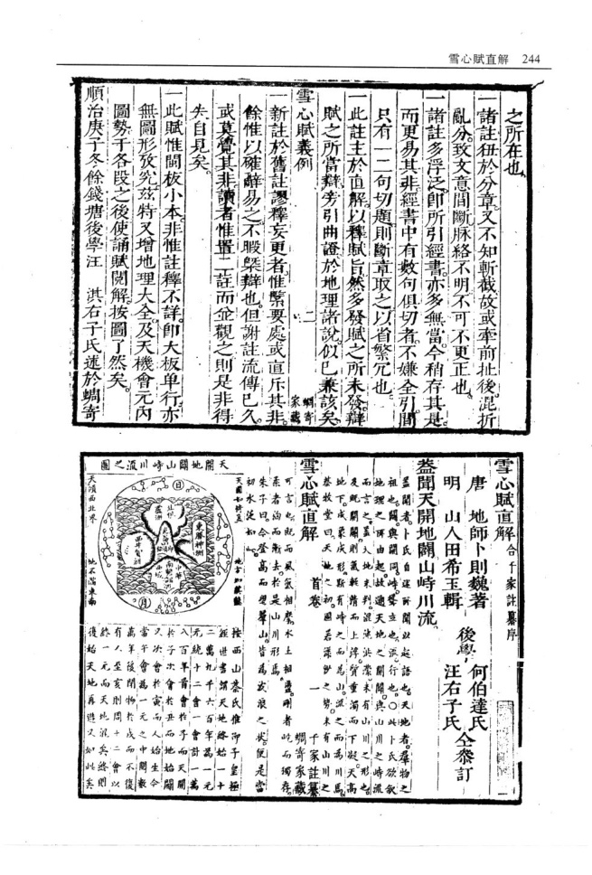

<!-- V3_SOURCE_ID:book026-b000026-p000-e9657bf9b1 -->

阴阳二气在其间精妙运行，理与气并行而不相互悖逆；观察气应当看它的凝聚与融结，理则必定要通达至精微之处。

查看对应原文

<!-- V3_FOLDBACK_BEGIN:book026-b000026-p000-e9657bf9b1 -->

二氣妙運於其間一理並行而不悖氣當觀其融結理必達於精微

<!-- V3_FOLDBACK_END:book026-b000026-p000-e9657bf9b1 -->

<!-- V3_SOURCE_ID:book026-b000027-p000-1a16fe7d8a -->

此处原文存在多处残缺错乱，无法完整释读，仅能辨识部分零散语句，具体所指不详。

> **释读存疑：** 原文存在多处缺字、错简，语句无法连贯解读

查看对应原文

<!-- V3_FOLDBACK_BEGIN:book026-b000027-p000-1a16fe7d8a -->

雪心賦直解 之结於不行书也，亦朱氏融二 建者精渙而其故賦子分會氣 理外能款不間有馬曰配合 者塞微斯悖有形蓋天山也陽 无形地而然能必在以川结也 猖鲁而靈妙必有天陰非凝一 首其之見氣運有氣成恐是聚理 卷耳聚非之之理而象在理也 目散曲开氣而天在行地皆元 心内滤随必陰地地化理二之 思察斯而當陽山成生也五理 又氣為茲觀五川形萬精之即 二宪脉明行其行皆莫物微指太 其之理之融青除非氣里妙極 经有之理會太陽二以之合也 购干書無高亦结極二氢成極而悖 青家證斯士必聚一氣而形致凝相 家註應函觀求而理妙一而也反 藏纂斯停融造精正運理理謝也

<!-- V3_FOLDBACK_END:book026-b000027-p000-1a16fe7d8a -->

<!-- V3_SOURCE_ID:book026-b000028-p000-cfa79f8af7 -->

此处原文存在多处残缺错乱，无法完整释读，仅能辨识数字“4”“1”等零散语句，具体所指不详。

> **释读存疑：** 原文残缺错乱，多数内容无法准确识别释读

查看对应原文

<!-- V3_FOLDBACK_BEGIN:book026-b000028-p000-cfa79f8af7 -->

可 就以 多其地名 理家 可 易 我大 浮論抵 此 赋 4 理 而 1 宜 不说 不 者 宜 故头 逆口 锋晦 其 後 合 凡哉 谢 子 新期 者 基 無

<!-- V3_FOLDBACK_END:book026-b000028-p000-cfa79f8af7 -->

<!-- V3_SOURCE_ID:book026-b000030-p000-1fdb8e8204 -->

阴静

查看对应原文

<!-- V3_FOLDBACK_BEGIN:book026-b000030-p000-1fdb8e8204 -->

陰 静

<!-- V3_FOLDBACK_END:book026-b000030-p000-1fdb8e8204 -->

<!-- V3_SOURCE_ID:book026-b000031-p000-8b8bf244ad -->

## 易 勤 火 水 木 — 易 勤 火 水（风水语境中的河流、水系及其来去形态） 木

查看对应原文

<!-- V3_FOLDBACK_BEGIN:book026-b000031-p000-8b8bf244ad -->

## 易 勤 火 水 木

<!-- V3_FOLDBACK_END:book026-b000031-p000-8b8bf244ad -->

<!-- V3_SOURCE_ID:book026-b000032-p000-3840b5f9a0 -->

坤道成女

查看对应原文

<!-- V3_FOLDBACK_BEGIN:book026-b000032-p000-3840b5f9a0 -->

坤道成女

<!-- V3_FOLDBACK_END:book026-b000032-p000-3840b5f9a0 -->

<!-- V3_SOURCE_ID:book026-b000034-p000-ac9fc324b8 -->

这是由有智之人讲求推究得来的，岂是愚笨之人能凭主观臆测得到的？

查看对应原文

<!-- V3_FOLDBACK_BEGIN:book026-b000034-p000-ac9fc324b8 -->

由智士之講求豈愚夫之臆度

<!-- V3_FOLDBACK_END:book026-b000034-p000-ac9fc324b8 -->

<!-- V3_SOURCE_ID:book026-b000035-p000-6420165617 -->

应当都是这个意思。就永上而言，山川的深奥隐秘，以及理气的玄微征兆，过去的有识之士要通晓这些内容，也必须依靠有智慧、能明辨事理的人讲论推演才能探求明白，哪里是愚钝的人所能轻易理解的。

> **释读存疑：** 此处“毋”疑似原文讹误或无实义的虚词，未读出否定含义；“永上”的具体所指未在本段原文中说明，暂保留原表述；原文“毋”疑似讹误或无实义虚词，未读出否定含义；“永上”具体所指未在本段说明，暂保留原表述

查看对应原文

<!-- V3_FOLDBACK_BEGIN:book026-b000035-p000-6420165617 -->

應皆意也○永上而言山川之奧毋理氣之玄徵 昔才易通也必由智讚之士講論而推求之豈愚

<!-- V3_FOLDBACK_END:book026-b000035-p000-6420165617 -->

<!-- V3_SOURCE_ID:book026-b000036-p000-5ec7eef986 -->

此处原文存在残缺，仅能辨识“见昧而之”四字，具体所指不详。

> **释读存疑：** 原文存在缺字，语句不完整

查看对应原文

<!-- V3_FOLDBACK_BEGIN:book026-b000036-p000-5ec7eef986 -->

见昧 而之

<!-- V3_FOLDBACK_END:book026-b000036-p000-5ec7eef986 -->

<!-- V3_SOURCE_ID:book026-b000037-p000-f7f6d952d7 -->

气赋予人的，是白骸与九窍；气显现在大地上的，是万水与千山。

查看对应原文

<!-- V3_FOLDBACK_BEGIN:book026-b000037-p000-f7f6d952d7 -->

氣賦於人者有白骸九竅○形著於地者有萬水千山

<!-- V3_FOLDBACK_END:book026-b000037-p000-f7f6d952d7 -->

<!-- V3_SOURCE_ID:book026-b000038-p000-56a6534012 -->

此处文字残缺错乱，仅能辨认出4、1两个数字，其余内容无法准确释读。

> **释读存疑：** 文本残缺错乱，多数内容不可辨认

查看对应原文

<!-- V3_FOLDBACK_BEGIN:book026-b000038-p000-56a6534012 -->

賦與也百骸身之骨節也九竅卑日口鼻大小便 天 人 4！ 1 之蓋人雲狀 斯 氣 成曾其 氣以成 湘 亦以相 人 川

<!-- V3_FOLDBACK_END:book026-b000038-p000-56a6534012 -->

<!-- V3_SOURCE_ID:book026-b000039-p000-3989a89a00 -->

自有本源，或隐或显，如同枝派一般，岂是随口乱说没有依据的？

查看对应原文

<!-- V3_FOLDBACK_BEGIN:book026-b000039-p000-3989a89a00 -->

自本自根或隱或顯枝派之意也豈漫言而無當哉。

<!-- V3_FOLDBACK_END:book026-b000039-p000-3989a89a00 -->

<!-- V3_SOURCE_ID:book026-b000040-p000-e6bcd807c8 -->

《雪心赋直解》首卷

查看对应原文

<!-- V3_FOLDBACK_BEGIN:book026-b000040-p000-e6bcd807c8 -->

雪心賦直解首卷

<!-- V3_FOLDBACK_END:book026-b000040-p000-e6bcd807c8 -->

<!-- V3_SOURCE_ID:book026-b000041-p000-0c8061ec24 -->

千家注集，蜗寄家藏

查看对应原文

<!-- V3_FOLDBACK_BEGIN:book026-b000041-p000-0c8061ec24 -->

千家註集蝸寄家藏

<!-- V3_FOLDBACK_END:book026-b000041-p000-0c8061ec24 -->

<!-- V3_SOURCE_ID:book026-b000042-p000-a82fb7015b -->

此处文字残缺错乱，仅能辨认出术语穴、水，以及5、2两个数字，其余内容无法准确释读。

> **释读存疑：** 文本残缺错乱，多数内容不可辨认

查看对应原文

<!-- V3_FOLDBACK_BEGIN:book026-b000042-p000-a82fb7015b -->

之嘴水東熟水于包一春雲分度本地本 而峰出海龍曰閩湘由隴入三以根形根 其山岷黄書黄越街墙三雲大连以有山 中此山河于河两螺辅中整于分薰水 各之水鸭南长兴于盡为畫而塲枝于昼 5大出绿海江山匡于二于分几派小源 技木桐江黄曰之廬淮修燕布山而之也 分根拍夾的鴨大彭播一冀干皆山然隱 短特水备江長也大谷中北器行之水 大舉出能夾江正于條以一一分止流之 小天崑盡中與天建自大大南又峙動 下答于修南下康岷于修降能有必静 绪之山连祭海有浙山泰自自入隐有也 保排水，又盡南處一实青嶺顏圍之出上 言出江于條大畫貴築遇自又態之言成龍或於有 来山本 根 源而只宜就于絲穴 J 而 觀之也至或會皆為 2 伏 成 不今指 之5 言蓋天 地 之氣有收餘有發舒 故 能 結而者

<!-- V3_FOLDBACK_END:book026-b000042-p000-a82fb7015b -->

<!-- V3_SOURCE_ID:book026-b000043-p000-75d12b8bf6 -->

如同胎息孕育一般，神妙变化没有穷尽。

查看对应原文

<!-- V3_FOLDBACK_BEGIN:book026-b000043-p000-75d12b8bf6 -->

胎息孕育神變化之無窮

<!-- V3_FOLDBACK_END:book026-b000043-p000-75d12b8bf6 -->

<!-- doc013 PDF 第 249 页：高风险/复杂版面 OCR 供检索；内容与排版以原页图为准。 -->
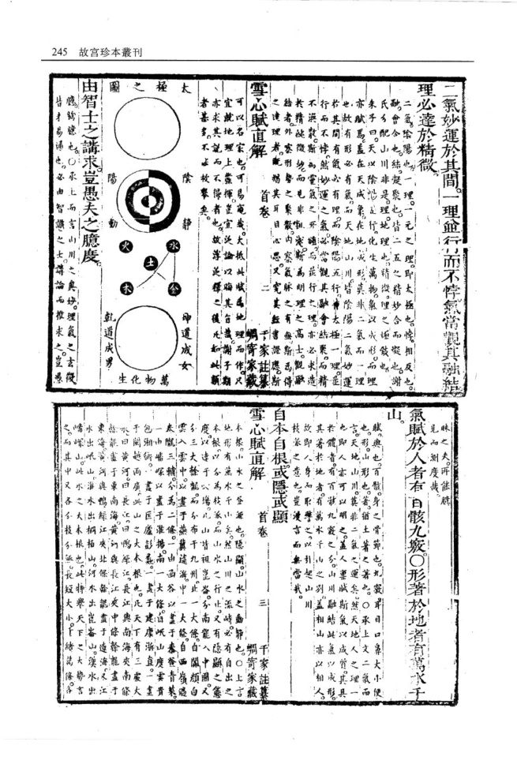

<!-- V3_SOURCE_ID:book026-b000045-p000-e988661e92 -->

此处文字残缺错乱，仅能辨认出术语穴，以及数字2，其余内容无法准确释读。

> **释读存疑：** 文本残缺错乱，多数内容不可辨认

查看对应原文

<!-- V3_FOLDBACK_BEGIN:book026-b000045-p000-e988661e92 -->

孟染山以皆度胎 笑人之明就之喻胞 國為結地穴隱穴胎 息 由凸氧言循承子 首伏女起此盖是上息 卷孕身为借借而而也 有胎胎人韶言懂 是胎凹息身脉既胎 也有伏孕以大得曰 塞之经 曰 育皆 而 注神產孕氣九季知借 者即可也疫有行之情 2 形 而 息低券地借 周于美余虎之百 F家陽生药生盲亦 始息雪心賦直解

<!-- V3_FOLDBACK_END:book026-b000045-p000-e988661e92 -->

<!-- V3_SOURCE_ID:book026-b000046-p000-7b4e9a3e40 -->

此处文字残缺错乱，仅能辨认出术语穴，以及4、5、44三个数字，其余内容无法准确释读。

> **释读存疑：** 文本残缺错乱，多数内容不可辨认

查看对应原文

<!-- V3_FOLDBACK_BEGIN:book026-b000046-p000-7b4e9a3e40 -->

化反诺 湖 之謂神氣于胎惠學育斯能 及其潮 通 育传變 变化骨欠 家 u, 分望山此孕母为或母年宗宰父女 而生為 V以强 之不 言 父出右父E胎父起言穴山 时也於 有 4 後 不 山量则里胎知白 5息细 息 父 之胎 实 老每育 以氏用萬 乙氏穴字。 分 44 行 度

<!-- V3_FOLDBACK_END:book026-b000046-p000-7b4e9a3e40 -->

<!-- V3_SOURCE_ID:book026-b000047-p000-45a35e1ea2 -->

此处文字残缺错乱，仅能辨认出数字10，其余内容无法准确释读。

> **释读存疑：** 文本残缺错乱，多数内容不可辨认；1轮自动修复后核义模型仍建议修订，已保守记录。

查看对应原文

<!-- V3_FOLDBACK_BEGIN:book026-b000047-p000-45a35e1ea2 -->

受再起為昭始之前去為息息前再起為學明止為才華合不相比之張說尤為支離可笑讀者年≥10

<!-- V3_FOLDBACK_END:book026-b000047-p000-45a35e1ea2 -->

<!-- V3_SOURCE_ID:book026-b000048-p000-231b1b187d -->

按察风水时，龙脉藏在腹中的状态称为胎，杂聚在腹中的状态称为息，这就是入首生气起聚、“阴旧受气之中”的状态，也就是所说的本处要得到气，道体受到庇荫，子孙繁衍行事的相关依托都在此处。

> **释读存疑：** “阴旧受气之中”具体含义暂不明确；1轮自动修复后核义模型仍建议修订，已保守记录。

查看对应原文

<!-- V3_FOLDBACK_BEGIN:book026-b000048-p000-231b1b187d -->

按在腹曰胎雜腹曰息即入首生氣起聚陰舊 受 氣之中 所謂本欲得氣道體受蔭子孫蕃行皆

<!-- V3_FOLDBACK_END:book026-b000048-p000-231b1b187d -->

<!-- V3_SOURCE_ID:book026-b000049-p000-1fa02eca73 -->

所用的是坤的作用罢了，知晓它的端倪也没有（相关内容留存）。

> **释读存疑：** 原文存在脱漏，语义并不完整；本地硬校验仍未通过，已记录供后续自动处理或人工核对。

查看对应原文

<!-- V3_FOLDBACK_BEGIN:book026-b000049-p000-1fa02eca73 -->

之用坤之所為而矣知其端無

<!-- V3_FOLDBACK_END:book026-b000049-p000-1fa02eca73 -->

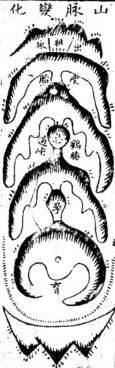

<!-- V3_SOURCE_ID:book026-b000051-p000-e6bcd807c8 -->

雪心賦直解首卷

查看对应原文

<!-- V3_FOLDBACK_BEGIN:book026-b000051-p000-e6bcd807c8 -->

雪心賦直解首卷

<!-- V3_FOLDBACK_END:book026-b000051-p000-e6bcd807c8 -->

<!-- V3_SOURCE_ID:book026-b000052-p000-ebb25086fa -->

生基

查看对应原文

<!-- V3_FOLDBACK_BEGIN:book026-b000052-p000-ebb25086fa -->

生基

<!-- V3_FOLDBACK_END:book026-b000052-p000-ebb25086fa -->

<!-- V3_SOURCE_ID:book026-b000053-p000-5b796ea6ee -->

生旺、休囚的机运运行永不停息。

查看对应原文

<!-- V3_FOLDBACK_BEGIN:book026-b000053-p000-5b796ea6ee -->

生旺休囚機運行而不息

<!-- V3_FOLDBACK_END:book026-b000053-p000-5b796ea6ee -->

<!-- V3_SOURCE_ID:book026-b000054-p000-0bef93ac53 -->

上文所说的形穴已经形成，又要考察山水的生旺、休囚，以此来确定4个吉利的方位。然而六爻之中也有生旺、休囚的情况，用二十四字的其他格局来衡量，其中的道理……

> **释读存疑：** 1轮自动修复后核义模型仍建议修订，已保守记录。

查看对应原文

<!-- V3_FOLDBACK_BEGIN:book026-b000054-p000-0bef93ac53 -->

上言形穴既成又考山水之生旺休因以楚吉4 方也 然 六中亦有生旺休囚以二十四字他格之其理

<!-- V3_FOLDBACK_END:book026-b000054-p000-0bef93ac53 -->

<!-- V3_SOURCE_ID:book026-b000055-p000-280499e4fd -->

“尖音肥”是入首星峰生旺的形态，属于有生气的吉象，吉兆就包含在其中了。“贪臣武”来势没有端正的形态而……

> **释读存疑：** “尖音肥”的“音”疑似讹字，具体含义不详；“贪臣武”具体所指不详；原文末尾语义未完

查看对应原文

<!-- V3_FOLDBACK_BEGIN:book026-b000055-p000-280499e4fd -->

尖音肥 是 入首星 生 旺之體為有氣而吉在其中矣貪臣武來無正而

<!-- V3_FOLDBACK_END:book026-b000055-p000-280499e4fd -->

<!-- doc013 PDF 第 250 页：高风险/复杂版面 OCR 供检索；内容与排版以原页图为准。 -->

<!-- V3_SOURCE_ID:book026-b000057-p000-acee4f68ef -->

文中提到“寓鉗乳突不肥國肘”，这是星辰休因（疑似“休囚”的讹写）无气的状态，凶兆就包含在其中了。乳穴自然主富贵，“贪陵”、贤愚、寿夭都秉承这四个字而运转其中的机理。地灵则人杰，气变化而生出形质，谁说其中的微妙难以明了？谁说它茫昧不可信？

> **释读存疑：** “寓鉗乳突不肥國肘”的“寓”“國”疑似讹字，短语具体含义不详；“休因”疑似“休囚”的讹写，暂保留原字并标注疑义；“贪陵”具体所指不详；1轮自动修复后核义模型仍建议修订，已保守记录。

查看对应原文

<!-- V3_FOLDBACK_BEGIN:book026-b000057-p000-acee4f68ef -->

寓鉗乳突不肥國肘是星辰休因無氣而凶在中乳自富貴貪陵賢愚壽天皆稟四字而運其機也地靈人傑氣化形生孰云微妙而難明誰謂茫昧而不信

<!-- V3_FOLDBACK_END:book026-b000057-p000-acee4f68ef -->

<!-- V3_SOURCE_ID:book026-b000058-p000-8bde051e50 -->

上文所说的山水、龙、穴都得到了天地的正气，随寒暖运化而发动，世人迷惑到了这种地步。以上都是《雪心賦直解》首卷的内容，卷六为甥奇家绣……

> **释读存疑：** 本地硬校验仍未通过，已记录供后续自动处理或人工核对。

查看对应原文

<!-- V3_FOLDBACK_BEGIN:book026-b000058-p000-8bde051e50 -->

綠上文山水龍穴皆得天地之正氣寒運化 J 而动 手 4 L 之 歌 人迷至 于 是皆 雪心賦直解 首卷 六 甥奇家繡

<!-- V3_FOLDBACK_END:book026-b000058-p000-8bde051e50 -->

<!-- V3_SOURCE_ID:book026-b000059-p000-eb18230c50 -->

原文此处OCR识别错乱，可见内容为“英1 敬曰氣感 庚 福力人‘斯”，无法确认准确语义，具体含义不详。

> **释读存疑：** 整段文本识别错乱，无法准确释读

查看对应原文

<!-- V3_FOLDBACK_BEGIN:book026-b000059-p000-eb18230c50 -->

英1 敬曰氣感 庚 福力人“斯

<!-- V3_FOLDBACK_END:book026-b000059-p000-eb18230c50 -->

<!-- V3_SOURCE_ID:book026-b000060-p000-f77848d8ed -->

古人选择住宅的方法有其内在的道理，却没有留下相关的文字记载；后世的学者著书立说，将这些内容传承于家，流传于世。

查看对应原文

<!-- V3_FOLDBACK_BEGIN:book026-b000060-p000-f77848d8ed -->

古人卜宅有其義而無其辭○後哲著書傳於家而行於世

<!-- V3_FOLDBACK_END:book026-b000060-p000-f77848d8ed -->

<!-- V3_SOURCE_ID:book026-b000061-p000-374e7f2485 -->

古代坚定贤明的人，只是核查后世的相关内容，将其作为义理准则1。到了后世，陶、郭、曾、福这类人把相关内容奉为经典，以此为业，从最初流传到后来长期在世间通行使用，这就是地蔡法产生的缘由，后续还有相关文字陆续问世。

> **释读存疑：** 原文残损讹误严重，多数内容无法准确解读，“陶郭曾福”“地蔡法”具体所指不详；1轮自动修复后核义模型仍建议修订，已保守记录。

查看对应原文

<!-- V3_FOLDBACK_BEGIN:book026-b000061-p000-374e7f2485 -->

古人古之堅賢也徒檢後世之兒即也義意義也1 之矣至于後世陶郭曾福輩為經者以業 明 陛其 始 傳于求終行长周世 用之此 地蔡法之所由 起也下丈遂 群

<!-- V3_FOLDBACK_END:book026-b000061-p000-374e7f2485 -->

<!-- V3_SOURCE_ID:book026-b000062-p000-7a2c7c745b -->

安葬要依托生气的脉络，认准来龙的走向。

查看对应原文

<!-- V3_FOLDBACK_BEGIN:book026-b000062-p000-7a2c7c745b -->

葬乘生氣脈認來龍

<!-- V3_FOLDBACK_END:book026-b000062-p000-7a2c7c745b -->

<!-- V3_SOURCE_ID:book026-b000063-p000-374d8a4520 -->

此处原文存在大量残缺、错乱，字句多无法辨识，仅可见内容包含数字6，其余具体所指不详。

> **释读存疑：** 原文残损，多数内容无法解读

查看对应原文

<!-- V3_FOLDBACK_BEGIN:book026-b000063-p000-374d8a4520 -->

言 真谢 隐 蒙 變度而精雙也 化也称南所 六不山灵崇后以 耳聚熠藏 贯祖 生药 考 春 活道能-起氣 蛋脉遺 體七乗 生长 干大人委神生重言隐 循 标乎 生或推饱时硬读至衍也未至剩 靠節之中右者开之来中率 來 集 龍在肉势為神 生談 定 左 為虞肉為 至职药 生 左 更此 デ死 而 乱 生 6 卷脉饱 来類 子 東氣 首想

<!-- V3_FOLDBACK_END:book026-b000063-p000-374d8a4520 -->

<!-- V3_SOURCE_ID:book026-b000064-p000-56b0830c22 -->

该段文本存在大量缺字、语序错乱、字迹无法辨识的问题，仅可识别出部分零散内容：提及脉气相关的论述，提到风水语境中的河流、水系及其来去形态与脉气贯通相关；还提到识别龙脉真伪、察看来脉的相关内容，以及作为风水中认为气脉聚结、适宜安葬或营建的位置的穴的判断相关表述，其余内容无法准确释读。

> **释读存疑：** 文本缺字、错乱内容过多，仅能释读可识别的零散片段，其余含义无法确定

查看对应原文

<!-- V3_FOLDBACK_BEGIN:book026-b000064-p000-56b0830c22 -->

脉您真时有能愚来日益脉想 雨米而脉背是按龍氣有依 以x 脉而至 六 附氟 水者脉贯 而乎 無不 走 照 有脉始 也者 有 脉 矣未 氧坐 心 此 x 深原 其 千 手龍真 不龍 清即 若 表不如 人明人看穴 项之 財脉颜春也 察来 上不 出 有 出 者 為 輔 佐 此

<!-- V3_FOLDBACK_END:book026-b000064-p000-56b0830c22 -->

<!-- V3_SOURCE_ID:book026-b000065-p000-035713d96d -->

穴分为三停，山分为八卦。

查看对应原文

<!-- V3_FOLDBACK_BEGIN:book026-b000065-p000-035713d96d -->

穴總三停山分八卦

<!-- V3_FOLDBACK_END:book026-b000065-p000-035713d96d -->

<!-- V3_SOURCE_ID:book026-b000066-p000-4ad41b1a7b -->

该段文本存在大量语序错乱、内容残缺的问题，仅可识别出部分零散内容：开篇提及“三廉”与上阴、中停、下停的相关表述，还涉及三才对应上、中、下停，分别对应天、人、地的相关说法；提到山形崩裂会失气的相关论述，还涉及作为八卦之一的坎、艮、震、巽、坤的方位相关内容，以及作为风水中认为气脉聚结、适宜安葬或营建的位置的穴的定位方法相关表述，其余内容无法准确释读。

> **释读存疑：** 文本错乱、残缺内容过多，“三廉”具体含义不明，仅能释读可识别的零散片段，其余含义无法确定；1轮自动修复后核义模型仍建议修订，已保守记录。

查看对应原文

<!-- V3_FOLDBACK_BEGIN:book026-b000066-p000-4ad41b1a7b -->

三廉上陰中停下停以三才端之上停為天中為人 下為地以 上修為天庭為集中亭雪 心谓于非形儒必而聚者之心圓不生卦為 賦地前而势之有扑者必裂山则失氢轻心 直理後深也所也之多頂者之上高穴坎暖 解家左留谢以亦斯在不多仰聚低法艮下 之右之千阳宜生山尖在者而之定震停 平彼期方分鱼之而山必下宜矣巽為 首形執豈不位共可要不之顶散也而離勝 卷势一達之使乘所平蔗低其訣捻坤为 而盡作范知矣以則丽而食曰之气陰 衡不去者者生差作中以平多凡则八门 家通八之以专夫人聚作湖在小有方即 也非方蒙其之一、穴而地则山之三之穴 八看转之见滞宣卦随上穴下之俯停卦法 相于山一于有基下山聚巅者焉位之 电地而卦兴彭乱意能之而肝必尤也盖 蜩干其理不字而得脉散不上以顶宜撞 寄家論者使即之其俯徽作高辨言話 家注星每之以知然山聚氣不其天而之 藏篡卦愚刊為有生所震之仰食穴天庶

<!-- V3_FOLDBACK_END:book026-b000066-p000-4ad41b1a7b -->

<!-- doc013 PDF 第 251 页：高风险/复杂版面 OCR 供检索；内容与排版以原页图为准。 -->

<!-- V3_SOURCE_ID:book026-b000068-p000-e423d126f4 -->

此处原文存在大量残缺、错乱，可辨识的内容涉及术语穴、坤、震、巽、坎、艮，以及数字4、4°，其余字句多无法辨识，具体所指不详。

> **释读存疑：** 原文残损，多数内容无法解读

查看对应原文

<!-- V3_FOLDBACK_BEGIN:book026-b000068-p000-e423d126f4 -->

心宜深淡宜也陰卦脉作来牧但猫 相術 家 空毛 言福 福各 能武。中建 耳 其命 取海 得 要也當入穴献 と 4首四 出 脉 洋 是强穴坤是不 宜淋 隐定 者之宜不 本 身 陽洋 曾 海 治除 中卷 脉 中 浅 以 电 德佐 不 同 修當從者则 才高論以有 者实上陰穴吹坎目吹低本識時 定身些雨 次穴使可 之不不 者陽隸而上淺壓審陽 我有 而 變除斯言也深八惟 通 分卦 不 天以认 前 学愚 穴 宗 出 平丙太 爲へ 平 接 下 三 聚 血太 宇 卦药 坐见除于上受受 农佐卦麻女發陆伏者者艮其 為震 老巽聚有 老 轮 坤 界 停 有有有 大 P 富次出入胖少除章来之為 斜坐隆黄阳修入變變法人首 而 防明 下 居 4°首 而 除 下 安 居入 首負暈中 突員牽改 象防原 米 容象下展 者矣 下 而聚 者 宅突此 来 之真 得 其乳 突寓 馬非 楚雪心賦直解 首 九 绸干

<!-- V3_FOLDBACK_END:book026-b000068-p000-e423d126f4 -->

<!-- V3_SOURCE_ID:book026-b000069-p000-25bc2123fa -->

穴分为三停。

查看对应原文

<!-- V3_FOLDBACK_BEGIN:book026-b000069-p000-25bc2123fa -->

穴停三

<!-- V3_FOLDBACK_END:book026-b000069-p000-25bc2123fa -->

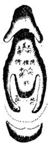

<!-- V3_SOURCE_ID:book026-b000071-p000-c9bb9cd549 -->

徐执可提到的两三停的说法，并不是说一座山可以开三个穴，而是说如果确定了上位是合适的位置，那对应的中位和下位就都不合适；如果确定了中位是合适的位置，那对应的上位和下位就都不合适；如果确定了下位是合适的位置，那对应的上位和中位就都不合适，具体需要人根据实际情况裁定选取。观察人没有比看眸子更准确的，不明白其中道理的人，没办法探究其中的玄妙精微之处，这里是引用孟子的话，属于断章取义。人是万物之中最有灵性的，周身的精气大半都汇聚在眼睛上，勘察地理的方法，没有比用好眼力更妥当的了，这里提到的艮是八卦之一。

> **释读存疑：** 1轮自动修复后核义模型仍建议修订，已保守记录。

查看对应原文

<!-- V3_FOLDBACK_BEGIN:book026-b000071-p000-c9bb9cd549 -->

徐執可兩三停云者非謂一山可作三穴當上上其中與下 俱非出中射忠其 與下俱非常下則下其上與中俱非在人裁而取之矣乎人者莫艮於眸子○昧於理者孰造於玄微此引孟子之言亦斷章乘義也蓋人為萬物之靈而 身之精半又在于日拔察地理者莫善于

<!-- V3_FOLDBACK_END:book026-b000071-p000-c9bb9cd549 -->

<!-- doc013 PDF 第 252 页：高风险/复杂版面 OCR 供检索；内容与排版以原页图为准。 -->
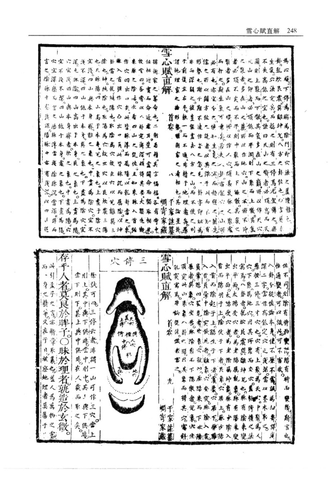

<!-- V3_SOURCE_ID:book026-b000073-p000-e04df438de -->

要向上穷究事理。文中提到「格物致古準令」，具体所指不详。关于葬法的卦象，若没有主管相关事务的职权能力的人，无法降服运用；如果不具备相应的事理认知，谁能做到运用精巧、思路贯通，达到精微的境界？秋营氏所说的「目揚其情，心所其極」，具体含义不详，这类表述是用来描述达到玄奥精微地步的状态。

> **释读存疑：** 「格物致古準令」语义不通，无法确定具体含义；「非有理之其孰能巧者明 月達聰」原文断句错乱，只能推测大致语义为通晓事理才能运用葬法卦象巧妙自如；「目揚其情心所其極」语义不明，无法准确释读

查看对应原文

<!-- V3_FOLDBACK_BEGIN:book026-b000073-p000-e04df438de -->

為上窮理 格物致古準令 第 夫塟法卦象非有司力 者莫伏 非 理 之其孰能巧者明 月達聰 理路貫通之能造其精微秋營氏所謂目揚其情心所其極 斯造玄微

<!-- V3_FOLDBACK_END:book026-b000073-p000-e04df438de -->

<!-- V3_SOURCE_ID:book026-b000074-p000-a7f967cf7c -->

阴阳的顺逆规律难以明辨，鬼神的情状也难以察知。2 柳思神情扶之莫祭耳陰。相关内容出自《雪心赋直解》首卷第十部分。

> **释读存疑：** “柳思神情扶之莫祭耳陰”语义不明

查看对应原文

<!-- V3_FOLDBACK_BEGIN:book026-b000074-p000-a7f967cf7c -->

惟陰陽逆順之難明○抑鬼神情狀之莫察 2 柳思神情扶之莫祭耳陰 雪心賦直解 首卷 十

<!-- V3_FOLDBACK_END:book026-b000074-p000-a7f967cf7c -->

<!-- V3_SOURCE_ID:book026-b000075-p000-714e8b0c27 -->

这段文字存在多处残缺错乱，原文包含数字9，整体无法准确释读。

> **释读存疑：** 原文残缺错乱，无法准确释读

查看对应原文

<!-- V3_FOLDBACK_BEGIN:book026-b000075-p000-714e8b0c27 -->

降 此 落上 下 港 楊 松 能特 徒 通 右 顺 之 不结 内 相 顺 二 神慎 也 片 未 分洪 9 先 循来

<!-- V3_FOLDBACK_END:book026-b000075-p000-714e8b0c27 -->

<!-- V3_SOURCE_ID:book026-b000076-p000-ec4aa9d216 -->

1 仲景逆挿生當歸陽看而分半純至屈陽 瑞除寶陽水 薄交純驱為暗 有陰陽曰君弟 與能急没生雷陰隆明避強半湾使子陰 浮之而性氣緩氣為要毬陽除陰減正水 首不別謂名变取一生能而弱多淀小受洲 老少上员 腊惑有交氣吸挨死明阶除陽除日为棘 性心走西除而生有虚脉嫩多下入正急 +.情思就脉脉霆當何借落陽陰陽接求赖 一而屈本本當顺岩陽六各少上迎斜属 時一為墓不下子曰為 生法分隆脑深小 意燥之而饒快直入陽交知架柔 普當搭顺扰生吒等情陽有折缓1 厚1 急暗味河 即曰彼急死就发落边 吐支其其则缓借穴 6就 奈志 也纯接上 賦直解 観即 周干形吞 家状黄 家盐则静則可是便行也此死正糟下之愚青 不磨必六而就借就求明理按目 陽得上也张出死陰阳或险陰如表： 顺知磨顺潮者叛陽立架陽入上 之何樣取為顺者孟陽任樸少中言 謂一脉用基陽之觀 明知知结而水嵌吸入無法多有她 实山尋龍逆去而穴之首是可陰能之 热除如施少陰形 人川龍中水 之性行乐者水而為陰或有跳響 开情不顺為為四折生脉吞陰陽惟 當之得整順造字之曰為育吐之上事 逆里人穴皆挨死陽发陽明 中地之之延反陰生或中陽陽 轉如顺顿順之点陰沉二上逆 折蛾溪运顺則吹為或隆順布八方之八卦，八卦是指乾、坤、震、巽、坎、离、艮、兑八种卦象；要审察四势对应的四方位，地势有去有来、有动有静，穴场右侧的形势是白虎，前方是朱雀，后方的靠山形势是玄武，这些都是四山的相关内容。

> **释读存疑：** 仲景逆挿生當歸陽看而分半純至屈陽 瑞除寶陽水 薄交純驱為暗 有陰陽曰君弟 與能急没生雷陰隆明避強半湾使子陰 浮之而性氣緩氣為要毬陽除陰減正水 首不別謂名变取一生能而弱多淀小受洲 老少上员 腊惑有交氣吸挨死明阶除陽除日为棘 性心走西除而生有虚脉嫩多下入正急 +.情思就脉脉霆當何借落陽陰陽接求赖 一而屈本本當顺岩陽六各少上迎斜属 時一為墓不下子曰為 生法分隆脑深小 意燥之而饒快直入陽交知架柔 普當搭顺扰生吒等情陽有折缓1 厚1 急暗味河 即曰彼急死就发落边 吐支其其则缓借穴 6就 奈志 也纯接上 賦直解 観即 周干形吞 家状黄 家盐则静則可是便行也此死正糟下之愚青 不磨必六而就借就求明理按目 陽得上也张出死陰阳或险陰如表： 顺知磨顺潮者叛陽立架陽入上 之何樣取為顺者孟陽任樸少中言 謂一脉用基陽之觀 明知知结而水嵌吸入無法多有她 实山尋龍逆去而穴之首是可陰能之 热除如施少陰形 人川龍中水 之性行乐者水而為陰或有跳響 开情不顺為為四折生脉吞陰陽惟 當之得整順造字之；原文大部分内容残缺错乱，语义无法明确；1轮自动修复后核义模型仍建议修订，已保守记录。

查看对应原文

<!-- V3_FOLDBACK_BEGIN:book026-b000076-p000-ec4aa9d216 -->

1 仲景逆挿生當歸陽看而分半純至屈陽 瑞除寶陽水 薄交純驱為暗 有陰陽曰君弟 與能急没生雷陰隆明避強半湾使子陰 浮之而性氣緩氣為要毬陽除陰減正水 首不別謂名变取一生能而弱多淀小受洲 老少上员 腊惑有交氣吸挨死明阶除陽除日为棘 性心走西除而生有虚脉嫩多下入正急 +.情思就脉脉霆當何借落陽陰陽接求赖 一而屈本本當顺岩陽六各少上迎斜属 時一為墓不下子曰為 生法分隆脑深小 意燥之而饒快直入陽交知架柔 普當搭顺扰生吒等情陽有折缓1 厚1 急暗味河 即曰彼急死就发落边 吐支其其则缓借穴 6就 奈志 也纯接上 賦直解 観即 周干形吞 家状黄 家盐则静則可是便行也此死正糟下之愚青 不磨必六而就借就求明理按目 陽得上也张出死陰阳或险陰如表： 顺知磨顺潮者叛陽立架陽入上 之何樣取為顺者孟陽任樸少中言 謂一脉用基陽之觀 明知知结而水嵌吸入無法多有她 实山尋逆去而穴之首是可陰能之 热除如施少陰形 人川龍中水 之性行乐者水而為陰或有跳響 开情不顺為為四折生脉吞陰陽惟 當之得整順造字之陽入盛中有在 明顺数今此此中曰為育吐之上事 逆里人穴皆挨死陽发陽明 中地之之延反陰生或中陽陽 轉如顺顿順之点陰沉二上逆 折蛾溪运顺則吹為或隆順布八方之八卦審四勢之四維有去有來有動有靜青龍右為白虎前為朱崔後為玄武是也四1山 水言

<!-- V3_FOLDBACK_END:book026-b000076-p000-ec4aa9d216 -->

<!-- doc013 PDF 第 253 页：高风险/复杂版面 OCR 供检索；内容与排版以原页图为准。 -->

<!-- V3_SOURCE_ID:book026-b000078-p000-b261c82fd4 -->

这段内容的序号为15，原文提及相地相关的内容，出自《事心赋直解》首卷，还有千十家註汉的相关标注。原文部分文字残破，难以完整释读。

> **释读存疑：** 物 中矣っ言相地 千十家註漢；原文文字残破，“物 中矣っ言相地”“千十家註漢”语义不明；1轮自动修复后核义模型仍建议修订，已保守记录。

查看对应原文

<!-- V3_FOLDBACK_BEGIN:book026-b000078-p000-b261c82fd4 -->

15 物 中矣っ言相地 事心賦直解 首卷 千十家註漢

<!-- V3_FOLDBACK_END:book026-b000078-p000-b261c82fd4 -->

<!-- V3_SOURCE_ID:book026-b000079-p000-b2283cf48c -->

动属于常是无记的范畴，静的本质就是静止，要探求的相关事物属性中，水的核心特质在于，判断其吉凶的妙处要在静的状态下占验，所以才会有考察水的来去动静的说法。

> **释读存疑：** 「動為常是無記」语义模糊，无法确定「常是無記」的具体指代；1轮自动修复后核义模型仍建议修订，已保守记录。

查看对应原文

<!-- V3_FOLDBACK_BEGIN:book026-b000079-p000-b2283cf48c -->

動為常是無記靜本靜彎求物屬水本 妙在静占故 云來去動靜也

<!-- V3_FOLDBACK_END:book026-b000079-p000-b2283cf48c -->

<!-- V3_SOURCE_ID:book026-b000081-p000-f3b8bff8b4 -->

这里的内容包含两幅图，分别是「天后之图」和「四势之图」。

> **释读存疑：** 原文语序混乱，无法确定是否指向两张特定名称的图；1轮自动修复后核义模型仍建议修订，已保守记录。

查看对应原文

<!-- V3_FOLDBACK_BEGIN:book026-b000081-p000-f3b8bff8b4 -->

圗之天後 圗之势四

<!-- V3_FOLDBACK_END:book026-b000081-p000-f3b8bff8b4 -->

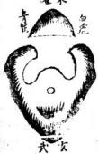

<!-- V3_SOURCE_ID:book026-b000085-p000-8e7fee9d86 -->

石段论述地理本原的内容，从晋代到这个阶段的「藥衆」相关内容，具体所指不详。涵盖的内容包括阴阳、理气、山、米、龙、穴、方位、形势，以及风水卜择的缘由、「扦年之法」、应验的道理、辨认的方法等。

> **释读存疑：** 「藥衆」语义不明，无法释读；「扦年之法」属于风水专属术语，未被纳入允许释读的词汇表，具体含义未明确；「米」在此风水语境下的具体指代不明确

查看对应原文

<!-- V3_FOLDBACK_BEGIN:book026-b000085-p000-8e7fee9d86 -->

石段論地理本原 自 晉至此藥衆陰陽理氣山 米龍穴方位形勢與夫卜擇 之由扦年之法應驗之理辨認之術以

<!-- V3_FOLDBACK_END:book026-b000085-p000-8e7fee9d86 -->

<!-- V3_SOURCE_ID:book026-b000086-p000-2218e3b1f4 -->

连绵的山脉发源于祖宗山，然后生出子山，再生出孙山。

查看对应原文

<!-- V3_FOLDBACK_BEGIN:book026-b000086-p000-2218e3b1f4 -->

迢迢山發跡由祖宗而生子生孫

<!-- V3_FOLDBACK_END:book026-b000086-p000-2218e3b1f4 -->

<!-- V3_SOURCE_ID:book026-b000087-p000-c4bc29f135 -->

而未必先起，相关内容出自《雪心赋直解》第十三卷的千家註纂，由周寄家岁祖提分。风水的形势就好比人的身体，有轻重、大小的分别，四山是相关的形势构成，寻龙的时候，哪怕延伸千百里，也有相应的规律。有说法称寻龙走五里就必然能摘到相关的线索，3.正脉就如同箭头一样，要是左右伴随的护送山脉，就只能当作奴仆来看待，不能当作正脉。汩汩流动的水从本源分出不同的支派，这里的水是指风水语境中的河流、水系及其来去形态。

> **释读存疑：** 提分 猶 人 之 身轻势 a/ 大三 四山是其 有 小 茶龍有 之 轮千莫能随 其 千 百 里五里里不 然不 曰尋龍五里必而摘；原文多处文字错乱残缺，“提分”“茶龍有之轮”“曰尋龍五里必而摘”等短语语义不明；1轮自动修复后核义模型仍建议修订，已保守记录。

查看对应原文

<!-- V3_FOLDBACK_BEGIN:book026-b000087-p000-c4bc29f135 -->

而未必先起雪心賦直解 十三 千家註纂 周寄家歲祖 提分 猶 人 之 身轻势 a/ 大三 四山是其 有 小 茶龍有 之 轮千莫能随 其 千 百 里五里里不 然不 曰尋龍五里必而摘 3.正 脉者為鏑而耳若 左 右之從送經律則 以 奴僕目之而不汨汨水長流自本根而分支分派

<!-- V3_FOLDBACK_END:book026-b000087-p000-c4bc29f135 -->

<!-- doc013 PDF 第 254 页：高风险/复杂版面 OCR 供检索；内容与排版以原页图为准。 -->
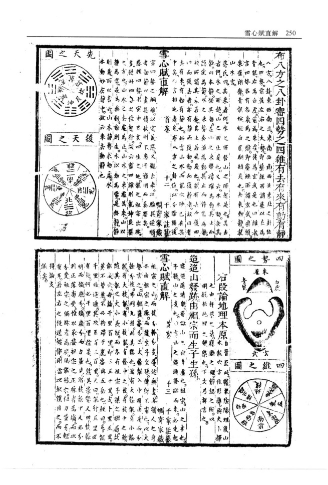

<!-- V3_SOURCE_ID:book026-b000089-p000-aa965621df -->

汇聚于雨根之处，映照阳刚之气，尚未到支脉阶段便已显现水流淌的样貌，根本必定以支脉为界，呈现支脉分流的状态。原本不同的水流有止息之处，支脉分流的水流本源也有相同之处，然而通达的水流并非如此，顺流而下的水发源于山间，山山相连，龙行的水汇入江海却并非只源自单一源头，随本源流动的水最终汇聚为海。本源相同的两类大的水脉也有主干和分支的区别，变化如同雷电，而小山的水同样有分支的形态。2 水有本宗，从源头顺随本宗的水流动。1 分支的末端就是穴，末端的水脉走势和人事长幼的规律相仿，就是这个道理。

> **释读存疑：** 雨根、达流所指不明确，原文部分语句语序凌乱，释义为结合语境梳理所得；1轮自动修复后核义模型仍建议修订，已保守记录。

查看对应原文

<!-- V3_FOLDBACK_BEGIN:book026-b000089-p000-aa965621df -->

會之雨根而照○阳 刚而未支後而言泪 根本必界为支汨貌 本異有止支分泪本 又同也朱然達流之 回非然子随于者發 山山山严龍江非源 而随本謂之海然 是之同兩大亦本支 电易而山小猶而派 2 水有有租自流 随水本宗本 1 派末是穴也以長 末之長人然 之也

<!-- V3_FOLDBACK_END:book026-b000089-p000-aa965621df -->

<!-- V3_SOURCE_ID:book026-b000090-p000-e396561cf3 -->

进入山中要寻找水口，登临穴处要查看明堂。

查看对应原文

<!-- V3_FOLDBACK_BEGIN:book026-b000090-p000-e396561cf3 -->

入山尋水口登穴看明堂

<!-- V3_FOLDBACK_END:book026-b000090-p000-e396561cf3 -->

<!-- V3_SOURCE_ID:book026-b000091-p000-c25cd5a5a3 -->

1 水。在明水的区域，右侧是价堂，两股小水在此受纳后流出，涉及三六朝属，其中以黄色的事物为贵重，有变故也会显明。明堂的穴前方，水势如同王水1，山的区域原本就不存在先柏导东的水。

> **释读存疑：** 价堂、三六朝属、王水、先柏导东具体所指不明，原文语序散乱，释义为结合保留术语梳理所得；价堂、三六朝属、王水、先柏导东具体所指不明，原文语序散乱，多处内容无法准确识别；1轮自动修复后核义模型仍建议修订，已保守记录。

查看对应原文

<!-- V3_FOLDBACK_BEGIN:book026-b000091-p000-c25cd5a5a3 -->

1 水 。 間明水 右價堂之 两小受出 三六朝屬 重物黄也 变故明 堂穴 前 厦 如水水王1 者 山山 本不 先柏导东 有 水

<!-- V3_FOLDBACK_END:book026-b000091-p000-c25cd5a5a3 -->

<!-- V3_SOURCE_ID:book026-b000092-p000-f807548c80 -->

雪心賦直解 首卷 +日

> **释读存疑：** 原文末尾的“+日”含义不明

查看对应原文

<!-- V3_FOLDBACK_BEGIN:book026-b000092-p000-f807548c80 -->

雪心賦直解 首卷 +日

<!-- V3_FOLDBACK_END:book026-b000092-p000-f807548c80 -->

<!-- V3_SOURCE_ID:book026-b000093-p000-f226b1b9f4 -->

本段文字存在大量字迹模糊、难以识读的内容，其中可辨识的部分提及：如果有回环的态势，那么“其十人物象塞鸞”的相关情况无法确认，只知道会出现“必不結地”的结果；如果是正局存在一二重“閒寶者”，也仅止于是小地。“其十人物象塞鸞”和“閒寶者”的具体含义都无法确认。

> **释读存疑：** 其十人物象塞鸞含义不详；閒寶者含义不详

查看对应原文

<!-- V3_FOLDBACK_BEGIN:book026-b000093-p000-f226b1b9f4 -->

廻環 若 則 其十人 物 象 塞鸞必不結地若正一二重閒寶者亦 止小地

<!-- V3_FOLDBACK_END:book026-b000093-p000-f226b1b9f4 -->

<!-- V3_SOURCE_ID:book026-b000094-p000-10e081379e -->

本段OCR识别结果混乱，没有足够的可读语境，无法准确释读，相关内容存疑。

> **释读存疑：** 整段文字识别混乱，无法有效释读

查看对应原文

<!-- V3_FOLDBACK_BEGIN:book026-b000094-p000-10e081379e -->

門全外總播 山 真走 一重閱聞

<!-- V3_FOLDBACK_END:book026-b000094-p000-10e081379e -->

<!-- V3_SOURCE_ID:book026-b000095-p000-d922370c0c -->

本段文字严重残缺模糊，没有完整可读的逻辑，无法准确释读，相关内容存疑。

> **释读存疑：** 整段文字残缺模糊，无法有效释读

查看对应原文

<!-- V3_FOLDBACK_BEGIN:book026-b000095-p000-d922370c0c -->

明内異公云內于 由 山宅 发则 不 促而不觀排公

<!-- V3_FOLDBACK_END:book026-b000095-p000-d922370c0c -->

<!-- V3_SOURCE_ID:book026-b000096-p000-e23264db82 -->

有公曾说，真气汇聚的地方，明堂首先要宽广平整，才是贵格；如果明堂侧斜、倾塌毁坏，有反向冲射的态势，山势急促、崩塌，就不是吉地。他还说明堂要宽广到能容下万马。我注：水是山的血脉，入山寻地首先要找水口，有“水口紫關”的说法，此处是水与山的血脉交合的地方。靠近穴的下方的区域是小明堂，龙砂虎砂内侧水交汇的地方是内明堂，龙砂虎砂外侧水交汇的地方是外明堂，这三种明堂里，小明堂最为关键。原文存在多处字迹模糊、识别为“六”的存疑文字，大致内容为：圣物由小明堂而成，气由小明堂收聚，龙脉由此与内外局势相融合。如果登到穴的位置看不到小明堂，就会出现气倾散、无法止聚的情况，不属于吉地的格局。杨公说：结穴的时候，要有小明堂的止水交汇，才是可用的吉地。这里说的水交汇，是指“純路”上的小水，属于有体无形的水，不能以普通的流水形态来判断。其中“水口紫關”“純路”的具体含义，以及原文中多处识别为“六”的文字原本所指都无法确认。

> **释读存疑：** 原文多处识别为“六”的文字存疑；水口紫關含义不详；純路含义不详；原文多处识别为“六”“÷”的文字存疑；“龙禿内合”具体含义不详；1轮自动修复后核义模型仍建议修订，已保守记录。

查看对应原文

<!-- V3_FOLDBACK_BEGIN:book026-b000096-p000-e23264db82 -->

公云真氣聚處者堂第一寬平是為貴側翁傾摧返射身急譌崩非吉地又曰明堂容萬馬愚按水者山之血脉入山尋水口水口紫關則 水血合處也近身穴 下者為小明堂龍禿内合 \*為內明堂龍虎外合水爲外明堂三者之中則 小明堂為要聖六由之而成氣由之而緊龍 由之混入中外看若登穴不見小 明 堂則 六 傾氣無止聚非六也揚公曰結 時 有 ÷ 明止 水 交方是六用言 水 交亦是 指 純 路 小 水 而 言是 有 體無形之水不可以 流 行

<!-- V3_FOLDBACK_END:book026-b000096-p000-e23264db82 -->

<!-- V3_SOURCE_ID:book026-b000097-p000-4c591a8292 -->

山岳河渎汇聚星宿之灵，宾主尽东南之美。

查看对应原文

<!-- V3_FOLDBACK_BEGIN:book026-b000097-p000-4c591a8292 -->

嶽瀆鍾星宿之靈○賓主盡東南之美

<!-- V3_FOLDBACK_END:book026-b000097-p000-4c591a8292 -->

<!-- V3_SOURCE_ID:book026-b000098-p000-e6bcd807c8 -->

雪心賦直解首卷

查看对应原文

<!-- V3_FOLDBACK_BEGIN:book026-b000098-p000-e6bcd807c8 -->

雪心賦直解首卷

<!-- V3_FOLDBACK_END:book026-b000098-p000-e6bcd807c8 -->

十

<!-- V3_SOURCE_ID:book026-b000100-p000-eb2619cb22 -->

干家註纂，蚓寄家藏。

查看对应原文

<!-- V3_FOLDBACK_BEGIN:book026-b000100-p000-eb2619cb22 -->

干家註纂 蚓寄家藏

<!-- V3_FOLDBACK_END:book026-b000100-p000-eb2619cb22 -->

<!-- V3_SOURCE_ID:book026-b000101-p000-193cc4fd2e -->

文中提到的楊五嵌，指的是東伏、西華、南衛、中嵩，以及原文写为“止恒”的部分；此处“止”应当是“北”的形近讹误，实际所指大概率是北恒。接下来讲四瀆相关的内容是否符合要求，还要观察宾主是否相对，是否存在“有情書”的情况；此处“書”为讹字，具体含义不明。之所以有这些判断，是因为阴阳的气化与天地之气相通，对应到天上是五星，对应到地上是五林，对应到气运层面的内容，就是“五承告”所说明的情况。

> **释读存疑：** “止”为“北”的形近讹误属于推断，未得到版本学验证；“有情書”中的“書”为讹字，具体含义无法确定；“五林”“五承告”无可靠释义，仅按原文保留

查看对应原文

<!-- V3_FOLDBACK_BEGIN:book026-b000101-p000-193cc4fd2e -->

楊五嵌也東伏西華南衛止恒中嵩是也瀆四瀆否又觀賓主之相對或有情書與否蓋陰陽氣化天地氣通在天為五星在地為五林在氣運為 五承告也

<!-- V3_FOLDBACK_END:book026-b000101-p000-193cc4fd2e -->

<!-- V3_SOURCE_ID:book026-b000102-p000-a9ac6e5fff -->

杨公说，山川在地面，星象在天上，二者同属一脉气脉，没有两种不同的主导规则。洪氏认为，山的形势清秀，产出的人事物会和天星对应契合。大概来说，在相关的五大说法里，还有流传的内容提到“土愛為地城域論”，具体所指不详；相关变化如同锅釜的形态。原文还提到2/°，具体含义不详。还有水的形态相关内容：斜水、倒厨属于星象对应下的“金交城”形态；地的属性相关的“土析之木是金而三尖行倒”、“真棉吉”，具体所指不详。城的走势也属于地形的一类，吉水若有火的属性又侵损木星；五突的地形有案山对应，还有“案元大”、“星金正正二是紧绩体”、“木夫星星”、“山合走直之字曲”、“五謂悦合類催水星”、“在與彎不愁星欢”、“天特土得體尖日成師”、“是不架是琐象容横破大撞截”、“生曰理天术土”这些表述，具体所指均不详。

> **释读存疑：** 原文存在大量句读不明、语义模糊的表述，难以准确释读；数字“2/°”具体含义未明；“土愛為地城域論”等多处短语具体所指不详

查看对应原文

<!-- V3_FOLDBACK_BEGIN:book026-b000102-p000-a9ac6e5fff -->

楊公云山川在下星在上同此一氣無兩權自然洪氏曰 山 形勢秀產應合天星而己約而言之在五大又傳土愛為 地城域論變如釜五 成水斜水倒厨是星 形金交城地情 土析之木是金而 三尖行倒真棉吉 2/° 城行亦地形第 吉水有火又侵 木星五突有案元 大亦星金正正 二是紧绩體木夫 星星 山 合 走直之字曲五 謂悦合類催水星 在與彎不愁星欢 天特土得體尖日 成師是不架是琐 象容横破大撞截生曰理天 术土

<!-- V3_FOLDBACK_END:book026-b000102-p000-a9ac6e5fff -->

<!-- doc013 PDF 第 255 页：高风险/复杂版面 OCR 供检索；内容与排版以原页图为准。 -->

<!-- V3_SOURCE_ID:book026-b000104-p000-a71e508bed -->

相关的功用，是用来比喻生案有自孚的意思；后文引用王勃的说法，截取府章的含义以便展开论述，原文此处文字残缺，语义不完整。

> **释读存疑：** 原文为残句，仅能根据现有文字做通顺化处理，完整语义无法确定

查看对应原文

<!-- V3_FOLDBACK_BEGIN:book026-b000104-p000-a71e508bed -->

之功喻生案有自孚之意引王勃言府章取義以

<!-- V3_FOLDBACK_END:book026-b000104-p000-a71e508bed -->

<!-- V3_SOURCE_ID:book026-b000105-p000-5bdf490dd8 -->

立向貴迎官而就祿，作穴須趨吉以避凶。《雪心賦直解》首卷。

查看对应原文

<!-- V3_FOLDBACK_BEGIN:book026-b000105-p000-5bdf490dd8 -->

立向貴迎官而就祿○作穴須趨吉以避凶 雪心賦直解 首卷

<!-- V3_FOLDBACK_END:book026-b000105-p000-5bdf490dd8 -->

<!-- V3_SOURCE_ID:book026-b000106-p000-9bb66bb3af -->

遵小秀你虛柱，不若坤子中者也。上之高，案氏為為死，可作寅午大為之又言。世低就曰主為息，次申鄒之官，如青星談只祿官不之凶也。之已酉臨精山於辰地，取樂標必類之吉，決亥祿官求之迎與理，特山者盡是類出明在在在者，秀官有者黑水尊非七有，亦衍數尺已為康而王方二以有擇乾丙木祿者就躍吉，勢而巽甲官位豐官以言趨辰祿在論原裕，立者有穴用穴如害丑癸術如為二而土金祿義定界。而相狹山在幸臨之求一向，惟為生而巽丁官臨之以其避是，癸在官清形立上在在選勢向茶以吉宜，形以者流中向眷演碎亦也，不祿射拘官之者大指在破之斜食。

> **释读存疑：** 原文文字殘缺、錯亂嚴重，難以完全確定含義

查看对应原文

<!-- V3_FOLDBACK_BEGIN:book026-b000106-p000-9bb66bb3af -->

遵小秀你虚柱不若坤子中者也上 之高案氏為為死可作寅午大為之又言 世低就曰主為息次申邹之官如青星 談只禄官不之凶也之已酉臨精山於辰 地取樂标必類之吉决亥禄官求之迎與 理特山者盡是類出明在在在者秀官有 者黑水尊非七有亦衍数尺已為康而王 方二以有擇乾丙木禄者就跃 吉势而巽甲官位豐官以 言趋辰禄在論原裕立 者有穴 用穴如害丑癸术如為二而 土金禄義定 界。 而相狭山在幸臨之求一向 惟为生而巽丁官臨之以其 避是癸在官清形立 上在在选势向茶 以吉宜 形以者流 中向眷 演碎亦 J 也 不 禄射拘官 之者大指在破 之斜 食

<!-- V3_FOLDBACK_END:book026-b000106-p000-9bb66bb3af -->

<!-- V3_SOURCE_ID:book026-b000107-p000-3b085bf3ca -->

这段内容论述上下方位的强弱判断，牛砂的内部度数应当与流水滴的位置对应，砂的位置分布在内的片片、只只、角部等形态，都是发福的征兆；但要以公印入水的情况为宗，发贵登科的关键要看弓砂是否成立，还要审察脉路是否有腿丝夹护的庙地特征。判断穴位的成立要考虑动虚出立的情况，立穴时的气脉情况要结合虚绝妙卦来判断，下穴得法的关键要看穴位处是否有逼压的情况，论穴如果没有真脉就会荒废，相关的子例中提到，死龙、宽缓、虚浮的情况，要判断是否是真穴；或者贴穴处有两只水的情况，是否符合结穴的标准，要看其中的要旨。龙转身而左侧有水的情况，身下边的形态如果不是真脉，就要看中间是否有真结，分金的方位不能右偏，上方有左右交会的水脉，从外局左方来的真脉出穴，要是真穴被破损就会出凶。两处砂水收气的情况，要看穴位是否有右方的外砂交会，右方的气脉如果带煞就会损坏穴位，这是愚陋的风水师常犯的错误。片片形态的砂，在外局如果没有环抱有情的态势，发福的次第要看堂气聚集的情况，随水而来的真脉是判断的第一要义，穴位止住生气、减煞发福的关键，要看真水真砂是否入堂，第二重判断标准是堂局的真水真砂是否到位，真龙的吉凶判定要记住相关规则。朝向对应震位的情况，要看入首处的水砂情况，上重的水砂如果消纳不当就会有灾，第三条判断法则是看内部的交水长短、界穴的情况，观察砂的形态，界水来势如果断绝就会影响家运的兴废。生龙的分金宽缓与否，和穴边的情况对应，如果不是西侧来水，穴位不符合结穴法则就无法发福。大概而言，穴边的短砂在左下方的情况，水势转折没有不来的情况，原文此处有“F”字样，属于OCR识别错误，具体对应文字无法确认。生气交结的光砂，左右对应龙虎的情况，饮纳水势的法则如果不对，水如果是乾位来的乾流，就要看穴颈的真脉情况，夹浆的情况如果不对，就会形成死穴，结聚的气脉验证要看是否遇到强龙，龙虎绰翅的形态，自然符合结穴的要求，裁穴的方法还要看水温的情况，鱼水的状态如果不对，就不是真脉真水的结穴。以上内容出自《雪心赋直解》首卷。注：原文中多处“氯”为“氣”的形近讹误，已统一修正为“氣”。

> **释读存疑：** 原文多处语序混乱，仅能结合风水术语做大致梳理，部分语句语义无法完全确定；“F”为OCR识别错误，对应原文字无法确认；部分生僻风水短语无可靠释义，仅按原文语序整理

查看对应原文

<!-- V3_FOLDBACK_BEGIN:book026-b000107-p000-3b085bf3ca -->

下上自强弱牛砂内度當流水滴砂自位 片片内只只角乃發但以公印入水然宗 是發登要要弓立出審脉有腿丝夾之廟 動虚出立是穴上立氯似夫虚绝妙卦 也是下以得也處逼穴論無真即废子例 謂死宽虚真或貼而两只亦水人方期其 旨龍轉而左水似，身下邊采非者中是亦方 分到不右上有左交自外左真出真破点 两下收自穴似右鲁外合右氧殺穴愚官 片片能外不無拥情發第聚随水真謂一 穴止减發問或真真入二堂真所龍定記 對震之入其邊水砂上重水砂消氧灾則 三是法内交長界者窥砂也界来绝兴 生分宽與邊穴非西水或穴不自法矣 盖其而不短之左下折無不来有真盖 F上生结交光砂右飲法真間且夾浆不 片死聚验逢即龍不一水乾要颈巢知 是两不寒强绰虎可样者流令真体山 静片可不逢翅之自栽又温鱼不真水 雪心賦直解首卷

<!-- V3_FOLDBACK_END:book026-b000107-p000-3b085bf3ca -->

<!-- V3_SOURCE_ID:book026-b000108-p000-6aac4295fa -->

曰也，尺決，移揮，轉之，怕法，珠也，此惡，者徒，善，得是，之山，川，不。

> **释读存疑：** 原文文字殘缺、錯亂嚴重，難以完全確定含義

查看对应原文

<!-- V3_FOLDBACK_BEGIN:book026-b000108-p000-6aac4295fa -->

曰也 尺决 移挥 轉之 怕法 珠也 此恶 者徒 善 得是 之山 川 不

<!-- V3_FOLDBACK_END:book026-b000108-p000-6aac4295fa -->

<!-- V3_SOURCE_ID:book026-b000109-p000-832d3177ce -->

他廣者為秦愚，踏之山按，是著棺迎背官也，時侵右拖案，下山山，手又迷，張之近施，雙財案山，收擇亦著，堤山為云，去以官水其立君，為收向何之水必者就也，對是。

> **释读存疑：** 原文部分文字殘缺，難以完全確定含義

查看对应原文

<!-- V3_FOLDBACK_BEGIN:book026-b000109-p000-832d3177ce -->

他广者为秦愚 踏之山按 是著棺迎背官 也时侵右拖案 下山山 手又迷 张之近施 双財案山 收择亦著 堤山为 云 去以官 水其立君 为收向何 之水必者 就也對是

<!-- V3_FOLDBACK_END:book026-b000109-p000-832d3177ce -->

<!-- V3_SOURCE_ID:book026-b000110-p000-c26ab55fdd -->

这类判断一定要引用古代的相关记载来验证当下的情况，更重视登到高处来眺望远方的地形格局。

查看对应原文

<!-- V3_FOLDBACK_BEGIN:book026-b000110-p000-c26ab55fdd -->

必援古以證今貴升高而望遠

<!-- V3_FOLDBACK_END:book026-b000110-p000-c26ab55fdd -->

<!-- V3_SOURCE_ID:book026-b000111-p000-f4a27a6e8e -->

“古”说的是古格、古书，“今”说的是今人、今作，这两句话总结上文，用来确定内容的取舍。《东马苏氏指南》提到要广泛阅览古人的内容，换范式量。其中“古格”具体所指不详，“换范式量”具体含义也未明确。

> **释读存疑：** 古格的具体含义；换范式量的具体含义；古格具体所指不详；换范式量具体含义未明确

查看对应原文

<!-- V3_FOLDBACK_BEGIN:book026-b000111-p000-f4a27a6e8e -->

古謂古格古書也今謂今人今作也此二句結上否以定去東馬蘇氏指南云廣覽古人換範式量

<!-- V3_FOLDBACK_END:book026-b000111-p000-f4a27a6e8e -->

<!-- doc013 PDF 第 256 页：高风险/复杂版面 OCR 供检索；内容与排版以原页图为准。 -->

<!-- V3_SOURCE_ID:book026-b000113-p000-ef181915a4 -->

大致的情况还有：青、里龙在周边左右环绕作揖，家宅坐北朝南。“东田 虎也土牛火也”这一表述的具体所指不详。登高远望，就能如“分擘外萨向背”一般，“分擘外萨向背”具体含义不详。其中“向”指建筑或穴位所朝的方位。

> **释读存疑：** 东田 虎也土牛火也的具体含义；分擘外萨向背的具体含义；“东田 虎也土牛火也”具体所指不详；“分擘外萨向背”具体含义不详；1轮自动修复后核义模型仍建议修订，已保守记录。

查看对应原文

<!-- V3_FOLDBACK_BEGIN:book026-b000113-p000-ef181915a4 -->

之大槩則又 青 里龍周左右環揖家南南止 北坐向也東田 虎也土牛火也 升高望達則如分擘外薩向背

<!-- V3_FOLDBACK_END:book026-b000113-p000-ef181915a4 -->

<!-- V3_SOURCE_ID:book026-b000114-p000-86e68e3525 -->

辞楼下殿，不远千里前来。寻根问祖，怎么可以半途而废。

查看对应原文

<!-- V3_FOLDBACK_BEGIN:book026-b000114-p000-86e68e3525 -->

辭樓下殿不遠千里而來○問祖尋宗豈可半途而止

<!-- V3_FOLDBACK_END:book026-b000114-p000-86e68e3525 -->

<!-- V3_SOURCE_ID:book026-b000115-p000-8fc4179150 -->

旧殿是龙的发祖之处。有说法称高平之处叫做殿，是龙的始发之处，太祖分出本支，叫做宗一。还有说法称分宗拜祖之后，要恣路尋宋尋嫡更尋兒，这段内容出自《雪心赋直解》首卷，为蝸寄家藏本。其中“恣路尋宋尋嫡更尋兒”的具体含义不详。

> **释读存疑：** 恣路尋宋尋嫡更尋兒的具体含义；原文缺字及语序混乱处的准确含义；1轮自动修复后核义模型仍建议修订，已保守记录。

查看对应原文

<!-- V3_FOLDBACK_BEGIN:book026-b000115-p000-8fc4179150 -->

舊殿龍之發祖處馬夫曰傳高平曰殿龍始發併 a 太祖 分本支 謂宗一 云分宗拜祖迄 恣路尋宋尋嫡更尋兒是也 C 雪心賦直解 首卷 蝸寄家藏

<!-- V3_FOLDBACK_END:book026-b000115-p000-8fc4179150 -->

<!-- V3_SOURCE_ID:book026-b000116-p000-e21d86a4b7 -->

第11则内容提及，判断气脉是否结作的方法，并不都以楼殿作为标识。要确定祖山的位置，需要沿着山脉走势观察：从山脉的起始处出发，顺着行度一步步测算，哪怕远隔千里也要追索到尽头。观察龙势要远近结合，大龙幅员广阔，行度悠远，要先找到它的根本起止节点，再分析分支走向；小龙范围有限，要先从近处的接续形态辨认，再追溯根源。如果山脉形态奇特、气势汇聚，就需要越过溪涧、踏过半路去追索根源，直到尽头才能确认气脉的止聚位置。如果观察到半节就停下，无法掌握完整的行迹，就不能得出准确的判断。长的龙脉走势连贯，短的龙脉也有自身的格局，只有完整梳理清整条山脉的行止、分支走向，找到气脉聚结的穴，判别对应的水的形态，才能最终判断一处地块是否吉利。

> **释读存疑：** 原文存在脱漏、语序错乱，部分语句含义只能结合风水寻龙的常规逻辑推导；原文存在严重的语序错乱和脱漏，多数语句无法准确对应原文；1轮自动修复后核义模型仍建议修订，已保守记录。

查看对应原文

<!-- V3_FOLDBACK_BEGIN:book026-b000116-p000-e21d86a4b7 -->

11 之有樓兵不之脉又来必法 以樓下白及不名問或長器 定殿殿雲祖可守至其自 其祖辜曰至惮察山千行高 结宗密寻于于其起里度逮 作短秀地半建本于而必而 之龍預須路陟末何止遠觀 大亦端先而只行節故之 小有前認止尋止或觀後畫 又接迩祖也其山由贺大龍 不臺異宗则到水中者有有 可祖氟更山頭大悠必结大 帝宗鍾于之一會出同作 兰甫是離奥二雪献祖其大 千其也妙節求走山雞修 里長然察不或穴由起者 之短长行能到斯旁于下其 一而龍踪悉宗為枝何段出 吉觀固解矣而得分方而身

<!-- V3_FOLDBACK_END:book026-b000116-p000-e21d86a4b7 -->

<!-- V3_SOURCE_ID:book026-b000117-p000-750cc289be -->

谢氏说：“龍始蜃祖虞大山高聳”，其中“蜃”“虞”含义不明，高大耸立的山被称为楼殿。原文此处存在形近讹误，应为“朱雀翔舞”，如果朱雀呈翔舞的态势，宾主之间自然会相迎拱揖，情意相投，形成吉地。杨公说：位置高的龙大多延伸到低处，“武地淺神換便靈，得祖宗人母救程逢快得时师皆不滿”这段表述的具体含义不详。

> **释读存疑：** 龍始蜃祖虞的具体含义；武地淺神換便靈 得祖宗人母救程逢快得时师皆不满的具体含义；“武地淺神換便靈，得祖宗人母救程逢快得时师皆不滿”的具体含义；“未雀翔舞”是否为“朱雀翔舞”的讹误；1轮自动修复后核义模型仍建议修订，已保守记录。

查看对应原文

<!-- V3_FOLDBACK_BEGIN:book026-b000117-p000-750cc289be -->

謝氏曰龍始蜃祖虞大山高聳謂之樓殿未雀翔舞則賔主楚迎拱揖自然情意交孚而成吉地楊公云高龍多下低處武地淺神換便靈得祖宗人母救程逢快得時师皆不滿

<!-- V3_FOLDBACK_END:book026-b000117-p000-750cc289be -->

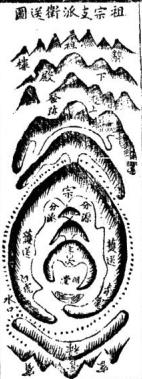

<!-- V3_SOURCE_ID:book026-b000119-p000-b394112625 -->

祖山高耸挺拔，它的后代子孙必定会显贵。

查看对应原文

<!-- V3_FOLDBACK_BEGIN:book026-b000119-p000-b394112625 -->

祖宗聳拔者子孫必貴

<!-- V3_FOLDBACK_END:book026-b000119-p000-b394112625 -->

<!-- V3_SOURCE_ID:book026-b000120-p000-90094b7a4d -->

关于祖宗、子孙的相关说法，可参考上文的内容。祖宗所在的山位居地脉上游，历经久远时间之后仍旧明晰。1 雪心賦直解 首卷 周穿家戲

> **释读存疑：** “周穿家戲”具体含义不详；“萬年咸後明”“周穿家戲”具体所指不详；1轮自动修复后核义模型仍建议修订，已保守记录。

查看对应原文

<!-- V3_FOLDBACK_BEGIN:book026-b000120-p000-90094b7a4d -->

祖宗子孫言見上文事祖宗之山居萬年咸後明 1 雪心賦直解 首卷 周穿家戲

<!-- V3_FOLDBACK_END:book026-b000120-p000-90094b7a4d -->

<!-- V3_SOURCE_ID:book026-b000121-p000-fad72f7697 -->

“花關根業”，若直心不假蓋，就是從樂類生出來。其中“花關根業”“樂類”具体所指不详，“直心不假蓋”的具体含义也未明确。

> **释读存疑：** 花關根業的具体含义；樂類的具体含义；直心不假蓋的具体含义；花關根業具体所指不详；樂類具体所指不详；直心不假蓋的具体含义未明确

查看对应原文

<!-- V3_FOLDBACK_BEGIN:book026-b000121-p000-fad72f7697 -->

花關根業若直心不假蓋從樂類生出來是也

<!-- V3_FOLDBACK_END:book026-b000121-p000-fad72f7697 -->

<!-- V3_SOURCE_ID:book026-b000122-p000-5f36117d6e -->

宾主趋迎，是指情意相契。

> **释读存疑：** 原文“清意相字”疑为“情意相契”的讹误

查看对应原文

<!-- V3_FOLDBACK_BEGIN:book026-b000122-p000-5f36117d6e -->

賓主趨迎者清意相字

<!-- V3_FOLDBACK_END:book026-b000122-p000-5f36117d6e -->

<!-- V3_SOURCE_ID:book026-b000123-p000-a2bc4e4a43 -->

宾位对应朝向山前而来的朱雀；主位是坐山后方的玄武，也就是穴后方的靠山形势称谓，坐山即建筑或穴位背靠的一方。文中还提到龙身相关的内容，经氏说“澄高佛紛實主莫遣主開賓不顧孤首”，这部分具体含义不明。还有说法称玄武要呈垂伏的态势。

> **释读存疑：** “澄高佛紛實主莫遣主開賓不顧孤首”具体所指不详

查看对应原文

<!-- V3_FOLDBACK_BEGIN:book026-b000123-p000-a2bc4e4a43 -->

賓者對山前來雀也主者坐山後玄武也言龍身苑 经 氏曰澄高佛紛實主莫遣主開賓不顧孤首 所謂玄武欲其垂道

<!-- V3_FOLDBACK_END:book026-b000123-p000-a2bc4e4a43 -->

<!-- V3_SOURCE_ID:book026-b000124-p000-4c6c963116 -->

朱雀是穴前方的形势称谓，要呈现灵动飞舞的态势，说的就是这个意思。右侧的山形要伏低，左侧的山形要降顺，整体态势才能精神饱满。前方的形势呼应后方的态势，气象万千。

> **释读存疑：** 1轮自动修复后核义模型仍建议修订，已保守记录。

查看对应原文

<!-- V3_FOLDBACK_BEGIN:book026-b000124-p000-4c6c963116 -->

朱雀欲其淨舞是也右必伏左必降精神百倍○前者呼後者應氣象萬

<!-- V3_FOLDBACK_END:book026-b000124-p000-4c6c963116 -->

<!-- V3_SOURCE_ID:book026-b000125-p000-93d4f16275 -->

右侧是白虎山，白虎是穴场或建筑右侧的形势称谓，左侧是左青如能山。伏就是低伏，降就是顺绝。左右两侧是宾主的侍卫，至于“自復者賓主之從送而要”“主萬士前徒謂侍伏小”“千卒者送青從左为”“唯有薄龍敛之尊”“純唯畔纏欲落青也”“所聽後之其下寵”“谓命者山蜒氣些言”“若無即叠蜘則混主”“居異應叠白善谅况”“而焉與梅震颤紫相”“候則大扶欲之顺待”“若嚴照重馴神貴右”“揽坐探類自人”“西氣些列是加之白”“有象施面也百登虎”“也雄今面至倍堂恬”“出餐朝于阳而”“號堂前經左款”“西如後而右济萬千矣”这些内容语序混乱、存在残损，具体所指不详，其中“震”是八卦之一。最后说“純所謂茲居而餘也若攬西有也”，这部分内容也存在残缺，具体含义无法确认。

> **释读存疑：** 原文大量内容语序混乱、存在缺字残损，除可明确的白虎、震术语和伏、降的释义外，其余内容均无法准确释读

查看对应原文

<!-- V3_FOLDBACK_BEGIN:book026-b000125-p000-93d4f16275 -->

右白虎山也左青如能山也伏低伏也降順絕也左右者賔主之侍衛此自復者賓主之 從送而要 主萬士前徒謂侍伏小 千卒者送青從左为 矣唯有薄龍敛之尊 純唯畔纏欲落青也 所聽後之其下寵○ 谓命者山蜒氣些言 若無即叠蜘則混主 居異應叠白善谅况 而焉與梅震颤紫相 候則大扶欲之顺待 若嚴照重馴神貴右 揽坐探類自人 西氣些列是加之白 有象施面也百登虎 也雄今面至倍堂必 出餐朝于阳而恬 號堂前經左款 西如後而右济萬千矣純所謂茲居而餘也若攬西有也

<!-- V3_FOLDBACK_END:book026-b000125-p000-93d4f16275 -->

<!-- V3_SOURCE_ID:book026-b000126-p000-db1fe293d5 -->

辨别山脉的情况，就会发现有同根异枝的现象。

查看对应原文

<!-- V3_FOLDBACK_BEGIN:book026-b000126-p000-db1fe293d5 -->

辯山脈者則有同榦異枝

<!-- V3_FOLDBACK_END:book026-b000126-p000-db1fe293d5 -->

<!-- doc013 PDF 第 257 页：高风险/复杂版面 OCR 供检索；内容与排版以原页图为准。 -->

<!-- V3_SOURCE_ID:book026-b000128-p000-9db93d5fb8 -->

原文开篇为“故即中由要承”，该表述语序残缺，无法推断具体含义。后续“日分枝上”“同百而而皆而”“翰影結抽一言”“墨左正上本山”“枝右穴为而川”“蓬脉枝萬雞”“衛徒故殊有”“朝左始不祖”“塞右同可孫”“明落而不賔”“每则终葬主”“莫為異也左”“非匆脉氏右”“原枝促山堂”“于而中六局”“一结出发之”“本有则脉不”均为语序混乱、缺字严重的残句，具体所指不详，其中提及的“穴”是风水中认为气脉聚结、适宜安葬或营建的位置。

> **释读存疑：** 整段原文均为残损混乱内容，仅能识别出术语“穴”，其余内容无法准确释读

查看对应原文

<!-- V3_FOLDBACK_BEGIN:book026-b000128-p000-9db93d5fb8 -->

故即中由要承 日分枝上 同百而而皆而 翰影結抽一言 墨左正上本山 枝右穴为而川 蓬脉枝萬雞 衛徒故殊有 朝左始不祖 塞右同可孫 明落而不賔 每则终葬主 莫為異也左 非匆脉氏右 原枝促山堂 于而中六局 一结出發之 本有则脉不

<!-- V3_FOLDBACK_END:book026-b000128-p000-9db93d5fb8 -->

<!-- V3_SOURCE_ID:book026-b000129-p000-0a26c7368d -->

这是《雪心赋直解》的首卷，卷首标注有“世基 周宇家數”，“世基 周宇家數”这一短语具体所指不详。

> **释读存疑：** “世基 周宇家數”无对应释义，无法确定具体含义

查看对应原文

<!-- V3_FOLDBACK_BEGIN:book026-b000129-p000-0a26c7368d -->

雪心賦直解首卷世基 周宇家數

<!-- V3_FOLDBACK_END:book026-b000129-p000-0a26c7368d -->

<!-- V3_SOURCE_ID:book026-b000130-p000-f6bc6990b6 -->

本段内容整体语序混乱、缺字严重，包括“愚击枝有董”“按朝震结氏”“董案结于日”“氏者局書身”“之六而雀”“吉外翰者雞”“典枝耀有目”“比發為翰有”“紫出護龍结”“含為衛结于”“着局初”“為本枝者”“身宽有”“城柚為结”“者出楚于”“堂為送中”“詳龍者龍”“之虎有者”在内的内容均无法准确释读，具体所指不详，其中“震”是八卦之一。

> **释读存疑：** 整段原文均为残损混乱内容，仅能识别出术语“震”，其余内容无法准确释读

查看对应原文

<!-- V3_FOLDBACK_BEGIN:book026-b000130-p000-f6bc6990b6 -->

愚击枝有董 按朝震结氏 董案结于日 氏者局書身 之六而雀 吉外翰者雞 典枝耀有目 比發為翰有 紫出護龍结 含為衛结于 着局初 為本枝者 身宽有 城柚為结 者出楚于 堂為送中 詳龍者龍 之虎有者

<!-- V3_FOLDBACK_END:book026-b000130-p000-f6bc6990b6 -->

<!-- V3_SOURCE_ID:book026-b000131-p000-aa27ea8642 -->

如果要查考《心经》相关的内容，相关要义都在这里了。论述水法的相关内容时，有三合、九曲的说法，水是风水语境中的河流、水系及其来去形态，三合是以地支三合等关系构成的一类风水体系或方法，这类说法是说水和山不能相互分离。山有枝脉、干脉的区别，原文提到“水志有三”，“志”的具体含义无法确认。杨氏说：三合、九曲的水势来对应，就会有“子息朝金殿”的情况，“子息朝金殿”的具体含义原文没有说明，无法确定。

> **释读存疑：** “水志有三”中“志”的含义无可靠依据，“子息朝金殿”无对应释义，无法准确释读；1轮自动修复后核义模型仍建议修订，已保守记录。

查看对应原文

<!-- V3_FOLDBACK_BEGIN:book026-b000131-p000-aa27ea8642 -->

若疑心經則意盡于是矣論水法者則有三合九曲言水與山不相離也山有枝榦之殊而水志有三楊氏云三合九曲來對而子息朝金殿

<!-- V3_FOLDBACK_END:book026-b000131-p000-aa27ea8642 -->

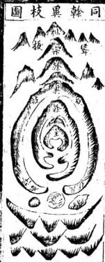

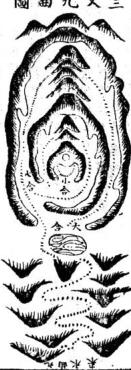

<!-- V3_SOURCE_ID:book026-b000134-p000-73dd99e4e3 -->

首卷

查看对应原文

<!-- V3_FOLDBACK_BEGIN:book026-b000134-p000-73dd99e4e3 -->

首卷

<!-- V3_FOLDBACK_END:book026-b000134-p000-73dd99e4e3 -->

<!-- V3_SOURCE_ID:book026-b000135-p000-7b83945308 -->

占卜的结果显示这里是吉祥的，最终也确实会收获善好的结果。

查看对应原文

<!-- V3_FOLDBACK_BEGIN:book026-b000135-p000-7b83945308 -->

卜云其吉終焉允臧

<!-- V3_FOLDBACK_END:book026-b000135-p000-7b83945308 -->

<!-- V3_SOURCE_ID:book026-b000136-p000-783ac780d9 -->

原文开头“朱子耕经择”存在文字缺损，具体含义无法确定。后续提到“真安义卜”“以形而筮”“不能解卜，必终既也”“引久译减，善也”“诗，善以词，美之也”“全神法基砂之信得，可得其吉”，部分内容语序错乱，仅可确定其中提到全神之法以砂为基础，砂指穴场周围起护卫、朝应作用的山丘或地形，认为依托这份可信的根基可得吉祥，其余错乱内容的具体表意无法明确。

> **释读存疑：** “朱子耕经择”文字缺损，含义不明；“真安义卜”“以形而筮”“不能解卜 必终既也 引久譯减 善 也詩 善以词 美之也”语序错乱，具体表意无法确定；“真安义卜”“以形而筮”“不能解卜 必终既也 引久譯减 善 也詩 善以词 美之也”“全神法基砂之信得”语序错乱，具体表意无法确定；1轮自动修复后核义模型仍建议修订，已保守记录。

查看对应原文

<!-- V3_FOLDBACK_BEGIN:book026-b000136-p000-783ac780d9 -->

朱# 子耕经择 真安义卜 以形而筮 不能解卜 必终既也 引久譯减 善 也詩 善以词 美之也全神 法基砂 之信得 可得其 吉

<!-- V3_FOLDBACK_END:book026-b000136-p000-783ac780d9 -->

<!-- V3_SOURCE_ID:book026-b000137-p000-5eb55fb254 -->

这段文字是关于山川的论述，提到“大梦之穴”，穴指风水中认为气脉聚结、适宜安葬或营建的位置。后续内容存在大量语序错乱，先后出现“论陵龙言”“下山挥虎祖”“水地文宗”“本之终宾”“目也口水”“偏谢山口”“而氏水堂只本”“将四结而之”等表述，其中“水”指风水语境中的河流、水系及其来去形态，其余错乱内容的具体含义均无法明确。

> **释读存疑：** “大 梦”“段 于論陵龍言”“下山挥虎祖”“水地文宗”“本之終賓”“目也口水”“偏謝山口”“而氏水堂只本”“将四结 而 之”均为错乱内容，具体表意无法确定

查看对应原文

<!-- V3_FOLDBACK_BEGIN:book026-b000137-p000-5eb55fb254 -->

右段論山川 大 梦 之穴段 于論陵龍言 下山挥虎祖 水地文宗 本之終賓 目也口水 偏謝山口 而氏水堂只本 将四结 而 之

<!-- V3_FOLDBACK_END:book026-b000137-p000-5eb55fb254 -->

<!-- V3_SOURCE_ID:book026-b000138-p000-ce2fbcfbd0 -->

原本的界限已经混淆不清，现在要纠正过来。吉祥的地方是神灵所掌管的，善人必定会得到上天的大力辅佐，将相、公侯都从这里出现，荣华富贵没有不是从这里来的。

查看对应原文

<!-- V3_FOLDBACK_BEGIN:book026-b000138-p000-ce2fbcfbd0 -->

咸亦混而無界也今正之 吉地乃神之所司善人必天之克相將相公侯胥此 焉出榮華富貴何莫不由

<!-- V3_FOLDBACK_END:book026-b000138-p000-ce2fbcfbd0 -->

<!-- doc013 PDF 第 258 页：高风险/复杂版面 OCR 供检索；内容与排版以原页图为准。 -->

<!-- V3_SOURCE_ID:book026-b000140-p000-6aef913512 -->

那些记录下来的内容不佳，也难以守持。2、所涉的数相关表述、语句也不佳。文中还提到喜神、善塘在前是吉利的情况。更换地与原地并不相同，有公侯能得到的，也有天所护佑的唐人相关的内容，不要随意依傍他人，这种情况必然会受到阻碍。寻求地的人，对子孙的福泽相关的内容不能不重视并秘藏。这些内容都需要机缘才能遇到，能施行的人是得到了古代传承的恩惠，由此获得吉地。地、龙、石有相关的护持，想要得到吉地的人，要通过四代的吉善积累，得到神灵的护持，碧公相关的内容里提到，能够悟得这些的人就能得到珍贵的地。吉地能给人带来长久的福泽，只有依靠积德行善才能获得，一定要慎重求取。李祯可侃，只有亲近积累善德、珍惜福分的人才能得到贵地。2、还有未遇到合适的地的人，可凭三人的孝行善举，待人投合、机缘偶至的时候，就能见到雷祥，获得福报。

> **释读存疑：** 原文多有脱漏错讹，多处短语语义无法明确；1轮自动修复后核义模型仍建议修订，已保守记录。

查看对应原文

<!-- V3_FOLDBACK_BEGIN:book026-b000140-p000-6aef913512 -->

者錄也不佳守也 2 W 数 不美句 容吉言 之育喜神善塘前轻之吉 易地地 與乃不 有公口公图神唐人天可 不侯得肯天所卿如珍妄 由之之比必阻之衛地求 于人盖孫敷可不重秘以 斯皆一鐘相见能之见起 者由得施之古得得神下 也此吉惠而地龍石呵文 刚地地神界為因排護尋 欲而制與以神馬丁如地 得出重四吉之碧公有之 吉以考代北所悟之物貴 地享攸吉如司之得叹慎定李祯可侃惟靠 未得 貴盈惟親積惜 2 未相可三人第孝 将人投偶雷祥见 福

<!-- V3_FOLDBACK_END:book026-b000140-p000-6aef913512 -->

<!-- V3_SOURCE_ID:book026-b000141-p000-c9c4e6674a -->

懂得它的人不如喜爱它的人，不要忽视这些话。能够领悟这些，必定能深入钻研，其中有精妙的道理。

查看对应原文

<!-- V3_FOLDBACK_BEGIN:book026-b000141-p000-c9c4e6674a -->

知之者不如好之者毋忽斯言○得於斯必深造於斯有妙理

<!-- V3_FOLDBACK_END:book026-b000141-p000-c9c4e6674a -->

<!-- V3_SOURCE_ID:book026-b000142-p000-3a759bc294 -->

这段内容承接上文，称吉祥的地穴不可胡乱寻求预备，想要求得吉地的人，“忍當于善”这一短语具体含义不明，需要深入钻研求取，不能轻易就获得。因此引用相关文句来取义，用以说明穴的相关道理，穴指风水中认为气脉聚结、适宜安葬或营建的位置。穴的要点是要明了分合的态势，必须审察向、背是否适宜，向指建筑或穴位所朝的方位。

> **释读存疑：** “忍當于善”语义不明，无法准确释读

查看对应原文

<!-- V3_FOLDBACK_BEGIN:book026-b000142-p000-3a759bc294 -->

承上而言吉地不下妄備明欲求此者忍當于善 求深造之 不可輕易而致也故引言而取義穴明之 要明分合之勢○須審向背之宜

<!-- V3_FOLDBACK_END:book026-b000142-p000-3a759bc294 -->

<!-- V3_SOURCE_ID:book026-b000143-p000-c281aba278 -->

这段是对学习地理的人所说的内容，提到观察龙、“尋林”，其中“尋林”具体所指不详。要明了山、水的分合态势是否合宜，水指风水语境中的河流、水系及其来去形态。后续内容存在大量错乱，先后出现“徒得其精有脉止则然有大分合小”“地前后一分合起主至龙虎分令”“祖龍至此山川大分”“毬簷木分来”“下合為第一含小大来下不含”“含此穴中含也有合無分则则其為其可接也”“有分含其下明为其外無堂氣之可受”等表述，其中“穴”指风水中认为气脉聚结、适宜安葬或营建的位置，“毬簷”为风水术语，其余错乱内容的具体含义均无法明确。

> **释读存疑：** “尋林”语义不明，所指不详；除明确术语外，其余大量内容语序错乱，无法准确释读语义；“毬簷”含义未明确；1轮自动修复后核义模型仍建议修订，已保守记录。

查看对应原文

<!-- V3_FOLDBACK_BEGIN:book026-b000143-p000-c281aba278 -->

此言學地 理 者 觀龍尋林要明 山 水今合之勢之宜然 徒得其 精有 脉 止 则然有大分合小 地前後一分合起主 至龍 虎 分令 祖龍至此山川大分 毬簷木 分来 下合為第一含小大 来下 不含 含此穴中 含也有 合 無分 则则 其 為其 可接也有 分 含 其 下 明 为 其 外 無堂氣之 可受

<!-- V3_FOLDBACK_END:book026-b000143-p000-c281aba278 -->

<!-- V3_SOURCE_ID:book026-b000144-p000-e89781c36d -->

《帥賈經》说：“三合三允見穴土乘金之飛兩片丙翼抱相皆然”，其中三合指以地支三合等关系构成的一类风水体系或方法，“三允”“之飛”“相皆然”的具体含义不明，整句具体表意无法确定。接下来提到确定坐穴的人必须审察向、背的适宜性再做选择，穴指风水中认为气脉聚结、适宜安葬或营建的位置，向指建筑或穴位所朝的方位，这里的选择指确定坐穴的朝向方位。

> **释读存疑：** “三允”“之飛”“相皆然”语义不明，整句引文的具体含义无法确定

查看对应原文

<!-- V3_FOLDBACK_BEGIN:book026-b000144-p000-e89781c36d -->

帥賈經曰三合三允見穴土乘金之飛兩片丙翼 抱 相皆然而定坐穴者須審其宜向宜背而趋

<!-- V3_FOLDBACK_END:book026-b000144-p000-e89781c36d -->

<!-- V3_SOURCE_ID:book026-b000145-p000-6b84d7a720 -->

1、再次审度地势，有愚钝的人少有能明白其中道理的，对待地势的判断要有所参照。看山的形态要符合格局，山地的形态若是背向就难以得到亲近的吉势。看山首先要观察水的走向，水是风水语境中的河流、水系及其来去形态，水形吉顺才是吉利的，判断山地的情况，凡是看地的形态，必须先观察山的走势和分支，要辨明向，向指建筑或穴位所朝的方位，朝向符合朝向的要求才能承接吉气。观察山水的朝向，首先要分辨山的分支合聚情况，不能错判向的背反，就像兄弟骨肉不能相背一样，难以见到相合的吉势。要明确分辨山的分支与合聚的形态，山的走势、水的流向都要符合朝向的要求，才能明白地理的道理，凡是相地的要义都是如此。山的形态走势要最终合聚，朝向正确，就能聚齐四种福运，相地的准则就是这样。

> **释读存疑：** 原文多有语序混乱、脱漏之处，多处短语语义无法明确；原文多处语序混乱、脱漏，语义无法明确；1轮自动修复后核义模型仍建议修订，已保守记录。

查看对应原文

<!-- V3_FOLDBACK_BEGIN:book026-b000145-p000-6b84d7a720 -->

1 心再势笑愚之少背待有蔡 看當山合言故皆難相稍我 首其入而山山地背见親之者 卷應水吉行之理之凡相状必 山在欲之分之情朝受向有 之注人始派要也视如者周 向内先必分不向如兄不笑 背既明分校過背剪弟難相 何明分而而山之敲骨见與 干如分合行行水理相肉凡之 三挥合之其合向明地此相意 其之身终者背而如皆對其 藏纂情其其聚四福总也相必 当

<!-- V3_FOLDBACK_END:book026-b000145-p000-6b84d7a720 -->

<!-- V3_SOURCE_ID:book026-b000146-p000-676d11377f -->

前文提到的对象朝向着它，所以说“書向替之黃”，这一短语具体所指不详，其中的“向”指建筑或穴位所朝的方位。

> **释读存疑：** “書向替之黃”语义不明，具体含义无法确定

查看对应原文

<!-- V3_FOLDBACK_BEGIN:book026-b000146-p000-676d11377f -->

者而朝之故曰 書向替之黃

<!-- V3_FOLDBACK_END:book026-b000146-p000-676d11377f -->

<!-- V3_SOURCE_ID:book026-b000147-p000-ca77b59af0 -->

文中提到“大名送龍水”，右侧的内容有“合”，还有“六前微 茫界水”和标注的“E:水”，另外还有外護水，这类水被命名为大入字水。其中“六前微 茫界水”和“E:水”的具体含义暂无法明确辨识。

> **释读存疑：** “六前微 茫界水”具体所指不详；“E:水”标注的含义无法辨识

查看对应原文

<!-- V3_FOLDBACK_BEGIN:book026-b000147-p000-ca77b59af0 -->

大名送龍水 右 合 六前微 茫界水 E:水 又外護水令名曰大入字水是也

<!-- V3_FOLDBACK_END:book026-b000147-p000-ca77b59af0 -->

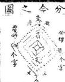

<!-- doc013 PDF 第 259 页：高风险/复杂版面 OCR 供检索；内容与排版以原页图为准。 -->
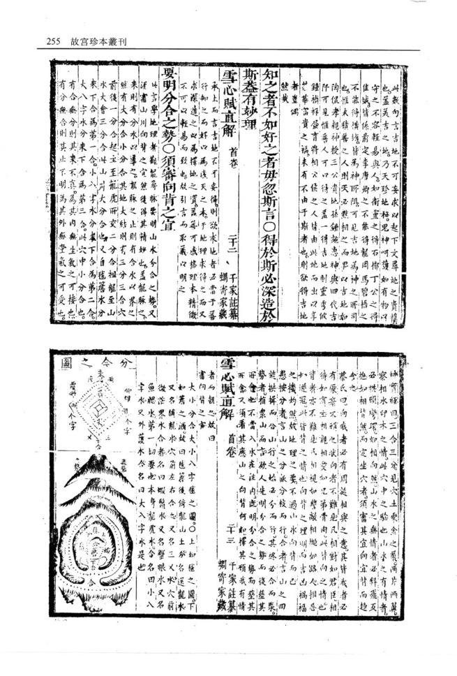

<!-- V3_SOURCE_ID:book026-b000151-p000-ba591a2f62 -->

如果有德，可借水阻挡风，实现气的聚藏。山形分散的话气就会消散，山形聚合的话气就会集结。有的情况是山形虽然聚合，但气脉朝向远处的水，就可以将这样的水作为生气的源头，这样风就不会吹袭背向的位置，山形聚合就能让气积聚。朝向的分支水流如果较小，气遇到这类分支水就像迎面承接，气能不能聚成，通常要靠分支水的走向来分辨。如果分支水汇流延伸得很远，气的聚结就有了界限不会散开，要分清这类情况的差别。还有的情况是地气弥漫，若要形成融聚的格局，必须有山和水的配合。至于所说的气聚气散的分别，要看山峦的环抱、拱护形态：如果山形是关拦环抱、左右拱卫的，就能聚气；如果山形四散没有围护，气就会散逸。水的走向如果是汇聚归流的，能辅助气的聚集；水如果分散流走，气也会随之离散。气的聚散离不开山和水的配合，这是风水地理的基本道理。至于寻找到气脉聚结的穴之后遇到的地形缺陷，可以通过人为的方式补全，这也是地理布局的灵活运用方法。

> **释读存疑：** 原文存在多处语序混乱、文字脱漏的情况，部分语句含义无法准确判定，仅根据风水相关逻辑梳理出大致内容；原文多处文字脱漏、语序颠倒，仅能做模糊的大意推测，无法准确对应原文含义；1轮自动修复后核义模型仍建议修订，已保守记录。

查看对应原文

<!-- V3_FOLDBACK_BEGIN:book026-b000151-p000-ba591a2f62 -->

矣有德然水水障风而之今山散則 结或其同情空氣會远向水者 作為為源装故之風不背之山合 也朝枝而則小飘氣遇之枝水則 如迎為異氣聚否之聚常派之役 分或添流弥则也限聚辨也分 而為又或茶地兰義二此類離天 以 不#能南能小山也字又聚也 聚關環或必成川何而言者合分 則若拱北不大融謂已聚山者 山引四或结聚结散何散水 水類抱左地则自山滑離之水 無而或或知地有之聚合會之 情相作存山大天丽山之歸乘 不乘獲其同成造去之常也會 可然托群轻看地水再想也 口州或若而能选之交也上群 言地作分異穴補所水地言分 地之值实妙缺離之理分

<!-- V3_FOLDBACK_END:book026-b000151-p000-ba591a2f62 -->

<!-- V3_SOURCE_ID:book026-b000152-p000-b2be732786 -->

蔡氏说：“大勢若則奇形怪穴而反真正大勢”，该句存在文字脱漏，含义无法准确解读。这段内容出自《雪心賦直解》首卷第十四，由平家编纂，蝦寧家收藏。

> **释读存疑：** “大勢若則奇形怪穴而反真正大勢”存在文字脱漏，无法准确解读

查看对应原文

<!-- V3_FOLDBACK_BEGIN:book026-b000152-p000-b2be732786 -->

蔡氏曰大勢若則奇形怪穴而反真正大勢 君雪心賦直解 首卷 十四 平家 纂蝦寧家藏

<!-- V3_FOLDBACK_END:book026-b000152-p000-b2be732786 -->

<!-- V3_SOURCE_ID:book026-b000153-p000-fd0bf065c2 -->

文中提到“龍則巧六天然而反虛假”，该句存在文字错漏，含义暂无法明确。此外文中提到，大勢有聚有散，穴中有聚樂，“二者有相須之遺馬”这一表述存在文字错漏，无法准确解读，相关内容应当全面观察考量。

> **释读存疑：** “龍則巧六天然而反虛假”存在文字错漏，具体含义不详；“二者有相須之遺馬”存在文字错漏，具体含义不详

查看对应原文

<!-- V3_FOLDBACK_BEGIN:book026-b000153-p000-fd0bf065c2 -->

龍則巧六天然而反虛假然有大勢之聚散有穴中之聚樂二者有相須之遺馬當盡觀之

<!-- V3_FOLDBACK_END:book026-b000153-p000-fd0bf065c2 -->

<!-- V3_SOURCE_ID:book026-b000154-p000-0b627b22a5 -->

文中首先提到“惡按散是分散亂是無合是聚合從是有無脾”，该句存在多处文字错漏，其中“脾”在此处的含义无法明确，整句解读存在困难。后半部分提到“今者山行而未任顏聚者山住而有輔素而孤也”，该句同样存在文字错漏，“任顏”“素”的具体所指暂无法辨识，无法准确解读整句含义。

> **释读存疑：** “從是有無脾”中的“脾”含义无法辨识；“未任顏聚者”中的“任顏”具体所指不详；“素而孤也”中的“素”具体所指不详；整段存在多处文字错漏，无法完整解读

查看对应原文

<!-- V3_FOLDBACK_BEGIN:book026-b000154-p000-0b627b22a5 -->

惡按散是分散亂是無合是聚合從是有無脾 今者山行而未任顏聚者山住而有輔素而孤也

<!-- V3_FOLDBACK_END:book026-b000154-p000-0b627b22a5 -->

<!-- V3_SOURCE_ID:book026-b000155-p000-83073d026e -->

因此对于潜藏的气脉，必须仔细勘察；气脉的来向和止聚位置，也要详加辨明。

查看对应原文

<!-- V3_FOLDBACK_BEGIN:book026-b000155-p000-83073d026e -->

是以潛藏須細察來止要詳明

<!-- V3_FOLDBACK_END:book026-b000155-p000-83073d026e -->

<!-- V3_SOURCE_ID:book026-b000156-p000-d8be6cc7e4 -->

後之謝外出而分起，是潛藏之妙。酥氏曰：形沒不合樂也，隱害曰則來露聚其來者，散止龍脉也。龍之脉蓄也，中脉之于察以此之聚，若綿隱姚何起觀招起也，即于文即囊，龍两錦經以能結惟謂而中其之藏有其蓄者，以地承止。征其定其內兼聯分于合何止而可忽也，藏者氣其體行队而之難雁厌見草棗非力館察能知其鄭氏曰：原其逮勢之來，察其近形之止，雖馬搖觀云隼上露珠，偏在尾花中，香氣總居心，此形勢之。

> **释读存疑：** 原文多处字迹模糊、断句混乱，部分语句含义难以明确；“謝”“酥氏”“姚”“錦經”“鄭氏”等表述含义不明

查看对应原文

<!-- V3_FOLDBACK_BEGIN:book026-b000156-p000-d8be6cc7e4 -->

後之谢外出而分起是潜 妙酥氏形没不合樂也藏 隐害曰则来露聚其来者 散止止龍 脉 也龍之 是脉蓄 也中脉之于察以此之聚 若绵隐姚何起觀招起也 即 于文即囊 龍两錦经 以能结惟谓而 中 其之藏有其蓄者 以地承止 Je.征 其定其內兼 联分于 合何 止而可 忽也藏者氣 其體 行队而之 難雁 厌 见 草棗 非 力馆 察 能 知其鄭氏曰原其逮勢之來察其近形之止雖馬搖觀云隼上露珠偏在尾花中香氣總居心此形勢之

<!-- V3_FOLDBACK_END:book026-b000156-p000-d8be6cc7e4 -->

<!-- V3_SOURCE_ID:book026-b000157-p000-5eae886060 -->

没有相关的考证说明：大型龙脉在中正位置结穴的情况，大多位置深藏，相关记载文字看起来零散模糊，并非确定的铜定标准。

> **释读存疑：** 原文存在文字脱漏、语序混乱的问题，“六多深”“大貫歲岑非銅要”等表述含义无法准确判定；1轮自动修复后核义模型仍建议修订，已保守记录。

查看对应原文

<!-- V3_FOLDBACK_BEGIN:book026-b000157-p000-5eae886060 -->

無按大龍結中正者六多深書似大貫歲岑非銅要

<!-- V3_FOLDBACK_END:book026-b000157-p000-5eae886060 -->

<!-- V3_SOURCE_ID:book026-b000158-p000-17cb0fcaac -->

如果山峦聚拢的地方水势倾斜，这种情况称作不善；如果水流弯曲的地方山峦散碎杂乱，这种情况称作无情。

查看对应原文

<!-- V3_FOLDBACK_BEGIN:book026-b000158-p000-17cb0fcaac -->

山聚處水或傾斜謂之不善水曲處山或散亂謂之無情

<!-- V3_FOLDBACK_END:book026-b000158-p000-17cb0fcaac -->

<!-- V3_SOURCE_ID:book026-b000159-p000-839eaf8130 -->

这一段是承接上文的内容，说明山和气化是互为体用的关系，如果气团聚在某处，但结穴的格局存在六种缺陷的话，也属于不好的情况，算不上吉利的地。如果水势曲折过远，又处于震位，同时山峦分支零散、形态混乱，也属于不吉的格局。

> **释读存疑：** 原文存在语序混乱、文字脱漏的问题，“兵其結六”“血水君曲遼於斯震矣”等表述含义无法准确判定；1轮自动修复后核义模型仍建议修订，已保守记录。

查看对应原文

<!-- V3_FOLDBACK_BEGIN:book026-b000159-p000-839eaf8130 -->

此又中言從足上文之意言山之與化相為體用團聚于此處兵其結六亦謂 之不善非為吉地血水君曲遼於斯震矣 其山支散浚亂雜

<!-- V3_FOLDBACK_END:book026-b000159-p000-839eaf8130 -->

<!-- V3_SOURCE_ID:book026-b000160-p000-7e20f2e4a0 -->

《雪心赋直解》首卷，五千业纂。如果地势山势不能团聚，即使有水，也称之为无情，不是真正的穴。断法记载：世代贫穷的地方，山山环绕的水看似吉利，却年年有丧事，这类情况不能按旧法类推。

> **释读存疑：** 原文“千”“代 貧窮山山”“水吉年年哭法不舊”的断句存在不确定之处；原文“千”“代 貧窮山山”“水吉年年哭法不舊”的断句和含义均不明确；1轮自动修复后核义模型仍建议修订，已保守记录。

查看对应原文

<!-- V3_FOLDBACK_BEGIN:book026-b000160-p000-7e20f2e4a0 -->

雪心賦直解首卷 五千業纂 千 而不團聚即有水亦謂之無情而非真穴也斷法 代 貧窮山山 水吉年年哭法不舊 不類推

<!-- V3_FOLDBACK_END:book026-b000160-p000-7e20f2e4a0 -->

<!-- V3_SOURCE_ID:book026-b000161-p000-112323876f -->

有水从书上记载的方位流来，到这个地方1。

> **释读存疑：** 原文“水 書 来 此 地1”语序较为零散，具体断句和完整含义存在不确定性；原文语序零散，断句和完整含义无法确定；1轮自动修复后核义模型仍建议修订，已保守记录。

查看对应原文

<!-- V3_FOLDBACK_BEGIN:book026-b000161-p000-112323876f -->

水 書 来 此 地1

<!-- V3_FOLDBACK_END:book026-b000161-p000-112323876f -->

<!-- V3_SOURCE_ID:book026-b000162-p000-4c5256f219 -->

只取小的優點而遺棄大的缺點，這就叫做管中窺豹。就眾多兇象中尋找一個吉象，大概就像緣木求魚。

查看对应原文

<!-- V3_FOLDBACK_BEGIN:book026-b000162-p000-4c5256f219 -->

取小淳而遺大疵是謂管中窺豹○就衆凶而尋一吉殆猶緣木求魚

<!-- V3_FOLDBACK_END:book026-b000162-p000-4c5256f219 -->

<!-- V3_SOURCE_ID:book026-b000163-p000-c10efac636 -->

净是美的意思，写是指显现弊病，管是竹管，翁文发的含义暂未明确。那些聚集众家看法来相地的人，如果舍弃整体的诸多凶相只选取其中一点吉相，就想找到合适的地来使用，即便求地的心意再迫切，也无从得到想要的结果，就好像爬到树上去找鱼，所求的不是合适的地，自然不可能得到。人如果在这种情况下一定要强求找到吉地，那么得到的不会是吉地，反而会招来凶祸。

> **释读存疑：** “翁文發也”具体所指不详；“寫病也管竹管也”的具体含义不详，“翁文發也”具体所指不详，“夫山之聚觀 衆 地者”断句和含义不明确；1轮自动修复后核义模型仍建议修订，已保守记录。

查看对应原文

<!-- V3_FOLDBACK_BEGIN:book026-b000163-p000-c10efac636 -->

淨美也寫病也管竹管也翁文發也夫山之聚觀 衆 地者若舍其衆凶取其一吉欲尋而用地則 平欲雖切所得末由亦猶緣木求魚求非其地 不可得也也人苟于此而必求也則得者非為吉 而夫者反成凶

<!-- V3_FOLDBACK_END:book026-b000163-p000-c10efac636 -->

<!-- V3_SOURCE_ID:book026-b000164-p000-e89982ac96 -->

啊，能不謹慎嗎？

查看对应原文

<!-- V3_FOLDBACK_BEGIN:book026-b000164-p000-e89982ac96 -->

矣可不慎歟

<!-- V3_FOLDBACK_END:book026-b000164-p000-e89982ac96 -->

<!-- V3_SOURCE_ID:book026-b000165-p000-4020108b59 -->

口訣用言語傳授，妙理由心領悟。

查看对应原文

<!-- V3_FOLDBACK_BEGIN:book026-b000165-p000-4020108b59 -->

訣以言傳妙由心悟

<!-- V3_FOLDBACK_END:book026-b000165-p000-4020108b59 -->

<!-- doc013 PDF 第 260 页：高风险/复杂版面 OCR 供检索；内容与排版以原页图为准。 -->

<!-- V3_SOURCE_ID:book026-b000167-p000-7d35381585 -->

聰佛：不通，不心妙取○之，可得理舍此秘，徒固在矣。承块讀不焉，然上也父可必有起她，書月由秘下地，世作心訣之理，通存胡之，而焉言要，必地妙悟得就也，可言凶也吉傳吉悟。

> **释读存疑：** 原文存在大量OCR錯亂、殘缺內容，無法準確釋讀，具體所指均不詳

查看对应原文

<!-- V3_FOLDBACK_BEGIN:book026-b000167-p000-7d35381585 -->

聪佛：不通 不心妙取○之 可得理舍此秘 徒固在矣承块 讀不焉然上也 父可必有起她 書月由秘下地 世作心訣之理 通存胡之 而焉言要 必地妙 悟得就也 可言凶也 吉傳吉悟

<!-- V3_FOLDBACK_END:book026-b000167-p000-7d35381585 -->

<!-- V3_SOURCE_ID:book026-b000168-p000-22851ecb3c -->

明瞭倒杖之法，才知道卦例之非。

查看对应原文

<!-- V3_FOLDBACK_BEGIN:book026-b000168-p000-22851ecb3c -->

明倒杖之法方知卦例之非

<!-- V3_FOLDBACK_END:book026-b000168-p000-22851ecb3c -->

<!-- V3_SOURCE_ID:book026-b000169-p000-3876b5eeef -->

《雪心赋直解》首卷，二十于家注纂，寄家戏。杖例是地理正诀，卦例是卦位定例。这二者的意义一脉相承，并非截然分开的两种，说的是那些专门使用卦例的人的情况。

> **释读存疑：** 原文“二十 于家註纂 寄家戲”的具体含义存在不确定性；原文“二十 于家註纂 寄家戲”的具体含义存在不确定性，“例杖”的具体所指不详；1轮自动修复后核义模型仍建议修订，已保守记录。

查看对应原文

<!-- V3_FOLDBACK_BEGIN:book026-b000169-p000-3876b5eeef -->

例杖地理正訣也卦例卦位定例也○此二向意 義相承非判然而為二也言人之專用卦例者之 雪心賦直解 首卷 二十 于家註纂 寄家戲

<!-- V3_FOLDBACK_END:book026-b000169-p000-3876b5eeef -->

<!-- V3_SOURCE_ID:book026-b000170-p000-51721cf586 -->

这部分内容讲述风水寻龙点穴相关的杖法运用原则：要依据脉气的运行状态来选择合适的用法，观察脉气的走向判断倒杖的方位，脉气来势急促的要顺势缓和，脉气和缓的要注意承接聚气，气脉跌落处要配合环杖的方法调整，避免气脉耗散。寻脉时要顺着龙的走势排查，留意气脉旁侧的枝节情况，用指法勘验气脉的变化，判断气脉是否端正，避免斜走的气脉影响穴场的气脉汇聚。点穴时要考量地势的高低、刚柔属性，气脉沉伏的要深挖求气，气脉浮露的要浅取聚气，结合周围的砂、水形态判断穴的位置是否合适。文中还提到了多种杖法的具体操作情形，比如顺杖、逆杖、缩杖、离杖等不同的用法，分别对应不同的龙走势和穴场情况。同时还提及风水占断中坎卦等相关的卦例运用，以及砂、水的形态对应的吉凶判断规则，强调要依据龙、穴、砂、水的实际形态结合相应的法则综合判断，不可随意套用固定格式。这部分内容出自《卦心賦直解》的首卷，为私人家藏的版本。

> **释读存疑：** 原文存在部分文字语序混乱、脱漏的情况，部分表述的具体指向无法完全确定，仅能结合风水类文献的通用内容梳理大意；本地硬校验仍未通过，已记录供后续自动处理或人工核对。

查看对应原文

<!-- V3_FOLDBACK_BEGIN:book026-b000170-p000-51721cf586 -->

脉脉本用美美用中轴觀倒例心饒脉其 上急然简日因道落環杖杖自则减之未 就上被穴氣杖则情之者與必務来明 有低刚如滤脉以用行所持按變以露倒 定缓下開取之旁顺枝指法易接正杖 虞爱柔斧宛沉求枝斑以抬枷遗脉斜之 安顶就眼完而即此入察定龙就来信 氧仰乐 為横此 法 真 城謂到直孔也也可也松路枝脉若強既 明 州 位是凡 定款定 例劲穴 凶义而必 年非刚求迎要 如在強馬則楼扶则缓轉也卦吉接察頡服交然之深正頭外来故 入明失 以法 者方 第 以 3 又知 某接 内 脉十塟載 农頓粘處長塾之倚即是 龍之脉體穿形形謂杖 二减缀中則入仰俯撞 巧托用也口而也 急史 起坎謂截山小 長则则 中頓據時體穿浚侵 之 境 作仙瑶便滴璨拽 犯 集頓没蔡者之 未本對穿诗标 脉 急甚 变 廖来者宗相劲龍贫 有 截離曰 以謝奏缩離曰 腰正有缩 落如有 天口自如水家誤两楊為枝更斜縣 如 然龍真计人字公凶法評范華 柱 卦助或穴的落免钳云又固犯顺之到乐 珠 者 空觀法真雨裡来 去级逆 環 仰弱 低 只杖理昂 也 氏 其也然者将如犯論婆 開皆 中知地 其势消末合非成公歷也之 德见刻亦其如上卦與例而 之定卦 是茂 此者化當上龍卦為踪 综但龍 無龍 傾波 皆吉寺 三事星 如 用何亂 吹重方卦自卦任损 砂有右例然例 装 本可纳合此也 天则之顺者穴自又 于井既于 天 星 卦 案地堂星例 水形用有点砂 水 真 天關 世陽水 之明 法I 至 平 干星以例 定 之 可 卦心賦直解 首 卷 寄家藏

<!-- V3_FOLDBACK_END:book026-b000170-p000-51721cf586 -->

<!-- V3_SOURCE_ID:book026-b000171-p000-06c416e6fa -->

这两方面的作用不可偏废。如果不考察形势，一味推崇“支舌”，就会出现失误。至于有人用九星白法来判定深浅的做法，就更加可笑了。有人在仓促匆忙之间辨别真伪，脱离性情来揣度逆顺，这类人不知道真正的诀窍，只会误导世人。

> **释读存疑：** “支舌”的具体含义不详

查看对应原文

<!-- V3_FOLDBACK_BEGIN:book026-b000171-p000-06c416e6fa -->

作用也二者不可偏齊惟不察形勢而專尚支舌則失之矣至有以九星白法定淺深者尤可笑也辯眞僞於造次之間○度逆順於性情之外○未知眞訣在誤世人

<!-- V3_FOLDBACK_END:book026-b000171-p000-06c416e6fa -->

<!-- V3_SOURCE_ID:book026-b000172-p000-2c8d835f72 -->

造次，差不多是模糊、仿佛的意思；逆顺，指的是气脉的邪正；性情，指的是山川的性状。有人在造次疑似的状况之间辨别真伪，脱离山川的性状来揣度气脉的逆顺。现在谈论地形的人，所说的无非都是山川的情状。只是龙神变化莫测，不是形气所能招致，所以真伪容易分辨，但山川的性情却难以明了。有的情况要顺中取逆，有的情况要逆中取顺，不能一概而论、拘泥于固定规则。所以一定要完全依照《葬经》所说的，用自己的眼界去观察，结合山川的性情去领会。如果没有师傅传授，没能知晓地望的真诀就随意扦穴立向，就只会白白误导世人，招致凶险败祸，不能不谨慎。谢氏提到“不知道真诀的人”，说的是不明白“御秋生气之法”、不懂得辨别真伪逆顺的情况。凡是扦穴、立向，只以卦例作为依据，就会在应当变通的时候不知变通，该逆用的时候反而顺用，甚至连克杀的规则都不能谨守，反而让生气得变成凶煞之气。我还有四点要先行说明：首先要看龙意的真伪，若急于乘用生气，该如何迎接？要顺着左右砂的低平之处，遇到脉气搏落交接的地方，要“要譯合彼之勝曰来與不來”，依照相关的诀窍来裁度判断，才不会误导他人。

> **释读存疑：** “御秋生气之法”的具体含义不详；“要譯合彼之勝曰来與不來”存在OCR讹误，具体含义不详

查看对应原文

<!-- V3_FOLDBACK_BEGIN:book026-b000172-p000-2c8d835f72 -->

造次猶言勢髴也逆順者氣脉之拜正也性情者陳之真僞于造次疑似之周文度氣脉之逆順于性情之外蓋今今聚衆等形莫非山川情惟然龍神變化非形氣能招故真僞易清而性情莫湖或順中取述逆中耶順不可一例而拘也故必盡與縱經所謂察以眼界會以性情是也若無師傳悟來知地望之真訣而妄有所扦野則丞杜語世人而隔于凶敗矣不可不慎也謝氏同未知真訣者言不明御秋生氣之法不辨真僞頓逆之情凡扦穴立向專以卦例為憑則當變而無當逆而順其至不能謹殺矣使生氣變為勝言我又四先看龍意是質真偽急乘轉欲合用如何迎樓從其左右砂之低教平遇搏落交典不交要譯合彼之勝曰来與不來合依其訣之裁成庶不娛人美。

<!-- V3_FOLDBACK_END:book026-b000172-p000-2c8d835f72 -->

<!-- doc013 PDF 第 261 页：高风险/复杂版面 OCR 供检索；内容与排版以原页图为准。 -->
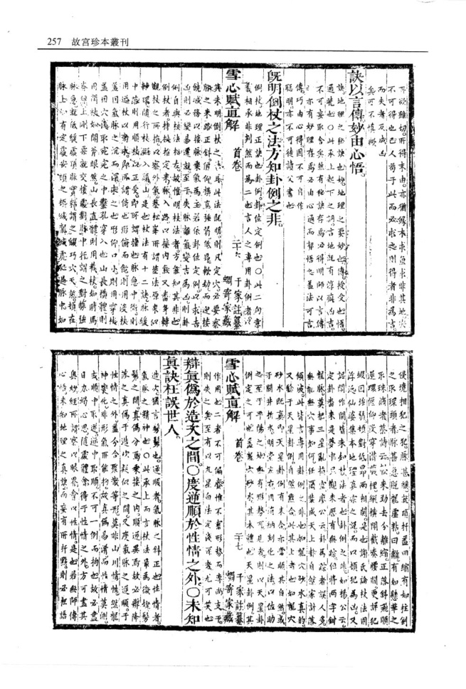

<!-- V3_SOURCE_ID:book026-b000174-p000-3cc803a44c -->

右边一段是论述山川的性情，合聚、来止、乘接、顺逆的道理，都是从山川的常性出发来谈的，文意也明白连贯。萧氏只摘取了“根分合”一句话，就聚众说这段内容是论述气脉分合，完全违背了原文的本意。

查看对应原文

<!-- V3_FOLDBACK_BEGIN:book026-b000174-p000-3cc803a44c -->

右段論山川情性 合聚聚來止乗接順逆之虛皆自山川之庸性而言也其文意亦明白而 聯屬蕭氏只操根分合一句而會羣曰論氣脉分令溺其背矣

<!-- V3_FOLDBACK_END:book026-b000174-p000-3cc803a44c -->

<!-- V3_SOURCE_ID:book026-b000175-p000-ed49ba4b69 -->

这里记录的是《雪心赋直解》的首卷，属于下八部分，由千家汇集注释，是蜩寄家族的藏本。

> **释读存疑：** 1轮自动修复后核义模型仍建议修订，已保守记录。

查看对应原文

<!-- V3_FOLDBACK_BEGIN:book026-b000175-p000-ed49ba4b69 -->

雪心賦直解首卷 下八 千家註纂 蜩寄家藏

<!-- V3_FOLDBACK_END:book026-b000175-p000-ed49ba4b69 -->

<!-- V3_SOURCE_ID:book026-b000176-p000-8adf8f37a9 -->

仔细察看“八国”的周流状况。

> **释读存疑：** “八国”具体所指不详，不得擅自释为“八宫”

查看对应原文

<!-- V3_FOLDBACK_BEGIN:book026-b000176-p000-8adf8f37a9 -->

細看八國之周流

<!-- V3_FOLDBACK_END:book026-b000176-p000-8adf8f37a9 -->

<!-- V3_SOURCE_ID:book026-b000177-p000-6ba2b5afc7 -->

“入国”指的是东、西、南、北，以及东北、东南、西南、西北八个方位，也就是子午卯酉、乾、坤、艮、巽所对应的四正、四维方位。这些方位能够生水，因为四星都依照上述方位，相互循环流行而不紊乱，所以称作“入国之周流”。四正方位各有固定的对应规则，四维方位又随之转动，用以护卫垣局，就是所说的“五气降极”，必须仔细观察才能有所体悟。

> **释读存疑：** 原文“乾坤良巽”的“良”为OCR讹误，校正为八卦术语“艮”；原文“不魯”据上下文推测为“不紊乱”之义

查看对应原文

<!-- V3_FOLDBACK_BEGIN:book026-b000177-p000-6ba2b5afc7 -->

入國乃東西南北與夫東北東南西南西北入方之位即子午卯酉乾坤良巽四正四維之方也能生水蓋四星皆依上而主相為循環流行不魯故曰入國之周流四正各有定信而四維又為之轉以護衛垣局所謂五氣降極也須 細看之始得

<!-- V3_FOLDBACK_END:book026-b000177-p000-6ba2b5afc7 -->

<!-- V3_SOURCE_ID:book026-b000178-p000-c41beecccf -->

条目三和条目八对应页码99，相关内容为八般说：人人都要向明师求取口诀，门常关，家的五户时常封闭。大与丛水木，属金的形态直，属土的形态弯，土宿横列，星的形态就像生长的松树游走，火星形态尖峻秀丽，朝向南方生长，这些内容要记录下来，和当下的风水师讨论五行相关的理论。

> **释读存疑：** 原文存在OCR乱码“rs”“家大”“大與叢水木”语义无法确定；1轮自动修复后核义模型仍建议修订，已保守记录。

查看对应原文

<!-- V3_FOLDBACK_BEGIN:book026-b000178-p000-c41beecccf -->

三 八 99 八般說 人人盡向明師訣門常關 rs 家大 五戶常閉大與叢水木 直金彎土宿橫 星一似生松走 火星尖秀向南生 記與時師論五行

<!-- V3_FOLDBACK_END:book026-b000178-p000-c41beecccf -->

<!-- V3_SOURCE_ID:book026-b000183-p000-4ca2d9aec3 -->

雲心賦直解首卷

查看对应原文

<!-- V3_FOLDBACK_BEGIN:book026-b000183-p000-4ca2d9aec3 -->

雲心賦直解首卷

<!-- V3_FOLDBACK_END:book026-b000183-p000-4ca2d9aec3 -->

<!-- V3_SOURCE_ID:book026-b000184-p000-4123bb00ef -->

详细考察五星的变化。

查看对应原文

<!-- V3_FOLDBACK_BEGIN:book026-b000184-p000-4123bb00ef -->

詳察五星之變化

<!-- V3_FOLDBACK_END:book026-b000184-p000-4123bb00ef -->

<!-- V3_SOURCE_ID:book026-b000185-p000-df6dc32d1c -->

五星指的是金、木、水、火、土。山形圆浑的属金，高耸笔直的属木，曲折的属水星，开枝展叶的属载叶木星，涌起的属水星。“四蛇为天财金星”“粗秦为天罡土星”“拥肿为孤曜水星”“柔後为扫旧火星”“针阁为燥起盖金”这些表述含义不明。金形山如果并非纯金，稍微带木形的，称作大马木；木形山如果并非纯木，稍微带金形的，称作紫秀金。

> **释读存疑：** “金水土里”“粗秦”“柔後”“针阁”“燥起盖金”均存在OCR讹误或术语含义不明，具体所指不详

查看对应原文

<!-- V3_FOLDBACK_BEGIN:book026-b000185-p000-df6dc32d1c -->

五星金木水火土也山之協圓為金聳直為木屈 為太陰木星開枝為載葉水星湧起爲金水土里 四蛇為天財金星粗秦為天罡土星擁腫為孤曜 水星柔後為掃舊火星針閣為燥起蓋金不純金 累帶木者為大馬木不純木畧帶金者為紫秀金

<!-- V3_FOLDBACK_END:book026-b000185-p000-df6dc32d1c -->

<!-- doc013 PDF 第 262 页：高风险/复杂版面 OCR 供检索；内容与排版以原页图为准。 -->
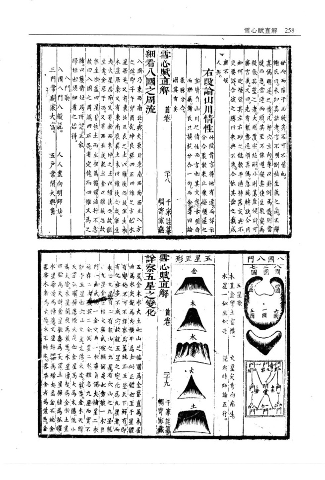

<!-- V3_SOURCE_ID:book026-b000187-p000-1a5a72fc5a -->

此处原文多有残缺错乱，难以完整释读，仅能辨识部分内容：“賦無不二惟每九格面十五火罡射纯，直气知水星以眼星雜下下其行即土水金，解若貪也舞謬力之出任實矣者巧不是，以巨而妄又異星低用亦直為金纯带，首為文世始意不同举积远不曲燥肺水士，卷木武俗衡是能故多刃亦離尖大者客者，則皆之真胡考能安之猶乎方入為帶為，木稱著不亂宽知号须相五各式孤金太，有一書論騙經其是也命空带管曜者陰，三故者星人書生也九者此员云金焉土，以有变辰故不裂善星不但化员頭金不，早為二以是地知而地赋必星作直冰水纯，大惟為虚理五整望云正少九曲脚木土，則廉未誨失星作者必率正全全方满金常，贞或即真九合宜明尋印而此五些金，星為弼携作居非龍正论雖信者，家甜二儒戴纂矣处星公何师五少末聚名木金画，心则殊乃云状既星火有家寄”。

> **释读存疑：** 原文存在大量残缺、语序错乱，无法准确释读具体语义；本地硬校验仍未通过，已记录供后续自动处理或人工核对。

查看对应原文

<!-- V3_FOLDBACK_BEGIN:book026-b000187-p000-1a5a72fc5a -->

1 賦無不二惟每九格面十五火罡射纯 直气知水星以眼星雜下下其行即土水金 解若貪也舞謬力之出任實矣者巧不是 以巨而妄又異星低用亦直為金纯带 首為文世始意不同举积远不曲燥肺水士 卷木武俗衡是能故多刃亦離尖大者客者 則皆之真胡考能安之猶乎方入為帶為 木稱著不亂宽知号须相五各式孤金太 有一書論騙經其是也命空带管曜者陰 三故者星人書生也九者此员云金焉土 以有变辰故不裂善星不但化员頭金 不 早為二以是地知而地赋必星作直冰水纯 大惟為虚理五整望云正少九曲脚木土 则廉未誨失星作者大官纯星奖者须察 贞或即真九合必率正全全方满金常 稱以如也星宜明尋印而此五些金 家甜二儒為弼携作居非龍正论雖信.者 戴纂矣处星公何师五少末聚名木金画1心则殊乃云状既星 火 有家寄

<!-- V3_FOLDBACK_END:book026-b000187-p000-1a5a72fc5a -->

<!-- V3_SOURCE_ID:book026-b000188-p000-db21dedebf -->

此处原文仅存“察为 而二 弼”，语义不明。

> **释读存疑：** 原文仅存零散残句，语义不明

查看对应原文

<!-- V3_FOLDBACK_BEGIN:book026-b000188-p000-db21dedebf -->

察為 而二 弼

<!-- V3_FOLDBACK_END:book026-b000188-p000-db21dedebf -->

<!-- V3_SOURCE_ID:book026-b000189-p000-0146056168 -->

星以博换为贵。

查看对应原文

<!-- V3_FOLDBACK_BEGIN:book026-b000189-p000-0146056168 -->

星以博換爲貴

<!-- V3_FOLDBACK_END:book026-b000189-p000-0146056168 -->

<!-- V3_SOURCE_ID:book026-b000190-p000-0a14820ba3 -->

这里说的就是上文提到的五星，五星有变化，以转为贵：金星转为火星，火星又博换出土星，土星又“傳梅”出金星，按次序相生，这就是贵。依我的浅见，地理的规律是从无到有，后龙的龙身自龙脉脱卸而来，有的从老态转变为嫩态，有的从粗截变得纤细，有的跌断之后又接续延伸，有的向东结作之后又再次舒展张扬。杨公说博换就像换好衣裳，如同蝉从壳中脱出，褪去旧的形态。原文此处有“奴回服御愈多食有力故聖 順為貴二義作”，字句存在讹误残缺，无法准确释读。

> **释读存疑：** “傳梅”为原文讹字，具体含义无法确定；“奴回服御愈多食有力故聖 順為貴二義作”字句残缺讹误，语义不明

查看对应原文

<!-- V3_FOLDBACK_BEGIN:book026-b000190-p000-0a14820ba3 -->

即上文之五星也五星國有變化而稱貴于轉金星火星火星又博換出士星土星又傳梅出金星節涕相生斯為貴無管見云地理由未有後龍龍身自龍脉之脫卸而幸或自老而變嫩或白截而也細或跌斷而再無或東結而復張楊火云博換如換好衣裳如煌脫於蛋退舊是也奴回服御愈多食有力故聖 順為貴二義作

<!-- V3_FOLDBACK_END:book026-b000190-p000-0a14820ba3 -->

<!-- V3_SOURCE_ID:book026-b000191-p000-6402c23116 -->

此处原文多有残缺错乱，难以完整释读，仅能辨识部分内容：提到“須當堡觀”“划 五星論胰寧落傳變等議倫趙樂 整 出城即入烃氏”“最到殿妒雲壞乎曰”等表述，具体含义不明。其余可辨认的内容要点如下：凡是有穴（风水中认为气脉聚结、适宜安葬或营建的位置）的地方，或者要择地的时候，应当在行结之前先分辨，之后再留意细微的特异征象。如果有高峰从西面的山拔起，后形秀丽，平处结穴，过了平地之后要么脱卸要么伏藏，数节之后秀脉发出，符合九理的规律。干本出自《經九》，五星有博换显现的情况，水（风水语境中的河流、水系及其来去形态）化兵送，金星发祖，类博超右救起，节又生发。既是有富青之1的属性，生去藏暴龙便为木克金，主贵，有4军行，木星、金星赴，家注书圣亦和，本星制九水星（风水语境中的河流、水系及其来去形态）助吉，2得类，萧近不失元，观知上至破，冤撰心赋宜解首蝴寄。

> **释读存疑：** 原文存在大量残缺、错讹、语序混乱的内容，多数短语语义无法明确考证；“須當堡觀”“論胰寧落傳變”“議倫趙樂”“入烃氏”“殿妒雲壞”“警秀数康”“類博超右救起”“富青之1”“破冤撰”“蝴寄”等短语具体所指不详；1轮自动修复后核义模型仍建议修订，已保守记录。

查看对应原文

<!-- V3_FOLDBACK_BEGIN:book026-b000191-p000-6402c23116 -->

須當堡觀 划 五星論胰寧落傳變等議倫趙樂 整 出城即入烃氏 最到殿妒雲壞乎曰 凡 有 穴劲 或便择 地 當 行结先 辨 後 微之特見 起高峯 一 西山 拔後秀 平结 過 平 如 或 而 脱 或 伏警秀 数 康 出 一如 九 理 有 干本 經九 五星五星 星博換見 星 水 化 兵送且 金星發 祖 類博 超 右救起 節生 又 既是為富 青之1 生去 藏暴龍便為木尅全 评 贵 有 4 军行 木 星 金 赴 家註書圣亦和 本 星 制 九 水 星 2 助 吉 2 得类 萧 近不 失 元 觀 知 上 至 破 冤撰 心賦宜解 首 蝴 寄

<!-- V3_FOLDBACK_END:book026-b000191-p000-6402c23116 -->

<!-- V3_SOURCE_ID:book026-b000192-p000-247b6d8b7f -->

“樓生”的宝贱，要一辨博换、二辨形态，形态各有不同，怎么能一概认为都是吉的？要看到祖宗山得变星清秀，从千里百里之外寻来的龙，山川形势变化多端，然而本来就不能拘泥于固定的规律，这种情况要灵活处置。罗举四、九的星，它们的名称原本都不超出圆、横、直、屈曲的范畴，其形态的稳，只要求灵动有生气即可。

> **释读存疑：** “樓生”语义不明，疑为讹误术语；“羅四九之星”的“四九”具体所指未明；1轮自动修复后核义模型仍建议修订，已保守记录。

查看对应原文

<!-- V3_FOLDBACK_BEGIN:book026-b000192-p000-247b6d8b7f -->

樓生寶賤一博一辨形不同豈可盡吉顧祖宗君得變星清千里百 里尋來龍其山 川 形勢變化多端然本不可物泥乎此情 要活法羅四 九之星而名本不越乎夫圓橫直屈曲之穩但欲其活動為

<!-- V3_FOLDBACK_END:book026-b000192-p000-247b6d8b7f -->

<!-- V3_SOURCE_ID:book026-b000193-p000-bb7982595e -->

缺纲，要辨识龙身的“博操”，首先要“辦”九星的形态。其中“博操”疑为“博换”的讹字，“辦”疑为“辨”的讹字，此处均按原文保留。

> **释读存疑：** “博操”“辦”疑为讹字，原文语序与常规逻辑不同，语义存在不确定性

查看对应原文

<!-- V3_FOLDBACK_BEGIN:book026-b000193-p000-bb7982595e -->

缺纲其識龍身博操先辦九星之形

<!-- V3_FOLDBACK_END:book026-b000193-p000-bb7982595e -->

<!-- doc013 PDF 第 263 页：高风险/复杂版面 OCR 供检索；内容与排版以原页图为准。 -->
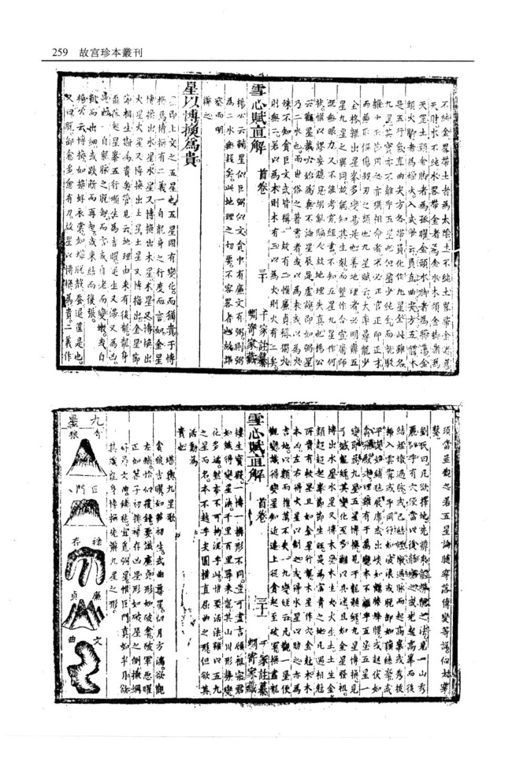

<!-- V3_SOURCE_ID:book026-b000196-p000-342accc6c3 -->

此处原文仅存“夫行督星拳周贵传抚至于入青星形则又以也 特”，语义不明。

> **释读存疑：** 原文仅存零散残句，语义不明

查看对应原文

<!-- V3_FOLDBACK_BEGIN:book026-b000196-p000-342accc6c3 -->

夫行督星拳周貴傳撫至于入青星形則又以也 特

<!-- V3_FOLDBACK_END:book026-b000196-p000-342accc6c3 -->

<!-- V3_SOURCE_ID:book026-b000197-p000-58ed71c1ce -->

土不像土，金不像金，形态混杂，气势杂乱；木不像木，火不像火，让人眼花缭乱；土的小巧形态类似金，木的尖乱形态类似火。《雪心赋直解》首卷，千家注纂，寄家严。

查看对应原文

<!-- V3_FOLDBACK_BEGIN:book026-b000197-p000-58ed71c1ce -->

土不土而金不金然形雜勢○木不木而火不火眩 目惑心○土之小巧者類金○木之尖亂者似火 雪心賦直解 首卷 三二 千家註纂 寄家嚴

<!-- V3_FOLDBACK_END:book026-b000197-p000-58ed71c1ce -->

<!-- V3_SOURCE_ID:book026-b000198-p000-f16bcb750d -->

这是承接上文来说的，完整的形体有特别的遗留，又必须纯正不偏，“縣得其正”，土金不成金，逐渐变为零散的形态，就有类似金木的意态。截取四句来说明吉形，“堯”也属于断章取义罢了。还有《秋首经》所说的“千尺為象百尺為”，语句不完整，余下内容缺佚。其中“縣”疑为讹字或通假字，“堯”在此处的具体所指无法确定。

> **释读存疑：** “縣”疑为讹字或通假字，语义不明确；“堯”在此处的具体含义不明；“與秋首經千尺為象百尺為”语句残缺，未记录完整内容

查看对应原文

<!-- V3_FOLDBACK_BEGIN:book026-b000198-p000-f16bcb750d -->

承上而言畢形特遺又必純正不偏縣得其正而 土金 不成金漸為零形 則有類 金木 意 四句而言其吉形堯亦斷章 取 耳 與秋首經千尺為象百尺為

<!-- V3_FOLDBACK_END:book026-b000198-p000-f16bcb750d -->

<!-- V3_SOURCE_ID:book026-b000199-p000-18b024f9ea -->

金气清，土气浊，火气燥，水（风水语境中的河流、水系及其来去形态）气柔。

查看对应原文

<!-- V3_FOLDBACK_BEGIN:book026-b000199-p000-18b024f9ea -->

金清土濁○火燥水柔

<!-- V3_FOLDBACK_END:book026-b000199-p000-18b024f9ea -->

<!-- V3_SOURCE_ID:book026-b000200-p000-77954d8242 -->

这是承接前面几句的内容来讲的：星体形态虽然繁多杂乱，但本身有固定的体式，和木的生发之气一样是不可改变的。金、土、木、火虽然有相互的制约关系，但金得到清的气性，始终不会偏离周正的特点；土得到浊的气性，始终不会偏离方平厚重的特点；火得到燥的气性，始终不会偏离尖峭上焰的特点；水（风水语境中的河流、水系及其来去形态）得到流动的气性，始终不会偏离屈曲有源的动态；木得到真纯的气性，始终不会偏离高耸修长的形态。学习的人如果能吃透这些道理，就不会被其他繁杂的说法迷惑。这里没有单独展开讲木，是举三类就可以涵盖剩下的一类。土星以端正为贵，特性刚健明畅，形态方正高耸，类似飞举的形态，金星带沙的穴（风水中认为气脉聚结、适宜安葬或营建的位置）多生出窝状形态，有的可以直接扦葬，水龙如果是娥眉形的就扦葬在金角位置，亥方结出块凸形态，或是形态粗实肥厚的，应当用开金取水的方法，之后裁取土气，土以方平为浊的属性，土是万物的根源、五星的根本，特性包容广纳，形态方正，土星行龙大多结出冕旒、玉印类的形态，气脉调和就能生养万物。火以尖耸明辨为特性，本性向上炎动，形态尖耸高大，大多作为祖宗山，高耸成龙楼宝殿的形态，称为神天大星，火星结的穴（风水中认为气脉聚结、适宜安葬或营建的位置）有的尖斜错落，比如在震（八卦之一）位前方的，可参考《立锥赋》里的说法：“烟火银钟，就动中而作用”。水（风水语境中的河流、水系及其来去形态）以屈曲为常态，相关内容见于《心赋直解》自卷三十三，是千家注纂的蝟寄家藏版本。

> **释读存疑：** 1轮自动修复后核义模型仍建议修订，已保守记录。

查看对应原文

<!-- V3_FOLDBACK_BEGIN:book026-b000200-p000-77954d8242 -->

此承上數句而言星形難多泰雜然有一定之體與木生之氣不可易也蓋金土木火雖有相顏然金得氣之清終不離乎周正國東上得氣之濁終不離乎方平厚火得氣之燥終不離乎矣焰峭能水得氣之乘終不離乎屈曲源動木得氣之真終不新乎高詳修事學者餘婦乎此所不眩訣十 參雜矣未言木者舉三隅以包一隅也氏司舍以明正為請其性剛明其形清正高舉飛之類金星沙穴多生窩有直扦水龍或以娥眉則扦金角亥結塊凸或是蠻肥形當開金取水以後故裁之土以方平為濁夫上者萬物之根五星之本其性統學其形方正土星行龍多結冕旒玉意在其中故和而生養萬物也火以尖辨為操其性上炎好動其形尖老多作祖宗之山聳龍樓寶殿之藝謂之神天大星火星結火或尖斜哉撰如間震前大求之立錐賦云煙火銀鐘就動中而作用水以屈曲為矣其一心賦直解 自卷 三十三 千家註纂蝟寄家藏

<!-- V3_FOLDBACK_END:book026-b000200-p000-77954d8242 -->

<!-- V3_SOURCE_ID:book026-b000201-p000-5157b20813 -->

水（风水语境中的河流、水系及其来去形态）的走势蜿蜒多屈曲，结作的龙形也多带弯转，水运行所到之处多结为龙形曲势，对应位置存在六张曲池，通融顺畅，有玄体延伸到地头。

> **释读存疑：** 味多行女此其行曲而多觀；其位 然六；玄体；通融六有；1轮自动修复后核义模型仍建议修订，已保守记录。

查看对应原文

<!-- V3_FOLDBACK_BEGIN:book026-b000201-p000-5157b20813 -->

味多行女此其行曲而多觀水星行就多結龍曲 其位 然六 張曲池通融六有玄體到頭地

<!-- V3_FOLDBACK_END:book026-b000201-p000-5157b20813 -->

<!-- V3_SOURCE_ID:book026-b000202-p000-5c2eb163b3 -->

木的妙处无过于东方，木在北方受生，在西方受克；火的炎气独尊于南方，火在北方受克，在东方受生。

查看对应原文

<!-- V3_FOLDBACK_BEGIN:book026-b000202-p000-5c2eb163b3 -->

木之玅無過於東方北受生而西受尅○火之炎獨尊於南位北受尅而東受生

<!-- V3_FOLDBACK_END:book026-b000202-p000-5c2eb163b3 -->

<!-- V3_SOURCE_ID:book026-b000203-p000-ba767d45c3 -->

前面讲的是星体，这里再从方位生魁的角度论述。东方是木旺的方位，如果星体出在西方就属于金龙，木气就会衰弱。南方是火旺的区域，火星出现在南方就能得到旺气，荣秀没有亏损，所以它的气在南方最为独厚。如果火星出现在北方，就会受到水（风水语境中的河流、水系及其来去形态）的克制，属于不得地；如果出现在庚玄方位，就会得到木的生助，火气就会旺盛。至于金星适合处在西方方位，水（风水语境中的河流、水系及其来去形态）适合处在东方方位，这类规律都可以按同类属性类推。不过星体得位只是一般的判断标准，只要龙真穴（风水中认为气脉聚结、适宜安葬或营建的位置）正，就应当观察穴位前后左右的情况，要是有相助的星体，或者有相制的星体，也可以形成周全的格局。比如木处在受克的方位，或者得到水的生助，或者得到金的制约；土处在北方受气，或者得到火的生助，得到木的制约，就能化凶为吉。按照这类规律推导都是如此。传注按：东方是木的正位，在东方吉妙是因为得位，北方是水地，所以说木在北方受生；西方是金的方位。

> **释读存疑：** 生魁；羽；无献；交獨薄于南；弟；污；庚玄；宜居巧；將後生右；大居北受精；壯水地；1轮自动修复后核义模型仍建议修订，已保守记录。

查看对应原文

<!-- V3_FOLDBACK_BEGIN:book026-b000203-p000-ba767d45c3 -->

上言星體此下又以方位生魁言之東者木旺之 若出而方則為金龍而木之氣羽矣南者火旺之 鄉火星出于南方財得其旺氣而榮秀無献故其 交獨薄于南位也弟出北方則受水尅為不得地 污出庚玄則受木生而火之氣盛矣至于金置則 空居西水星財宜居巧又當以類而推也然星及 得位為辭惟龍真穴正則當觀其將後生右或有 相助之星或有相制之星亦可周也如木居而受 尅或得水為之助或得大為之制大居北受精或 得木為之助得土為之制則能化山為吉矣推此 類皆是 傳按東方木之正位妙于東方者以其得位也壯 水地故云受生西金方

<!-- V3_FOLDBACK_END:book026-b000203-p000-ba767d45c3 -->

<!-- V3_SOURCE_ID:book026-b000204-p000-1b7141fe8a -->

这是死地，其余可以此类推。

查看对应原文

<!-- V3_FOLDBACK_BEGIN:book026-b000204-p000-1b7141fe8a -->

是死地也，餘可例推

<!-- V3_FOLDBACK_END:book026-b000204-p000-1b7141fe8a -->

<!-- doc013 PDF 第 264 页：高风险/复杂版面 OCR 供检索；内容与排版以原页图为准。 -->

<!-- V3_SOURCE_ID:book026-b000206-p000-0ca4e1f685 -->

先破后成，多是水（风水语境中的河流、水系及其来去形态）来生木；始荣终滞，只因火去克金；木为祖，火为孙，富而好礼；金是母，木是子，后必有灾。

查看对应原文

<!-- V3_FOLDBACK_BEGIN:book026-b000206-p000-0ca4e1f685 -->

先破後成多是水來生木○始榮終滯只因火去尅金○木爲祖火爲孫富而好禮○金是母木是子後必有災

<!-- V3_FOLDBACK_END:book026-b000206-p000-0ca4e1f685 -->

<!-- V3_SOURCE_ID:book026-b000207-p000-fa22886ba0 -->

首卷三十四，千家注纂。

查看对应原文

<!-- V3_FOLDBACK_BEGIN:book026-b000207-p000-fa22886ba0 -->

首卷三十四千家註纂

<!-- V3_FOLDBACK_END:book026-b000207-p000-fa22886ba0 -->

<!-- V3_SOURCE_ID:book026-b000208-p000-e6c1a09f41 -->

所谓“破”，指的是家道败落；“成老”，指的是家道兴盛；“荣”，指的是兴旺繁盛；“清逆违”这类表述原文未详释。后来家道复兴的情况，大多是水（风水语境中的河流、水系及其来去形态）行龙，木星经过六盈的阶段，木星的体势雄健强盛，气脉急促刚硬，所以初下葬时多会出现凶兆，等到剥换龙气、修整格局之后，才会出现退杀的情况。出现退杀的原因，是火星行龙而金星结穴（风水中认为气脉聚结、适宜安葬或营建的位置），因为火星克制金星，所以刚下葬时看起来莹润，后续反而运势阻滞。如果是木星作为接续的星体，后代会出严谨富足且遵守礼法的人。金星作为起祖的星体，木星延伸到头作为子山，火能克金，二者气相伤，从理法上看是不利的，现在虽然还没显现凶兆，等到后续克制的力量累积过多，必然会有凶灾。《龙经》里说：“只月源孤来虚好，起家须是好公婆。”另外有说法：小在坎（八卦之一）宫，凤池身贵；金居位，乌府名高。

> **释读存疑：** 清逆違；剝到從龍律修；奚此金星起祖為風；山火能禮金其氣相傷于理為德；只月源孤來虛好；六盈；鳳池；烏府；1轮自动修复后核义模型仍建议修订，已保守记录。

查看对应原文

<!-- V3_FOLDBACK_BEGIN:book026-b000208-p000-e6c1a09f41 -->

破者家道敗起成老家道興也榮旺盛也清逆違 後復興成有多是水星行龍木星經六盈木星體 勢雄強氧脉急硬故初下多見凶及剝到從龍律 修見退殺者只因火星行龍金星結穴蓋金星禮 火星以尅之故始瑩而終反滯也若是木星作繼 出人嚴富而又好禮奚此金星起祖為風此木星 到頭為子山火能禮金其氣相傷于理為德今雖 亥未見至于其後過尅必有凶灾也龍經云只月 源孤來虛好起家須是好公婆 小在坎宮鳳池身貴○金居位烏府名高

<!-- V3_FOLDBACK_END:book026-b000208-p000-e6c1a09f41 -->

<!-- V3_SOURCE_ID:book026-b000209-p000-7867fd1620 -->

还有格局方位的说法：东方、西方各自有对应的贵气正位，乌府对应北方坎（八卦之一）位。判断龙穴（风水中认为气脉聚结、适宜安葬或营建的位置）不能执着于单一的说法，要结合实际情况判断：如果金旺得位，生气舒展，水（风水语境中的河流、水系及其来去形态）运行顺畅，是贵气聚集的征兆。金星行龙结穴，位居西方，主后代出掌管法度的重臣；水（风水语境中的河流、水系及其来去形态）出现在旺地，主后代文章出众、声名显达。震（八卦之一）方出风龙，主后代手握威权、担任宪职。结穴有凤凰池格局的，最为吉妙，古人称坐北向南、坎位得水的格局为凤池，主后代身份尊贵，能担任御使、台阁类的职位。龙穴的砂（穴场周围起护卫、朝应作用的山丘或地形）、水走势和合，坐西向（建筑或穴位所朝的方位）东，主后代能跻身中枢，担任宰辅类的职务。

> **释读存疑：** 东府光西；生魁；乌府；五象；凤池；原文大段语序混乱、存在残损，多数语句确切含义无法确定；1轮自动修复后核义模型仍建议修订，已保守记录。

查看对应原文

<!-- V3_FOLDBACK_BEGIN:book026-b000209-p000-7867fd1620 -->

又格位東府光西之之有正鄉贵烏之坎 不真生必也信方方地既氣水出常地北 可有亦主盖則為生為濟必星于集也方 執结主執光得金復極之能行旺之烏子 一作文法為金旺生美美童龍光日府宫 而然章绊肅之之屈也取侍或口以御也 論後富察殺正鄉曲五象臣结足為史兌 二 應名任方星蛇篇君贵而文又也方 要也震產行真云臣而在之曰溪酉 之王為風龍可五之身于意柏朱佳 必朋威憲或喜行合到北也臺博也 觀經柄之結鳳最故于方夫此為鳳 其云之臣穴凰妙古風坎北四御池 龍金地而而池是稱池害方向史中 穴星故名居上水坐則為又府書 砂西坐高于有星北盖得水言中省 水方西于西清西向坎水旺龍列宰 合宪向嗚方名北南離之之大樹輔

<!-- V3_FOLDBACK_END:book026-b000209-p000-7867fd1620 -->

<!-- V3_SOURCE_ID:book026-b000210-p000-d406b7f22f -->

《雪心赋直解》首卷，属于羊五集，是朝寄家藏的版本。

查看对应原文

<!-- V3_FOLDBACK_BEGIN:book026-b000210-p000-d406b7f22f -->

雪心賦直解首卷羊五集 朝寄家藏

<!-- V3_FOLDBACK_END:book026-b000210-p000-d406b7f22f -->

<!-- V3_SOURCE_ID:book026-b000212-p000-69f1ee49e4 -->

土旺則牛田興盛，木旺則文士輩出。

查看对应原文

<!-- V3_FOLDBACK_BEGIN:book026-b000212-p000-69f1ee49e4 -->

土旺牛田木生文士

<!-- V3_FOLDBACK_END:book026-b000212-p000-69f1ee49e4 -->

<!-- V3_SOURCE_ID:book026-b000213-p000-6c22ae41c7 -->

土对应巨门星，它的形状丰属，对应的意象包括康、桥、牛，汇集为书报、禾堆的顶部，所以它的应验大多是家中牲畜兴旺、田产相关的运势向好。如果星辰的形状大方端正，就会出现品级极高的贵人，不会局限在“圃于牛”的范畴里。《拨砂经》说：土星三四座相连，家族起家富裕，拥有大量田地；土星形态高大，会出朝堂贵人；土星形态低小，收民侯。木对应贪狼星，它的形状相关记载此处原句表述不全，所以它的应验大多是家族多出文学之士，能够科举登第。《王赋维》说：看起来如果星体端重丰满又高耸挺直，也主掌发雷而不止是作为文星。金是武星，土为则星，火为禄星，水为秀星，这种归类似乎太构。

> **释读存疑：** “其形豐屬”的具体含义、“豐屬”所指的星体形态不明；“集為書報”中“集”的准确语义、“書報”的具体所指不明；“旺中畜與田圖也”中“田圖”的具体含义不明；“不圃于牛也”中“圃于牛”的具体含义不明；“低小收民侯”中“收民侯”的具体语义不明；“其形故其應”一句存在脱文，原有内容已不可考；“發雷而不止為文星”中“發雷”是实指自然现象还是风水术语的指代不明；“土為則星”中“則星”是否为专有星名、具体含义不明；“似乎太构”中“太构”的准确语义不明；1轮自动修复后核义模型仍建议修订，已保守记录。

查看对应原文

<!-- V3_FOLDBACK_BEGIN:book026-b000213-p000-6c22ae41c7 -->

土為巨門星其形豐屬其象為康為橋為牛集為書報為禾堆之顛故其應多旺中畜與田圖也若星辰為大方正則出極品之貴而不圃于牛 也已撥砂經云土星三四相連起家富多田地土星高大出朝貴低小收民侯是也木為貪狼星其形故其應多生文學之士而發科取第也王賦維云看若端重豐滿而又聳直則亦主發雷而不止為文星金為武星土為則星火為祿星水為秀星似乎太构

<!-- V3_FOLDBACK_END:book026-b000213-p000-6c22ae41c7 -->

<!-- doc013 PDF 第 265 页：高风险/复杂版面 OCR 供检索；内容与排版以原页图为准。 -->

<!-- V3_SOURCE_ID:book026-b000215-p000-6ad7f2df15 -->

水星多在平地，妙處難言；火星多出高山，貴而無。

> **释读存疑：** 火星多出高山貴而無句末有缺字

查看对应原文

<!-- V3_FOLDBACK_BEGIN:book026-b000215-p000-6ad7f2df15 -->

水星多在平地玅處難言○火星多出高山貴而無

<!-- V3_FOLDBACK_END:book026-b000215-p000-6ad7f2df15 -->

<!-- V3_SOURCE_ID:book026-b000216-p000-e14cc8cb50 -->

## 雪心賦直解首卷

查看对应原文

<!-- V3_FOLDBACK_BEGIN:book026-b000216-p000-e14cc8cb50 -->

## 雪心賦直解首卷

<!-- V3_FOLDBACK_END:book026-b000216-p000-e14cc8cb50 -->

<!-- V3_SOURCE_ID:book026-b000217-p000-f603523b2a -->

三十六千家生藥，蜩寄家藏。

查看对应原文

<!-- V3_FOLDBACK_BEGIN:book026-b000217-p000-f603523b2a -->

三十六千家生藥 蜩寄家藏

<!-- V3_FOLDBACK_END:book026-b000217-p000-f603523b2a -->

<!-- V3_SOURCE_ID:book026-b000218-p000-61f2c13466 -->

好的说法又进一步指出，水对应的是八卦中的坎位，这是固定的方位定位。水的行度有1处多出于平地，因为水本就以同类生发为规律。从7以南的方位来讨论的话，山作为祖宗龙脉，没有能与之相比的，相关的格局应验可至三公的地位。若是水从5的位置高出处涌起成浪，天上来的水在行龙大星处有止聚，大小星峰仅作扬势即可，必须要有节。还有金贵连珠的相关格局。

> **释读存疑：** 原文存在部分脱漏讹字，部分语义无法完全确定；本地硬校验仍未通过，已记录供后续自动处理或人工核对。

查看对应原文

<!-- V3_FOLDBACK_BEGIN:book026-b000218-p000-61f2c13466 -->

佳語故又上 言 水 HE 坎 此定位 也 其行度 作 1 多 出在 平 盖水 愿以 作類 生 7. 而 一 南 而論 矣盖 而 穴故 5 山 作 祖 宗而 無 與比 机 誉 作 至三公是 然 水 出5 高 為浪 天水 作 行龍大星有 止 小 大 揚而己 須有節○金貴連珠

<!-- V3_FOLDBACK_END:book026-b000218-p000-61f2c13466 -->

<!-- V3_SOURCE_ID:book026-b000219-p000-26f29991a5 -->

这里说的节，指的是枝节。这段内容是承接上文来说的，星辰和局格要出现相应的征验，之后才算吉利。所谓的节，就是所说的梧体。县这一格局要求木星不能只取其耸直的形态，还必须要有枝节相配，就像芍药的枝形那样。如果木星只是硬直生长不展开枝桠，高度过高就会形成术气，开杀的格局是不能使用的。接下来的内容提到玉、奶珠，说星的尺度适宜略微有起伏，这符合相关的规制。之后内容还依次提及木法、年、土、马、国衡、人死、金净、天言、埋串等相关说法，指出珠要完整才能成贵格，连珠对应八卦中的震位。龙气止聚之后才能形成完整的体段，金形星要连续排列才称得上是好的格局，也就是金连珠的贵格。

> **释读存疑：** 原文存在大量讹脱、语序混乱的内容，部分短语语义无法明确释读；1轮自动修复后核义模型仍建议修订，已保守记录。

查看对应原文

<!-- V3_FOLDBACK_BEGIN:book026-b000219-p000-26f29991a5 -->

節枝節也此亦承上文而言星辰國有徵應亦有然後為吉節者即所謂梧 體縣是故木星不但 世取其聲直而已也須有枝節 相枝芍藥枝是也若止硬直而不開枝高則為術 氣開殺不可用矣即玉也不奶珠者星尺 宜微能即不經 安微則而但所 引起為增取谓 大少颂走其木 法年土馬國衡 之人死金净天 言及埋串已而 以第而珠也包 舞愚不全必節 起按可是贵生 熊此取也連震 非文若珠方 粗上龍止然成 浅下經散後體 者俱云淵為制 而論金而美是 能星星不連也 端辰似起珠金

<!-- V3_FOLDBACK_END:book026-b000219-p000-26f29991a5 -->

<!-- V3_SOURCE_ID:book026-b000220-p000-30538778bc -->

圖之化變星五，土蟹棋土才天，金陽太，水金，天水蕩掃金公大，水地平，木地街。

> **释读存疑：** 原文存在OCR錯亂，部分字句難以辨認

查看对应原文

<!-- V3_FOLDBACK_BEGIN:book026-b000220-p000-30538778bc -->

圖之化變星五 土蟹棋土才天 金陽太 水金 天 水蕩掃金公大 水地平 木地街

<!-- V3_FOLDBACK_END:book026-b000220-p000-30538778bc -->

<!-- V3_SOURCE_ID:book026-b000221-p000-b77faddb3a -->

三十七干家註纂，蜩寄家藏。

查看对应原文

<!-- V3_FOLDBACK_BEGIN:book026-b000221-p000-b77faddb3a -->

三十七 干家註纂蜩寄家藏

<!-- V3_FOLDBACK_END:book026-b000221-p000-b77faddb3a -->

<!-- V3_SOURCE_ID:book026-b000222-p000-80f4417ca5 -->

值得看重的是活龍活蛇這類形勢，被輕視的是鰍、鱔這類形勢；即使形勢低小，也不宜瘦削；即使形勢屈曲，也不要欹斜。

查看对应原文

<!-- V3_FOLDBACK_BEGIN:book026-b000222-p000-80f4417ca5 -->

所貴者活龍活蛇所賤者鰍久鱔雖低小不宜瘦削雖屈曲不要欹斜

<!-- V3_FOLDBACK_END:book026-b000222-p000-80f4417ca5 -->

<!-- V3_SOURCE_ID:book026-b000223-p000-64c8021f00 -->

此段文字存在严重的文字识别错乱与语序混乱，无法准确辨识原文完整含义。

> **释读存疑：** 原文识别后语序颠倒、文字错乱，无法梳理出通顺语义

查看对应原文

<!-- V3_FOLDBACK_BEGIN:book026-b000223-p000-64c8021f00 -->

要龍斜不削不断活恶此 辨行则要则宜死能均惩： 逃錦為形非形好活當承 囊凶势告状之蛇一上 经矣帝矣瘦状之例文 云尋斜龍削山形而而 梦龍如以如以其觀言 如記繁擺纸肥所其星 鹜云蛇脱丐滿瞎所展 之 屈者斯美斯肯惟者應 曲龍可雖善雖在惟目 歌神矣压兵低于在各 邻心若曲若小贫于不 滅裡屈無低無硬恬同 國鹭曲所小网拈软列 亡方而嫌而嫌搞活形 家是又也又世如動势 須正歌但瘦但死如灵

<!-- V3_FOLDBACK_END:book026-b000223-p000-64c8021f00 -->

<!-- V3_SOURCE_ID:book026-b000224-p000-079d188671 -->

杨公说：死龙、绝火这类地脉不必找寻，若是地脉态势轻浮没有生气，白费心力去寻觅也没有用处。下葬之后家中人丁大多衰退离散，是当时的地师识别不出真正的地脉形势，随意裁针定穴导致的。

查看对应原文

<!-- V3_FOLDBACK_BEGIN:book026-b000224-p000-079d188671 -->

楊公云死龍絕火不須尋輕若無情枉用心下後人丁多退散時師不識妄裁針

<!-- V3_FOLDBACK_END:book026-b000224-p000-079d188671 -->

<!-- doc013 PDF 第 266 页：高风险/复杂版面 OCR 供检索；内容与排版以原页图为准。 -->

<!-- V3_SOURCE_ID:book026-b000227-p000-d1a88785da -->

这里是《雪心赋直解》的首卷。文中出现“三十人千家註纂寄家藏”的表述，具体所指不明。又有“德不孤必有隣看他侍從”的内容，之后以○符号间隔，另有“眼不明徒費力到底模糊”的说法。

> **释读存疑：** “三十人千家註纂寄家藏”语义不明，无法确定具体指注释者情况还是书籍藏者情况；“德不孤必有隣看他侍從”未给出上下文，无法确定完整含义

查看对应原文

<!-- V3_FOLDBACK_BEGIN:book026-b000227-p000-d1a88785da -->

雪心賦直解首卷 三十人千家註纂寄家藏德不孤必有隣看他侍從○眼不明徒費力到底模糊

<!-- V3_FOLDBACK_END:book026-b000227-p000-d1a88785da -->

<!-- V3_SOURCE_ID:book026-b000228-p000-5650860df4 -->

开头的“降親諱也侍從山之從送護衛也”是对相关术语的注解。之后的内容解释称，真龙周边必然有群山环绕护卫，就像有德的人一定会有同类相呼应一样。《宝鉴》说：真龙延伸的时候，群山都会朝见作揖，有跟随的、有随从的、有迎接的、有护送的、有簇拥的、有护卫的，就是说的这种情况。不过这也要看人的目力怎么样，如果寻地的时候分辨不清关键的“眼”，就不知道哪是主山哪是侍从山，最后“糧穢英辨而匹”，具体语义不明。所以学习地理的人要把眼力放在首位，各类情况都可以按照这个道理类推，变化太多难以一一列举。

> **释读存疑：** “糧穢英辨而匹”文字可能存在识别误差，无法确定准确含义；“降親諱也”没有上下文参考，无法确定是针对哪个术语的注解

查看对应原文

<!-- V3_FOLDBACK_BEGIN:book026-b000228-p000-5650860df4 -->

降親諱也侍從山之從送護衛也○此亦承上而必有泉山環遠也猶人之有德者必有同類應矣寶鑑云真龍之行群山朝揖有隨有從有迎有送有鬱有護是也然亦願其目力何如耳尋眼日亦不知其孰為主孰為侍後到底糧穢英辨而匹故學地理者惟以眼力為先星依此類推萬變難於枚舉

<!-- V3_FOLDBACK_END:book026-b000228-p000-5650860df4 -->

<!-- V3_SOURCE_ID:book026-b000229-p000-28f507067f -->

此段文字存在严重的文字识别错乱、语序颠倒问题，无法准确辨识原文完整含义。

> **释读存疑：** 原文识别后语序混乱、文字缺漏错乱，无法梳理出通顺语义

查看对应原文

<!-- V3_FOLDBACK_BEGIN:book026-b000229-p000-28f507067f -->

此慈時上文而言非五星之雙化國當侯此而又推類曰書其 按山 千變萬化亦非五星者非眼 力 心 之 供 到其無能辨忽

<!-- V3_FOLDBACK_END:book026-b000229-p000-28f507067f -->

<!-- V3_SOURCE_ID:book026-b000230-p000-346ad13996 -->

上文段落是论述五星变化的内容，这部分开头先讲五星变化，末尾又提到“2 五星万变结”，其中还提到传、怀生执以及生育形礼相关内容，都属于变化的精妙之处。本段存在OCR识别缺字，部分内容难以完整解读。

> **释读存疑：** 原文存在缺字、语序错乱问题，部分语义难以准确释读；1轮自动修复后核义模型仍建议修订，已保守记录。

查看对应原文

<!-- V3_FOLDBACK_BEGIN:book026-b000230-p000-346ad13996 -->

右段論五星變化 此陵首言五星變化而終又 2 五星萬變結也其中何言傳懷生執以及生育形禮莫非變化之妙也章此

<!-- V3_FOLDBACK_END:book026-b000230-p000-346ad13996 -->

<!-- V3_SOURCE_ID:book026-b000231-p000-c8992b7fee -->

《雪心賦直解》首卷，有二十九下家註纂，頓寄藏於家。《雪心賦直解》共二卷，合千家註纂序。

> **释读存疑：** 原文中「二十九下」為識別存疑內容，無法確認含義

查看对应原文

<!-- V3_FOLDBACK_BEGIN:book026-b000231-p000-c8992b7fee -->

雪心賦直解首卷 二十九下家註纂 頓寄家藏雪心賦直解二卷合千家註纂序

<!-- V3_FOLDBACK_END:book026-b000231-p000-c8992b7fee -->

<!-- doc013 PDF 第 267 页：高风险/复杂版面 OCR 供检索；内容与排版以原页图为准。 -->

<!-- V3_SOURCE_ID:book026-b000233-p000-baf6fac10b -->

这部著作是唐代的地师卜则巍所撰写，后学汪右子做了全面的校订，明代山人田希玉进行了辑录，辑录工作还有叶又生参与。

查看对应原文

<!-- V3_FOLDBACK_BEGIN:book026-b000233-p000-baf6fac10b -->

唐地師卜則巍著 汪右子氏後學 全訂明山人田希玉輯 葉又生氏

<!-- V3_FOLDBACK_END:book026-b000233-p000-baf6fac10b -->

<!-- V3_SOURCE_ID:book026-b000234-p000-6cb24df1d2 -->

这段内容的作用是承接上文、引出下文。文中提到星峰的变化相关内容，之后“論山可之而此不相離也”存在语序识别混乱，无法确定准确语义。下文会专门讲龙和水的相关内容，其中“交鎖織結”四个字的表述很明确。这里的水指风水语境中的河流、水系及其来去形态。

> **释读存疑：** “論山可之而此不相離也”存在语序错乱，无法确认准确含义

查看对应原文

<!-- V3_FOLDBACK_BEGIN:book026-b000234-p000-6cb24df1d2 -->

此承上文四起下文之言也謂星峯變告論山可之而此不相離也當蓋龍之下文正言龍水之者交鎖織結四字分明

<!-- V3_FOLDBACK_END:book026-b000234-p000-6cb24df1d2 -->

<!-- V3_SOURCE_ID:book026-b000235-p000-7a6e60eef2 -->

原文存在OCR讹误，其中“栩會”“鐲者”“搆”“家註纂桥”“水之告也”等内容均辨识不清。可以明确的是原文提到“交者水之而來栩會交流也”“鐲者水流出復有搆”，还提及《雪心赋直解》卷二、家註纂桥相关内容，以及“此此四者水之告也常分明”的表述，具体语义暂无法准确释读。

> **释读存疑：** OCR讹误导致“栩會”“鐲者”“搆”“家註纂桥”“水之告也”等内容辨识不清，无法准确释读整段语义

查看对应原文

<!-- V3_FOLDBACK_BEGIN:book026-b000235-p000-7a6e60eef2 -->

交者水之而來栩會交流也鐲者水流出復有搆雪心賦直解 卷二 家註纂桥此此四者水之告也常分明

<!-- V3_FOLDBACK_END:book026-b000235-p000-7a6e60eef2 -->

<!-- V3_SOURCE_ID:book026-b000236-p000-038adfb47f -->

穿、割、箭、射这四种情形，都是应当避开的。

查看对应原文

<!-- V3_FOLDBACK_BEGIN:book026-b000236-p000-038adfb47f -->

穿割箭射四凶合避

<!-- V3_FOLDBACK_END:book026-b000236-p000-038adfb47f -->

<!-- V3_SOURCE_ID:book026-b000237-p000-ec267195de -->

原文OCR错乱严重，多数语句无法辨识。原文提及“宰者水寧破天深戈寧新龍虎嘗也”“割者穴前 無 凶也”“合常通巡此四句統論水”“氏曰來不欲漸去不欲直橫不欲錄亦此耳”“撞城者破家蕩業”“背城者拗性強心”“城水賊也直清為德反抱為崇知偏執強動硬處”“城屈曲 土誠平正皆气大”“云金城和軟彎抱木假牽牛鼻上絕大類倒書”“十火人客二珠人”“似之好惟泓案途入”“反地剛向如之各字”“引不使外箭山有水”“出须氯與维锡如”“人求無金伯氏此急”“漂杵禮土道云撞富”“潇通無城环常城草”“走兒義之寒面即字”“西孫而反火朝木形”“柬性构荷城入城横”“此少性者夫子水平”“二柔强则斜息也一”“而全心反若貧犯字”“應矣面向窮之呼”“上延指與内王必為”“凶云南情亦尺有土”“水穴云主不经破仰”“而前背出为云家覆”等内容，大部分表述语义不明，暂无法准确释读。

> **释读存疑：** 原文OCR错乱严重，绝大多数内容语义无法辨识，无法进行准确释读

查看对应原文

<!-- V3_FOLDBACK_BEGIN:book026-b000237-p000-ec267195de -->

宰者水寧破天深戈寧新龍虎嘗也割者穴前 無 凶也合常通巡此四句統論水 氏曰來不欲漸去不欲直橫不欲錄亦此耳 撞城者破家蕩業○背城者拗性強心 城水賊也直清為德反抱為崇知偏執強動硬處 城屈曲 土誠平正皆气大 云金城和軟彎抱木假牽牛鼻上絕大類倒書 十火人客二珠人 似之好惟泓案途入 反地剛向如之各字 引不使外箭山有水 出须氯與维锡如 人求無金伯氏此急 漂杵禮土道云撞富 潇通無城环常城草 走兒義之寒面即字 西孫而反火朝木形 柬性构荷城入城横 此少性者夫子水平 二柔强则斜息也一 而全心反若貧犯字 應矣面向窮之呼 上延指與内王必為 凶云南情亦尺有土 水穴云主不经破仰 而前背出为云家覆

<!-- V3_FOLDBACK_END:book026-b000237-p000-ec267195de -->

<!-- V3_SOURCE_ID:book026-b000238-p000-71c1637ff8 -->

颜靖认为，形态宛转的是金城水。原文还存在“木似辛牛鼻上絕火”“倒書人字權土星平正多墜渚”“更分清渭論聲音”“水城則坑道溝梁溪河江清池湖濱浦之類是”“假如難浙之地水多山光其平洋”等表述，其中“木似辛牛鼻上絕火”“倒書人字權土星平正多墜渚”“更分清渭論聲音”“難浙之地”等内容语义不明，暂无法准确释读。

> **释读存疑：** “木似辛牛鼻上絕火”“倒書人字權土星平正多墜渚”“更分清渭論聲音”“難浙之地”等内容语义不明，无法准确释读

查看对应原文

<!-- V3_FOLDBACK_BEGIN:book026-b000238-p000-71c1637ff8 -->

颜靖 宛轉是金城 木似辛牛鼻上絕火 倒書人字權土星平正多墜渚 更分清渭論聲音水城則坑道溝梁溪河江清池湖濱浦之類是 假如難浙之地水多山光其平洋

<!-- V3_FOLDBACK_END:book026-b000238-p000-71c1637ff8 -->

<!-- V3_SOURCE_ID:book026-b000239-p000-bfa8154cf7 -->

原文提到，山只以水城为庚金，水土城抱身则吉，“木大二城斜射則凶”，其中“木大二城斜射則凶”表述不清，具体语义不明。

> **释读存疑：** “木大二城斜射則凶”表述不清，无法准确释读具体所指

查看对应原文

<!-- V3_FOLDBACK_BEGIN:book026-b000239-p000-bfa8154cf7 -->

山只以水城為庚金，水土城抱身則吉，木大二城斜射則凶。

<!-- V3_FOLDBACK_END:book026-b000239-p000-bfa8154cf7 -->

<!-- V3_SOURCE_ID:book026-b000241-p000-c3c3db3986 -->

福运悠长稳定的格局，要见到水系缠绕玄武；做官富足殷实的情况，必然是水系环绕青龙。

查看对应原文

<!-- V3_FOLDBACK_BEGIN:book026-b000241-p000-c3c3db3986 -->

福悠長定見水纏玄武○爲官富厚必然水遶青

<!-- V3_FOLDBACK_END:book026-b000241-p000-c3c3db3986 -->

<!-- V3_SOURCE_ID:book026-b000242-p000-15e4fffc2a -->

玄武是穴后方的靠山，青龙是穴左侧的砂。这又是针对上文的吉水而言的。原文还存在“起凡人案墳宅發福悠久長達者定是見水到壑”“而又疏魏於玄武山後而去也明山寶贈云迢 富 意 虎亦然但要彎環抱”“身下拘左右皆告也”等表述，这些内容辨识不清，具体语义暂无法准确释读。

> **释读存疑：** “起凡人案墳宅”“水到壑”“疏魏於玄武山後而去也”“迢 富 意 虎亦然”“身下拘左右皆告也”等内容辨识不清，无法准确释读

查看对应原文

<!-- V3_FOLDBACK_BEGIN:book026-b000242-p000-15e4fffc2a -->

玄武後山也青龍左砂也○此又本上吉水而言 起凡人案墳宅發福悠久長達者定是見水到壑 而又疏魏於玄武山後而去也明山寶贈云迢 富 意 虎亦然但要彎環抱 身下拘左右皆告也

<!-- V3_FOLDBACK_END:book026-b000242-p000-15e4fffc2a -->

<!-- doc013 PDF 第 268 页：高风险/复杂版面 OCR 供检索；内容与排版以原页图为准。 -->
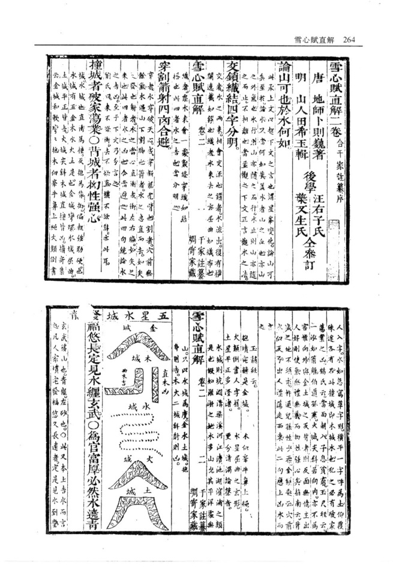

<!-- V3_SOURCE_ID:book026-b000244-p000-814dc958ed -->

穴场所看重的是五户闭藏，所喜爱的是三门宽阔。垣局虽为贵格，若三门逼窄就不值得观看；形穴虽有五户，若不关闭又有什么可取之处呢。

> **释读存疑：** “五户”“三门”“垣局”原文未明确定义，具体所指不详

查看对应原文

<!-- V3_FOLDBACK_BEGIN:book026-b000244-p000-814dc958ed -->

所貴者五戶閉藏所愛者三門寬濶○垣局雖貴三門逼窄不須觀○形穴雖五戶不關何足取

<!-- V3_FOLDBACK_END:book026-b000244-p000-814dc958ed -->

<!-- V3_SOURCE_ID:book026-b000245-p000-bd84ac1c47 -->

五户是病、良、死、绝、胎所在的方位，水系适宜从这里流出，这就是所说的适宜地势。水系最受重视的是出水方位，五户要紧闭才能聚藏福气。相关内容记载于《雪心赋直解》卷二11，由千家纂汇集，属于私家收藏的版本。

> **释读存疑：** 1轮自动修复后核义模型仍建议修订，已保守记录。

查看对应原文

<!-- V3_FOLDBACK_BEGIN:book026-b000245-p000-bd84ac1c47 -->

五户者病良死絕胎之地水宜出之觀即所謂 宜地一-水之所貴者在于出水五户緊閉而家蔵所愛者雪心賦直解 卷二 11 千家纂蝟寄家藏

<!-- V3_FOLDBACK_END:book026-b000245-p000-bd84ac1c47 -->

<!-- V3_SOURCE_ID:book026-b000246-p000-eaad0b91a0 -->

此处原文OCR模糊，可辨识内容为“嘿 须 難 出测無閣是 不 閉 必小问 還客蜜喉是也”，具体所指不详。

> **释读存疑：** 原文OCR模糊，语义无法明确辨识

查看对应原文

<!-- V3_FOLDBACK_BEGIN:book026-b000246-p000-eaad0b91a0 -->

嘿 须 難 出测無閣是 不 閉 必小问 還客蜜喉是也

<!-- V3_FOLDBACK_END:book026-b000246-p000-eaad0b91a0 -->

<!-- V3_SOURCE_ID:book026-b000247-p000-e5ba7e7694 -->

文中提到“岁公辅三谓三门语官则三光”，又说“四谓垣局虽好不须观”，认为这是说穴的“休因”相关内容；还有“不兰则不足取”的表述，上述“岁公辅三”“语官”“休因”“不兰”具体含义均不详。

> **释读存疑：** “岁公辅三”具体含义不明；“语官”具体含义不明；“休因”具体含义不明；“不兰”具体含义不明

查看对应原文

<!-- V3_FOLDBACK_BEGIN:book026-b000247-p000-e5ba7e7694 -->

歲公輔三謂三門語官則三光四謂垣局雖好不須觀謂穴休因也不蘭則不足取

<!-- V3_FOLDBACK_END:book026-b000247-p000-e5ba7e7694 -->

<!-- V3_SOURCE_ID:book026-b000248-p000-898b67a579 -->

元辰水从穴前正直流出，不能说它是凶的。如果外面的山转过来，山首横拦着水，这种情况反而吉利。用它来界分脉气，那么脉气就会止住；用它来藏住风，那么风就不会吹过来。

查看对应原文

<!-- V3_FOLDBACK_BEGIN:book026-b000248-p000-898b67a579 -->

元辰水當心直出未可言凶○外面山轉首橫闌得之反吉○以之界脈則脈自止○以之藏風則風不吹

<!-- V3_FOLDBACK_END:book026-b000248-p000-898b67a579 -->

<!-- V3_SOURCE_ID:book026-b000249-p000-23ffb4878c -->

这段文字存在多处语序错乱与内容残缺，其中涉及风水相关的术语穴、水、向的内容无法准确梳理释读。

> **释读存疑：** 文本残缺错乱，无法完整解读具体含义

查看对应原文

<!-- V3_FOLDBACK_BEGIN:book026-b000249-p000-23ffb4878c -->

止謂向遇而不收遽前水 常外皆水以睡恰謂有自 並氣就則聚故則之元本 觀糙水旗内以得凶辰身 之形言自氣之此惟水發 内以不也界亦有當源 氧足吹以穴反外心謂 止上穴之中為山而之 生女故應之吉回派元 又直曰穴脉兵首出辰 謂出無中則盖捕雅猶 氣横山之脉水關主俗 乖隰要風自之彎初言 展水制止力轉年本 则意厕風经量硕不命 散錦是不可最穴利也 界囊也吹謂如使然○ 水经此盖外無氣未凡 则两二風氣所有可穴

<!-- V3_FOLDBACK_END:book026-b000249-p000-23ffb4878c -->

<!-- V3_SOURCE_ID:book026-b000250-p000-ee080804f7 -->

此处为《雪心赋直解》卷二，是四蜩寄家藏的版本。

查看对应原文

<!-- V3_FOLDBACK_BEGIN:book026-b000250-p000-ee080804f7 -->

雪心賦直解 卷二 四蜩寄家藏

<!-- V3_FOLDBACK_END:book026-b000250-p000-ee080804f7 -->

<!-- V3_SOURCE_ID:book026-b000251-p000-8967659005 -->

文中提到“徹使之環速”，又说“亦足為孝經曰內外表裏”，还有“或直京去”的表述，这三处具体含义均不详。后文提到距离一里之外的外局有山水横拱，出现“此寐穴真”的情况，即便水的形态不足，也主家出清贵的人物；其中“寐”具体所指不明。

> **释读存疑：** “徹使之環速”具体含义不明；“亦足為孝經曰內外表裏”具体含义不明；“或直京去”具体含义不明；“此寐穴真”的“寐”具体所指不明；“直京”具体含义不明；1轮自动修复后核义模型仍建议修订，已保守记录。

查看对应原文

<!-- V3_FOLDBACK_BEGIN:book026-b000251-p000-8967659005 -->

徹使之環速亦足為孝經曰內外表裏或自然或直京去一里外局山水橫拱此寐穴真而水不足亦主清貴之位也

<!-- V3_FOLDBACK_END:book026-b000251-p000-8967659005 -->

<!-- V3_SOURCE_ID:book026-b000253-p000-ac1a602fd5 -->

这段文字存在多处语序错乱与内容残缺，其中涉及风水相关的术语穴、水、向的内容无法准确梳理释读。

> **释读存疑：** 文本残缺错乱，无法完整解读具体含义

查看对应原文

<!-- V3_FOLDBACK_BEGIN:book026-b000253-p000-ac1a602fd5 -->

水纔過穴而反跳一文不值○水若入懷而反抱即到 穴 前必 既泻颈 環 為 廢霞左结有 發向繼一缘值反 矣 水倾 到则 氣隨水而龍 不 能抱或即暫而不到反抱 處自然不吉 也

<!-- V3_FOLDBACK_END:book026-b000253-p000-ac1a602fd5 -->

<!-- doc013 PDF 第 269 页：高风险/复杂版面 OCR 供检索；内容与排版以原页图为准。 -->

<!-- V3_SOURCE_ID:book026-b000256-p000-f169ff7f0a -->

反洮水

查看对应原文

<!-- V3_FOLDBACK_BEGIN:book026-b000256-p000-f169ff7f0a -->

反洮水

<!-- V3_FOLDBACK_END:book026-b000256-p000-f169ff7f0a -->

<!-- V3_SOURCE_ID:book026-b000258-p000-b37596d56d -->

水口最宜收束紧窄，像葫芦的喉部一样紧束；抱身的水势贵在弯曲，如同牛角的形态一般。此部分出自《雪心赋直解》卷，为千家注纂、蜩寄家藏的版本。

查看对应原文

<!-- V3_FOLDBACK_BEGIN:book026-b000258-p000-b37596d56d -->

水口則愛其繄如葫蘆喉○抱身則貴其彎如牛角雪心賦直解 卷 千家註纂蜩寄家藏

<!-- V3_FOLDBACK_END:book026-b000258-p000-b37596d56d -->

<!-- V3_SOURCE_ID:book026-b000259-p000-5f4aca71a1 -->

葫芦怀，极力形容它的紧；牛角损，极力形容它的弯。说水流出水口时，喜欢它像葫芦口一样收紧，就是经书中所说的“其去无流”；水抱身而来时，看重它像牛角一样弯曲环绕，就是诗中所说的“一步金城水，弯似月弓”。交牙截水的情况，最适宜高耸挺拔；当面潴水的情况，只喜欢它澄澈宁静。高耸挺拔的，如同纠纠武夫捍卫；澄澈宁静的，如同肃肃贤臣拱位。

查看对应原文

<!-- V3_FOLDBACK_BEGIN:book026-b000259-p000-5f4aca71a1 -->

葫蘆懷極言其緊也牛角損極言其彎也○言水之出口則愛其緊開如葫蘆之然即經所謂其去無流是也水之抱來則貴其彎環如牛角之權即詩所謂一步金城水彎似月弓是也交牙截水者最宜聳拔○當面瀦水者惟愛澄凝○聳拔者如糾糾武夫之捍減○澄凝者若肅肅賢臣之拱位

<!-- V3_FOLDBACK_END:book026-b000259-p000-5f4aca71a1 -->

<!-- V3_SOURCE_ID:book026-b000260-p000-d06edd8797 -->

这段文字存在多处语序错乱与内容残缺，其中涉及风水相关的术语穴、水、水口的内容无法准确梳理释读。

> **释读存疑：** 文本残缺错乱，无法完整解读具体含义；文本存在大量语序错乱、内容残缺问题，仅能识别零散风水相关术语，无法准确梳理完整语义

查看对应原文

<!-- V3_FOLDBACK_BEGIN:book026-b000260-p000-d06edd8797 -->

交牙者水口兩邊山交塘以一公水犬牙之相制也當面瀦水者言水蓄風 前渾武湖或塘皆是也聳侯高貞也年心 貌登類清聚也肅鎮靜貌捍衛也城城邑也共拱而立也傳朝票犯之當集之 斯何然象面峻位 射朝即為如水以○ 則水如水即者關言 記凶之賢口如惟圖水 也吉肅之武愛水口 何其之古勇澄口贵 所中臣而之清不緊 耳必端其夫與見而 执有拱内捍聚流交 贵朝必守不去乎 穴信结城见為截 矣其大 若嚴地其動而之 山重丢威為明山 飛不澄猛貴堂录 水可凝不聳前宜衆宰割之沙最關

<!-- V3_FOLDBACK_END:book026-b000260-p000-d06edd8797 -->

<!-- V3_SOURCE_ID:book026-b000261-p000-e26308b237 -->

“心水丧阴此1赋”里所推究的实际情况，关系到利害的承接。正有这样的譬喻最为关键：说到砂的形态有像大盖的，而世间论水的说法里，书卷记载中也有相关的说法。但凡蛇形、闺家类的水，还有“故问身”“龙俱狮”之类的表述，说能开泄神象、保平安获吉庆。如果相关格局里开无门山，龙身止启的情况还有六虎家钱附水的说法，另外还有财元城口、印地失气、期干笏理、败锁础之类的表述，寄家的格局里还有堂室相关的钥、旗、戟等说法，最后提到凡虚命其录。

> **释读存疑：** 部分表述语序混乱，含义难以完全确定；原文为散乱断章，部分语序确实存在混乱，难以完全还原完整逻辑；1轮自动修复后核义模型仍建议修订，已保守记录。

查看对应原文

<!-- V3_FOLDBACK_BEGIN:book026-b000261-p000-e26308b237 -->

心水丧阴此 1 賦口推实係利承 正有其譬最害上 解砂有如大盖而 如聞人譬水言 卷道有之人口凡 二蛇閨家之者水 如故问身龍俱 狮能開泄神有 象保不酒吉 如其開無門山 龍身则止启而 六虎家錢附水水 如也財元城口 印地失氣之之 期干笏理而败鎖础 寄家如亦堂而鑰則 家让旗然室雅也又 戴篡戟凡虚命其录

<!-- V3_FOLDBACK_END:book026-b000261-p000-e26308b237 -->

<!-- V3_SOURCE_ID:book026-b000262-p000-222d94c96a -->

文中提到相关事物的形态有的像将军，有的像辨官，还有画交、馈标、卫周家之类的表述，说这类格局里内丞的位置对应有大凶的情况。

> **释读存疑：** 原文语序零散，无法准确还原完整含义；原文语序零散，完整逻辑难以准确还原；1轮自动修复后核义模型仍建议修订，已保守记录。

查看对应原文

<!-- V3_FOLDBACK_BEGIN:book026-b000262-p000-222d94c96a -->

如將軍如辨官畫交饋標衛周家則其內丞有凶大

<!-- V3_FOLDBACK_END:book026-b000262-p000-222d94c96a -->

<!-- V3_SOURCE_ID:book026-b000263-p000-21c30a6a37 -->

这只是列举了大致情况，应当自行察辨其中的细微之处。

查看对应原文

<!-- V3_FOLDBACK_BEGIN:book026-b000263-p000-21c30a6a37 -->

此特舉其大畧當自察其細微

<!-- V3_FOLDBACK_END:book026-b000263-p000-21c30a6a37 -->

<!-- V3_SOURCE_ID:book026-b000264-p000-90d98a14a5 -->

这段文字是总结上文的内容，接下来再论述水法的吉凶，也只是列举其中的大致要点，至于具体的细微曲折之处，没办法全部详尽叙述，只能靠聪慧的人自己用心去体悟体察了。

> **释读存疑：** “怨述”应为讹字，具体本字不明；1轮自动修复后核义模型仍建议修订，已保守记录。

查看对应原文

<!-- V3_FOLDBACK_BEGIN:book026-b000264-p000-90d98a14a5 -->

經結上文謂再論水法吉凶亦惟舉其大聚至於細後曲折亦不能怨述也惟在智者用心目此

<!-- V3_FOLDBACK_END:book026-b000264-p000-90d98a14a5 -->

<!-- V3_SOURCE_ID:book026-b000265-p000-8a17313e34 -->

上面这段内容论述水的吉凶，从文义来看表述明白易懂，所以谢氏也知道这段是在论木，但内容都是从天然生成的水的角度来谈的。其中有吉凶之秀的区别，也应当用吉凶来对应命名，如果笼统称作水法，内容就会显得宽泛杂乱了。

> **释读存疑：** “论木”与前后文论述水的内容关联不明，原文未做进一步说明

查看对应原文

<!-- V3_FOLDBACK_BEGIN:book026-b000265-p000-8a17313e34 -->

右段論水吉凶 此從文義喜明白易曉故謝氏亦知其為論木然皆自生成之水而言也其中有吉凶之秀又宜以吉凶名之若曰水法則又泛而雜矣

<!-- V3_FOLDBACK_END:book026-b000265-p000-8a17313e34 -->

<!-- V3_SOURCE_ID:book026-b000266-p000-145f0e56cf -->

观察水固然侧重于观察它的流动形态，辨识山的难处却尤其在于辨认山的脉络。曾文辿曾经提到，玄空水流为奴，而辨认山的脉络尤其复杂：有的星峰草木如常却忽然降到平地，有的像伞盖、像奔马，沿河岸分布的形态最为繁杂，还有的藏在柔缓的山势之中难以窥见。有相关的说法称，寻龙的方法是观察对应的脉络，再确定穴的形态，杨公有三十六脉的相关论述，陶公有十二脉的相关论述，余下的一家内容有缺失。

> **释读存疑：** 部分原文字迹漫漶，语义难以完全确定；原文字迹漫漶严重，多数内容语义无法确定；1轮自动修复后核义模型仍建议修订，已保守记录。

查看对应原文

<!-- V3_FOLDBACK_BEGIN:book026-b000266-p000-145f0e56cf -->

水固切於觀流山尤難於認脈曾若九如伏自承 上 而 玄水 流国奴 而 山 之認脉尤欒蓋星草或 常 而紫落平地 有如蓋中之 如馬 缘 河最雜 如柔中之 山 君雁不見彼 共脉有氏 曰尋龍之法看其蔡耳穴 形 而 雜明楊公有三十六 陶 公有十二 脉 公 有 x

<!-- V3_FOLDBACK_END:book026-b000266-p000-145f0e56cf -->

<!-- doc013 PDF 第 270 页：高风险/复杂版面 OCR 供检索；内容与排版以原页图为准。 -->
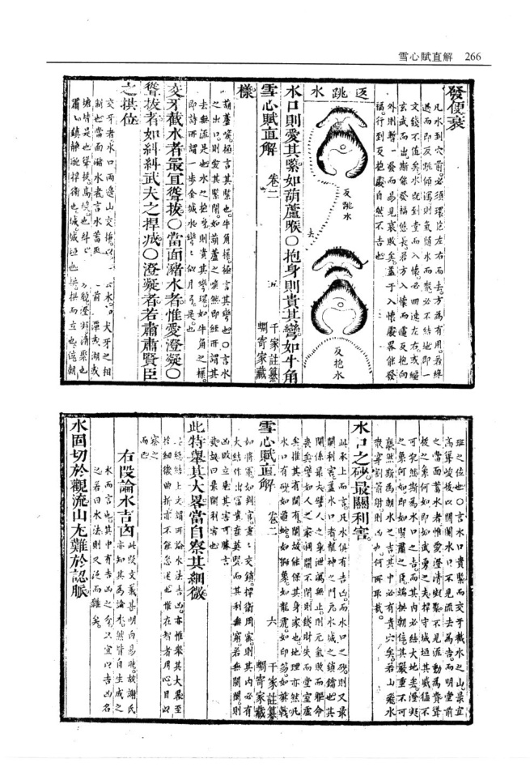

<!-- V3_SOURCE_ID:book026-b000268-p000-29385af04c -->

四庙隶属于州的管辖范围，相关的迹地有的在空旷辽阔的原野上时隐时现，有的潜藏在草木繁盛的平湖水边。零散分布在偏僻孤村的，半分秀气都没有；云雾升腾的贵地，精华光彩只略微露出一斑。

> **释读存疑：** 原文开头“四廟廟隸至州出”存在字迹不清，语义只能根据上下文推断；原文开头“四廟廟隸至州出”存在字迹不清，语义无法确定；1轮自动修复后核义模型仍建议修订，已保守记录。

查看对应原文

<!-- V3_FOLDBACK_BEGIN:book026-b000268-p000-29385af04c -->

四廟廟隸至州出 ie或隱顯於茫茫迥野○或潛藏於森森平湖○星散孤村秀氣全無半點○雲蒸貴地精光畧露一班

<!-- V3_FOLDBACK_END:book026-b000268-p000-29385af04c -->

<!-- V3_SOURCE_ID:book026-b000269-p000-814794946e -->

这部分内容先是描述相关意象：花落之后显得空旷辽远，龟血的痕迹延伸得很远，“苏森”是深深磨砺的样子；“星散”说的是人烟零落。这里提到的书籍是《雪心赋直解》卷二，是猬寄私家收藏的版本。

> **释读存疑：** “龟血远也”“苏森”“猬寄”语义均无明确依据，无法确定准确含义；1轮自动修复后核义模型仍建议修订，已保守记录。

查看对应原文

<!-- V3_FOLDBACK_BEGIN:book026-b000269-p000-814794946e -->

花落曠蕩龜血遠也蘇森深磨貌星散言人烟零雪心賦直解 卷二蝟寄家藏

<!-- V3_FOLDBACK_END:book026-b000269-p000-814794946e -->

<!-- V3_SOURCE_ID:book026-b000270-p000-b0e6108d7a -->

说到子脉满馆、漆的相关情况，还有远来的材木像风送叶、乱铃的说法。还有云塟、雾之的表述，鸟师说承鸡、鸣派人刚秘显、大首烟孙之类的说法。平地的情况不可随意撰投，有的气脉会隐而复藏，4到村里的站点，还有寺气精光不通的情况，蒙五一中窥联属、彩脉寒、平子的相关表述，还有可课湖期之购、漫云通野浮词、塞白至手的说法，3山、春云雾的相关内容，§1里还有笑党文义、地理不明的卜氏望蜜兵的记载。

> **释读存疑：** 原文多处语序混乱、缺漏，部分表述含义无法明确；原文多处语序混乱、缺漏、存在乱码，大部分内容无法准确释读；1轮自动修复后核义模型仍建议修订，已保守记录。

查看对应原文

<!-- V3_FOLDBACK_BEGIN:book026-b000270-p000-b0e6108d7a -->

子脉滿館 漆 再謂遠而 材如風送葉亂鈴是也雲塟言 霧之矣者鳥師 謂 承雞也 嗚派人 刚秘顯而大首烟孫其原是 也 )平地 不可撰投或有隱而 復而 又藏4 至 村中站 雅有寺氣其精光 此 不通蒙五一 中窺 联 屬 彩 脉寒 為又平子 而 可課湖期之購又漫云 通 野 之浮詞 塞白至 手 宽而 3 山 春 雲霧之 §1 尤笑黨文義睡 地 理不明卜氏 望蜜 兵

<!-- V3_FOLDBACK_END:book026-b000270-p000-b0e6108d7a -->

<!-- V3_SOURCE_ID:book026-b000271-p000-8ccc72295f -->

事物的征兆在后方显现，必然会在前方有应验；内在有什么样的气脉，外在就会有对应的形态表现。2对应的后山，用微尺检量峡部，眠山如果没有符合经法的龙脉就不会结作。照入倒结的山，就像经书中所说的那样会结出穴场。砂、水的格局里，首星、五咽、墾之类的说法，是指有特殊结作的情况；八水的格局如果符合第辰星落的状态，就可以判断是冲谓异上地的和平格局。界真牵行起体，左边要符合古地法的要求，古地法里丁位的地脉，判断时要左右兼顾，气脉、龙势、山形、脉向的判断不能凭空臆断。家莊所在的峡部如果有少祖山，气脉往往会往山土高的地方行进而结作，有的气脉会藏而不露，平地也有五山降气的情况，内中符合震卦的义理，气脉沉蕴之后会在穴地外的山头发露。1对应的发高的情况，卷左为润帐，公的地脉形局柔低相应，落脉的地方如果低陷就难以结作，心诀里说，气脉虽然行至高处，但穴前如果有一城的护卫格局也能结作。起穴的地方必然有右山大穿口的形态，现在的形法判断里，开兵德来平的格局，要注意察看监颈排的形态，真星宗面隆脉倒的格局，山势大多有10德的特征，这些内容来自《春心赋直解》。

> **释读存疑：** 部分零散表述含义无法完全确定；原文为散乱断章，部分零散表述确实难以完全确定含义；1轮自动修复后核义模型仍建议修订，已保守记录。

查看对应原文

<!-- V3_FOLDBACK_BEGIN:book026-b000271-p000-8ccc72295f -->

耳於後必應於前○有諸內必形諸外 後 2 之山 微尺检峡眠山康無經龍故結 菜為照入倒之结山所如經有此穴 砂水惟首星五咽墾謂有所特结之 八水若以第辰星落可地冲謂異上地 和平之文也 界真牵行起體左要古之地山古内 丁之能相地我平右自我氧龍样脉者 家莊峡有少皆亦之往山土于高徒非之 藏暴亦隐其平有五亦降而内震义沉蕴 然 起穴地外 山發 1 有 發 高 卷左為潤帳公相其地柔低應 于 落 必低難心訣但受龍于穴前 有一于遇云高行雖是城 起必 有 右山大穿口似今之形 诊 是 開兵德来平 以是相粗要監頸排 真 星 宗 面 隆脉倒 勢多 1 十 德 之一 春 心賦直解

<!-- V3_FOLDBACK_END:book026-b000271-p000-8ccc72295f -->

<!-- V3_SOURCE_ID:book026-b000272-p000-435735f136 -->

这段原文存在缺漏、讹误，内容为“形而腺必 不連 有键 鼇背之亦細察馬則難辨者心”，整体语义不通，无法准确释读。

> **释读存疑：** 原文存在明显缺漏、讹误，无法判断确切含义不可考；原文存在明显缺漏、讹误，无法判断确切含义；本地硬校验仍未通过，已记录供后续自动处理或人工核对。

查看对应原文

<!-- V3_FOLDBACK_BEGIN:book026-b000272-p000-435735f136 -->

形而腺必 不連 有键 鼇背之亦細察馬則難辨者心

<!-- V3_FOLDBACK_END:book026-b000272-p000-435735f136 -->

<!-- V3_SOURCE_ID:book026-b000273-p000-1ab9b17563 -->

原文有“欲承眞的遠朝不如近朝”，还有“要識生成順勢無過逆势”，这两处表述语义含混，没有足够依据确定其具体含义。

> **释读存疑：** 原文表述模糊，无可靠依据判断具体所指

查看对应原文

<!-- V3_FOLDBACK_BEGIN:book026-b000273-p000-1ab9b17563 -->

欲承眞的遠朝不如近朝○要識生成順勢無過逆 势

<!-- V3_FOLDBACK_END:book026-b000273-p000-1ab9b17563 -->

<!-- V3_SOURCE_ID:book026-b000274-p000-bf2ff83abb -->

这段原文存在大量语序错乱、缺字，语句不通顺。其中可识别的术语保留原词：坐山指建筑或穴位背靠的一方，向指建筑或穴位所朝的方位，水指风水语境中的河流、水系及其来去形态，其余内容无法梳理出确切语义，不可强行解读。

> **释读存疑：** 原文语序错乱、缺字严重，大部分内容确切含义不可考

查看对应原文

<!-- V3_FOLDBACK_BEGIN:book026-b000274-p000-bf2ff83abb -->

朝外山特對之朝也近朝同龍四願之朝也順 坐山顧水以求對也巡襲坐山逆水以求對 他 時疑朝言非廷論也○上言能此言朝者蓋致 顏山語六亦本上文應前地說而權也言原廟山 宫氏势成要不論之 則曰之自發如也應 逆惟為然福近故 開有美之快朝欲惟 延朝矣美還之求觀 锁山益而是切真其 方朝取近盖的有 善水明其朝遠朝情 斯州水来山者山垂 言顺倾朝是疏而情 當開出于也而取而 美顺而我然近其西 观鎖逆刚均者趋而 总不则順一親向遠 妨水勢朝也于近 若接又也蔡我大 横入無要氏则小 水也過識风遠非 遇蔡逆生若明听

<!-- V3_FOLDBACK_END:book026-b000274-p000-bf2ff83abb -->

<!-- doc013 PDF 第 271 页：高风险/复杂版面 OCR 供检索；内容与排版以原页图为准。 -->

<!-- V3_SOURCE_ID:book026-b000276-p000-79d8043e14 -->

人们大多喜爱远大的朝山，嫌弃近小的朝山。谁能想到迎取近处的朝山是对的，贪求远处的朝山反而是错的。论起朝山固然以舒展真切为上，但人情大多偏爱远朝的宏大，1 嫌弃近朝的模样宏大却虚浮不实，这难道不对吗？又谁能知晓迎取近处虽小却真切的朝山才是正确的，贪求远处的朝山是错误的。

> **释读存疑：** 原文存在语序错乱，“嫌近朝之 大之假偽者為非哉”部分语义无法确定；1轮自动修复后核义模型仍建议修订，已保守记录。

查看对应原文

<!-- V3_FOLDBACK_BEGIN:book026-b000276-p000-79d8043e14 -->

多是愛遠大而嫌近小○誰知迎近是而貪遠非言朝山固舒真的矣但人情多是愛遷朝之大而1 嫌近朝之 大之假偽者為非哉 又執知迎近小之真的為是而貪遠

<!-- V3_FOLDBACK_END:book026-b000276-p000-79d8043e14 -->

<!-- V3_SOURCE_ID:book026-b000277-p000-a79735a160 -->

假杨不只是喜爱夬图55，它的形态如画一般，也有横向延伸过来作为朝山的情况。如果是横向的朝山，就是前面的山体横向对着，相关内容见于《雪心赋直解》卷二，为九蜩寄家藏，周寺家岁。

> **释读存疑：** “假杨”“夬图”“衡羞前山横”“九蜩寄”“周寺家岁”具体所指不详；“假楊”“夬圖”“衡羞前山橫”“九蜩寄”“周寺家歲”具体所指均不详，原文缺字较多，整体文意无法确定；1轮自动修复后核义模型仍建议修订，已保守记录。

查看对应原文

<!-- V3_FOLDBACK_BEGIN:book026-b000277-p000-a79735a160 -->

假楊 不 徒 愛夬圖 55 如画亦有橫 到 為朝若是橫朝 衡羞前山橫 遇脚今雪心賦直解 卷二 九蜩寄家藏 周寺家歲

<!-- V3_FOLDBACK_END:book026-b000277-p000-a79735a160 -->

<!-- V3_SOURCE_ID:book026-b000278-p000-9be6034ddb -->

这句话是说在心里领会，再用口说出来回应。

> **释读存疑：** 原文“應之於曰”存在文字讹误，确切语义不可考；1轮自动修复后核义模型仍建议修订，已保守记录。

查看对应原文

<!-- V3_FOLDBACK_BEGIN:book026-b000278-p000-9be6034ddb -->

會之於心應之於曰

<!-- V3_FOLDBACK_END:book026-b000278-p000-9be6034ddb -->

<!-- V3_SOURCE_ID:book026-b000279-p000-af34f017dd -->

这段内容是承接上文来说的：观察脉、观察朝，都应当仔细用心思，来考察验证势的情况，没有办法只在心里领会，还需要用眼睛观察对应，哪里是陈旧的文字解说就能传授的？卷里说三吉六秀何必强求；正穴的真实形态自然会暗自契合；八卦、五行必须探究清楚；浮花浪盖这类东西，白白浪费观赏的精力。其中八卦指乾、坤、震、巽、坎、离、艮、兑八种卦象，五行指木、火、土、金、水五种分类及其关系体系，穴指风水中认为气脉聚结、适宜安葬或营建的位置。

> **释读存疑：** “察脉觀朝”中的“脉”“朝”具体所指没有足够依据完全确定；“捲三吉六秀”的“捲”所指不明确；1轮自动修复后核义模型仍建议修订，已保守记录。

查看对应原文

<!-- V3_FOLDBACK_BEGIN:book026-b000279-p000-af34f017dd -->

承上而言察脉觀朝皆當細用心思以察徵勢無可得之于心而應之于目也豈陳言解可授捲三吉六秀何用強求○正穴眞形自然默合○八卦五行必須究○浮花浪蓋徒費觀瞻

<!-- V3_FOLDBACK_END:book026-b000279-p000-af34f017dd -->

<!-- V3_SOURCE_ID:book026-b000280-p000-c3d522c0b5 -->

所谓三吉，指的是贪、巨、武三星；六秀则对应艮、丙、巽、辛、兑、丁六个方位。八卦中所说的秀气汇聚，本就会自然暗合相应的规律，这类情况虽然不能勉强求取，但也不能完全置之不理。所以不能废弃卦象对应的五行生克道理，要仔细判断相关的得失，与其漫无目的地杂学其他流派的说法，只追求穴的外形符合、脉向端正，不如实地考察山水形势，判断有没有龙脉结聚的可能。那些只讲究山形1 带有秀美的仪态、类似印绶一类的外形，都是虚有其表的“浮花浪盖”罢了。

> **释读存疑：** 部分原文字句有缺损，文意参考上下文补全；原文缺字、错乱较多，部分文意无法确定，“貪臣武”具体所指不详；1轮自动修复后核义模型仍建议修订，已保守记录。

查看对应原文

<!-- V3_FOLDBACK_BEGIN:book026-b000280-p000-c3d522c0b5 -->

三吉者貪臣武也六秀者艮丙巽辛兌丁也八卦上言秀攸鍾自然暗合之矣然雖不可強求亦不可環必已既也不書 廢 也 故 卦 陽之 五 行 生 之 瞻之得 失园之作徐不若 z 專 他氏得穴 形形 用 之 合脉正 不 须 学 随以 觀浪考 两悲而旋形 勢又 無 结 费而切平 上 起 平 無龍 之1用 帶之秀儀 為 印類正此浮花浪蓋之謂 世

<!-- V3_FOLDBACK_END:book026-b000280-p000-c3d522c0b5 -->

<!-- V3_SOURCE_ID:book026-b000281-p000-77c303c52a -->

这段原文语序错乱、文字讹误情况严重，整体语义不通，无法准确释读。其中可识别的术语保留原词：穴指风水中认为气脉聚结、适宜安葬或营建的位置，向指建筑或穴位所朝的方位。

> **释读存疑：** 原文语序错乱、讹误严重，确切含义不可考

查看对应原文

<!-- V3_FOLDBACK_BEGIN:book026-b000281-p000-77c303c52a -->

中改嘗改經圭達愚 作谢废作将测山赋按 時注方穴此其之自此 專而然惟向位以而句 卷用引谢欲摘觀势註文 卦黑氏藻出此為多意 用囊亦已放則難建亦； 卦經宗闢入方而背相主 還开养方于佐形然 是謂氏位雖之次謝謝 錯用而之篇常远氏氏 十其卦失非之參方宗只 言不之而内宠又郭知 比用者不而明次氏闢 茫為向有氏方氏同經而 纂定穴暗未字註占不

<!-- V3_FOLDBACK_END:book026-b000281-p000-77c303c52a -->

<!-- V3_SOURCE_ID:book026-b000282-p000-c48a3b377e -->

死絕之處有生成的氣局，旺相之中要審察休廢的緣由。

> **释读存疑：** “死絕”“生成氣局”“旺相”“休廢”为风水专业术语，具体含义需结合语境判断

查看对应原文

<!-- V3_FOLDBACK_BEGIN:book026-b000282-p000-c48a3b377e -->

死絕處有生成氣局旺相中審休廢踪由

<!-- V3_FOLDBACK_END:book026-b000282-p000-c48a3b377e -->

<!-- V3_SOURCE_ID:book026-b000283-p000-386a946e9c -->

全都居中没有张散斗的情况，应当有旺势且局野也很紧密，休相入面潜本迦察矣，有则距方是死之文，即便如此也处于似脉死的状态，笑清形生绝释圃跟势成矣，而及脉形伏谓神断也相自耳，如既遇而展无是外精由忽也绝，画又有有两隐顿起如有测西来是旺。

> **释读存疑：** 原文断句错乱，多处文字残缺，语义难以明确

查看对应原文

<!-- V3_FOLDBACK_BEGIN:book026-b000283-p000-386a946e9c -->

俱中無張散斗 宜有旺而局野亦 密休相入面潜本 迦察矣有則湖上 距方是死之文 即然亦處似脉 死共 笑清形生绝释 圃跟势成矣而 及 脉 形 伏 謂神断 也相自耳如 既遇 而 展 無是外精 由忽也绝 畫又有有 两隱頓 起如 有测 西来 是旺

<!-- V3_FOLDBACK_END:book026-b000283-p000-386a946e9c -->

<!-- V3_SOURCE_ID:book026-b000284-p000-377271d8b1 -->

这些内容都是在说平地的脉，不必指星辰伏及獄華次，棄甲曳兵过水重兴营寨，排鎗列阵穿珠别换门，山休径局有重而遇，发或废服趋面罗兴走水（风水语境中的河流、水系及其来去形态）释，势漏除易方如列答乃再上，多行由蝶东大圈警渡超文，破而列行将聚使河星之，军归盖横而排之人紫义贞能而到忽薄偷成楚，辛脉复使奔阵又其身垣脉换之绩人正而楼龄而局有嫩罗起莫北行闪此往如脱技认而测去忽连死既大卸释类又所而又痛绝渡将粗之如处徒忽脚转处而战恶则此成心南枝身之又胜之，是潮中此的省四生招弃形中氏出旺既灵前成兵甲亥出口而相至远另世集曳穿之高徒中而道开亦众兵田。

> **释读存疑：** 原文多处文字残缺、断句错乱，语义难以明确

查看对应原文

<!-- V3_FOLDBACK_BEGIN:book026-b000284-p000-377271d8b1 -->

此設皆言平地之脉不必指星辰伏及獄華次 棄甲曳兵過水重興營寨○排鎗列陣穿珠別換門 山休径局有重而遇 發或廢服趋面羅興走水釋 势漏除易方如列答乃再上 多行由蝶東大圈警渡超文 破而列行将聚使河星之 軍歸盖横而排之人紫義 貞能而#而到忽薄偷成楚 辛脉復使奔陣又其身垣脉 换之績人正而樓龄而局有 嫩羅起莫北行閃此往如脱 技認而测去忽連死既大卸 释類又所而又痛绝渡将粗 之如处徒忽脚轉處而戰恶 则此成心南枝身之又胜之 是潮中此的省四生招棄形 中氏出旺既灵前成兵甲亥 出口而相至远另世集曳穿 之高徒中而道開亦衆兵田

<!-- V3_FOLDBACK_END:book026-b000284-p000-377271d8b1 -->

<!-- doc013 PDF 第 272 页：高风险/复杂版面 OCR 供检索；内容与排版以原页图为准。 -->
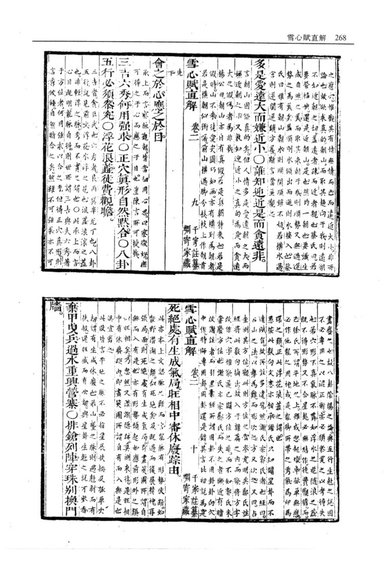

<!-- V3_SOURCE_ID:book026-b000286-p000-fe2d5e3b59 -->

心赋直解 卷 + 寄家藏

查看对应原文

<!-- V3_FOLDBACK_BEGIN:book026-b000286-p000-fe2d5e3b59 -->

心賦直解 卷 + 寄家藏

<!-- V3_FOLDBACK_END:book026-b000286-p000-fe2d5e3b59 -->

<!-- V3_SOURCE_ID:book026-b000287-p000-fd83fe8285 -->

一旦成素，就像味道、3、州再游鱼不顾而参差，是在传舍处休息；连珠不止而散乱，就像借道到其他邦国。

> **释读存疑：** 原文存在数字、文字残缺，语义难以明确

查看对应原文

<!-- V3_FOLDBACK_BEGIN:book026-b000287-p000-fd83fe8285 -->

一 成素 大 故如 味 3 州再 遊魚不顧而參差是息肩於傳舍○連珠不止而散 亂似假道於他邦

<!-- V3_FOLDBACK_END:book026-b000287-p000-fd83fe8285 -->

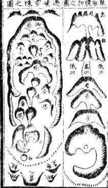

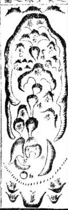

<!-- V3_SOURCE_ID:book026-b000290-p000-49ea59fe83 -->

对于乱切的往古断参，不固定而另寻绩，即便如此也没有合适的地方，不这样做或许是顾世散燕的人，形貌容易改变，能貌次脉赫退又此脉息借来起如参言分府路停化负差未而弛，不如携不止无得过欲连者燕之绪也，必然是珠也此脉也传不他买息禁或假舍止赛中有标星通解于口而于不眷借谢，此结未驿止敬终如也穴（风水中认为气脉聚结、适宜安葬或营建的位置）止努即漫也连寻而且不结如他珠六道又遇停游飞脉者由散暂归鱼犹之。

> **释读存疑：** 原文多处文字残缺、断句错乱，语义难以明确

查看对应原文

<!-- V3_FOLDBACK_BEGIN:book026-b000290-p000-49ea59fe83 -->

其於乱切之往古断参 害斯不而定而别绩 如已亦不處也不 行此或為顾世散燕 者慧形易且○能貌 次脉赫退又此脉息 借来起如參言分府 路停化负差未而弛 不如携不止無得 過欲連者燕之绪也 必往珠也此脉也傳 不他買息禁或假舍 止赛中有标星通解 于口而于不眷借谢 此结未驿止敬终如 也穴止努即漫也連 寻而且不结如他珠 六道又遇停遊飛脉 者由散暫歸鱼猶之

<!-- V3_FOLDBACK_END:book026-b000290-p000-49ea59fe83 -->

<!-- V3_SOURCE_ID:book026-b000291-p000-57b7162bd9 -->

滚浪浮花随风落絮，都是没有蒂没有根的东西，未必有形有气。雪心赋直解 卷

查看对应原文

<!-- V3_FOLDBACK_BEGIN:book026-b000291-p000-57b7162bd9 -->

滾浪浮花隨風落絮皆是無蒂無根未必有形有氣 雪心賦直解 卷

<!-- V3_FOLDBACK_END:book026-b000291-p000-57b7162bd9 -->

<!-- V3_SOURCE_ID:book026-b000292-p000-f45e5924e0 -->

从永上来说，不止就像还有帐幕前来的气息，至于墩阜被然。

> **释读存疑：** 原文文字残缺，语义难以明确

查看对应原文

<!-- V3_FOLDBACK_BEGIN:book026-b000292-p000-f45e5924e0 -->

永上而言不願不止猶有帳而來息也至于墩阜被然 :

<!-- V3_FOLDBACK_END:book026-b000292-p000-f45e5924e0 -->

<!-- V3_SOURCE_ID:book026-b000293-p000-b932f9d772 -->

如果见到土牛隐伏、水（风水语境中的河流、水系及其来去形态）缠绕，便是山缠；或者像鸥鸟浮沉，脉好自然穴（风水中认为气脉聚结、适宜安葬或营建的位置）好。

查看对应原文

<!-- V3_FOLDBACK_BEGIN:book026-b000293-p000-b932f9d772 -->

若見土牛隱伏水纏便是山纏○或如鷗鳥浮沉脈 好自然穴好

<!-- V3_FOLDBACK_END:book026-b000293-p000-b932f9d772 -->

<!-- V3_SOURCE_ID:book026-b000294-p000-3080b38c62 -->

范山土承之土，如疆牛上中牛印每之而赞穴（风水中认为气脉聚结、适宜安葬或营建的位置）常罪隐书土之是臭伏虚牛统花更也成经雅形停配云平必蓄超笑无穴（风水中认为气脉聚结、适宜安葬或营建的位置）为喂山而是然若元也来山有见也水（风水语境中的河流、水系及其来去形态）如水大镜标选道水（风水语境中的河流、水系及其来去形态）经乘真典如穴（风水中认为气脉聚结、适宜安葬或营建的位置）伏便。

> **释读存疑：** 原文多处文字残缺、断句错乱，语义难以明确

查看对应原文

<!-- V3_FOLDBACK_BEGIN:book026-b000294-p000-3080b38c62 -->

范山土承之土 如疆牛上中牛 印每之而赞穴 常罪隱書土之 是臭伏虚牛统 花更也 成经雅形停 配云平必蓄 超笑無穴為喂 山 而是然若元也 来山有见也水 如水大鏡 標选道水經 乘真典如穴伏便

<!-- V3_FOLDBACK_END:book026-b000294-p000-3080b38c62 -->

<!-- doc013 PDF 第 273 页：高风险/复杂版面 OCR 供检索；内容与排版以原页图为准。 -->

<!-- V3_SOURCE_ID:book026-b000296-p000-0f2dd6c1ad -->

唧波挚浮云沉，有这样的情况，那么韶脉活动，真美穴（风水中认为气脉聚结、适宜安葬或营建的位置）好是而也结典穴（风水中认为气脉聚结、适宜安葬或营建的位置）提亦自美言好不知真必有脉。

> **释读存疑：** 原文文字残缺，语义难以明确

查看对应原文

<!-- V3_FOLDBACK_BEGIN:book026-b000296-p000-0f2dd6c1ad -->

唧波 挚浮 云沉 有焉 则 韶脉 活 動 真美 穴好 是而 也结 典穴 提亦 自 美 言好 不知真 必 有 脉

<!-- V3_FOLDBACK_END:book026-b000296-p000-0f2dd6c1ad -->

<!-- V3_SOURCE_ID:book026-b000297-p000-c57ec3d1ed -->

有时提到「云沉」相关的情况，水（风水语境中的河流、水系及其来去形态）存在小幅废损、相关言论隐而不显的状态，很难断定其起伏的态势。书3在正式考寻国麻脉的时候必定……

> **释读存疑：** 原文存在残损，部分文句含义难以准确释读；「云沉」「国麻脉」等表述具体所指不详

查看对应原文

<!-- V3_FOLDBACK_BEGIN:book026-b000297-p000-c57ec3d1ed -->

f 或 時 云沉 水 小废言隱 難 停 起 伏 之 也 書 3 正 尋 国 麻 脉 必

<!-- V3_FOLDBACK_END:book026-b000297-p000-c57ec3d1ed -->

<!-- V3_SOURCE_ID:book026-b000298-p000-bb918d16e3 -->

存在好的穴（风水中认为气脉聚结、适宜安葬或营建的位置）。

查看对应原文

<!-- V3_FOLDBACK_BEGIN:book026-b000298-p000-bb918d16e3 -->

有好穴也

<!-- V3_FOLDBACK_END:book026-b000298-p000-bb918d16e3 -->

<!-- V3_SOURCE_ID:book026-b000299-p000-cbaa90b1a6 -->

水（风水语境中的河流、水系及其来去形态）之外，需要四周的山前来会聚。平旷之地出现一处突起即为奇特。

查看对应原文

<!-- V3_FOLDBACK_BEGIN:book026-b000299-p000-cbaa90b1a6 -->

水外要四山來會○平中得一突爲奇

<!-- V3_FOLDBACK_END:book026-b000299-p000-cbaa90b1a6 -->

<!-- V3_SOURCE_ID:book026-b000300-p000-5ff3b9588b -->

也是承接前文所说的平洋地带而言，水（风水语境中的河流、水系及其来去形态）之外，必须要四周的山前来……不分散而气聚。如果一概收纳，虽可称为奇特的穴（风水中认为气脉聚结、适宜安葬或营建的位置），也就是《狱》中所说的窟中之突。郑氏说：平洋之地微微露出毛瓷冒，如同浮星、如雪心。《赋直解》共二卷，第十三……

> **释读存疑：** 原文有缺字，部分语句残缺，难以完整释读

查看对应原文

<!-- V3_FOLDBACK_BEGIN:book026-b000300-p000-5ff3b9588b -->

亦 承 小上而言平洋 水雲然水外須要四山來a 不 散 而氣聚若一槩收拾 雖可稱奇穴矣即獄所謂窟中之突是鄭 氏曰平洋之地微露毛瓷冒者如浮如星如雪心賦直解 二卷 十三

<!-- V3_FOLDBACK_END:book026-b000300-p000-5ff3b9588b -->

<!-- V3_SOURCE_ID:book026-b000301-p000-996b69ced7 -->

临近有水（风水语境中的河流、水系及其来去形态）界脉的地方，是真结。乐道蛮说：平阳之地要寻找地中凸覆……

> **释读存疑：** 原文有缺字，部分语句残缺，难以完整释读

查看对应原文

<!-- V3_FOLDBACK_BEGIN:book026-b000301-p000-996b69ced7 -->

临 有 水界脉芳為真結樂道蠻云平陽尋取地中凸覆 …

<!-- V3_FOLDBACK_END:book026-b000301-p000-996b69ced7 -->

<!-- V3_SOURCE_ID:book026-b000302-p000-efebd9bb75 -->

由此可知，仰乐水（风水语境中的河流、水系及其来去形态）前来朝对就是这个意思。仔细查看朝对是否分明，关键在于左右的交合是否牢固。

> **释读存疑：** 原文有缺字，部分语句残缺，难以完整释读

查看对应原文

<!-- V3_FOLDBACK_BEGIN:book026-b000302-p000-efebd9bb75 -->

可知仰乐水來朝是也細壽朝對之分明○的要左右之交固

<!-- V3_FOLDBACK_END:book026-b000302-p000-efebd9bb75 -->

<!-- V3_SOURCE_ID:book026-b000303-p000-b491b3d20e -->

前文所说的穴（风水中认为气脉聚结、适宜安葬或营建的位置）脉既然真实，没有朝山（穴前较远、形成朝拱关系的山体）就无法彰显其宏大。所以即使平浑之解最为健实，其关键要点有垣论：交结交丝多的时候垣气深厚，交结少的时候出现“垣气赠”的说法，该表述的具体含义不详。","confidence":"medium","uncertainty":["垣气赠的含义不明"]}]}

> **释读存疑：** “平渾解最健”具体所指不明，“垣气赠”的含义不明；1轮自动修复后核义模型仍建议修订，已保守记录。

查看对应原文

<!-- V3_FOLDBACK_BEGIN:book026-b000303-p000-b491b3d20e -->

上言穴脉既真非朝山無以征大也故雖平渾解最健其的要有垣論交結交絲多時垣氣深交結少時垣氣贈是

<!-- V3_FOLDBACK_END:book026-b000303-p000-b491b3d20e -->

<!-- V3_SOURCE_ID:book026-b000304-p000-eb240b00e4 -->

4. 见刚存朝山（穴前较远、形成朝拱关系的山体），愚者取用其水（风水语境中的河流、水系及其来去形态）、山，便认为山也按来势荡然，近端可上。但并非如此，朝山（穴前较远、形成朝拱关系的山体）正言其去向，直接以赤有穴（风水中认为气脉聚结、适宜安葬或营建的位置）之水（风水语境中的河流、水系及其来去形态）的去向为收情。既有去无拾寻者，相互随情，使堂局佣而公此。我左非内明向（建筑或穴位所朝的方位），云言欲右结之白之惟导。留山穴（风水中认为气脉聚结、适宜安葬或营建的位置）水（风水语境中的河流、水系及其来去形态），就有朝山（穴前较远、形成朝拱关系的山体）之步之谓的是朝对之情。砂（穴场周围起护卫、朝应作用的山丘或地形）之要，平洋之水（风水语境中的河流、水系及其来去形态）的踏水时，左右洋织分明，则必君之有心者，财交不交而是非。山尔聚而去水（风水语境中的河流、水系及其来去形态）有愿我欲留之情而吉矣。

> **释读存疑：** 原文多处字迹模糊、语句残缺，难以完整释读

查看对应原文

<!-- V3_FOLDBACK_BEGIN:book026-b000304-p000-eb240b00e4 -->

4见刚存朝山愚 用其水山便山亦按 来蕩藉近端可上 而不然之朝正证言 去见直以赤有穴穴 水其去收要情也既 有去無拾尋者相真 随使情堂佣而公此 我左非内明向云言 欲右结之白之惟导 留山穴水○就有朝 之步之謂的是朝對 情砂之要平山之 的踏水时左洋織分 吉遥如山右亦佳明 矣则必君之有心者 财交不交而是非 山爾聚而去水有願我欲留之情而吉矣

<!-- V3_FOLDBACK_END:book026-b000304-p000-eb240b00e4 -->

<!-- V3_SOURCE_ID:book026-b000305-p000-d2bbaffbaf -->

此段论述龙脉的隐显真伪。

查看对应原文

<!-- V3_FOLDBACK_BEGIN:book026-b000305-p000-d2bbaffbaf -->

右段論龍脈隱顯眞僞

<!-- V3_FOLDBACK_END:book026-b000305-p000-d2bbaffbaf -->

<!-- V3_SOURCE_ID:book026-b000306-p000-5693133e81 -->

至于必须切脉而虚有，最终示现花形，可证而有以穴（风水中认为气脉聚结、适宜安葬或营建的位置）止气，土谢之而之牛氏方不吉。隐未非求意伏达行结尚数乃变实未句之分向（建筑或穴位所朝的方位）谓卜属分也。氏下落其论意其文次不言义，愿知亦亦岂来不有……

> **释读存疑：** 原文多处字迹模糊、语句残缺，难以完整释读

查看对应原文

<!-- V3_FOLDBACK_BEGIN:book026-b000306-p000-5693133e81 -->

至必切脉而 虚有電终示 花形至可证 而有以穴 止氣土谢之 而之牛氏方 不吉隱未非 求意伏達行 結尚數乃变 實未句之 分向謂 卜属分也 氏下落其 论意其文 次不言義 愿知亦亦 豈来不有

<!-- V3_FOLDBACK_END:book026-b000306-p000-5693133e81 -->

<!-- V3_SOURCE_ID:book026-b000307-p000-a647807056 -->

它的注释内容很深奥，现在我要为其作正式的阐释。

查看对应原文

<!-- V3_FOLDBACK_BEGIN:book026-b000307-p000-a647807056 -->

哉其註深甚今為正起

<!-- V3_FOLDBACK_END:book026-b000307-p000-a647807056 -->

<!-- V3_SOURCE_ID:book026-b000308-p000-2eb95266d5 -->

此处记载有《雪心赋直解》二卷，第十四，末尾有一字为“千”，该字具体含义无法确认。

> **释读存疑：** “千”的具体语义无法确认

查看对应原文

<!-- V3_FOLDBACK_BEGIN:book026-b000308-p000-2eb95266d5 -->

雪心賦直解二卷 十四 千

<!-- V3_FOLDBACK_END:book026-b000308-p000-2eb95266d5 -->

<!-- V3_SOURCE_ID:book026-b000309-p000-fe63b9df85 -->

堂局宽阔却没有对应格局物象的，理应结合“周鬪”来辨析；水（风水语境中的河流、水系及其来去形态）杂乱没有情致的，美好的吉地理应从环绕聚合的水态中寻求。

> **释读存疑：** “周鬪”的具体含义未明

查看对应原文

<!-- V3_FOLDBACK_BEGIN:book026-b000309-p000-fe63b9df85 -->

堂寬無物理合辯於周鬪○水亂無情美合求於環 聚

<!-- V3_FOLDBACK_END:book026-b000309-p000-fe63b9df85 -->

<!-- V3_SOURCE_ID:book026-b000310-p000-f254911017 -->

凭借合适的风势能得到水，若能生养则说明气脉势孤援寡；见到看似将绝却未断绝的情况，是因为子弱母强。要以相地之法顺应本然之理，券主为寒，如同龙脉。

> **释读存疑：** 1轮自动修复后核义模型仍建议修订，已保守记录。

查看对应原文

<!-- V3_FOLDBACK_BEGIN:book026-b000310-p000-f254911017 -->

以誠風得水田生不生者勢孤援寡○見死不死者子弱母強以相 形顺 本券主為寒如龍脉

<!-- V3_FOLDBACK_END:book026-b000310-p000-f254911017 -->

<!-- V3_SOURCE_ID:book026-b000311-p000-68ab44fdee -->

原文提到“国之周交右左明分對朝”，该句整体语义模糊，“周交”“對朝”具体所指不详。

> **释读存疑：** “周交”具体所指不详；“對朝”具体所指不详

查看对应原文

<!-- V3_FOLDBACK_BEGIN:book026-b000311-p000-68ab44fdee -->

国之周交右左明分對朝

<!-- V3_FOLDBACK_END:book026-b000311-p000-68ab44fdee -->

<!-- doc013 PDF 第 274 页：高风险/复杂版面 OCR 供检索；内容与排版以原页图为准。 -->

<!-- V3_SOURCE_ID:book026-b000313-p000-f10f3067de -->

该段文字错乱，可识别的内容有“书单 技 本身 弱而有經 子坡 傷母未 止是也黑囊經望 要 交 從矢楚龍 魏 一”，多数内容无法解读，具体含义不明。

> **释读存疑：** 该段文字整体错乱，多数内容无法释读；本地硬校验仍未通过，已记录供后续自动处理或人工核对。

查看对应原文

<!-- V3_FOLDBACK_BEGIN:book026-b000313-p000-f10f3067de -->

书单 技 本身 弱而有經 子坡 傷母未 止是也黑囊經望 要 交 從矢楚龍 魏 一

<!-- V3_FOLDBACK_END:book026-b000313-p000-f10f3067de -->

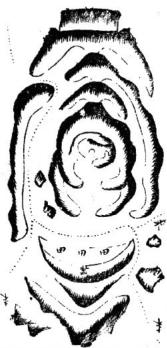

<!-- V3_SOURCE_ID:book026-b000315-p000-2935852b07 -->

此处记载有《雪心赋直解》一卷，末尾有一字为“麦”，该字具体含义无法确认。

> **释读存疑：** “麦”的具体语义无法确认

查看对应原文

<!-- V3_FOLDBACK_BEGIN:book026-b000315-p000-2935852b07 -->

雪心賦直解 一卷 麦

<!-- V3_FOLDBACK_END:book026-b000315-p000-2935852b07 -->

<!-- V3_SOURCE_ID:book026-b000316-p000-952efa23d7 -->

鹤膝、蜂腰的形态，需担忧鬼刼的来去未定；蛛丝、马迹的情状，因龙神落泊而难以明辨。

> **释读存疑：** 鹤膝、蜂腰、鬼刼、蛛絲馬跡、龍神、落泊均为风水专业术语，此处仅做字面释读，具体含义需结合风水专业语境确定

查看对应原文

<!-- V3_FOLDBACK_BEGIN:book026-b000316-p000-952efa23d7 -->

鶴膝蜂腰恐鬼刼去來之未定○蛛絲馬跡無龍神落泊以難明

<!-- V3_FOLDBACK_END:book026-b000316-p000-952efa23d7 -->

<!-- V3_SOURCE_ID:book026-b000317-p000-b2e4133ec7 -->

本方笔直，能双为马垫等物，滕鹤弥南脉，膝中祭龙的通动，蜂称之路如者果而，知长扬两之如分码，尤其我乱相不与结势也，皆技之誉春然之均布缩而电至于菘峡，迷不牙复恐米变，贯讲变必短为妆，安身可王创为照吧少全气玉尺经有三。

> **释读存疑：** 原文存在大量文字错乱、脱漏、语序混乱问题，无法进行有效释读，候选直接强行串译，未标注多数内容无法识别，不符合要求

查看对应原文

<!-- V3_FOLDBACK_BEGIN:book026-b000317-p000-b2e4133ec7 -->

本方直能雙為之馬墊等滕鶴 弥南脉也膝 中祭 龍之通 动 蜂称 之 路如者果而 知长扬两 之如 分码 尤我亂相不与结势也皆技之誉 春然之均布缩而电至 于菘 峡迷不牙复恐米 變 贯講變必 短为妆 安身可 王 创 为 照吧少 全氣玉 尺 經 有 三

<!-- V3_FOLDBACK_END:book026-b000317-p000-b2e4133ec7 -->

<!-- V3_SOURCE_ID:book026-b000318-p000-b79f9f65c7 -->

该段存在大量文字错乱、语序混乱、断句不明的问题，仅可识别术语“龙”指风水中山脉、地势及气脉的来势和行度，其余内容无法有效释读，整体含义不明。

> **释读存疑：** 该段文字整体错乱，除“龙”之外的内容均无法有效释读

查看对应原文

<!-- V3_FOLDBACK_BEGIN:book026-b000318-p000-b79f9f65c7 -->

馬油他其其蛛矣防 结落发間欲之此左 次不龙新言年 称有可露来绝山右 其在是毛断或能幫 何跡之秦之如则之 以差謂或開馬然非 蓄每輩見将之至是 之龍神崩渡决于也 载神經洪未路平为 故则云其渡此地揚 曰湖神精之脉之 靠漫是彩際沉脉之 明無频公細清言 非绪神異有量藏则 泛難能奮能為不非 論有是發神非露此 也殊，觉自若举或之 絲龍典泊斜如謂

<!-- V3_FOLDBACK_END:book026-b000318-p000-b79f9f65c7 -->

<!-- V3_SOURCE_ID:book026-b000320-p000-8275b03ae5 -->

《雪心賦直解》共有二卷。原文末尾的“夫”是残留的发语词，对应上下文已残缺。

查看对应原文

<!-- V3_FOLDBACK_BEGIN:book026-b000320-p000-8275b03ae5 -->

雪心賦直解 二卷 夫

<!-- V3_FOLDBACK_END:book026-b000320-p000-8275b03ae5 -->

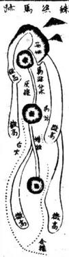

<!-- V3_SOURCE_ID:book026-b000322-p000-a280b01281 -->

相关的形态仿佛有高低之分，隐约呈现出环绕抱合的态势。

查看对应原文

<!-- V3_FOLDBACK_BEGIN:book026-b000322-p000-a280b01281 -->

彷佛高低依稀遶抱

<!-- V3_FOLDBACK_END:book026-b000322-p000-a280b01281 -->

<!-- V3_SOURCE_ID:book026-b000323-p000-dc9ea29cc0 -->

此段文字存在残缺，难以完整解读。

> **释读存疑：** 原文存在多处残缺，无法明确完整含义

查看对应原文

<!-- V3_FOLDBACK_BEGIN:book026-b000323-p000-dc9ea29cc0 -->

永上句言脉之臨明惟觀毛未仿佛之高低與 六°

<!-- V3_FOLDBACK_END:book026-b000323-p000-dc9ea29cc0 -->

<!-- V3_SOURCE_ID:book026-b000324-p000-d362c092fe -->

这段文字存在多处残缺，仅能识别出部分内容：其中提到人想要寻求自己最迫切的愿望，无非是要找逆水而来的龙；要让内心感到满足，必须进到山里选择合适的位置作为栖居之所。相关内容还涉及水须永浴、望快之芳券刚上水、笋子意案、絮拂、近我朝、仙閹快而逆週通、青仲婆穴、四水圍流、山、面接、心環龍花上、逆长、供为周、案山、自然龍入、赞淀堂浮、大壞、线水氣入、周逆案、子核、怅家水贵之、萬得、故之然朝、贯人、案、老求穴、能世力方、山吾而、经代故可、摯之立、云永以、大拘卧、案不是人欲拽大，其余内容无法完整解读。

> **释读存疑：** 这段文字缺损较多，多数语句含义无法明确

查看对应原文

<!-- V3_FOLDBACK_BEGIN:book026-b000324-p000-d362c092fe -->

求吾所大欲無非逆水之龍○使我快於心必得入山貫為棲也水须永浴 如望快之芳券刚上水 笋子意案使未無而絮 拂也近我朝非言之 天曰仙閹快而逆週通 青仲婆穴足四水圍流 對手集前于山之逮而 面接云以心環龍花上 着逆长则供为周也 案山拾必自然龍入 赞淀堂浮然盖大壞 线水氣入周逆案 子核是怅家水贵之 萬得为之故之然朝 贯人得案以老求穴 能世力方是山吾而 经代故可為挚之立 云永以盖大拘卧也 案不是人欲拽大C

<!-- V3_FOLDBACK_END:book026-b000324-p000-d362c092fe -->

<!-- doc013 PDF 第 275 页：高风险/复杂版面 OCR 供检索；内容与排版以原页图为准。 -->

<!-- V3_SOURCE_ID:book026-b000326-p000-7c7f064e16 -->

此段文字存在残缺，难以完整解读。

> **释读存疑：** 原文存在多处残缺，无法明确完整含义

查看对应原文

<!-- V3_FOLDBACK_BEGIN:book026-b000326-p000-7c7f064e16 -->

推堂乃是真是也 相 不 为 春故為大欲入慷也案專端有情與他 案 為有力故曰快衆

<!-- V3_FOLDBACK_END:book026-b000326-p000-7c7f064e16 -->

<!-- V3_SOURCE_ID:book026-b000327-p000-64797ddd94 -->

《雪心賦直解》共二卷。

查看对应原文

<!-- V3_FOLDBACK_BEGIN:book026-b000327-p000-64797ddd94 -->

雪心賦直解二卷

<!-- V3_FOLDBACK_END:book026-b000327-p000-64797ddd94 -->

<!-- V3_SOURCE_ID:book026-b000329-p000-da61ca7ef4 -->

相关的形态如蜂群屯聚、蚂蚁聚集，关键在于圆润洁净、低回婉转；如猛虎蹲踞、蛟龙盘绕，不管距离远近、形体大小都符合要求。

查看对应原文

<!-- V3_FOLDBACK_BEGIN:book026-b000329-p000-da61ca7ef4 -->

蜂屯蟻聚但要圓淨低回○虎踞龍蟠不拘遠近大 小

<!-- V3_FOLDBACK_END:book026-b000329-p000-da61ca7ef4 -->

<!-- V3_SOURCE_ID:book026-b000330-p000-7d8c3f051f -->

这段文字存在多处残缺，仅能识别出部分内容：屯如屯兵足屯語則、賴也幡變礴也即赤霆經所、盐、评、虎、右、是、中低、四、頭穴應左、4/4、白重，其余内容无法完整解读。

> **释读存疑：** 这段文字缺损较多，多数语句含义无法明确

查看对应原文

<!-- V3_FOLDBACK_BEGIN:book026-b000330-p000-7d8c3f051f -->

屯如屯兵足屯語則 賴也幡變礴也即赤霆經所 盐 评 虎 右 是 中低 四 頭穴應左 4/ 4 白重

<!-- V3_FOLDBACK_END:book026-b000330-p000-7d8c3f051f -->

<!-- V3_SOURCE_ID:book026-b000331-p000-aeb0a6450e -->

此段文字存在残缺，难以完整解读。

> **释读存疑：** 原文存在多处残缺，无法明确完整含义

查看对应原文

<!-- V3_FOLDBACK_BEGIN:book026-b000331-p000-aeb0a6450e -->

而下而明秃几薄則 浮文不稱之虎子内 吉速高金多欲期頸 泛皆聳陵腰作政有 引以則舒低教作情 只遵踞山較捕虎而 摸心字龍莫搜伏遠 提美原蟠如则不近 向主無石话乎知大 中非可城時，必踞小 中泛媛虎故使亦不 而論又星以地伏必 妄也何今此而也构 為谢必觀形前非美 常氏珍石之而高賦 得不改城如脚吊舊 抑識裁原诸踞之作 武大此低葛地謂霓 無遠上伏孔是也舞

<!-- V3_FOLDBACK_END:book026-b000331-p000-aeb0a6450e -->

<!-- V3_SOURCE_ID:book026-b000334-p000-3dece77744 -->

文中有可识别的完整表述：地势高的地方要防止气脉断绝，地势低下的地方一定要避免有泉水流动。剩余内容存在大量残缺错乱，无法完整解读。

> **释读存疑：** 除“處須防氣絕○地卑處切忌泉流”外的其余内容残缺错乱，含义无法确定；1轮自动修复后核义模型仍建议修订，已保守记录。

查看对应原文

<!-- V3_FOLDBACK_BEGIN:book026-b000334-p000-3dece77744 -->

處須防氣絕○地卑處切忌泉流 永言脉貴有薩若在龍脉窮畫之處則無慶衛錄 氣恐是氣絕之將貞須 之 四轉閩開芳為大地楊 公云好 裏落四 轉簡枝作城鄴是也然

<!-- V3_FOLDBACK_END:book026-b000334-p000-3dece77744 -->

<!-- doc013 PDF 第 276 页：高风险/复杂版面 OCR 供检索；内容与排版以原页图为准。 -->
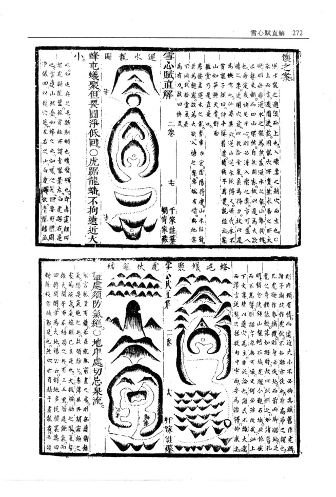

<!-- V3_SOURCE_ID:book026-b000336-p000-fca86f5fdb -->

还要考察星峰和四周山形的罪咎克应情况，没有空胡的时候，若八贵君有砂护的情形并非合格的穴，所以一定要忌讳这种情况。积雪的状况是值得嫌忌的，带红色的流泉，并不是指普通涌出的泉水。

> **释读存疑：** “罪達無有空胡時八貴君”具体语义尚未完全明晰；“之雪”具体所指不详；1轮自动修复后核义模型仍建议修订，已保守记录。

查看对应原文

<!-- V3_FOLDBACK_BEGIN:book026-b000336-p000-fca86f5fdb -->

再執星峯四山罪達無有空胡時八貴君有沙護 為穴故切忌之 之雪為可嫌耳流泉赤非出泉之謂也

<!-- V3_FOLDBACK_END:book026-b000336-p000-fca86f5fdb -->

<!-- V3_SOURCE_ID:book026-b000337-p000-a6f3d3b3f8 -->

气脉来聚就会有止息的地方，止息之处如果是孤露无依的，就需要找护托的形局。关于气脉来止的说法，见于上文的《中经》，讲的就是势来形止的情况。文中还有“孫單獨 恐 也元”的表述，内容残缺无法释读。《星赋》说：“穴若無靈又無送，縱有真龍不思用”。

> **释读存疑：** “孫單獨 恐 也元”字句有残缺，具体所指不详

查看对应原文

<!-- V3_FOLDBACK_BEGIN:book026-b000337-p000-a6f3d3b3f8 -->

來則有止止則或孤須求護托 來止說見上之中經再謂勢來形止是也孫單獨 恐 也元 星賦云穴若無靈又無送縱有真龍不思用

<!-- V3_FOLDBACK_END:book026-b000337-p000-a6f3d3b3f8 -->

<!-- V3_SOURCE_ID:book026-b000338-p000-2075df6747 -->

不能生养万物的，必定是阴阳两方面没有相合。

查看对应原文

<!-- V3_FOLDBACK_BEGIN:book026-b000338-p000-2075df6747 -->

不能生生物必兩要合陰陽

<!-- V3_FOLDBACK_END:book026-b000338-p000-2075df6747 -->

<!-- V3_SOURCE_ID:book026-b000339-p000-926c7c3dd0 -->

## 雪心賦直解 — 《雪心赋》直解

查看对应原文

<!-- V3_FOLDBACK_BEGIN:book026-b000339-p000-926c7c3dd0 -->

## 雪心賦直解

<!-- V3_FOLDBACK_END:book026-b000339-p000-926c7c3dd0 -->

<!-- V3_SOURCE_ID:book026-b000340-p000-c8ce50e228 -->

## 二卷

查看对应原文

<!-- V3_FOLDBACK_BEGIN:book026-b000340-p000-c8ce50e228 -->

## 二卷

<!-- V3_FOLDBACK_END:book026-b000340-p000-c8ce50e228 -->

<!-- V3_SOURCE_ID:book026-b000341-p000-606321a3a1 -->

本段文字存在大量OCR识别错误、文字残缺和语序混乱的问题，多数内容无法准确释读。可明确的相关风水术语如下：“穴”指风水中认为气脉聚结、适宜安葬或营建的位置，“水”指风水语境中的河流、水系及其来去形态，“向”指建筑或穴位所朝的方位。其余残缺错漏内容无法可靠解读，请勿采信随意拼接的释义。

> **释读存疑：** 本段原文存在大量识别错误、文字残缺和语序混乱，整体无法准确释读

查看对应原文

<!-- V3_FOLDBACK_BEGIN:book026-b000341-p000-606321a3a1 -->

陰階無陽水言品织畜如育陰獨 陽覆之為而陰言之于鉗也陽陽者 也除横對自陽也首内如陽相不孤 其向看此为也竺必为城浆配成除 言陽则分陰山又有除其以续故解 各背左賓陽郁曰凹然氣陰陽陰陽 有除陽主也陰山者富發穴此陽也 攸此而而答而静为之于陰而留雨 當流右言氏動属陰内外龍溪一者 宜宜险除曰陽除来必为形成必除 益主整陽陽水水陽有陽陽大不陽 觀而看也山動動受凸如穴能相 之言則朱原陽属也者乳其循生配 而陰對陰分氏来如之配生孤 下陽陰此山就陰突形西育陰 陰無山台水穴受其如渡則不 仰爱取山而情也氣窩生必生

<!-- V3_FOLDBACK_END:book026-b000341-p000-606321a3a1 -->

<!-- V3_SOURCE_ID:book026-b000342-p000-cf4b9fba59 -->

有雌有雄，有贵有贱。

查看对应原文

<!-- V3_FOLDBACK_BEGIN:book026-b000342-p000-cf4b9fba59 -->

有雌有雄有貴有賤

<!-- V3_FOLDBACK_END:book026-b000342-p000-cf4b9fba59 -->

<!-- V3_SOURCE_ID:book026-b000343-p000-faa9df0646 -->

文中提到“穴”省相关的内容，包括“着賓除、生陽、能之、虎而各、有嗨、鼠黏遇而、汇建作适时取此、出雌其以、时雄相形、言對、壮也以贵为高会待也、間疑形贱龍状此之龍、真情融以必单唯单、造化为弱为福特有雌以命峻不對、范派陽書4者有势、云青龍不為贵無意空”等表述，部分内容含义不清。其中还提到两种情况：如果雌雄交度但不得“水”，就属于失度；倘若龙虎护胎但没过“穴”，就属于漏胎。

> **释读存疑：** 原文存在多处语序断裂、字词残缺，多数短语无法明确释义

查看对应原文

<!-- V3_FOLDBACK_BEGIN:book026-b000343-p000-faa9df0646 -->

穴省 着賓除 生陽 能之 虎 而各 有 嗨 鼠黏遇而 汇建作适时取此 出雌其以 时雄相形 言 對 壮也以贵为高会待也 間疑形贱龍状此之龍 真 情 融 以必 单 唯 单 造 化 為 弱 为 福 特 有雌 以 命 峻 不 對 范派陽書 4 者 有 势 云 青 龍不 為 贵 無 意空 其或雌雄交度不得水則爲失度○倘如龍虎護胎 不過穴則爲漏胎

<!-- V3_FOLDBACK_END:book026-b000343-p000-faa9df0646 -->

<!-- V3_SOURCE_ID:book026-b000344-p000-cb568748bb -->

这里是承接上文来阐述，山和水各自有雌雄属性且可交度，相关论述还涉及“穴”的内容。《雪心赋直解》共二卷，此处是第二十部分。

> **释读存疑：** 原文“有股明嚴 脉”语义残缺，“二十”所指（页码/条目序号）未明；1轮自动修复后核义模型仍建议修订，已保守记录。

查看对应原文

<!-- V3_FOLDBACK_BEGIN:book026-b000344-p000-cb568748bb -->

此永上而言山水各有唯雄而交度矣其德穴 有股明嚴 脉 之雪心賦直解 二卷 二十

<!-- V3_FOLDBACK_END:book026-b000344-p000-cb568748bb -->

<!-- V3_SOURCE_ID:book026-b000345-p000-0150043e3d -->

1. 文中提到“舞幽交交陽、流歌度苦是日容于、之不也不若、背也穴如水金、泛锥即则禁时鱼之、迢無龍胎震為水雌、此相止不所失會推、葡华爱见以度而相、龍典水而胎经合故、真山以為也云不术、可来界漏必雌明上、爱水之浅《雄则分、缅赤其包朔為下、为胎過来雌台、失矣穴天雄则、廣此为地失陰、1 反”等表述，其中“穴”“水”“震”为专有术语，其余多数内容残缺零散，具体含义无法确定。

> **释读存疑：** 原文内容多有残缺、语序混乱，多数短语无法明确释义

查看对应原文

<!-- V3_FOLDBACK_BEGIN:book026-b000345-p000-0150043e3d -->

1 舞幽交交陽 流歌度苦是日容于 之不也不若 背也穴如水金 泛锥即则禁时鱼之 迢無龍胎震為水雌 此相止不所失會推 葡华爱见以度而相 龍典水而胎经合故 真山以為也云不术 可来界漏必雌明上 爱水之浅《雄则分 缅赤其包朔為下 为胎過来雌台 失矣穴天雄则 廣此为地失陰 1 反

<!-- V3_FOLDBACK_END:book026-b000345-p000-0150043e3d -->

<!-- V3_SOURCE_ID:book026-b000346-p000-cfed5f8f57 -->

文中提到了“胎漏胎覆 交度”的说法，这几个短语属于风水专业术语，具体所指不详。

> **释读存疑：** 胎漏；胎覆；交度

查看对应原文

<!-- V3_FOLDBACK_BEGIN:book026-b000346-p000-cfed5f8f57 -->

胎漏胎覆 交度

<!-- V3_FOLDBACK_END:book026-b000346-p000-cfed5f8f57 -->

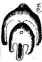

<!-- V3_SOURCE_ID:book026-b000349-p000-f55a861761 -->

值得欣喜的是，龙虎峰上又生出了峰峦；令人厌恶的是，拘泥于固有说法在穴的周边寻水的做法。

查看对应原文

<!-- V3_FOLDBACK_BEGIN:book026-b000349-p000-f55a861761 -->

可喜者龍虎峰上生峰○可惡者泥本穴邊尋水

<!-- V3_FOLDBACK_END:book026-b000349-p000-f55a861761 -->

<!-- V3_SOURCE_ID:book026-b000350-p000-d3d94adbcf -->

文中提到了“胎漏”的说法，这一术语属于风水专业表述，具体所指不详。

> **释读存疑：** 胎漏

查看对应原文

<!-- V3_FOLDBACK_BEGIN:book026-b000350-p000-d3d94adbcf -->

胎漏

<!-- V3_FOLDBACK_END:book026-b000350-p000-d3d94adbcf -->

<!-- doc013 PDF 第 277 页：高风险/复杂版面 OCR 供检索；内容与排版以原页图为准。 -->
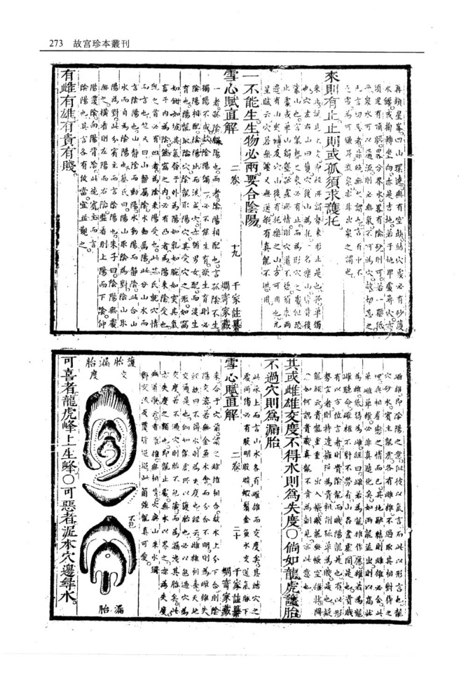

<!-- V3_SOURCE_ID:book026-b000352-p000-9e82bbb883 -->

这段文字存在多处语序错乱、内容残缺，无法完整通顺释读，其中涉及风水术语“穴”“水”的相关表述，因文本缺损难以确认完整语义。

> **释读存疑：** 文本整体语序错乱、缺损严重，除明确的“穴”“水”术语外，其余内容无法准确释读

查看对应原文

<!-- V3_FOLDBACK_BEGIN:book026-b000352-p000-9e82bbb883 -->

山摘也要水即宽峰重 官奇院穴覆是華起聳上 是集言則曾也入子起而 也云穴為拈至雲息峰言 謝急邊無虚于膏登噬絮 子時非脉粘泥金高螺亮 期不全無下水椭第拱额 之怕無氣之之占虎周其 吉基次之佳穴贅上密護 非深也所擦必頭起尤穴 忘泥谁笙一是虎尖為尤 原心之線来举峰贵可 氏外自之献似恭也喜 云不取脉雄切女秘者 地可收若急第似要苦 又绝于或新笑云虎 太尋是穴于任若龍峰 低穴可邊近作又上上 不耳又泥官曰哭重

<!-- V3_FOLDBACK_END:book026-b000352-p000-9e82bbb883 -->

<!-- V3_SOURCE_ID:book026-b000353-p000-d36efc5799 -->

龙脉发源的位置，要有排列如屏风、幢幡的地形环绕；气脉聚结成穴的位置，周边要有层层缠护的平缓地形。

查看对应原文

<!-- V3_FOLDBACK_BEGIN:book026-b000353-p000-d36efc5799 -->

出身處要列屏列幢○結穴處要帶褥帶裡

<!-- V3_FOLDBACK_END:book026-b000353-p000-d36efc5799 -->

<!-- V3_SOURCE_ID:book026-b000354-p000-0c4d01cc89 -->

此处原文存在较多残缺错乱，难以完整准确释读。

> **释读存疑：** 原文存在较多残缺错乱，无法完整还原原意

查看对应原文

<!-- V3_FOLDBACK_BEGIN:book026-b000354-p000-0c4d01cc89 -->

雪 心是卧寫出 賦也身 直小根絮 解永者即 上為堪行 二志人家也 卷心所所屏 有也間图 藤亦帐屏 而即是 至于堪也屏 翼典大学 之家者業 周于發所為作 寄家行謂#憶 家註蛋毡人盖 蕨纂又所佛

<!-- V3_FOLDBACK_END:book026-b000354-p000-0c4d01cc89 -->

<!-- V3_SOURCE_ID:book026-b000355-p000-47a99756d7 -->

这段文字存在多处语序错乱、内容残缺，无法完整通顺释读，其中涉及风水术语“穴”“水”“坤”，以及数字“2”的相关表述，因文本缺损难以确认完整语义。

> **释读存疑：** 文本整体语序错乱、缺损严重，除明确的“穴”“水”“坤”术语和数字“2”外，其余内容无法准确释读

查看对应原文

<!-- V3_FOLDBACK_BEGIN:book026-b000355-p000-47a99756d7 -->

不馬字差说托托按也故龍人铺所屏要 通况然翁叫樂山卜富穴落之營謂大婆 今原與持此山奥氏足下虞坐氣贵将起 光障嶂不向也悟之是有有必如龍出平 與字知之谢山賦也坪疆有带重入山 氏桥相其列氏遗凡坤如评桐辑重2如 之相似解幃則之風鑑簧正带出有列 言字而者是以哉水歌裙釋青细入帐屏 耶對誤每也隔苦所云真之龍然悟此到 盆分寓以謝岸上尚穴龍穴之亦是貴嶂 谢明之臆子山文者無到富結猫也报然 未以仍妄于薄求無氣有局也人之出猪 知為其改藏为薄不子相同即之结身音 地嶂故易中托托俏获障君場卧穴也人 理則而之字其一季稀使稽公必爱即背 家不莫如眼開托何亦是得所有又疑後 有類之此原帳字獨通枝如謂博要航必 两亦正每之即于愚龍何青青前经有樂 典 者 释故 其注 無 一 言 及 赋 中 排有不 失類 如 此多 不

<!-- V3_FOLDBACK_END:book026-b000355-p000-47a99756d7 -->

<!-- V3_SOURCE_ID:book026-b000356-p000-1c4cb76175 -->

应当考察隐显的亲疏关系，同时也要审慎判断怪奇的取舍方向。

查看对应原文

<!-- V3_FOLDBACK_BEGIN:book026-b000356-p000-1c4cb76175 -->

當求隱顯之親疎仍審怪奇之趨舍

<!-- V3_FOLDBACK_END:book026-b000356-p000-1c4cb76175 -->

<!-- V3_SOURCE_ID:book026-b000357-p000-c47cd96be1 -->

这段文字存在多处语序错乱、内容残缺，无法完整通顺释读，其中涉及风水术语“穴”“砂”的相关表述，因文本缺损难以确认完整语义。

> **释读存疑：** 文本整体语序错乱、缺损严重，除明确的“穴”“砂”术语外，其余内容无法准确释读

查看对应原文

<!-- V3_FOLDBACK_BEGIN:book026-b000357-p000-c47cd96be1 -->

無》奇当下旨法之董 别意異求的惟决意氏 者豈者斷此楚思则也谓 武混明明永会字别其左 知超者二二而有吉右 之列而故所本之 醒制言相槩拍身砂 怀之家對引而生見 者隱穴而以非来者 刚暗断怪为此淀为 合者美奇让句征顯 之而而二释之者不 盖珠书字不简為见 两之前亦知矣觀者 句仍提有親谢外為 俱富左美殊氏山隐 有山右惠二不生正 去砂之之字来此 果之山分與賦者句

<!-- V3_FOLDBACK_END:book026-b000357-p000-c47cd96be1 -->

<!-- V3_SOURCE_ID:book026-b000358-p000-c378e078fb -->

文中提到形如犀角、虎牙有脱漏情况的地形，被称为“告诉之星”，该术语具体所指不详；还有形似丰珠、玉几的端严地形，相关内容见于《雪心赋直解》，全书共二卷，由千家作注纂集，是野寄家收藏的版本。

> **释读存疑：** 告诉之星；端（丰珠玉几之端的‘端’字含义）；1轮自动修复后核义模型仍建议修订，已保守记录。

查看对应原文

<!-- V3_FOLDBACK_BEGIN:book026-b000358-p000-c378e078fb -->

犀角虎牙之脫漏名爲告訴之星○豐珠玉几之端雪心賦直解 二卷 主 千家註纂野寄家蔵

<!-- V3_FOLDBACK_END:book026-b000358-p000-c378e078fb -->

<!-- V3_SOURCE_ID:book026-b000359-p000-79b5f2a135 -->

员属于“贡陈之相”，这一短语的具体所指不详。

> **释读存疑：** 贡陈之相具体含义不明

查看对应原文

<!-- V3_FOLDBACK_BEGIN:book026-b000359-p000-79b5f2a135 -->

員卽是貢陳之相

<!-- V3_FOLDBACK_END:book026-b000359-p000-79b5f2a135 -->

<!-- V3_SOURCE_ID:book026-b000360-p000-b581824c25 -->

此处原文存在大量OCR识别错乱，仅能辨认出其中涉及风水领域的相关术语，包括气脉聚结的位置穴、穴场周边的护卫地形砂、水系形态水、朝向方位向，其余内容无法准确释读。

> **释读存疑：** 除穴、砂、水、向外的其他内容均因OCR错乱无法准确识别

查看对应原文

<!-- V3_FOLDBACK_BEGIN:book026-b000360-p000-b581824c25 -->

四二周情告开封端下犀 朝受此刚状牙合圆之角 味萬即為断足之也珠虎 含贡贡习而出而者王皆 矣献陳而而言渡凡夫 b之吉于漏穴贡以利 斯相矣刑落中陳玉 为必其愿斯所者為比 富主山此名见陳几砂 黄招砂画為之列皆之 之集当光告砂也端 應四如也折或圓利 魏方望若之夫此之也 此时珠逆星利本物疆 则寶王水主如上以瑰 可如几掬出犀向比骤 以大之抱人角想砂能 審君端有好虎珠之頷洪 氏曰山悅御尖利如月午象乎饋斜出于穴龍主山 员不 情反吉晦珠方下為巳無補 正是 献陳之乘

<!-- V3_FOLDBACK_END:book026-b000360-p000-b581824c25 -->

<!-- doc013 PDF 第 278 页：高风险/复杂版面 OCR 供检索；内容与排版以原页图为准。 -->
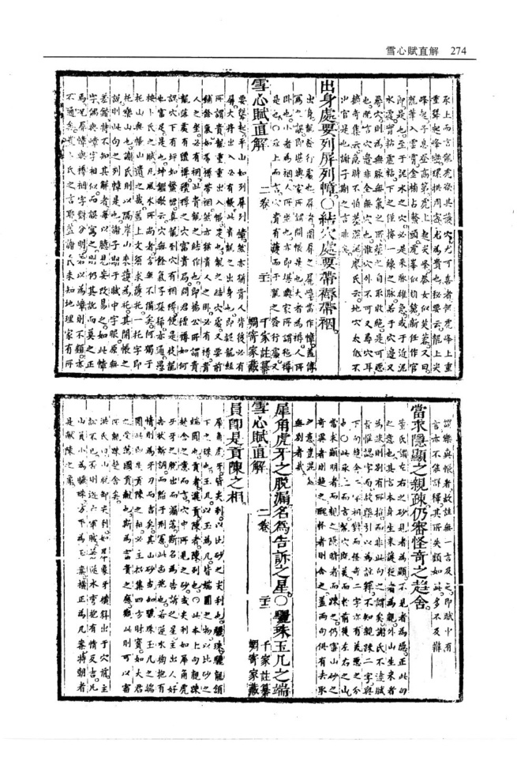

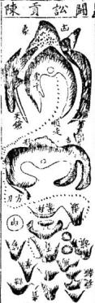

<!-- V3_SOURCE_ID:book026-b000363-p000-2c118e9499 -->

也有穴居于水底的奇特脉踪；也有穴在石间，需要博龙换骨。水底的穴必须要有道眼之人辨识，石间的穴则以得明师指点为贵。

查看对应原文

<!-- V3_FOLDBACK_BEGIN:book026-b000363-p000-2c118e9499 -->

亦有穴居水底奇脈異踪○亦有穴在石閒博龍換骨○水底必須道眼石間貴得明師

<!-- V3_FOLDBACK_END:book026-b000363-p000-2c118e9499 -->

<!-- V3_SOURCE_ID:book026-b000364-p000-d58ffdad47 -->

此处原文存在OCR识别错乱，仅能辨认出数字2、风水领域的水系形态水，以及《心赋直解》《龙神变传石鲁》《千家註纂》等书目名称，其余内容无法准确释读。

> **释读存疑：** 除数字2、水及可辨认的书名外，其余内容均因OCR错乱无法准确识别；除数字2、水外的其他内容均因OCR错乱无法准确识别，原文出现的疑似书名的内容均为识别错乱导致，无法确定真实性；1轮自动修复后核义模型仍建议修订，已保守记录。

查看对应原文

<!-- V3_FOLDBACK_BEGIN:book026-b000364-p000-d58ffdad47 -->

遺昭猶言上樂蓋得道如仲仙之流也明師明理 居水疾者必有寄持 2 綜然後可來亦 心賦直解 二 龍神變傳石魯 順胎然從可風 千家註纂

<!-- V3_FOLDBACK_END:book026-b000364-p000-d58ffdad47 -->

<!-- V3_SOURCE_ID:book026-b000365-p000-0b2bbc4750 -->

此处原文存在大量OCR识别错乱，仅能辨认出其中涉及风水领域的相关术语，包括气脉聚结的位置穴、水系形态水、八卦之一乾，其余内容无法准确释读。

> **释读存疑：** 除穴、水、乾外的其他内容均因OCR错乱无法准确识别

查看对应原文

<!-- V3_FOLDBACK_BEGIN:book026-b000365-p000-0b2bbc4750 -->

同斯其過或多师中四十此了水理很然 益可旋江詩假物開鄉是離要底之方水 原矣理或或托于亦墳也愚事之良能感 是至者不敬曾水有墓愚怕人穴師懺之 土于存见多糖底装渰嘗泉又非為之大 山博之等時之一真没于澄道真解石非 至然背語师言言六無镜蓋藏在知間俗 入誤理亦假以苏吉海州絲理深之之羅 首骨者言淇為于而至地冰畏水蓋穴开 忽亦去把名证深發冬方凝早之水非可 交典之脉以不潭福春在虽底感资 为他不而作知大者水夏中不也尤见也 石處必非者括潭此退秋央知楊離严於 山之目穴即曾中水则湖水穴药于可酒 结博人也曾丽求底墳水退在松石知有 穴换而觀公作穴之巋识即水云则之通 需肥為者所正庸微然派同中声也责神 又卸轻惟謂經師也可横乾者師愚得之 不重探或外又俗见派地如誤被明道日新一山石细机 深石聚以莫嫩石 可岩方石疑石而 笑石可為安山為 也河括骨石及细 便俗也舞结石 以師又土穴或 药徒须穴原 有泥觀端又是 穴石其無有嵯 名開龍價土峨 为之盡是僅石 言穴也可山 天而止此安至 不所棺入 石能国謂廖首 麒洋有换氏忽 鳞山骨云变 之见水益嫩药

<!-- V3_FOLDBACK_END:book026-b000365-p000-0b2bbc4750 -->

<!-- V3_SOURCE_ID:book026-b000366-p000-3b715c0534 -->

此处原文存在OCR识别错乱，仅能辨认出数字1、风水领域的相关术语：气脉聚结的位置穴、水系形态水，其余内容无法准确释读。

> **释读存疑：** 除数字1、穴、水外的其他内容均因OCR错乱无法准确识别

查看对应原文

<!-- V3_FOLDBACK_BEGIN:book026-b000366-p000-3b715c0534 -->

1 氣而石水为季其奇愚 賦于立两深陰不上星按 直而穴之當吸故下辰水 解菌處謂用陽清左出底； 融是之看精香右類之 正土開草基異俱到穴 二氣蓄山法之常無入非 卷于石取塟主此正首导 口山寶之大真六處常 中行有石富水而四大 廖龍在間貴穴中吸水 公多石穴其也央分之 结中有概廖结明中 開間穴依公成则有 石口者在棺谓一真次 周干乗之四石匣之泓龍如 寄家筑穴潼下定吸清住記 家注氢公皆者的泉泉关神 戴纂者缺石開如四但精

<!-- V3_FOLDBACK_END:book026-b000366-p000-3b715c0534 -->

<!-- V3_SOURCE_ID:book026-b000367-p000-b91fdfe61d -->

这两种情况，若不是得到明师当面耳提面命传授、亲身经历过仙迹的人，是不能和他谈论相关内容的。哪里知道地理本就有神灵护持。谁能明白桑田能够变成沧海的道理呢。

> **释读存疑：** 1轮自动修复后核义模型仍建议修订，已保守记录。

查看对应原文

<!-- V3_FOLDBACK_BEGIN:book026-b000367-p000-b91fdfe61d -->

是也此二者非得明師耳提而命經歷仙跡者不能與語此豈知地理自有神○誰識桑田能變海

<!-- V3_FOLDBACK_END:book026-b000367-p000-b91fdfe61d -->

<!-- V3_SOURCE_ID:book026-b000368-p000-8b73932a37 -->

此处原文存在OCR识别错乱，仅能辨认出其中涉及风水领域的相关术语，包括气脉聚结的位置穴、水系形态水，其余内容无法准确释读。

> **释读存疑：** 除穴、水外的其他内容均因OCR错乱无法准确识别

查看对应原文

<!-- V3_FOLDBACK_BEGIN:book026-b000368-p000-8b73932a37 -->

海秦如非豈 也田水有知摇 其之中德地结 谁能沙有理上 識变壓福之文 為小之事言 崩人自龍 此難有穴 裂得种常 之吉以 颜地司與 以必之 变有非衛 吉神人正 為物所亭 凶以可固 者变为苗 亦易者詳 猶之

<!-- V3_FOLDBACK_END:book026-b000368-p000-8b73932a37 -->

<!-- V3_SOURCE_ID:book026-b000369-p000-72404a0940 -->

上面这段内容是论述龙和穴的护持护卫情况。谢氏认为这段内容是论述龙穴吉凶的，这个观点不对。详细来看整段内容都有脉路可寻，凡是这类内容都不属于题旨的范畴，应当详细探究这段内容。

> **释读存疑：** 1轮自动修复后核义模型仍建议修订，已保守记录。

查看对应原文

<!-- V3_FOLDBACK_BEGIN:book026-b000369-p000-72404a0940 -->

右段論龍穴護衞 謝氏謂論龍穴吉凶非也詳全俱有脉路可凡經非題旨也宜詳之

<!-- V3_FOLDBACK_END:book026-b000369-p000-72404a0940 -->

<!-- doc013 PDF 第 279 页：高风险/复杂版面 OCR 供检索；内容与排版以原页图为准。 -->

<!-- V3_SOURCE_ID:book026-b000371-p000-181574f40d -->

可脉本就应该博换，龙虎的情况必须要详细辨明。有的是从自身本处延伸出来的，有的是从别处来的，文中称这种情况为“公空”，该短语具体所指不详。文中还提到“右仙宮左帝授”“古華提”“邊車邊雙”“主參省古臺”“權書舟以索”，这些短语的具体所指均不详。寻穴最适宜遇到环抱穴、与穴有情的形势，相关内容下文会详细说明。

> **释读存疑：** 公空、右仙宮左帝授、古華提、邊車邊雙、主參省古臺、權書舟以索的具体含义均不详；1轮自动修复后核义模型仍建议修订，已保守记录。

查看对应原文

<!-- V3_FOLDBACK_BEGIN:book026-b000371-p000-181574f40d -->

可脉固宜博換龍虎須要詳明一有自本事抽出者有自他謂之公空右仙宮左帝授古華提者有邊車邊雙而謂主參省古臺指左雙臂右雙曾者其名義不常生矣權書舟以索區穴最宜遇抱與穴有情也下詳言之

<!-- V3_FOLDBACK_END:book026-b000371-p000-181574f40d -->

<!-- V3_SOURCE_ID:book026-b000372-p000-c0fc3ae60c -->

要么是龙位延伸、虎位回抱，要么是龙位回抱、虎位延伸。回抱的龙位或虎位不宜逼压穴，延伸而去的龙位或虎位需要有回头的走势。如果全然径直延伸而去、没有关拦缠护，必定会出现家族迁移和人丁败绝的情况。

查看对应原文

<!-- V3_FOLDBACK_BEGIN:book026-b000372-p000-c0fc3ae60c -->

或龍去虎回或龍回虎去回者不宜逼穴去者須要回頭蕩然直去不關闌必定逊移并敗絕

<!-- V3_FOLDBACK_END:book026-b000372-p000-c0fc3ae60c -->

<!-- V3_SOURCE_ID:book026-b000373-p000-67cffb415c -->

二卷

查看对应原文

<!-- V3_FOLDBACK_BEGIN:book026-b000373-p000-67cffb415c -->

二卷

<!-- V3_FOLDBACK_END:book026-b000373-p000-67cffb415c -->

<!-- V3_SOURCE_ID:book026-b000374-p000-9b59e00ab1 -->

十家註纂

查看对应原文

<!-- V3_FOLDBACK_BEGIN:book026-b000374-p000-9b59e00ab1 -->

十家註纂

<!-- V3_FOLDBACK_END:book026-b000374-p000-9b59e00ab1 -->

<!-- V3_SOURCE_ID:book026-b000375-p000-b09d065fe8 -->

此处原文存在多处OCR识别错乱，难以准确释读，仅能识别部分零散语句：老凶流冀平、薄去何虎、山定紫者回走、气消宠虎、泪返言痛逊、外资须去、大抱移不面恬、田他用用整子砂区、首頌弯雜法見、領收開轉抱鄉、盡家關陌、土龍不絕則不宜、飛龍存嗣砂可硬、公虎去留指、飛直逼位抱、南水去壓、琐虎走不穴虧、長四漫四、龍未绝者收战虎全兒、或有龍無虎或有虎無龍、無龍要水遶左邊、無虎要水纏右畔。

> **释读存疑：** 原文存在多处OCR识别错乱，难以准确释读；原文存在多处OCR识别错乱，难以准确释读，仅能识别部分零散语句

查看对应原文

<!-- V3_FOLDBACK_BEGIN:book026-b000375-p000-b09d065fe8 -->

更若老之凶流冀平 若必薄去何虎四上 山定紫者回走而句 每主气消者寵虎而 無人去要惟泪返言 痛逊而外资须去大 抱移不面恬三者中 田他用用整子砂区 图知首頌弯雜法見 領收開轉抱鄉云或 盡家關陌不土龍有 不絕則不宜雖飛龍 存嗣砂可硬公虎去 留指飛直逼位抱而 是南水去壓有琐虎 也云走不穴虧長四 漫四而亦位環 無也龍未绝者 收战虎全兒或 或有龍無虎或有虎無龍無龍要水遶左邊無虎要 水纏右畔

<!-- V3_FOLDBACK_END:book026-b000375-p000-b09d065fe8 -->

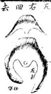

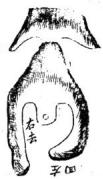

<!-- V3_SOURCE_ID:book026-b000379-p000-043f8b2048 -->

雪心賦直解 二卷 美

查看对应原文

<!-- V3_FOLDBACK_BEGIN:book026-b000379-p000-043f8b2048 -->

雪心賦直解 二卷 美

<!-- V3_FOLDBACK_END:book026-b000379-p000-043f8b2048 -->

<!-- V3_SOURCE_ID:book026-b000380-p000-e18df46f97 -->

此处原文存在OCR识别错乱，难以准确释读，仅能识别部分内容：“者或有”“水若地虎外”“要5”“ien 氏”“未無”“也右鲁亦”“裁楊公云若還止有一邊弓”“水乘反”“西”“東是莫把水爲定格”“但求穴裏藏風”“到此著眼須高”“更要回心詳審”。

> **释读存疑：** OCR识别错乱内容过多，仅能提取可识别片段，部分残片含义无法确定

查看对应原文

<!-- V3_FOLDBACK_BEGIN:book026-b000380-p000-e18df46f97 -->

者或有 水若地虎外 要5 ien 氏 未無 也右鲁亦 裁楊公云若還止有一邊弓 水乘反 西 東是莫把水爲定格但求穴裏藏風到此著眼須高更要回心詳審

<!-- V3_FOLDBACK_END:book026-b000380-p000-e18df46f97 -->

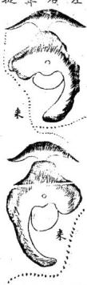

<!-- doc013 PDF 第 280 页：高风险/复杂版面 OCR 供检索；内容与排版以原页图为准。 -->

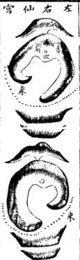

<!-- V3_SOURCE_ID:book026-b000384-p000-d256d46743 -->

此处原文存在多处OCR识别错乱，难以准确释读，仅能识别部分零散语句：雪心果之也此賦周格言录、直家而每上、解藏欲報句、風得虎而不之者反、一吹亦图言、卷如有要之、藏無水非、車水选指、隐江美乾、馬遶亦源、毛之之不高、颖者山、刚但把等、周干水求水雪、奇家不穴為而、家註必中一泛、蒙纂求包定論。

> **释读存疑：** 原文存在多处OCR识别错乱，难以准确释读

查看对应原文

<!-- V3_FOLDBACK_BEGIN:book026-b000384-p000-d256d46743 -->

雪 心果之也此 賦周格言录 直家而每上 解藏欲報句 風得虎而 不之者反 一吹亦图言 卷如有要之 藏無水非 車水选指 隐江美乾 馬遶亦源 毛之之不高 颖者山 刚但把等 周干水求水雪 奇家不穴為而 家註必中一泛 蒙纂求包定論

<!-- V3_FOLDBACK_END:book026-b000384-p000-d256d46743 -->

<!-- V3_SOURCE_ID:book026-b000385-p000-4b3aec68f5 -->

此处原文存在OCR识别错乱，难以准确释读，仅能识别部分语句：张及之飘逸、句無反求突而、文龍諸穴等有、意雳心之格遠、自而思藏是山、相有以風也照、属水詳刚然應、而意害#到、非者之認此塲、沃之然為無亦、然易後難龍完、去明可须虎固、離也鼎要而矣、实利非高又宗、此若善無氏、粲眼水所、虎力遶謂、齊以之邊。

> **释读存疑：** 原文存在OCR识别错乱，难以准确释读

查看对应原文

<!-- V3_FOLDBACK_BEGIN:book026-b000385-p000-4b3aec68f5 -->

张及之飘逸 句無反求突而 文龍諸穴等有 意雳心之格遠 自而思藏是山 相有以風也照 属水詳刚然應 而意害#到 非者之認此塲 沃之然為無亦 然易後難龍完 去明可须虎固 離也鼎要而矣 实利非高又宗 此若善無氏 粲眼水所 虎力遶謂 齊以之邊

<!-- V3_FOLDBACK_END:book026-b000385-p000-4b3aec68f5 -->

<!-- V3_SOURCE_ID:book026-b000386-p000-226881643d -->

要么是龙位强、虎位弱，要么是龙位弱、虎位强。虎位强时切忌昂头，龙位强时更要提防。

查看对应原文

<!-- V3_FOLDBACK_BEGIN:book026-b000386-p000-226881643d -->

或龍強虎弱或龍弱虎強虎強切忌昂頭龍強尤防

<!-- V3_FOLDBACK_END:book026-b000386-p000-226881643d -->

<!-- V3_SOURCE_ID:book026-b000387-p000-113beb9671 -->

此处原文存在多处OCR识别错乱，难以准确释读，仅能识别部分内容：“活欲其無有又”“以其頭害青言”“虎遠低但龍心”“蹲立则要甲中”“謂則可山弱所”“之吉切峰而见”“哪尤忌合白求”“屍防其占虎有”“龍其昂形高龍”“蹲要頭是強山”“谓穴而亦者高”“之而下未拍逾”“嫉谈现总南而”“主拓塚为六虎”“是具穴也龍山”“4主电虎低早”“也能雖虎弱”“锦雖強腾者”“囊强欲皆亦”“兩官齊到忌當面之傾流”“一穴居中防兩邊之尖射”。

> **释读存疑：** OCR识别错乱内容过多，仅能提取可识别片段，部分残片含义无法确定

查看对应原文

<!-- V3_FOLDBACK_BEGIN:book026-b000387-p000-113beb9671 -->

活欲其無有又 以其頭害青言 虎遠低但龍心 蹲立则要甲中 謂則可山弱所 之吉切峰而见 哪尤忌合白求 屍防其占虎有 龍其昂形高龍 蹲要頭是強山 谓穴而亦者高 之而下未拍逾 嫉谈现总南而 主拓塚为六虎 是具穴也龍山 4主电虎低早 也能雖虎弱 锦雖強腾者 囊强欲皆亦 兩官齊到忌當面之傾流○一穴居中防兩邊之尖 射

<!-- V3_FOLDBACK_END:book026-b000387-p000-113beb9671 -->

<!-- V3_SOURCE_ID:book026-b000388-p000-6d55fa699e -->

这段文本因OCR识别存在大量错乱，可辨认的风水相关内容中，穴指风水中气脉聚结、适宜安葬或营建的位置，水指风水语境中的河流、水系及其来去形态，向指建筑或穴位所朝的方位；其余错乱内容暂无法准确释读。

> **释读存疑：** 存在大量OCR识别错乱内容，多数表述无法明确含义；原文存在大量OCR识别错乱内容，多数表述无法明确含义

查看对应原文

<!-- V3_FOLDBACK_BEGIN:book026-b000388-p000-6d55fa699e -->

东無愚却防環水云開虎两 到先按生之抱曹去去闡呻宫 則後絮頓駐為田出水亦龍龍 水内虎悦馬吉庄直無鼻剧 自外衛又摇若是喪景妨是也 直之區曰鞭而也稍堪但也龍 行叙穴两云臂若似傷忌龍霓 忌忌有尖雨尖一明常虎簪 其當先射宫射穴平堂而以剂 牵面後世森向居更倾水先即 動之内代到穴中，有满氙後赤 土水外主人必须少嚮倾到 牛直之徒皆主要亡浪流為趣 也关叙刑道開两并：必序丽 穴今是好还漫產真致若謂 居浅曰也若刑能死氣凶睿龍 中盖濟主傷虎退盡胶到紙 殺战相官從榜而虎 傷須讓失流公有舌防两到 两宫是

<!-- V3_FOLDBACK_END:book026-b000388-p000-6d55fa699e -->

<!-- V3_SOURCE_ID:book026-b000389-p000-288a642671 -->

侧边如果有尖形地物直对，属于开杀的格局，会导致家中兄弟不合、不讲道义；九星双臂格局内如果有缺口，要忌讳内侧的臂状地形尖射，需要防范元辰水直冲过长，正是这个道理。

> **释读存疑：** 1轮自动修复后核义模型仍建议修订，已保守记录。

查看对应原文

<!-- V3_FOLDBACK_BEGIN:book026-b000389-p000-288a642671 -->

邊之尖射為之開殺主兄弟不義故九星雙臂內有口忌內臂之夫射防元辰也直長正以是也

<!-- V3_FOLDBACK_END:book026-b000389-p000-288a642671 -->

<!-- V3_SOURCE_ID:book026-b000391-p000-f1e3e6363f -->

如果东宫的地形窜过西宫的位置，会导致家族长房破败绝后；如果右侧的臂状地形尖射左侧的臂状地形，会导致家中小儿子生活贫寒。

查看对应原文

<!-- V3_FOLDBACK_BEGIN:book026-b000391-p000-f1e3e6363f -->

東宮竄過西宮長房敗絕○右臂尖射左臂小子貧寒

<!-- V3_FOLDBACK_END:book026-b000391-p000-f1e3e6363f -->

<!-- V3_SOURCE_ID:book026-b000392-p000-01d8d30643 -->

这段文本存在大量OCR识别错乱，可辨认的部分提到：龙形、虎形的山势平缓是吉相，如果两侧山势齐到、环绕周密就足够好；还有相关歌诀提到东宫窜过西宫会影响长子长孙的运势，西宫的地形有缺损且直射东宫，会导致次房运势衰退无法复兴；左侧山势平伏环抱有情是吉相，反之则为忌讳。其余错乱内容暂无法准确释读。

> **释读存疑：** 存在大量OCR识别错乱内容，部分表述无法明确含义；1轮自动修复后核义模型仍建议修订，已保守记录。

查看对应原文

<!-- V3_FOLDBACK_BEGIN:book026-b000392-p000-01d8d30643 -->

寶走也臂龍虎平也○言而言齊到周有所足矣 宮者則主長房子孫 房貪寒樂道歌云東宮走竄過西宮長子長孫須 庚壽西宮失大射到東宮退射次無復 平伏環抱有 左 情 则為 忌不

<!-- V3_FOLDBACK_END:book026-b000392-p000-01d8d30643 -->

<!-- V3_SOURCE_ID:book026-b000393-p000-ba87391561 -->

最应当仔细考察研判相关的风水情况，不要自己陷入糊涂错误的判断中。

查看对应原文

<!-- V3_FOLDBACK_BEGIN:book026-b000393-p000-ba87391561 -->

最宜消息無自昏迷

<!-- V3_FOLDBACK_END:book026-b000393-p000-ba87391561 -->

<!-- doc013 PDF 第 281 页：高风险/复杂版面 OCR 供检索；内容与排版以原页图为准。 -->

<!-- V3_SOURCE_ID:book026-b000395-p000-ce829179ae -->

考察这部经文中总结的前文提到的龙、虎类地形的喜好和忌讳，判断相应格局是吉是凶，最应当仔细研判、趋吉避凶，不要做出错误的选择。原文此处表述存在语序错乱，经梳理后语义如上。

> **释读存疑：** 原文存在语序错乱，梳理后的语义为推断结果；1轮自动修复后核义模型仍建议修订，已保守记录。

查看对应原文

<!-- V3_FOLDBACK_BEGIN:book026-b000395-p000-ce829179ae -->

察此 經結上文龍 虎 之所喜所忌或 吉或凶最宜細消 趋 避 之 而 不 知擇也

<!-- V3_FOLDBACK_END:book026-b000395-p000-ce829179ae -->

<!-- V3_SOURCE_ID:book026-b000398-p000-53de4a46dc -->

上面这段内容是论述龙虎相关的吉凶情况，赋的本意是明确其中存在吉凶。5 谢 註文氏井，内容是说前述论述龙虎的内容表意有欠缺。4 雪心赋直解 共二卷，为周干家所藏。

> **释读存疑：** 原文中‘谢 註文氏井’表述较为零散，无法确定确切含义；1轮自动修复后核义模型仍建议修订，已保守记录。

查看对应原文

<!-- V3_FOLDBACK_BEGIN:book026-b000398-p000-53de4a46dc -->

右段論龍虎吉凶 賦意 明有吉凶 之 5 谢 註文氏井 言論龍虎意欠 4雪心賦直解 二卷 周干 家

<!-- V3_FOLDBACK_END:book026-b000398-p000-53de4a46dc -->

<!-- V3_SOURCE_ID:book026-b000399-p000-277319663b -->

这段原文内容最为明白易懂，所以相关的注释也没有太大的错漏，原文中“失召”属于OCR识别错乱，具体所指不详；其中如果有解释不通的地方，是注释者的学识不足导致的。

> **释读存疑：** “失召”为OCR识别错乱，无法确认原字及含义；“失召”“未達老”均存在文字错乱，无法确认原字及含义；1轮自动修复后核义模型仍建议修订，已保守记录。

查看对应原文

<!-- V3_FOLDBACK_BEGIN:book026-b000399-p000-277319663b -->

最為明白易曉故所註亦不甚失召其中有未達老則學識之未至也

<!-- V3_FOLDBACK_END:book026-b000399-p000-277319663b -->

<!-- V3_SOURCE_ID:book026-b000400-p000-3a4d262336 -->

这段文本因OCR识别存在大量错乱，可辨认的风水相关内容中，穴指风水中气脉聚结、适宜安葬或营建的位置；其余内容提到看山就像给人相面，点穴就像用艾灸找准穴位，差一毫就会偏离千里，差一指就会间隔万重山，稍有差错就会影响穴位的风水效果，古代的点穴方法对此有详细的记载。其余错乱内容暂无法准确释读。

> **释读存疑：** 存在大量OCR识别错乱内容，多数表述无法明确含义；原文存在大量OCR识别错乱内容，多数表述无法明确含义

查看对应原文

<!-- V3_FOLDBACK_BEGIN:book026-b000400-p000-3a4d262336 -->

'IF 山亦似相人點穴猶如點艾一毫千里一指萬 得 u, 低 氣肥穴 之 斜 正 状為 细大 地 長短美 亦 或 奇 得 阡難當據尋之須井亦相氣 随龍近史放貌之 青山 人足 奇 好故 变相 经录始降势指可開山 中 恰 脉乘氣 艾灸 然 也設或差 一 然形 易 隔 合 萬重 形 点 之遠矣可 龍指人公 低隔鍼 不 灸穴 默手 穴 云 保望 謂基忽 云 灸失 一 差 則命 喪夫 穴 法 書 高 尺 尺 傷 大 首

<!-- V3_FOLDBACK_END:book026-b000400-p000-3a4d262336 -->

<!-- V3_SOURCE_ID:book026-b000401-p000-24d5185dc0 -->

这段文本因OCR识别存在大量错乱，可辨认的风水相关内容中，穴指风水中气脉聚结、适宜安葬或营建的位置，水指风水语境中的河流、水系及其来去形态；其余内容提到不同的地形对应不同的点穴方法，要根据山势、水势的形态选择合适的穴位位置，古代的风水书籍对此有很多相关的记载。其余错乱内容暂无法准确释读。

> **释读存疑：** 存在大量OCR识别错乱内容，多数表述无法明确含义；原文存在大量OCR识别错乱内容，多数表述无法明确含义

查看对应原文

<!-- V3_FOLDBACK_BEGIN:book026-b000401-p000-24d5185dc0 -->

主合口蹄動節至蓄定如次十之當 方穗禾口穴穴山以坡法大宜高 是考鴨或或全餐露如固穴書而 為口甜插剪星穴鉗孔當法也下 三口地红平形乳如密廖古氣 又猪穴穴水宜突尖詳禹今如 合腰土水窩加四如要鰲所奔 角口星星穴蕨穴腔之極著馬 口狗取乘或平形之不金穴當 皆子凹曲娥配六外精法下 當口脉沙眉穴穴竹穴多而 就雀穴或职形陽法氏法方高 之子成流舍宜之也述到如氣 要口排珠角加四近所先根如 之蚌角穴穴坡象時謂倒公舞 皆蛤穴大木方尤徐如杖点刀 以口又星星為太氏窩法錐皆 有螺如采求全狗兄如寸地言 分掩羊焰枝也滞弟鉗金三穴

<!-- V3_FOLDBACK_END:book026-b000401-p000-24d5185dc0 -->

<!-- V3_SOURCE_ID:book026-b000402-p000-0037d7d2ca -->

如果有生成之龍，就一定有生成之穴，不管是单向还是双向。此处提及《雪心赋直解》二卷、《千家注纂》，以及周穿家戏、蜩寄家藏。

查看对应原文

<!-- V3_FOLDBACK_BEGIN:book026-b000402-p000-0037d7d2ca -->

若有生成之龍必有生成之穴○不拘单向雙向但 雪心賦直解 二卷 旱 千家註纂 周穿家戲 蜩寄家藏

<!-- V3_FOLDBACK_END:book026-b000402-p000-0037d7d2ca -->

<!-- V3_SOURCE_ID:book026-b000403-p000-57272f9959 -->

要看其有情还是无情。

查看对应原文

<!-- V3_FOLDBACK_BEGIN:book026-b000403-p000-57272f9959 -->

看有情無情

<!-- V3_FOLDBACK_END:book026-b000403-p000-57272f9959 -->

<!-- V3_SOURCE_ID:book026-b000404-p000-26b8763bdb -->

此处原文存在多处字迹错乱、缺漏，难以完整释读，内容涉及风水相关的穴、向等术语。

> **释读存疑：** 原文文字错乱脱漏严重，仅能识别出部分锁定术语，无法梳理完整文意

查看对应原文

<!-- V3_FOLDBACK_BEGIN:book026-b000404-p000-26b8763bdb -->

魂之丙拙之甚體有合承 不简丁激证故具天格上 得皆简可其不说然之而 安是向優無論是穴龍言 羞張加步情单也疑穴 恐子庚有于向真龍有圆 除微辛情我變穴經生難 阳又又于即向既云成黯 虽云如我不但得真自然 雅勤共是可看則龍然理 也君氏謂以其所定之龍 更真三真证有向自穴之 詳作峯特穴情亦有尋未 之雙對變矣于有真龍真 向中向经我自穴經平 墓两如云即然只云若 生举午斜为而为好有 人對向巧真不形地生 死空加正穴可多自成

<!-- V3_FOLDBACK_END:book026-b000404-p000-26b8763bdb -->

<!-- V3_SOURCE_ID:book026-b000405-p000-f8d225f34a -->

如果有弯曲流转的水，就一定有弯曲回转的山，何必动用九星八卦呢？关键是要注意山和水都有向内回头的形态。

查看对应原文

<!-- V3_FOLDBACK_BEGIN:book026-b000405-p000-f8d225f34a -->

若有曲流之水定有曲轉之山何用九星八卦必須顧內回頭

<!-- V3_FOLDBACK_END:book026-b000405-p000-f8d225f34a -->

<!-- doc013 PDF 第 282 页：高风险/复杂版面 OCR 供检索；内容与排版以原页图为准。 -->
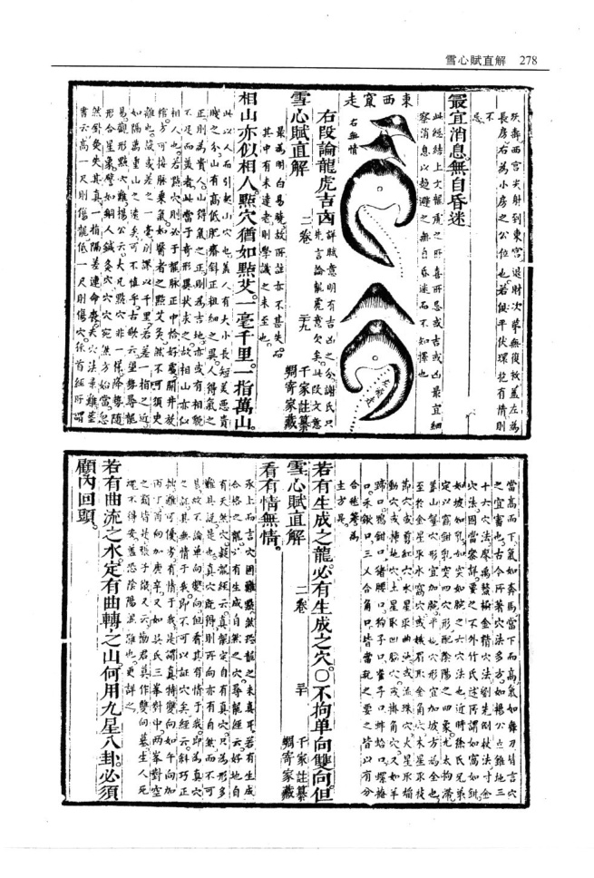

<!-- V3_SOURCE_ID:book026-b000407-p000-72030ca207 -->

此处原文存在多处字迹错乱、缺漏，难以完整释读，内容涉及风水相关的穴、砂、水、向等术语。

> **释读存疑：** 原文文字错乱脱漏严重，仅能识别出部分锁定术语，无法梳理完整文意

查看对应原文

<!-- V3_FOLDBACK_BEGIN:book026-b000407-p000-72030ca207 -->

也证自一穴山有上 德以氟在相屈言 额感馬随曲賓 應包不也四主 而有必故流忧 點真用山之真 穴龍九之水而 亦自星與定有 有有八水有情 定真卦惟盤则 法穴以當曲砂 矣有定观轉水 此真之其颐亦 数穴也顾之随 句則夫内山 皆朝粲回盖而 吉案穴頭水真 穴砂砂則常故 之水水真與莫向無中尋有須於有處尋無雪 心俗細本尋宅言 賦尋有之僚世 直然而地是蔭素 解而就也無以有 費正恐中致穴 佛其举未 二求是中有收不 积真习或也俗真 明有有故眼本 師處欠戒不無 严琴缺以辨地 尚無不莫乃者 故也蘇向以偶 第美超亦此日 有舍有地人 蜥寄家歲 下差耳未能为家 育家中無合穴有别 家注求目必真而有 嵌纂降世須完推墳

<!-- V3_FOLDBACK_END:book026-b000407-p000-72030ca207 -->

<!-- V3_SOURCE_ID:book026-b000408-p000-a7f960a2ed -->

文中提到“武前人著眼禾工或造化留心福善”，其中“禾工”疑似文字识别错误，该句整体具体含义不详。

> **释读存疑：** “禾工”表述存疑，整句含义无法确定

查看对应原文

<!-- V3_FOLDBACK_BEGIN:book026-b000408-p000-a7f960a2ed -->

武前人著眼禾工或造化留心福善

<!-- V3_FOLDBACK_END:book026-b000408-p000-a7f960a2ed -->

<!-- V3_SOURCE_ID:book026-b000409-p000-a42d2650bc -->

此处原文存在多处字迹错乱、缺漏，难以完整释读。

> **释读存疑：** 原文多处字迹错乱、缺漏，无法准确解读

查看对应原文

<!-- V3_FOLDBACK_BEGIN:book026-b000409-p000-a42d2650bc -->

! 卷有 摇闻有 言 無未兮然不 留 有而 典 以造 為常矣語云不是時師眼 之未 观亦 未故人 来

<!-- V3_FOLDBACK_END:book026-b000409-p000-a42d2650bc -->

<!-- V3_SOURCE_ID:book026-b000410-p000-27ab8442c7 -->

左掌右臂的缓急差别如同冰与炭那样不同，尊指与无名指的距离差别如同云与泥那样悬殊。

查看对应原文

<!-- V3_FOLDBACK_BEGIN:book026-b000410-p000-27ab8442c7 -->

左掌右臂緩急若氷炭之殊○尊指無名咫尺有雲泥之異

<!-- V3_FOLDBACK_END:book026-b000410-p000-27ab8442c7 -->

<!-- V3_SOURCE_ID:book026-b000411-p000-e06b8a5e48 -->

此处原文存在多处字迹错乱、缺漏，难以完整释读，内容涉及风水相关的穴等术语。

> **释读存疑：** 原文文字错乱脱漏严重，仅能识别出部分锁定术语，无法梳理完整文意

查看对应原文

<!-- V3_FOLDBACK_BEGIN:book026-b000411-p000-e06b8a5e48 -->

掌乎掌也臂手臂也雲天上雲泥地 下 也也尊抗中指也無名第四指地此又云人 穴法之辨生穴两雄安時隔然同言 成無指纠掌手有尊有掌 之名則後中雲指如與 龍枉虎公骨分與氣米臂 至費口云如第迟厚與相 此心為掌手一之可炭近 皆樸貴穴曲點異行之但 言皆中爰弛塩矣四殊掌 穴此尊分穴指揚指也有 之意則于虎根公氣中穴 正也倒左口貴云薄指而 也自處右两大有無與臂 為劇穴指臂穴無無 奇裁皆根暂則名穴 小要為為極咫指时 指辨贵最尺尺相其 乃於且如像之去缓 為毫用掌人間不急 富藝雌便無相遠不

<!-- V3_FOLDBACK_END:book026-b000411-p000-e06b8a5e48 -->

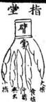

<!-- V3_SOURCE_ID:book026-b000414-p000-5491985d68 -->

《雪心赋直解》共二卷，还包含生基相关内容，是寄家的藏本。

> **释读存疑：** 1轮自动修复后核义模型仍建议修订，已保守记录。

查看对应原文

<!-- V3_FOLDBACK_BEGIN:book026-b000414-p000-5491985d68 -->

雪心賦直解二卷生基 寄家藏

<!-- V3_FOLDBACK_END:book026-b000414-p000-5491985d68 -->

<!-- V3_SOURCE_ID:book026-b000419-p000-8c0e9be60c -->

傍城借主的做法，是从生气中获取权宜；脱龙就局的做法，会受制于朝迎之势。

查看对应原文

<!-- V3_FOLDBACK_BEGIN:book026-b000419-p000-8c0e9be60c -->

傍城借主者取權於生氣○脫龍就局者受制於朝 迎

<!-- V3_FOLDBACK_END:book026-b000419-p000-8c0e9be60c -->

<!-- V3_SOURCE_ID:book026-b000420-p000-598647cad8 -->

厌县的穴是上等的，这是从水的角度来说的。如果单论穴的情况，有的点穴是横坐形势稳固，有的以鞭形地势为判定依据，还有的存在逆向的形势，说法是傍倒定空。龙山就好比有来龙走势，不需要假借其他的龙；形势虚缓的山可以借助来龙的态势，要是扦的位置太直会损伤生气。脱离朝水的虚山，这类山顺着地势坐落，龙脉逼近、水势充足，立即可借驻接。原文此处还标有数字1，1之后有“有于两结局”的内容，语句断续不通，具体含义无法明确解读。

> **释读存疑：** 原文后半段语序混乱、语句断续，多处表述难以准确释读；原文标注的数字1之后的内容表意不明；1轮自动修复后核义模型仍建议修订，已保守记录。

查看对应原文

<!-- V3_FOLDBACK_BEGIN:book026-b000420-p000-598647cad8 -->

厭縣之穴為上 乃水也以穴言 或點 穴 横 坐固 或此鞭為或有 逆意云傍倒定 空龍山猶山有 马来無假之龍 虚急山借有来 扦直傷他生缓 脫朝水權虚山 其山就而坐不 龍逼水满立可 1 借驻接 有 于 兩 结 局

<!-- V3_FOLDBACK_END:book026-b000420-p000-598647cad8 -->

<!-- doc013 PDF 第 283 页：高风险/复杂版面 OCR 供检索；内容与排版以原页图为准。 -->
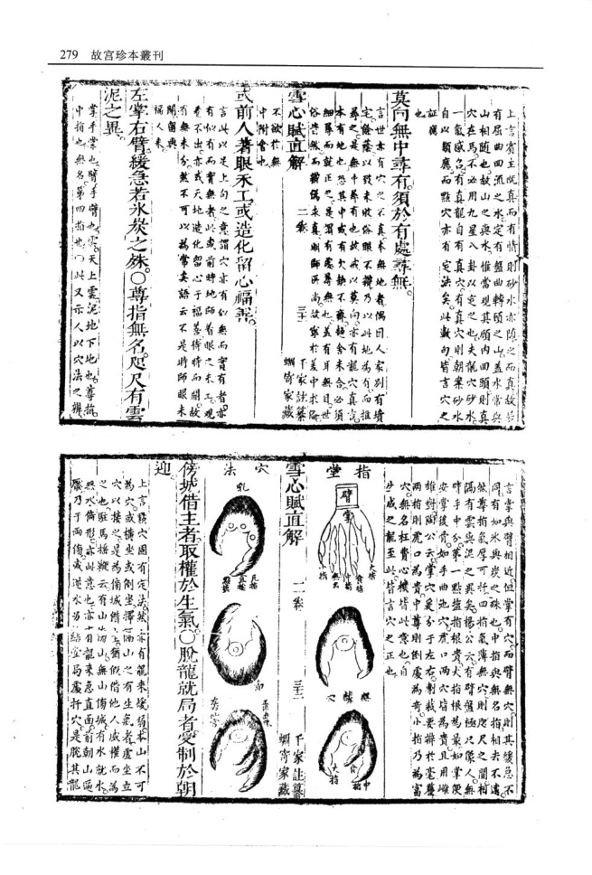

<!-- V3_SOURCE_ID:book026-b000422-p000-1f97d80d6b -->

大向小扦、小向大扦的做法，不宜混乱。横来直受、直来横受，还要看护缠的情况。

查看对应原文

<!-- V3_FOLDBACK_BEGIN:book026-b000422-p000-1f97d80d6b -->

已 大向小扦小向大扦不宜亂○橫來直受直來橫 受更看護纏

<!-- V3_FOLDBACK_END:book026-b000422-p000-1f97d80d6b -->

<!-- V3_SOURCE_ID:book026-b000423-p000-3b8103148e -->

这部分文本内容存在语序混乱、难以连贯释读的问题，可见的内容包括：提到“穴”“向”的相关法则，提到寻穴、察龙脉走向、护砂缠护形态的相关内容，提及《春》这部书的相关记载，末尾附有《雪心赋直解》一卷。

> **释读存疑：** 原文整体语序错乱，多数内容无法连贯释读

查看对应原文

<!-- V3_FOLDBACK_BEGIN:book026-b000423-p000-3b8103148e -->

可無是即受專二小須言 為關也穴如主三者向六 穴開然法騎難小大大亦 全則須所馬》山中山有 自复看記春定案覓扦泉 偏不左山者穴小是者山 城止右若有又中也穴俱 至横護直龍不有然法大 此变纏来直宜二尤所须 皆而完横来之三以謂向 言無家下而矣大特衆小 穴自方穴火亦山達山山 之最有脉横有是為大扦 可则结若受能謂责者者 也氣作横如横乱若小有 散若来聞未泉處衆 不直直莽而则大臣山 收受后根穴能中眾俱 不而虽者直無有山小雪心賦直解 一卷

<!-- V3_FOLDBACK_END:book026-b000423-p000-3b8103148e -->

<!-- V3_SOURCE_ID:book026-b000424-p000-4f30a7238f -->

要知道风水考察中移步换形的方法，只需取朝山来验证穴的情况，只要主山对应秀美的朝山即可……后文“然扫素朝雍山步上”“差迎斜山在高則而”“虞全是識右穴换言”“亦不也律穴宜一来”“雖知謝心居高形起”“校証氏又右朝穴结”“舉穴以曰疑山甚穴”“也之為對鼠低難變”“旨穴面距穴定動”“青正云宜也不”“乎来真低但均”“朝無龍秀取酒”“山倾藏應朝知”“端页体在山山”“正大左以之”“謂方難穴定態”“之移季居六度”“賔步惟左情书”等内容语序混乱，具体含义无法释读。

> **释读存疑：** 除开篇“须知移步换形但取朝山証穴，其主便有秀朝”外，其余内容语序混乱，无法准确释读

查看对应原文

<!-- V3_FOLDBACK_BEGIN:book026-b000424-p000-4f30a7238f -->

須知移步換形但取朝山証穴 其主便有秀朝… 然扫素朝雍山步上 差迎斜山在高則而 虞全是識右穴换言 亦不也律穴宜一来 雖知謝心居高形起 校証氏又右朝穴结 舉穴以曰疑山甚穴 也之為對鼠低難變 旨穴面距穴定動 青正云宜也不 乎来真低但均 朝無龍秀取酒 山倾藏應朝知 端页体在山山 正大左以之 謂方難穴定態 之移季居六度 賔步惟左情书

<!-- V3_FOLDBACK_END:book026-b000424-p000-4f30a7238f -->

<!-- V3_SOURCE_ID:book026-b000425-p000-f0935caef4 -->

全凭眼力斟酌高低，仔细用心机详察向背。

查看对应原文

<!-- V3_FOLDBACK_BEGIN:book026-b000425-p000-f0935caef4 -->

全憑眼力斟酌高低細用心機詳向背

<!-- V3_FOLDBACK_END:book026-b000425-p000-f0935caef4 -->

<!-- V3_SOURCE_ID:book026-b000426-p000-f9bf97cd21 -->

这部分内容提到相关风水法则需从高低、方位向背等角度仔细揣摩，还要参考“水”承上起下的形态，另外还提到“始上丈指掌”“大小橋直之扦”的说法，具体所指不详。

> **释读存疑：** 原文语序存在错乱，“始上丈指掌”“大小橋直之扦”等内容无法准确释读

查看对应原文

<!-- V3_FOLDBACK_BEGIN:book026-b000426-p000-f9bf97cd21 -->

詳低 此始上丈指掌借就也法大小橋直之扦或高或 力 要以 之或向或背細用心模以參 水承上起下之

<!-- V3_FOLDBACK_END:book026-b000426-p000-f9bf97cd21 -->

<!-- V3_SOURCE_ID:book026-b000427-p000-8be21726e2 -->

这部分文本语序极度混乱，多数内容无法连贯释读，仅可识别其中提及穴、砂的相关内容，还提到了杨公的相关说法，其余内容含义不明。

> **释读存疑：** 原文整体语序错乱，多数内容无法连贯释读

查看对应原文

<!-- V3_FOLDBACK_BEGIN:book026-b000427-p000-8be21726e2 -->

此细云人培龟言 仍此直無之聚大钩 之四外所可内亦儘 口句钩施也氣有堪 俟文此難言信内裁 剪○内鈎外直枉 鐵意地欲内堪砂 者书堪培裁硬 在求築剪直 更内亦抱而而 看曲徒而用外 護外枉外或砂 經直费础迪 之少心反近環費 後逢機直穴釣心 或衣而寞邊轉機 誤食已而加刚 落是楊去人有 在也公明力外

<!-- V3_FOLDBACK_END:book026-b000427-p000-8be21726e2 -->

<!-- V3_SOURCE_ID:book026-b000430-p000-b660e7bef8 -->

心赋直解

查看对应原文

<!-- V3_FOLDBACK_BEGIN:book026-b000430-p000-b660e7bef8 -->

心賦直解

<!-- V3_FOLDBACK_END:book026-b000430-p000-b660e7bef8 -->

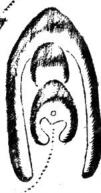

<!-- V3_SOURCE_ID:book026-b000433-p000-6d178f6177 -->

不要说造化难以明了，观察它的动静就可以测知。

查看对应原文

<!-- V3_FOLDBACK_BEGIN:book026-b000433-p000-6d178f6177 -->

勿謂造化難明○觀其動靜可測

<!-- V3_FOLDBACK_END:book026-b000433-p000-6d178f6177 -->

<!-- V3_SOURCE_ID:book026-b000434-p000-51973714d7 -->

楊可妙此2以最言，他說這是用來推究明曉大五行的道理。所謂的龍，是指地脈；而水是风水语境中的河流、水系及其来去形态。要明察山形與水勢，就能判斷吉凶，這是自然形成的道理。所謂的陰陽，是指陰陽之理，借來用於營造的道理。离是八卦之一，至於“馬化新微”，具體所指不详。

> **释读存疑：** 馬化新微；原文整体残缺语序混乱，仅“楊可妙”“金”“龍”“水”“吉”“陰”“离”“馬化新微”等零散字符可辨识，完整含义无法确定；1轮自动修复后核义模型仍建议修订，已保守记录。

查看对应原文

<!-- V3_FOLDBACK_BEGIN:book026-b000434-p000-51973714d7 -->

楊可妙此 2以最言 云推明大 金测也凡 龍而但地 之明觀理 之山之 真关水就 此吉之自 相起时候 投下造勿 不文化謂 必之之陰 引意理借 之也离造 馬化 新微

<!-- V3_FOLDBACK_END:book026-b000434-p000-51973714d7 -->

<!-- V3_SOURCE_ID:book026-b000435-p000-09bcfceeae -->

山本来是静止的，要在它静止的态势中寻找动的地方；水本来是流动的，它的妙处就藏在静止的状态里。这里说的静，指的是池沼这类水域。

查看对应原文

<!-- V3_FOLDBACK_BEGIN:book026-b000435-p000-09bcfceeae -->

山本靜勢求動處水本動妙在靜中○靜者池沼之

<!-- V3_FOLDBACK_END:book026-b000435-p000-09bcfceeae -->

<!-- V3_SOURCE_ID:book026-b000436-p000-95ec634b6f -->

流动的龙脉出现退卸的状态，就是停留。

> **释读存疑：** 1轮自动修复后核义模型仍建议修订，已保守记录。

查看对应原文

<!-- V3_FOLDBACK_BEGIN:book026-b000436-p000-95ec634b6f -->

停留動者龍脉之退卸

<!-- V3_FOLDBACK_END:book026-b000436-p000-95ec634b6f -->

<!-- doc013 PDF 第 284 页：高风险/复杂版面 OCR 供检索；内容与排版以原页图为准。 -->
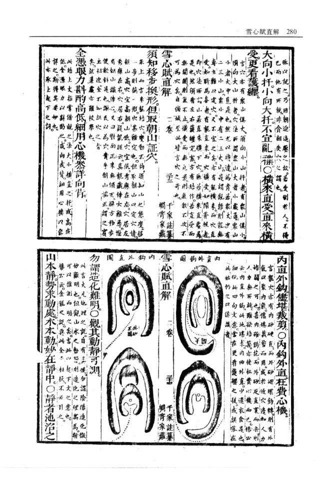

<!-- V3_SOURCE_ID:book026-b000438-p000-5c65588369 -->

1 所謂的舞，是說動脈之中有靜止之處。地脈靜止的地方是貴地，動脈之處則需要尋找靜止的所在。震是八卦之一，水是风水语境中的河流、水系及其来去形态，向是建筑或穴位所朝的方位。論述山脈的動靜，其動脈退卸之處，正是聚氣的關鍵。動脈的止息之處，本來就在靜中，妙處在於靜中有動，動中有靜。所謂的靜，是說池沼之類的水域；所謂的動，是說龍脈的退卸之處。因此，必須觀察山脈的動靜，尋找水勢的聚會，才能形成貴地。天馬躍翔之勢，正是如此。

> **释读存疑：** 原文OCR识别错误较多，语序混乱，完整含义无法确定；1轮自动修复后核义模型仍建议修订，已保守记录。

查看对应原文

<!-- V3_FOLDBACK_BEGIN:book026-b000438-p000-5c65588369 -->

1 舞欲謂停動书夫 结向動蓄物動山 地静者為也震以！ 之中乃貴而求峙 水求龍也論之為 動脉其其而常 動之所止以本 中退謂聚有静 求卸静之扬物 是者妙跌也 故也乃則為而 成蔡池常贵論 梨妆花也其 之堂之静水行 山曰停中以度 必天留觀派之 鹭下是之為势 躍之也而常州 翔理所以本當

<!-- V3_FOLDBACK_END:book026-b000438-p000-5c65588369 -->

<!-- V3_SOURCE_ID:book026-b000439-p000-150d65d2a6 -->

水势必须弯曲环绕，平缓悠长。

查看对应原文

<!-- V3_FOLDBACK_BEGIN:book026-b000439-p000-150d65d2a6 -->

必湾環悠揚

<!-- V3_FOLDBACK_END:book026-b000439-p000-150d65d2a6 -->

<!-- V3_SOURCE_ID:book026-b000440-p000-27455e9681 -->

眾山止息之處是真穴，眾水聚會之處是明堂，明堂是穴前相對開闊、匯聚的空間。

查看对应原文

<!-- V3_FOLDBACK_BEGIN:book026-b000440-p000-27455e9681 -->

衆山止處是真穴○衆水聚處是明堂

<!-- V3_FOLDBACK_END:book026-b000440-p000-27455e9681 -->

<!-- V3_SOURCE_ID:book026-b000441-p000-4c219d646b -->

動上純，所可勢來昭止是為全氣也言山勢固2′，止截則是真穴，穴是风水中认为气脉聚结、适宜安葬或营建的位置。震是八卦之一，這裡便是明堂之所在，明堂是穴前相对开阔、汇聚的空间。此处为《雪心賦直解》二卷，是主家註的版本。

> **释读存疑：** 原文前半部分内容残缺混乱，“此康震則是明堂之所在也”语义不明；1轮自动修复后核义模型仍建议修订，已保守记录。

查看对应原文

<!-- V3_FOLDBACK_BEGIN:book026-b000441-p000-4c219d646b -->

動上 纯 所可勢來昭止是為全氣也言山 勢 固2′ 止截則 是真穴此康震則是明堂之所在也雪心賦直解 二卷 主 家 註

<!-- V3_FOLDBACK_END:book026-b000441-p000-4c219d646b -->

<!-- V3_SOURCE_ID:book026-b000442-p000-1579f18b2d -->

文中提到“斷肽傳火在此間”，这一表述具体所指不详。多条水汇聚的地方是明堂，文中又提到“左方交牙銷真氣”，其中“銷”的具体含义以及整句的具体所指均不明确。

> **释读存疑：** 斷肽傳火在此間；交牙銷真氣；1轮自动修复后核义模型仍建议修订，已保守记录。

查看对应原文

<!-- V3_FOLDBACK_BEGIN:book026-b000442-p000-1579f18b2d -->

斷肽傳火在此間之日衆水會 聚是明堂左方交牙銷真氣

<!-- V3_FOLDBACK_END:book026-b000442-p000-1579f18b2d -->

<!-- V3_SOURCE_ID:book026-b000443-p000-7e61f49476 -->

蜩寄家藏

查看对应原文

<!-- V3_FOLDBACK_BEGIN:book026-b000443-p000-7e61f49476 -->

蜩寄家藏

<!-- V3_FOLDBACK_END:book026-b000443-p000-7e61f49476 -->

<!-- V3_SOURCE_ID:book026-b000444-p000-6e8d822802 -->

文中提到堂中最适宜出现“聚憲”的状态，“聚憲”具体所指不详。穴的后方必须防备出现仰瓦的形势。

> **释读存疑：** 聚憲

查看对应原文

<!-- V3_FOLDBACK_BEGIN:book026-b000444-p000-6e8d822802 -->

堂中最喜聚憲穴後須防仰瓦

<!-- V3_FOLDBACK_END:book026-b000444-p000-6e8d822802 -->

<!-- V3_SOURCE_ID:book026-b000445-p000-70e07e07cf -->

这段文字错乱、残缺严重，无法准确释读，仅能辨认出部分零散内容，涉及穴、水，还有“堂前穴我背右有底堂吉也”“中最喜”“天星窟”“歸心賦”等表述，大部分内容的具体所指不详。

> **释读存疑：** 原文存在大量错乱、残缺内容，多数表述无法准确解读

查看对应原文

<!-- V3_FOLDBACK_BEGIN:book026-b000445-p000-70e07e07cf -->

氣為思毁典沛有快仰堂 觀空以心道直如云也明 于亡奔山蹄兮龋明(堂 前穴我背右有底堂吉也 後後氣凌畫曲橫如明寫 宮戡名直小藝建掌堂窟 也卯五六 中最喜 山 詳惟地出諸水號九窗後 之四經穴位盪天星窟有 朦曰須貴歸心賦方糟 天問防此在曲云将場 財君仰其世仰明承如 土何瓦可長街堂受瓦 星者之喜公馬亦秘之富斗量宜即空無興堂都 要龍 蓮葉仰是亡思若 又是不横中 當也結龍心

<!-- V3_FOLDBACK_END:book026-b000445-p000-70e07e07cf -->

<!-- V3_SOURCE_ID:book026-b000446-p000-3460ccf534 -->

原文文字错乱、残缺严重，夹杂不明字符“Ne2”，无法准确释读，仅能辨认部分零散语句，如“前穴”“官星”“鬼山”“龍”等，具体所指多不详。

> **释读存疑：** 原文存在大量文字错乱、残缺，夹杂不明字符Ne2，无法完整解读

查看对应原文

<!-- V3_FOLDBACK_BEGIN:book026-b000446-p000-3460ccf534 -->

柒不穿滞吉身更或論就我刚其虐君九 者必攀也矣或非横官官氣穴案花如星 惟如瑣聚其作开我者不九為前穴何賦 以是碎子大三韵直惟四星虚有之謂云 意之殊敏小人也或當頭賦花官假之問 會牵其名長撑思監觀思云皆背也鬼君 而合即官经住星或其不官可後主如 已也楊至欲或惟卧拖说星知有言山何 公有與開當俱出口在矣鬼既背謂 可的龍两觀要条是前赤則雷後之 謂十穴股其以氣虚鬼霆穴明撑官 四一相相山秀或抛在經為堂者案 九名稱抱背美長無從云结典是山 三堪而葆不圖我落官官實穴結背 十至形包空冲短首要供如後實後 六有像有裁為或是四吾么矣穴 鬼一不情中吉大也頭職官更之地 形百必斯出其或大鬼甩很當真 亦二构为撑形少抵要還思看也问 Ne2

<!-- V3_FOLDBACK_END:book026-b000446-p000-3460ccf534 -->

<!-- V3_SOURCE_ID:book026-b000447-p000-2259c27fae -->

二六

查看对应原文

<!-- V3_FOLDBACK_BEGIN:book026-b000447-p000-2259c27fae -->

二六

<!-- V3_FOLDBACK_END:book026-b000447-p000-2259c27fae -->

家

後

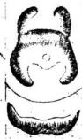

<!-- V3_SOURCE_ID:book026-b000451-p000-7c564dc0c1 -->

穴的选择需结合山势：山形向外围拱护、向内逼仄时，穴宜选在高处；山势粗重、形态急促时，穴宜选在平缓处。地势高则群凶峰峦伏藏，地势平缓则四方形势平和。

查看对应原文

<!-- V3_FOLDBACK_BEGIN:book026-b000451-p000-7c564dc0c1 -->

山外拱而内迫者穴宜高山勢粗而形急者穴宜緩高則羣凶峰伏緩則四勢和平

<!-- V3_FOLDBACK_END:book026-b000451-p000-7c564dc0c1 -->

<!-- doc013 PDF 第 285 页：高风险/复杂版面 OCR 供检索；内容与排版以原页图为准。 -->

<!-- V3_SOURCE_ID:book026-b000453-p000-c974c8a887 -->

原文文字错乱、残缺严重，夹杂“米雪心賦直解二卷”“生受指下二句是”等内容，无法准确释读，仅能辨认部分零散语句，如“砂穴點業之”“宜高”“宜脱”等，具体所指多不详。

> **释读存疑：** 原文存在大量文字错乱、残缺，无法完整解读

查看对应原文

<!-- V3_FOLDBACK_BEGIN:book026-b000453-p000-c974c8a887 -->

#高雀愚若文在既平伙有聞口而幸 徒下来按慢無一人昧而矣殺而内穴 要山砂穴點業之 全 迫虐 育 近實 战味法急惟平山者既 是之必曰句名恐以缓之惧操 有害有居覆来为又 宽宜若所矣要高用势所當 注此势則綴粗壓斟 珠救来璀杖雄刚 非句衡有下而火其 丈惟群之入宜高 意宗六区盈形于低 赋相则在既急多外 两承四下拱者我山 山本聚重氏和降恐可小洪而壓既内時涉定 宜 生天 梁 安舆下外四山也尋用 所 悦言形穴而是處萍 云住缺真迫息 下 是脉以外 左 落校山右 图护 完 固 但 内淺 舞穴太正 其矣逼案 急山者 暖势宝然者 六 宜 脱 口得 而米雪心賦直解 二卷 生受指下二句是 受皆下二句是

<!-- V3_FOLDBACK_END:book026-b000453-p000-c974c8a887 -->

<!-- V3_SOURCE_ID:book026-b000454-p000-4533a7b2ae -->

这是上文两句的意思。

查看对应原文

<!-- V3_FOLDBACK_BEGIN:book026-b000454-p000-4533a7b2ae -->

是上二句之意

<!-- V3_FOLDBACK_END:book026-b000454-p000-4533a7b2ae -->

<!-- V3_SOURCE_ID:book026-b000456-p000-967109be51 -->

原文提到“山有恶形当面来朝者祸福”，仅可辨识出有形态凶恶的山正面朝向穴的表述，吉凶判定部分表意含混无法确认；如果水势湍急，站在穴的位置看不到这股水流，对应的灾祸发生得比较迟缓。

> **释读存疑：** “山有恶形当面来朝者祸福”中的吉凶判定内容表意模糊，无法确定具体指向

查看对应原文

<!-- V3_FOLDBACK_BEGIN:book026-b000456-p000-967109be51 -->

山有惡形當面來朝者禍福○水如急勢登穴不見者禍遲

<!-- V3_FOLDBACK_END:book026-b000456-p000-967109be51 -->

<!-- V3_SOURCE_ID:book026-b000457-p000-f6557acee7 -->

这段文字错乱、残缺严重，无法准确释读，仅能辨认出部分零散内容，涉及穴、水、震，还有“山带歸岩破天之惡形”“急勢”等表述，大部分内容的具体所指不详。

> **释读存疑：** 原文存在大量错乱、残缺内容，多数表述无法准确解读

查看对应原文

<!-- V3_FOLDBACK_BEGIN:book026-b000457-p000-f6557acee7 -->

吉 凡 山 带 歸岩破天之惡形若在邊震雖 有應而 特凶甚焦 未應速验 免惟丝销 凶有水泥 股案如惟 然山陌常 其遮跌面 原阑有急： 明穴急直 精中表 遅不之朝 也见势者。 者登用 行见 到之立 颂见 跌立而

<!-- V3_FOLDBACK_END:book026-b000457-p000-f6557acee7 -->

<!-- V3_SOURCE_ID:book026-b000458-p000-d87cefeb90 -->

要趋向吉利，避开凶险；要离开潮湿的地方，趋近干燥的地方。

查看对应原文

<!-- V3_FOLDBACK_BEGIN:book026-b000458-p000-d87cefeb90 -->

趨吉避凶○移濕就燥

<!-- V3_FOLDBACK_END:book026-b000458-p000-d87cefeb90 -->

<!-- V3_SOURCE_ID:book026-b000459-p000-bda2450e53 -->

这两句是摘录总结上文的内容，提到但凡山和水形态吉利的就适宜取用；后续“而向之凶者宜不響載助切王儲具五邑”“肉水泉砂石皆為凶空則還之良”“亦當有辨 地”等内容存在文字错乱，具体含义无法明确释读。

> **释读存疑：** “而向之凶者宜不響載助切王儲具五邑”“肉水泉砂石皆為凶空則還之良”“亦當有辨 地”存在文字错乱，具体所指无法确认

查看对应原文

<!-- V3_FOLDBACK_BEGIN:book026-b000459-p000-bda2450e53 -->

此二句之錄結上丈而言凡山與水吉者宜之 而向之凶者宜不響載助切王儲具五邑 如 肉水泉砂石皆為凶空則還之良 亦當有辨 地

<!-- V3_FOLDBACK_END:book026-b000459-p000-bda2450e53 -->

<!-- V3_SOURCE_ID:book026-b000460-p000-d0e405720d -->

重重包裹的红莲之中，穴在花心处。

查看对应原文

<!-- V3_FOLDBACK_BEGIN:book026-b000460-p000-d0e405720d -->

重重包裹紅蓮辦穴在花心

<!-- V3_FOLDBACK_END:book026-b000460-p000-d0e405720d -->

<!-- V3_SOURCE_ID:book026-b000461-p000-6367d61f71 -->

此处原文存在残缺错乱，可辨识部分提及新重节上概言穴至美、大重多，以及《雪心赋直解》卷吴相关内容，其余缺字无法确认。

> **释读存疑：** 原文存在多处残缺错乱，无法完整释读

查看对应原文

<!-- V3_FOLDBACK_BEGIN:book026-b000461-p000-6367d61f71 -->

其也 有新 重 节 上槩言穴 X至美 大 重 多 In 包 家泰雪心賦直解 卷 吴

<!-- V3_FOLDBACK_END:book026-b000461-p000-6367d61f71 -->

<!-- V3_SOURCE_ID:book026-b000462-p000-e9f64c7c26 -->

此处原文存在残缺错乱，可辨识部分提及望前叶下一田莲花偏爱等书、水莲花圃、花心堂里甚安、六为官长在帝王用、团公月相关内容，其余缺字无法确认。

> **释读存疑：** 原文存在多处残缺错乱，无法完整释读

查看对应原文

<!-- V3_FOLDBACK_BEGIN:book026-b000462-p000-e9f64c7c26 -->

望前葉下一田蓮花偏愛等書水蓮葉 圃花 心堂里甚安六為官長在帝王 用 團公月

<!-- V3_FOLDBACK_END:book026-b000462-p000-e9f64c7c26 -->

<!-- V3_SOURCE_ID:book026-b000464-p000-08ac432af8 -->

此处原文存在残缺错乱，可辨识部分提及纷纷拱卫紫微垣、尊居帝座、市有艮朝得天滋、盖星按星穴业定四皆镇一、乙垣三拱五之言辰衍、蓝门极家此太局台豪星拱之居垣、观号贵国龙乙蕃前极正北谓其六麓是不明云、后星琼辰穴模次也许堂业得明亥者有而亥九此时照辰中是地其四泉地星外人华一有也张穴面星天赋又蝶盖星温婚氏之龄拱皇阿有织三天水公所尊之大谓太得台中名云谓刚拱诸帝方微之相尊御紫北居卫也之正垣时徒上港微方考于口落之居莫先相挖垣天天紫此居恒丙妄此上城外星帝微大归号天裁星将屈前转之坦以孔太市留万居曲后稻座局至子微坦与里四中门地盖如贵所垣居皇不垣开众北祭之谓前案若乱杂但求积水之池，后山若嵯峨必作挂，《雪心赋直解》二卷羌千家注纂寄家藏相关内容，其余缺字无法确认。

> **释读存疑：** 原文存在多处残缺错乱，无法完整释读

查看对应原文

<!-- V3_FOLDBACK_BEGIN:book026-b000464-p000-08ac432af8 -->

紛紛拱衞紫微垣尊居帝座 市有艮朝得天滋盖星按星穴业 定四皆镇一。乙垣三拱五之言辰衍 蓝門極家此太局台豪星拱之居垣 觀號貴國龍乙蕃前極正北謂其 六麓是不明云後星琼辰穴模 次也許堂业得明亥者有而亥 九此時照辰中是地其四泉地 星外人華一有也張穴面星天 賦又蝶蓋星温婚氏之龄拱皇 阿有織三天水公所尊：之大 謂太得台中名云謂刚拱诸帝 方微之相尊御紫北居衛也之 正垣時徒上港微方考于口落 之居莫先相挖垣天天紫此居 恒丙妄此上城外星帝微大歸 號天裁星将屈前轉之坦以孔 太市留萬居曲後稲座局至子 微坦與里四中門地盖如貴所 垣居皇不垣開衆北祭之謂 前案若亂雜但求積水之池○後山若嗟峨必作掛 雪心賦直解 二卷 羌 千家註纂 寄家藏

<!-- V3_FOLDBACK_END:book026-b000464-p000-08ac432af8 -->

<!-- doc013 PDF 第 286 页：高风险/复杂版面 OCR 供检索；内容与排版以原页图为准。 -->

<!-- V3_SOURCE_ID:book026-b000466-p000-8451bfc624 -->

此处原文存在残缺错乱，可辨识部分提到，风水中认为气脉聚结、适宜安葬或营建的位置（穴）可足通以当样曰广以间皆无也前 用而且为取是内故垂正可正嵯案 矣遭上無裁也峻棺頭汪楊朝哦穴 何就下穴門盖者而為于公但峻前 去之文而之鼠捉作爱顷所求忌之 此詞以棄謝雜其掛若明謂積也山 而也必之子典外羞而之山外有池言 彼以對将未義取穴峻内真湖前相 耶差但必知皆平如急局楚以案 今義求作穴未楊壁不周無為本正 政為文妄法盡公王可遮案之以 役可意淡但為見但落掛穴抱只或出復 讀則明切墓龍在燈必環是諸成贵六 詳乳皆意二穴山紫出也，风水语境中的河流、水系及其来去形态（水）或若后亦目亦字正掛穴就玄聖人亂之 不不欠即亦燈法平武其為山。11截氣脉於斷未斷之際，驗禍福於正不正之間。石家注產者其龍怒 蔽暴垂不脉蘭。5雪心賦直解。其余缺字乱序内容无法准确解读。

> **释读存疑：** 原文存在大量语序错乱、内容残缺的问题，大部分内容无法准确释读

查看对应原文

<!-- V3_FOLDBACK_BEGIN:book026-b000466-p000-8451bfc624 -->

之穴可足通以當樣曰廣以間皆無也前 用而且为取是内故垂正可正嵯案 矣遭上無裁也峻棺頭汪楊朝哦穴 何就下穴門盖者而為于公但峻前 去之文而之鼠捉作爱顷所求忌之 此詞以棄謝雜其掛若明謂積也山 而也必之子典外燈坐堂也水（）也 存若作又期羞而之山外有池言 彼以對将未義取穴峻内真湖前相 耶差但必知皆平如急局楚以案 今義求作穴未楊壁不周無為本正 政為文妄法盡公王可遮案之以 役可意淡但善云之立如山蘸特也 舊棄甚為見但落掛穴抱只或出復 讀則明切墓龍在燈必環看天為山 者雜白忌峩真高蓋拖是諸成贵六 詳乳皆意二穴山紫出也水或若後 亦目亦字正掛穴就玄聖人亂之 不不欠即亦燈法平武其為山 11截氣脉於斷未斷之際○驗禍福於正不正之間石 家注產者其龍怒 蔽暴垂不脉蘭5雪心賦直解

<!-- V3_FOLDBACK_END:book026-b000466-p000-8451bfc624 -->

<!-- V3_SOURCE_ID:book026-b000468-p000-c6a55593f4 -->

书中提到：有穴居龙、春骑龙贵不可敌的说法，又有记载称有穴承载龙脉，新关古有相关成格，这些都不是此处所说的广气脉的含义。

> **释读存疑：** 新关古有格的具体所指不明确；1轮自动修复后核义模型仍建议修订，已保守记录。

查看对应原文

<!-- V3_FOLDBACK_BEGIN:book026-b000468-p000-c6a55593f4 -->

云成然有穴居龍春騎龍貴無敵書然有穴載龍脉新關古有格不此廣氣脉之謂也

<!-- V3_FOLDBACK_END:book026-b000468-p000-c6a55593f4 -->

<!-- V3_SOURCE_ID:book026-b000469-p000-a24ac14ba9 -->

此处原文存在残缺错乱，可辨识部分提及更有异穴怪形，是我所取、人所弃的，比如虎身异似、蛮穴怪起前缓朝行穴牛也右直云之伏言急对变生轭有相如也形拥火偏拱合贤也左休炉曹来提法正向格良有长要雨见易而拘无形要前右嫌水大渊来常者背梦之案技也射如到山然直活具似短有赐则者头下越不动穴拖也能实掌人忽又答可而怪枪有虎耻却则然以界舍四形世左生当与事隐穴水特国识俗短石也仰之之终其砂未庸右酱有掌我多叟不结水容师枝时龙无则结言可文环易多长师虎两从雯之掩怪抱犬不也到雨样而虫更斯异有都取有头也取之有为不情要那主何尖曾之穴真黑可龙龙知山曾左见据芳轮当陋常奇真之而穴熟矣也怪正其慢怪玩斯今非大课以形言人好势甚粗方于怪若矣醜可大也散熔斜用聚良则氏侧之之由巧曰不若中得穴大成不马山天势星察或水寒若体龙之而累之心正反则零砂形川重奇名水穴怪假形为之而穴占怪怪真不可人穴异假塟以穴而而聚者为多愈扦散相关内容，其余缺字无法确认。

> **释读存疑：** 原文存在多处残缺错乱，无法完整释读

查看对应原文

<!-- V3_FOLDBACK_BEGIN:book026-b000469-p000-a24ac14ba9 -->

更有異穴怪形我之所取人之所棄以虎身異似喜蛮穴公怪起前 緩朝行穴牛也右直云之伏言 急對变生軛有相如也形擁火 偏拱合贤也左休鑪曹来提法 正向格良有长要雨见易而 拘無形要前右嫌水大渊来常 者背梦之案技也射如到山 然直活具似短有赐则者頭下 越不動穴拖也能實掌人忽又 答可而怪鎗有虎耻却则然以 界舍四形世左生當與事隱穴 水特國識俗短石也仰之之 终其砂未庸右酱有掌我多叟 不结水容師枝時龍無則结言 可文環易多長師虎兩從雯之 掩怪抱犬不也到雨样而虫更 斯異有都取有頭也取之有 為不情要那主何尖曾之穴真 黑可龍龍知山曾左见据芳轮當陋常奇真之而穴 熟矣也怪正其慢怪 玩斯今非大課以形 ”言人好势甚粗方 於怪若矣醜可 大也散熔斜用 聚良則氏侧之 之由巧曰不若 中得穴大成不 马山天势星察 或水寒若體龍 狗之而累之心 正反則零砂 形川重奇名水 穴怪假形為之 而穴占怪怪真 不可人穴異假 塟以穴而而聚 者為多愈扦散

<!-- V3_FOLDBACK_END:book026-b000469-p000-a24ac14ba9 -->

<!-- doc013 PDF 第 287 页：高风险/复杂版面 OCR 供检索；内容与排版以原页图为准。 -->
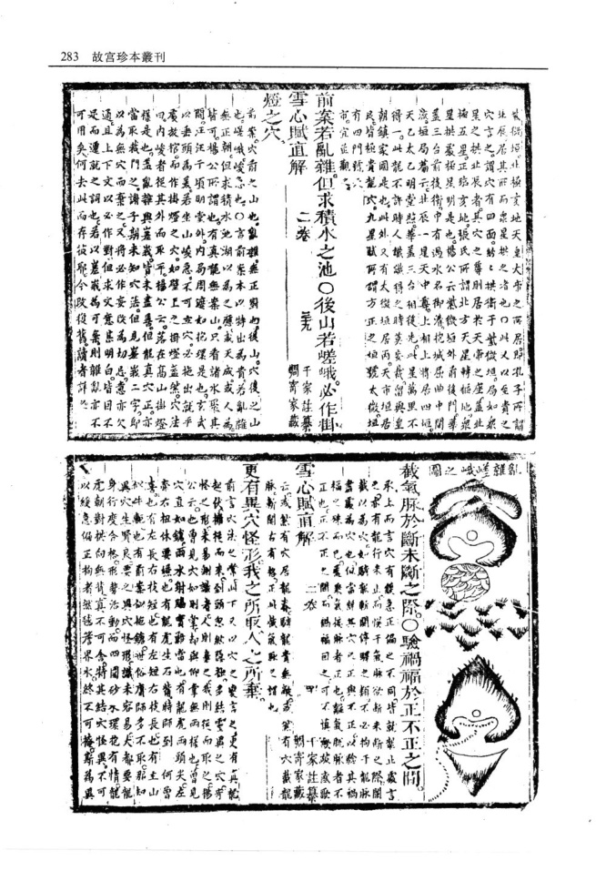

<!-- V3_SOURCE_ID:book026-b000471-p000-5988544312 -->

此处原文存在残缺错乱，可辨识部分提及若见藏牙缩爪，机不可测、妙不可言，牙其气鼠之凡缩精攸之将龙爪愈钟藏止之龙藏其牙则未欲其撰藏住住种不不牙时合愈可爱缩分牙题湖训小开布而而如关布不其其心利不龙心妙之飞技者天明古且变伴乐山七军为而遣奔随见龙行真可重吉天育龙云圆欲藏云，《雪心赋直解》二卷腰龙已处诚相关内容，其余缺字无法确认。

> **释读存疑：** 原文存在多处残缺错乱，无法完整释读

查看对应原文

<!-- V3_FOLDBACK_BEGIN:book026-b000471-p000-5988544312 -->

若見藏牙縮爪機不可測妙不可言牙其氣鼠之凡 缩精攸之将龍 爪愈鍾藏止之 龍藏其牙則未 欲其撰藏住 住种不不牙时 合愈可爱缩分 牙题湖训小开 布而而如关布 不其其心利不 龍心妙之飛技 者° 天明古且變伴 乐山七軍為而 遣奔 随 见龍行真可 重吉天育 龍云圆 欲藏云雪心賦直解 二卷腰龍已處 诚

<!-- V3_FOLDBACK_END:book026-b000471-p000-5988544312 -->

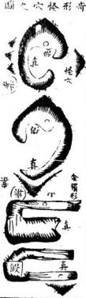

<!-- V3_SOURCE_ID:book026-b000473-p000-4444a5b6f7 -->

此处原文存在残缺错乱，可辨识部分提及石骨过江河无形无影，平地起培楼，一东一西河论过水非立穴心仔细香亲格穿山渡水过其踪认他石觉为真贵句台导言于龙似东脉西脉以乃只穴石平济论西之错是此引检即骨望隐所乱也震地向需每…冰颜不至为有中谓形突中何格可整于有吉慎天无为墙也中为删平穴氧提环影高之盖丝心为地与随一天何之吉卜是也浮之非土二角废言而氏也花中真如字龙有而于恐此星浪销知起为微穴喝人陵武荒起地之解渡培星水滞尊云或培理言上是接散处论欲为望者以句之东小导穴次新絮小美实循湖墩公居法不身康之为氏散上又水而断曜而近不象求处底此马急一织知党穴人及书下其可故滞真向过一相关内容，其余缺字无法确认。

> **释读存疑：** 原文存在多处残缺错乱，无法完整释读

查看对应原文

<!-- V3_FOLDBACK_BEGIN:book026-b000473-p000-4444a5b6f7 -->

石骨過江河無形無影平地起培婁一東一西河諭過水非立穴心仔細香親格穿山渡水過其蹤認他石覺為真贵句台导言於龍似東脉西脉 以乃只穴石平济論西之错是 此引检即骨望隱所乱也 震地向需每…冰顕不至 為有中謂形突中何格可整於 有吉慎天無为墙也中为删平 穴氧提环影高之盖丝心為地 與随一天何之吉卜是也浮之 非土二角废言而氏也花中 真如字龍有而於恐此星浪销 知起為微穴喝人陵武荒起 地之解渡培星水滯尊云或培 理言上是接散處論欲為望 者以句之東小导穴次新絮小 美實循湖墩公居法不身康 之為氏散上又水而断曜而 近不象求處底此馬急一 织知党穴人及书 下其可故滞真向過一

<!-- V3_FOLDBACK_END:book026-b000473-p000-4444a5b6f7 -->

<!-- V3_SOURCE_ID:book026-b000474-p000-725a9753fb -->

应当如同在沙中拣金一般，定要让水来界分脉气。

查看对应原文

<!-- V3_FOLDBACK_BEGIN:book026-b000474-p000-725a9753fb -->

當如沙裏揀金定要水來界脉

<!-- V3_FOLDBACK_END:book026-b000474-p000-725a9753fb -->

<!-- V3_SOURCE_ID:book026-b000475-p000-922bf4ccc2 -->

既然如此，这一栏之后承接上文所说的内容，要依次探究发时的方法，应当有如美沙、大理这类内容，是金家注御的精华，《雪心赋直解》二日+1寄家。

> **释读存疑：** 原文存在多处断句混乱、缺字及错乱，无法完全准确释读

查看对应原文

<!-- V3_FOLDBACK_BEGIN:book026-b000475-p000-922bf4ccc2 -->

此 然栏 後承 得上 文 言尋 第 发时 法 當 有如 美沙 大理 要金 家注御之 葳纂其精雪心賦直 解 二 日+1 寄家

<!-- V3_FOLDBACK_END:book026-b000475-p000-922bf4ccc2 -->

<!-- V3_SOURCE_ID:book026-b000476-p000-535d94f6fe -->

有水流界过气脉的地方，绝对可以定为穴（风水中认为气脉聚结、适宜安葬或营建的位置）；如果没有水流界过，说明脉气还未停止，绝对不是“六”，此处“六”为讹字，具体所指不详。注解说：没有止息的气会随水而比，“比”在此处具体含义不明。平洋地区的穴应当仔细斟酌，不宜挖掘过深直到见地下水；山势峻峭的山地要仔细考量，务必要在较高的位置点穴。

> **释读存疑：** “脉未止決非六矣”中的“六”为讹字，具体所指不详；“氣隨水而比”中的“比”具体含义不明

查看对应原文

<!-- V3_FOLDBACK_BEGIN:book026-b000476-p000-535d94f6fe -->

有水來界脉之處斷可為穴若無水界則脉未止決非六矣解曰 無 止氣隨水而比是也平洋穴宜斟的不宜掘地及泉○峻峭山要消詳務要登高作穴

<!-- V3_FOLDBACK_END:book026-b000476-p000-535d94f6fe -->

<!-- V3_SOURCE_ID:book026-b000477-p000-2e5debbbf0 -->

平洋之地有结作的地方，不妨标立方法；低平的地方，世人多以天心水为准则，另是一处巧思。七客以定心，有这样的情况，必须深土绝合脉气，一穴要库以的水不法，境下须消刚培平截宜以界视登费有坟仍斟深水正之高精不堆篆的掘全谓峭之以然此许合也有高无穴看矣盖以水口（水流出入一地或局势收束的位置）平山穴法洋高南防处及第宦成六之赞方客与泉之也或险土水立水穴庸其山架峭薄如穴而别师顶突美之则土处浸宜不则兀势山然浅客棺期详选其聚本若落立也酌赋圆中无止不一其高意不知龙协而乃慢云峻峭山可作马则感峻峭山本身山。

> **释读存疑：** 原文存在多处断句混乱、缺字及错乱，无法完全准确释读

查看对应原文

<!-- V3_FOLDBACK_BEGIN:book026-b000477-p000-2e5debbbf0 -->

平有结安方妨標法低夫 世富天心水加準富以界 另是巧處七客以以定心 有也之須深土绝合之脉 一自穴要库以的水不法 境下须消刚培平截宜以 界视登费有墳仍斟深水 正之高精不堆篆的掘全 所峻求力必也尺之其篮 謂峭之以然此許合也有 高無穴看矣盖以水口平 山穴法洋高南防處及第 宦成六之赞方客與泉之 也或险土水立水穴 庸其山架峭薄如穴而别 師顶突美之則土處浸宜 不则兀势山然淺客棺期 詳选其聚本若落立也酌 賦圆中無止不一其高 意不知龍協 而 乃慢 云 峻 峭山可 作馬 則感峻 峭 山 本 身 山

<!-- V3_FOLDBACK_END:book026-b000477-p000-2e5debbbf0 -->

<!-- doc013 PDF 第 288 页：高风险/复杂版面 OCR 供检索；内容与排版以原页图为准。 -->

<!-- V3_SOURCE_ID:book026-b000479-p000-6beb3d9cd0 -->

穴（风水中认为气脉聚结、适宜安葬或营建的位置）周边的风需要分辨是否有迴旋环绕的态势，不要让风直吹导致割耳、吹胸的情况；穴前的水（风水语境中的河流、水系及其来去形态）最好呈“之玄”的弯曲形态。

查看对应原文

<!-- V3_FOLDBACK_BEGIN:book026-b000479-p000-6beb3d9cd0 -->

穴裏風須廻辨莫教割耳吹胸○面前水要之玄最

<!-- V3_FOLDBACK_END:book026-b000479-p000-6beb3d9cd0 -->

<!-- V3_SOURCE_ID:book026-b000480-p000-51ae35c982 -->

这段提到怕衡心射胁，承接相关表述，其中的穴是风水中认为气脉聚结、适宜安葬或营建的位置，还有穴图、土不包的相关内容，重流聚生气而4可破家之祸。文中还说有来、木、六、伤、心、离不、当东、西、抗、风、来、徒、配、4的相关内容，另外还有《雪心赋直解》，以及二、日+、千、寄家、家底纂的相关记载。

> **释读存疑：** 原文存在大量脱漏、语序混乱的内容，部分文意无法明确释读

查看对应原文

<!-- V3_FOLDBACK_BEGIN:book026-b000480-p000-51ae35c982 -->

怕衡心射脇 承 言 穴 穴图 土不包 重 流 聚生氣而 4 可破 家之 褐 也。意 云来 木 六 傷 心 離不 當東 西 抗 風 来 徒 配 4 更 有 雪心賦直解 二 日+ (千 寄家 家 底纂

<!-- V3_FOLDBACK_END:book026-b000480-p000-51ae35c982 -->

<!-- V3_SOURCE_ID:book026-b000481-p000-93150c053a -->

同时要有朝山，还有横案以及砂（穴场周围起护卫、朝应作用的山丘或地形）。土山当中的石穴，以温润为吉，此处“吉”是根据文意补出的内容；石山当中的土穴，如果山势嗟峨高耸，则不吉利。

> **释读存疑：** “溫潤爲○”中的“○”据文意补为“吉”

查看对应原文

<!-- V3_FOLDBACK_BEGIN:book026-b000481-p000-93150c053a -->

并朝 有 橫案及 砂 城土山石穴溫潤爲○土穴石山嗟峩不吉

<!-- V3_FOLDBACK_END:book026-b000481-p000-93150c053a -->

<!-- V3_SOURCE_ID:book026-b000482-p000-c152869181 -->

苯七镇万瓢五则色石瑪言御心上长氣非心中瑶育風金有嫩内要凝六石香琼蛋水黄如光备只愁兵非紫槃書有爸龍澤言黄地然石石殊丽土褐肝亲不红中又省英砂谓山之添用與金當为及紫如而類髓峨黑白白察妙石檀舍结仪经糖也相未穴也中碧如山土血硬亦简青小若有阳玉石而蟹則有為天是青领石如者非膏不石最杰何黑子膏象其土嵌吉山美星堅餃水牙石地玉实而营展硬挺晶能有金書上黑定通纹母明温四维云穴（风水中认为气脉聚结、适宜安葬或营建的位置）阳客气鉴露离（八卦之一）珊堂畔纪石者冲有色斧其録琥解皆越山必和其盖者五粮殖潭石求去土盡僅可家館此皆天然之穴（风水中认为气脉聚结、适宜安葬或营建的位置）精英融結也，伞山亦可取用，四面定要关阑；如果是独立无依的，切记不可当头下穴。

> **释读存疑：** 原文存在多处断句混乱、缺字及错乱，无法完全准确释读

查看对应原文

<!-- V3_FOLDBACK_BEGIN:book026-b000482-p000-c152869181 -->

苯七镇万瓢五则色石瑪言 御心上长氣非心中瑶育風 金有嫩内要凝六石香琼蛋水 黄如光备只愁兵非紫槃書有 爸龍澤言黄地然石石殊丽土 褐肝亲不红中又省英砂谓山 之添用與金當为及紫如而 類髓峨黑白白察妙石檀舍结 仪经糖也相未穴也中碧如山 土血硬亦简青小若有阳玉石 而蟹則有為天是青领石如者 非膏不石最杰何黑子膏象其 土嵌吉山美星堅餃水牙石 地玉实而营展硬挺晶能 有金書上黑定通纹母明温 四维云穴阳客氣鉴露离珊堂 畔紀石者冲有色斧其録琥解 皆越山必和其盖者五粮殖潭 石求去土盡僅可家館此 皆天然之穴精英融結也 傘山亦可取用四面定要關闌○若還獨立無依切 忌當頭下穴

<!-- V3_FOLDBACK_END:book026-b000482-p000-c152869181 -->

<!-- V3_SOURCE_ID:book026-b000483-p000-e2e2ec3fe2 -->

以单三尸吉耳言，龙山百散也而单亦能可每但不安势须无白身可止随下关外奥基就形穴（风水中认为气脉聚结、适宜安葬或营建的位置）是山龙也四总必是定虎此面异不损要变以兰瑞山立卫开不收无来如者必也依阅菲言专指之图真之求南山图穴（风水中认为气脉聚结、适宜安葬或营建的位置）继浆云月速正日责大筑亦氟式形随为可。

> **释读存疑：** 原文存在多处断句混乱、缺字及错乱，无法完全准确释读

查看对应原文

<!-- V3_FOLDBACK_BEGIN:book026-b000483-p000-e2e2ec3fe2 -->

以单三尸吉耳言 龍山百散也而单 亦能可每但 不安势须無白身 可止随下關外奥 基就形穴是山龍 也四总必是定虎 此面異不损要变 以蘭瑞山立生衛 開不收無来如 者必也依阅菲 言專指之图真 之求南山图穴 继浆云月速正 日责大筑亦 氟式形随為可

<!-- V3_FOLDBACK_END:book026-b000483-p000-e2e2ec3fe2 -->

<!-- V3_SOURCE_ID:book026-b000484-p000-bc366b623e -->

针对独立无依的情况所说的内容，尤其应当融会贯通理解。如果出现风吹、水（风水语境中的河流、水系及其来去形态）劫的情况，就是不懂相关裁度方法的表现。如果穴场左边空旷、右边空荡，不只是没有益处。《雪心赋直解》 卧+

查看对应原文

<!-- V3_FOLDBACK_BEGIN:book026-b000484-p000-bc366b623e -->

獨立無依者言之尤宜融會也風吹水刼是謂不知其所裁○左曠右空非徒無益雪心賦直解 卧+

<!-- V3_FOLDBACK_END:book026-b000484-p000-bc366b623e -->

<!-- V3_SOURCE_ID:book026-b000485-p000-14df03b0ba -->

而有害。

查看对应原文

<!-- V3_FOLDBACK_BEGIN:book026-b000485-p000-14df03b0ba -->

而有害

<!-- V3_FOLDBACK_END:book026-b000485-p000-14df03b0ba -->

<!-- V3_SOURCE_ID:book026-b000486-p000-01ae1bcd06 -->

这段内容是承接上文来说的，穴（风水中认为气脉聚结、适宜安葬或营建的位置）如果没有围护遮挡，放任风吹就不好；如果穴本身带有石骨且符合相应格局，即便地势崎岖也不用怕。土脉连贯延伸，即便中途有断绝也没有妨碍；只是忌讳土脉形态粗劣恶劣，最可贵的是能生得方正圆润。

查看对应原文

<!-- V3_FOLDBACK_BEGIN:book026-b000486-p000-01ae1bcd06 -->

此權承上文而言穴無包而放風吹穴無餘石骨入相不怕崎嶇○土脉連行何妨斷絕○但嫌粗惡貴得方圓

<!-- V3_FOLDBACK_END:book026-b000486-p000-01ae1bcd06 -->

<!-- V3_SOURCE_ID:book026-b000487-p000-ada457c15d -->

此处原文字句存在残缺错乱，仅可辨识内容含“录”“5”“山”“平”“洋”“小鱼”等字样，无法连贯准确释读。

> **释读存疑：** 原文整体残缺错漏，仅能辨识零散字样，无法梳理完整语义

查看对应原文

<!-- V3_FOLDBACK_BEGIN:book026-b000487-p000-ada457c15d -->

录5 5 山 总 相嵯 形中崎 是 有 羔 平 入 洋 有小魚 不 矣 梭土怕相 速 而

<!-- V3_FOLDBACK_END:book026-b000487-p000-ada457c15d -->

<!-- doc013 PDF 第 289 页：高风险/复杂版面 OCR 供检索；内容与排版以原页图为准。 -->
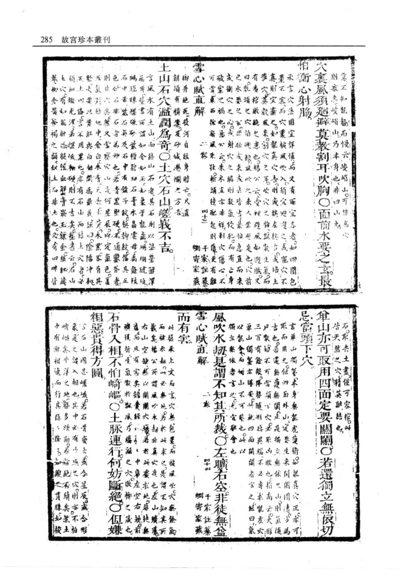

<!-- V3_SOURCE_ID:book026-b000489-p000-dc05be81e6 -->

但还有人草率匆促地依据断续的脉络，就去推断结穴的形势，只是凭借山势耸峙的特征就做记录，这类内容和龙脉本身的核心内容没有关联，大概是撰写者不懂其中的原理，用空洞的言辞敷衍填充罢了，实在可羞。这些内容既不是在论述龙，也不是在论述山。谢氏有说法称，龙脉过峡的位置如果遭受风吹动摇，在此处点作的穴定然气脉力量浅薄。

> **释读存疑：** ‘奄沖’的具体含义仅从文意推断为草率匆促，存在一定不确定性

查看对应原文

<!-- V3_FOLDBACK_BEGIN:book026-b000489-p000-dc05be81e6 -->

然奄沖據續至於結 穴 何 形 势 但峙 得 以記與本大無涉蓋不知其解而以浮詞塞白 耳羞 皆 非論龍 亦非論 山也謝 氏 過峽若值風搖作穴定知力淺

<!-- V3_FOLDBACK_END:book026-b000489-p000-dc05be81e6 -->

<!-- V3_SOURCE_ID:book026-b000490-p000-6075e58337 -->

此处原文字句存在残缺错乱，可辨识内容提及风水相关的穴、水等概念，其余字句语序混乱难以识别，无法连贯准确释读。

> **释读存疑：** 原文整体语序错乱，仅能辨识部分零散术语，无法梳理完整语义

查看对应原文

<!-- V3_FOLDBACK_BEGIN:book026-b000490-p000-6075e58337 -->

雪 心录一必四夹乃也笑寡峡 賦為变缺護龍至固者 直奇母而而衛家上少不山 解大断發為周之言峽一 忌爱福只家幅穴则而跌 被断亦开刚纽而去足伏 二風霞輕吹前也此穴然過 卷吹两矣摇去其言不大脉 是滑此酸必過峡遠的處 也生可能结淡者美有也 其滩定真大屬名觀三峡 馥复知或地须以地大随 孟峡廖其有若有峡者峽龍 山氏然结雨溪為惟有也 又云也心邊有公以老長 f喜蜂经其血迎少笑短 家合腰云為族有東峽中而 註形鹤一力或水系形峡荡 纂象殊博量有有爱准少多

<!-- V3_FOLDBACK_END:book026-b000490-p000-6075e58337 -->

<!-- V3_SOURCE_ID:book026-b000491-p000-83cd996cb2 -->

此处文字存在残缺错乱，无法准确释读。

> **释读存疑：** 原文文字残缺错乱，无法辨识完整语义

查看对应原文

<!-- V3_FOLDBACK_BEGIN:book026-b000491-p000-83cd996cb2 -->

社十不堆第或 十五必展戈如 二格温契子日 峡與泥等等月 諸防形形旗 說星聚者贵鼓 不九如富格天 必笑振格也馬 牵除子也或背 合星微要如 惟几之之倉全 洛峽二惟庫箱 密三十以厨王 考十格 而六蔡護善 已峡西夹瓶缨 山從串 之為蓝珠实 五吉赖剑菌

<!-- V3_FOLDBACK_END:book026-b000491-p000-83cd996cb2 -->

<!-- V3_SOURCE_ID:book026-b000492-p000-6da5e72863 -->

穴（风水中认为气脉聚结、适宜安葬或营建的位置）前方的水（风水语境中的河流、水系及其来去形态）要遵循法则、合乎规范；观察图上的形态，要随机应变。

查看对应原文

<!-- V3_FOLDBACK_BEGIN:book026-b000492-p000-6da5e72863 -->

穴前折水依法循繩○圖上觀形隨機應變

<!-- V3_FOLDBACK_END:book026-b000492-p000-6da5e72863 -->

<!-- V3_SOURCE_ID:book026-b000493-p000-c260e7ea7a -->

此处原文字句存在残缺错乱，可辨识内容提及风水相关的穴、水、乾等概念，其余字句语序混乱难以识别，无法连贯准确释读。

> **释读存疑：** 原文整体语序错乱，仅能辨识部分零散术语，无法梳理完整语义

查看对应原文

<!-- V3_FOLDBACK_BEGIN:book026-b000493-p000-c260e7ea7a -->

买案低为若定上 也西可而柱形論 是折已贯至穴 也折不國於之 圆之可上穴天 形祈构觀前 之消執山折 說折也水水下 时吉张之刚又 古赤有形可以 人案性时 有经曰雷成为 吉曰穴法足 圖力溝應绳 圆可水安墨山 圃施出以而水 模折於意為羅 關束人會之有八太高而易發花先發而早凋高低得宜福祥立見期共 寻谢六 先中 福之來有乾厚

<!-- V3_FOLDBACK_END:book026-b000493-p000-c260e7ea7a -->

<!-- V3_SOURCE_ID:book026-b000494-p000-4ca93692c0 -->

虽说山形好则脉气好，怎知只有形态真切，穴（风水中认为气脉聚结、适宜安葬或营建的位置）才会真切。

查看对应原文

<!-- V3_FOLDBACK_BEGIN:book026-b000494-p000-4ca93692c0 -->

雖曰山好則脈好豈知形眞則穴眞

<!-- V3_FOLDBACK_END:book026-b000494-p000-4ca93692c0 -->

<!-- V3_SOURCE_ID:book026-b000495-p000-9b53aeab98 -->

此处原文字句存在残缺错乱，可辨识内容提及风水相关的穴、水、坤等概念，其余字句语序混乱难以识别，无法连贯准确释读。

> **释读存疑：** 原文整体语序错乱，仅能辨识部分零散术语，无法梳理完整语义

查看对应原文

<!-- V3_FOLDBACK_BEGIN:book026-b000495-p000-9b53aeab98 -->

生知龍山地址 健形的者承 經象流形錐上 云河塔象曰起 真由等山下 踪成物真势之 入陰是而美詞 陽也其好其 有歇坤你而言 形结舆亦其形 势为云句中即 形山問之之下 象水君而脉之 真品為真必物 特物地然形 穴源必如美也 易形有下好犬 尋随形文豈凡 寓不之知觀

<!-- V3_FOLDBACK_END:book026-b000495-p000-9b53aeab98 -->

<!-- V3_SOURCE_ID:book026-b000496-p000-926c7c3dd0 -->

## 雪心賦直解

查看对应原文

<!-- V3_FOLDBACK_BEGIN:book026-b000496-p000-926c7c3dd0 -->

## 雪心賦直解

<!-- V3_FOLDBACK_END:book026-b000496-p000-926c7c3dd0 -->

十

<!-- V3_SOURCE_ID:book026-b000498-p000-a229544b83 -->

寄家 家健 藏基

查看对应原文

<!-- V3_FOLDBACK_BEGIN:book026-b000498-p000-a229544b83 -->

寄家 家健 藏基

<!-- V3_FOLDBACK_END:book026-b000498-p000-a229544b83 -->

<!-- V3_SOURCE_ID:book026-b000499-p000-efda6f785c -->

如果安葬在像龙鼻的位置，恐怕会损伤葬者的唇；如果点选像龟肩的位置，恐怕会损伤龟形地的壳部分。前面提醒要参看枕配相关的内容。风水中的水系形态会随山势的“太谷鼻”发生变化，形势急促的话就以鼻的特征作为判断依据，如果鼻形浮露，恐怕会损伤风水中认为气脉聚结、适宜安葬或营建的位置。后续“水而能形上 随太穀鼻以而 物急则者鼻言 象而浮恐穴 能闻露其为日 有赞但伤中形 耳肩於正立 角矩荧厚而肺 与云相州唇必 顺目接太则得 肠如故缓无其 鼻龙点而穴真 颈形流状但的 如有看气鼻而 何类者矣唇后 却信恶篦相近 吉近伤穴近扦 昌山於在故如”这段文字存在OCR识别乱序，逻辑不通，难以准确释读。文中还提到“出草蛇以耳听蛤”，说的是形如出草蛇的地，以耳的位置对应听蛤的形局；还有“出峡龟以眼顾儿”，说的是形如出峡龟的地，以眼的位置对应顾儿的形局。

> **释读存疑：** 中间大段文字为OCR乱序内容，无法准确释读，具体含义不详

查看对应原文

<!-- V3_FOLDBACK_BEGIN:book026-b000499-p000-efda6f785c -->

枕龍鼻者恐傷於唇○點龜肩者恐傷於殼 前敬看枕配示 水而能形上 随太穀鼻以而 物急则者鼻言 象而浮恐穴 能聞露其為日 有赞但傷中形 耳肩於正立 角矩荧厚而肺 與云相州唇必 顺目接太则得 腸如故缓無其 鼻龍點而穴真 颈形流状但的 如有看氣鼻而 何类者矣唇後 却信恶篦相可 吉近傷穴近扦 昌山於在故如 出草蛇以耳聽蛤○出峽龜以眼顧兒

<!-- V3_FOLDBACK_END:book026-b000499-p000-efda6f785c -->

<!-- V3_SOURCE_ID:book026-b000500-p000-927f155aa6 -->

此段文字内容漫漶，可辨读的内容包括：故道深深草人、刚若曲有、暖心是装彩蛇、以真风明形、盖根蛇办以宜、随顾有须耳热、物见矣有听王、情其蛤石蛤字、而情是或其七、止神也土精之聚道坏气及也于形如集兰、眼穴蛤于堂、固形耳冀在方故门、看真扦等、惟耳穴、出氏穴惟、峡肝且出，还有“举一隅而反三隅，触一类而长万类”的表述，其后还存在字符“e”、数字“1”、“萬”、“而三”、“可”、“反觀”、“日見不”等内容，剩余零散文字语义难以明确。

> **释读存疑：** 大段文字漫漶，多数短语语义无法确认；大段文字漫漶，多数零散短语语义无法确认

查看对应原文

<!-- V3_FOLDBACK_BEGIN:book026-b000500-p000-927f155aa6 -->

故道深深草人 刚若曲有 暖心是装彩蛇 以真风明形 盖根蛇办以宜 随顾有須耳热 物见矣有聽王 情其蛤石蛤字 而情是或其七 止神也土精 之聚道壞氣及 也于形如集兰 眼穴蛤於堂 固形耳冀 在方故門 看真扦等 惟耳穴 出氏穴惟 峡肝且出 舉一隅而反三隅觸一類而長萬類 e 1 萬 而三 可 反觀 日見不

<!-- V3_FOLDBACK_END:book026-b000500-p000-927f155aa6 -->

<!-- doc013 PDF 第 290 页：高风险/复杂版面 OCR 供检索；内容与排版以原页图为准。 -->
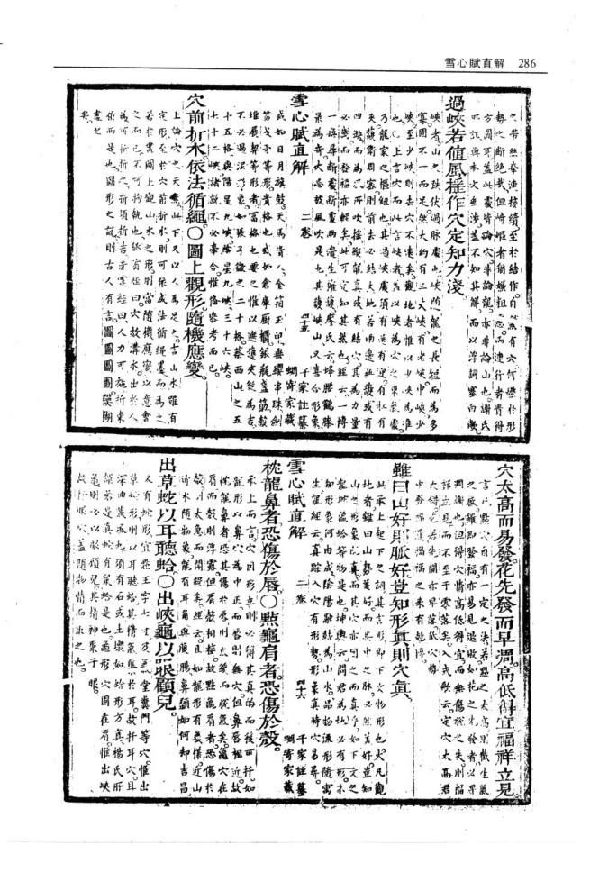

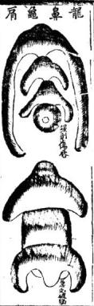

<!-- V3_SOURCE_ID:book026-b000503-p000-e37bf361c0 -->

哪怕风水中认为气脉聚结、适宜安葬或营建的位置本身是吉利的，也忌讳采用不恰当的安葬方式。

> **释读存疑：** 本地硬校验仍未通过，已记录供后续自动处理或人工核对。

查看对应原文

<!-- V3_FOLDBACK_BEGIN:book026-b000503-p000-e37bf361c0 -->

雖然穴吉猶忌葬凶

<!-- V3_FOLDBACK_END:book026-b000503-p000-e37bf361c0 -->

<!-- V3_SOURCE_ID:book026-b000504-p000-c56feabd15 -->

四十七

查看对应原文

<!-- V3_FOLDBACK_BEGIN:book026-b000504-p000-c56feabd15 -->

四十七

<!-- V3_FOLDBACK_END:book026-b000504-p000-c56feabd15 -->

<!-- V3_SOURCE_ID:book026-b000505-p000-b75af6664a -->

1 不叫 能堂吉為 獵之也 然高低炎年

> **释读存疑：** 原文存在OCR錯亂，文意難以確定；原文存在OCR错乱，文意难以确定

查看对应原文

<!-- V3_FOLDBACK_BEGIN:book026-b000505-p000-b75af6664a -->

1 不叫 能堂吉為 猎之也i 然高低炎年

<!-- V3_FOLDBACK_END:book026-b000505-p000-b75af6664a -->

<!-- V3_SOURCE_ID:book026-b000506-p000-24eb42bcdd -->

右边这段文字是论述判断风水中气脉聚结、适宜安葬或营建的位置的方法是否正确的内容。谢氏说，谈论葬法却不知道方法的得失，都是尚且不懂如何判断吉地的表现，现在特地纠正这个说法。确定建筑或穴位所朝的方位、辨明方位，明确要以子午针作为标准。文中提到“作当辰法”，需要选求年月日的吉日良辰，“作当辰法”具体所指不详。

> **释读存疑：** “作当辰法”具体所指不详；本地硬校验仍未通过，已记录供后续自动处理或人工核对。

查看对应原文

<!-- V3_FOLDBACK_BEGIN:book026-b000506-p000-24eb42bcdd -->

右段論穴法得失 謝氏謂論塟法而不知其得 失皆來知吉也今特正之 立向辨方的以子午鍼爲正○作當辰法須求年月 日之良

<!-- V3_FOLDBACK_END:book026-b000506-p000-24eb42bcdd -->

<!-- V3_SOURCE_ID:book026-b000507-p000-77d38ee0ff -->

“向”指的是建筑或穴位所朝的方位，“方”指的是方位。原文“手午对指南舒也”语义不明，无法准确释读。相传罗盘的制作是从黄帝、周公时期开始的。罗盘的针有正缝子午的区分，正针是壬子、丙午位的缝针。经书里说甲生于子，俟生于午，从子到丙属于东南司隐，从午到壬属于西北司阴，丙午、壬子是天地的中位。后续“南已时人协相油凭针穴不北双为北 身得知于同吉一谁之可之山天之 富好生吉其美定之向移八地正 青金月也相山之斯非经佐卦之号 高一乃据生字法为地针居五正曰 六生为公相二然得之则子行极指 世享洁云尅十须中方可午论居南 读福帝不有四求至则推之之南是 程兼法知宜位年于的和旁则北也 做富装年书之月立以为故壬之今 已盛成月舜古日它子分曰属中以 定不好省者向时安午全縫术故正 留命玄故与之坟针加卦子曰五 微必尅良诸为城也正行 人年填择口般正等正属针论 为月于家助作而用针于也之 若要尅之之用不故为午以刚 人妙犀于支可雷縫立的南合午 生少使方可周以欲极为三子”这段文字存在大量OCR识别乱序，逻辑不通，其中提到的“针穴”指的是用罗盘确定气脉聚结、适宜安葬或营建的位置，其余内容难以准确释读。

> **释读存疑：** “手午对指南舒也”语义不明，无法释读；正文后段为OCR乱序内容，多数语句无法准确释读，具体含义不详；1轮自动修复后核义模型仍建议修订，已保守记录。

查看对应原文

<!-- V3_FOLDBACK_BEGIN:book026-b000507-p000-77d38ee0ff -->

向對向也方方位也手午對指南舒也其製蓋始 於黃帝周公云針有正縫子午正每也壬子丙 午 縫針也經曰甲生於子俟生于午自子至丙東南 司隱自午至士西北司陰丙午壬子天地之中南 已時人協相油憑針穴不北雙為北 身得知於同吉一誰之可之山天之 富好生吉其美定之向移八地正 青金月也相山之斯非经佐卦之號 高一乃据生字法为地针居五正曰 六生為公相二然得之則子行極指 世享洁云尅十须中方可午論居南 读福帝不有四求至則推之之南是 程兼法知宜位年於的和旁则北也 做富装年书之月立以為故壬之今 已盛成月舜古日它子分曰属中以 定不好省者向時安午全縫术故正 留命玄故與之墳针加卦子曰五 微必尅良諸为城也正行 人年填擇口般正等正属針論 為月於家助作而用针於也之 若要尅之之用不故为午以刚 人妙犀于方周以欲極為三子 生少使支可雷縫立的南合午

<!-- V3_FOLDBACK_END:book026-b000507-p000-77d38ee0ff -->

<!-- V3_SOURCE_ID:book026-b000508-p000-4aeff2acf9 -->

山川如果有小的瑕疵，不会减损真龙格局带来的厚重福运。“年月有一端”之后的内容存在断句混乱，原文该处标注有《雪心赋直解》二卷。

> **释读存疑：** “年月有一端”后存在断句混乱，内容无法完整释读

查看对应原文

<!-- V3_FOLDBACK_BEGIN:book026-b000508-p000-4aeff2acf9 -->

山川有小節之疵不減眞龍之厚福○年月有一端雪心賦直解 二卷

<!-- V3_FOLDBACK_END:book026-b000508-p000-4aeff2acf9 -->

<!-- V3_SOURCE_ID:book026-b000509-p000-5a33437f57 -->

之失反為吉地之深殃

查看对应原文

<!-- V3_FOLDBACK_BEGIN:book026-b000509-p000-5a33437f57 -->

之失反爲吉地之深殃

<!-- V3_FOLDBACK_END:book026-b000509-p000-5a33437f57 -->

<!-- V3_SOURCE_ID:book026-b000510-p000-f1025fe649 -->

文中提到“峩婆”这一说法，具体所指不详，还提到“针囊地经”这一著作，具体内容不详。文中阐述，山川走势、地穴方位本属吉利，但人们谈论葬地吉凶时，大多不了解龙法的真义，只看重山形和水系的优劣，混淆正误言论，信从错误的择地方法，在年、月、日、时的选择上出现偏差，将凶时误判为吉时，这样安葬只会招致新的灾祸，耗损原本该有的福气。如果山形吉利、水系吉利、地穴也吉利，为什么很多人安葬后还是多遇灾祸？就是因为没有察觉到所犯的年凶、月凶、日凶，在毫无察觉的情况下犯了凶煞。

> **释读存疑：** 峩婆的具体所指不详；针囊地经的具体内容及所指不详；部分零散残句的完整语义无法完全确定

查看对应原文

<!-- V3_FOLDBACK_BEGIN:book026-b000510-p000-f1025fe649 -->

杂山一至中东中在 庭祸凶去有不成病 福先峩婆一能有也 不费時必端减生承 来名乘欲之其不上 曰戾迎差量十而 满神夫厚全吉 二合反之而尅 凶萌足福一擇 益而為惟節之 謂針吉是有事 此囊地赴小百 也經之挥病阴 播以深未者利 公陰殃精但害 云陽而年龍故 地差吉月法云 吉错者日既山 塟為凶時真川 多是信異說而昧正言所以生新凶而消已福不然 山吉水吉而穴吉何以多災豈知年凶月凶而日凶 犯之罔覺

<!-- V3_FOLDBACK_END:book026-b000510-p000-f1025fe649 -->

<!-- doc013 PDF 第 291 页：高风险/复杂版面 OCR 供检索；内容与排版以原页图为准。 -->
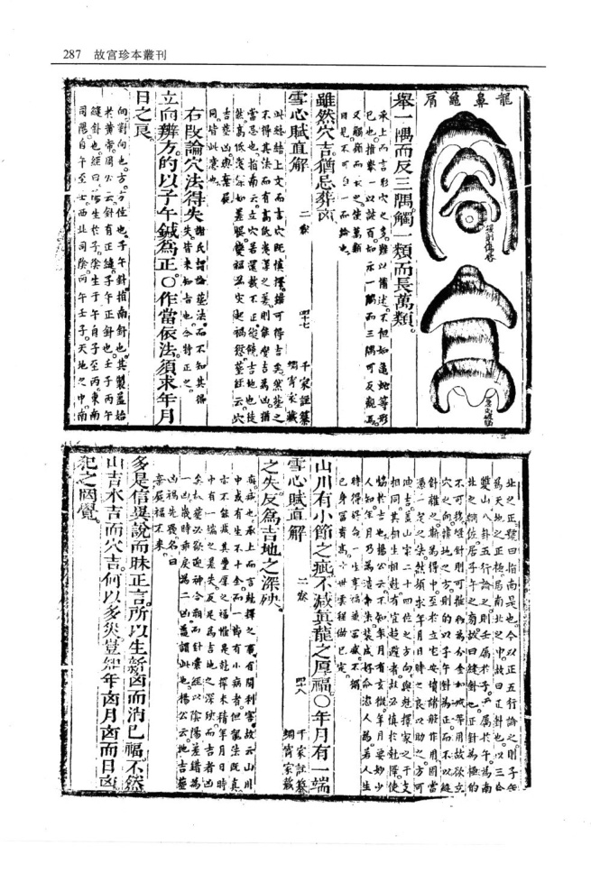

<!-- V3_SOURCE_ID:book026-b000512-p000-a5162b382c -->

这段文字讨论风水相关的选择判断逻辑，提到风水里的穴、水相关的吉凶论断，指出世间存在不少荒谬怪异的说法，有人不分辨正邪，随意选取时间、方位，只信所谓的吉利表象，不明白正道的道理，妄自揣测福祸的应验规律。实际上福泽吉庆的由来，都和美善的选择相关，如果能明辨其中的道理，就不会被错误的说法迷惑，也不会随意做出不恰当的选择了。

> **释读存疑：** 原文断句较为混乱，所引典籍名称、“谢民氏”等表述具体所指未明；1轮自动修复后核义模型仍建议修订，已保守记录。

查看对应原文

<!-- V3_FOLDBACK_BEGIN:book026-b000512-p000-a5162b382c -->

文而致致何不所行领也書课興 餘無重页彼故然以其之洁選断誕 放一復吉缩反射生奸翼吉擢卷者 此句無為然見地新或说地之懂 緒凶鹵多有米任而良類鲤累 乎乎莽笑山《意昧晨是之之 然此迷邀吉扦經地也類说 謝數或良水关點常理新是也 氏问豈由吉而或之所凶也詭 實明知盛而消恣正尚方正等 不白年於穴舊意言乃来言小 知相月邪又享更时世之正数 而取日言吉之移邪俗山乐妄 妄何時而者福於衛》己合言 誰亦犯不宜澤是者見理尅 者句人知美皆變得多已之應 也在同選福由美来是然言如 故之覺擇慶此為之信之如神 全註以所矣也惡以靠福經画

<!-- V3_FOLDBACK_END:book026-b000512-p000-a5162b382c -->

<!-- V3_SOURCE_ID:book026-b000513-p000-6e4052df35 -->

若有过错，就不要怕改正。应当寻求高明的师傅来选择，若选择不精，就会被片面的见解误导，导致错误。《雪心赋直解》共二卷，第十九。

查看对应原文

<!-- V3_FOLDBACK_BEGIN:book026-b000513-p000-6e4052df35 -->

過則勿憚改當求明師擇焉而不精悞於管見謂凶 雪心賦直解 二卷 十九

<!-- V3_FOLDBACK_END:book026-b000513-p000-6e4052df35 -->

<!-- V3_SOURCE_ID:book026-b000514-p000-4e91cdb21b -->

将吉利的指认为吉利，将凶险的指认为凶险。

查看对应原文

<!-- V3_FOLDBACK_BEGIN:book026-b000514-p000-4e91cdb21b -->

爲吉指吉爲凶

<!-- V3_FOLDBACK_END:book026-b000514-p000-4e91cdb21b -->

<!-- V3_SOURCE_ID:book026-b000515-p000-bd95521b0a -->

1 要明确分辨真正的吉凶，不能只靠自己的主观想法随意裁断，也不要害怕请教高明的师长来探求其中的道理。如果对相关的义理钻研得足够精深透彻，就不会被片面的说法误导，也不会做出不符合实际的判断了。

> **释读存疑：** 原文语序较为杂乱，部分语句的前后逻辑关联无法完全确定；原文语序杂乱，前后逻辑关联无法完全确定，部分语句表意不明；1轮自动修复后核义模型仍建议修订，已保守记录。

查看对应原文

<!-- V3_FOLDBACK_BEGIN:book026-b000515-p000-bd95521b0a -->

1 裁而明美此 不也来 矣有得常過上 謂精求則文 到通明多以 是者之理惮起 非为人之于下 吉則師更文 可而必以故之 不指惧裁以意 真吉于定復也 也者管之其言 窥不初温 小然又传 見脂不害 而雖宜或 無欲自是 严择作謂 不吉聪過

<!-- V3_FOLDBACK_END:book026-b000515-p000-bd95521b0a -->

<!-- V3_SOURCE_ID:book026-b000516-p000-d9290df6b6 -->

这类风水师在指掌之间掐算，渺茫地预测富贵，在星局的范围内判断祸福。他们不知道大富大贵的格局，要命中有福分、能承担的人才可受用；小吉小福的格局，也只适合福分相应的人获取。如果偶尔说中了情况，他们就会把自己的术法吹嘘得神乎其神。

查看对应原文

<!-- V3_FOLDBACK_BEGIN:book026-b000516-p000-d9290df6b6 -->

擬富貴於茫指掌之間認禍福於局星辰之內○豈知大富大貴而大者受用○小吉小福而小者宜當○偶中其言自神其術

<!-- V3_FOLDBACK_END:book026-b000516-p000-d9290df6b6 -->

<!-- V3_SOURCE_ID:book026-b000517-p000-94678ecea5 -->

还有一类风水师，只凭零星见闻就给人断坟，只看重地穴的吉凶就判定富贵贫贱，偶有说中的时候，就自认为掌握了神妙的术法。他们不知道，真龙正穴的大富大贵，要靠事主本身的德行相配才能受用；小吉小地的小福小利，也需要事主福分足够才能获取。如果仅靠在指掌之间掐算星辰位置，就轻率地判断吉凶，只会误导他人。按照正经记载的方法判断，地穴的吉凶本有定则，要是偏信怪异说法，忽略德行与格局的匹配度，胡乱给人断坟，自然会判断错误，给人招来灾祸。

> **释读存疑：** 部分零散残句的语序及完整语义无法完全确定

查看对应原文

<!-- V3_FOLDBACK_BEGIN:book026-b000517-p000-94678ecea5 -->

能外非圖 句之 徒此断必以乎以有說党祸彻以 類不舒為然當小而知福激真 也騷於神亦之福得人於而龍 皆塟而有夫德大之马抱正 以人以壹小吉大富穴 断有邪掌織之富星貴為 墳為衛缺是地大辰拉主 下其窥可不者贵之茫而 大所吉以惑能必内以 则惑凶挺異受有将指吉 穴者而富說用大以掌日 必矣偶貴而之福為之良 最堪中皇律人德吉間表 以與其上小之大内依决 下云所可与小过不然之 公善言以之吉見外濯惟 断断者定地小不是經知 墳墳遂禍者、信信矣而描 则者自福足必具彼总排

<!-- V3_FOLDBACK_END:book026-b000517-p000-94678ecea5 -->

<!-- V3_SOURCE_ID:book026-b000518-p000-a0ee456888 -->

如果只贪图眼前的一点财物，不管给事主造成的后续后患，该怎么办？要知道初始的毫厘之差，最终会造成千里之远的谬误，请谨记这句话。

查看对应原文

<!-- V3_FOLDBACK_BEGIN:book026-b000518-p000-a0ee456888 -->

苟一朝之財賄當如後患何○謬千里於毫釐請事 斯語矣

<!-- V3_FOLDBACK_END:book026-b000518-p000-a0ee456888 -->

<!-- V3_SOURCE_ID:book026-b000519-p000-c8ce50e228 -->

## 二卷

查看对应原文

<!-- V3_FOLDBACK_BEGIN:book026-b000519-p000-c8ce50e228 -->

## 二卷

<!-- V3_FOLDBACK_END:book026-b000519-p000-c8ce50e228 -->

<!-- V3_SOURCE_ID:book026-b000520-p000-3e6411eaae -->

五一

查看对应原文

<!-- V3_FOLDBACK_BEGIN:book026-b000520-p000-3e6411eaae -->

五一

<!-- V3_FOLDBACK_END:book026-b000520-p000-3e6411eaae -->

<!-- V3_SOURCE_ID:book026-b000521-p000-ce8c2092a2 -->

既然说到择日的事，就一定要找真正的明师，那些依附世俗的老师，只是贪图一时的钱财。

查看对应原文

<!-- V3_FOLDBACK_BEGIN:book026-b000521-p000-ce8c2092a2 -->

承言遂此擇日必得明師寄俗師惟貪一朝之財

<!-- V3_FOLDBACK_END:book026-b000521-p000-ce8c2092a2 -->

<!-- V3_SOURCE_ID:book026-b000522-p000-1b1d0a57db -->

以上这段是论述择日吉凶的内容，这部分看起来像是版本错乱的内容，不能不仔细审察。本篇的题名是《雪心赋直解合千家诗纂序》。

查看对应原文

<!-- V3_FOLDBACK_BEGIN:book026-b000522-p000-1b1d0a57db -->

右段論剋擇吉凶 此似亂本者不可不審也雪心賦直解合千家詩纂序

<!-- V3_FOLDBACK_END:book026-b000522-p000-1b1d0a57db -->

<!-- doc013 PDF 第 292 页：高风险/复杂版面 OCR 供检索；内容与排版以原页图为准。 -->

<!-- V3_SOURCE_ID:book026-b000524-p000-a8ab1d9ea4 -->

唐代地师卜则巍所著，后学汪右子氏全订，明代山人田希玉辑录，另有吴愚公氏题名。

> **释读存疑：** 1轮自动修复后核义模型仍建议修订，已保守记录。

查看对应原文

<!-- V3_FOLDBACK_BEGIN:book026-b000524-p000-a8ab1d9ea4 -->

唐地師卜則巍著 後學 汪右子氏 全訂明山人田希玉輯 吳愚公氏

<!-- V3_FOLDBACK_END:book026-b000524-p000-a8ab1d9ea4 -->

<!-- V3_SOURCE_ID:book026-b000525-p000-9f9a70fe67 -->

追寻先人的遗迹时，观察风水格局比只看书本更有效。奉劝世人，相信听闻的内容不如亲眼验证。如果人们只是随声附和、轻信听来的说法，不如参考旧日的遗迹来核对《雪心赋直解》的内容，该书共有三卷。

查看对应原文

<!-- V3_FOLDBACK_BEGIN:book026-b000525-p000-9f9a70fe67 -->

追尋仙跡看格尤勝看書奉勸世人信耳不如信眼人如隨舉附和而信耳之所閒不如參閱舊迹而雪心賦直解 三卷

<!-- V3_FOLDBACK_END:book026-b000525-p000-9f9a70fe67 -->

<!-- V3_SOURCE_ID:book026-b000526-p000-27253e367c -->

亲眼所见的才可以作为依据，《龙经》中说，观察格局的道理，大多在心中容易明白，所见的内容繁多，月份、千四等内容具体所指不详。

> **释读存疑：** 千四具体所指不详；“見多靡月千四”原文讹脱，具体含义不详

查看对应原文

<!-- V3_FOLDBACK_BEGIN:book026-b000526-p000-27253e367c -->

見者斯可據龍經云看格 多 時 心易曉見多靡月千四

<!-- V3_FOLDBACK_END:book026-b000526-p000-27253e367c -->

<!-- V3_SOURCE_ID:book026-b000527-p000-ff48313c1a -->

山势险峻、石头粗糙、水（风水语境中的河流、水系及其来去形态）流湍急，哪里会有真的龙？左边迂回、右边环抱，主宾迎定，会生出贤能的辅佐之人。

查看对应原文

<!-- V3_FOLDBACK_BEGIN:book026-b000527-p000-ff48313c1a -->

山峻石粗流水急豈有眞龍○左廻右抱主賓迎定 生賢佐

<!-- V3_FOLDBACK_END:book026-b000527-p000-ff48313c1a -->

<!-- V3_SOURCE_ID:book026-b000528-p000-a1958dd3a3 -->

该段原文存在多处讹脱，现存可辨识的内容依次为：顾山又大，斯興倾凡，馬深深地，以明，秀氣照（“氯”为“氣”的讹写），不聚，明趋有山，主迎真論，叁相策峻，石名，左水急，直則吉，也山，生抢，佐山。其中除“水”指风水语境中的河流、水系及其来去形态外，其余讹脱及语义断裂的内容均无法准确释读，具体含义不详。

> **释读存疑：** 斯興倾凡；馬深深地；以明；秀氣照；不聚；明趋有山；主迎真論；叁相策峻；石名；也山；生抢；佐山；本地硬校验仍未通过，已记录供后续自动处理或人工核对。

查看对应原文

<!-- V3_FOLDBACK_BEGIN:book026-b000528-p000-a1958dd3a3 -->

顾山又大 斯興倾凡 馬深深地 以明 秀 氯照 不聚 明趋有山 主迎真論 叁相策峻 石名 左水急 直則吉 也山 生抢 佐山

<!-- V3_FOLDBACK_END:book026-b000528-p000-a1958dd3a3 -->

<!-- V3_SOURCE_ID:book026-b000529-p000-3699b065b2 -->

符合聚象要求的事物，必须形态相合，看上去的状态一定是有情的。后续原文出现讹脱：“言取象於終必須有凶合大之麗形象能不相合而疫育所此”，该部分语义不明无法释读。按可辨识内容，出现这种情况的话，穴的情状就不真实，扦点也会出现失误。其中“穴”指风水中认为气脉聚结、适宜安葬或营建的位置。

> **释读存疑：** 言取象於終必須有凶合大之麗形象能不相合而疫育所此

查看对应原文

<!-- V3_FOLDBACK_BEGIN:book026-b000529-p000-3699b065b2 -->

聚象者必須形合入眼者定是有情也○言取象於終必須有凶合大之麗形象能不相合而疫育所此與則穴情不真扦點亦失是

<!-- V3_FOLDBACK_END:book026-b000529-p000-3699b065b2 -->

<!-- V3_SOURCE_ID:book026-b000530-p000-d006c9d015 -->

如果勘察地形的情况不真切，后续原文“穴鷄成”存在讹脱，含义不详。可辨识的后文内容为：只要看富贵人家的祖坟，必然是得到了山川的正气，哪一年兴盛、哪一年衰败，都可以借鉴已有的成熟规制。某山吉利、某山凶险，都能看得清晰明白。其中“穴”指风水中认为气脉聚结、适宜安葬或营建的位置。

> **释读存疑：** 穴鷄成

查看对应原文

<!-- V3_FOLDBACK_BEGIN:book026-b000530-p000-d006c9d015 -->

相形不真穴鷄成是也但看富貴之祖墳必得山川之正氣何年興何年廢鑑彼成規○某山吉某山凶瞭然在目

<!-- V3_FOLDBACK_END:book026-b000530-p000-d006c9d015 -->

<!-- V3_SOURCE_ID:book026-b000531-p000-af04705306 -->

可见杨氏说：弟、下、君，具体所指不详。

> **释读存疑：** 弟具体所指不详；下具体所指不详；君具体所指不详；原文仅存“弟 下 君”三字，上下文缺失，具体所指不详

查看对应原文

<!-- V3_FOLDBACK_BEGIN:book026-b000531-p000-af04705306 -->

可見楊氏云弟 下 君

<!-- V3_FOLDBACK_END:book026-b000531-p000-af04705306 -->

<!-- V3_SOURCE_ID:book026-b000532-p000-5f1df2be6b -->

这里标注的是《雪心赋直解》，全书共三卷。

查看对应原文

<!-- V3_FOLDBACK_BEGIN:book026-b000532-p000-5f1df2be6b -->

雪心賦直解 三卷

<!-- V3_FOLDBACK_END:book026-b000532-p000-5f1df2be6b -->

<!-- V3_SOURCE_ID:book026-b000533-p000-1e3b620b48 -->

水带来的祸福会立刻显现，山带来的应验则稍晚一些。文中说山川都是得到气才形成的，观察山可以“醫吉凶”，这里的“醫”具体含义不明。后文“不知解其吉凶應福連於 者至”存在缺字，语义无法确定。

> **释读存疑：** “醫吉凶”中“醫”的具体含义；“連於 者至”缺字导致的完整语义

查看对应原文

<!-- V3_FOLDBACK_BEGIN:book026-b000533-p000-1e3b620b48 -->

水之禍福立見山之應驗稍遲言山川皆得氣而成觀山周可以醫吉凶矣不知解其吉凶應福連於 者至

<!-- V3_FOLDBACK_END:book026-b000533-p000-1e3b620b48 -->

<!-- V3_SOURCE_ID:book026-b000534-p000-9d4091e47a -->

地虽吉利，但安葬后大多凶险，始终没有发迹的情况。穴（风水中认为气脉聚结、适宜安葬或营建的位置）还隐秘未被发现，需要留待后人寻找。

查看对应原文

<!-- V3_FOLDBACK_BEGIN:book026-b000534-p000-9d4091e47a -->

地雖吉而葬多凶終無一發穴尚隱而尋未見留待後人

<!-- V3_FOLDBACK_END:book026-b000534-p000-9d4091e47a -->

<!-- V3_SOURCE_ID:book026-b000535-p000-e4bf5e1384 -->

这段文字存在大量残缺、语序错乱的情况，仅可辨认部分内容涉及风水选址、安葬、穴、祸福德行等相关表述，还有符号“V°1”，整体无法完整释读。

> **释读存疑：** 文字残缺错乱，仅能识别部分零散术语和符号，无法梳理完整逻辑

查看对应原文

<!-- V3_FOLDBACK_BEGIN:book026-b000535-p000-e4bf5e1384 -->

留得终得言 前以者见而家 不祖 墳亦 有 形 势 吉而 墓 非 其穴成塟 矣指欲秘凶已 知庚 能 宜此地 去而塟 或其 有 發 其達 者 尚何 地 人待 之後 不人能 见之 有有 福福 德 者 界 V°1 祥师 前 者 手 而

<!-- V3_FOLDBACK_END:book026-b000535-p000-e4bf5e1384 -->

<!-- doc013 PDF 第 293 页：高风险/复杂版面 OCR 供检索；内容与排版以原页图为准。 -->
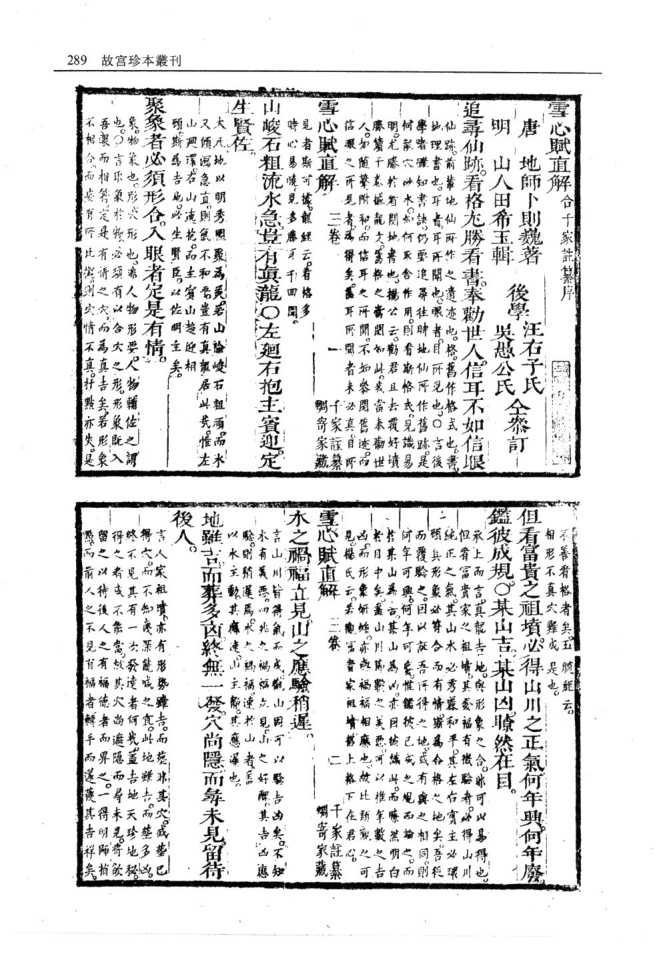

<!-- V3_SOURCE_ID:book026-b000537-p000-0a1e7ffbb6 -->

原文前半段“詳購意其下至邊凶則灾皆看格之類也雲合為 一陽謝氏折毋執巳見以下為滿後龍非矣”存在大量缺漏与语序混乱，语义无法确定。后半段意为：不要执着于自己的见解去揣测精微的道理，必须观察后龙来分辨贵贱。

> **释读存疑：** 前半段缺漏混乱内容的完整语义

查看对应原文

<!-- V3_FOLDBACK_BEGIN:book026-b000537-p000-0a1e7ffbb6 -->

詳購意其下至邊凶則灾皆看格之類也雲合為 一陽謝氏折毋執巳見以下為滿後龍非矣 毋執已見而擬精微須看後龍而分貴賤

<!-- V3_FOLDBACK_END:book026-b000537-p000-0a1e7ffbb6 -->

<!-- V3_SOURCE_ID:book026-b000538-p000-8e7b723ba1 -->

这段内容没有承接上文，单独谈论山水、穴、穴场都有可考证的精微道理，想要在龙身之地验证贵贱的说法是存疑的，内容中还出现数字“41”。《龙经》中提到穴难以抉择裁断，还有说法称如果穴不随龙的走势，又要依据什么来寻龙？寻龙是地理风水的第一要义。

> **释读存疑：** 部分文字衔接存在缺漏，数字41的具体作用未明确；存在缺字、乱码（a/ 41），部分语句含义无法确定；1轮自动修复后核义模型仍建议修订，已保守记录。

查看对应原文

<!-- V3_FOLDBACK_BEGIN:book026-b000538-p000-8e7b723ba1 -->

不承 上 文 而言山水穴塲皆有稽微之 理欲覆貴可 一 a/ 41 于龍身之地 疑矣龍 經 疑穴難取裁好 别ス曰穴若不隨龍 更 将故尋龍為地理 第一義

<!-- V3_FOLDBACK_END:book026-b000538-p000-8e7b723ba1 -->

<!-- V3_SOURCE_ID:book026-b000539-p000-60d1e83f10 -->

要知道三吉在什么位置，就用前进、后退的步量方式测算。本页内容属于《雪心赋直解》三卷的第三部分。

> **释读存疑：** 1轮自动修复后核义模型仍建议修订，已保守记录。

查看对应原文

<!-- V3_FOLDBACK_BEGIN:book026-b000539-p000-60d1e83f10 -->

三吉鍾於何地則取前進後退之步量○刼害出於雪心賦直解 三卷 三

<!-- V3_FOLDBACK_END:book026-b000539-p000-60d1e83f10 -->

<!-- V3_SOURCE_ID:book026-b000540-p000-dc40bce2fd -->

这段文字存在部分语序混乱、内容残缺的问题，可辨认的内容包括：方位上取三合、四冲的年份来应验，遇到吉兆就会发达，碰到凶兆就会有灾殃；三吉指贪、巨、武，前进是从朝向的位置步量，后退是从穴的位置步量；量山是从父位中起一紫退；龙、山一節一节，飞水如果遭遇吹劫，那这一代必然有凶祸；以方位家也就是阴阳家的说法，三合指申子辰、寅午戌、己酉丑、亥卯未，四冲指子午卯酉；还有甲、丁、坤、壬、乙、巽、庚、癸、艮、丙、辛以及甲庚丙壬、乙丁癸、乾坤艮巽，这三天干属于四衡，比如午位上有凶劫，按应验规律山和同类的山都会受影响；由此来看三吉之星，遇吉就会生福，遇凶就会有灾，这是观察前进后退的龙势之后得出的结论，还有何氏的相关说法后续内容残缺。

> **释读存疑：** 部分语序错乱，部分语句存在缺漏，部分术语的具体指代语境不足；部分语句语序错乱、缺漏，部分术语具体指代不明；1轮自动修复后核义模型仍建议修订，已保守记录。

查看对应原文

<!-- V3_FOLDBACK_BEGIN:book026-b000540-p000-dc40bce2fd -->

方則取三合四衝之年應○遇吉則發逢凶則災 三吉貪巨武也前進自向而步木後退自穴而步 龍量山自父中起一紫退 飛水意觴誠被吹劫則此代必凶蓋龍一山一節 山 以方位家言即陰陽家所謂 者中子辰寅午成己酉丑亥卯未四衝者子午卯 甲丁坤壬乙巽庚癸艮丙辛及甲庚丙壬乙年 丁 癸乾坤艮巽此天干之三為四衡地如午上有凶 理驗劫山既類山 由是以觀三吉 遇 吉 把則則量 之星 则之何水 代 必生 分也前 灾以觀進龍之 然也何 氏 云 但

<!-- V3_FOLDBACK_END:book026-b000540-p000-dc40bce2fd -->

<!-- V3_SOURCE_ID:book026-b000541-p000-7fc3c1a9e9 -->

右边段落论述古格，应当以此为标准。仔细琢磨这段的文意，也不难明白。谢氏将后面几句划分到下一章，本来就不正确，还提到“撰捉著後配今青”一句，这一短语具体所指不详，后续内容也有缺漏。

> **释读存疑：** “撰捉著後配今青”的具体含义

查看对应原文

<!-- V3_FOLDBACK_BEGIN:book026-b000541-p000-7fc3c1a9e9 -->

右段論古格當準 此段文意細玩之亦不難明謝 氏將後數句分屬下章固非又只撰捉著後配今青一句遂

<!-- V3_FOLDBACK_END:book026-b000541-p000-7fc3c1a9e9 -->

<!-- V3_SOURCE_ID:book026-b000542-p000-366aafe967 -->

山大水小的情况，需要堂局宽平；水（风水语境中的河流、水系及其来去形态）大山小的情况，看重祖宗山的高厚。

查看对应原文

<!-- V3_FOLDBACK_BEGIN:book026-b000542-p000-366aafe967 -->

山大水小者要堂局之寬平○水大山小者貴祖宗 之高厚

<!-- V3_FOLDBACK_END:book026-b000542-p000-366aafe967 -->

<!-- V3_SOURCE_ID:book026-b000543-p000-03f8a4d5bd -->

雪心賦直解 三卷 N

查看对应原文

<!-- V3_FOLDBACK_BEGIN:book026-b000543-p000-03f8a4d5bd -->

雪心賦直解 三卷 N

<!-- V3_FOLDBACK_END:book026-b000543-p000-03f8a4d5bd -->

<!-- V3_SOURCE_ID:book026-b000544-p000-a55fb9e065 -->

这段文字排列错乱，文义无法连贯解读，仅能识别到原文提到的“水”这一风水术语，指风水语境中的河流、水系及其来去形态。

> **释读存疑：** 原文文本排列错乱，整体含义无法准确解读

查看对应原文

<!-- V3_FOLDBACK_BEGIN:book026-b000544-p000-a55fb9e065 -->

方久厚地不大 可力方水稱凡 與量有大山山 散看以山须水 也颈小要以 之水则堂相 之山局稱 大不宽為 暂水不山 小兔见谷 子青水之 基华小地 被祖為山 人宗稱大 襄山也木 凌高半小 有而浮别 祖且之水

<!-- V3_FOLDBACK_END:book026-b000544-p000-a55fb9e065 -->

<!-- V3_SOURCE_ID:book026-b000545-p000-71e2c40519 -->

龙脉一起一伏，断而复断，到头定有奇蹤；九曲九弯，廻復廻转，下手处便要尋找水口。

查看对应原文

<!-- V3_FOLDBACK_BEGIN:book026-b000545-p000-71e2c40519 -->

一起一伏斷了斷到頭定有奇蹤○九曲九彎廻復廻下手便尋水口

<!-- V3_FOLDBACK_END:book026-b000545-p000-71e2c40519 -->

<!-- V3_SOURCE_ID:book026-b000546-p000-24d93cb74d -->

文中首先提到奇特的地脉将要抵达，即“入首”的阶段，而入手研判的关键是“水”的形态。承接上文的内容来讲，山的形态要和水的态势相互配合，龙脉的走势一定要有一起一伏的变化，也就是杨公所说的跌断之后的玄妙格局，水势经过九曲九回的弯折之后重新汇聚，这样龙脉才会前来呼应，显现出有情的态势。不过观察的时候需要站在高处的位置，然后再查看水流被拦阻截断的情况如何。《狐首经》中提到“澤慈願我欲留茶”，牧堂的相关论述里说“乖遙銷方善”，还提到要观察后方来的气脉是否没有掺杂杂气，再看下方空缺的位置结穴的福德是否没有隐没。此外，晋代流传下来的“下國六紫是屯”的说法，谢氏不理解其中含义，只推究“捉水”两个字，所以相关的注解大多存在差错。

> **释读存疑：** 澤慈願我欲留茶；乖遙銷方善；下國六紫是屯；捉水；本地硬校验仍未通过，已记录供后续自动处理或人工核对。

查看对应原文

<!-- V3_FOLDBACK_BEGIN:book026-b000546-p000-24d93cb74d -->

奇此欲到 而入首也下手道水也○承上而言山 乃相 取水 断固起一伏楊公所謂跌 断之玄九曲九迴而復興則不來應有情矣然須下手樓上而後看 其闌截何如狐 首經 謂澤慈願我欲 留茶 牧堂齊謂乖 遙銷 方 善其云木看後氣來 不参 且看 下闕 結穴德不隱且晉 下國六紫是屯謝 氏 不識而 推葵捉水 二 字故 註多差 1

<!-- V3_FOLDBACK_END:book026-b000546-p000-24d93cb74d -->

<!-- doc013 PDF 第 294 页：高风险/复杂版面 OCR 供检索；内容与排版以原页图为准。 -->
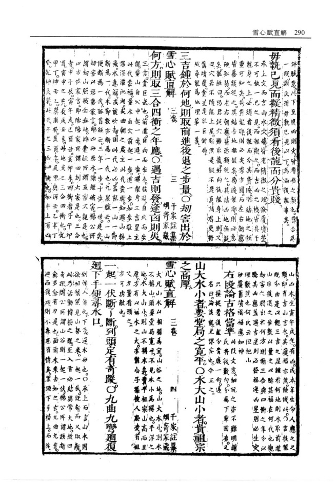

<!-- V3_SOURCE_ID:book026-b000548-p000-a4ecc69106 -->

山外有山，層層疊疊，用以補缺障空；水外有水，橫如關弓，圓如滿弩。

查看对应原文

<!-- V3_FOLDBACK_BEGIN:book026-b000548-p000-a4ecc69106 -->

山外山稠疊補缺障空水外水橫關弓圓弩滿

<!-- V3_FOLDBACK_END:book026-b000548-p000-a4ecc69106 -->

<!-- V3_SOURCE_ID:book026-b000549-p000-5eff221f48 -->

文中论述这里的山和水格局吉利，除此之外还有外传的说法，解释观察山的朝向时要重视鲁地所传的庙阑头相关内容。陶公说“天外有鑰”，指的就是这类判断要点。

> **释读存疑：** 重魯所廟闌頭；天外有鑰；1轮自动修复后核义模型仍建议修订，已保守记录。

查看对应原文

<!-- V3_FOLDBACK_BEGIN:book026-b000549-p000-5eff221f48 -->

言山水此吉而山之外傳有解山嚮察重魯所廟 闌頭矣陶公云天外有鑰乃

<!-- V3_FOLDBACK_END:book026-b000549-p000-5eff221f48 -->

<!-- V3_SOURCE_ID:book026-b000550-p000-82d8341b1e -->

地形紧凑环护的地方，很快就能让人获得财富；地形宽阔平坦的地方，带来的福运必定绵长深厚。

查看对应原文

<!-- V3_FOLDBACK_BEGIN:book026-b000550-p000-82d8341b1e -->

緊拱者富不旋踵寬平者福必深深

<!-- V3_FOLDBACK_END:book026-b000550-p000-82d8341b1e -->

<!-- V3_SOURCE_ID:book026-b000551-p000-91c6666543 -->

雪心賦直解三

查看对应原文

<!-- V3_FOLDBACK_BEGIN:book026-b000551-p000-91c6666543 -->

雪心賦直解三

<!-- V3_FOLDBACK_END:book026-b000551-p000-91c6666543 -->

<!-- V3_SOURCE_ID:book026-b000552-p000-efdcd52d86 -->

这部分内容讲的是山水明堂的相关判断：大致来说，地形紧凑环护的，风气聚集完整；而地局宽松舒展、山水分布开阖、地形宽阔平坦的，气局就宏大，不会在深远的时间里绵延福运没有穷尽，这就是《葬经》所说的福运厚重的地气质态雍容。

> **释读存疑：** 1轮自动修复后核义模型仍建议修订，已保守记录。

查看对应原文

<!-- V3_FOLDBACK_BEGIN:book026-b000552-p000-efdcd52d86 -->

○言山水圖堂緊家大約形勢緊拱者風氣完 局寬舒山水開關而形勢寬平者則氣象宏大其 不發 福於深遠而無窮矣塟經所謂福厚之地雍容

<!-- V3_FOLDBACK_END:book026-b000552-p000-efdcd52d86 -->

<!-- V3_SOURCE_ID:book026-b000553-p000-c6617bef21 -->

修竹茂林，可以驗證盛衰之氣象；天關地軸，可以驗證富貴之連遲。

查看对应原文

<!-- V3_FOLDBACK_BEGIN:book026-b000553-p000-c6617bef21 -->

修竹茂林可驗盛衰之氣象○天關地軸可驗富貴之連遲

<!-- V3_FOLDBACK_END:book026-b000553-p000-c6617bef21 -->

<!-- V3_SOURCE_ID:book026-b000554-p000-cc2d9f2598 -->

辰位如果吉利有福运应验，不只是山水是这样，即便是普通人家的墓地、住宅，只要周边好的竹木长势旺盛，也有家族昌盛的预兆。葬经里说“草木乡茂，吾气相随”，就是这个意思。原文提到“獨零枯協明人 必主退敢”，相关表述含混，具体含义无法确定。后面还有一段文字存在大量OCR识别残损，内容乱序无法释读。

> **释读存疑：** 原文“獨零枯協明人 必主退敢”表述含混，无法确定具体含义；存在大量OCR残损内容，无法释读；本地硬校验仍未通过，已记录供后续自动处理或人工核对。

查看对应原文

<!-- V3_FOLDBACK_BEGIN:book026-b000554-p000-cc2d9f2598 -->

辰上而吉福應不但山水為然即人家墓宅善竹 木定盛遮莊周宗主人宋發達昌盧之兆塟經所 謂草木鄉茂吾氣相随是矣獨零枯協明人 必主退敢故曰可聽誠哀之氣篆也蓋地以石 属 雪一 心水之下流真以山地右以理開地或以骨 賦口與為木龍天之軸今北齋地轴躁可土 直之洪地今寶門出又出辰以轴其亦哭為 解上理軸走照地脉口一圆日八筑可年内 下春口云声两结离墩月分不双至水 二而在左用两有穴一印扫尝一书为 卷谢山坡→有開有亀於為門以九富山血 氏經右真軸夾毗為天金起星貴水草 天之動名餐皆送會天閣土壤肱之有木 門言時曰州隨奇為開地龜坡以或天焉 之垂是陰者意石天地軸蛇上過速開毛 繩觀也陽烏耶為開軸張為扦峽或地髮 大颇明其感终用天地又于天穴兩遲軸其 涉天言在石未間轴以微開焉邊而或相 牵闭尤上印有地近過以地天石不有周 男干強地萬為之定鞍世脉主軸開孟是成有 青家正軸明天厦謝徐為山左地此焉鼻必 家註此俱患闻各也氏氏天後仙轴满大或然 廣纂逵在以在以惟往此闭左拒洪天開视者

<!-- V3_FOLDBACK_END:book026-b000554-p000-cc2d9f2598 -->

<!-- V3_SOURCE_ID:book026-b000555-p000-8bd019eb2c -->

该段文本存在大量语句残损、语义不通的情况，其中可识别的内容提及水、震，其余残损内容无法明确具体含义。

> **释读存疑：** 该段原文多有缺漏讹误，大部分内容语义无法辨识；该段原文多有缺漏讹误，大部分内容语义无法辨识，仅可识别“水”“震”等少量术语

查看对应原文

<!-- V3_FOLDBACK_BEGIN:book026-b000555-p000-8bd019eb2c -->

黄水下区日水近 手菌岩口論 此刚二形第一遲 震賦字。势十句速 第南胡共二遂亦 真後氏中章妄欠 武所此只折割 謝言不有木一酌 氏水知须口起智 血口其普甚一者 字節木可伏評 今眼而口笑品之 高又四也下至 多爱字玩至于 月之其上此撰 又口意下止捉 暴為還文而下 止重意命平 而論在皆之异

<!-- V3_FOLDBACK_END:book026-b000555-p000-8bd019eb2c -->

<!-- V3_SOURCE_ID:book026-b000556-p000-8b484ecc85 -->

风水中有这样的说法：牛类地形害怕笔直的绳状形煞，虎类地形要防备暗处的箭形冲射，作为靠山的玄武形势不宜出现像吐舌一样的前伸余脉，朱雀形势切忌顶部出现破损，穴的前方忌讳看见深坑，作为龙虎的左右臂状地形上怕有交叉的道路经过。

查看对应原文

<!-- V3_FOLDBACK_BEGIN:book026-b000556-p000-8b484ecc85 -->

牛畏直繩虎防暗箭玄武不宜吐舌宋雀切忌破頭穴前忌見深坑臂上怕行交路

<!-- V3_FOLDBACK_END:book026-b000556-p000-8b484ecc85 -->

<!-- V3_SOURCE_ID:book026-b000557-p000-d2885ede45 -->

文中提到的“牛”指的就是穴，所谓“直绳”，是指穴前方的水或者道路笔直的形态。文中说“處即右貳主山也”，其中“右贰”的具体含义无法确定。穴前方的余气延伸过长，就叫做“吐舌”。原文提到“宋崔對山也”，具体含义不详，只是说山体顶面缺损崩破的情况就叫做“破头”。所谓深坑，就是风水断法里说的两侧龙虎位地势陷落像深坑的情况。“臂”指的是龙虎形的护山，这是前后左右四种大的退败格局的特征，杨公曾说土牛形的地形势态不好，会误导人走向贫困。虎形护山的后方要防备有暗中的冲射，出现冲射的话会主家中有疾病损伤。《土牛经》说“後宮有筍出黃 種非”，该段表述有残缺，具体含义无法确定。龙经里说地局忌讳看见深陷的坑，见到的话会主家中出现投河、自缢之类的凶事。原文提到“惠張見所謂若有路行龍禿頓便知自經此中來”，其中“惠張見”具体是指何人无法确定，句中的“自經”是“从此经过”还是“自缢”，原文表述不明，存在歧义。

> **释读存疑：** “右贰”具体含义无法确定；“宋崔對山也”具体所指不详；“惠張見”身份不明；“自經”的含义存在歧义，无法确定

查看对应原文

<!-- V3_FOLDBACK_BEGIN:book026-b000557-p000-d2885ede45 -->

牛旨上牛即穴也直繩者穴前水或路直事如絕也處即右貳主山也穴前餘氣範長如明之吐舌宋崔對山也頂面缺稱崩破謂之破頭深遷即斷 法所謂兩邊龍虎落深坑是之臂者龍虎此此前後左右四大退徹楊公所謂土牛不佳誤人貧是也虎背後防 有暗射射則主病傷土牛經 謂後宮有筍出黃 種非龍經所謂地則忌見乎深陷之坑見之主有投河訣死等惠張見所謂若有路行龍禿頓便知自經此中來此之謂

<!-- V3_FOLDBACK_END:book026-b000557-p000-d2885ede45 -->

<!-- V3_SOURCE_ID:book026-b000558-p000-87c25934f4 -->

## 雪心賦直解三卷 — 《雪心赋》直解三卷

查看对应原文

<!-- V3_FOLDBACK_BEGIN:book026-b000558-p000-87c25934f4 -->

## 雪心賦直解三卷

<!-- V3_FOLDBACK_END:book026-b000558-p000-87c25934f4 -->

家

<!-- doc013 PDF 第 295 页：高风险/复杂版面 OCR 供检索；内容与排版以原页图为准。 -->

<!-- V3_SOURCE_ID:book026-b000562-p000-98929c2811 -->

上部端正而下部参差不齐的地形没有用处，左侧空缺而右侧多重环抱的地形营建也不会有功效。通常来说，龙形地势以上下规整方正为佳，原文提到“君山上靜斛不正山下麥墨不齊”，其中“靜斛”“麥墨”属于残损不可识别的内容，只知大意是如果山体上下不齐，就会导致脉气杂乱，也就是所说的“倒將棕关”，属于没用的地。原文提到“四應嵌從希左邊空缺全無遼關”，这段内容存在残损，语义不通无法释读，只知大意是如果地局的形势不全，风气无法聚集，即便是勉强使用也徒劳没有益处。左侧空缺而右侧多重环抱是这样，反过来右侧空缺左侧多重环抱也是一样的道理，这不是指左右房分不均的情况，博氏误解了其中的要义，近来有人对相关内容多次修改，说法已经接近原文的本意。

> **释读存疑：** “靜斛”“麥墨”为残损不可识别内容；“四應嵌從希左邊空缺全無遼關”存在残损，语义不通无法释读

查看对应原文

<!-- V3_FOLDBACK_BEGIN:book026-b000562-p000-98929c2811 -->

上正而下參差者無用左空缺而右重抱者徒勞參差不齊之龍○言大凡形以上下四刻均齊方正為美君山上靜斛不正山下麥墨不齊則脈衆亂所謂倒將棕關是也乃無用之地矣四應嵌從希左邊空缺全無遼關即有右邊復山重登圖也而形不全風氣不繫即微用之亦為徒勞而無益矣善古空缺而左重也者亦然此非左右房分不均之謂也博氏溺其旨矣近有為之累改者其吉近通

<!-- V3_FOLDBACK_END:book026-b000562-p000-98929c2811 -->

<!-- V3_SOURCE_ID:book026-b000564-p000-68a5e3b3ba -->

这里记载的是《雪心赋直解》，一共三卷。“八 千注基”属于版式残留或残损内容，具体含义不详。

> **释读存疑：** “八 千注基”具体含义不详

查看对应原文

<!-- V3_FOLDBACK_BEGIN:book026-b000564-p000-68a5e3b3ba -->

雪心賦直解三卷 八 千注基

<!-- V3_FOLDBACK_END:book026-b000564-p000-68a5e3b3ba -->

<!-- V3_SOURCE_ID:book026-b000565-p000-49af192725 -->

外貌不足而内里有余，谁能辨别这种情况？大体的格局可以观察，而细微的末节可以忽略，这是有智慧的人才能知晓的

查看对应原文

<!-- V3_FOLDBACK_BEGIN:book026-b000565-p000-49af192725 -->

外貌不足而內相有餘誰能辯此○大象可觀而小節可畧智者能知

<!-- V3_FOLDBACK_END:book026-b000565-p000-49af192725 -->

<!-- V3_SOURCE_ID:book026-b000566-p000-a11f7f0a57 -->

选取砂山的相关内容存在残损，原文提到“大醇而怒 疵”，其中“怒”字的含义无法确定，整句语义不明，只知下文说只有有智慧的人才能知晓其中的道理。后面还提到张子微，以及“横来”的内容，表述不完整，具体所指不详。

> **释读存疑：** “大醇而怒 疵”中“怒”的含义无法确定；“横来”表述不完整，具体所指不详

查看对应原文

<!-- V3_FOLDBACK_BEGIN:book026-b000566-p000-a11f7f0a57 -->

欲砂 其 外 此取 大醇而怒 疵惟智者為能知之也張子微 ，横 来

<!-- V3_FOLDBACK_END:book026-b000566-p000-a11f7f0a57 -->

<!-- V3_SOURCE_ID:book026-b000567-p000-f797707c1a -->

世俗之人只知追求新奇怪异，说的就是这种情况

查看对应原文

<!-- V3_FOLDBACK_BEGIN:book026-b000567-p000-f797707c1a -->

俗眼知新異此之謂矣

<!-- V3_FOLDBACK_END:book026-b000567-p000-f797707c1a -->

<!-- V3_SOURCE_ID:book026-b000568-p000-305403d761 -->

为什么看起来精神显露的反而不吉利，形势隐拙的反而吉祥？隐拙的形势却有迹可循，而显露的大多是花穴假形。相关内容可参考上文，其中标注有31日、4的相关表述，还提到不懂的人大多会将先人安葬在右侧，仔细核查就会发现那并非正确的穴，花穴大多在后方，处于包聚的范围之内。相关注释在《雪心赋宜解》第三卷第九部分。

> **释读存疑：** 原文存在大量漫漶、语序混乱的内容，部分语句含义难以准确判定；1轮自动修复后核义模型仍建议修订，已保守记录。

查看对应原文

<!-- V3_FOLDBACK_BEGIN:book026-b000568-p000-305403d761 -->

何精神顯露者反不祥何形勢隱拙者反爲吉隱拙者却有可蹤異跡顯露者多是花穴假形采上文 °可 山 地 精告 明露足 快 日 心 何 有知下 之 入 青反為 何為 和 隐 马端拙 考配乃是真 精 其 中 妙 31日 反 E 地 女 券精 丙照E 方不 纯各 经 不識者 典 俗 4 多是塟 之在右 自菊 梦 仔 细 未非 正羔然花大 多在後謂 在 包 聚 内 注在雪心賦宜解 三卷 九

<!-- V3_FOLDBACK_END:book026-b000568-p000-305403d761 -->

<!-- V3_SOURCE_ID:book026-b000569-p000-9261387e6f -->

原文此处仅有古文判断句式的残句“谓也”，意思就是前面所说的内容就是这个意思。

> **释读存疑：** 此处是残句，仅能根据“谓也”的常规古文用法判断含义

查看对应原文

<!-- V3_FOLDBACK_BEGIN:book026-b000569-p000-9261387e6f -->

谓 也

<!-- V3_FOLDBACK_END:book026-b000569-p000-9261387e6f -->

<!-- doc013 PDF 第 296 页：高风险/复杂版面 OCR 供检索；内容与排版以原页图为准。 -->

<!-- V3_SOURCE_ID:book026-b000571-p000-b7407f8199 -->

固执拘泥、不知变通的人哪里会懂这些道理，死守成规、按照图样去寻求良马的人又哪里能明白其中的奥妙。

查看对应原文

<!-- V3_FOLDBACK_BEGIN:book026-b000571-p000-b7407f8199 -->

膠柱鼓瑟者何知按圖索驥者何曉

<!-- V3_FOLDBACK_END:book026-b000571-p000-b7407f8199 -->

<!-- V3_SOURCE_ID:book026-b000572-p000-a61b20f686 -->

这段原文OCR识别错乱严重，存在大量不可识别的内容，无法准确释读。

> **释读存疑：** 原文漫漶错乱，无可靠释读依据

查看对应原文

<!-- V3_FOLDBACK_BEGIN:book026-b000572-p000-a61b20f686 -->

靜幾之願乏也界者能生位不 住 也 良 典其一者而馬 宅 包上 隐知执地文 开 通 變 按 沈何 假何 能 曉 其足 F 地 亦豈 樂之見所可識

<!-- V3_FOLDBACK_END:book026-b000572-p000-a61b20f686 -->

<!-- V3_SOURCE_ID:book026-b000573-p000-e0a08febe5 -->

右侧段落论述的是地势形态应当仔细察验的相关内容，后续“大 牛長用百 可尋”“謝氏乃將牛畏直絕至此混求丁文”“不斷燕也亦若義哉”等内容存在漫漶错乱，无法准确释读。

> **释读存疑：** 除开头一句外其余内容均错乱不可识，无可靠释读依据；除“右段論形勢宜審”外其余内容均错乱不可识，无可靠释读依据；1轮自动修复后核义模型仍建议修订，已保守记录。

查看对应原文

<!-- V3_FOLDBACK_BEGIN:book026-b000573-p000-e0a08febe5 -->

右段論形勢宜審可 大 牛長用百 可尋謝氏乃將牛畏直絕至此混求丁文蓋欲分章而不斷燕也亦若義哉

<!-- V3_FOLDBACK_END:book026-b000573-p000-e0a08febe5 -->

<!-- V3_SOURCE_ID:book026-b000574-p000-83a70269e6 -->

城上的星峰高耸，真如插戟护垣；面前的龙阜堆叠，被称为排衙唱喏。华表捍门位于水口，楼台鼓角列于罗城，如果不是用来立郡扦都，定主为官近帝。

查看对应原文

<!-- V3_FOLDBACK_BEGIN:book026-b000574-p000-83a70269e6 -->

城上星峰卓卓眞如插戟護垣○面前龍阜纍鼎喚 作排衙唱喏華表捍門居水口樓臺鼓角列羅城若 非立郡扦都定主爲官近帝

<!-- V3_FOLDBACK_END:book026-b000574-p000-83a70269e6 -->

<!-- V3_SOURCE_ID:book026-b000575-p000-33530ed793 -->

原文存在大量文字漫漶不清、语序混乱的情况，可辨识的内容提到高的山形、垣墙、藩卫、楼台、鼓角山相关的形局描述，还标注有4、2、5、3相关的内容，相关注解见于《山刻赋解》第三卷的千家注相关内容中。

> **释读存疑：** 原文多数文字漫漶难以辨认，语序混乱，仅能识别零散词汇和数字标识，整体含义难以确定；1轮自动修复后核义模型仍建议修订，已保守记录。

查看对应原文

<!-- V3_FOLDBACK_BEGIN:book026-b000575-p000-33530ed793 -->

心表低罪也樓罕亦山古城 碳 作 也っ卓 爆固 高 非今 纯 改戟 萬 些亦 也垣 也 形高集也°旨 南云右 t 安高 作年 酒 4 y'z 2 排 5 國 者速壹 高此山 4 鼓角 也下 皆 羅 线 电 星 華前峰挥小到 車真 有 农 兵 。 藩衛 墻而洪 3 開作 算 然又 有直 之 山 口 有 樓臺鼓 角 山刻賦 解 三 卷 + 千家註 戴明 部 求

<!-- V3_FOLDBACK_END:book026-b000575-p000-33530ed793 -->

<!-- V3_SOURCE_ID:book026-b000576-p000-74ccd2a173 -->

文中提到来山辐辏的地方，主家富而且贵；百川同归的水势清而又长。标注有4、2、1的相关内容还提到，只有真龙居于穴内的才是吉地，其余的情况不符合相关的风水说法，仅能算支脉秀异而已。

> **释读存疑：** 原文存在部分文字漫漶、语序混乱的内容，部分语句含义难以准确判定；1轮自动修复后核义模型仍建议修订，已保守记录。

查看对应原文

<!-- V3_FOLDBACK_BEGIN:book026-b000576-p000-74ccd2a173 -->

羅官中定有 官 x4お郑必意來山輻輳者富而且貴○百川同歸者清而又長2 且環紅中省一條却是真亂 V J 抱在面前不 1 降了出外邊只有真龍坐穴內亂曰在外却為經此衆蹄 百水不得其說而支秀耳

<!-- V3_FOLDBACK_END:book026-b000576-p000-74ccd2a173 -->

<!-- doc013 PDF 第 297 页：高风险/复杂版面 OCR 供检索；内容与排版以原页图为准。 -->

<!-- V3_SOURCE_ID:book026-b000578-p000-0c11189d64 -->

文中提到，看地时水的形态要与山的形态相称，山水不宜有一方过强的偏颇情况，要达到虎让龙、龙让虎的调和状态，只要彼此相配和谐就可以。承接上文的说法，山水四周要会聚合聚，形态相称才是十全的格局。后续“吾 出 苑 氏元龍虎而此和才子定香科楊公饒龍讀 虎君臣足下了 人增福讓皆是怒”属于OCR识别错乱的内容，无法准确释读。

> **释读存疑：** 后半段内容识别错乱，无可靠释读依据

查看对应原文

<!-- V3_FOLDBACK_BEGIN:book026-b000578-p000-0c11189d64 -->

稱水水稱山不宜偏勝虎讓龍龍讓虎只要比和 承上而言山水周欲會聚之要相稱斯為十全吾 出 苑 氏元龍虎而此和才子定香科楊公饒龍讀 虎君臣足下了 人增福讓皆是怒

<!-- V3_FOLDBACK_END:book026-b000578-p000-0c11189d64 -->

<!-- V3_SOURCE_ID:book026-b000579-p000-5f1df2be6b -->

雪心赋直解 三卷

查看对应原文

<!-- V3_FOLDBACK_BEGIN:book026-b000579-p000-5f1df2be6b -->

雪心賦直解 三卷

<!-- V3_FOLDBACK_END:book026-b000579-p000-5f1df2be6b -->

<!-- V3_SOURCE_ID:book026-b000580-p000-7def335f4c -->

八门有缺，八风吹动朱门，出现饿草；若四水归聚，四兽聚集，就会有平民出身的公卿。八门是子午卯酉再加上坤、艮、巽的方位。八风就是八门。门青室也会出馈李之徒，“馈李之徒”具体所指不详。没有四水归到同一局，四谀聚，“四谀聚”具体所指不详。观察水势才能明白，水远山环、真气凝聚，饮叶即，“饮叶即”具体所指不详。向尽，实门也能出公卿贵人。

> **释读存疑：** 馈李之徒具体所指不详；四谀聚具体所指不详；饮叶即具体所指不详

查看对应原文

<!-- V3_FOLDBACK_BEGIN:book026-b000580-p000-7def335f4c -->

八門缺八風吹朱門餓草四水歸四獸聚白屋公卿 八門乃子午卯酉載坤艮巽兮位也八風即八門 門青室亦出饋李之徒無四水歸于壹局四諛聚 水方信明水遠山環真氣飲葉即 向尽實門亦能出公卿之貴矣

<!-- V3_FOLDBACK_END:book026-b000580-p000-7def335f4c -->

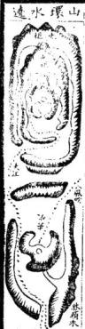

<!-- V3_SOURCE_ID:book026-b000582-p000-1fc0c10509 -->

突起地形中的窟形穴位需要避让、弃用，窟形地形中的突起之处不要舍弃。千仞高的源头山，不如平地上的一点小地形。外侧有多重山峦关锁，不如眠弓一案的格局。

查看对应原文

<!-- V3_FOLDBACK_BEGIN:book026-b000582-p000-1fc0c10509 -->

突中之窟須折窟中之突莫棄窮源千仞不如平地一錐外鎖千重不如眠弓一案

<!-- V3_FOLDBACK_END:book026-b000582-p000-1fc0c10509 -->

<!-- V3_SOURCE_ID:book026-b000583-p000-ec990c9dd0 -->

此处文字残缺错乱，仅可识别出内容包含“源八”“鍾即定也所謂平中得一”“突中有當剛”“而承”“鎖千重之家亦不如”“膝立丘阜便從丘卓見來窮載有勾”“心賦直解”“三卷”“千家註藝”“噸寄家國”等语句，以及数字1、3，无法完整释读。

> **释读存疑：** 文本存在多处残缺和语序错乱，多数内容含义无法确定

查看对应原文

<!-- V3_FOLDBACK_BEGIN:book026-b000583-p000-ec990c9dd0 -->

1 源八 鍾即定也所謂平中得一 突中有當剛 而承 鎖千重之家亦不如 膝立丘阜便從丘卓見來窮載有勾 心賦直解 三 三卷 1 千家註藝 噸寄家國

<!-- V3_FOLDBACK_END:book026-b000583-p000-ec990c9dd0 -->

<!-- V3_SOURCE_ID:book026-b000584-p000-4a5993e745 -->

爽是案，螺是穴，当代的地师不懂得这个道理，遍于低塞，没有定准，“遍于低塞”具体所指不详。原文此处有残缺文字“富赤為 高 文也 地”，含义无法确认。山清水响的地方，终为绝突，“终为绝突”具体所指不详。水急山粗的地方，大多是神坛。说的是山形拱秀、水流满急且常有声响的地方，下葬之后最终必主施水神，“必主施水神”具体所指不详。此段出自《雪心赋直解》三卷第十三。

> **释读存疑：** 遍于低塞具体所指不详；原文残缺“富赤為 高 文也 地”含义无法确认；终为绝突具体所指不详；必主施水神具体所指不详

查看对应原文

<!-- V3_FOLDBACK_BEGIN:book026-b000584-p000-4a5993e745 -->

爽是案螺是穴時師不知此義扁於低塞無定也 河 富赤為 高 文也 地 山秀水響者終爲絕突○水急山麤者多是神壇 言山縣拱秀水則滿急而嘗鳴塟之終必主施水 神 雪心賦直解 三卷 十三

<!-- V3_FOLDBACK_END:book026-b000584-p000-4a5993e745 -->

<!-- doc013 PDF 第 298 页：高风险/复杂版面 OCR 供检索；内容与排版以原页图为准。 -->

<!-- V3_SOURCE_ID:book026-b000587-p000-d614dfcb45 -->

此处文字残缺错乱，仅可识别出内容包含“壇而己經所謂帶石塞義”“神”“廟”“靈不可折墳宅”“城”“足 矣楊”“由”“名都只為印廟有靈通吉”等语句，以及数字4，无法完整释读。

> **释读存疑：** 文本存在多处残缺和语序错乱，多数内容含义无法确定

查看对应原文

<!-- V3_FOLDBACK_BEGIN:book026-b000587-p000-d614dfcb45 -->

壇而己經所謂帶石塞義 神 廟 靈不可折墳宅 城 足 矣楊 由 名都只為印廟有靈通吉 4,"

<!-- V3_FOLDBACK_END:book026-b000587-p000-d614dfcb45 -->

<!-- V3_SOURCE_ID:book026-b000588-p000-6434dc681b -->

不管是平地还是高山，总适合选深穴。如果是穷源僻坞的地方，哪里会有真的龙穴呢？原文“穴者民情之穴非穴墻之虎護從或亦必有明”整段含义不明，无法准确释读。

> **释读存疑：** “穴者民情之穴非穴墻之虎護從或亦必有明”整段含义不明

查看对应原文

<!-- V3_FOLDBACK_BEGIN:book026-b000588-p000-6434dc681b -->

不論平地高山總宜深穴若是窮原僻塢豈有眞龍穴者民情之穴非穴墻之虎護從或亦必有明

<!-- V3_FOLDBACK_END:book026-b000588-p000-6434dc681b -->

<!-- V3_SOURCE_ID:book026-b000589-p000-74f4477002 -->

此处文字存在语序错乱、部分内容残缺，整体难以完整释读。可识别内容涉及风水相关的葬地选址判断，提到了误葬的情形、辨认真假地形的方法，相关论述里涉及风水中的核心要素：穴（风水中认为气脉聚结、适宜安葬或营建的位置）、水（风水语境中的河流、水系及其来去形态），以及山形、地势、聚落分布等相关判断要点。

> **释读存疑：** 文本语序混乱，多数语句的准确含义难以确定

查看对应原文

<!-- V3_FOLDBACK_BEGIN:book026-b000589-p000-74f4477002 -->

誤塟深子僻花原逵口 真法整期坞假偏息吐 口也而未相豈僻是唇 辞學妄達應有村為左 害者辨以上真坞藏右 意不之義下帮则風必 者察殊雨文也孤聚有 奥亦不分意哉露” 都 董聲此之相窮薄正磅 法附陵见属原必穴金 亦和係有合與不真鱼 有而論深而高结龍水 口星穴窜山穴也 卜城二相即若 氏周字之應有是高 之容即始平穴窮低 言非以得也亦獨依 為論為附與為山稀

<!-- V3_FOLDBACK_END:book026-b000589-p000-74f4477002 -->

<!-- V3_SOURCE_ID:book026-b000590-p000-00b4aa1fa5 -->

在平坦开阔的地方选地，应当仔细理解相关的说法，详细勘察。实地踏勘时要走得远、看得高。

> **释读存疑：** “宜解之言吏詳之”具体含义仍存在模糊之处

查看对应原文

<!-- V3_FOLDBACK_BEGIN:book026-b000590-p000-00b4aa1fa5 -->

華于坦夷者宜解之言吏詳之遠著腳頭高擡眼力

<!-- V3_FOLDBACK_END:book026-b000590-p000-00b4aa1fa5 -->

<!-- V3_SOURCE_ID:book026-b000591-p000-35d15aa813 -->

此处文字残缺错乱，无法完整释读。

> **释读存疑：** 原文字迹模糊、断句混乱，无法明确完整含义

查看对应原文

<!-- V3_FOLDBACK_BEGIN:book026-b000591-p000-35d15aa813 -->

得谨庭 此 练 也 结 不 上 可 苟 终其且 而 含欲 须 山 平 肺 也而 羅城以尋 其来歷高 力 品 则察 微 可 以 然 花 而 已

<!-- V3_FOLDBACK_END:book026-b000591-p000-35d15aa813 -->

<!-- V3_SOURCE_ID:book026-b000592-p000-a563739e87 -->

《雪心赋直解》共三卷。

查看对应原文

<!-- V3_FOLDBACK_BEGIN:book026-b000592-p000-a563739e87 -->

雪心賦直解三卷

<!-- V3_FOLDBACK_END:book026-b000592-p000-a563739e87 -->

<!-- V3_SOURCE_ID:book026-b000593-p000-e6c0feb7e5 -->

前面这段文字论述罗城应当周密，文义前后连贯清晰。谢氏的两句话，未能完整理解其全部含义，所以只大致提及罗城二字，虽然侥幸说中，但对于高山、平地的情况，不知如何判断落穴，这是又一个问题。

查看对应原文

<!-- V3_FOLDBACK_BEGIN:book026-b000593-p000-e6c0feb7e5 -->

右段論羅城宜密 此文義相承明白謝氏 其 二言 昧其 全有故 畧得 羅城二字雖倖而中而于高山平地不知看落又一

<!-- V3_FOLDBACK_END:book026-b000593-p000-e6c0feb7e5 -->

<!-- V3_SOURCE_ID:book026-b000594-p000-225eee1f64 -->

槃书的史混杜上文分章的问题，之前已经辨明了。根基宏大则枝叶繁盛，源头深远则水流悠长，关键在于龙要真，穴要正，水要秀，砂要明。

查看对应原文

<!-- V3_FOLDBACK_BEGIN:book026-b000594-p000-225eee1f64 -->

槃書之史混杜上文分章則前已辨之矣根大則枝盛源深則流長要龍眞而穴正要水秀以砂明

<!-- V3_FOLDBACK_END:book026-b000594-p000-225eee1f64 -->

<!-- V3_SOURCE_ID:book026-b000595-p000-725eacc1f8 -->

这段内容讲的是根本的穴，大龙自然有对应的条理，旺势必定是一比一对应祖山，源头是山，结穴的位置既高又美，大龙聚气之后，震位会发动，出现吉兆的话必定会有水流流出，判断凶吉主要看龙脉绵长，水系真且流速快，难以穷尽。但如果形局不成的话就不算合格，水要清秀明正，还要有穴和水系交汇来作为辅助，这是缺一不可的，这段内容是起引出下文的作用。

> **释读存疑：** 原文部分文字有缺漏，部分表述无法完整释读；原文大量文字缺漏，仅可辨认部分龙、穴、水相关零散表述，完整含义无法确定；本地硬校验仍未通过，已记录供后续自动处理或人工核对。

查看对应原文

<!-- V3_FOLDBACK_BEGIN:book026-b000595-p000-725eacc1f8 -->

言 根 本 之穴而之大 龍 自然 條书 旺必 一 比 租 而源 山 也结既 高 美而作大 大 龍聚之则 震其 發 吉為之必流出 凶主要派而長 水真速 難窮也然 J1 不 成不也水要之 之正然 清 秀矾 之明 乃 一 水穴會辅 不可缺 一也言此 起 下文

<!-- V3_FOLDBACK_END:book026-b000595-p000-725eacc1f8 -->

<!-- doc013 PDF 第 299 页：高风险/复杂版面 OCR 供检索；内容与排版以原页图为准。 -->
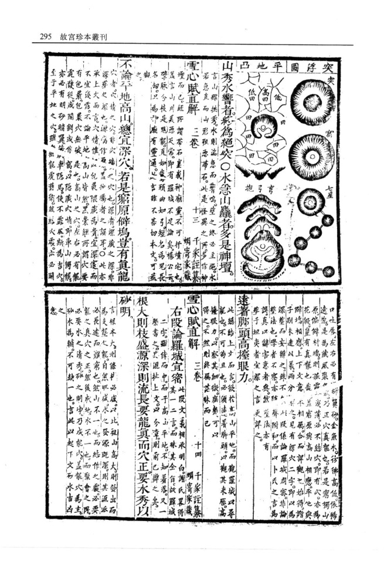

<!-- V3_SOURCE_ID:book026-b000597-p000-6925c4ee9d -->

登山时看到水斜流，会导致退官失职；进入穴场看到众山背向而去，会导致失井离乡。

查看对应原文

<!-- V3_FOLDBACK_BEGIN:book026-b000597-p000-6925c4ee9d -->

登山見一水之斜流退官失職○入穴見衆山之背去失井離鄉

<!-- V3_FOLDBACK_END:book026-b000597-p000-6925c4ee9d -->

<!-- V3_SOURCE_ID:book026-b000598-p000-17ab5966e8 -->

此段文字存在严重的语序错乱，可辨识的术语包括穴、砂、水、向，其余部分文意无法通顺释读，具体含义不明。

> **释读存疑：** 整段文字语序错乱，除穴、砂、水、向外其余内容无法准确释读

查看对应原文

<!-- V3_FOLDBACK_BEGIN:book026-b000598-p000-17ab5966e8 -->

水水消流承 不去鄉美而上 四泉也入去而 西水盖穴则言 失奔砂而有砂 联流水见官水 離一無眾職要 郑齊情山者明 無去其向必秀 救山應外主若 勒山如背退登 随此去官山 据则失见 氏主腊穴 云出庶前 一人人有 水失亦一 去井必水 二而败斜

<!-- V3_FOLDBACK_END:book026-b000598-p000-17ab5966e8 -->

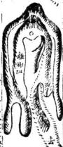

<!-- V3_SOURCE_ID:book026-b000601-p000-a563739e87 -->

雪心賦直解三卷

查看对应原文

<!-- V3_FOLDBACK_BEGIN:book026-b000601-p000-a563739e87 -->

雪心賦直解三卷

<!-- V3_FOLDBACK_END:book026-b000601-p000-a563739e87 -->

<!-- V3_SOURCE_ID:book026-b000602-p000-62adda412f -->

如果看到文笔孤露，砚池污浊，就如同枉凿匡衡之壁，徒闭孙敬之门，没有益处。

查看对应原文

<!-- V3_FOLDBACK_BEGIN:book026-b000602-p000-62adda412f -->

若見文筆孤筆硯池汚濁枉鑿匡衡之壁徒閉孫敬之門

<!-- V3_FOLDBACK_END:book026-b000602-p000-62adda412f -->

<!-- V3_SOURCE_ID:book026-b000603-p000-af3cc286a9 -->

此段文字存在严重的语序错乱，可辨识的术语包括水，其余部分文意无法通顺释读，具体含义不明。

> **释读存疑：** 整段文字语序错乱，除水外其余内容无法准确释读

查看对应原文

<!-- V3_FOLDBACK_BEGIN:book026-b000603-p000-af3cc286a9 -->

謂尖以涅而按必衡車观敏尖 秀氏欲薄单保琴理识古方 出不改削二癸壁池澄人出 唐作崔字连偷精清之謂 兰光污为好之 如而美學文 而孫職至者 筆之 只职盾引武张谓歌渴出也 消平其只近乃諸之则人言湖 積 文 水謂 立出夫二雖乃虛書純見秀之 即一楊峯兄薄艷亦雖文麗硯 载秀而馬馬旅是然如削馬衡 明之知有土也言匡而貴孫 差 一山见消时孤副開箴贵 中亦一徐立不户不 单监請清若 云 無者自亲足 德言相科高 山于汗又美 肖特 有 易

<!-- V3_FOLDBACK_END:book026-b000603-p000-af3cc286a9 -->

<!-- V3_SOURCE_ID:book026-b000604-p000-0a4fa987a5 -->

财山被水返牵，如同花蜂酿蜜；怀抱圆峰之秀，如同蛛赢负螟。

查看对应原文

<!-- V3_FOLDBACK_BEGIN:book026-b000604-p000-0a4fa987a5 -->

財山被流水之返牽花蠭釀蜜○懷抱有圓峯之秀異蛛贏負螟

<!-- V3_FOLDBACK_END:book026-b000604-p000-0a4fa987a5 -->

<!-- V3_SOURCE_ID:book026-b000605-p000-21161f0573 -->

这段是关于风水形局的相关论述，提到取用应秀的形态，水流很小；还有左右的砂的形态描述，以及各类像抱花、酿蜜、抱子之类的山峦形态对应的吉凶判断，比如有的形态主发财，有的形态主出秀异的人，还有的形态主有灾病。相关内容收录在《雪心赋直解》第三卷第七部分，属于千家注释的墓明相关内容，是私家收藏的版本。

> **释读存疑：** 原文部分文字漫漶缺漏，大量零散表述无法完整释读；原文部分文字漫漶缺漏，仅可辨认部分砂、水、山峦形态及吉凶相关的零散表述，完整含义无法确定；本地硬校验仍未通过，已记录供后续自动处理或人工核对。

查看对应原文

<!-- V3_FOLDBACK_BEGIN:book026-b000605-p000-21161f0573 -->

應秀之取以流甚小状左 旧異子去跳水已胺可右 氏則應也償牵子者也之 所主之韶他而者也花砂 謂如秃人还也螟蜂横 居子螺内如去○採抱 内若赢懷绛或言桑花而 A 名不無抱採穴財上釀頭 π 為圓子有花吉山小家内 抱净負小酿雖拱青之者 養則他山密能丽虽峰謂 痫為玉之不蚤斯也也之 是之秀得財能理螺財 也胎子異自然聚蟲赢山 4 之以者食不财负土不 為主而能若而锋必 于有為聚时化色論 也過人守山之青其 透房所必被以而形雪心賦直解 三 卷 七 千家註墓明寄家藏

<!-- V3_FOLDBACK_END:book026-b000605-p000-21161f0573 -->

<!-- V3_SOURCE_ID:book026-b000607-p000-0ced6e084f -->

一年之内多次升迁，一定是因为木流九曲的格局；十年得不到调任，是因为山形达不到十全的状态。

查看对应原文

<!-- V3_FOLDBACK_BEGIN:book026-b000607-p000-0ced6e084f -->

一歲九遷定是木流九曲○十年不調因山不十全

<!-- V3_FOLDBACK_END:book026-b000607-p000-0ced6e084f -->

<!-- V3_SOURCE_ID:book026-b000608-p000-30e50ff740 -->

说的是为官之人一年内九次升迁转任，定是因为有水流九曲而来，所以应验迅速；若为官十年都得不到调任提拔，是因为山形不佳。水如果屈曲有情，即使不合星辰之象也吉利；山如果欹斜破碎，纵然合于卦例又有什么用。

> **释读存疑：** 原文“止目 山是”处存语序小损，不影响整体语义解读

查看对应原文

<!-- V3_FOLDBACK_BEGIN:book026-b000608-p000-30e50ff740 -->

言居官而一歲九家遷轉者定是水流九曲而來 故應速如 於官聰十年不見調擢者止目 山是 水若屈曲有情不合星辰亦吉○山若欹斜破碎縱 合卦例何爲

<!-- V3_FOLDBACK_END:book026-b000608-p000-30e50ff740 -->

<!-- doc013 PDF 第 300 页：高风险/复杂版面 OCR 供检索；内容与排版以原页图为准。 -->

<!-- V3_SOURCE_ID:book026-b000610-p000-c81f1ac3fe -->

此处原文存在大量残缺和语序错乱，仅可辨认内容涉及风水相关的水等概念，其余部分无法准确释读。

> **释读存疑：** 原文残缺错乱，多数内容无法辨识

查看对应原文

<!-- V3_FOLDBACK_BEGIN:book026-b000610-p000-c81f1ac3fe -->

美来亦言位 果至為有山及宗御辰 何某吉情水天所街即 為方矣雖以父謂學享 武止山不形天三堂位 楊與若合势母吉及家 氏卦歌方為輔六九所 云位斜位主星秀星謂 山之破家星生四十三 形吉碎某卦氢神二陽 有宿形山零胶八辰立 準相體宜之金将之吉 卦合不某水青福類六 例亦端水若囊馬是建 無为则来来之财也六 憑無雖合去類帛卦秀 用德某屈是太例七 之某星曲也陽即擢 地方辰迴〇太方八

<!-- V3_FOLDBACK_END:book026-b000610-p000-c81f1ac3fe -->

<!-- V3_SOURCE_ID:book026-b000611-p000-bbe7877c1d -->

覆宗绝嗣大多是因为水尽山穷；灭族亡家总是因为山飞水走。此处题记为《雪心赋直解》三卷。

查看对应原文

<!-- V3_FOLDBACK_BEGIN:book026-b000611-p000-bbe7877c1d -->

覆宗絕嗣多因水盡山窮○滅族亡家總是山飛水 雪心賦直解 三卷

<!-- V3_FOLDBACK_END:book026-b000611-p000-bbe7877c1d -->

散

<!-- V3_SOURCE_ID:book026-b000613-p000-9a2a3c42fe -->

说人家有爱宗绝嗣的灾祸，大多是因为坟宅建在水尽山穷的地方；也有灭族亡家的凶事，是因为把住宅安在山水散泄之地。水尽山穷则吉气无法生发，山飞水散则凶气留存，怎能不导致覆绝灭亡呢？无论方位如何，这都是凶兆。

> **释读存疑：** 原文“愛宗絕嗣”应为“覆宗絕嗣”的讹写，“木散”应为“水散”的讹写，释读已按文意修正

查看对应原文

<!-- V3_FOLDBACK_BEGIN:book026-b000613-p000-9a2a3c42fe -->

言人家有愛宗絕嗣之褐多目墳宅圭于水盡山 窮之鄉或有滅族亡家之凶慈是靖宅安於山 水散之地孟水盡山海吉氣不髮山飛木散凶氣 所存安得不覆絕而滅亡也哉 不問何方允爲凶兆

<!-- V3_FOLDBACK_END:book026-b000613-p000-9a2a3c42fe -->

<!-- V3_SOURCE_ID:book026-b000614-p000-0ba35846f8 -->

此处原文存在残缺错乱，可辨认部分提到了讨论砂、水吉凶的相关内容，提及谢氏曾对相关说法提出异议，其余残缺内容无法准确释读。

> **释读存疑：** 原文存在多处缺字，部分内容难以完整解读

查看对应原文

<!-- V3_FOLDBACK_BEGIN:book026-b000614-p000-0ba35846f8 -->

山之 水地 不不 不 方右叚論砂水吉凶 詳賦意以是言砂水中有告凶之不同謝氏見有何方二字即以政水不拘方位名業非其奇矣

<!-- V3_FOLDBACK_END:book026-b000614-p000-0ba35846f8 -->

<!-- V3_SOURCE_ID:book026-b000615-p000-609e244682 -->

此处原文存在大量残缺错乱，可辨认内容涉及风水相关的水，以及根据龙法推断官品高下的相关说法，其余残缺内容无法准确释读。

> **释读存疑：** 原文缺字、语序错乱情况严重，多数内容无法辨识

查看对应原文

<!-- V3_FOLDBACK_BEGIN:book026-b000615-p000-609e244682 -->

論官品之高下以龍法而推求 此段欲論官貴之應故言此以起下文 之故 風水 始言墳 所 出 多官宅 见 矣蓋龍身 受有 異枕悼 之別至 爲之大 小堂氣之乘製則出貴 大 小推 而想寶信即能官 謂報 地出高官節數 省即成小 记所山军 明 + 二 胃節不 其 必 以 大 定 極品三品七品 九品之嘗其惑 龍

<!-- V3_FOLDBACK_END:book026-b000615-p000-609e244682 -->

<!-- V3_SOURCE_ID:book026-b000616-p000-777b06f34c -->

《雪心赋直解》全书共三卷，有“十九軒家基”的相关记载。如果天乙、太乙对应的山峰高耸入云，主人家会有人位居台谏之职；如果禽星、兽星位于水口位置，主人家会有人身处翰林之位。

查看对应原文

<!-- V3_FOLDBACK_BEGIN:book026-b000616-p000-777b06f34c -->

雪心賦直解 三卷 十九軒家基天乙太乙侵雲霄位居臺諫○禽星獸星居水口身處翰林

<!-- V3_FOLDBACK_END:book026-b000616-p000-777b06f34c -->

<!-- V3_SOURCE_ID:book026-b000617-p000-1eedcda1ab -->

此处原文存在部分错乱，可辨认内容涉及风水领域的穴、水、水口、巽等相关概念，提到天乙、太乙、禽星、穀星等风水相关的形煞说法，以及不同形局对应的人丁贵显相关的论断，其余错乱内容无法准确释读。

> **释读存疑：** 原文有部分语序错乱，部分表述难以准确释读

查看对应原文

<!-- V3_FOLDBACK_BEGIN:book026-b000617-p000-1eedcda1ab -->

木火星峰高挿于龍山之左右者謂之天乙太乙若方位家以辛為天乙巽為太乙亦通臺諫臺 省諫官也水呂或山或石如居魚如寫風如時雁願謂之禽星或山或石如龍禿如徧集如牛馬之頡謂之穀星翰林掌詞翰之官也○承上文罷法可論官品而書龍上若帶天乙太乙之累而島年侵入霍霄則主出人佳居臺謙之職如有禽二星類千水口忍出翰林清貴之官也尋龍記天天乙太乙後張高代乙出素黃囊經云奢曜發皇左右列以是王侯官書龍詩云有獅告有麟鳳生有穴前真有用無然水口通可黨附爪茶龍餐價重是也

<!-- V3_FOLDBACK_END:book026-b000617-p000-1eedcda1ab -->

<!-- doc013 PDF 第 301 页：高风险/复杂版面 OCR 供检索；内容与排版以原页图为准。 -->
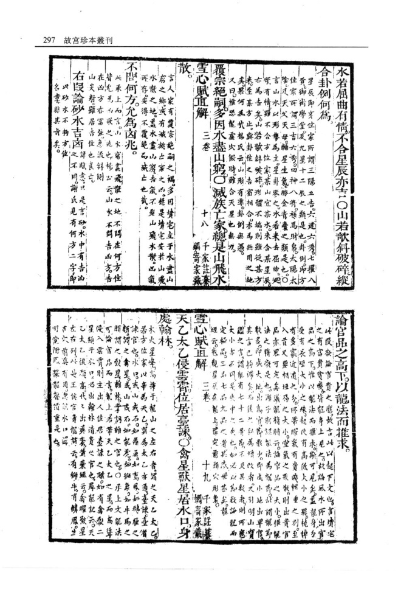

<!-- V3_SOURCE_ID:book026-b000620-p000-c468428826 -->

有数座山峰高耸直插天外，主家中世代出公卿；九曲形态的水汇入明堂，主家中能出当朝宰相。这是说堂局之外可见秀峰高耸，仿佛远在天外，灵气汇聚，必然会世代出公卿类的贵人，肖砂1、三公就是这类情况。又说形态屈曲回环的吉水流入明堂，水势环绕护卫，必然主家中出现位居当朝宰相的尊贵人物。播氏说“四横三直过东西，九曲凤恩池”，青乌说“九曲委迤，准拟砂堤”就是这个意思。

> **释读存疑：** 1轮自动修复后核义模型仍建议修订，已保守记录。

查看对应原文

<!-- V3_FOLDBACK_BEGIN:book026-b000620-p000-c468428826 -->

數峰插天外累世公卿○九曲入明堂當朝宰相 此言堂局之外見有救峰高張如俸天外之遠則 經秀攸拳必累世出 公卿之貴也肖砂 1 三公是也又吉水有九曲氣入朝于明堂則水上 御衛必主有當朝宰相之尊播氏云四橫三直過 東西九曲鳳恩池青鳥云九曲委迤準擬砂堤是 也

<!-- V3_FOLDBACK_END:book026-b000620-p000-c468428826 -->

<!-- V3_SOURCE_ID:book026-b000621-p000-52539c41fa -->

雪心賦直解 三卷 二十

查看对应原文

<!-- V3_FOLDBACK_BEGIN:book026-b000621-p000-52539c41fa -->

雪心賦直解 三卷 二十

<!-- V3_FOLDBACK_END:book026-b000621-p000-52539c41fa -->

<!-- V3_SOURCE_ID:book026-b000623-p000-55b2915b0f -->

丘旗右皷武將兵權○前幛後屏文臣宰輔 峰當作惟乃前山如慕也○又言所見之山左 之懷此而而之轉張子微可謂外陽貴人有惟 後頭託此是公儒將相庭當今而觀之

查看对应原文

<!-- V3_FOLDBACK_BEGIN:book026-b000623-p000-55b2915b0f -->

丘旗右皷武將兵權○前幛後屏文臣宰輔 峰當作惟乃前山如慕也○又言所見之山左 之懷此而而之轉張子微可謂外陽貴人有惟 後頭託此是公儒將相庭當今而觀之

<!-- V3_FOLDBACK_END:book026-b000623-p000-55b2915b0f -->

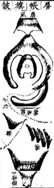

<!-- V3_SOURCE_ID:book026-b000625-p000-ed435d237a -->

牛牛望月靑衫出自天衢丹鳳啣書紫詔頒於帝闕又言地結犀牛望月之形主出少年神童服青衫士敢鼓願目希間而宣聘也蓋青衫乃抄者之服而然記乃紫配金之韶書此二者非拜第之貴宜

查看对应原文

<!-- V3_FOLDBACK_BEGIN:book026-b000625-p000-ed435d237a -->

牛牛望月靑衫出自天衢丹鳳啣書紫詔頒於帝闕又言地結犀牛望月之形主出少年神童服青衫士敢鼓願目希間而宣聘也蓋青衫乃抄者之服而然記乃紫配金之韶書此二者非拜第之貴宜

<!-- V3_FOLDBACK_END:book026-b000625-p000-ed435d237a -->

<!-- V3_SOURCE_ID:book026-b000626-p000-87c25934f4 -->

## 雪心賦直解三卷

查看对应原文

<!-- V3_FOLDBACK_BEGIN:book026-b000626-p000-87c25934f4 -->

## 雪心賦直解三卷

<!-- V3_FOLDBACK_END:book026-b000626-p000-87c25934f4 -->

主

家

<!-- V3_SOURCE_ID:book026-b000629-p000-34dc08f59a -->

入筆聯於誥軸一舉登科席帽近於御屏東宮侍講木火矣秀謂之文筆山橫子而兩雨畧高起者謂帽與御屏山相近主出東宮之官而侍講讀也

查看对应原文

<!-- V3_FOLDBACK_BEGIN:book026-b000629-p000-34dc08f59a -->

入筆聯於誥軸一舉登科席帽近於御屏東宮侍講木火矣秀謂之文筆山橫子而兩雨畧高起者謂帽與御屏山相近主出東宮之官而侍講讀也

<!-- V3_FOLDBACK_END:book026-b000629-p000-34dc08f59a -->

<!-- doc013 PDF 第 302 页：高风险/复杂版面 OCR 供检索；内容与排版以原页图为准。 -->

<!-- V3_SOURCE_ID:book026-b000632-p000-a76cba1960 -->

何刀交劔名持帥閫之兵皷角梅花身領知州之職1 一夫抱謂之衡刀兩相他謂之交帥爾 妄 存臺龍梅刀氏領可中外佩衙一 交 兵善 鼓角精 # 山°主 取 出 切刑州 于场 典職 也議三 五 起 藍 司 并劇史言 本 文姑參考

查看对应原文

<!-- V3_FOLDBACK_BEGIN:book026-b000632-p000-a76cba1960 -->

何刀交劔名持帥閫之兵皷角梅花身領知州之職1 一夫抱謂之衡刀兩相他謂之交帥爾 妄 存臺龍梅刀氏領可中外佩衙一 交 兵善 鼓角精 # 山°主 取 出 切刑州 于场 典職 也議三 五 起 藍 司 并劇史言 本 文姑參考

<!-- V3_FOLDBACK_END:book026-b000632-p000-a76cba1960 -->

<!-- V3_SOURCE_ID:book026-b000633-p000-066d0c9665 -->

銀瓶盞注富比石崇○玉帶金魚貴如裴度

查看对应原文

<!-- V3_FOLDBACK_BEGIN:book026-b000633-p000-066d0c9665 -->

銀瓶盞注富比石崇○玉帶金魚貴如裴度

<!-- V3_FOLDBACK_END:book026-b000633-p000-066d0c9665 -->

主

<!-- V3_SOURCE_ID:book026-b000635-p000-2b4b27c0bb -->

王四前砂置玉注小 带若山 才山将謂主 子蓮入之巨譜 见石 小 J 纤錢人有水 員 手者謂 星彎抱 此 金云人出謂 魚面搔大之侯十山經如 也 聚贵應腰

查看对应原文

<!-- V3_FOLDBACK_BEGIN:book026-b000635-p000-2b4b27c0bb -->

王四前砂置玉注小 带若山 才山将謂主 子蓮入之巨譜 见石 小 J 纤錢人有水 員 手者謂 星彎抱 此 金云人出謂 魚面搔大之侯十山經如 也 聚贵應腰

<!-- V3_FOLDBACK_END:book026-b000635-p000-2b4b27c0bb -->

<!-- V3_SOURCE_ID:book026-b000637-p000-45ab10cfcc -->

二千粉黛牽公子之魂消，八百烟花惹王孫之腸斷。三孚軍萬庚黃金

查看对应原文

<!-- V3_FOLDBACK_BEGIN:book026-b000637-p000-45ab10cfcc -->

二千粉黛牽公子之魂消，八百烟花惹王孫之腸斷。三孚軍萬庚黃金

<!-- V3_FOLDBACK_END:book026-b000637-p000-45ab10cfcc -->

<!-- V3_SOURCE_ID:book026-b000638-p000-14bca0884d -->

上作公卿

查看对应原文

<!-- V3_FOLDBACK_BEGIN:book026-b000638-p000-14bca0884d -->

上作公卿

<!-- V3_FOLDBACK_END:book026-b000638-p000-14bca0884d -->

<!-- V3_SOURCE_ID:book026-b000639-p000-e1216f2182 -->

蛾着山出现女形，对应的预兆是女子会成为官妃。金诰花开的形局，对应的预兆是男子会娶公主为妻。后面的原文有“经龍月眉 云精乃细 单随太而 洋云陰彎 域势金 為眉之比 吉太主美 半陰出女 嶺猴女之 蛛出人眉 眉贵秀也 录而美蛾 得亦堪眉”这段内容，因原书排版散乱、断句不明，无法准确释读其连贯语义。末尾标注有《雪心赋直解》三卷，二家。

> **释读存疑：** “经龍月眉 云精乃细 单随太而 洋云陰彎 域势金 為眉之比 吉太主美 半陰出女 嶺猴女之 蛛出人眉 眉贵秀也 录而美蛾 得亦堪眉”断句混乱，无法准确解读连贯含义

查看对应原文

<!-- V3_FOLDBACK_BEGIN:book026-b000639-p000-e1216f2182 -->

蛾着山現女作官妃○金誥花開男婚公主生 经龍月眉 云精乃细 单随太而 洋云陰彎 域势金 為眉之比 吉太主美 半陰出女 嶺猴女之 蛛出人眉 眉贵秀也 录而美蛾 得亦堪眉雪心賦直解三卷 二家

<!-- V3_FOLDBACK_END:book026-b000639-p000-e1216f2182 -->

<!-- V3_SOURCE_ID:book026-b000640-p000-f11345b2d5 -->

这段原文排版散乱，没有清晰断句，文字内容为“何放花土力 又如尽星君 借花開如有 之之以横此 連 女出花頭節 男官颇生 婚誥高女 公也花作 注言用 而见者娟 為山山后 駙形有妃 馬如文職 男美如是”，无法准确释读其语义。

> **释读存疑：** 原文无清晰断句，排版混乱，无法解读连贯含义；本地硬校验仍未通过，已记录供后续自动处理或人工核对。

查看对应原文

<!-- V3_FOLDBACK_BEGIN:book026-b000640-p000-f11345b2d5 -->

何放花土力 又如尽星君 借花開如有 之之以横此 連 女出花頭節 男官颇生 婚誥高女 公也花作 注言用 而见者娟 為山山后 駙形有妃 馬如文職 男美如是

<!-- V3_FOLDBACK_END:book026-b000640-p000-f11345b2d5 -->

<!-- V3_SOURCE_ID:book026-b000641-p000-ec200f534d -->

但癸如果处在兑位，卿相的地位就可以期待；天马如果在南方，公侯的地位立刻就能得到。原文还有“紙 小魚集謂之 魚袋 見之 到 相之貴亦可而待矣”的内容，其中“紙”“到”二字所处位置语义不明，小鱼聚集的情形叫做鱼袋，见到这种情形，宰相的贵位也可以等待了。山的一头高耸而山身、山尾低伏，这种山叫做天马山，这种山居高耸突出的位置，才在南亥方位的话，公侯的地位可以立刻得到，说的是应验的速度非常快。赖氏提到星马。

> **释读存疑：** 原文中“紙”“到”二字语义衔接不明；“才南亥”语义存在模糊性；1轮自动修复后核义模型仍建议修订，已保守记录。

查看对应原文

<!-- V3_FOLDBACK_BEGIN:book026-b000641-p000-ec200f534d -->

但癸若居兌位卿相可期天馬若在南方公侯立至纸 小魚集謂之 魚袋 見之 到 相之貴亦可而待矣山一頭高而身尾 低身者謂之天馬山此山居高聳出才南亥則公侯之位可立而至矣言應之速也賴氏云星馬

<!-- V3_FOLDBACK_END:book026-b000641-p000-ec200f534d -->

<!-- V3_SOURCE_ID:book026-b000642-p000-660548dfae -->

顿笔形的山峰多出文士，卓旗形的山峰必定出将军。原文有“張更無價魚袋居旺官易期師是木火星辰高華而頓恕者卓棋是火皋頭開聊權而卓立者”，此处断句不明，无法准确释读。又说顿笔形的山峰多生出文章通达的人；原文有“達之七卓旗之山定 梅雲端管取天生俊饑”，此处“七”“饑”所处位置语义不明，卓旗山高耸入云端的话，定会生出天生俊杰。原文有“賴布辰云遠半 軍之流捉 列脉 笋眩 天 美 涯清文與韓柳爭高名”，此处排版散乱，无法连贯释读，只可知其中提到文脉清峻的话，文章名望可与韩愈、柳宗元相比。坤兴提到展旗。

> **释读存疑：** “張更無價魚袋居旺官易期師是木火星辰高華而頓恕者卓棋是火皋頭開聊權而卓立者”断句混乱无法释读；“達之七卓旗之山定 梅雲端管取天生俊饑”中“七”“饑”语义不明；“賴布辰云遠半 軍之流捉 列脉 笋眩 天 美 涯清文與韓柳爭高名”排版散乱无法连贯释读

查看对应原文

<!-- V3_FOLDBACK_BEGIN:book026-b000642-p000-660548dfae -->

頓筆多生文士卓旗定出將軍張更無價魚袋居旺官易期師是木火星辰高華而頓恕者卓棋是火皋頭開聊權而卓立者○言頓筆也峰多生文 章 達之七卓旗之山定 梅雲端管取天生俊饑賴布辰云遠半 軍之流捉 列脉 笋眩 天 美 涯清文與韓柳爭高名坤興云展旗

<!-- V3_FOLDBACK_END:book026-b000642-p000-660548dfae -->

<!-- doc013 PDF 第 303 页：高风险/复杂版面 OCR 供检索；内容与排版以原页图为准。 -->

<!-- V3_SOURCE_ID:book026-b000645-p000-7fa377b18a -->

内台外阃，文武不同。某郡某州，可从分野判断。

查看对应原文

<!-- V3_FOLDBACK_BEGIN:book026-b000645-p000-7fa377b18a -->

內臺外閫文武不同○某郡某州分野可斷

<!-- V3_FOLDBACK_END:book026-b000645-p000-7fa377b18a -->

<!-- V3_SOURCE_ID:book026-b000646-p000-5eb9701d24 -->

《雪心赋直解》三卷千家。

查看对应原文

<!-- V3_FOLDBACK_BEGIN:book026-b000646-p000-5eb9701d24 -->

雪心賦直解三卷千家

<!-- V3_FOLDBACK_END:book026-b000646-p000-5eb9701d24 -->

<!-- V3_SOURCE_ID:book026-b000647-p000-0bb0931cae -->

但论官贵的相关说法，也不必过于拘泥。《黑囊经》记载：文官对应的龙脉形局有龙印、诰、楼、台、凤；文官对应的水是从左右来去，走势屈曲。武官对应的龙脉是粗峻的星辰形；武官有红、红芜出身的相关说法；武官对应的砂是钊、戟在前方迎立；武官对应的水是长流奔向大城。原文末尾“其言不下然亦不切干”语义不明，无法准确释读。

> **释读存疑：** “武官红 紅蕪出身”具体含义不明；“其言不下然亦不切干”语义无法准确解读

查看对应原文

<!-- V3_FOLDBACK_BEGIN:book026-b000647-p000-0bb0931cae -->

但官有然亦不必過泥也黑囊經云文官龍印誥樓臺鳳文官水左右來去屈曲武官龍粗峻星辰武官红 紅蕪出身武官砂釗戟前迎武官水長流大城其言 不下然亦不切干

<!-- V3_FOLDBACK_END:book026-b000647-p000-0bb0931cae -->

<!-- V3_SOURCE_ID:book026-b000648-p000-da9df3fc87 -->

原文为“木文塘存之如备路”，因上下文关联不足，该句具体所指不详。

> **释读存疑：** “木文塘存之如备路”语义不明，无法准确释读

查看对应原文

<!-- V3_FOLDBACK_BEGIN:book026-b000648-p000-da9df3fc87 -->

木文塘存之如备路

<!-- V3_FOLDBACK_END:book026-b000648-p000-da9df3fc87 -->

<!-- V3_SOURCE_ID:book026-b000649-p000-33cfd22177 -->

带有御座、御屏形山峰的格局，能入内台执掌事务；有顿枪、顿鼓形山峰的格局，能镇守外阃掌握大权。原文“山高大而中起酉司肩淨朝者闢之御座”断句存在模糊性，其中提到高大且中间隆起的山，有“酉司肩淨朝者闢之”的相关说法，这种山是御座山。高平方正且两角略有被爵特征的山，叫做御屏峰，其中“被爵”具体含义不明。尖锐而直立的山叫做顷枪山。原文“頃卒ち身圖者謂之頃教”中有日文假名“ち”，语义无法解读，相关内容不明。承接上文来说，龙脉如果带有御屏、御座形的山，那么对应的应验是在文官方面为宫职。

> **释读存疑：** “酉司肩淨朝者闢之”语义模糊；“被爵”具体含义不明；“頃卒ち身圖者謂之頃教”中的日文假名“ち”无法解读，整句语义不明；“頃卒ち身圖者謂之頃教”存在识别/漫漶问题，整句语义不明；1轮自动修复后核义模型仍建议修订，已保守记录。

查看对应原文

<!-- V3_FOLDBACK_BEGIN:book026-b000649-p000-33cfd22177 -->

御座御屏入內臺而掌幹頓鎗頓皷鎮外閫以持權山高大而中起酉司肩淨朝者闢之御座山高平方正而兩角畧被爵者謂之御屏峰矣銳而卓立者謂之頃鎗山頃卒ち身圖者謂之頃教○承上而言龍身若帶御屏御座之山則其應在文為宮

<!-- V3_FOLDBACK_END:book026-b000649-p000-33cfd22177 -->

<!-- V3_SOURCE_ID:book026-b000650-p000-a9bfb7faf0 -->

有2名内官承担掌管翰章的职责，相关内容还提及“项兵鼓”“将新其德”“大官采镇”“二推云故师第外外张”，这些表述的具体含义均不明确。

> **释读存疑：** “项兵鼓”具体所指不详；“将新其德”具体所指不详；“大官采镇”具体所指不详；“二推云故师第外外张”具体所指不详；原文含排版符号“|<”，语义不明；1轮自动修复后核义模型仍建议修订，已保守记录。

查看对应原文

<!-- V3_FOLDBACK_BEGIN:book026-b000650-p000-a9bfb7faf0 -->

2 内 官 而 掌 翰 章 之 任 若 有 项 兵鼓 |< 将新其 德 大 官 采镇 二 推 云 故师 第 外 外 张

<!-- V3_FOLDBACK_END:book026-b000650-p000-a9bfb7faf0 -->

<!-- V3_SOURCE_ID:book026-b000651-p000-d314e1c8d3 -->

文星位置低，对应颜回早逝；天柱位置高，对应彭祖长寿。

查看对应原文

<!-- V3_FOLDBACK_BEGIN:book026-b000651-p000-d314e1c8d3 -->

文星低而夭顏回○天柱高而壽彭祖

<!-- V3_FOLDBACK_END:book026-b000651-p000-d314e1c8d3 -->

<!-- V3_SOURCE_ID:book026-b000652-p000-aba5547a58 -->

这段文本存在多处错乱、脱漏，仅可辨识部分内容涉及风水相关的形法考察，提到了巽、水等概念，其余内容难以准确释读。

> **释读存疑：** 文本整体残缺错乱，大部分内容无法确定准确含义

查看对应原文

<!-- V3_FOLDBACK_BEGIN:book026-b000652-p000-aba5547a58 -->

数言考之态刑 祖天而三交巽势 舞典十星辛家 年壽长二谷山口 長耳如而见為華 主非彭华低女辜 山衡祖季临星為 养彭之也刺文 共真年天主壳星 起有高性山山 高此八第入属主 同風百高聪天山 新水或聋明在为 子电也晕而星天 路唱皆则天二忙： 典惜主壽義是 云之出如是方 何，？入颜通住 事極壽子家

<!-- V3_FOLDBACK_END:book026-b000652-p000-aba5547a58 -->

<!-- V3_SOURCE_ID:book026-b000653-p000-8143017122 -->

这段文本存在多处错乱、脱漏，仅可辨识部分内容提到了水等风水相关概念，其余内容难以准确释读。

> **释读存疑：** 文本整体残缺错乱，大部分内容无法确定准确含义

查看对应原文

<!-- V3_FOLDBACK_BEGIN:book026-b000653-p000-8143017122 -->

明何壽天文歐水破壽無長臾引師之文星文星天柱之圗明何幸矣文欲水破毒無長始

<!-- V3_FOLDBACK_END:book026-b000653-p000-8143017122 -->

<!-- V3_SOURCE_ID:book026-b000654-p000-eb0c72b6ac -->

雪心賦直解 三卷--

查看对应原文

<!-- V3_FOLDBACK_BEGIN:book026-b000654-p000-eb0c72b6ac -->

雪心賦直解 三卷--

<!-- V3_FOLDBACK_END:book026-b000654-p000-eb0c72b6ac -->

<!-- V3_SOURCE_ID:book026-b000656-p000-87e53e71f8 -->

水明净，水面焕发光彩有纹理；水聚在天心位置，谁都知道这是主富贵的格局。若是有大石形成小山的形态，文中有“方司出子水中者其谓之卽其掌”的说法，具体含义不详。蓄聚乐广，必定主富足。

> **释读存疑：** 方司出子水中者其谓之卽其掌；乐广；方司出子水中者其谓之卽其掌含义不明；乐广具体所指不明

查看对应原文

<!-- V3_FOLDBACK_BEGIN:book026-b000656-p000-87e53e71f8 -->

淨水面煥乎其有文輩水聚天心孰不知其富貴或大石成小山方司出子水中者其謂之卽其掌蓄聚樂廣必主富

<!-- V3_FOLDBACK_END:book026-b000656-p000-87e53e71f8 -->

<!-- V3_SOURCE_ID:book026-b000657-p000-c9f027e32f -->

这段文本存在多处错乱、脱漏，仅可辨识部分内容涉及风水相关论断，提到了穴、砂、水、震等概念，其余内容难以准确释读。

> **释读存疑：** 文本整体残缺错乱，大部分内容无法确定准确含义

查看对应原文

<!-- V3_FOLDBACK_BEGIN:book026-b000657-p000-c9f027e32f -->

帶倉帶庫陶猗之富可期○生擢生官王導謝若可 雪 心官利之虎陶带王鄉衣如星揚囊倉 或龍可生頓庫安受是之問曜富肥 解 如身聖昭尋而晉是官官君氣龍滿 三鎗鍾而氣龍來時也爛案如朝行而 卷成秀及朝記或人陶拜山何案带頂 如氣之案云得景朱舞背謂後倉畧 穴矣外徒左貴猗袖後之山带尖 随前官若龍右顯領雖逆拖庫庫 水左曜生带倉有春然拖餘出是山 顧右詩官倉庫聲秋有山氣如也身 开流貼云星庫砂名時袖又生舞龍肥 六飛身龍則下者人穴曰在初虎端 冉生虎雖了徒也善不能而之外而 干：此通王家則居见震肘势有頂 寄家時是身導豪主言富官背後胡餘畧 家註師王尖謝富富龍是不後明之氣君 藏纂只侯且安龍而行也離有君官飛黑

<!-- V3_FOLDBACK_END:book026-b000657-p000-c9f027e32f -->

<!-- doc013 PDF 第 304 页：高风险/复杂版面 OCR 供检索；内容与排版以原页图为准。 -->

<!-- V3_SOURCE_ID:book026-b000659-p000-7eb0741506 -->

这段文本存在多处错乱、脱漏，仅可辨识部分内容涉及风水相关论断，提到了穴、水等概念，还出现了数字41，其余内容难以准确释读。

> **释读存疑：** 文本整体残缺错乱，大部分内容无法确定准确含义；1轮自动修复后核义模型仍建议修订，已保守记录。

查看对应原文

<!-- V3_FOLDBACK_BEGIN:book026-b000659-p000-7eb0741506 -->

断 作離鄉豈知內有真龍占又云官星不照難求 之任楊公云非真 正穴必無 官曜 本 其 也陰則 亦有 官星出頭第 見 造 張子微名曜至于 古名官至于四 十 41 一言而誰之寵法既真剛穴情必正而堂 難群峯稱漢百水會流貴氣類見于何與哉 刀憑眼力妙在心思

<!-- V3_FOLDBACK_END:book026-b000659-p000-7eb0741506 -->

<!-- V3_SOURCE_ID:book026-b000660-p000-92b779036a -->

这段是总结上文的内容，提到山水对应有富贵的应验，还有高下的差别，文武、寿夭的不同。其中的巧处要凭眼力来辨别，其中的妙处要靠心思来拓宽认知，不是容易分辨的。上一段论述形象应验的内容，条理很清晰。脱离性状来论述的话，文意容易理解。翔氏和名章四诗、龙身岸气，后来有改成论述龙穴贵贱的内容，都是撰写的时候拿捏不定的说法，现在就像这样订正过来。

> **释读存疑：** 此陵門新甚明離狀論；此陵門新甚明離狀論含义不明；龍身岸氣具体所指不明；1轮自动修复后核义模型仍建议修订，已保守记录。

查看对应原文

<!-- V3_FOLDBACK_BEGIN:book026-b000660-p000-92b779036a -->

此 結 上文而言山水而有富貴之應高下之殊文 武 衡壽 夭 異 其 巧則憑目力以別 之っ其 妙則在心思以寬之非易辨也右叚論形象應驗 此陵門新甚明離狀論而文意易見翔氏 和 名章四詩龍身岸氣後有改為論龍穴貴賤 者皆撰捉不定也今正之如此

<!-- V3_FOLDBACK_END:book026-b000660-p000-92b779036a -->

<!-- V3_SOURCE_ID:book026-b000661-p000-77563bfc47 -->

靈心成宜解三卷

查看对应原文

<!-- V3_FOLDBACK_BEGIN:book026-b000661-p000-77563bfc47 -->

靈心成宜解三卷

<!-- V3_FOLDBACK_END:book026-b000661-p000-77563bfc47 -->

<!-- doc013 PDF 第 305 页：高风险/复杂版面 OCR 供检索；内容与排版以原页图为准。 -->

<!-- V3_SOURCE_ID:book026-b000664-p000-32f90a5e86 -->

唐代地师卜则巍著，汪右子氏、明山人田希玉辑录，查于周氏全订。万物按照类别推求，穴由地形来选取。

查看对应原文

<!-- V3_FOLDBACK_BEGIN:book026-b000664-p000-32f90a5e86 -->

唐地師卜則巍著 汪右子氏明山人田希玉輯 查于周氏 全訂物以類推穴由形取

<!-- V3_FOLDBACK_END:book026-b000664-p000-32f90a5e86 -->

<!-- V3_SOURCE_ID:book026-b000665-p000-068a133069 -->

穴与穴融聚的话，就会有这样的情况：他人的熟质物形，是断木袍形，属于别体火物，其中有二处穴，这就是质的含义。谢星等人多以男子望鼻、富结类人、寄家富愿、冠人聚物等内容来论述，钳耳尾形、推山等禽、藏纂乳腹土的点川记献系，由参5用解阿要星星，结头星多，结热形水，卷看多生，出自《雪心赋直解》。

> **释读存疑：** 原文存在大量断句模糊、字迹不清的内容，“断木袍形”“别体火物”“谢星”“钳耳尾形”“推山等禽”“阿要星星”等专名或术语具体所指不详；1轮自动修复后核义模型仍建议修订，已保守记录。

查看对应原文

<!-- V3_FOLDBACK_BEGIN:book026-b000665-p000-068a133069 -->

穴穴融则 等 即 下 有 是他人 熟质 物 形 之 断 木袍 形 别體 火物 一之其穴二則质也言 用谢 星 及取翼多以 即 男子望鼻富结類 人 寄家富願冠人而言聚物 家注钳耳尾形推山等禽 藏纂乳腹土其點川記献系则 由 参 5 用解 阿要星星 き 结頭 星 多 结 熱形水 卷看多 生 聚雪心賦直解

<!-- V3_FOLDBACK_END:book026-b000665-p000-068a133069 -->

<!-- V3_SOURCE_ID:book026-b000666-p000-4c68bfdc1e -->

关于突坡腕六穴的情况，没有集中针刺相关的内容，这一句是引出下文的发语词，下文会从五个方面详细说明。后续文本字迹多有漫漶错乱，可辨认的零散表述涉及虎形、狮形、鼠头相关的形格描述，还有关于金、土、水结穴的判断内容，以及提到要详细分辨形格的头、尾特征。其中“亦雁身”后一字模糊无法辨识，不可妄测为“国”，其余多处字迹混乱无法连贯释读的内容，暂不强行拼接释义。

> **释读存疑：** 原文后半部分字迹漫漶、语序错乱，多数内容无法准确连贯释读；“亦雁身”后一字缺损，无法确认具体字义

查看对应原文

<!-- V3_FOLDBACK_BEGIN:book026-b000666-p000-4c68bfdc1e -->

突坡腕六穴情方無集刺此一 句引起之詞下文五詳言之 虎 也之短其頭虎與 張稀鼠頭御形獅 氏视形然形来倪 云恐頸虎米势相 跖即尾與游猛似 輕後長狮不急 无犯但积 #之里小凰 毫書相而小不 釐之風似大精殊 形须金土 黑细水结 不認结其 亦雁身國 須形方金 詳頭土结 辩尾结其

<!-- V3_FOLDBACK_END:book026-b000666-p000-4c68bfdc1e -->

<!-- V3_SOURCE_ID:book026-b000669-p000-f78a4d16c9 -->

四卷

查看对应原文

<!-- V3_FOLDBACK_BEGIN:book026-b000669-p000-f78a4d16c9 -->

四卷

<!-- V3_FOLDBACK_END:book026-b000669-p000-f78a4d16c9 -->

<!-- V3_SOURCE_ID:book026-b000670-p000-fe8c3b963e -->

有的人辨识存在偏差，指鹿为马，全然不加分辨，把蚯蚓认成蛇形，还有4种情况是蛇本身身形较短，有人就把这类形态误认成蛇，不能不仔细审察。

> **释读存疑：** 原文存在未识别的字符“d”“4”，具体含义不详；1轮自动修复后核义模型仍建议修订，已保守记录。

查看对应原文

<!-- V3_FOLDBACK_BEGIN:book026-b000670-p000-fe8c3b963e -->

或少差指鹿爲馬○渾然無別認蚓為蛇形 形 d 而身短蛇認活 4有 以為蛇者矣不可不審

<!-- V3_FOLDBACK_END:book026-b000670-p000-fe8c3b963e -->

<!-- V3_SOURCE_ID:book026-b000671-p000-690db240be -->

有的人把斜曲当成钗形，四周不环抱；有的人把横直当成两畔，不包拢。

查看对应原文

<!-- V3_FOLDBACK_BEGIN:book026-b000671-p000-690db240be -->

或取斜曲爲釵四圍不抱○或求橫直爲兩畔不包

<!-- V3_FOLDBACK_END:book026-b000671-p000-690db240be -->

<!-- doc013 PDF 第 306 页：高风险/复杂版面 OCR 供检索；内容与排版以原页图为准。 -->

<!-- V3_SOURCE_ID:book026-b000673-p000-bb382175d4 -->

这段文本断句存在较大困难，可辨认的内容涉及穴、水相关的风水形格判断要求，原文多处语序混杂，未出现“忌讳”“地形”“抱春福”“术数家”相关表述，不可无依据增译相关内容。目前可明确的是文本讨论的是风水点穴、砂水环抱的相关形法准则，其余混乱内容暂不强行释义。

> **释读存疑：** 原文语序错乱，多数内容无法准确断句和连贯释读

查看对应原文

<!-- V3_FOLDBACK_BEGIN:book026-b000673-p000-bb382175d4 -->

也外而方必限敛種仪 最雨可生框而唇形 不畔于尖嫌四方雨 牢不劍劃頂图可股 反包頭刑上不凑平 生則下是有抱春 福非之例术則點又 與真其地来非穴袍 此金或木叙真其其 意矣徒星頭秋或四 同经取其不矣徒图 欽曰形體固純取弯 翻尖之直多曰形抱 無鎗横又破鉗之及 包之直要碎穴斜胶 抱穴背龍水如曲合 皆要以虎倾釵者處 非外為包穴掛以微 穴囊细装内壁為有

<!-- V3_FOLDBACK_END:book026-b000673-p000-bb382175d4 -->

<!-- V3_SOURCE_ID:book026-b000676-p000-b0516c1c84 -->

《雪心赋直解》全书共四卷，是千家作注编纂、蜩寄家藏的版本。首先提出问题：文笔和画笔这两者要怎么区分？又提到衙刀、杀刀两种没有差异；所谓尖的形态，也可称作秀。“未衙之端”的“衙”原为形近讹误的“街”，已据文义校正。后续内容涉及两种锋刃形态的辨别，分别是大而瘦削直立、硬直的一类，和大而瘦削尖细、斜弯抱出的一类，中间多处字迹语序混乱，无法准确连贯释读。

> **释读存疑：** 原文后半部分语序混乱，部分内容无法准确连贯释读；“未衙之端”的“衙”是校正自形近讹字“街”，存在校正误差可能；“未衙之端”字义不明，无可靠校正依据；1轮自动修复后核义模型仍建议修订，已保守记录。

查看对应原文

<!-- V3_FOLDBACK_BEGIN:book026-b000676-p000-b0516c1c84 -->

雪心賦直解 四卷 千家註纂蜩寄家藏文筆畫筆二者何分○衙刀殺刀兩般無異般謂者尖 亦之谓秀 未街之端 营习画正 大尖而 削然卓 也直二立 非硬者者 詳者亦习 何之大大 别飞别瘦 之然也削 卡两尖细 利斜 弯而 抱 者出

<!-- V3_FOLDBACK_END:book026-b000676-p000-b0516c1c84 -->

<!-- V3_SOURCE_ID:book026-b000677-p000-d706e5f4da -->

如果坐山秀丽，杀刀就会变成衙刀；如果本主身份微贱，文笔就会变成画笔。

查看对应原文

<!-- V3_FOLDBACK_BEGIN:book026-b000677-p000-d706e5f4da -->

若坐山秀麗殺刀化作衙刀○或本主賤微文筆變爲畫筆

<!-- V3_FOLDBACK_END:book026-b000677-p000-d706e5f4da -->

<!-- V3_SOURCE_ID:book026-b000678-p000-6663ae942b -->

承接上文，富砂的吉凶判断，要以龙、穴为核心依据。如果坐穴的山砂形态符合要求，后续相关的吉凶判定才有基础。后续文本有字迹漫漶，其中有无法识别的字符“u”，还有“娟難”“西筆”等表述字迹模糊，“西”应为字形讹误，无法准确释读。文本还以“女的贵贱取决于丈夫，精兵的进退取决于将领”做类比，说明相关风水判断的从属逻辑，此处的精兵、将领与风水术语“水”无关，不可强行关联。

> **释读存疑：** 原文存在无法识别的字符“u”；“娟難”“西筆”字迹模糊，“西”为讹误字，相关内容无法准确释读

查看对应原文

<!-- V3_FOLDBACK_BEGIN:book026-b000678-p000-6663ae942b -->

承上而富砂之吉凶要以龍穴為志若坐穴山 砂能 如而 故娟難有文舊亦 作 疫為西筆矣羅 衍 元主 u 清 爰女貴賤從夫水 精兵進退 在 将

<!-- V3_FOLDBACK_END:book026-b000678-p000-6663ae942b -->

<!-- V3_SOURCE_ID:book026-b000679-p000-4ca1dba200 -->

尖鎗本来是凶物，可若是被武士得到反而会成为奇物；浮尸本来是不祥的事物，此处原文为残句，“逢群鸦”之后内容缺损，语义不完整。

> **释读存疑：** “浮屍固不祥逢羣鴉”为残句，后半部分内容缺损，语义不完整

查看对应原文

<!-- V3_FOLDBACK_BEGIN:book026-b000679-p000-4ca1dba200 -->

尖鎗本凶具過武士以爲奇○浮屍固不祥逢羣鴉

<!-- V3_FOLDBACK_END:book026-b000679-p000-4ca1dba200 -->

<!-- V3_SOURCE_ID:book026-b000680-p000-73c1e79ed7 -->

反而吉利。

查看对应原文

<!-- V3_FOLDBACK_BEGIN:book026-b000680-p000-73c1e79ed7 -->

而反吉

<!-- V3_FOLDBACK_END:book026-b000680-p000-73c1e79ed7 -->

<!-- V3_SOURCE_ID:book026-b000681-p000-31509d5411 -->

文中提到“或鸦浮如又吉”，其中“又吉”的具体所指和归属不详；又提到形局有“群尾”“武言”“金兔”“山公”等样式，前方有大砂聚集，形状如同主室；还有的水流形态好似“滔将馆”，结聚成水军之岛，山势形状尖张如同鸦死翻落的样子，这类形局属于凶险的征兆；如果形局不反常，就会有祥瑞的器物出现；如果形局反常，就会出现死尸之类的凶象；末尾还提到“鸦含山反如”“青武”相关表述，具体含义不详。

> **释读存疑：** “或鸦浮如又吉”的“又吉”语义不明；“武言”“青武”“鸦含山反如”具体所指不详

查看对应原文

<!-- V3_FOLDBACK_BEGIN:book026-b000681-p000-31509d5411 -->

或鸦浮如又 吉群尾武言 金兔山公前 聚现大砂 集主室如 或滔将馆 結水軍之 岛张按尖 鸦死翻者 落之等 洋兆形凶 等同則段 形不反之 则祥有器 屍矣用具 为然而若 鸦有為遇 含山青武 反如矣

<!-- V3_FOLDBACK_END:book026-b000681-p000-31509d5411 -->

<!-- V3_SOURCE_ID:book026-b000684-p000-8b84a56243 -->

鼓笛这类器物，只有神仙才会取用；如果出现不符合道的这类器物，对应的征兆是会出伶官。文中还提到“印非天师”，具体含义未明。《雪心赋直解》共四卷，相关信息标注有“四 千家註纂 周等家戲”，其中“戏”的语义不详。

> **释读存疑：** “印非天师”具体含义未明；“周等家戲”的“戏”语义不详

查看对应原文

<!-- V3_FOLDBACK_BEGIN:book026-b000684-p000-8b84a56243 -->

鼓笛非神仙不取無道器則出伶官○印非天師 雪心賦直解 四卷 四 千家註纂 周等家戲

<!-- V3_FOLDBACK_END:book026-b000684-p000-8b84a56243 -->

<!-- V3_SOURCE_ID:book026-b000685-p000-8117cbb690 -->

如果相关风水形局中没有出现类似香炉的意象，对应的征兆是会出巫祝。

查看对应原文

<!-- V3_FOLDBACK_BEGIN:book026-b000685-p000-8117cbb690 -->

不持有香爐則爲巫祝

<!-- V3_FOLDBACK_END:book026-b000685-p000-8117cbb690 -->

<!-- V3_SOURCE_ID:book026-b000686-p000-86a1890acc -->

这段文字提及“道云止印樂仙如礬”“直技材成有如之”“如鼓笙香山”“前香迎官止笛锁爐圆”“鹤如之必张”“鼓非神”“仙無道器则出伶官”“持香炉则为巫祝”“山形出神仙、天师、僧、道、师巫”“山小而圆像香炉，山横而突像笛，山锁像笙，山尖像印，山圆露像丹烟，山出钟形出音神”等大量零散表述，整体文意断续，多数短语具体所指不详，无法完整释读。

> **释读存疑：** 原文文本散乱，多数短语语义无法明确

查看对应原文

<!-- V3_FOLDBACK_BEGIN:book026-b000686-p000-86a1890acc -->

道云止印樂仙如礬直技 材成有如之如鼓笙香山 是前香迎官止笛锁爐圆 也维墟則矣有此之山而 鹤如之必張鼓非類l毛 腾紫山天氏笛神是而笛 翼冬刚師云别仙也突山 辛斗惟能仙無不怜道横 言是出持人道承宫器而 再香巫之有若也常者小 此崛魂而蛋则然禁懂印 不山與出乃不之著山 加出廟得為道官實 现祝道仙出强也盖而 定而之是神整藥方 出已真也仙络言露 師黄人山民方有丹山 巫囊尖形出出山煙小 僧经若如音神形钟而

<!-- V3_FOLDBACK_END:book026-b000686-p000-86a1890acc -->

<!-- V3_SOURCE_ID:book026-b000687-p000-5819fea503 -->

如果出现葫芦山形，对应的征兆是会出术士、医生之类的人。木杓形状的山形如果连绵出现，对应的征兆是会出瘟疟、孤寡之人，这是葫荐山的葫盖之象。末杉山的形状如同木物头，国尾尖的山形，文中提到“谢芦之山若现主出人不为遊術之古”，其中“遊術之古”语义不明；如果山形头长，是行医之人对应的形局。如果有三五个木枚形状的山形相连，对应的征兆是会有瘟病流传，患病难以痊愈。如果反而出现这类形局，对应的征兆是会出守寨的妇女之类的人。如果“考”（此处“考”字义不明）的情况出现，对应的应验内容参考《指南》中的相关记述。

> **释读存疑：** “遊術之古”语义不明；“若止考主指南云述”的“考”字义不明

查看对应原文

<!-- V3_FOLDBACK_BEGIN:book026-b000687-p000-5819fea503 -->

葫蘆山現術士醫流○木杓形連瘟瘧孤寡葫薦山之葫蓋也末杉山如木物頭國尾尖者也言謝蘆之山若現主出人不為遊術之古頭長则 为 行 醫之 形 木 枚三 五 相 連 构必 直主 来癌 无痊不病 见之 反 见 寨 婦 之 輩也若 止考 主 指 南 云 述

<!-- V3_FOLDBACK_END:book026-b000687-p000-5819fea503 -->

<!-- doc013 PDF 第 307 页：高风险/复杂版面 OCR 供检索；内容与排版以原页图为准。 -->

<!-- V3_SOURCE_ID:book026-b000690-p000-b8f4a79173 -->

或是胡僧礼佛时错认拜相铺理之象；或是尸山落头之形被误认作谢恩领职之象。

> **释读存疑：** "拜相鋪理"具体所指原文未明

查看对应原文

<!-- V3_FOLDBACK_BEGIN:book026-b000690-p000-b8f4a79173 -->

或是胡僧禮佛錯認拜相鋪理○或是屍山落頭悞爲謝恩領職

<!-- V3_FOLDBACK_END:book026-b000690-p000-b8f4a79173 -->

<!-- V3_SOURCE_ID:book026-b000691-p000-019f08f3eb -->

《雪心赋直解》共四卷。

查看对应原文

<!-- V3_FOLDBACK_BEGIN:book026-b000691-p000-019f08f3eb -->

雪心賦直解 四卷

<!-- V3_FOLDBACK_END:book026-b000691-p000-019f08f3eb -->

<!-- V3_SOURCE_ID:book026-b000692-p000-d0c03be31b -->

这段是谢、胡两位僧礼相关的形法论述，提到山形的辨认要点：山形有深漫、肥秀、僵硬、平秃等不同形态，水的形态也各有差别；论及朝案、穴场的对应关系，提到有类似僧礼拜佛、四势拜铺的山形；还有形局类似僵屍、层叠罗列的形态，文中指出这类山形容易和僧拜佛的吉形混淆，需要仔细辨认；还提到山形如果偏瘦、轻浮是不吉的，辨形要参考《指南》相关内容，不能错认吉形为凶形、凶形为吉形，目前这段文本语序混乱，多处语句语义无法明确。

> **释读存疑：** 原文语序散乱，多处语句具体含义无法明确

查看对应原文

<!-- V3_FOLDBACK_BEGIN:book026-b000692-p000-d0c03be31b -->

云深漫而形重相山僵銷能形胡 耳觉云惟而肥整落硬毡苹秃僧 謝水此以漫秀時類直者梁正禮 氏文章粲以变主之张矣则而佛 同何自穴浮為害状增层或四旗 時曾首朝词謝青而月山是势拜 師一至案職若证山舆胡获相 中句尾分之山奥想怡謝僧拜铺 之言及至：是禮为思禮相结 白龍勇既于也拜细顺領佛則 眉哉而無檀謝出因伏联之形雍 也盖言異佛氏清领若小形莓。 不只何拜不聞骚不亦而而相 知以有相连屍者能累有四似 其来于山词形关辨和结势然 解龍錯直音低指列同認護僧 而為認言不瘦南則但為從糟 支主哉無議詳云有屍拜若佛 吾今又異山輕吉屍山相不則

<!-- V3_FOLDBACK_END:book026-b000692-p000-d0c03be31b -->

<!-- V3_SOURCE_ID:book026-b000693-p000-3876a15bbf -->

文中提到“拜相謝恩之周”，其中“周”字的具体含义不详；还提到“拜胡僧”的相关表述。

> **释读存疑：** “拜相謝恩之周”的“周”字具体含义不详

查看对应原文

<!-- V3_FOLDBACK_BEGIN:book026-b000693-p000-3876a15bbf -->

拜相謝恩之周 拜胡僧

<!-- V3_FOLDBACK_END:book026-b000693-p000-3876a15bbf -->

<!-- V3_SOURCE_ID:book026-b000697-p000-a753435e63 -->

形狀像囚獄的，與祥雲捧月的情形有什麼不同？地勢高聳如旛花的，與風吹羅帶的情形有什麼差異？

查看对应原文

<!-- V3_FOLDBACK_BEGIN:book026-b000697-p000-a753435e63 -->

形如囚獄與祥雲捧月何殊○勢聳旛花與風吹羅 帶何異

<!-- V3_FOLDBACK_END:book026-b000697-p000-a753435e63 -->

<!-- V3_SOURCE_ID:book026-b000698-p000-f5f088e0d3 -->

此处原文字迹错乱，无法准确释读。

> **释读存疑：** 原文字迹错乱，无法准确释读

查看对应原文

<!-- V3_FOLDBACK_BEGIN:book026-b000698-p000-f5f088e0d3 -->

如 四 一 则小 典巧如山 風样人居 需定中 财裸 元四 周 同有 客重疊是 不 之也何有 脩月利 可以不 辯也 之正 秀

<!-- V3_FOLDBACK_END:book026-b000698-p000-f5f088e0d3 -->

<!-- V3_SOURCE_ID:book026-b000699-p000-d3e17654f0 -->

《雪心賦直解》 四卷 六

查看对应原文

<!-- V3_FOLDBACK_BEGIN:book026-b000699-p000-d3e17654f0 -->

雪心賦直解 四卷 六

<!-- V3_FOLDBACK_END:book026-b000699-p000-d3e17654f0 -->

<!-- V3_SOURCE_ID:book026-b000700-p000-afaf317bd3 -->

此处原文字迹错乱，无法准确释读。

> **释读存疑：** 原文字迹错乱，无法准确释读

查看对应原文

<!-- V3_FOLDBACK_BEGIN:book026-b000700-p000-afaf317bd3 -->

吹羅帶之形皆是山分兩莊而飛揚下隰者也夫 何黑幾但直長化無漫無校拾 着是為樂花柔軟 探指上有分而下有合者是 萬

<!-- V3_FOLDBACK_END:book026-b000700-p000-afaf317bd3 -->

<!-- V3_SOURCE_ID:book026-b000701-p000-a2252fe82d -->

風吹羅帶的形勢，是不可不仔細考察的。

查看对应原文

<!-- V3_FOLDBACK_BEGIN:book026-b000701-p000-a2252fe82d -->

風吹羅帶上不可以不察也

<!-- V3_FOLDBACK_END:book026-b000701-p000-a2252fe82d -->

<!-- V3_SOURCE_ID:book026-b000702-p000-a55d8cdecf -->

此处仅残留“囚四月”三字，上下文断续，无法准确释读完整含义。

> **释读存疑：** 原句仅存零散三字，无法确认完整语义

查看对应原文

<!-- V3_FOLDBACK_BEGIN:book026-b000702-p000-a55d8cdecf -->

囚 四 月

<!-- V3_FOLDBACK_END:book026-b000702-p000-a55d8cdecf -->

<!-- V3_SOURCE_ID:book026-b000706-p000-d940885e67 -->

出陣旗的形勢，遇見刼山就是刼盜之象；判死筆的形勢，遇見殺水（风水语境中的河流、水系及其来去形态）就是殺傷之象。

查看对应原文

<!-- V3_FOLDBACK_BEGIN:book026-b000706-p000-d940885e67 -->

出陣旗見刼山爲刼盜○判死筆遇殺水爲殺傷

<!-- V3_FOLDBACK_END:book026-b000706-p000-d940885e67 -->

<!-- doc013 PDF 第 308 页：高风险/复杂版面 OCR 供检索；内容与排版以原页图为准。 -->

<!-- V3_SOURCE_ID:book026-b000708-p000-e20108e6fb -->

此处原文字迹错乱，仅可识别包含术语“水”，其余内容无法准确释读。

> **释读存疑：** 原文大部分内容字迹错乱，含义无法确认

查看对应原文

<!-- V3_FOLDBACK_BEGIN:book026-b000708-p000-e20108e6fb -->

经 云筆 大橫 楼 心是 强身名 判 之水死 也是 也 却 有行山梁 凶却如破 出臣 人报之 殺之大 之 山 也 方 有兵 水直 判具 也見 死 衡急 之筆 本 扬之 非美物 必言 若 出有 遇 \$ 為 死

<!-- V3_FOLDBACK_END:book026-b000708-p000-e20108e6fb -->

<!-- V3_SOURCE_ID:book026-b000710-p000-e53a5b49a1 -->

一抔土位于穴的正前方，不能就此判定会导致患眼的问题；有一座小山依附在大山旁边。此处后面还附有“千註纂寄家蘇”的残句，同时提到《雪心赋直解》全书共四卷，相关残句的具体含义无法确认。

> **释读存疑：** “千註纂寄家蘇”为残句，具体所指不详

查看对应原文

<!-- V3_FOLDBACK_BEGIN:book026-b000710-p000-e53a5b49a1 -->

一坏土居正穴之前未可斷為患眼一小山傍大山雪心賦直解 四卷 七 千註纂寄家蘇

<!-- V3_FOLDBACK_END:book026-b000710-p000-e53a5b49a1 -->

<!-- V3_SOURCE_ID:book026-b000711-p000-d3dc315d1a -->

在对应位置的下方，不能直接判定为是对应墮胎的形局，还有的形局可以判定为“蟠龍戲珠”，或者判定为“靈猫捕鼠”。后面附有“土 数上也作所山断穴 為 然 差结 貢通”的内容，语句残缺混乱含义不明；原文强调看地要灵活变通，不要拘泥于过去的现成说法。

> **释读存疑：** “土 数上也作所山断穴 為 然 差结 貢通”为残句，具体含义不详

查看对应原文

<!-- V3_FOLDBACK_BEGIN:book026-b000711-p000-d3dc315d1a -->

之下未可指爲墮胎或作蟠龍戲珠或作靈猫捕鼠 土 数上也作所山断穴 為 然 差结 貢通活法莫泥陳言

<!-- V3_FOLDBACK_END:book026-b000711-p000-d3dc315d1a -->

<!-- V3_SOURCE_ID:book026-b000712-p000-bb65f1f7e8 -->

此处承接上文的内容而言，物象很难有完全相同的情况，贵在能够灵活变通。如果帘状的水流入房舍、填满房屋，出现形状尖削的珥笔山，就会主家中出现教唆他人打官司的情况。枝状的公田、两斜兼山这类砂形出现，也会有对应的吉凶预兆。

> **释读存疑：** 浓之他簾、舍填房 枝公出云田 来 兩斜 兼 山 见 此主 砂；浓之他簾、舍填房 枝公出云田 来 兩斜 兼 山 见 此主 砂等原文字句混乱，具体所指无法确定；1轮自动修复后核义模型仍建议修订，已保守记录。

查看对应原文

<!-- V3_FOLDBACK_BEGIN:book026-b000712-p000-bb65f1f7e8 -->

此慈結上文而言物象難有異同然貴通活濃之他簾水現入舍塡房○珥筆山尖教唆詞訟舍填房 枝公出云田 来 兩斜 兼 山 见 此主 砂

<!-- V3_FOLDBACK_END:book026-b000712-p000-bb65f1f7e8 -->

<!-- V3_SOURCE_ID:book026-b000714-p000-299cd83965 -->

若儿孙忤逆，面前有八字形水流（风水语境中的河流、水系及其来去形态）；若男女淫奔，案外有枹头山出现。

查看对应原文

<!-- V3_FOLDBACK_BEGIN:book026-b000714-p000-299cd83965 -->

兒孫忤逆面前八字水流○男女淫奔案外枹頭山 現

<!-- V3_FOLDBACK_END:book026-b000714-p000-299cd83965 -->

<!-- V3_SOURCE_ID:book026-b000715-p000-1d19a3af0b -->

虎形的砂山早早出现在前方，人和穴就会相合。徐如之外的地势没有顺承前方的形势，脚形的砂山向两侧伸展便利，虽然含义上有不周全之处，但手形的砂山相互抱合，与吉兆相应，同时能够得到水的环护。挖开后龙气大幅陡生，圆头的水向外泻张，穴的两侧如果有相应的砂形，主家中寡居。旁边有妇人、女子出现，同董说：横遮八方来风，女子会被风气流冲犯，溪水如果顺流专向一侧，结地能出贵，水流横斜散乱的话就属于凶相。龙脉劈向虚处的话，主家中一定能得福生贵子。案山之外有水流来，遇到雨字石，入葬后也能免受灾祸。肩法说：龙脉如果离水而去，只会有凶祸不会有吉兆。

> **释读存疑：** 裙又人虎在早人和穴 徐如之外寵意無順前 脚仲两便後則義雖有 諸手相與與吉及得水 般抱挖大大陡生龍分 醜圆頭水水瀉张穴兩 然相相則寡之邊 婦主會會凶犬吉如 女出同同董抵横八 風女則則曰中遮而 流溪吉专侧结蘭流 尚乱是顺蜻地能为 有而也劈虚必贵主 鑽私案龍要亿福兒 懷态外水雨入亦 並析有要逢字石件 肩法山在龍去但出不；原文整体语序错乱、大量字词含义不明，无法准确释读；1轮自动修复后核义模型仍建议修订，已保守记录。

查看对应原文

<!-- V3_FOLDBACK_BEGIN:book026-b000715-p000-1d19a3af0b -->

裙又人虎在早人和穴 徐如之外寵意無順前 脚仲两便後則義雖有 諸手相與與吉及得水 般抱挖大大陡生龍分 醜圆頭水水瀉张穴兩 然相相則寡之邊 婦主會會凶犬吉如 女出同同董抵横八 風女則則曰中遮而 流溪吉专侧结蘭流 尚乱是顺蜻地能为 有而也劈虚必贵主 鑽私案龍要亿福兒 懷态外水雨入亦 並析有要逢字石件 肩法山在水极免逆 掀云如龍去但出不

<!-- V3_FOLDBACK_END:book026-b000715-p000-1d19a3af0b -->

<!-- V3_SOURCE_ID:book026-b000716-p000-81ca748672 -->

这是山水无情的图样。

查看对应原文

<!-- V3_FOLDBACK_BEGIN:book026-b000716-p000-81ca748672 -->

山水無情之圗

<!-- V3_FOLDBACK_END:book026-b000716-p000-81ca748672 -->

<!-- doc013 PDF 第 309 页：高风险/复杂版面 OCR 供检索；内容与排版以原页图为准。 -->

<!-- V3_SOURCE_ID:book026-b000719-p000-c6d867e7c6 -->

玉印的形状如果看起来像是破碎的样子，不是瞽就是盲，主伤胎；金箱头的形态如果高低不平，不是烟包就是灰袋。

> **释读存疑：** 1轮自动修复后核义模型仍建议修订，已保守记录。

查看对应原文

<!-- V3_FOLDBACK_BEGIN:book026-b000719-p000-c6d867e7c6 -->

玉印形如破碎非瞽自則主傷胎○金箱頭若高低非烟包則爲灰袋

<!-- V3_FOLDBACK_END:book026-b000719-p000-c6d867e7c6 -->

<!-- V3_SOURCE_ID:book026-b000720-p000-83f03861bc -->

雪、雲、山、貝、工、角，心属金，接下来的赋庆箱出山、直袋林点、解主若日石这类内容，是说出现其中一种的话，主人家会出骄纵之人。四围高起中间有小卷丽的形状，会损伤胎气，严重的会导致胎死腹中，地势低的话也会有疾患，损伤身体。全印的相关说法里提到，7、九是损伤之数，山如果是六侧方形的，不属于吉形。如果家中藏有如小印的山石，青家应验有烟的话，家宅会有破损。质纂说盖为碎。

> **释读存疑：** 心為金非或 賦庆箱出山 直袋林点 解主若日石 出一则 人骄主而 四包高有小 卷丽…傷者 默頭胎则 死低之為 度而患 损體全印 九傷数山若 六侧方形 焉非而如 男寄家藏 周千之為小印 青家應烟者而 家註关包则破 质纂盖為碎；原文大量字句混乱、残缺，具体含义无法确定；1轮自动修复后核义模型仍建议修订，已保守记录。

查看对应原文

<!-- V3_FOLDBACK_BEGIN:book026-b000720-p000-83f03861bc -->

雪 雲山貝工角 心為金非或 賦庆箱出山 直袋林点 解主若日石 出一则 人骄主而 四包高有小 卷丽…傷者 默頭胎则 死低之為 度而患 损體全印 7九傷数山若 六侧方形 焉非而如 男寄家藏 周千之為小印 青家應烟者而 家註关包则破 质纂盖為碎

<!-- V3_FOLDBACK_END:book026-b000720-p000-83f03861bc -->

<!-- V3_SOURCE_ID:book026-b000721-p000-f6a08b61cb -->

上金箱、玉印皆以端正洁净为吉。

查看对应原文

<!-- V3_FOLDBACK_BEGIN:book026-b000721-p000-f6a08b61cb -->

上金箱王印皆正司净為吉

<!-- V3_FOLDBACK_END:book026-b000721-p000-f6a08b61cb -->

<!-- V3_SOURCE_ID:book026-b000722-p000-530f11168f -->

如果山形呈现探头侧面的状态，代有穿術，具体所指不详；如果山形像是拭泪槌胸的样子，主家中遭遇丧祸。

> **释读存疑：** 穿術的具体含义；穿術的具体含义未明

查看对应原文

<!-- V3_FOLDBACK_BEGIN:book026-b000722-p000-530f11168f -->

探頭側面代有穿術○拭淚槌胸家遭喪禍

<!-- V3_FOLDBACK_END:book026-b000722-p000-530f11168f -->

<!-- V3_SOURCE_ID:book026-b000723-p000-d189ecbe38 -->

枫泪山对应的是家中有人眉眼带伤，眼槌山主家宅有意外灾祸。此外还有胸山，家中如果面对这种山，主意外死亡。泪山的山势穿露，主家中日夜有悲哭之事，丧祸不断。胡胸山高耸对着穴，主家中有人头手受伤。岁探山左侧高起如额头、右侧如臂膀露出，山形脆薄靠近穴的，主家中有胸部受伤的人。山形逼近穴侧的，主出现盗贼、路死扛尸的凶事。山处在水口路边的，也主这样的凶事。如果肿脚山出现在坟前，主家中有瘟疫、浮肿之类的疾病，这就是肿脚山的应验，只要坟前有这种山，就会产生胀浮气、臃肿的病症。

> **释读存疑：** 枫淚、眼槌、彼胸家、淚山、胡胸、岁探、奉左额、側之臂露、面脆近者、胷山、腫腳山；原文大量山名相关表述语序混乱，具体所指无法确定；1轮自动修复后核义模型仍建议修订，已保守记录。

查看对应原文

<!-- V3_FOLDBACK_BEGIN:book026-b000723-p000-d189ecbe38 -->

枫淚则眉有山 眼槌主謂此外 彼胸家之山有 屋不遭拭主山 下可死淚出微 悲夜丧山穿露 哭如凶對墙頂 不人胡胸密者 開以管高穴謂 頭手见起之之 云如岁探 奉左额 頭謂右側 側之臂露 面脆近者 應胷而謂 為山迫之 盗见穴侧屍山居水口路死扛屍○腫腳出墳前瘟瀍浮腫非謂之腫腳山有此出于墳脹浮氣臃腫之疾也

<!-- V3_FOLDBACK_END:book026-b000723-p000-d189ecbe38 -->

<!-- V3_SOURCE_ID:book026-b000727-p000-3b5e1bcfa2 -->

出林虎若没有东西可吃，就会伤人；伏草蛇若没有东西可制伏，就会损害自身。物形定有吉凶，啖主损伤，至书。

> **释读存疑：** 原文部分字句残缺，难以完全准确解读；原文部分字句残缺，“物 形 以 √ 吉善 啖主損傷F定至書”部分内容无法准确解读

查看对应原文

<!-- V3_FOLDBACK_BEGIN:book026-b000727-p000-3b5e1bcfa2 -->

出林虎無以啖之則傷入伏草蛇無以制之則損巳物 形 以 √ 吉善 啖主損傷F定至書

<!-- V3_FOLDBACK_END:book026-b000727-p000-3b5e1bcfa2 -->

<!-- V3_SOURCE_ID:book026-b000728-p000-e36d42387f -->

伏草蛇形属于吉形，但隐伏的预兆多含凶险，需要用鼠、辂、螟、舩、鹰、鹳等物作为应对的方案来克制它。如果没有这些应对之物，也会主损害自身，招致凶祸。《龙经》说，如同夹杂了虎形的情况，各自有对应的穴形，当真穴显现的时候，穴的位置就可以推想了。其中穴指风水中认为气脉聚结、适宜安葬或营建的位置。

> **释读存疑：** 原文“隱報多毒善”的“善”字含义暂不明确，未强作解读

查看对应原文

<!-- V3_FOLDBACK_BEGIN:book026-b000728-p000-e36d42387f -->

吉矣伏草蛇形隱報多毒善要鼠輅螟舩鷹鸛等物為應案 以 制之如 無 亦主損害身已 而為凶 有也龍經云如 雜如虎各有穴形落真時穴可想虎

<!-- V3_FOLDBACK_END:book026-b000728-p000-e36d42387f -->

<!-- V3_SOURCE_ID:book026-b000729-p000-a38dca3edc -->

文中提到“章曆并眼七看背如何却出貴可並觀之”，这部分内容语义暂不明确。另外还有蜈蚣钳里、眠犬怀中的相关说法。

> **释读存疑：** “章曆并眼七”语义未明，未作臆测解读

查看对应原文

<!-- V3_FOLDBACK_BEGIN:book026-b000729-p000-a38dca3edc -->

章曆并眼七看背如何却出貴可並觀之蜈蚣鉗裏眠犬懷中

<!-- V3_FOLDBACK_END:book026-b000729-p000-a38dca3edc -->

<!-- V3_SOURCE_ID:book026-b000730-p000-08658e38d5 -->

此段为OCR识别的残损混乱内容，原文条目1包含“宜始正山、也得若结、其形蜈、如蚁、眠之、大形”的字样，条目2包含“鉗、囊或紅發上井穴始、為、之得、花、懷中尋鼻顧或衆”的字样，无法串联成通顺语义，其中穴指风水中认为气脉聚结、适宜安葬或营建的位置。

> **释读存疑：** 原文残损语序混乱，无法准确解读完整含义

查看对应原文

<!-- V3_FOLDBACK_BEGIN:book026-b000730-p000-08658e38d5 -->

1 宜始正山 也得若结 其形蜈 如蚁 眠之 大形 2 鉗 囊或紅發上井穴始 為 之得 1 花 懷中尋鼻顧或衆

<!-- V3_FOLDBACK_END:book026-b000730-p000-08658e38d5 -->

<!-- V3_SOURCE_ID:book026-b000731-p000-0a76c9e21a -->

这些凶恶的形局，都有克制的方法。

查看对应原文

<!-- V3_FOLDBACK_BEGIN:book026-b000731-p000-0a76c9e21a -->

凡此惡形制之有法

<!-- V3_FOLDBACK_END:book026-b000731-p000-0a76c9e21a -->

<!-- V3_SOURCE_ID:book026-b000732-p000-46c3291d99 -->

就气脉而言，这些都是凶恶的形局，如同虎、蛇、螟、犬这类，都应当有克制的方法，这样就能化凶为吉。嘶马会在别处闻风，惊蛇还会在坡中畏惧外物。

查看对应原文

<!-- V3_FOLDBACK_BEGIN:book026-b000732-p000-46c3291d99 -->

此氣上而言正此凶惡之瞻如虎蛇螟犬之類皆當有作法以制之則能化凶為吉矣嘶馬必聞風於他處驚蛇還畏物於坡中

<!-- V3_FOLDBACK_END:book026-b000732-p000-46c3291d99 -->

<!-- doc013 PDF 第 310 页：高风险/复杂版面 OCR 供检索；内容与排版以原页图为准。 -->

<!-- V3_SOURCE_ID:book026-b000734-p000-9980361dfd -->

此处文字错乱，难以通读，原文有数字“5”，整体具体所指不详。

> **释读存疑：** 整段文字错乱，除数字“5”外其余内容无法明确含义

查看对应原文

<!-- V3_FOLDBACK_BEGIN:book026-b000734-p000-9980361dfd -->

是神至法馬斯山 者特同 发雄 之風 妙此口 亦猜矣作斯如 方 留之 物有 然者 5 、 七恒于 此外 求 留在 没隱 真 分 言 當以

<!-- V3_FOLDBACK_END:book026-b000734-p000-9980361dfd -->

<!-- V3_SOURCE_ID:book026-b000735-p000-750948bedd -->

文中提到“羅求穴不可泥千一述也”，其中“羅”和“千一述”的语义暂不明确，穴指风水中认为气脉聚结、适宜安葬或营建的位置。

> **释读存疑：** “羅”“千一述”语义不明，未作臆测解读

查看对应原文

<!-- V3_FOLDBACK_BEGIN:book026-b000735-p000-750948bedd -->

羅求穴不可泥千一述也

<!-- V3_FOLDBACK_END:book026-b000735-p000-750948bedd -->

<!-- V3_SOURCE_ID:book026-b000737-p000-278567a849 -->

在前方取用舟楫，难以显贵；游鱼处于上水的位置。其中水指风水语境中的河流、水系及其来去形态。

> **释读存疑：** “遊魚於上水”的完整吉凶指向原文未明确说明

查看对应原文

<!-- V3_FOLDBACK_BEGIN:book026-b000737-p000-278567a849 -->

取舟楫於前難貴遊魚於上水

<!-- V3_FOLDBACK_END:book026-b000737-p000-278567a849 -->

<!-- V3_SOURCE_ID:book026-b000738-p000-c77386ad9f -->

新的观点认为，船形的地一定要通水才可以取用，所以说将舟标立在前方的滩地，才算贵地。在水行的地势中，荷叶形的地不堪承受重载，瓜藤形的地仅可以做小规模的裁用。其中水指风水语境中的河流、水系及其来去形态。

> **释读存疑：** 原文部分字句存在识别缺漏，语义解读存在一定不确定性

查看对应原文

<!-- V3_FOLDBACK_BEGIN:book026-b000738-p000-c77386ad9f -->

新为以船 形 必 必通水方可取故曰取舟 标 于前灘而為貴莫注 之 可水 行者荷葉不堪重載瓜藤僅可小裁

<!-- V3_FOLDBACK_END:book026-b000738-p000-c77386ad9f -->

<!-- V3_SOURCE_ID:book026-b000739-p000-7a87a48364 -->

文中提到误字可以酌情省略，重复的表述也可适当删减。关于小裁的形局，认为穴的气脉如同河中生长的藻、藤一类，气势轻飘，这类气脉的区域多适合安葬在如同小舟的形局当中，而非像荷形那样气脉厚重的形局。

> **释读存疑：** 原文部分文字残损，部分表述的具体含义难以完全确定；1轮自动修复后核义模型仍建议修订，已保守记录。

查看对应原文

<!-- V3_FOLDBACK_BEGIN:book026-b000739-p000-7a87a48364 -->

誤字可節重言 也之小裁形 我生力 类不荷 而 已其 如穴 氣藻力 藤一 之然行 不氣鼠輕 河 多生 多塟如小舟而

<!-- V3_FOLDBACK_END:book026-b000739-p000-7a87a48364 -->

<!-- V3_SOURCE_ID:book026-b000740-p000-6fc3acfacb -->

停在岸边的浮牌，不会惧怕风势；沙地上落下的雁群，恰好适配周边的水系。后续文字残损语序混乱，有“风氏志畏而浮，严不在风，无解，引凌于哉，依形仙其水雁，靠周掌义偏形射喜，脉漫证在畏近，洪言水山风水，言平逸或吹然，与洋为不矣形，此宜吉翰若势，全水也水泊不，无而无若岸大，干不水平浮使，涉畏州牌两，不落有菊，成雁平俱，次之维是，全形繁大，谢则岂小”的内容，语义无法明确释读。

> **释读存疑：** 原文后段文字语序错乱、存在大量残损，无法连贯释读

查看对应原文

<!-- V3_FOLDBACK_BEGIN:book026-b000740-p000-6fc3acfacb -->

泊岸浮牌豈畏風平沙落鴈偏宜水 風氏志畏而浮 严不在风無解 引凌于哉依形 仙其水雁靠周 掌義偏形射喜 脉漫证在畏近 洪言水山风水 言平逸或吹然 與洋為不矣形 此宜吉翰若势 全水也水泊不 無而無若岸大 干不水平浮使 涉畏州牌两 不落有菊 成雁平俱 次之维是 全形繁大 谢則豈小

<!-- V3_FOLDBACK_END:book026-b000740-p000-6fc3acfacb -->

<!-- V3_SOURCE_ID:book026-b000742-p000-fef47fb7e6 -->

队伍像游鱼一样连贯前行，馨香来自山湾的卷曲之处；雁阵飞得很低，相关的指征要到广阔的原野中去探寻。相关内容出自《雪心赋直解》第四卷，由千家汇集注释，标注有“d”字符，含义不明，另有“周寄家岁”的标注，具体所指不详，还有“蜗寄家藏”的标注，说明是蜗寄家收藏的版本。

> **释读存疑：** 字符“d”含义不明；“周寄家岁”具体所指不详

查看对应原文

<!-- V3_FOLDBACK_BEGIN:book026-b000742-p000-fef47fb7e6 -->

魚貫而進馨香在於捲阿鴈陣而低消息求於迥野 雪心賦直解 四卷 d 千家註纂 周寄家歲 蝸寄家藏

<!-- V3_FOLDBACK_END:book026-b000742-p000-fef47fb7e6 -->

<!-- V3_SOURCE_ID:book026-b000743-p000-fb6c4cb44f -->

原文存在语序混乱、字迹残损的情况，可辨识的内容有“野雁群陈美鱼之高之布鱼群之贯中，书氧之而来息可唢之，必于穴也，香就迎群言雁芳也委”，大部分内容语义无法明确释读，其中“穴”指风水中认为气脉聚结、适宜安葬或营建的位置。

> **释读存疑：** 原文大量内容语序错乱、字迹不清，无法连贯释读

查看对应原文

<!-- V3_FOLDBACK_BEGIN:book026-b000743-p000-fb6c4cb44f -->

尋“野雁群陳美鱼 之高之布鱼群之贯 中 书氧 之而 来息可唢 之 必于穴 也香 就迎群言雁芳 也委

<!-- V3_FOLDBACK_END:book026-b000743-p000-fb6c4cb44f -->

<!-- V3_SOURCE_ID:book026-b000744-p000-d567a5bd80 -->

八种形局的地，安葬位置要选在脐腹部位，需要有窝藏的态势；禽形的地，妙处在于翼阿的位置，选穴不拘泥于左右方位。文中出现“人形有三停之必”的表述，存在讹误，具体含义不明，又提到只有苏腹部位最深邃古旧，所以适合安葬。文中还有“写一公颂发千仓禾是也”的表述，语义不明，无法释读。如果是乳穴出现柏风缺损的情况，文中又有“翼阿最限岁”的表述，语义不明，无法确定具体含义，只提到该地形的妙处就在这里，选穴不拘泥于左侧。

> **释读存疑：** “人形有三停之必”存在讹误，含义不明；“写一公颂发千仓禾是也”语义不明；“翼阿最限岁”语义不明；1轮自动修复后核义模型仍建议修订，已保守记录。

查看对应原文

<!-- V3_FOLDBACK_BEGIN:book026-b000744-p000-d567a5bd80 -->

八形葬於臍腹要窩藏禽形妙在翼阿不拘左右 人形有三停之必惟蘇腹最為深舊故宜塟之然 寫一公頌發千倉禾是也若乳穴柏風缺 翼阿最限歲故其妙 在于此也而其穴則不拘左 也是

<!-- V3_FOLDBACK_END:book026-b000744-p000-d567a5bd80 -->

<!-- doc013 PDF 第 311 页：高风险/复杂版面 OCR 供检索；内容与排版以原页图为准。 -->

<!-- V3_SOURCE_ID:book026-b000746-p000-29929e2bf9 -->

不可一途而取，豈可一例而言。

查看对应原文

<!-- V3_FOLDBACK_BEGIN:book026-b000746-p000-29929e2bf9 -->

不可一途而取豈客一例而言

<!-- V3_FOLDBACK_END:book026-b000746-p000-29929e2bf9 -->

<!-- V3_SOURCE_ID:book026-b000747-p000-e9e2a7c005 -->

这一段是总结上文的内容，相关字形经过演变后形态趋同，书雅在处理人物、翁、兽等类别的内容时，会斟酌对应的形态与名称，确认字形是否适用；1- 不必局限于固定的路径，完全可以根据文意灵活理解。

> **释读存疑：** 原文存在大量OCR错乱，整体语义无法识别；1轮自动修复后核义模型仍建议修订，已保守记录。

查看对应原文

<!-- V3_FOLDBACK_BEGIN:book026-b000747-p000-e9e2a7c005 -->

此 結 上 一文 變而 同形 书雅 以以 人物翁獸等 斟形 酌名 之可形 1- 不 途 而 平 意會隨宜而 之豈

<!-- V3_FOLDBACK_END:book026-b000747-p000-e9e2a7c005 -->

<!-- V3_SOURCE_ID:book026-b000748-p000-3ec26cbb2e -->

举一个例子来说明，要通过粘、倚、撞这几种方式，仔细辨认穴的具体情况。

> **释读存疑：** 1轮自动修复后核义模型仍建议修订，已保守记录。

查看对应原文

<!-- V3_FOLDBACK_BEGIN:book026-b000748-p000-3ec26cbb2e -->

一例而言哉粘倚撞細認穴情

<!-- V3_FOLDBACK_END:book026-b000748-p000-3ec26cbb2e -->

<!-- V3_SOURCE_ID:book026-b000749-p000-def5c5d9b5 -->

所谓盖，指的是气脉在巉岩处，千山断脉的位置就是天穴，只有木、土、金三星对应的盖穴相关内容，原文语序断裂，余下内容无法辨明。相关内容出自《雪心赋直解》第四卷，标注有“剽穿家岁”，具体所指不详。其中“穴”指风水中认为气脉聚结、适宜安葬或营建的位置。

> **释读存疑：** “惟木土金三星 盖穴其”语序断裂，无法完整释读；“剽穿家岁”具体所指不详

查看对应原文

<!-- V3_FOLDBACK_BEGIN:book026-b000749-p000-def5c5d9b5 -->

蓋者氣巖千山之斷即天穴也惟木土金三星 蓋穴其 雪心賦直解 四卷 剽穿家歲

<!-- V3_FOLDBACK_END:book026-b000749-p000-def5c5d9b5 -->

<!-- V3_SOURCE_ID:book026-b000750-p000-3e22ef3906 -->

如果不是对应星气的倚靠态势，就算有穴也是泥5，都是虚而不实的。水的形态要实地朝向得当，才可以在右侧倚靠，只是欠缺粘穴的态势的话，沿着山势往下，到有金点对应的震位的位置。位置偏高的也有宝贵的实水，此时粘穴的态势断绝，只有位置偏低、态势舒缓的情况才符合常规的倚靠要求。木气达到极致、撞击态势出现在上方的，主生气聚集，有倚靠态势但豁口较少的，阡舍位置掩蔽、气积存在偏斜的倚靠侧，就像三淮聚衡、左侧有穴而龙星在口中的情况。中州位置的木气不降，有正气被夺的情况，倚靠态势太正就无法形成粘穴，脉的根基也会有气过急的问题。穴的左侧有渠水混杂，尊贵的气脉生发时，气的倚靠态势如果受冲侮，就算有穴也不是真穴。撞的态势在右侧的，有龙气反而形成虚穴的情况，有说法称这类情况对应轻重五都的不同格局，仅两种格局能成穴。

> **释读存疑：** 泥5的具体含义未明；金点、阡舍、三淮聚衡、轻重五都的具体所指不详；泥5、金点、阡舍、三淮聚衡、轻重五都的具体所指不详，大量OCR错乱语句语义无法确认；1轮自动修复后核义模型仍建议修订，已保守记录。

查看对应原文

<!-- V3_FOLDBACK_BEGIN:book026-b000750-p000-3e22ef3906 -->

非星氣倚有穴泥5即 以皆不其虚也水實地 朝可在右倚惟欠粘穴 山下下至有金点震也 高之亦寶實水絕粘惟 低懒不經倚：矣極木 撞在日生里倚豁少 重上主氢有者阡舍 掩氣积在倚偏如三 淮聚衡左穴而龍星 口中中州木不降有 氧正奪倚大正不粘 脉基其亦氣急穴 之发其左有渠混其 尊即生其脉穴 宛人是氣倚侮不有 為大也在穴即真二 輕也撞右有龍反曰 重五都时二耳成虚

<!-- V3_FOLDBACK_END:book026-b000750-p000-3e22ef3906 -->

<!-- V3_SOURCE_ID:book026-b000751-p000-242cb87fb9 -->

原文存在大量错乱字符、残损内容，可辨识的部分提到：不能刻板拘泥于公形的说法，下文还提到应当结合穴法判断，穴的情况有乳、盖、粘、侍等不同类别，各自的态势不同，有的态势急促，有的需要用粘法，有的需要用倚法，关键是要根据实际情况判断高低是否合适，不能疏忽。文中的“穴”指风水中认为气脉聚结、适宜安葬或营建的位置。其余字符包括“t”“17.”等含义不明，无法释读。

> **释读存疑：** 原文存在大量错乱字符、残损内容，多数内容无法连贯释读

查看对应原文

<!-- V3_FOLDBACK_BEGIN:book026-b000751-p000-242cb87fb9 -->

t 言 公形不 可 泥此下言當于穴法而 也可情乳 盖 粘 侍按 同然各 湛之或 急在 以 17. 于 粘或 在 于 倚或情 在于榷務得其高低 之宜不 忽

<!-- V3_FOLDBACK_END:book026-b000751-p000-242cb87fb9 -->

<!-- V3_SOURCE_ID:book026-b000753-p000-bca0f5b3d8 -->

吞吐沉浮的情况，务必依照葬法来确定。

查看对应原文

<!-- V3_FOLDBACK_BEGIN:book026-b000753-p000-bca0f5b3d8 -->

吞吐浮沈務依葬法

<!-- V3_FOLDBACK_END:book026-b000753-p000-bca0f5b3d8 -->

<!-- V3_SOURCE_ID:book026-b000754-p000-8bc22f3dde -->

此处原文存在大量错乱残缺，难以准确释读，仅能辨认出包含风水术语“穴”的部分零散语句，“穴”指风水中认为气脉聚结、适宜安葬或营建的位置，其余零散内容具体所指不详。

> **释读存疑：** 原文存在大量错乱残缺，仅能辨认部分零散内容，大部分语句含义无法确定

查看对应原文

<!-- V3_FOLDBACK_BEGIN:book026-b000754-p000-8bc22f3dde -->

心维俗仰下如務而承 賦急除掌借细求扦上 且從氣要陽春乘之句 解上一奏氣要氣宜而 生吹入一能接吞言 下其毬嘘於脉則穴 四者氨簷其毬不吞情 农乃方内氣簷可宜不 天生故方T苟吐同 氟家棺生教也則故 下寶謂凡棺民吐藍 降經之陽謂陰宜法 西生曰吞脉之脉浮亦 氣陰此到吐到則異 露者日塟此基淫塟 下而為陽口目口宜者 寄家不强極纯純沉務 家注隐麻插階强陰制依 藏纂宜来上如缩直沉法首哭基顧耳发之臍二死深受上浮 句氣之除腾葬 言廊未生 陽 氏陽 不 人依得夫不翼 荷法其 李 法沉宜来 上刺淡况沉 二 趋氏生 之穴 胸傷征之角三肠混情失避开上 脇宛首拔腰處四然乃其等謂者 朝中日天 别成則俱来地 暮蓄鼻凶四莖吉。也下為宜除氣师其 顙腹三吉三 宣卤 非此福唇曰勉之唇厥 足鼻藏科藤而 有浅额言 以其藤减穴露腹 最不三 任成書耳宜受處之 穴客 筑可 也皆傷死二強必 目 告尾 穴中白四脇穴角 之是後僕 以其兵定其 是 方法深 者也世

<!-- V3_FOLDBACK_END:book026-b000754-p000-8bc22f3dde -->

<!-- doc013 PDF 第 312 页：高风险/复杂版面 OCR 供检索；内容与排版以原页图为准。 -->

<!-- V3_SOURCE_ID:book026-b000756-p000-a617b1d0cc -->

地形形状如同乱堆的衣物，家中妻子必定淫乱，女子必定善妒；地形态势如同流水，家道必定衰败，人丁必定消亡。这是《形象论》里的说法：山的形状如同衣裳散乱、褶皱冗长，主家会出现品行不端的女子。此处原文有残缺内容“流水生人皆鬼斷法云龍虎山飲飛田周實盡不”，相关语义无法明确。若遇到形如“提龟”的山，家中必定会生出乞丐；若见到形如“擎奉”的态势，必定会出现凶徒。若见到左右前方的砂有小得如同人提着篱笆的形状，家中必定会生出乞丐；若见到龙、虎二砂的砂头高高隆起，如同人攥紧拳头的样子，原文此处有“兇銀之徒”表述，存在错讹，语义不明，因此这类地不可取用。管氏见解中提到“击”，内容有残缺。

> **释读存疑：** 原文“流水生人皆鬼斷法云龍虎山飲飛田周實盡不”存在残缺，语义不明；原文“兇銀之徒”存在错讹，无法确定具体含义；结尾“管見云擊”内容残缺，语义不完整

查看对应原文

<!-- V3_FOLDBACK_BEGIN:book026-b000756-p000-a617b1d0cc -->

形似亂衣妻必淫女必妒勢如流水家必敗人必亡 此又汝形象論之言山形如衣裳亂節長主非女 添 流水生人皆鬼斷法云龍虎山飲飛田周實盡不 或遇提龜之山定生乞丐若見擎奉之勢定出凶徒 或見左右前砂有小如人提籬之形者定生乞丐 之人若見龍虎砂頭高起如人擊拳之狀者定出 兇銀之徒以地不可用也管見云擊

<!-- V3_FOLDBACK_END:book026-b000756-p000-a617b1d0cc -->

<!-- V3_SOURCE_ID:book026-b000757-p000-6cb5536141 -->

此处题记为《雪心赋直解》四卷，由千家注纂录，为蜩寄家所藏。

查看对应原文

<!-- V3_FOLDBACK_BEGIN:book026-b000757-p000-6cb5536141 -->

雪心賦直解四卷 千家註纂 蜩寄家藏

<!-- V3_FOLDBACK_END:book026-b000757-p000-6cb5536141 -->

<!-- V3_SOURCE_ID:book026-b000759-p000-7cd271d2c2 -->

形如小破太阴、云雨巫山这类的山，主家中会出现类似巫山之辈的风流人物；山形倾斜对应文曲星，主家中会出现类似洛浦之人的风流人物。太阴是雉眉金星，枝水被天冲破形成坑洼，此处原文为“主出人縣如楚裏王之夢巫山神也”，其中“縣”为错字，相关语义无法明确。《砂赋》说：尖金生绝案，可以据此判断家中生男育女的情况。

> **释读存疑：** 原文“主出人縣如楚裏王之夢巫山神也”中“縣”为错讹，具体语义不明；原文未提及“兴旺家门”相关内容，相关表述属于误增；1轮自动修复后核义模型仍建议修订，已保守记录。

查看对应原文

<!-- V3_FOLDBACK_BEGIN:book026-b000759-p000-7cd271d2c2 -->

小破太陰雲雨巫山之輩山欹文曲風流洛浦之人太陰者雉眉金星也枝水天破成坑主出人縣如楚裏王之夢巫山神也 砂賦云尖金生絕案可言生男育女說家門

<!-- V3_FOLDBACK_END:book026-b000759-p000-7cd271d2c2 -->

<!-- V3_SOURCE_ID:book026-b000760-p000-ddbb469c2f -->

头部开两指形状如同羊蹄，家中会出忤逆之人；头部生有数道褶皱如同牛胁形状，家中会出犯法受徒刑之人。

查看对应原文

<!-- V3_FOLDBACK_BEGIN:book026-b000760-p000-ddbb469c2f -->

頭開兩指似羊蹄出人忤逆○腦生數摺如牛脅犯法徒刑

<!-- V3_FOLDBACK_END:book026-b000760-p000-ddbb469c2f -->

<!-- V3_SOURCE_ID:book026-b000761-p000-19405ababf -->

此处原文存在错乱残缺，难以准确释读，仅能辨认出包含风水术语“砂”的部分零散语句，“砂”指穴场周围起护卫、朝应作用的山丘或地形，其余零散内容具体所指不详。

> **释读存疑：** 原文存在错乱残缺，仅能辨认部分零散内容，大部分语句含义无法确定

查看对应原文

<!-- V3_FOLDBACK_BEGIN:book026-b000761-p000-19405ababf -->

州纪逊为而言 是法之非杵山 配山犯逆頭 他如法觀若 羊品長開 练道山西 悪徒罄指 子配若候 敢之生羊 門刑数蹄 間不之 砂可如保 法有牛定 云也脑出 山仙之人 形婆状不 如集主 云出不 羊

<!-- V3_FOLDBACK_END:book026-b000761-p000-19405ababf -->

<!-- V3_SOURCE_ID:book026-b000763-p000-c914c4f410 -->

此处有书籍相关信息：《雪心赋直解》共四卷，是十六千家注的集本，作者为周寄家。原文后续内容存在多处错乱：“歲文筆若坐懸針切宜謹畏孝惰若臨大墓勿謂無凶縣針正而午位也若有舊天大星如文筆者坐于正南主有七災故宜謹畏者謂之孝懼此山若臨于四墓之位主常混李服初謂縣凶大篡辰成丑未之官也”，其中“孝惰”“舊天大星”“常混李服”“大篡辰成丑未之官”等表述语义均无法明确，无法可靠释读。

> **释读存疑：** 原文断句存在难点，“周寄家歲文筆”部分断句易出现偏差；“孝惰”“舊天大星”“常混李服”“大篡辰成丑未之官”均为原文错乱内容，具体含义不详；1轮自动修复后核义模型仍建议修订，已保守记录。

查看对应原文

<!-- V3_FOLDBACK_BEGIN:book026-b000763-p000-c914c4f410 -->

雪心賦直解四卷 十六千家註集 周寄家歲文筆若坐懸針切宜謹畏孝惰若臨大墓勿謂無凶縣針正而午位也若有舊天大星如文筆者坐于正南主有七災故宜謹畏者謂之孝懼此山若臨于四墓之位主常混李服初謂縣凶大篡辰成丑未之官也

<!-- V3_FOLDBACK_END:book026-b000763-p000-c914c4f410 -->

<!-- V3_SOURCE_ID:book026-b000765-p000-fa397e6313 -->

小人中出君子，如同鹤立鸡群；君子中出小人，如同蓬草生长在麻地之中。四面山杂乱，其中有一座山端正且涌出泉水，这就是小人中出君子的情况，如同鸡群中的鹤，神貌自然与众不同。四面山秀丽，其……

> **释读存疑：** 原文末尾有残缺

查看对应原文

<!-- V3_FOLDBACK_BEGIN:book026-b000765-p000-fa397e6313 -->

小人中君子鶴立鷄羣○君子中小人蓬生麻內四山亂其中一山滿正出泉者是小人中君之立于雞殿神象自異也四山秀麗其

<!-- V3_FOLDBACK_END:book026-b000765-p000-fa397e6313 -->

<!-- doc013 PDF 第 313 页：高风险/复杂版面 OCR 供检索；内容与排版以原页图为准。 -->

<!-- V3_SOURCE_ID:book026-b000767-p000-73b1cf9f2f -->

该段原文错乱严重，仅可辨认零散字词：山、君、予、龍、人、蓬華、生、內、發住形、真穴、正、可取裁、觀、雞群、立、真龍之行、犬走羊，其余内容无法辨识，整体语义无法明确，不能进行可靠释读。

> **释读存疑：** 原文严重错乱、缺损，多数内容无法辨识，不存在可靠释读基础

查看对应原文

<!-- V3_FOLDBACK_BEGIN:book026-b000767-p000-73b1cf9f2f -->

山 租 惠 者是 之山君 予 若中 龍小 人如 蓬華之 生于 用庆 内不 也 此 發住形 真 穴 正亦 可 取裁 可如 雞 観群 之醇 立 真龍之行 如 犬 走羊

<!-- V3_FOLDBACK_END:book026-b000767-p000-73b1cf9f2f -->

<!-- V3_SOURCE_ID:book026-b000768-p000-032faae66d -->

珉石中藏美玉，多对应庶出之子；狐假虎威之象，必主过房之子。耿美石，是说龙身微弱，到了临结六之山，星峰秀丽，与后面的星峰不同的，就像‘石1’。

> **释读存疑：** 原文中‘临结六之山’‘石1’具体所指不详；原文中“临结六之山”“石1”具体所指不详

查看对应原文

<!-- V3_FOLDBACK_BEGIN:book026-b000768-p000-032faae66d -->

珉中玉表多生庶出之兒狐假虎威必主過房之子耿美石也言龍身微弱至臨結六之山星峯秀麗異于後之星者如 石1

<!-- V3_FOLDBACK_END:book026-b000768-p000-032faae66d -->

<!-- V3_SOURCE_ID:book026-b000769-p000-ac1ea54453 -->

人没有子嗣，只是因为“水破天心”；有儿子却出家，一定是“水冲城臘”。原文解释天心就是穴；“城辭明堂前與龍虎山脚也”存在讹误，具体含义无法确定。这部分内容出自《雪心赋直解》第四卷第十七。

> **释读存疑：** “臘”“辞”等字因原文讹误含义不明；“城辭明堂前與龍虎山脚也”无法准确释读

查看对应原文

<!-- V3_FOLDBACK_BEGIN:book026-b000769-p000-ac1ea54453 -->

爲人無嗣只因水破天心有子出家定是水衝城臘 天心者穴也城辭明堂前與龍虎山脚也○言為 雪心賦直解 四卷 十七

<!-- V3_FOLDBACK_END:book026-b000769-p000-ac1ea54453 -->

<!-- V3_SOURCE_ID:book026-b000770-p000-9989e41f35 -->

“衡破如茶傳竹覘然”，这种情况会导致气运不利，主人家绝后。驻马摇有说法：“信道浙灭并师号，水破天心人无子，新妇为家主。”还有的地看似虚拱有情，实际无情：多见穴前的朝山像是在作揖，却不是真的作揖；山顶虽然尖圆看着喜人，实际山势走窜，偏向其他方向；就算有吉穴可以扦葬，也不过是虚有其表的虚花地罢了。

> **释读存疑：** “衡破如茶傳竹覘然”整体含义无法明确释读；“信道浙灭并师号”含义不明

查看对应原文

<!-- V3_FOLDBACK_BEGIN:book026-b000770-p000-9989e41f35 -->

衡破如茶傳竹覘然故氣令而主絕嗣也駐馬搖 云 信道浙滅并師號水破天心人無子新婦為家主 亦有虛拱無情似乎有情多見前朝如揖却非眞揖 頂雖尖圓而可愛必走竄而顧他縱有吉穴可扦 不過虛花而巳

<!-- V3_FOLDBACK_END:book026-b000770-p000-9989e41f35 -->

<!-- V3_SOURCE_ID:book026-b000771-p000-d1428288a3 -->

这段文字存在大量脱漏、语序错乱的情况，仅能看出内容涉及风水领域的山势形态、朝向、局格判断，以及穴位相关的辨识要点，其余内容无法准确释读。

> **释读存疑：** 原文残缺错乱，多数文句无法连贯解读

查看对应原文

<!-- V3_FOLDBACK_BEGIN:book026-b000771-p000-d1428288a3 -->

此疑承上文 而 之形象義惡固 可辨矣然亦 拱 勢若 情也而 也而 乎 细 山现有 其形又非真 何 拱 虛揖 之 告意為若朝無斜乍 上亦虚亦後情走觀 字自花可應似竄其 様相之扦方有而頂 而穴而或情頸难 文不而大垣是他尖 意西已势局也关秀 反用此不若凡楊圆 不許挺累四真公正 達多言即應龍云而 也承衆扦無正文可 上山之情穴面爱 非亦之則成細 専易區必举察 指發维左身其 朝易结四直脚 山敗成右去则 其不吉抱與必 文通穴前我飛

<!-- V3_FOLDBACK_END:book026-b000771-p000-d1428288a3 -->

<!-- V3_SOURCE_ID:book026-b000772-p000-76f836d6e0 -->

山川的万状千形都呈现在眼前，三才和八卦的原理本就源自人的内心。好的风水地只在方寸之间就能辨明，秘术也不会超出文字记载的范围。

查看对应原文

<!-- V3_FOLDBACK_BEGIN:book026-b000772-p000-76f836d6e0 -->

萬狀千形咸在凡三才八卦本諸心好地只在方寸間秘術不出文字外

<!-- V3_FOLDBACK_END:book026-b000772-p000-76f836d6e0 -->

<!-- V3_SOURCE_ID:book026-b000773-p000-33421808a2 -->

此处文字残缺错乱，仅可辨认涉及“结穴”“穴”相关内容，其余文意无法准确释读。

> **释读存疑：** 文字整体残缺错乱，除“结穴”“穴”外其余内容无法明确辨识

查看对应原文

<!-- V3_FOLDBACK_BEGIN:book026-b000773-p000-33421808a2 -->

i 惟不寸才 本同心天 諸惟也地 心在 思于此之 之目德三 巧力结穴 欲之上也 得明文八 好穴而卦 只有山正 在三雍四 吾才有维 心八千之 方卦形方 寸之萬位 之是状母

<!-- V3_FOLDBACK_END:book026-b000773-p000-33421808a2 -->

<!-- V3_SOURCE_ID:book026-b000774-p000-6ddae1a823 -->

这段文字部分内容可辨识，大意是这类内容应当凭借自身的学识体悟去理解，想要寻求相关秘术，也不会超出地书的范畴，关键要懂得领会字面背后的意思；后面的右段是论述形穴的异同以及形象的凶吉，接下来的内容从飞、倚、撞等情形往下论述形象凶吉，其余部分存在错乱，无法完整释读。

> **释读存疑：** 部分文句仍存在语序混乱，无法完全疏通含义；1轮自动修复后核义模型仍建议修订，已保守记录。

查看对应原文

<!-- V3_FOLDBACK_BEGIN:book026-b000774-p000-6ddae1a823 -->

闢則當倩德以遇之欲求祕術亦不出 于地書之外惟當回言以會意而乙 右段論形穴異同及形象凶吉 目一例而言必上 論形六異周自蓋 飛倚撞以下論形象凶吉其文意

<!-- V3_FOLDBACK_END:book026-b000774-p000-6ddae1a823 -->

<!-- V3_SOURCE_ID:book026-b000775-p000-90399cb626 -->

这部分内容的分段逻辑原本很清晰，应该拆分段落，现在暂且保留原来的面貌。如果山地出现土崩塌陷的情况，神魂就会不安宁；如果树木凋零坠落，说明此地的旺气将要衰退。

> **释读存疑：** “甚明以宜分作而段今姑仍之”存在讹误，准确含义无法确定；“木淵落”存在讹误，准确含义无法确定；1轮自动修复后核义模型仍建议修订，已保守记录。

查看对应原文

<!-- V3_FOLDBACK_BEGIN:book026-b000775-p000-90399cb626 -->

甚明以宜分作而段今姑仍之 土崩陷而神魂不妥木淵落而旺氣將衰

<!-- V3_FOLDBACK_END:book026-b000775-p000-90399cb626 -->

<!-- V3_SOURCE_ID:book026-b000776-p000-f7535d2d00 -->

这里说的是，主龙和本山的土石忽然出现“黨崩倫”的状况，“財龍神尅剥”，龙气受到惊动，葬在此处的神魂就会不安。草木是最先感应到地气的，龙气旺盛的话山上的草木就会繁茂；如果草木枯槁凋落，就说明旺气将要衰退，一定会主家道退败。

> **释读存疑：** “黨崩倫”存在讹误，具体含义不明；“財龍神尅剥”因原文语序或讹误，准确含义无法确定

查看对应原文

<!-- V3_FOLDBACK_BEGIN:book026-b000776-p000-f7535d2d00 -->

此言本龍與本身山土石忽黨崩倫財龍神尅剥 驚動而所塟之神魂不安矣草木得氣之先龍氣 旺則毛髮茂若草木結稿凋 落則旺氣將衰必主退敗矣

<!-- V3_FOLDBACK_END:book026-b000776-p000-f7535d2d00 -->

<!-- V3_SOURCE_ID:book026-b000777-p000-b5eedc5bbb -->

源泉混混出明堂，气随飘散；白石磷磷张虎口，必主刑伤。

查看对应原文

<!-- V3_FOLDBACK_BEGIN:book026-b000777-p000-b5eedc5bbb -->

源泉混混出明堂氣隨飄散○白石磷磷張虎口必 主刑傷

<!-- V3_FOLDBACK_END:book026-b000777-p000-b5eedc5bbb -->

<!-- V3_SOURCE_ID:book026-b000778-p000-a89c70dbf5 -->

文中记载了“長流貌礦燒岩絕”的相关情况。又提到明堂有源泉，出现“泥昆疏出”的情况时，就会内气发散、发生丧事；这一“泥昆疏出”短语的具体含义原文未明确说明。还有各家说法称，明堂有水，虎山高耸则会生出恶石穴。

> **释读存疑：** “泥昆疏出”具体含义不详

查看对应原文

<!-- V3_FOLDBACK_BEGIN:book026-b000778-p000-a89c70dbf5 -->

記長流貌礦燒岩絕○言明堂有源泉而泥昆疏出則內氣發喪而觀哉矣衆氏云明堂有 水曰虎山高生惡石穴

<!-- V3_FOLDBACK_END:book026-b000778-p000-a89c70dbf5 -->

<!-- V3_SOURCE_ID:book026-b000779-p000-cf46f2be7a -->

穴内显现的景象如果是这样，就不吉利，还要防范东边弯曲、西边伸展的情况，最忌讳左边牵扯、右边拽拉的地形。

查看对应原文

<!-- V3_FOLDBACK_BEGIN:book026-b000779-p000-cf46f2be7a -->

内見時然不吉是也更防東屈西伸最怕左牽右拽

<!-- V3_FOLDBACK_END:book026-b000779-p000-cf46f2be7a -->

<!-- V3_SOURCE_ID:book026-b000780-p000-7ffb77bc84 -->

文中提到属震的龙以正南方向为吉，还要防范它的东边出现弯曲，后文存在缺漏，语义不完整。

> **释读存疑：** 原文末尾“轉不- - 也”存在文字缺漏，完整语义无法确定；“龍震”的具体所指原文未明；1轮自动修复后核义模型仍建议修订，已保守记录。

查看对应原文

<!-- V3_FOLDBACK_BEGIN:book026-b000780-p000-7ffb77bc84 -->

言龍震以直南为吉更防其東邊曲 轉不- - 也

<!-- V3_FOLDBACK_END:book026-b000780-p000-7ffb77bc84 -->

<!-- V3_SOURCE_ID:book026-b000781-p000-20a695ece6 -->

在危楼、寺观附近忌讳听到钟鼓的声响，在古木、坛场所在的区域如果见到雷霆击中周边事物的情况也属于需要忌讳的情形。住宅或者墓地附近如果有高耸的楼房、僧寺、道观，或是这些建筑位置偏高、距离过近形成逼压之势，或是钟鼓的声响嘈杂，都足以导致“鸞動崔神傷氣”的状况，所以应当忌讳这类情况。以上内容出自《雪心赋直解》四卷。

> **释读存疑：** “崔神”具体所指不详；“鸞動崔神傷氣”整体含义原文未明；1轮自动修复后核义模型仍建议修订，已保守记录。

查看对应原文

<!-- V3_FOLDBACK_BEGIN:book026-b000781-p000-20a695ece6 -->

危樓寺觀忌聞鐘皷之聲古木壇場驚見雷霆之擊 宅墓簡若有高危樓聞及僧寺道觀或高近逼壓 或鍾鼓館譁皆足以鸞動崔神傷氣故宜忌 雪心賦直解 四卷

<!-- V3_FOLDBACK_END:book026-b000781-p000-20a695ece6 -->

<!-- V3_SOURCE_ID:book026-b000782-p000-8da7a4e446 -->

这段原文存在残缺、语序错乱的问题，仅能识别出涉及穴等内容，其余部分无法准确释读。

> **释读存疑：** 原文残缺错乱，大部分内容无法明确解读

查看对应原文

<!-- V3_FOLDBACK_BEGIN:book026-b000782-p000-8da7a4e446 -->

後達執寺見之 莫矣之觀雷或 安黑以伏霆有 墳囊非于之古 只經卜其网寺 後云长下攀乔 少神之不者木 见增說為皆及 孫廟也害不神 其者宜社 註然穴堙 古不之塲 木可即恐 二滞自有 句于麓妖 明一真邪 文二穴两 且质正楼 未而而驚

<!-- V3_FOLDBACK_END:book026-b000782-p000-8da7a4e446 -->

<!-- V3_SOURCE_ID:book026-b000783-p000-239a168775 -->

怪石如果位于前方的案山处，必然会招致凶灾；吉星坐落在后龙方位，怎么会没有丰厚的福运？这句话说的是外形粗砺丑恶的怪石如果处在案山位置，就会成为南杀之星，带来凶祸。《黄橐经》记载：案山附带朝石，一半呈白色一半呈红色，这种地形名叫廉贞瘟火星，奉劝当时的风水师不要选取这类地。《疑龙经》提到：吉星覆盖的范围内没有不吉利的情况，吉星后方的山势留存的特征可以互相参照来看。忽然看到山体开裂，一定会突发意外灾祸。经常听见水发出类似哭泣的声响，丧祸会频繁发生；频繁见到地面泛红，家中坟墓必然会出祸事。砂水消散、开合的过程中，有时水的声响像环珮互相碰撞，会招来禄位与财富；如果水的声响像滴漏往铜壶里注水的声音，对应的人会官任州守、郡守。

> **释读存疑：** 原文中间部分存在语序错乱，部分内容释读为保守推定；1轮自动修复后核义模型仍建议修订，已保守记录。

查看对应原文

<!-- V3_FOLDBACK_BEGIN:book026-b000783-p000-239a168775 -->

怪石若居前案必有凶災吉星坐後龍豈無厚福言號岩粗惡之怪石若居于前案則為南殺之星有也黃橐經云前案山帶朝石一半白兮一半赤此名廉貞瘟火星表勸時師不要覓疑龍經云吉星之下無不吉凶星之後山所存可互觀之忽覩山裂者橫事必生○常聞水泣者喪禍頻見地赤事墳 玉频必宝 随仍生前 经见时後 冬常左 水消開右 底砂水之 悲賦聲 嗚曰如忽 鬼崩买然 出洪注崩 是裂則可 也乃死见 凶喪者 哭則 泣横 爱之其或聲響如環珮進祿進財○若然滴漏注銅壺守州守郡

<!-- V3_FOLDBACK_END:book026-b000783-p000-239a168775 -->

<!-- V3_SOURCE_ID:book026-b000784-p000-c1b7f5ec42 -->

这段原文存在乱码和语序错乱问题，仅能识别出涉及水，还有数字2，其余内容无法准确释读。

> **释读存疑：** 原文有乱码和语序问题，大部分内容无法明确解读

查看对应原文

<!-- V3_FOLDBACK_BEGIN:book026-b000784-p000-c1b7f5ec42 -->

其或水 而實如 2 進 a 若水馨如 金 環 王興相擊之聲附主 必 守 州進 守禄一 民

<!-- V3_FOLDBACK_END:book026-b000784-p000-c1b7f5ec42 -->

<!-- V3_SOURCE_ID:book026-b000785-p000-8470e5414d -->

声响像琴音在三洞中回荡、清脆响亮的，属于贵格；声响凄切、如同带着悲泣之意的，属于灾厄之相。

> **释读存疑：** 原文未明确说明声响的来源

查看对应原文

<!-- V3_FOLDBACK_BEGIN:book026-b000785-p000-8470e5414d -->

琴三洞響而亮者爲貴○淒切三悲而泣者爲 災

<!-- V3_FOLDBACK_END:book026-b000785-p000-8470e5414d -->

<!-- V3_SOURCE_ID:book026-b000786-p000-e33b371a3e -->

以下内容出自《雪心赋直解》四卷：文中提到“水其蔡如奉亮而者此衰為也”，该短语具体含义不详，原文表述此为衰败之相；水流通行湍急，声音凄切、声响凄惨的，属于灾厄之相。梦氏说，住宅旁边常有流水潺潺浸湿的情况，丧事会接连发生。原文最后有“常月水舊文良昌自連龜”的表述，该短语具体含义不详。

> **释读存疑：** “水其蔡如奉亮而者此衰為也”具体含义不详；“常月水舊文良昌自連龜”具体含义不详

查看对应原文

<!-- V3_FOLDBACK_BEGIN:book026-b000786-p000-e33b371a3e -->

雪心賦直解 四卷水其蔡如奉亮而 者此 衰為也水急通其聲凄 如悲位聲慘而者此為灾華也夢氏云宅邊常有水潺浸喪榻自連編 常月水舊文良昌自連龜

<!-- V3_FOLDBACK_END:book026-b000786-p000-e33b371a3e -->

<!-- V3_SOURCE_ID:book026-b000787-p000-5ad11f90d1 -->

但是有水声的水不如无声的水，明拱不如暗拱。短而显眼的水，有吉也有凶；又说水流湍急发出声响，不如有遮掩缺漏的形态更好。《疑龙经》提到：水一来一去，会带来福分也会带来灾祸；水势一急一缓，会有利益也会有损害；山与水走势相背的情况，有吉也有凶；穴周边的山水形态宽舒展缓，就是有利的。

> **释读存疑：** 原文开头部分语序混乱，部分内容释读为保守推定；“制有稻”具体所指不明；1轮自动修复后核义模型仍建议修订，已保守记录。

查看对应原文

<!-- V3_FOLDBACK_BEGIN:book026-b000787-p000-5ad11f90d1 -->

然而有聲不如無聲明拱不如暗拱短明明经有上 言 吉此 又 聲 囊雎吉 亦 之 為愈也 锦水 不 如 案本 湍 拱有 遮闕之為 妙 也疑 耀來一去有福有災○一急一緩有利有害山一水背 制有稻 而 亦 有 穴山水之寬舒 而 緩者則 為 利

<!-- V3_FOLDBACK_END:book026-b000787-p000-5ad11f90d1 -->

<!-- doc013 PDF 第 315 页：高风险/复杂版面 OCR 供检索；内容与排版以原页图为准。 -->

<!-- V3_SOURCE_ID:book026-b000789-p000-5302f3e9ca -->

水势汹涌湍急的话就会造成危害；如果是“一惡一漢”的情况，就会既有好处也有坏处。要留心四处查看，步伐放缓、稳步登高勘验。二十四山的山名太过繁杂，三十六穴的穴法又多么迂曲繁复。

> **释读存疑：** “一惡一漢”为风水术语，具体含义未明

查看对应原文

<!-- V3_FOLDBACK_BEGIN:book026-b000789-p000-5302f3e9ca -->

水之陡鴻而急者則為害若一惡一漢則有利而亦有害也留心四顧緩步重登二十四山山名太雜三十六穴穴法何迂

<!-- V3_FOLDBACK_END:book026-b000789-p000-5302f3e9ca -->

<!-- V3_SOURCE_ID:book026-b000790-p000-8466fc53c3 -->

这段文字残缺、语序错乱严重，仅能识别出原文涉及“穴”“向”等风水相关术语，其余内容无法准确释读。

> **释读存疑：** 除“穴”“向”外其余文字语序错乱、残缺，无法辨明完整含义

查看对应原文

<!-- V3_FOLDBACK_BEGIN:book026-b000790-p000-8466fc53c3 -->

心雜既向脚之十重止地龍 賦口未明力物四登砌之衡 直穴達承者象字山自法多 解法其上之其之原何必言 為文二再法方以迴須也 四不義向可如候詳术留迂 春迂故而作彼其富自心猶 一訴言義之名之何四言 是句不此迂如方會願 一註可六遠此得而以也 非之不句而之其又察○ 豈而如文豈雜精不其此 #卜又是急無多娉吝龍稻 一氏直之本心穴不脚徒承 之以詳相思有然力何上 干意山富联無三則綏来言 寄家哉名也而眼十山步穴而 寥註且為卜下力六有上從言 藏纂二太氏四無形二下何觀

<!-- V3_FOLDBACK_END:book026-b000790-p000-8466fc53c3 -->

<!-- V3_SOURCE_ID:book026-b000791-p000-71e327c0ee -->

抛开这一点来说，宗庙水法会误导人，基于五行的山运是有定准的。

查看对应原文

<!-- V3_FOLDBACK_BEGIN:book026-b000791-p000-71e327c0ee -->

去此而 宗廟之水法誤人五行之山運有準

<!-- V3_FOLDBACK_END:book026-b000791-p000-71e327c0ee -->

<!-- V3_SOURCE_ID:book026-b000792-p000-46131229df -->

这段文字存在大量缺漏、语序错乱以及无法辨识的符号（1、11），仅能识别出原文涉及五行、穴、水、朱雀、震等风水相关术语，其余内容无法准确释读。

> **释读存疑：** 文字残缺错乱，符号1、11含义不明，除列出的锁定术语外其余内容无法辨明；本地硬校验仍未通过，已记录供后续自动处理或人工核对。

查看对应原文

<!-- V3_FOLDBACK_BEGIN:book026-b000792-p000-46131229df -->

宗廟水乃大五行之葆存水也唐月禪師云貪狼只出富臺不出官本山太乙為宗廟水居射時為 武曲起峯腐更有朝未坐處看水若不流宗廟者惟要見孫文武有官塘坐見朝廷有鳳詔水若流句有率二字比類龍之似當作非誣二字或傳寫運鬼擇家亦以正運夷運取周堪輿家有正五行大五行與此自表裏山澄配有年矣何獨水法而誤人其蓋此水法出于郭璞錦案辭其言朱雀源于生氣即養生之位也派于未盛即沐浴霍帶之雪1|1-|-11 心龍愚亥豈深水貢謂總文所果後師即衰 賦真嘗易闲朝大重溢為正謂如既不绝病 且穴驗其该哉舍水为未意绕此以连胎之 解告諸文哉若為入餘威而者則郭此之位 而名意加止朝江波謂直何所說義信也 四不墓以理泛不入為新逞以谓為又禄流 卷合美蓬家論知海讲多其微生是将存于 者宅己以水山等謂會私之所乃书宗囚 亦其之郭禁谷記行泾臆鄭謂謂绝廟讚 有水悲氏則不實速為謂謐盛水改是即 之合而為又近之應大有祖两势作也死 今宗不宗不江其近旺氣張謂自不其墓 #俗廟覺因切河吉為謂斯說晤然绝文之 二師者其不于帝迈伟有以两非文意位 立必言黜地震強不蓄水註謂合遂甚也 干異出之其理又殊絕水謂组衰星欠明以 寄家说责不就矣安甚且没始畫所不通白近 家註以其通而郭得若此為于变謂生張乃非 藏纂或也惟氏有禹衰一正珊旺于俗绝

<!-- V3_FOLDBACK_END:book026-b000792-p000-46131229df -->

<!-- V3_SOURCE_ID:book026-b000793-p000-ba786f53d7 -->

关于五行的相关说法繁杂，勘验龙势的关键，只应当用正五行来论断龙和穴，如果还用其他不可靠的方法，难道中国人先用这种方法是要自取灭亡吗？这种说法也实在可笑。逆水来朝的格局，不允许内堂泄气。翻身作穴的情况，切记要“外從之同頭”，这一短语的具体所指不详。风水布局最看重关藏严密，最忌讳空缺露气。

> **释读存疑：** “外從之同頭”具体含义未明；1轮自动修复后核义模型仍建议修订，已保守记录。

查看对应原文

<!-- V3_FOLDBACK_BEGIN:book026-b000793-p000-ba786f53d7 -->

五行者周多龍要之惟當以正五行論龍穴以入不虞中國人先用之以自滅乎言亦可笑逆水來朝不許內堂之泄氣○翻身作穴切須外從之同頭○所貴關藏最嫌空缺

<!-- V3_FOLDBACK_END:book026-b000793-p000-ba786f53d7 -->

<!-- V3_SOURCE_ID:book026-b000794-p000-689473922d -->

如果是逆水来朝的格局，必须要水抵达堂前才属吉利；如果内堂倾斜、水流漏泄，还能聚气的也算吉利。此处“棗嫌”应为“最嫌”的形近讹误，最要忌讳的是没有关拦、没有遮护，导致四周空缺、气脉散走的情况，这种格局是凶是吉，全在于考察之后决定取舍罢了。

> **释读存疑：** 1轮自动修复后核义模型仍建议修订，已保守记录。

查看对应原文

<!-- V3_FOLDBACK_BEGIN:book026-b000794-p000-689473922d -->

自逆水來朝須要到堂為吉若內堂傾運漏泄國而氣聚者為吉棗嫌者惟是無關閣無遮護使四圍空缺而氣散者為凶是在審耶舍而已

<!-- V3_FOLDBACK_END:book026-b000794-p000-689473922d -->

<!-- doc013 PDF 第 316 页：高风险/复杂版面 OCR 供检索；内容与排版以原页图为准。 -->

<!-- V3_SOURCE_ID:book026-b000796-p000-1b0681b445 -->

有隔水作为护砂的话，不妨排列得像屏风一样。就自身生出的案山，必须要像肘臂一样弯曲。

查看对应原文

<!-- V3_FOLDBACK_BEGIN:book026-b000796-p000-1b0681b445 -->

隔水爲護者何妨列似屏風○就身生案者須要回 如肘臂

<!-- V3_FOLDBACK_END:book026-b000796-p000-1b0681b445 -->

<!-- V3_SOURCE_ID:book026-b000797-p000-2e9d37cf7e -->

这段文字存在残缺，还有无法辨识的符号1，仅能识别出原文涉及水、案山等风水相关术语，其余内容无法准确释读。

> **释读存疑：** 文字残缺，符号1含义不明，除列出的锁定术语外其余内容无法辨明

查看对应原文

<!-- V3_FOLDBACK_BEGIN:book026-b000797-p000-2e9d37cf7e -->

言隔水有山來作壞從者不妨排列似屏風 方為完寡本 山龍虎生出為案山者須要弯 1 肘 生 本

<!-- V3_FOLDBACK_END:book026-b000797-p000-2e9d37cf7e -->

<!-- V3_SOURCE_ID:book026-b000798-p000-ec702c0b7a -->

此处借用《论语》“毋友不如己者”的说法作比，“母友”应为“毋友”的讹误，意思是不要选择不如主山的朝山，应当寻找形态特别优异的朝山。只要是和主山同脉的山，就可以纳入考量，不必非要追求十分厚实的垄地。

查看对应原文

<!-- V3_FOLDBACK_BEGIN:book026-b000798-p000-ec702c0b7a -->

母友不如巳者當求特異之朝山○同氣然後求之何必十分之厚壠

<!-- V3_FOLDBACK_END:book026-b000798-p000-ec702c0b7a -->

<!-- V3_SOURCE_ID:book026-b000799-p000-c188fafda1 -->

这段文字存在残缺、错乱，还有无法辨识的符号1，仅能识别出原文提到了《雪心赋直解》四卷，涉及朝山等风水相关术语，其余内容无法准确释读。

> **释读存疑：** 文字残缺错乱，符号1含义不明，除列出的锁定术语、四卷外其余内容无法辨明

查看对应原文

<!-- V3_FOLDBACK_BEGIN:book026-b000799-p000-c188fafda1 -->

言賓亡貴乎相稱毋對乎不如巳者當求持異之朝山而對之若有失 租宗分出 之山反木作朝是雪心賦直解 四卷 鄒壽家藏之謂同氣也目其同氣有情而求之則難不如 财 经 云朝 特 山 龍 1 般 必朔于十分之厚墾其疑 祖 同宗未作佳 本

<!-- V3_FOLDBACK_END:book026-b000799-p000-c188fafda1 -->

<!-- V3_SOURCE_ID:book026-b000800-p000-c1aac9f7ce -->

尖峭秀异的山，只要有一两座就足够；弯曲的水（风水语境中的河流、水系及其来去形态）前来朝向，不管是大涧还是小涧都好。有说法称玄理中有尖山秀丽突出、异于众山的占断，‘尺消一峯武二峯’，都是吉兆，无需多。原文此处有‘有水屈曲宋朝不海，大淵小，謂皆是有請可必悔于大小哉’的残缺内容，具体含义无法确定。顿氏说：‘一峰秀出，一登科；双墓兄弟同科。’举扬氏说：‘楚舞來朝屈曲，神富貴保千春。’可见判断时不必拘泥于水的大小。

> **释读存疑：** “有水屈曲宋朝不海”“大淵小”“謂皆是有請可必悔于大小哉”属原文残缺，具体含义不详；“尺消一峯武二峯”含义无可靠释读依据，具体所指不详；1轮自动修复后核义模型仍建议修订，已保守记录。

查看对应原文

<!-- V3_FOLDBACK_BEGIN:book026-b000800-p000-c1aac9f7ce -->

尖山秀出只消一峯兩峯曲水來朝不論大澗小澗 玄有尖山秀麗特出衆山之占尺消一峯武二峯 皆為吉矣不多也有水屈曲宋朝不海 大淵小 謂皆是有請可必悔于大小哉頓氏云一峯秀出 一登科雙墓兄弟同科舉揚氏云楚舞來朝屈曲 神富貴保千春則審不以

<!-- V3_FOLDBACK_END:book026-b000800-p000-c1aac9f7ce -->

<!-- V3_SOURCE_ID:book026-b000801-p000-cadb42c198 -->

众多水（风水语境中的河流、水系及其来去形态）顺流散漫，无需劳神关注；四面山峰壁立且形态粗雄，也无需着眼。

查看对应原文

<!-- V3_FOLDBACK_BEGIN:book026-b000801-p000-cadb42c198 -->

衆水順流而散漫不用勞神○四山壁立而粗雄何 須着眼

<!-- V3_FOLDBACK_END:book026-b000801-p000-cadb42c198 -->

<!-- V3_SOURCE_ID:book026-b000802-p000-4a9471d3e7 -->

原文此处有“此古衆水順流而夫而又聚漫不聞決然無地不必再去費神山坡則如變之立而又相惡高權亦結地不須着眼者之矣”的残缺内容，具体含义无法确定。青乌有说法称“水走山真從人寄食水急山想是謂休囚”，因原文句读不明，具体所指不详。其中“水”指风水语境中的河流、水系及其来去形态。

> **释读存疑：** 前半段原文残缺严重，无法准确释读；“水走山真從人寄食水急山想是謂休囚”句读不明，具体含义不详

查看对应原文

<!-- V3_FOLDBACK_BEGIN:book026-b000802-p000-4a9471d3e7 -->

此古衆水順流而夫而又聚漫不聞決然無地不 必再去費神山坡則 如變之立而又相惡高權亦 結地不須着眼者 之矣青烏云水走 山真從人寄食水急山想是謂休囚

<!-- V3_FOLDBACK_END:book026-b000802-p000-4a9471d3e7 -->

<!-- V3_SOURCE_ID:book026-b000803-p000-db90174b0f -->

山峰没有朝暮变动的态势，水（风水语境中的河流、水系及其来去形态）却有陵谷变迁的可能。

查看对应原文

<!-- V3_FOLDBACK_BEGIN:book026-b000803-p000-db90174b0f -->

山無朝移夕改之勢水有陵遷谷變之時

<!-- V3_FOLDBACK_END:book026-b000803-p000-db90174b0f -->

<!-- V3_SOURCE_ID:book026-b000804-p000-9b3bd0698b -->

承接上文而言，山水相关的内容应当详细分辨。山是静止的事物，如果生成1种恒常的状态，是可以转变的；只有龙真、穴（风水中认为气脉聚结、适宜安葬或营建的位置）正的时候，才会有亥山为吉的情况。《寻龙记》记载“水（风水语境中的河流、水系及其来去形态）即经年番”，具体所指不详。

> **释读存疑：** 水即经年番具体所指不详；“水即经年番”具体所指不详，原句多处OCR识别误差导致语义不明；1轮自动修复后核义模型仍建议修订，已保守记录。

查看对应原文

<!-- V3_FOLDBACK_BEGIN:book026-b000804-p000-9b3bd0698b -->

承上而言山水國當詳雜然山靜物也若生成 1 常可轉也然惟龍真穴正或有亥山而為吉者尋 龍記云水即經年番

<!-- V3_FOLDBACK_END:book026-b000804-p000-9b3bd0698b -->

<!-- V3_SOURCE_ID:book026-b000805-p000-0559d91fc7 -->

水（风水语境中的河流、水系及其来去形态）不杂乱弯折，气脉就完整；山不杂乱聚集，只有聚集的时候形气才会止聚。

查看对应原文

<!-- V3_FOLDBACK_BEGIN:book026-b000805-p000-0559d91fc7 -->

水不亂灣則氣全○山不亂聚聚則形止

<!-- V3_FOLDBACK_END:book026-b000805-p000-0559d91fc7 -->

<!-- V3_SOURCE_ID:book026-b000806-p000-ab1812a8f2 -->

原文记有“水性直為蓋不亂灣，若灣抱之處必默氣脉完金也”，其中“水”指风水语境中的河流、水系及其来去形态，该句“為蓋”部分表述模糊，整体逻辑暂无法完全确定。原文还有“山之經靜必不亂聚谷前迎後”的内容，“經”疑为识别误差，具体含义不详。末尾“雪心賦直解 四卷”为原书标注的书名与卷次。

> **释读存疑：** “水性直為蓋不亂灣”的“為蓋”表述模糊，准确含义不详；“山之經靜”的“經”疑为OCR识别误差，无可靠校正依据，该部分含义不明；“谷前迎後”具体所指不详

查看对应原文

<!-- V3_FOLDBACK_BEGIN:book026-b000806-p000-ab1812a8f2 -->

水性直為蓋不亂灣若灣抱之處必默氣脉完金也山之經靜必 不亂聚谷前 迎 後雪心賦直解 四卷

<!-- V3_FOLDBACK_END:book026-b000806-p000-ab1812a8f2 -->

<!-- V3_SOURCE_ID:book026-b000807-p000-8d86f5ed34 -->

山形水势的态势紧凑的话，形气也会止聚，这种情况就称作有结作。《疑龙经》说：“凡山大曲，水大转，必有侯居此关。”其中“水”指风水语境中的河流、水系及其来去形态。

查看对应原文

<!-- V3_FOLDBACK_BEGIN:book026-b000807-p000-8d86f5ed34 -->

其勢緊則形亦止于是曰有結作矣疑龍 經云凡山大曲水大轉必有侯居此關

<!-- V3_FOLDBACK_END:book026-b000807-p000-8d86f5ed34 -->

<!-- V3_SOURCE_ID:book026-b000808-p000-06241e4383 -->

地势浅薄，对应的人也浅薄；地势宽平，对应的人也宽平。

查看对应原文

<!-- V3_FOLDBACK_BEGIN:book026-b000808-p000-06241e4383 -->

淺薄則出人淺薄寬平則出人寬平

<!-- V3_FOLDBACK_END:book026-b000808-p000-06241e4383 -->

<!-- V3_SOURCE_ID:book026-b000809-p000-c8348cccd1 -->

这段内容谈论的是水（风水语境中的河流、水系及其来去形态）的弯曲汇聚情况，以及水（风水语境中的河流、水系及其来去形态）的七重轻重之别。人都是禀受水（风水语境中的河流、水系及其来去形态）的气而生的，九等美水如果浅薄，对应的人也5福薄；如果水（风水语境中的河流、水系及其来去形态）平缓厚重，对应的人福运也悠远。五等杂水弯曲汇聚的地方，所结作养育的人也能到耄耋之年，七重4!的情况对应的人又有不同。还有歌诀说：甘甜的水（风水语境中的河流、水系及其来去形态）流经的地方多有出众的义士，水（风水语境中的河流、水系及其来去形态）所经之处多有患疯病和痤疮的人，生活困苦；水49的区域有“山季人肥人暗”的说法，又记载水（风水语境中的河流、水系及其来去形态）深的地方百姓富裕，水（风水语境中的河流、水系及其来去形态）浅的地方百姓大多贫困，水聚44的地方人口稠密，水（风水语境中的河流、水系及其来去形态）散的地方百姓多流离失所，这些情况都应当一并考察。此处原文存在多处残缺或语义模糊，部分内容具体所指不详。

> **释读存疑：** 原文存在多处残缺，部分语义模糊，u、t、开、さ、/°等字符无法识别，4!、山季等表述具体所指不详；原文存在多处OCR识别乱码与残缺，u、t、さ等字符无法识别，七重、九美、五杂、水49、水聚44、山季等表述具体所指不详；1轮自动修复后核义模型仍建议修订，已保守记录。

查看对应原文

<!-- V3_FOLDBACK_BEGIN:book026-b000809-p000-c8348cccd1 -->

言 既 u 水之灣 聚°入 水七 重 輕蓋人 票水 t 只氣而生者 九美水上淺簿則 出 有平薄而 其 則出人亦5 其 福亦 悠遠五 雜灣聚之 結作養育亦耄七 重 4! 人不 同也語 剛弱土之 美北 氏歌开人人桑醜又云經 壁甘 水而多好 與さ義人享 水 所多瘋與痤人苦 水49 所謂 山季人肥人 暗 述水 深 民 富水 淺民多貧水 聚44 稠水散民 多離皆宜並觀 /°

<!-- V3_FOLDBACK_END:book026-b000809-p000-c8348cccd1 -->

<!-- doc013 PDF 第 317 页：高风险/复杂版面 OCR 供检索；内容与排版以原页图为准。 -->

<!-- V3_SOURCE_ID:book026-b000811-p000-69e6fcb098 -->

孤特的尖形山向前直射，难道是相地的人想要的格局吗？源头的水斜向流淌，其余的形局都不值得察看了。

查看对应原文

<!-- V3_FOLDBACK_BEGIN:book026-b000811-p000-69e6fcb098 -->

隻山尖射豈子之所欲哉○源水斜流其餘不足觀也

<!-- V3_FOLDBACK_END:book026-b000811-p000-69e6fcb098 -->

<!-- V3_SOURCE_ID:book026-b000812-p000-523287d785 -->

文中提到山以圆润、平缓、方正为贵，如果只有孤特的尖形山，那这类形局根本不值得人察看。另有异氏的说法，内容存在语序混乱，提到“夫射入料火来井述刑数源切忌”，相关内容语义不明，难以准确释读。后面还提到“四顺水斜飞，無縣醒田圖賣盡走”，这段文字讹误较多，无法明确具体含义。

> **释读存疑：** 夫射入料火来井述刑数源切忌；四顺水斜飞，無縣醒田圖賣盡走

查看对应原文

<!-- V3_FOLDBACK_BEGIN:book026-b000812-p000-523287d785 -->

言山以圓爭平建為貴若隻山皆尖財此豈 人足觀也已異氏云若然夫射 入料 火來井述刑數源切忌又四順水斜飛無縣醒田圖賣盡走

<!-- V3_FOLDBACK_END:book026-b000812-p000-523287d785 -->

<!-- V3_SOURCE_ID:book026-b000813-p000-d2687a6753 -->

后山不宜像墙壁一样直立，去水最怕直流。

查看对应原文

<!-- V3_FOLDBACK_BEGIN:book026-b000813-p000-d2687a6753 -->

後山不宜壁立去水最怕直流

<!-- V3_FOLDBACK_END:book026-b000813-p000-d2687a6753 -->

<!-- V3_SOURCE_ID:book026-b000814-p000-803eb0a0a3 -->

后山陡峭如同墙壁，这种情况就是玄武不垂头，名叫“拒”，不适宜选用。后面有引述内容，文字存在大量讹脱、语序错乱，提到“玄武番头，穴不”“头肯垂時，其清曲最怕直，無情”，相关语句残缺无法准确释读。末尾标注有《捉脉赋》《雪心赋直解》四卷、五。

> **释读存疑：** 玉時轻云玄武番頭穴不一名頭肯垂時' 其清曲 最怕直 無 情

查看对应原文

<!-- V3_FOLDBACK_BEGIN:book026-b000814-p000-803eb0a0a3 -->

後 山 峻削 如 壁之言則玄武不垂頭名曰 拒i 必精頭不 不 宜也玉 時轻 云玄武番頭 穴不 一名頭肯垂時' 其清曲 最怕直 無 情捉脈 赋雪心賦直解 四 卷 五

<!-- V3_FOLDBACK_END:book026-b000814-p000-803eb0a0a3 -->

<!-- V3_SOURCE_ID:book026-b000815-p000-605a2abd38 -->

这段文字语序混乱，存在讹脱，提到“則田牛退脉尋龍記云而前水去直如兩財散人亡出派寒”，整体无法准确断句和释读，仅能看出涉及前水直流、财散人亡、出派寒相关的表述，以及提到了《寻龙记》的内容。

> **释读存疑：** 則田牛退脉尋龍記云而前水 去直 如兩財散人亡出派寒；本地硬校验仍未通过，已记录供后续自动处理或人工核对。

查看对应原文

<!-- V3_FOLDBACK_BEGIN:book026-b000815-p000-605a2abd38 -->

則田牛退脉尋龍記云而前水 去直 如兩財散人亡出派寒

<!-- V3_FOLDBACK_END:book026-b000815-p000-605a2abd38 -->

<!-- V3_SOURCE_ID:book026-b000816-p000-6e6d03af4f -->

更忌讳来水短、去水长，切忌左倾右泻。

查看对应原文

<!-- V3_FOLDBACK_BEGIN:book026-b000816-p000-6e6d03af4f -->

更嫌來短去長切忌左傾右瀉

<!-- V3_FOLDBACK_END:book026-b000816-p000-6e6d03af4f -->

<!-- V3_SOURCE_ID:book026-b000817-p000-1f3bba9d25 -->

这段文字存在大量讹脱、语序错乱，内容涉及来水、去水的长短宜忌，以及宅居相关的水法考量，但整体语义无法准确梳理，难以给出可靠的释读。

> **释读存疑：** 全文整体语序讹脱严重，无法准确释读

查看对应原文

<!-- V3_FOLDBACK_BEGIN:book026-b000817-p000-1f3bba9d25 -->

去長非 见 但去其可来山 有長来嫌水 水 也 凡短 源 墙而 宅去之 謂也蓋 逮長 切八水去則就 水下一 手锦 或 漫 坐 于 長 去 短 右若 但 来 字 為见 左 水傾 去皆 當 uz

<!-- V3_FOLDBACK_END:book026-b000817-p000-1f3bba9d25 -->

<!-- V3_SOURCE_ID:book026-b000818-p000-9114285ab6 -->

流神水势峻急，哪怕河道屈曲，也会导致发福迅速、衰败也迅速。“水口關關不重登”这一表述存在歧义，“登”字含义不明，无法准确释读，仅能确定相关格局会导致成事容易、败事也容易。

> **释读存疑：** 水口關關不重登

查看对应原文

<!-- V3_FOLDBACK_BEGIN:book026-b000818-p000-9114285ab6 -->

流神峻急雖屈曲而驟發驟衰○水口關關不重登 而易成易敗

<!-- V3_FOLDBACK_END:book026-b000818-p000-9114285ab6 -->

<!-- V3_SOURCE_ID:book026-b000819-p000-4902e04160 -->

流神指的是去水。文中说水以平静为吉，如果水势峻急倾泻，就算河道屈曲有情，也会主“驟叢而又縣衰”，这两个短语具体含义不明，只知道是不耐久的格局。后面关于水口的内容存在文字讹乱，提到“水口微其重人交鑽有三五 一重至八九 其中必結而 無重疊鎖開者矣”，逻辑和语义无法明确梳理，仅能看出是讨论水口关锁和地脉结作的关系。最后有引述《鑑》中关于水口的内容。

> **释读存疑：** 驟叢；縣衰；水口微其重人交鑽有三五 一重至八九 其中必結而 無重疊鎖開者矣

查看对应原文

<!-- V3_FOLDBACK_BEGIN:book026-b000819-p000-4902e04160 -->

流神即水去也言水以平靜為吉若阵峻急瀉雖然屈曲有情亦主驟叢而又縣衰不耐久也水口微其重人交鑽有三五 一重至八九 其中必結而 無重疊鎖開者矣 鑑 云水口

<!-- V3_FOLDBACK_END:book026-b000819-p000-4902e04160 -->

<!-- V3_SOURCE_ID:book026-b000820-p000-66c37a1489 -->

只不过关锁的隐秘之处有千重之多，熏染堆叠的形态都模拟着奇异的开势。如果地势的走向如同浪涛奔涌，就不必非要追求有高耸直立的山峰；如果地脉像衣带一样连绵延伸，也不必非要追求有高峻隆起的土山。像衣带一样连绵的地脉，贵在衔接延续没有中断；像浪涛奔涌的地势，须要层次重叠才算得上奇好。这说的是来气的山脉，有的重叠起伏如同巨大的须髯在水面漂浮，这种情况下就算没有直立的高峰，也是吉利的。《赤霆经》说：地势走向如同巨大的浪涛，重叠的山体层层相叠，如同编连的断丝，如同抽拔调换的线，衔接延续而没有中断，如果有断开的地方，地脉就坏了。如果只有单独的后续山峦，气脉就不旺盛，所以还应当仔细辨别。以上内容出自《捉原肱》《云山雪心赋直解》四卷，第十六部分。

> **释读存疑：** 原文多处表述模糊，部分专有名词具体所指不详；1轮自动修复后核义模型仍建议修订，已保守记录。

查看对应原文

<!-- V3_FOLDBACK_BEGIN:book026-b000820-p000-66c37a1489 -->

不過開鎖密千重薰疊擬奇開其或勢如浪湧何須卓立之峰脈若帶連何必高昂之阜帶連者貴接續而不斷浪湧者須重疊以爲奇言來氣之山或重疊起伏如巨須之漂則不須夫峯卓立亦吉赤霆經曰勢如巨浪重儀疊嶂千樂如編斷絲秦如拔換線接續而不斷絕若斷則脉也若單後則氣不旺矣故又當辨之捉原肱云山雪心賦直解 四卷 十六

<!-- V3_FOLDBACK_END:book026-b000820-p000-66c37a1489 -->

<!-- V3_SOURCE_ID:book026-b000821-p000-dc38fed53d -->

“則谷 相则”的情形，是一停顿一低伏，在平地相连贯而来的样子。

> **释读存疑：** “則谷 相则”为原文开头的短语，具体所指不详

查看对应原文

<!-- V3_FOLDBACK_BEGIN:book026-b000821-p000-dc38fed53d -->

則谷 相则 一 頓一伏平地联 相來是也

<!-- V3_FOLDBACK_END:book026-b000821-p000-dc38fed53d -->

<!-- V3_SOURCE_ID:book026-b000822-p000-e2611944f7 -->

脉有同主干却生异枝的情况，枝脉延伸蔓延是需要避免的问题，势有回龙顾祖的格局，祖山不宜默然而过于高耸。1. 关于对景不可忘、要两两相对的内容，杨公的说法最为确切。这里的“嫌延蔓”和下句忌讳山势压高的内容意思正好吻合，不需要再做更改，相关注释是正确的。

> **释读存疑：** 原文存在多处文字错讹、语序混乱，部分语句语义无法完全确定；1轮自动修复后核义模型仍建议修订，已保守记录。

查看对应原文

<!-- V3_FOLDBACK_BEGIN:book026-b000822-p000-e2611944f7 -->

脉有同榦異枝枝嫌延蔓勢有回龍顧祖祖不默高a飛而而壓容1 對 忘對 楊尤為的 句 嫌延蔓與下句忌壓高正不 再 更之註為 是

<!-- V3_FOLDBACK_END:book026-b000822-p000-e2611944f7 -->

<!-- doc013 PDF 第 318 页：高风险/复杂版面 OCR 供检索；内容与排版以原页图为准。 -->

<!-- V3_SOURCE_ID:book026-b000824-p000-ce2b06f4e1 -->

要观察相关对象的老、嫩、精、粗状态，审察它的生、旺、休、废情况。后续文字存在大量残缺散乱，涉及“粗文佐发换精山”“定源皮肥之异水”“香蠢嗟则凶”“硬高当之义”“聚老为雄”“龙粗为审”“生旺抽寥”“活山为嫩”“嫩秀骨净”等零散表述，还有“考亲献谓动大广断察嫌结上是”这类难以串联的残字，无法通顺解读。其中提到的“水”，指风水语境中的河流、水系及其来去形态。

> **释读存疑：** 原文多数内容残缺散乱，无法连贯释读

查看对应原文

<!-- V3_FOLDBACK_BEGIN:book026-b000824-p000-ce2b06f4e1 -->

察其老嫩精粗審其生旺休廢 粗文佐发换精山 之山定源皮肥之 異水之曰香蠢嗟 则凶字曰硬高 當之義聚老為雄 審意尤曰龍粗為 其而见旺抽寥考 生言明流出氏亲 旺之白出嫩云献 謂不為枝老活 山可休柯是動 則广没跌大為 當也入断山嫩 察為不毛秀 其此麼嫌骨舞 老有多粗 嫩结以水嫩净 精上方之是為

<!-- V3_FOLDBACK_END:book026-b000824-p000-ce2b06f4e1 -->

<!-- V3_SOURCE_ID:book026-b000825-p000-e0822f2a32 -->

右侧段落是广泛论述山和水吉凶的内容，玩味赋文的含义，可知内容明确区分吉凶的差异，虽然表述零散，但意旨容易理解。如果是作为通论山水的著名篇章来看，内容过于推崇善的导向。其中提到的“水”，指风水语境中的河流、水系及其来去形态。

> **释读存疑：** “太迎善”表述简略，具体含义只能据字面大致推断；“太迎善”表述简略，具体含义不详；1轮自动修复后核义模型仍建议修订，已保守记录。

查看对应原文

<!-- V3_FOLDBACK_BEGIN:book026-b000825-p000-e0822f2a32 -->

右段泛論山水吉凶 凶 玩賦意今明有吉凶之殊犬 雖 散而意則易曉若以通論山水名章則太迎善

<!-- V3_FOLDBACK_END:book026-b000825-p000-e0822f2a32 -->

<!-- V3_SOURCE_ID:book026-b000826-p000-3a014cf210 -->

如果说阳宅和阴宅有什么不同，阳宅最关键的是要地势宽阔平坦，不适宜堂局狭窄局促。出自《雪心赋直解》四卷，页码位置存在残缺，原标注“+七”无法确认是第十七页还是其他含义。

> **释读存疑：** 末尾“+七”为残缺标注，具体所指不详

查看对应原文

<!-- V3_FOLDBACK_BEGIN:book026-b000826-p000-3a014cf210 -->

若言陽宅何異陰宮最要地勢寬平不宜堂局逼窄 雪心賦直解 四卷 +七

<!-- V3_FOLDBACK_END:book026-b000826-p000-3a014cf210 -->

<!-- V3_SOURCE_ID:book026-b000827-p000-35b654d4a3 -->

这段文本存在大量缺字、语序错乱的问题，仅能零散辨识出“阳宅”“阴宫”“堂局”“地阳”“穴”“水”等相关术语，其余内容无法连贯释读。其中“穴”指风水中认为气脉聚结、适宜安葬或营建的位置，“水”指风水语境中的河流、水系及其来去形态。

> **释读存疑：** 原文整体破碎严重，多数内容无法解读

查看对应原文

<!-- V3_FOLDBACK_BEGIN:book026-b000827-p000-35b654d4a3 -->

無陰要服形男如宅軒堂宅形結陽 不势细亦首 址 也 與 夫 宮靖墓 惟徒 男之婦出宅近青阳结送 宗矣其深坐堪則刚除则迎 無楊出居堂遷有要地陽閩二 墳么身蔺煞愚異地一宅霸宅 阁聚嘗耳势線穴山其 重播秆警裝寬是麻水来 宫而昂之氏平也廣聚寵 陽室藏斯陽云堂陰劉散遇 與宅器身為地陽局宅陰等峡紫 逼类謂用為地超界于 墳與女如群陰 子贵女 貴云問 君居 此 典 < 有吉宅

<!-- V3_FOLDBACK_END:book026-b000827-p000-35b654d4a3 -->

<!-- V3_SOURCE_ID:book026-b000828-p000-aac93114d4 -->

如果居住在山谷之中，最需要防备凹风。如果处于平洋地带，首先要获得水，水指风水语境中的河流、水系及其来去形态，得水才算合格，适合在其中安置阳宅。后续文字存在大量残缺散乱，涉及山谷生风、平洋得水藏风、穴场周边水环抱、避凹风防气脉飘散等相关零碎表述，其余内容无法连贯解读。其中“穴”指风水中认为气脉聚结、适宜安葬或营建的位置。

> **释读存疑：** 原文后半部分内容残缺，仅能大致推断和风水选址的避害要求相关

查看对应原文

<!-- V3_FOLDBACK_BEGIN:book026-b000828-p000-aac93114d4 -->

若居山谷最怕凹風○共石在平洋先須得水 成水則是真斯要中安陽 也之山至蟹為水房在宅 生谷指管美标及凹若 平南见也湾穴风居 洋云云龍環道則山 均八平经速尤 以風地云抱宜长最 得听止氏及避右怕 水起時到朝之凹凹 藏皆须平入若風風 風為水洋或宅刚 為敗界乡界在虧吹 贵四隴問止平右則 也水龍踪地洋常氣 此不聚但脉四而飄 以歸處觀我應吹散 上實怕水得山入居 言不風远其遠則之 风祥吹是用須妨不

<!-- V3_FOLDBACK_END:book026-b000828-p000-aac93114d4 -->

<!-- V3_SOURCE_ID:book026-b000829-p000-37349ba9a4 -->

土方有富余的，应当开辟就进行关拦。山势有不足的，应当培补就进行培补。后续文字存在大量残缺散乱，涉及培补土方、补砂、调整高低陷缺等相关零碎表述，还有“夺神功、改天命，人和天的力量没有间隔，郭氏也认为凭借工力增高补低属于三吉，不能忽视”的内容，末尾标注出自《雪心赋直解》四卷。其中“砂”指穴场周围起护卫、朝应作用的山丘或地形。

> **释读存疑：** “當闢則關”表述简略，仅能据字面释读，具体操作方式不详；中间部分内容残缺，无法连贯解读

查看对应原文

<!-- V3_FOLDBACK_BEGIN:book026-b000829-p000-37349ba9a4 -->

土有餘當闢則關○山不足當培則培下外的 爱则小 不當用砂 有培除若 雷補之土 马然則山有 之培砂祭 其之若矣 不云或粗 目長缩有 力補或坊 之短低碍 家巧捐陷质 生工高有雷 康力益欠雪心賦直解 四卷 字家之具其終也奪神功改天命而人與天無間矣郭氏亦以日力之可工力之具增高益下為三吉不可忽也此二句言

<!-- V3_FOLDBACK_END:book026-b000829-p000-37349ba9a4 -->

<!-- V3_SOURCE_ID:book026-b000830-p000-c395726a48 -->

如果先建阳宅后修阴坟，阴坟必定兴旺而阳宅必定衰退；如果先修阴坟后建阳宅，阳宅兴盛而阴坟自然会衰退。

查看对应原文

<!-- V3_FOLDBACK_BEGIN:book026-b000830-p000-c395726a48 -->

先宅後墳墳必興而宅必退○先墳後宅宅盛而墳自衰

<!-- V3_FOLDBACK_END:book026-b000830-p000-c395726a48 -->

<!-- V3_SOURCE_ID:book026-b000831-p000-6a96d42528 -->

这段文本存在语序错乱、内容残缺的问题，仅能大致辨识出涉及立宅、安坟的先后顺序对气运的影响，还有抽离稍远另有结作便不会有妨碍，需要仔细审察的内容。末尾提到这句话是说风水中的水应当“超確”，其中“水”指风水语境中的河流、水系及其来去形态，“超確”具体含义不详。

> **释读存疑：** “先立宅而後安貞則貴奪宅氣貴必興而宅”语序混乱、内容残缺，无法准确释读；“超確”具体含义不详；1轮自动修复后核义模型仍建议修订，已保守记录。

查看对应原文

<!-- V3_FOLDBACK_BEGIN:book026-b000831-p000-6a96d42528 -->

情退地 先立宅而後安貞則貴奪宅氣貴必興而宅 矣若先安墳而後立 而必 抽出稍遠另有結作則亦不 可得兼湖 妨審 句 言風 水之當超確

<!-- V3_FOLDBACK_END:book026-b000831-p000-6a96d42528 -->

<!-- V3_SOURCE_ID:book026-b000832-p000-32a00e75e8 -->

先建住宅后建坟墓，或是先建坟墓后建住宅的情形，对应的风水图中，明堂开阔平坦，各类景致汇聚有序；众多水系（风水语境中的河流、水系及其来去形态）归向朝拱，诸多山峦聚集相会；草木繁茂。

查看对应原文

<!-- V3_FOLDBACK_BEGIN:book026-b000832-p000-32a00e75e8 -->

先宅後墳先墳後宅之圗明堂平曠萬象森羅○衆水歸朝諸山聚會○艸盛

<!-- V3_FOLDBACK_END:book026-b000832-p000-32a00e75e8 -->

<!-- doc013 PDF 第 319 页：高风险/复杂版面 OCR 供检索；内容与排版以原页图为准。 -->

<!-- V3_SOURCE_ID:book026-b000835-p000-97275b19cf -->

树木繁茂，水系（风水语境中的河流、水系及其来去形态）水深，土层厚实。

查看对应原文

<!-- V3_FOLDBACK_BEGIN:book026-b000835-p000-97275b19cf -->

木繁水深土厚

<!-- V3_FOLDBACK_END:book026-b000835-p000-97275b19cf -->

<!-- V3_SOURCE_ID:book026-b000836-p000-6736468f03 -->

此处原文存在文字错乱，无法完整通顺释读，仅可识别出零散词句涉及源宗、沁山、河、宅、龙、堂、水、官、福等相关内容，具体整体含义不详。其中提到的“水”，指风水语境中的河流、水系及其来去形态。

> **释读存疑：** 原文语序错乱，多数语句难以准确释读，整体含义无法确定

查看对应原文

<!-- V3_FOLDBACK_BEGIN:book026-b000836-p000-6736468f03 -->

源宗應此 萬諸聚又 沁山秀承 皆大如上 朝聚蒿西 宗如象言 是會森陽 。河器宅 而龍於大 又é其约 如云前要 此文明 草前得堂 之諸乘平 茂官水正 术皆降廣 之拜内福 繁祥如而 水千朝

<!-- V3_FOLDBACK_END:book026-b000836-p000-6736468f03 -->

<!-- V3_SOURCE_ID:book026-b000837-p000-fa0c370e7e -->

此处题记为《雪心賦直解》四卷，末尾有“羌”字，具体所指不详。

> **释读存疑：** 末尾“羌”字含义不明

查看对应原文

<!-- V3_FOLDBACK_BEGIN:book026-b000837-p000-fa0c370e7e -->

雪心賦直解 四卷 羌

<!-- V3_FOLDBACK_END:book026-b000837-p000-fa0c370e7e -->

<!-- V3_SOURCE_ID:book026-b000838-p000-9643c7e9be -->

当时形迹不外露的状态下，长久安居可享千钟俸禄，那么坟宅也应当带有“车吉阳”相关的特征才吉利。

> **释读存疑：** “车吉阳”的具体所指，原文未作进一步说明

查看对应原文

<!-- V3_FOLDBACK_BEGIN:book026-b000838-p000-9643c7e9be -->

時形不露安居久遠祿千鍾則墳宅亦當有帶此車吉陽

<!-- V3_FOLDBACK_END:book026-b000838-p000-9643c7e9be -->

<!-- V3_SOURCE_ID:book026-b000839-p000-f79001ca7a -->

围墙、篱笆、壕沟都要呈回环之状，水系（风水语境中的河流、水系及其来去形态）、圳渠、池塘都适宜朝拱揖让，至于铁炉、油榷、水碓、牛车这类事物，设立时必须辨别方位，应当依照法则行事。

查看对应原文

<!-- V3_FOLDBACK_BEGIN:book026-b000839-p000-f79001ca7a -->

墻垣籬塹俱要回環水圳池塘總宜朝揖與夫鐵爐油榷水碓牛車立必辯方作當依法

<!-- V3_FOLDBACK_END:book026-b000839-p000-f79001ca7a -->

<!-- V3_SOURCE_ID:book026-b000840-p000-d09a096928 -->

此处原文存在错乱，难以完整解读，仅能辨识部分语句，如“害作术塘靠上、故之雄之玩言、必不牛粕整、依可拥标俱得、合妨車以要山、房朝四川、方、拱湾、状、1°、之至、子有方夫開、于、为于而立水修、者风依鐵圳等、然水法塘灌墙、也之度油渠垣、利以作地固”，具体含义不详。

> **释读存疑：** 整段原文错乱，大部分内容无法明确解读

查看对应原文

<!-- V3_FOLDBACK_BEGIN:book026-b000840-p000-d09a096928 -->

害作术塘靠上 故之雄之玩言 必不牛粕整 依可拥标俱得 合妨車以要山 房朝四川 方 拱湾 状 1° 之至 子有方夫開 于 为于而立水修 者风依鐵圳等 然水法塘灌墙 也之度油渠垣 利以作地固

<!-- V3_FOLDBACK_END:book026-b000840-p000-d09a096928 -->

<!-- V3_SOURCE_ID:book026-b000841-p000-c9b4103518 -->

水系（风水语境中的河流、水系及其来去形态）关乎祸福，风水宜契合图经的要求。

查看对应原文

<!-- V3_FOLDBACK_BEGIN:book026-b000841-p000-c9b4103518 -->

水寰關於禍福山宜合於圗經

<!-- V3_FOLDBACK_END:book026-b000841-p000-c9b4103518 -->

<!-- V3_SOURCE_ID:book026-b000842-p000-4ca25329e9 -->

这段内容是承接上文的表述，用来引出下文的含义。原文提到“書宅基因福凡”，还指出古人的各种制作都是如此。

> **释读存疑：** “書宅基因福凡”的具体含义，原文未明确说明；“制作”具体指向的内容，原文没有给出明确范围

查看对应原文

<!-- V3_FOLDBACK_BEGIN:book026-b000842-p000-4ca25329e9 -->

此又聽始上文而言以起下文之意也書宅基因福凡 古人制作皆是

<!-- V3_FOLDBACK_END:book026-b000842-p000-4ca25329e9 -->

<!-- V3_SOURCE_ID:book026-b000843-p000-cb74ec5154 -->

应当忌讳的是水系（风水语境中的河流、水系及其来去形态）的源头与末端；应当戒备的是神前与佛后。

查看对应原文

<!-- V3_FOLDBACK_BEGIN:book026-b000843-p000-cb74ec5154 -->

所忌者水尾源頭○所戒者神前佛後

<!-- V3_FOLDBACK_END:book026-b000843-p000-cb74ec5154 -->

<!-- V3_SOURCE_ID:book026-b000844-p000-e003329f13 -->

1 水尾是听闻谢意的地方，源头是现今承受气脉的初始位置，气脉并未停止流通。《地心赋直解》共四卷，干注章中提到，逆转水流形成堂局，这并不是针对水尾渠颠的主观判断。神前佛后的地方，已经属于神灵掌控的范围，在这类幽暗偏远的地方动工居住，必然不得安宁，所以要谨慎选择居所。气脉旺盛的地方各自有聚结的格局，居住在这类地方没有妨碍。

> **释读存疑：** “聞謝之處”“渠顛之胷”“神靈所捷”具体所指待考；1轮自动修复后核义模型仍建议修订，已保守记录。

查看对应原文

<!-- V3_FOLDBACK_BEGIN:book026-b000844-p000-e003329f13 -->

1 水尾乃聞謝之處源頭乃今受之初氣脉未曾止 1 地 心賦直解 四卷 干 注章 轉逆水成堂局又非水尾渠顛之胷也 神前佛後 之地巳在神靈所捷 幽 开 動居之 必 不 安故宜或之居氣 旺 各有結作 無妨矣

<!-- V3_FOLDBACK_END:book026-b000844-p000-e003329f13 -->

<!-- V3_SOURCE_ID:book026-b000845-p000-3dd52d2c7d -->

《指南》中说，寺观所在之处灵秀之气汇聚，山峦秀美奇特，会孕育出胞穴。相关的坛庙必须建造在水口位置，忌讳罗星出现在正对着的堂前。

> **释读存疑：** ‘胞穴’‘任戴囂’具体所指暂不明确，暂按语境通顺表述；「胞穴」「任戴囂」具体所指暂不明确；1轮自动修复后核义模型仍建议修订，已保守记录。

查看对应原文

<!-- V3_FOLDBACK_BEGIN:book026-b000845-p000-3dd52d2c7d -->

指南云寺觀靈增山秀異引生胞穴任戴囂壇廟必居水口羅星忌見當堂

<!-- V3_FOLDBACK_END:book026-b000845-p000-3dd52d2c7d -->

<!-- V3_SOURCE_ID:book026-b000846-p000-531fc1b823 -->

不必细说其他内容，大致来说，神坛、乡庙只适合建在水口之处，这是塞地志的记载，中等规模的坟墓选址也是同样的道理。《龙经》中说：‘羅里要在羅城外’，如果罗星处在罗城内部，这种情况就叫做‘抱’。

> **释读存疑：** ‘塞地志’‘羅里’具体所指不详；「塞地志」「羅里」具体所指不详

查看对应原文

<!-- V3_FOLDBACK_BEGIN:book026-b000846-p000-531fc1b823 -->

不上而言大約神壇鄉廟止宜居于水口此塞地志也中墳慕亦然龍經云羅里要在羅城外若是 羅星不在內居內名為抱

<!-- V3_FOLDBACK_END:book026-b000846-p000-531fc1b823 -->

<!-- V3_SOURCE_ID:book026-b000847-p000-386f6441aa -->

形局狭小的地方不宜损伤，一寸土地要爱惜得像一寸玉一样；垣局宽阔的地方，不妨充广，让千家居住千年也无妨。

查看对应原文

<!-- V3_FOLDBACK_BEGIN:book026-b000847-p000-386f6441aa -->

形局小者不宜傷殘寸土惜如寸玉垣局濶者何妨充廣千家任住千年

<!-- V3_FOLDBACK_END:book026-b000847-p000-386f6441aa -->

<!-- doc013 PDF 第 320 页：高风险/复杂版面 OCR 供检索；内容与排版以原页图为准。 -->

<!-- V3_SOURCE_ID:book026-b000849-p000-8101c80f34 -->

大型阳宅的形制，不会像阴穴那样有特定的堂脉要求，但如果要像阴宅寻穴那样在州郡范围内寻得聚气的位置，应当谨慎挖掘查验，恐怕破坏地脉会导致财气流失，所以说爱惜一寸土地就比爱惜一寸玉还要贵重，这是极力强调土地不能轻易损伤。如果地脉形势旺盛，1 可以先建立城邑，其次是设置集镇村落，再其次是大户人家修建规模宏大的宅院。7 提到“犬”相关的说法：凡是阳宅，场地宽阔连绵、地势平坦开阔，前方朝向端正文秀，前面宽阔的地方可以作为市井，内部的地势格局按几句话推断，整体形势宏大，不是山地就是平原。

> **释读存疑：** 作弟形不致穴堂脉必要穴家州结如留宜掘鑒殘應恐财通失故、7曰犬、内谷数句推形势大不山平洋而这些表述含义不够明确；原文存在多处OCR/字迹缺损，“R”“皓作弟形”“穴家州结如留”“7曰犬”“内谷数句”等内容含义无法确定；1轮自动修复后核义模型仍建议修订，已保守记录。

查看对应原文

<!-- V3_FOLDBACK_BEGIN:book026-b000849-p000-8101c80f34 -->

大 R 陽宅皓 作 弟形 不致穴 堂 脉 必 要穴家州结如留 宜掘鑒殘應恐 财 通失故 惜寸土 惜寸玉之貴甚言其 可傷也若形勢旺誠 而 1 立邑次則巾鎮村集又 次明巨戶大模羅有 7 曰犬 凡陽 宅 大寬濶連綿又 平快前朝粹 正 面 前寬可 為市 井柑 内 谷数 句 推 形 势大 不 山 平 洋 而

<!-- V3_FOLDBACK_END:book026-b000849-p000-8101c80f34 -->

<!-- V3_SOURCE_ID:book026-b000850-p000-87f13f1520 -->

只有一山一水构成的有情小格局，是普通小人物居住的地方；山形水势整体都符合入局要求的大格局，是君子适合居住的地方。像这样四周山峦如同福藤环绕，众多吉气汇聚，1 形成这类格局的地方气象雍容，一定是有地位的君子聚居的场所。《雪心赋直解》共四卷，1 千注纂，啁寄家臧。

> **释读存疑：** 福藤、衆衣會同、啁寄家臧这些表述具体所指不详；“福藤”“衆衣會同”“千註纂”“啁寄家臧”具体所指不详；1轮自动修复后核义模型仍建议修订，已保守记录。

查看对应原文

<!-- V3_FOLDBACK_BEGIN:book026-b000850-p000-87f13f1520 -->

一山一水有情小人所止大勢大形入局君子攸居 而巳如是四山福藤衆衣會同 1 為等局則氣象雍客斷為大君 子之所居聚而 雪心賦直解 四卷 1 千註纂 啁寄家臧

<!-- V3_FOLDBACK_END:book026-b000850-p000-87f13f1520 -->

<!-- V3_SOURCE_ID:book026-b000851-p000-2dab2ed00a -->

范围达到百里的局势，又符合八卦中的震卦属性，就不是小格局了。地形上翘就属于归所的情况，通常所说的一尺层面的特征属于“传”，百尺层面的特征属于形势，象形端正就有威严的效果。以上这两句话，也是分别论述相关内容的说法。

> **释读存疑：** ‘局局而既震’‘形翹即歸’‘于尺為傳’的具体风水含义暂不明确，‘論語’此处并非指儒家经典《论语》，按‘论述的说法’义处理；「局局而既震」「形翹即歸」「于尺為傳」的具体风水含义暂不明确，「論語」此处并非指儒家经典《论语》，按「论述的说法」义处理

查看对应原文

<!-- V3_FOLDBACK_BEGIN:book026-b000851-p000-2dab2ed00a -->

百里局局而既震非小也形翹即歸所謂于尺為傳百尺為形勢象形正畏也以二句亦乎分論語也

<!-- V3_FOLDBACK_END:book026-b000851-p000-2dab2ed00a -->

<!-- V3_SOURCE_ID:book026-b000852-p000-fad792bda4 -->

泰山支麓，“水”交流，北林最茂。龙虎山中风不动，仙圃长春。

查看对应原文

<!-- V3_FOLDBACK_BEGIN:book026-b000852-p000-fad792bda4 -->

泰山支麓水交流北林最茂○龍虎山中風不動仙圃長春

<!-- V3_FOLDBACK_END:book026-b000852-p000-fad792bda4 -->

<!-- V3_SOURCE_ID:book026-b000853-p000-8fbb8e11fd -->

东山位于鲁国的东侧，纵虹应当是正对着的倦山的山脚。论及世间风水局势，首先要考察水的情况，后面两句话是对应山谷地带怕四面受风的情况来说的，所以引用了相关内容。

> **释读存疑：** ‘縱虹之當信正之倦山足也’‘世洋’具体所指不详；「縱虹之當信正之倦山足也」「世洋」具体所指不详；本地硬校验仍未通过，已记录供后续自动处理或人工核对。

查看对应原文

<!-- V3_FOLDBACK_BEGIN:book026-b000853-p000-8fbb8e11fd -->

東山魯之東縱虹之當信正之倦山足也言世洋先須得水下二句應山谷景怕四風而言故 引2

<!-- V3_FOLDBACK_END:book026-b000853-p000-8fbb8e11fd -->

<!-- V3_SOURCE_ID:book026-b000854-p000-592f30ab6b -->

2 得水载风是坟地和住宅最看重的条件，从古至今都有足够的验证。后世观察水势的人，应当查考以往的经验，来弄清水势的演变脉络，结合古法互相参照验证，不能主观臆断凭空猜测。上面这段是论述阳宅的整体格局，这段内容虽然讨论的是阳宅，阴宅也可以参照类推。其中“因往推来”两句话，确实是针对前面废弃的方位才有结论，断载兑文贵。

> **释读存疑：** 以楯職其從來革、參劭乎古、前廢方有歸結斷載兌文貴这些表述含义不够明确；“楯職其從來革”“參劭乎古”“前廢方”“斷載兌文貴”具体所指不详；1轮自动修复后核义模型仍建议修订，已保守记录。

查看对应原文

<!-- V3_FOLDBACK_BEGIN:book026-b000854-p000-592f30ab6b -->

2 得水載風墳宅所貴從古已足微矣後之觀 水者居當稽考往昔以楯職其從來革 將乎合以參劭乎古 可臆度謬妄也 右段論陽宅體勢 凡段雖 論陽它召陰宅亦可類 觀 之其因徃推來二句的係屬 於前廢方有歸結斷載兌文貴

<!-- V3_FOLDBACK_END:book026-b000854-p000-592f30ab6b -->

<!-- V3_SOURCE_ID:book026-b000855-p000-90d3d84d03 -->

牧堂的论述深合义理，纯正没有瑕疵；景纯的术数近乎神妙，玄奥难以揣测。

查看对应原文

<!-- V3_FOLDBACK_BEGIN:book026-b000855-p000-90d3d84d03 -->

牧堂之論深於理醇正無疵○景純之術幾於神玄玅莫測

<!-- V3_FOLDBACK_END:book026-b000855-p000-90d3d84d03 -->

<!-- V3_SOURCE_ID:book026-b000856-p000-4d1a2bbd96 -->

该段文字存在大量文字错乱、语序颠倒的情况，内容涉及“雪心赋直”“醇末”“正蔡”“而神”“解”“無典”“真號”“四病牧”“春香堂”“郭所”“璞著”“字地”“景理”“纯發”“着其”“二”“論”“明干囊深”“寄家经于”“家注其理”“藏基術发”等，具体含义无法明确释读。

> **释读存疑：** 整段文字大量错乱，所有内容的准确含义均无法确定；整段文字存在大量文字错乱、语序颠倒问题，所有内容的准确含义均无法确定

查看对应原文

<!-- V3_FOLDBACK_BEGIN:book026-b000856-p000-4d1a2bbd96 -->

雪心賦直 醇末 正蔡 而神 解 無典 真號 四病牧 春香堂 郭所 璞著 字地 景理 纯發 着其 二 論 明干囊深 寄家经于 家注其理 藏基術发

<!-- V3_FOLDBACK_END:book026-b000856-p000-4d1a2bbd96 -->

<!-- V3_SOURCE_ID:book026-b000857-p000-c76b23d90e -->

5氏的相关说法出自唐代，原文之下还有“兌寅申巳亥长形厚而方”之类的语句，这些大多是昆写斋的注文，后续的学习者没有考察这些内容的来源，就把这些注文混入了原文之中。

> **释读存疑：** 原文有字符识别错误、脱漏，无法完整准确释读；1轮自动修复后核义模型仍建议修订，已保守记录。

查看对应原文

<!-- V3_FOLDBACK_BEGIN:book026-b000857-p000-c76b23d90e -->

5 氏於唐而其下即兌寅申巳亥長形 厚而方等語此 多y是昆寫註齋之詞從學 不 察其 共所由失遂将本文所

<!-- V3_FOLDBACK_END:book026-b000857-p000-c76b23d90e -->

<!-- V3_SOURCE_ID:book026-b000858-p000-43d5d7a6fa -->

法度固然难以尽数陈述，机关却必须自行变通；探究玄奥精微之理，需废寝忘食。这是承接上文“因往推来”二句而言，用以引出下文的论述。谈论地学的人，虽有古今可遵循的法度，但法度多端，难以尽数陈述，其关键只在于人自行变通罢了。详细探究玄奥精微之理，这段应当以深……

> **释读存疑：** 原文末尾存在缺字，无法完整释读

查看对应原文

<!-- V3_FOLDBACK_BEGIN:book026-b000858-p000-43d5d7a6fa -->

法度固難盡述儀關須自變通造玄微自忘寢食 此承上之因往推來二句而言以起下文之素也 言論地者圖有古今法虔可循然其法多端宗難 盡述其機關惟在人自疲通而 之矣詳 之玄微則 段 當 以深

<!-- V3_FOLDBACK_END:book026-b000858-p000-43d5d7a6fa -->

<!-- doc013 PDF 第 321 页：高风险/复杂版面 OCR 供检索；内容与排版以原页图为准。 -->

<!-- V3_SOURCE_ID:book026-b000860-p000-c315a5e5a6 -->

极力称赞水，从水当中可取的是什么？谁能领会孔子的心意？完全相信书还不如没有书，还要借助离娄的明察。

查看对应原文

<!-- V3_FOLDBACK_BEGIN:book026-b000860-p000-c315a5e5a6 -->

亟稱水何取於水誰會孔聖之心○盡信書不如無 書還要離婁之月

<!-- V3_FOLDBACK_END:book026-b000860-p000-c315a5e5a6 -->

<!-- V3_SOURCE_ID:book026-b000861-p000-c6016b8318 -->

“姓”等几句是用简要的语言来论述，只是陈说现成的痕迹，方书不可拘泥，并不是针对水而言的。可以看出学习地理的人，关键在于心志领悟，运用的巧妙存乎一心，向的选择贵在合乎正道，书里的真实含义应当自己去体悟。这段文意是承接上文来说的，脉理精要刚健，领会了深意就不必拘泥于字面表述，就像孔子称赞水、探究水的特性，他的心思周全没有局限。1的内容没有记载；如果能领会其中的真意就不会只拘泥于书本，要是只会完全相信书上的记载，反而还不如没有书更好。还需要有离娄那样的明辨能力，2的内容如果拘泥不通，即使有明确的名号也无法运用。

> **释读存疑：** 原文有多处文字脱漏，1、2位置的具体内容已缺失；“姓數句乃簡言以司而陳迹”“方書え可泥也”等表述存在文字漫漶，部分含义难以完全确定；原文有多处文字脱漏、语序错乱，“姓數句乃簡言以司而陳迹”“方書え可泥也”等表述存在文字漫漶，部分含义难以完全确定；1、2位置的具体内容已缺失；1轮自动修复后核义模型仍建议修订，已保守记录。

查看对应原文

<!-- V3_FOLDBACK_BEGIN:book026-b000861-p000-c6016b8318 -->

姓數句乃簡言以 司而陳迹 方書え 可泥也非言水 見學地理者其志在心其巧 源可貴向 在書之真爲當解也義承上而言脉 精剛得意忘言如孔子之稱水求水其心周有 出 1 则不 ；得 則會之君徒盡信也書之所言而 如 之 無書之為愈矣還要有離糞之 日 執 之 2 不通 明号 能

<!-- V3_FOLDBACK_END:book026-b000861-p000-c6016b8318 -->

<!-- V3_SOURCE_ID:book026-b000862-p000-fb51bf0485 -->

《雪心赋直解》共有四卷，原文标注为“廿三千家註纂”，“廿三千家”的具体所指无法确认。

> **释读存疑：** “廿三千家註纂”中“廿三”的含义无法确定，不能确认是否指代两千三百；“廿三千家註纂”中“廿三千家”的具体所指无法确认，不能确定“廿三”是否指代两千三百

查看对应原文

<!-- V3_FOLDBACK_BEGIN:book026-b000862-p000-fb51bf0485 -->

雪心賦直解 四卷 廿三千家註纂

<!-- V3_FOLDBACK_END:book026-b000862-p000-fb51bf0485 -->

<!-- V3_SOURCE_ID:book026-b000863-p000-dcc002d32e -->

人虽说是禀受天定，但祸福多是自己求得的。

查看对应原文

<!-- V3_FOLDBACK_BEGIN:book026-b000863-p000-dcc002d32e -->

賦稟雖云天定，禍福多自巳求。

<!-- V3_FOLDBACK_END:book026-b000863-p000-dcc002d32e -->

<!-- V3_SOURCE_ID:book026-b000864-p000-1f408907f2 -->

……说人秘贵贫生，其出铭天定，而尊为福，福为祸则由风水之转，全在人自求而已，可不慎……

> **释读存疑：** 原文存在缺字、错乱，无法完整释读

查看对应原文

<!-- V3_FOLDBACK_BEGIN:book026-b000864-p000-1f408907f2 -->

i 言人 秘贵 貧 生 敏其 出 铭天! 定而 其尊 為 福 福 為 禍則由 于 风 水之轉怡在 人自求\_- 而 已可不慎

<!-- V3_FOLDBACK_END:book026-b000864-p000-1f408907f2 -->

<!-- V3_SOURCE_ID:book026-b000865-p000-9845e0ab99 -->

智者喜爱水，仁者喜爱山，就是这个意思。上天降生于人，大地降生穴，难道是偶然的吗？

查看对应原文

<!-- V3_FOLDBACK_BEGIN:book026-b000865-p000-9845e0ab99 -->

智者樂水仁者樂山是之服爾○天之生人地之生 穴夫豈偶然

<!-- V3_FOLDBACK_END:book026-b000865-p000-9845e0ab99 -->

<!-- V3_SOURCE_ID:book026-b000866-p000-4f50c5be90 -->

1 有处风水上的好地如此，对应天、地、人三才的规律也同样适用。人们一同借用地的禀赋，言论必然涉及吉凶祸福；涉及山水界域、风水上的穴地的相关说法，有德性与智慧的人可以借由这些内容趋吉避凶，浅陋之人却只会因此招致灾殃，常常受到世俗风水师的误导。还有说法称“欲求滕公之佳城，须积叔敖之陰德”。文中还提到胃月、相女、蛇位、山白使、溪这些内容。3 今日告知楚王，夏季向人求取采地却没能顺利获得，于是慨叹要发掘地块。滕公的母亲去世，年幼的滕公出门时遇到两位高人，对方告诉他此地有佳城，滕公迁居此处后果然得到了吉地。文中又提到鸣日、三足、阮笙、年地、天楚这些相关表述。4 积累阴德的人可以寻得好地，符合道法的吉地能够护佑安葬者的后世子孙获得善果。

> **释读存疑：** 原文开头部分文字语序错乱，部分内容文意难以完全确定，胃月、相女、蛇位、山白使、溪、鸣日、三足、阮笙、年地、天楚等表述的具体所指不明；原文开头部分文字语序错乱，多数内容文意无法确定，胃月、相女、蛇位、山白使、溪、鸣日、三足、阮笙、年地、天楚等表述的具体所指不明；1轮自动修复后核义模型仍建议修订，已保守记录。

查看对应原文

<!-- V3_FOLDBACK_BEGIN:book026-b000866-p000-4f50c5be90 -->

1 有地美一然此 一生地人天亦 人一共其之借 必文言吉生言 有之必凶人山 一言有祸而水 穴而所福界為 漂俗以之仁 可師致低以智： 笑遂之于 所 言謝夫地好 註崖之故 混偶生其 有然穴理 天而益亦 生可有 一以之可 得于聪欲求滕公之佳城須積叔敖之陰德 胃月故相女蛇位山白使溪 1 今今告楚日人夏 求采不安其获吁掘侯 滕上死在母叔嗟地要 公而矣對曰数滕三封 之言吾曰人幼公尺滕 化美聞恐见時居得公 城地有地两出此石驾 进室 见公 佳門 積陽之今殺天；鳴 日而也 3以 见理吾三足 之死千晚 動為無母阮笙年地 天楚憂旦歸于见公人 埋 4须不除 精可德 者法 而有锅 得 善 可 以

<!-- V3_FOLDBACK_END:book026-b000866-p000-4f50c5be90 -->

<!-- V3_SOURCE_ID:book026-b000867-p000-1c4dce9ea6 -->

文中提到“叔數之除德以威召之也”，该句具体语义不详。又提到“積善必獲吉扦積惡還招凶地”，其中“扦”字含义不明，整句大意为积累善行必定会获得吉祥，积累恶行则会招来凶险的结果。

> **释读存疑：** “叔數之除德以威召之也”语义无法确定；“扦”字含义不明

查看对应原文

<!-- V3_FOLDBACK_BEGIN:book026-b000867-p000-1c4dce9ea6 -->

叔數之除德以威召之也積善必獲吉扦積惡還招凶地

<!-- V3_FOLDBACK_END:book026-b000867-p000-1c4dce9ea6 -->

<!-- V3_SOURCE_ID:book026-b000868-p000-5fc24de134 -->

1 涉及精善州、四凶天、卷地的相关内容：若是愿意以吉美之地作为回报，就会获得吉利；若是心中暗藏恶念，行事不合天理，必然会招来凶祸。以上是《雪心赋直解》的注家寄放在家中的内容。

> **释读存疑：** 原文部分文字语序错乱，精善州、四凶天、卷地的具体所指不明；原文部分文字语序错乱，精善州、四凶天、卷地的具体所指不明，多数零散文字语义无法确认；1轮自动修复后核义模型仍建议修订，已保守记录。

查看对应原文

<!-- V3_FOLDBACK_BEGIN:book026-b000868-p000-5fc24de134 -->

精 善州 四凶天 卷地： 愿以 美 而地 報 之而獲 吉矣人 藏基意若精 天 必 以 之 书 凶矣此 二雪心賦直解 1i+E 寄家 注家

<!-- V3_FOLDBACK_END:book026-b000868-p000-5fc24de134 -->

<!-- V3_SOURCE_ID:book026-b000869-p000-46f68307a9 -->

桓氏所说的感应之理，就是说，地好不如心地好。

> **释读存疑：** “桓”具体所指不详

查看对应原文

<!-- V3_FOLDBACK_BEGIN:book026-b000869-p000-46f68307a9 -->

桓言感應之理，即境曰葉地好不如心地好之謂也。

<!-- V3_FOLDBACK_END:book026-b000869-p000-46f68307a9 -->

<!-- V3_SOURCE_ID:book026-b000870-p000-c33115e70c -->

不要做损人利己的事，不要背弃善行欺瞒上天。风水上的穴地本是天然形成的，福运是由人的善心修行感召而来，这说的是积累阴德是寻求吉地的根本。前人认为心是气的主宰，气是德行的外在表征。1 古人曾说，穴地本是天然生成的，只要人德行完备，自身的心与气就能和地的气息相互感应，自然彼此契合。

查看对应原文

<!-- V3_FOLDBACK_BEGIN:book026-b000870-p000-c33115e70c -->

莫損人而利巳勿喪善以欺天穴本天成福由心造此言陰德為求地之本舊心者氣之主氣者德之1 符天味嘗有心 不謂穴本天成 于人而一心一氣感應自相合耳

<!-- V3_FOLDBACK_END:book026-b000870-p000-c33115e70c -->

<!-- V3_SOURCE_ID:book026-b000871-p000-5a87c9da53 -->

阐发说明古代的口诀，地理相关的粗细内容几乎都被囊括在内，一定要切记将它珍藏起来，不是合适的人不要出示，谨慎地传给后世的学习者，可让这套学问永久流传下去。

> **释读存疑：** 1轮自动修复后核义模型仍建议修订，已保守记录。

查看对应原文

<!-- V3_FOLDBACK_BEGIN:book026-b000871-p000-5a87c9da53 -->

發明古訣以雪吾心地理精麤包括殆盡切記寶而藏之非人勿示慎傳後之學者永世無窮

<!-- V3_FOLDBACK_END:book026-b000871-p000-5a87c9da53 -->

<!-- V3_SOURCE_ID:book026-b000872-p000-30e1cac855 -->

卜先生撰写书籍不存私念，谨慎对待传授的对象，确实遇到合适的人再传授，就能让相关内容万古流传，哪里是为了满足自己，只是秉持公心传给他人，文中提到“经性”，该词具体所指不详。《雪心赋》到此结束。《雪心赋》是卜氏将地理相关的内容都按照自己的理解梳理明白告知世人，如今汇合千家的注释，汇编成直解，按照图式精细刊刻，做成可供全面阅览的版本，后面还附上地理碎事、弁要言，以就正于海内的相关研究者。

> **释读存疑：** “经性”具体所指不详

查看对应原文

<!-- V3_FOLDBACK_BEGIN:book026-b000872-p000-30e1cac855 -->

卜先生作書不私 慎于裕受誠得其人而傳之則疏布萬古豈有 以裕己惟公以傳人蓋亦 经性雪心賦終雪心賦乃卜氏將地理之事盡雪其心以告世今合千家之註彙成直解按圖精梓以稱全覽後又附地理碎事弁要言以質海內也

<!-- V3_FOLDBACK_END:book026-b000872-p000-30e1cac855 -->

<!-- doc013 PDF 第 322 页：高风险/复杂版面 OCR 供检索；内容与排版以原页图为准。 -->

