# 地理辨正图解掌诀（戴礼台）

> V3 AI 全自动白话释读版。专业术语保留，释读内容可展开核对原文。

> 来源：地理辨正 图解掌诀(戴礼台著).pdf

<!-- V3_SOURCE_ID:book031-b000002-p000-12b558a11e -->

新 增 地理辨正圖解掌訣

查看对应原文

<!-- V3_FOLDBACK_BEGIN:book031-b000002-p000-12b558a11e -->

新 增 地理辨正圖解掌訣

<!-- V3_FOLDBACK_END:book031-b000002-p000-12b558a11e -->

<!-- V3_SOURCE_ID:book031-b000003-p000-3cdae7320b -->

書有可解者有不可解者日用倫常經書欲盡人知之故明白顯易人皆得而解之也天地秘藏機不容洩故深文奧義不可得而解之也

查看对应原文

<!-- V3_FOLDBACK_BEGIN:book031-b000003-p000-3cdae7320b -->

書有可解者有不可解者日用倫常經書欲盡人知之故明白顯易人皆得而解之也天地秘藏機不容洩故深文奧義不可得而解之也

<!-- V3_FOLDBACK_END:book031-b000003-p000-3cdae7320b -->

<!-- V3_SOURCE_ID:book031-b000004-p000-7fdcd456e8 -->

新增地理辨正圖解掌訣序

查看对应原文

<!-- V3_FOLDBACK_BEGIN:book031-b000004-p000-7fdcd456e8 -->

新增地理辨正圖解掌訣序

<!-- V3_FOLDBACK_END:book031-b000004-p000-7fdcd456e8 -->

<!-- V3_SOURCE_ID:book031-b000005-p000-284ad6c612 -->

地理者古人察天地之微識陰陽之奧竊其生機自為造化可以改天命奪神功此造物所珍秘非通徹三教九流者不能洞察其微也故青囊天玉諸經自古迄今知者絕少而坊間刊本雜出不一盡皆妄誕未免悖謬始害此辨正之書所由作也自辨正作而青囊天玉始得有真解矣無如世人不訪真師不請秘旨而並不解其解及至心思窮盡搜索無由反為蔣公恨甚至詆毀蔣公而塗抹辨正者噫若而人者真可哀矣

查看对应原文

<!-- V3_FOLDBACK_BEGIN:book031-b000005-p000-284ad6c612 -->

地理者古人察天地之微識陰陽之奧竊其生機自為造化可以改天命奪神功此造物所珍秘非通徹三教九流者不能洞察其微也故青囊天玉諸經自古迄今知者絕少而坊間刊本雜出不一盡皆妄誕未免悖謬始害此辨正之書所由作也自辨正作而青囊天玉始得有真解矣無如世人不訪真師不請秘旨而並不解其解及至心思窮盡搜索無由反為蔣公恨甚至詆毀蔣公而塗抹辨正者噫若而人者真可哀矣

<!-- V3_FOLDBACK_END:book031-b000005-p000-284ad6c612 -->

<!-- V3_SOURCE_ID:book031-b000006-p000-f17ac28a7b -->

予歷盡艱辛訪師多年始得其缺於丁五少自道間遊寓星子連州二三知巳以辨正索解予眷明掌訣並已盡其概乃慮其難得而易失也小上將生首乍圖圖其難知者以為隨地披麗焉曰年正下朱巳盡于斯而訣亦寓其中圗僅二十有八師來丁年有青皮閱斯今而後可無遺忘之患矣儲猶有才而華前作無不可圗而重繹之則雖深文奧義不可得而解元二之不

查看对应原文

<!-- V3_FOLDBACK_BEGIN:book031-b000006-p000-f17ac28a7b -->

予歷盡艱辛訪師多年始得其缺於丁五少自道間遊寓星子連州二三知巳以辨正索解予眷明掌訣並已盡其概乃慮其難得而易失也小上將生首乍圖圖其難知者以為隨地披麗焉曰年正下朱巳盡于斯而訣亦寓其中圗僅二十有八師來丁年有青皮閱斯今而後可無遺忘之患矣儲猶有才而華前作無不可圗而重繹之則雖深文奧義不可得而解元二之不

<!-- V3_FOLDBACK_END:book031-b000006-p000-f17ac28a7b -->

<!-- V3_SOURCE_ID:book031-b000007-p000-d206cac3db -->

得而解之矣又何患乎青虞諸經有不了然于心目者手願共珍之情之勿輕洩焉可也

查看对应原文

<!-- V3_FOLDBACK_BEGIN:book031-b000007-p000-d206cac3db -->

得而解之矣又何患乎青虞諸經有不了然于心目者手願共珍之情之勿輕洩焉可也

<!-- V3_FOLDBACK_END:book031-b000007-p000-d206cac3db -->

<!-- V3_SOURCE_ID:book031-b000008-p000-bc71797674 -->

合功山人桃谷戴禮臺序李榮仰重抄於名北市

查看对应原文

<!-- V3_FOLDBACK_BEGIN:book031-b000008-p000-bc71797674 -->

合功山人桃谷戴禮臺序李榮仰重抄於名北市

<!-- V3_FOLDBACK_END:book031-b000008-p000-bc71797674 -->

<!-- V3_SOURCE_ID:book031-b000009-p000-812b61330b -->

一地理之書所牛光棟其言峦頭者總通套當同其言經氣者諸書皆僞惟青囊天玉經乃真正秋傳古今地師皆進哀不洩今將辨正詳註而辨明之其詞似秘實則透闢註書盡但少掌訣少起例耳

查看对应原文

<!-- V3_FOLDBACK_BEGIN:book031-b000009-p000-812b61330b -->

一地理之書所牛光棟其言峦頭者總通套當同其言經氣者諸書皆僞惟青囊天玉經乃真正秋傳古今地師皆進哀不洩今將辨正詳註而辨明之其詞似秘實則透闢註書盡但少掌訣少起例耳

<!-- V3_FOLDBACK_END:book031-b000009-p000-812b61330b -->

<!-- V3_SOURCE_ID:book031-b000010-p000-a7dafe6127 -->

一玄空大五行胡以言乎大以其按盡議家五行而一以貫之者也却又並無五行非若俗傳大玄空以某干支屬木某干支屬金某干支属火土水者

查看对应原文

<!-- V3_FOLDBACK_BEGIN:book031-b000010-p000-a7dafe6127 -->

一玄空大五行胡以言乎大以其按盡議家五行而一以貫之者也却又並無五行非若俗傳大玄空以某干支屬木某干支屬金某干支属火土水者

<!-- V3_FOLDBACK_END:book031-b000010-p000-a7dafe6127 -->

<!-- V3_SOURCE_ID:book031-b000011-p000-6cba4427c7 -->

一玄空大五行實是玄空却不是俗傳之大小玄空實是四經灰

查看对应原文

<!-- V3_FOLDBACK_BEGIN:book031-b000011-p000-6cba4427c7 -->

一玄空大五行實是玄空却不是俗傳之大小玄空實是四經灰

<!-- V3_FOLDBACK_END:book031-b000011-p000-6cba4427c7 -->

<!-- V3_SOURCE_ID:book031-b000012-p000-78c37c54d5 -->

并非世俗流传的四经，实则是三合；却又不是世俗流传的三合，实则是八卦九星；也并非世俗流传的八卦九星，实则是斗首；更不是世俗流传的非首。只有这一个五行，贯通上下，所有谱录家所列的各类五行名目，都属于玄空大五行，因此一见就能判断这是真传。

查看对应原文

<!-- V3_FOLDBACK_BEGIN:book031-b000012-p000-78c37c54d5 -->

不是俗傳之四經實是三合却不是俗傳之三合實是八卦九星却不是俗傳之八卦九星實是斗首却不是俗傳之非首祇此一個五行徹上徹下舉凡譜家各種五行之名皆是玄空大五行故一見而知其為真傳也

<!-- V3_FOLDBACK_END:book031-b000012-p000-78c37c54d5 -->

<!-- V3_SOURCE_ID:book031-b000013-p000-68b8a5f6c7 -->

一玄室将二十四山划分成八卦，八卦又分出三大卦，名为玄空大五行。但经书中又提到天卦、地卦、东卦、西卦、南卦、北卦、文母卦，为什么会有这么多卦例？愚昧的人常常指认某卦是东卦、某卦是西卦、某卦是南北卦、文母卦、天地卦，何其糊涂。又将子午卯酉划为一大卦，辰戌丑未划为一大卦，寅申巳亥划为一大卦，更是虚妄。玄空本是丹家内炼的秘要，是生生不息的区域，万物交结的场所，就是老子所说的“象妙之门”。山川融结确实存在这样的地方，随处可以指认，其中的道理和易卦没有不相符合的。葬乘生气、掌控造化的关键，正在于此。知晓这个道理，那么格龙、格水、下卦、起星都可以稳妥确定了。

查看对应原文

<!-- V3_FOLDBACK_BEGIN:book031-b000013-p000-68b8a5f6c7 -->

一玄室以廿四山分八卦八卦分三大卦名玄空大五行是矣乃經又云天卦地卦東卦西卦南卦北卦文母卦例何多也昧都每指某為東卦某為西卦某為南北卦文母卦天地卦何夢夢若是更分子午卯酉為一大卦辰戍丑未為一大卦寅申已亥為一大卦愈係作夢也玄空乃丹家內煉之秘實生生不已之區萬物交結之所老子謂象妙之門者也山川融結實有其處隨在可指其理即與易卦無不符合葬乘生氣奪造化之權正在於此知比則格龍格水下卦起星可坐而定矣

<!-- V3_FOLDBACK_END:book031-b000013-p000-68b8a5f6c7 -->

<!-- V3_SOURCE_ID:book031-b000014-p000-762e52f5a7 -->

关于五星所属，《天玉经》未曾提及，只说了“五星配出九星名”这一句。我谨慎辨正，是因为有一件憾事，不知《天玉经》其实已经说得很详尽了，读者只是自己没察觉罢了。仔细阅读图诀，定会有所领悟。

查看对应原文

<!-- V3_FOLDBACK_BEGIN:book031-b000014-p000-762e52f5a7 -->

一五星所屬天玉未嘗言及祇云五星配出九星名一句而已謹辨正者布一恨事不知天玉固已言之諄諄矣讀者過自不覺耳細閱圗訣當必有悟

<!-- V3_FOLDBACK_END:book031-b000014-p000-762e52f5a7 -->

<!-- V3_SOURCE_ID:book031-b000015-p000-7242cf2254 -->

关于九星，从前的错误暂且不论，近来多尊崇《古镜歌》的方法，将二十四山隔四位按族排列，让廉贞归中，声称这是蒋公的秘授；又有将辅弼作为一星，采用“三匝七四位”排布的说法，“三匝七四位”的具体含义不详。

> **释读存疑：** 隔四位族排的具体排布规则；三匝七四位的含义

查看对应原文

<!-- V3_FOLDBACK_BEGIN:book031-b000015-p000-7242cf2254 -->

一九星除從前錯誤者不論近日多宗古鏡歌以廿四山隔四位族排而廉貞歸中誥為蔣公秘授又有以輔弼作一星三匝七四位

<!-- V3_FOLDBACK_END:book031-b000015-p000-7242cf2254 -->

<!-- V3_SOURCE_ID:book031-b000016-p000-5214ada923 -->

原文开头有一“荀”字，应为衍文或误字，无法确认具体含义。又有人认为九星不足凭信，这都是没有得到真传的缘故。他们不知道九星飞布九宫，是天地自然本有的位度数理，不需要人为安排。省中阳说：“九星是判断向、水应验吉凶的精微奥妙之事。”学者既然已经知晓八卦的兴衰规律，那么对九星的内容也可以略过，不肯轻易泄露的规矩就是像这样的吗？

> **释读存疑：** 开头“荀”字的具体含义；省中阳的身份

查看对应原文

<!-- V3_FOLDBACK_BEGIN:book031-b000016-p000-5214ada923 -->

荀又有九星為不足憑信都皆不得真傳故也不知九星之飛布九宮乃天地自然之位數不假人力安排省中陽云九星乃斷向水應驗吉凶微渺之事學者既知八卦興衰則九星亦可畧其不肯輕洩也如此乎

<!-- V3_FOLDBACK_END:book031-b000016-p000-5214ada923 -->

<!-- V3_SOURCE_ID:book031-b000017-p000-4028ba2fc5 -->

使用时日最为关键，有安葬在吉地却不发福的情况，就是日时不合适导致的。择日的方法除了太乙、禽奇、六壬、遁甲诸位大家的体系之外，只有杨公造命的传承流传极广。近来有人专门使用乌兔、太阳吊照的方法，认为是得到了蒋公的秘授，哪里知道《天玉经》里“合禄合马合官星”的句子，相关的诀窍流传到被广泛使用的时候，极为神妙、极为奇异、极为灵验、极为盛行，是世间独一无二的日课方法。用它来造葬，没有不迅速发福的；用它来催福，没有不奇妙应验的。只有得到心传口授的人，才能知晓其中的妙处。现在我摘取其中的要点，一共绘制了数幅图附在后面，懂的人运用这些内容，择日的核心要领就全部掌握了。

> **释读存疑：** 1轮自动修复后核义模型仍建议修订，已保守记录。

查看对应原文

<!-- V3_FOLDBACK_BEGIN:book031-b000017-p000-4028ba2fc5 -->

一用時日最為緊要有葬吉地而不發者日時不合敬也擇日自太乙禽奇六壬當霆諸大家而外惟楊公造命傳橘極廣近日專用烏兔太陽吊照以為得蔣公秘授豈知天玉經合祿合馬合官星之句其訣至被其用至神至奇至驗至盛為世間有一無二之日課用以造葬無不速發用以催福無奇驗惟得心傳口授者方知其妙今撮其要共著數圗於後知者用之擇日之能事畢矣

<!-- V3_FOLDBACK_END:book031-b000017-p000-4028ba2fc5 -->

<!-- V3_SOURCE_ID:book031-b000018-p000-95462ecf01 -->

近来地仙选定一穴安葬一地，必定留下标记，预先确定何时兴发、出何等人物、发生何等事情。这虽然是在龙、穴、砂、水方面的判断应验，实则没有比数更贴近的了。这个数依据八卦、九星，与奇门、太乙、皇极并无不同，“辰流轉要相逢”这句话已经开启了端倪，在于学者精心探求、灵活运用罢了。戊辛木亭

> **释读存疑：** “戊辛木亭”具体所指原文未明，疑为衍文或抄录错误

查看对应原文

<!-- V3_FOLDBACK_BEGIN:book031-b000018-p000-95462ecf01 -->

一左今地仙立一穴葬一地必留鈴記預定何時興發何時出 何等人物何等事情此雖在龍穴砂水上斷驗實則莫近乎 數也此數依八卦九星宗奇門與太乙皇極不異生而廣之 辰流轉要相逢之句巳發其端在學者精而求之猶而意之 耳 戊辛木亭

<!-- V3_FOLDBACK_END:book031-b000018-p000-95462ecf01 -->

<!-- V3_SOURCE_ID:book031-b000019-p000-fb0e61f273 -->

## 圖訣三序

查看对应原文

<!-- V3_FOLDBACK_BEGIN:book031-b000019-p000-fb0e61f273 -->

## 圖訣三序

<!-- V3_FOLDBACK_END:book031-b000019-p000-fb0e61f273 -->

<!-- V3_SOURCE_ID:book031-b000020-p000-bd4439349e -->

戴梓林序 李崇仰抄

查看对应原文

<!-- V3_FOLDBACK_BEGIN:book031-b000020-p000-bd4439349e -->

戴梓林序李崇仰抄

<!-- V3_FOLDBACK_END:book031-b000020-p000-bd4439349e -->

<!-- V3_SOURCE_ID:book031-b000021-p000-5e088d675f -->

原著加上增补、增著的内容一共五十幅图，前五幅是纲领，第六到第九幅是总将，“总将”的具体含义不详。第十到第十三幅以及增著的三元歌、分金掌诀是入门使用的内容。第十四到第十九幅图以及增著的坎离掌诀，是阐明大卦天然交媾的道理，作为四十八局的准则。第二十到第三十二幅图是挨星作用的应验相关内容。第三十三、三十四、四十五幅图是阐明生成度北的道理，“度北”的具体含义不详。第三十五到第四十三幅图是择日相关的内容。平素把玩研读这些内容，再去读《辨正》，《辨正》的隐秘旨意就能明白了。希望读者不要把这些内容看得如同天上的河汉一样遥远不切实际。

> **释读存疑：** 总将的含义；度北的含义；1轮自动修复后核义模型仍建议修订，已保守记录。

查看对应原文

<!-- V3_FOLDBACK_BEGIN:book031-b000021-p000-5e088d675f -->

原著及增補增著共五十圗首五圗為綱領第六至第九關為總將第十至十三及增著三元歌分金掌訣為入用第十四至第十九圗並增著坎離掌訣乃明大卦天然交媾之理為四十八局之準繩第二十至第三十二圗乃挨星作用應驗第三十三四四十四五圗乃明生成度北之理第三十五至四十三圗乃擇日用素玩此以讀辨正則辨正之秘旨見矣閱者幸無視為河漢也可

<!-- V3_FOLDBACK_END:book031-b000021-p000-5e088d675f -->

<!-- V3_SOURCE_ID:book031-b000022-p000-de20ea1a13 -->

陳鳳梧、典臣、韓補。

查看对应原文

<!-- V3_FOLDBACK_BEGIN:book031-b000022-p000-de20ea1a13 -->

陳 鳳梧 典臣 韓補

<!-- V3_FOLDBACK_END:book031-b000022-p000-de20ea1a13 -->

<!-- V3_SOURCE_ID:book031-b000023-p000-542257c928 -->

李崇仰編抄辦正圖訣增解序。

查看对应原文

<!-- V3_FOLDBACK_BEGIN:book031-b000023-p000-542257c928 -->

李崇仰編抄辦正圗訣增解序

<!-- V3_FOLDBACK_END:book031-b000023-p000-542257c928 -->

<!-- V3_SOURCE_ID:book031-b000024-p000-4088618460 -->

地学的道理，以峦头为根本，以理气为功用。地理类的书籍有上百家，内容杂乱，谈到出頭的部分大同小异，没有太大的差错；论说理气的部分则门户分歧，都属于伪妄之说，唯有《辨正》一书所说的岔头理气、「两而化者一而神」，是独得真传的。因此有志于地学的人，过去多有诵读相关书籍的，却大多不能理解，原因是没有得到真师的传授。江右戴公，号韞玉的衣钵传人，晚年游历龙州，我因此得到他的口诀，对于「事乎旨頗有所見」的相关内容，我有自己的理解，于是遍访山川，验证名山古墓，更加确信口诀的真实性。戊子年我在穗垣与陈君典臣相聚，谈论地理学，整日不知疲倦，询问他的学问，原来他师从龙王师，才知道我们的学习同出一门，于是拿出戴公的《辨正》图诗，看到「相旗見生為月未脩次序不分」的内容，语句存在残缺，于是一同转补，还为它增著增解，「戰前刻尤為明」，相关内容没有更多说明。

> **释读存疑：** 出頭的具体含义不明；岔头理气、两而化者一而神的具体含义没有足够依据释读；事乎旨頗有所見原句存在讹误，无法准确释读；相旗見生為月未脩次序不分原句残缺，无法准确释读；戰前刻尤為明缺少主语及相关语境，无法确认是否为刊刻相关内容；相旗見生為月未脩次序不分原句表述模糊，无法准确释读；戰前刻尤為明缺少足够语境，无法确认具体所指；1轮自动修复后核义模型仍建议修订，已保守记录。

查看对应原文

<!-- V3_FOLDBACK_BEGIN:book031-b000024-p000-4088618460 -->

地學之道峦頭為體理氣為用地理之書百家雜出言出頭則大同而小異無甚差謬說理氣則别户分門皆屬偽妄惟辨正一書所言岔頭理氣兩而化者一而神獨得真傳焉所以有志地學昔人多誦讀却人多不曉以未得真師傳授故也江右戴公於衣之哲嗣號韞玉者暮年遊歷龍州余因得其口訣而於辨正之妙事乎旨頗有所見因而遍闕山川覆驗名山古墓益信口訣不說戊子崖於穗垣與陳君典臣聚首談及地理終日忘倦詢其所學蓋龍王師也乃知學習同出一門遂出戴公辨正圗詩相旗見生為月未脩次序不分遂相共轉補更為之增著增解戰前刻尤為明

<!-- V3_FOLDBACK_END:book031-b000024-p000-4088618460 -->

<!-- V3_SOURCE_ID:book031-b000025-p000-0fef21f1f3 -->

「顯雖秘傳未敢盡洩」，而图诀的注解，已经把核心的方法暗中传授了。世上读《辨正》的人，若能将各图与注解细心考究，反复探寻，对于《辨正》的微言、「奧首」相关内容，难道没有豁然贯通的时候吗？

> **释读存疑：** 顯字在此处的具体含义不明；奧首的含义不明，未随意释读

查看对应原文

<!-- V3_FOLDBACK_BEGIN:book031-b000025-p000-0fef21f1f3 -->

顯雖秘傳未敢盡洩而圗訣註解己把金針暗度矣世之讀 辦正者將各圗典註解細心考究往復搜尋其於辨正之微 言奧首豈無豁然貫通之候乎

<!-- V3_FOLDBACK_END:book031-b000025-p000-0fef21f1f3 -->

<!-- V3_SOURCE_ID:book031-b000026-p000-34e46b8fbc -->

上汽、鳳祛、典涇、相洪，在羊城讀易草堂作序。

> **释读存疑：** 原文中「上汽」「鳳祛」「典涇」「相洪」的具體所指不詳，「上汽」可能為OCR識別錯誤

查看对应原文

<!-- V3_FOLDBACK_BEGIN:book031-b000026-p000-34e46b8fbc -->

上汽 鳳祛 典涇 相洪序於羊城讀易草堂

<!-- V3_FOLDBACK_END:book031-b000026-p000-34e46b8fbc -->

<!-- V3_SOURCE_ID:book031-b000027-p000-eae3d11ee7 -->

李崇仰在象翔大句讀編抄。

> **释读存疑：** 「象翔大」的具體所指不詳

查看对应原文

<!-- V3_FOLDBACK_BEGIN:book031-b000027-p000-eae3d11ee7 -->

李崇仰句讀編抄於象翔大

<!-- V3_FOLDBACK_END:book031-b000027-p000-eae3d11ee7 -->

<!-- V3_SOURCE_ID:book031-b000028-p000-721706da2f -->

## 讀辨正訣

查看对应原文

<!-- V3_FOLDBACK_BEGIN:book031-b000028-p000-721706da2f -->

## 讀辨正訣

<!-- V3_FOLDBACK_END:book031-b000028-p000-721706da2f -->

<!-- V3_SOURCE_ID:book031-b000029-p000-1489dc4138 -->

凡是读《辨正》的人，大多不知道如何解读，探究它的文句，就像「晴啞謎」一样，即使读熟了《辨正》，也终究茫然无所得，原因是没有得到真传、没有掌握口诀的缘故。要知道《辨正》一书，文辞越是浅显的地方，道理越是深刻，用处也越重要。「惟青囊與語十義足見詩」，凡相关的作用都在奧語十义之中，「生母夏化道所方方具備」。凡是读这本书的人，应当用十义逐句寻求解释，再逐字逐句推求，才算得法。比如第一为什么叫义，第二为什么叫言，第三为什么叫法，「第曰何以曰奇」，第五为什么叫妙，第六为什么叫秘，第七为什么叫奠，第八为什么叫裁，第九为什么叫神，第十为什么叫真。再结合图诗「細心號之」，没有不能了然的，这就是读《辨正》的「秋訣」，所以有辨正理案。

> **释读存疑：** 晴啞謎中晴为讹字，含义不明；語十義、奧語十義是否为特定书籍无可靠依据，足見詩的含义未明；生母夏化道所方方具備原句残缺讹误，无法准确释读；第三何以曰法第曰何以曰奇存在讹误，未随意补为第四；細心號之的號字含义不明，未随意释读；秋訣的秋字含义不明，未随意省略

查看对应原文

<!-- V3_FOLDBACK_BEGIN:book031-b000029-p000-1489dc4138 -->

凡讀辨正者多不知解若求其文句如晴啞謎即讀熟辨正終屬渺茫因不得真傳而不得訣故也不知辨正一書其文辭至淺者道理愈深其用尤重惟青囊與語十義足見詩凡作用盡在奧語十義之中起止分合生母夏化道所方方具備凡讀者宜以十義遂句索解更以逐句字字追求方為得法如第一何以曰義第二何以曰言第三何以曰法第曰何以曰奇第五何以曰妙第六何以曰秘第七何以曰奠第八何以曰裁第九何以曰神第十何以曰真再以圗詩細心號之無不了然此便是讀辨正之秋訣也所以有辨正理案

<!-- V3_FOLDBACK_END:book031-b000029-p000-1489dc4138 -->

<!-- V3_SOURCE_ID:book031-b000030-p000-e09827dcc3 -->

不能没有《辨正》图解，有了《辨正》图诀，才能懂得《辨正》的理气。《宝照经》说：「潘龍若依圗訣葬，官職榮華立可觀。」图诀是理气的对照验证依据。

查看对应原文

<!-- V3_FOLDBACK_BEGIN:book031-b000030-p000-e09827dcc3 -->

不可無辨正圗解是有辨正圗訣方可識辨正理氣寶照經云潘龍若依圗訣葬官職榮華立可觀圖訣是理氣對證

<!-- V3_FOLDBACK_END:book031-b000030-p000-e09827dcc3 -->

<!-- V3_SOURCE_ID:book031-b000031-p000-190776cdf2 -->

天地生成河圖圖訣。

查看对应原文

<!-- V3_FOLDBACK_BEGIN:book031-b000031-p000-190776cdf2 -->

天地生成河圗圖訣

<!-- V3_FOLDBACK_END:book031-b000031-p000-190776cdf2 -->

<!-- V3_SOURCE_ID:book031-b000032-p000-7dd71bf192 -->

河图的精妙义理可贯通天地，事物的本末根苗由同一气脉相连；四象在中央分出内外，五行（木、火、土、金、水五种分类及其关系体系）之中又契合方圆之理。

查看对应原文

<!-- V3_FOLDBACK_BEGIN:book031-b000032-p000-7dd71bf192 -->

河圖妙義理通天 本末根苗一氣連 四象中央分內外 五行個裡合方圓

<!-- V3_FOLDBACK_END:book031-b000032-p000-7dd71bf192 -->

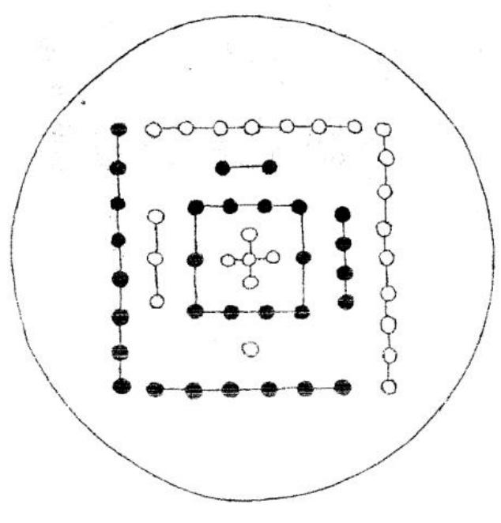

<!-- V3_SOURCE_ID:book031-b000034-p000-d16c387ff7 -->

河图的精妙义理可贯通地理与天道，事物的根由、萌芽、始末、细枝末节，都由同一气脉彼此相连。

查看对应原文

<!-- V3_FOLDBACK_BEGIN:book031-b000034-p000-d16c387ff7 -->

河圖妙義地理通天 根苗本末一氣相連

<!-- V3_FOLDBACK_END:book031-b000034-p000-d16c387ff7 -->

<!-- V3_SOURCE_ID:book031-b000035-p000-427e4f5dd9 -->

在河图洛书的数象出现之前，先有了天地、乾坤（八卦之一，卦象及五行、方位依原文语境确定）的理气；正是因为有了天地、乾坤的理气，才产生了河图洛书的数象。理、气、数、象相互贯通，因此河图洛书的义理与乾坤、天地合而为一。所以天地生成的过程中，河图是地理的本体，自然由乾坤度化；洛书是天文的应用，地理本体生成五行（木、火、土、金、水五种分类及其关系体系）、四象，进而形成干道；天文应用度化八卦（乾、坤、震、巽、坎、离、艮、兑八种卦象）、九星，以对应天心。这便是天地生成河图的本末，也是天地度化洛书的根苗。

查看对应原文

<!-- V3_FOLDBACK_BEGIN:book031-b000035-p000-427e4f5dd9 -->

未有河圗洛書之數象先有天地乾坤之理氣是有天地乾 坤之理氣故有河圗洛書之數象理與氣數與象則河洛之 義與乾坤天地合一而乙矣所以天地生成河圗為地理之 體自有乾坤度化洛書為天文之用地理之體生成五行四 象而成干道天文之用度化八卦九星以應天心此便是天 地生成河圗之本末自有天地度化洛書之根苗

<!-- V3_FOLDBACK_END:book031-b000035-p000-427e4f5dd9 -->

<!-- V3_SOURCE_ID:book031-b000036-p000-f99702704a -->

涉及河图变化的洛书图诀记载：洛书的本末以四为根，八卦以中央的五为至尊，九个星辰伴随日月运行，经过“三回天地”的过程便确定了乾坤。其中“三回”的具体所指原文并未明确说明。

> **释读存疑：** “三回”的具体所指不详；“三回”的具体所指原文未明

查看对应原文

<!-- V3_FOLDBACK_BEGIN:book031-b000036-p000-f99702704a -->

河圖變化洛書圖訣 洛書本末四為根 八卦中央五至尊 九個星辰行日月 三回天地定乾坤

<!-- V3_FOLDBACK_END:book031-b000036-p000-f99702704a -->

<!-- V3_SOURCE_ID:book031-b000037-p000-123b85088a -->

九星、八卦以五、四为尊，经过“三回天地逆滿乾坤”的过程。其中“三回”“逆滿”的具体所指原文并未明确说明。

> **释读存疑：** “三回”的具体所指不详；“逆滿”的具体所指不详；1轮自动修复后核义模型仍建议修订，已保守记录。

查看对应原文

<!-- V3_FOLDBACK_BEGIN:book031-b000037-p000-123b85088a -->

九星八卦五四為尊三回天地逆滿乾坤

<!-- V3_FOLDBACK_END:book031-b000037-p000-123b85088a -->

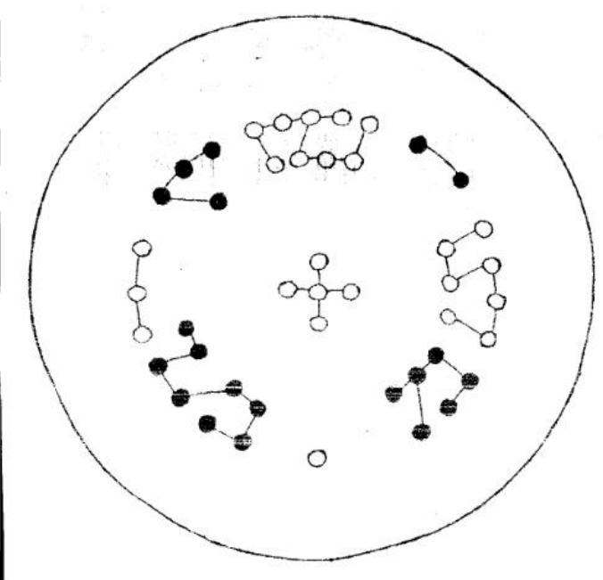

<!-- V3_SOURCE_ID:book031-b000039-p000-cd5076e48b -->

洛书本就是河图，河图也本就是洛书；洛书可以化为河图，河图“慶為洛書”，洛书可以合为河图，河图可以分为洛书。洛书对应的是在天所显现的象，河图对应的是在地所形成的形；有成形的事物就会有显现的象，有显现的象就必然有对应的成形事物。天地生成的过程中，河图是地理的本体，本就由乾坤度化；洛书是天文的应用，地理的本体生成五行、四象，进而形成“十道”；天文的应用演化出八卦、九星，用来对应天心。这就是无穷度化的始末，也是万物生成的根由。其中“慶”字含义未明，“十道”的具体所指原文并未明确说明。

> **释读存疑：** “慶”字含义不明；“十道”的具体所指不详；“慶”字含义未明；“十道”的具体所指原文未明

查看对应原文

<!-- V3_FOLDBACK_BEGIN:book031-b000039-p000-cd5076e48b -->

洛書郭是河圗河圗便是洛書洛書化為河圗河圗慶為洛書洛書合為河圗河圗分為洛書洛書是說在天成象河圗是說在地成形是有形故有顯象是有顯象必有成形足有天地生成河圗為地理之體固有乾坤度化洛書為天文之用是有五行四象而成十道故有八卦九星以應天心比便是無窮度化之本末自有萬物生成之根苗

<!-- V3_FOLDBACK_END:book031-b000039-p000-cd5076e48b -->

<!-- V3_SOURCE_ID:book031-b000040-p000-cc392d9020 -->

先天八卦本象图诀的内容如下：先天八卦的道理是可以为人知晓的，甲木遇到春季就会萌发枝叶；四象以中央作为正干，五行之外的都是旁枝；有正干就必然有旁枝，真龍出入时会有“左右秋持”的状态。其中“秋持”的具体含义原文并未明确说明。

> **释读存疑：** “秋持”的具体所指不详

查看对应原文

<!-- V3_FOLDBACK_BEGIN:book031-b000040-p000-cc392d9020 -->

先天八卦本象圖訣
先天八卦說君知
甲木逢春發葉時
四象中央為正幹
五行以外是旁枝
是有正幹必有旁枝
真龍出入左右秋持

<!-- V3_FOLDBACK_END:book031-b000040-p000-cc392d9020 -->

<!-- V3_SOURCE_ID:book031-b000042-p000-707c070b5b -->

先天八卦（术数中表示先天卦序或本体关系的概念）讲的是生数，生数就是太极生出两仪，两仪生出三才，三才生出四象，四象生出五行（木、火、土、金、水五种分类及其关系体系），五行生出八卦（乾、坤、震、巽、坎、离、艮、兑八种卦象），就像甲木逐渐长成枝干，枝干是一直向上生长的乾（八卦之一，卦象及五行、方位依原文语境确定）之性，枝节是横向分布于八方的坤（八卦之一，卦象及五行、方位依原文语境确定）之性；所以乾卦形成后坤卦便随之形成，乾坤两卦形成后八卦便随之形成，八卦形成后九星便随之形成，八卦、九星形成后天地万物便随之形成。这便是先天八卦生数的本末，也是后天八卦成数的根苗。

查看对应原文

<!-- V3_FOLDBACK_BEGIN:book031-b000042-p000-707c070b5b -->

先天八卦是說生數生數者即太極生兩儀兩儀生三才三才生四象四象生五行五行生八卦郭如甲木關萊漸成枝幹幹者一直生上乾之性也被者橫劇八方坤之性也所以乾卦成而坤卦隨郎成矣乾坤兩卦成而八卦隨卽成矣八卦成而九星隨即成矣八卦九星成而天地萬物隨即成矣此便是先天八卦生數之本末自有後天八卦成數之根苗

<!-- V3_FOLDBACK_END:book031-b000042-p000-707c070b5b -->

<!-- V3_SOURCE_ID:book031-b000043-p000-0e61e600a7 -->

后天八卦末象图诀的内容如下：后天八卦与先天八卦本是同源，二者的始末靠中央的同一气脉相连；太极生成三极之体，五星对应排布出九星垣；在天显现为象，在地凝结成形，八卦明确之后便演化出九星。

查看对应原文

<!-- V3_FOLDBACK_BEGIN:book031-b000043-p000-0e61e600a7 -->

後天八卦末象圖訣
後天八卦卽先天
本末中央一氣連
太極生成三極體
五星配出九星垣
在天成象在地成形
分明八卦爰化九星

<!-- V3_FOLDBACK_END:book031-b000043-p000-0e61e600a7 -->

<!-- V3_SOURCE_ID:book031-b000045-p000-81b6e5e298 -->

后天八卦（乾、坤、震、巽、坎、离、艮、兑八种卦象）讲的是成数，成数就是六、七、八、九、十。六七八九十节就是一、二、三、四、五，实际上是两个一、二、三、四、五，一个先天的一、二、三、四、五作为根本，一个后天的一、二、三、四、五作为末梢。仅靠这两个一、二、三、四、五，一二三四五度就可以化生出无数个一、二、三、四、五，无数个一、二、三、四、五最终又共同归为一个一、二、三、四、五，这就是天机。这就是后天八卦成数的本末，自然也是先后天八卦合数的根由。

> **释读存疑：** “節”的具体含义原文未明确说明；本地硬校验仍未通过，已记录供后续自动处理或人工核对。

查看对应原文

<!-- V3_FOLDBACK_BEGIN:book031-b000045-p000-81b6e5e298 -->

後天八卦是說成數成數者六七八九十是也六七八九十節是一二三四五實為兩個一二三四五也一個先之一二三四五為本一個後之一二三四五為末止此兩個一二三四五度化無數個一二三四五無數個一二三四五終歸公為一個一二三四五此天機也此便是後天八卦成數之本末自有先後八卦合數之根苗

<!-- V3_FOLDBACK_END:book031-b000045-p000-81b6e5e298 -->

<!-- V3_SOURCE_ID:book031-b000046-p000-88ba6656b9 -->

先后八卦并体图的口诀：后天的极数与先天相合，八卦与九星由同一气相连；四象归位于中央，五行在内、在外各自还原。先本后末，同属一天；五行与四象在内、在外相互连接。

查看对应原文

<!-- V3_FOLDBACK_BEGIN:book031-b000046-p000-88ba6656b9 -->

先後八卦並體圖訣 後天極數合先天 八卦九星一氣連 四象中央歸本位 五行內外各還原 先本後末同共一天 五行四象內外相連

<!-- V3_FOLDBACK_END:book031-b000046-p000-88ba6656b9 -->

<!-- V3_SOURCE_ID:book031-b000048-p000-0708902eba -->

前面的先后八卦是讲分数，这张图的先后八卦是讲会数；有分数就必然有合数，有合数也必然有分数。分数是指将十分为二五，合数是指将二五合为一十。所以前面的先后八卦分而为二，对应卷九、卷九十四、卷九十五的内容；这里的先后八卦合而为一，对应九九八十一的内容。其中四九五是讲行龙的实际含义，九九八十一是讲结地的真实情况，这便是先后八卦合数的来龙去脉，也自然包含先后八卦分数的根源线索。

> **释读存疑：** “会數”“分數”“合數”的具体术数含义原文未明确说明；本地硬校验仍未通过，已记录供后续自动处理或人工核对。

查看对应原文

<!-- V3_FOLDBACK_BEGIN:book031-b000048-p000-0708902eba -->

前圗先後八卦是說分數此圖先後八卦是說会數是有分數故有合數是有合數必有分數分數者一十分為二五合數者二五合為一十所以前之先後八卦分而為二此之先復八卦合而為一分而為二卷九四九五合而為一都九九八一九四九五是說行龍之實義九九八一是說結地之真情此便是先後八卦合數之本末自有先後八卦分數之根苗

<!-- V3_FOLDBACK_END:book031-b000048-p000-0708902eba -->

<!-- V3_SOURCE_ID:book031-b000049-p000-296f1cf8a5 -->

这是卦分为三卦的图诀：乾坤演化，易门就此开启，天地人三道相通，可任意往来；九直九横的格局划分出九曜，三经三纬的排布与三才相合。乾坤演化出三纬三经，横向推演、纵向排布的过程中形成“三卦分勾”的格局。此处“分勾”的具体含义暂不明确。

> **释读存疑：** “三卦分勾”中“分勾”的具体含义

查看对应原文

<!-- V3_FOLDBACK_BEGIN:book031-b000049-p000-296f1cf8a5 -->

卦分為三卦圖訣 乾坤爰化易門開 天地人通任往來 九直九橫分九曜 三經三緯合三才 乾坤爰化三緯三經 橫推直有三卦分勾

<!-- V3_FOLDBACK_END:book031-b000049-p000-296f1cf8a5 -->

<!-- V3_SOURCE_ID:book031-b000051-p000-ef3c667e01 -->

江东一卦向来吉利，八神中有四个一。

> **释读存疑：** “江东一卦”“八神四个一”的具体术数含义原文未明

查看对应原文

<!-- V3_FOLDBACK_BEGIN:book031-b000051-p000-ef3c667e01 -->

江東一卦從來吉。八神四個一。

<!-- V3_FOLDBACK_END:book031-b000051-p000-ef3c667e01 -->

<!-- V3_SOURCE_ID:book031-b000052-p000-90330862b1 -->

江东一卦起于西方，是天然形成的位数，没有不吉利的。所谓“八神四个一”，是指以八卦“缓四位”的方式求取同气，实际对应的是三个一。三个一分别指坎、巽、兑的一，坤、中、艮的一，震、乾、离的一；有三个一就对应有三个二，有三个二就对应有三个三，这一体系一气相连，实际就是三个一二三，也就是所说的一生二、二生三、三生万物的玄妙关键。此处“缓四位”的术数含义暂不明确，“坤中艮”“巽中乾”里的“中”具体所指也不明确。

> **释读存疑：** “缓四位”的术数含义；“坤中艮”“巽中乾”中“中”的具体所指；“坤中艮”中“中”的具体所指；1轮自动修复后核义模型仍建议修订，已保守记录。

查看对应原文

<!-- V3_FOLDBACK_BEGIN:book031-b000052-p000-90330862b1 -->

江東一卦起於西乃天然位數無有不吉八神四個一者是以八卦緩四位以求同氣實為三個一也三個一者坎巽兌之一也坤中艮之一也震乾離之一也是有三個一卽有三個二是有三個二卽有三個三也此一氣相連實為三個一二三也所謂一生二今二生三三生萬物之玄關是也

<!-- V3_FOLDBACK_END:book031-b000052-p000-90330862b1 -->

<!-- V3_SOURCE_ID:book031-b000053-p000-c4d38ecd0c -->

这是八卦分为二卦的图诀：相关内容虽与三极有区别，但也彼此相通，两卦最终都要依托祖宗；只要遇到这种情况都是吉利的地穴，每逢符合这个要义的就是真龙。真龙虽与其他脉系不是同支骨肉，却和祖宗同属一族，“族着父母”便是真龙的判定标准。此处“族着”的具体含义暂不明确。

> **释读存疑：** “族着”的具体含义

查看对应原文

<!-- V3_FOLDBACK_BEGIN:book031-b000053-p000-c4d38ecd0c -->

八卦分為二卦圖訣不同三極也相通兩卦終歸靠祖宗但遇此情皆吉地每逢是義郎真龍不同骨肉却共祖宗族着父母便是真龍

<!-- V3_FOLDBACK_END:book031-b000053-p000-c4d38ecd0c -->

<!-- V3_SOURCE_ID:book031-b000055-p000-5faabf5b5d -->

江西一卦排布龙位，八神中有四个二。

> **释读存疑：** “江西一卦”“八神四个二”的具体术数含义原文未明

查看对应原文

<!-- V3_FOLDBACK_BEGIN:book031-b000055-p000-5faabf5b5d -->

江西一卦排龍位八神四個二

<!-- V3_FOLDBACK_END:book031-b000055-p000-5faabf5b5d -->

<!-- V3_SOURCE_ID:book031-b000056-p000-39d59c7a54 -->

江西一卦是江东一卦的对宫位置，也就是常说的“江西龙去望江东”的情况。所谓“八神四个二”，是指以八卦“经四位”的方式起“文母”，实际对应的是三个二。三个二分别指坎、坤、震的二，巽、中、乾的二，兑、艮、离的二；有三个一所以有三个二，有三个二就必然有三个三，实际就是三个一二三的体系；所以三卦由此区分，八卦九星也由此形成。此处“经四位”的具体含义暂不明确，“文母”的具体所指也不明确。

> **释读存疑：** “经四位”的具体含义；“文母”的具体所指

查看对应原文

<!-- V3_FOLDBACK_BEGIN:book031-b000056-p000-39d59c7a54 -->

江西一卦乃江東一卦之對面所謂江西龍去望江東是也 八神四個二者是以八卦經四位而起文母實為三個二也 三個二者坎坤震之二也巽中乾之二也兌艮離之二也是 有三個一故有三個二是有三個二必有三個三實為三個 一二三也所以三卦由此而分八卦九星由此而成也

<!-- V3_FOLDBACK_END:book031-b000056-p000-39d59c7a54 -->

<!-- V3_SOURCE_ID:book031-b000057-p000-eab24bac78 -->

这是八卦统共一卦的图诀：生成变化之中显现方圆之理，九个星辰可任意倒转排布；天地五行同属一体，“乾坤大断”与三连相合；洛书显现对应的征象，八卦形成具体卦形，三者与天地同序，化出九星。

> **释读存疑：** “乾坤大断”的具体含义；“三连”的具体含义；“三同天地”的准确含义；1轮自动修复后核义模型仍建议修订，已保守记录。

查看对应原文

<!-- V3_FOLDBACK_BEGIN:book031-b000057-p000-eab24bac78 -->

八卦統共一卦圖訣生成變化顯方圓九個星辰任倒頭天地五行同一體乾坤大斷合三連洛書顯象八卦成形三同天地化出九星

<!-- V3_FOLDBACK_END:book031-b000057-p000-eab24bac78 -->

<!-- V3_SOURCE_ID:book031-b000059-p000-715ee7da76 -->

南北八神共同归属一卦，确实要用到“兼差”的方法。此处“用兼差”属于术数专门表述，具体含义暂不明确。

> **释读存疑：** “用兼差”的术数具体含义

查看对应原文

<!-- V3_FOLDBACK_BEGIN:book031-b000059-p000-715ee7da76 -->

南北八神共一卦端的用兼差

<!-- V3_FOLDBACK_END:book031-b000059-p000-715ee7da76 -->

<!-- V3_SOURCE_ID:book031-b000060-p000-5ce29728f5 -->

开头说东方一卦，接下来讲西方一卦，这里说的是南北八神共一卦，这难道不是三大卦吗？这难道不是‘江南龙来江北望，江西龙去望江东’的精妙含义吗？又说天机妙诀原本各有不同，八卦（乾、坤、震、巽、坎、离、艮、兑八种卦象）中只有一卦能够贯通，难道说的就是这一卦？所以唯有这一卦，没有什么不能通晓、没有什么不能通达的，天地万物的生成、变化的道理，都尽数包含在这一卦之中，因此它的使用范围极为广泛。

> **释读存疑：** 原文“魚所不通”应为“無所不通”的讹写，按“无所不通”释义；原文“生俄衷化”疑为“生灭变化”类讹误，暂按文意译为生成、变化，具体原词所指存疑

查看对应原文

<!-- V3_FOLDBACK_BEGIN:book031-b000060-p000-5ce29728f5 -->

始云東一卦次云西一卦此云南北八神共一卦堂非三大卦乎登非云江南龍來江北望江西龍去望江東之妙義乎又曰天機妙訣本不同八卦止有一卦通黨非云此一卦乎所以惟此一卦魚所不通無所不達凡天地萬物生俄衷化道理盡在此一卦中是以為入用之極廣

<!-- V3_FOLDBACK_END:book031-b000060-p000-5ce29728f5 -->

<!-- V3_SOURCE_ID:book031-b000061-p000-d20d867a9d -->

廿四龙管三卦圗诀解 增 三般卦数理与天相通，六合周流本于自然，分配九宫能知晓其精妙含义，相生的同气也会相互连接。

查看对应原文

<!-- V3_FOLDBACK_BEGIN:book031-b000061-p000-d20d867a9d -->

廿四龍管三卦圗訣解 增 三般卦數理通天六合週流在自然分配九宮知妙義相生同氣亦相連

<!-- V3_FOLDBACK_END:book031-b000061-p000-d20d867a9d -->

<!-- V3_SOURCE_ID:book031-b000062-p000-e0a7c0a32d -->

鼓骈闻 二十四龙管三卦，不要和当世的地师谈论这个道理，忽然领悟其中的要义便能通仙，代代

> **释读存疑：** 原文末尾“代代”后有缺字，未补全，语义不完整

查看对应原文

<!-- V3_FOLDBACK_BEGIN:book031-b000062-p000-e0a7c0a32d -->

鼓駢聞 二十四龍管三卦莫與時師語忽然得知便通仙代代

<!-- V3_FOLDBACK_END:book031-b000062-p000-e0a7c0a32d -->

<!-- V3_SOURCE_ID:book031-b000063-p000-c306a1812c -->

从当前位置依次到巽（八卦之一）是四位，从巽到兑也是四位。八卦（乾、坤、震、巽、坎、离、艮、兑八种卦象）都经过四位，三才六秀是一个例子，久母子息是一个例子，兄弟子孙是一个例子，一四七、二五八、三六九的规律人人都知道，但在实际运用配合的时候，即使是常年精研此道的人尚且还很懵懂，问题出在只是依从先师的传授行事，没有真正通晓其中的道理。

> **释读存疑：** 原文“久母子息”为存疑短语，具体所指不详；原文“雖老於此眷尚在昧昧病在耶度命於先師也”存在讹字，“老於此眷”疑为“老於此道者”，译文为按文意推导的结果，存在不确定性

查看对应原文

<!-- V3_FOLDBACK_BEGIN:book031-b000063-p000-c306a1812c -->

次至巽是四位巽至兌亦是四位八卦皆經四位三才六秀為一例久母子息為一例兄弟子孫為一例一四七二五八三六九人皆知之矣而作用配合雖老於此眷尚在昧昧病在耶度命於先師也

<!-- V3_FOLDBACK_END:book031-b000063-p000-c306a1812c -->

<!-- V3_SOURCE_ID:book031-b000064-p000-94405780ce -->

此图与前面的三般卦大同小异，而此图更为明显，分别零神、正神的圗诀。

查看对应原文

<!-- V3_FOLDBACK_BEGIN:book031-b000064-p000-94405780ce -->

此圗與上三般卦大同小異而此較為明顯分別零神正神圗訣

<!-- V3_FOLDBACK_END:book031-b000064-p000-94405780ce -->

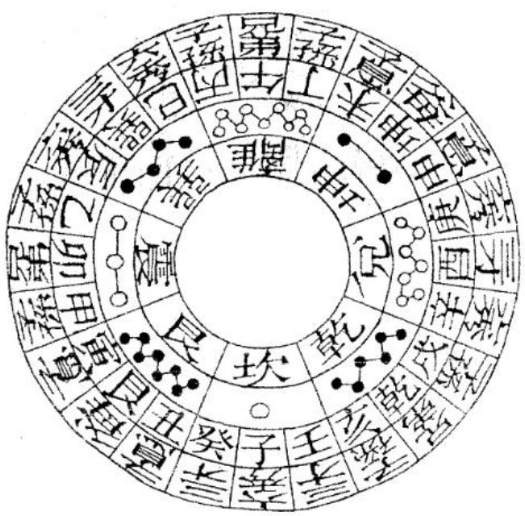

<!-- V3_SOURCE_ID:book031-b000066-p000-bd93c6cf6c -->

阴阳二字对应两个星辰，龙与水相交，理气才真实。坎位生出的是正向，离宫克制入内的是零神。龙与水的配合如同夫妇情真，零堂与合气、正向相通神妙。

> **释读存疑：** 1轮自动修复后核义模型仍建议修订，已保守记录。

查看对应原文

<!-- V3_FOLDBACK_BEGIN:book031-b000066-p000-bd93c6cf6c -->

陰陽二字兩星辰 龍水相交理氣真 坎位生來為正向 離宮剋入是零神 龍水配合夫婦情真 零堂合氣正向通神

<!-- V3_FOLDBACK_END:book031-b000066-p000-bd93c6cf6c -->

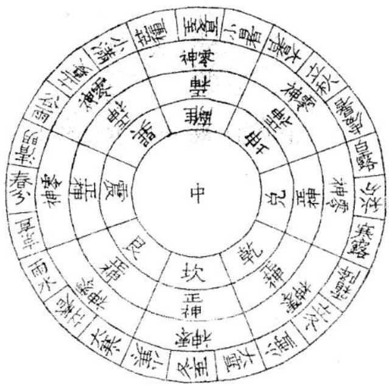

<!-- V3_SOURCE_ID:book031-b000068-p000-d9f32209a1 -->

阴阳二字要看零神与正神的分别，坐向（建筑或穴位所朝的方位）要知道其中的弊病。如果遇到正神处在正位就做相应安置，将水（风水语境中的河流、水系及其来去形态）引入零堂，零堂和正向要选得妥当，认取来山的主峰，在水上排布龙位、确定点位安置妥当，就能积攒下万仓的粮食。

查看对应原文

<!-- V3_FOLDBACK_BEGIN:book031-b000068-p000-d9f32209a1 -->

陰陽二字看零正坐向須知病若遇正神正位裝撥水入零堂零堂正向須知好認取來山腦水上排龍點位裝積粟萬餘倉

<!-- V3_FOLDBACK_END:book031-b000068-p000-d9f32209a1 -->

<!-- V3_SOURCE_ID:book031-b000069-p000-34127429a4 -->

区分零、正两个字的含义有两种情况：有在局内区分零正的，有在局外区分零正的。局外区分零正的规则是，只允许零神入内；局内区分零正的规则是，不允许零神出外。符合这个规则的就是雌雄交媾，属于天然结地无疑；违背这个规则的就是阴阳差错，并不符合结地的理气要求。

查看对应原文

<!-- V3_FOLDBACK_BEGIN:book031-b000069-p000-34127429a4 -->

分零正兩字之義有二有局內之分零正者有局外之分零正者局外之 分零正者正許零神入內局內之分舉正者不許零神出外如是則為雌 雄交媾天然結地無疑矣反此則為陰陽差錯並非結地之理氣矣

<!-- V3_FOLDBACK_END:book031-b000069-p000-34127429a4 -->

<!-- V3_SOURCE_ID:book031-b000070-p000-6d68a12b23 -->

分别珠赞火坑圗诀。

查看对应原文

<!-- V3_FOLDBACK_BEGIN:book031-b000070-p000-6d68a12b23 -->

分別珠贊火坑圗訣

<!-- V3_FOLDBACK_END:book031-b000070-p000-6d68a12b23 -->

<!-- V3_SOURCE_ID:book031-b000071-p000-87e184030d -->

颠颠倒倒地翻天，气运循环六十年，珠宝与火坑分处对面，火坑与珠宝近身相伴。

查看对应原文

<!-- V3_FOLDBACK_BEGIN:book031-b000071-p000-87e184030d -->

顛顛倒倒地翻天 氣運循環六十年 珠寶火坑分對面 火坑珠寶近身邊

<!-- V3_FOLDBACK_END:book031-b000071-p000-87e184030d -->

<!-- V3_SOURCE_ID:book031-b000073-p000-99b3a6ebdf -->

颠倒排布二十四山（将周天划分为二十四个方位的体系），对应方位有珠宝般的吉地；顺着或逆着排布二十四山，对应方位也有火坑般的凶地。颠颠倒倒说的是化育的次序，火坑、珠宝的顺逆排布，说的是生成的大势。火坑与珠宝，近在左右两侧，化育的火坑与珠宝，近在前后两方。右侧的火坑与珠宝，生成的定数已然确定；前后的火坑与珠宝，化育的时机需随时调整。因此为人行事，总要行得端正、做得中正，便是珠宝般的吉运；倘若有偏心不正、见利忘义的念头，就会陷入火坑般的凶局。原文提到“明比则火玩爰为珠宝之用矣”，这一表述的具体含义不详。

> **释读存疑：** “明比则火玩爰为珠宝之用矣”具体含义不明

查看对应原文

<!-- V3_FOLDBACK_BEGIN:book031-b000073-p000-99b3a6ebdf -->

頭顛倒二十四山有珠寶順逆行二十四山有火坑顛顛倒是說爰化之次坑珠寶順逆行是說生成之大坑殊賢生成之火坑珠實近在左右度化之火坑珠實近在前後云右之火坑珠寶生成已定前後之火坑珠賢度化隨時所以為人作事總要行得正做得中便是珠寶倘有偏心不正見利忘義則陷入與火坑矣明比則火玩爰為珠寶之用矣

<!-- V3_FOLDBACK_END:book031-b000073-p000-99b3a6ebdf -->

<!-- V3_SOURCE_ID:book031-b000074-p000-e4c72152d3 -->

审龙定向分金图诀

查看对应原文

<!-- V3_FOLDBACK_BEGIN:book031-b000074-p000-e4c72152d3 -->

審龍定向分金圖訣

<!-- V3_FOLDBACK_END:book031-b000074-p000-e4c72152d3 -->

<!-- V3_SOURCE_ID:book031-b000075-p000-a441653382 -->

审察龙的出脉需仔细详尽，要兼顾天地人三才，同时留意左右两侧，查看九个分金（罗盘中进一步细分坐向度数的方法），挨查内外三回，定向需傍随中央。龙有三出脉、三来脉，需专向三者取象，执定三才之理。

查看对应原文

<!-- V3_FOLDBACK_BEGIN:book031-b000075-p000-a441653382 -->

審龍出脉細心詳天地人兼左右看九個分金挨內外三回定向傍中央龍有三出脉有三來專向三取執定三才

<!-- V3_FOLDBACK_END:book031-b000075-p000-a441653382 -->

<!-- V3_SOURCE_ID:book031-b000077-p000-f5aec3718f -->

前兼龙神，前兼向（建筑或穴位所朝的方位），原文提到“联殊莫相被”，这一短语具体所指不详。后兼龙神，后兼向该如何排布，需推算阴阳之理来确定。

> **释读存疑：** “联殊莫相被”具体所指不明

查看对应原文

<!-- V3_FOLDBACK_BEGIN:book031-b000077-p000-f5aec3718f -->

前兼龍神前兼向聯殊莫相被後兼龍神後兼何排定陰陽算

<!-- V3_FOLDBACK_END:book031-b000077-p000-f5aec3718f -->

<!-- V3_SOURCE_ID:book031-b000078-p000-30564143e0 -->

前兼龙神是阳龙，后兼龙神是阴龙。阴龙相兼有三出，阳龙相兼有三来。三来指的是左中右，三出指的是右中左。以左中右来评断十道，以右中左来确定天心，以此确定乘气的中正，作为求福的准则。这是葬法的精微之处，也是地理家的秘要。因此有的葬吉地却不发福，有的发福不均，甚至有不发福而绝房的情况，都是因为乘气不中正的缘故。

查看对应原文

<!-- V3_FOLDBACK_BEGIN:book031-b000078-p000-30564143e0 -->

前兼龍神陽龍也後兼龍神陰龍也陰龍相兼有三出陽龍相兼有三來三來者左中右三出者右中左以左中右評十道以右中左定天心以定乘氣之中正以為足福之準繩此葬法之精微乃地理家之秘要所以有葬吉地而不發者亦有發而不均者甚至乎不發而絕房者皆乘氣不中正故也

<!-- V3_FOLDBACK_END:book031-b000078-p000-30564143e0 -->

<!-- V3_SOURCE_ID:book031-b000079-p000-b0dd031e30 -->

依龙立向分金图诀 增解：向首分金要合龙，阴阳二气贵相通。先察三才，观透地之理，还从天际认虚空之象。

查看对应原文

<!-- V3_FOLDBACK_BEGIN:book031-b000079-p000-b0dd031e30 -->

依龍立向分金圗訣 增 解 向首分金要合龍 陰陽二氣貴相通 先察三才觀透地 還從天際認虛空

<!-- V3_FOLDBACK_END:book031-b000079-p000-b0dd031e30 -->

<!-- V3_SOURCE_ID:book031-b000081-p000-15cd9d706e -->

此格是龙主向与消纳的配合之法。倘若龙犯剥杂之弊，就用水（风水语境中的河流、水系及其来去形态）来补救，另有专门的口诀。以三大卦为主，以夫妇图分金（罗盘中进一步细分坐向度数的方法），执此也可入用。至于入神入化的境界，则非研究诸图不可。

查看对应原文

<!-- V3_FOLDBACK_BEGIN:book031-b000081-p000-15cd9d706e -->

此格龍主向消納配合之被法若龍犯剝雜則以水救之另自有訣以三大卦為主以夫婦圗分金執此亦入用矣至入神入化則非研究諸圗不可

<!-- V3_FOLDBACK_END:book031-b000081-p000-15cd9d706e -->

<!-- V3_SOURCE_ID:book031-b000082-p000-9c04d7322b -->

此三元（以三元、九运等时序结构为核心的一类体系）配合文母，与前兼后兼之理尽在其中。虽说如此，相关内容也不是轻易能讲明白的。如今有人读了《宝照经》的几句话，就拿着蒋盘自称是三元地师，实在是非常可耻。这张图和前面的图相比，内容更为清楚明白。

> **释读存疑：** “文母”具体含义未明，“蒋盘”的具体形制、用途未做进一步说明

查看对应原文

<!-- V3_FOLDBACK_BEGIN:book031-b000082-p000-9c04d7322b -->

此三元配合文母與前兼後兼盡在於此矣雖然亦豈易言哉今人讀得寶照經數語則特蔣盤而稱三元地師可矣可恥之甚也此圗同前較為明白

<!-- V3_FOLDBACK_END:book031-b000082-p000-9c04d7322b -->

<!-- V3_SOURCE_ID:book031-b000083-p000-5ac3e37452 -->

九离水火交媾图诀：先天（术数中表示先天卦序或本体关系的概念）化育后天，南北东西一路贯通。坎（八卦之一）离（八卦之一）中宫通九窍，乾坤（八卦之一）逐位合三才。水火既济，北去南来，坎离合气，妙应三才。

查看对应原文

<!-- V3_FOLDBACK_BEGIN:book031-b000083-p000-5ac3e37452 -->

玖離水火交媾圖訣 先天爰化後天開 南北東西一路來 坎離中宮通九竅 乾坤逐位合三才 水火既濟北去南來 坎離合氣妙應三才

<!-- V3_FOLDBACK_END:book031-b000083-p000-5ac3e37452 -->

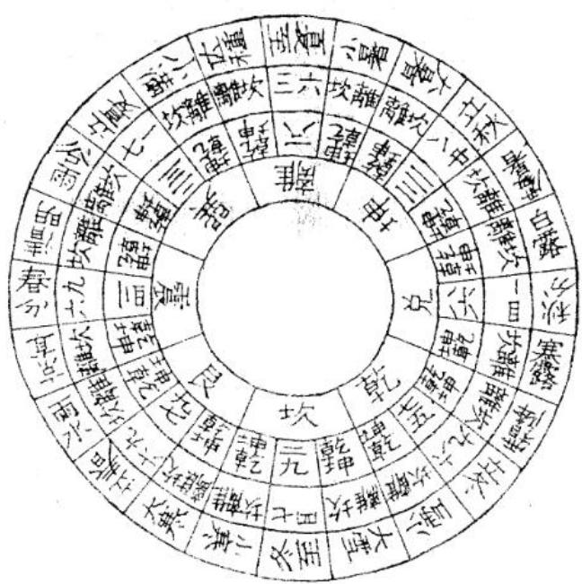

<!-- V3_SOURCE_ID:book031-b000085-p000-e44bb86090 -->

坎离水火中天过，龙池移帝座。

查看对应原文

<!-- V3_FOLDBACK_BEGIN:book031-b000085-p000-e44bb86090 -->

坎離水火中天過龍池移帝座

<!-- V3_FOLDBACK_END:book031-b000085-p000-e44bb86090 -->

<!-- V3_SOURCE_ID:book031-b000086-p000-2d5bc42928 -->

这两句话上下含义相同，其中的妙用在于中天。所谓中天，就是中五。如果没有中五，就无法实现气机的上行下达；如果没有中五，就不能让坎、离二卦相交媾合。因此天地万物遇到五就能通顺，遇到五就能畅达，遇到五就会发生“爰”的变化，遇到五就会化育，遇到五就会生长，遇到五就会长成，遇到五就会运动，遇到五就会静止，遇到五就会富足，遇到五就会穷困。这足以说明，坎离与水对应中天的含义，所有相关运化都要依靠中五才能运行，化育也都要依靠中五才能完成，这就是雌雄相配的规律。

> **释读存疑：** “逢五则爰”中“爰”的具体含义未明，此处保留原表述；“逢五则爰”中“爰”的具体含义未明；原文“此足見坎離水之中天過一句皆得中五而行爰化得中五而成雌雄者也”存在断句歧义，具体语义尚不明确；1轮自动修复后核义模型仍建议修订，已保守记录。

查看对应原文

<!-- V3_FOLDBACK_BEGIN:book031-b000086-p000-2d5bc42928 -->

兩句上下同義其妙用在中天中天者中五也若非中五不能上行下濟若非中五不得媾合坎離所以天地萬物逢五則通逢五則達逢五則爰逢五則化逢五則生逢五則成逢五則動逢五則靜逢五則富逢五則窮此足見坎離水之中天過一句皆得中五而行爰化得中五而成雌雄者也

<!-- V3_FOLDBACK_END:book031-b000086-p000-2d5bc42928 -->

<!-- V3_SOURCE_ID:book031-b000087-p000-9e086ce6c5 -->

倒排父母子息圗訣

查看对应原文

<!-- V3_FOLDBACK_BEGIN:book031-b000087-p000-9e086ce6c5 -->

倒排父母子息圗訣

<!-- V3_FOLDBACK_END:book031-b000087-p000-9e086ce6c5 -->

<!-- V3_SOURCE_ID:book031-b000088-p000-805b4c5bee -->

倒排父母是真龍

查看对应原文

<!-- V3_FOLDBACK_BEGIN:book031-b000088-p000-805b4c5bee -->

倒排父母是真龍

<!-- V3_FOLDBACK_END:book031-b000088-p000-805b4c5bee -->

<!-- V3_SOURCE_ID:book031-b000089-p000-6b6bb5bca5 -->

子息達天聰

查看对应原文

<!-- V3_FOLDBACK_BEGIN:book031-b000089-p000-6b6bb5bca5 -->

子息達天聰

<!-- V3_FOLDBACK_END:book031-b000089-p000-6b6bb5bca5 -->

<!-- V3_SOURCE_ID:book031-b000090-p000-a7d7209134 -->

倒排就是颠倒的意思，大五行（木、火、土、金、水五种分类及其关系体系）的作用全在于颠倒。这张图粗略一看，只是合为十而已；仔细探究，是八卦（乾、坤、震、巽、坎、离、艮、兑八种卦象）对待，也就是坎、离相交媾合。

查看对应原文

<!-- V3_FOLDBACK_BEGIN:book031-b000090-p000-a7d7209134 -->

倒排者卽顛倒顛也大五行 作用全在顛倒此圗粗視之 合十而己精求之八卦對待 卽坎離交媾

<!-- V3_FOLDBACK_END:book031-b000090-p000-a7d7209134 -->

<!-- V3_SOURCE_ID:book031-b000091-p000-b9939a1105 -->

这个口诀要从“夫妇”对应的关系着眼，此处“夫妇”具体所指不详。

> **释读存疑：** “夫妇”作为专用术语的具体指代未明确，仅保留原表述；“夫妇”作为专用术语的具体指代未明确

查看对应原文

<!-- V3_FOLDBACK_BEGIN:book031-b000091-p000-b9939a1105 -->

此訣在夫婦着眼

<!-- V3_FOLDBACK_END:book031-b000091-p000-b9939a1105 -->

<!-- V3_SOURCE_ID:book031-b000092-p000-f2260d8dd8 -->

挨排九星元運圖訣：坤（八卦之一，卦象及五行、方位依原文语境确定）、壬、乙对应的是巨门星，从这里开始排列；艮（八卦之一）、丙、辛对应的处处都是破军星；辰、巽（八卦之一）、亥对应的全是武曲星的位置；甲、癸、申对应的是贪狼星，一路排列下去。

查看对应原文

<!-- V3_FOLDBACK_BEGIN:book031-b000092-p000-f2260d8dd8 -->

挨排九星元運圖訣 坤壬乙巨門從頭出 艮丙辛位位是破軍 辰巽亥盡是武曲位 甲癸申貪狼一路行

<!-- V3_FOLDBACK_END:book031-b000092-p000-f2260d8dd8 -->

<!-- V3_SOURCE_ID:book031-b000093-p000-562016517c -->

这个扭转图是挨星（玄空等体系中按规则排布、推移星数的方法）的重要作用，用它来判断祸福，没有不奇妙应验的。蒋公已经明确说过，但并非像世俗流传的那样隔四位扶排。

查看对应原文

<!-- V3_FOLDBACK_BEGIN:book031-b000093-p000-562016517c -->

此扭轉圖乃挨星大作用。用斷禍福無不奇驗，蔣公已明明說出，但非如俗傳隔四位扶排者。

<!-- V3_FOLDBACK_END:book031-b000093-p000-562016517c -->

<!-- V3_SOURCE_ID:book031-b000096-p000-ea201d5de5 -->

分布四十八局圖訣

查看对应原文

<!-- V3_FOLDBACK_BEGIN:book031-b000096-p000-ea201d5de5 -->

分布四十八局圖訣

<!-- V3_FOLDBACK_END:book031-b000096-p000-ea201d5de5 -->

<!-- V3_SOURCE_ID:book031-b000097-p000-522acec570 -->

二十四山分顺行和逆行两种模式，总共形成四十八个格局，五行就分布在这些格局当中。这些格局的根源都出自阴阳，阳从左边团团旋转，阴从右边循环转动、相互贯通。

查看对应原文

<!-- V3_FOLDBACK_BEGIN:book031-b000097-p000-522acec570 -->

二十四山分順逆共成四十有八局五行卽在此中分祖宗却從陰陽出陽從左邊團團轉陰從右路轉相通

<!-- V3_FOLDBACK_END:book031-b000097-p000-522acec570 -->

<!-- V3_SOURCE_ID:book031-b000098-p000-7b171a2a3e -->

我曾对癸亥四柱、甲戌四柱逐一查考，从源头处便能知晓其所属的五行（木、火、土、金、水五种分类及其关系体系）。

查看对应原文

<!-- V3_FOLDBACK_BEGIN:book031-b000098-p000-7b171a2a3e -->

內癸亥四柱甲戌四柱挨考政。從源頭起便知屬何五行。

<!-- V3_FOLDBACK_END:book031-b000098-p000-7b171a2a3e -->

<!-- V3_SOURCE_ID:book031-b000099-p000-ab08201b01 -->

有《五星配出九星图诀》，这张图和前人提到的“一个排来千百个”说的并不是五行四柱。我斗胆请问，所谓星辰流转要相逢，到底是哪一个和哪一个相逢？善于研读辨正的人，难道本来就是这样的吗？

查看对应原文

<!-- V3_FOLDBACK_BEGIN:book031-b000099-p000-ab08201b01 -->

五星配出九星圖訣 此圖同前人謂一個排來 千百個不是說五行四柱 乎敢問星辰流轉要相逢 又着實是那一個相逢 善讀辨正者固如是耶。

<!-- V3_FOLDBACK_END:book031-b000099-p000-ab08201b01 -->

<!-- V3_SOURCE_ID:book031-b000102-p000-15936e22e5 -->

一个排来千百个，莫把星辰错。五星配出九星名，天下任横行。九星双起雌雄异，玄关真妙处。本向本水（风水语境中的河流、水系及其来去形态）四神奇，代代着绯衣。

查看对应原文

<!-- V3_FOLDBACK_BEGIN:book031-b000102-p000-15936e22e5 -->

一個排來千百個莫把星辰錯五星配出九星名天下任横行九星雙起雌雄異玄關真妙處本向本水四神奇代代着緋衣

<!-- V3_FOLDBACK_END:book031-b000102-p000-15936e22e5 -->

<!-- V3_SOURCE_ID:book031-b000103-p000-f689a19330 -->

我曾经解释过，“一个”指的就是星辰，“星晨”是“星辰”的讹写，星辰本是一个，这里具体指的是帝星。帝星运行有定时，亥位对应有四柱，都以帝星归垣为核心。帝星的度化没有穷尽，所以五行四柱有臣求立的说法，因此才说“一个排来千百个”。原文“五行金木水次土”是“五行金木水火土”的讹写，五行确实贯穿在九星之中，用两三组星就能配出九星。

> **释读存疑：** “五行金木水次土”的准确写法存疑，“有臣求立”的具体含义未明；1轮自动修复后核义模型仍建议修订，已保守记录。

查看对应原文

<!-- V3_FOLDBACK_BEGIN:book031-b000103-p000-f689a19330 -->

曾解一個即是星晨星辰部是一個指帝星而言也帝星限時亥有四柱皆以帝星歸垣為主帝星度化無窮故五行四桂有臣求立故云一個排來千百個也五行金木水次土實然貫九星內兩三三星配出九星也

<!-- V3_FOLDBACK_END:book031-b000103-p000-f689a19330 -->

<!-- V3_SOURCE_ID:book031-b000104-p000-01caca6061 -->

有《雌雄交合玄空图效》，内容提到雌与雄交会，合乎玄空的法则；雄与雌相交，要在玄空卦内推演。山和水的情况必须要辨明，原文“盡湘關”是“盡相關”的讹写，指水与山的祸福全都是相关联的。只要明白玄空的道理只在五行之中，懂得这个方法就不需要再去探寻纳甲的内容。

> **释读存疑：** 原文存在语序错乱，断句参照文义调整为‘雌與雄交會合玄空，雄與雌交，玄空卦內推，山與水須要明此理，水與山禍福盡相關，明玄空只在五行中，知此法不須尋納甲’；原文存在语序错乱，断句参照文义调整为‘雌與雄交會合玄空，雄與雌交，玄空卦內推，山與水須要明此理，水與山禍福盡相關，明玄空只在五行中，知此法不須尋納甲’，“盡湘關”为“盡相關”的讹写属于合理推测

查看对应原文

<!-- V3_FOLDBACK_BEGIN:book031-b000104-p000-01caca6061 -->

雌雄交合玄空圗效 雌與雄交會合玄空雄與雌 玄空卦內推山與水須要明 此理水興山禍福盡湘關明 玄空只在五行中知此法不 須尋納甲

<!-- V3_FOLDBACK_END:book031-b000104-p000-01caca6061 -->

<!-- V3_SOURCE_ID:book031-b000105-p000-dd89cb4a1c -->

一遁入玄空（结合时间、空间和星数推演的一类风水体系）之图，一宫是一卦交媾，一图已该八卦（乾、坤、震、巽、坎、离、艮、兑八种卦象），下卦交则卦卦交，奇妙至极，实在太多了。

> **释读存疑：** ‘一遁入玄空之圗’‘下卦交則卦卦交奇絕 多多多’语义较晦涩，候选释读为合理推测

查看对应原文

<!-- V3_FOLDBACK_BEGIN:book031-b000105-p000-dd89cb4a1c -->

一遁入玄空之圗一宮是一卦交媾一圗已該八卦下卦交則卦卦交奇絕 多多多

<!-- V3_FOLDBACK_END:book031-b000105-p000-dd89cb4a1c -->

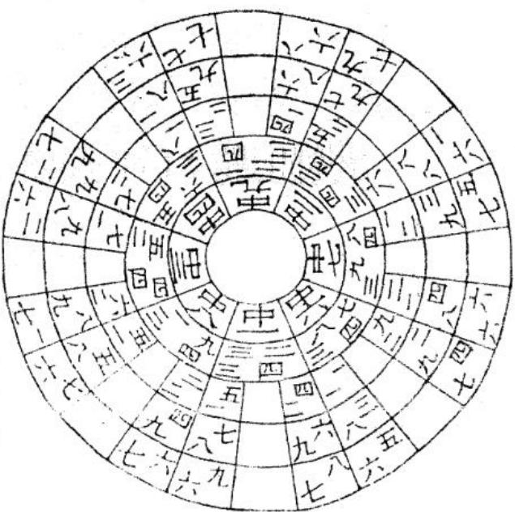

<!-- V3_SOURCE_ID:book031-b000107-p000-98c5545023 -->

《青囊》开篇就说：独公养老看雌雄。无奈世人不加察辨，竟不能找到它。

查看对应原文

<!-- V3_FOLDBACK_BEGIN:book031-b000107-p000-98c5545023 -->

青囊開闢首云：獨公養老看雌雄。奈世人不察。竟不獲尋也。

<!-- V3_FOLDBACK_END:book031-b000107-p000-98c5545023 -->

<!-- V3_SOURCE_ID:book031-b000108-p000-094b202893 -->

有《冬至顺行甲子图诀》，内容说：顺行甲子是顺应自然规律的，天地之间生生不息的一气相互连贯，反复循环排布六甲，流转终始运行三元。顺行甲子是从自然中化生出来的，文中还提到“贫而至弼一气相连”，这一表述具体所指不详。

> **释读存疑：** “贫而至弼”语义不明，具体含义待考

查看对应原文

<!-- V3_FOLDBACK_BEGIN:book031-b000108-p000-094b202893 -->

冬至順行甲子圖訣 順行甲子順天然 天地生生一氣連 反復循環排六甲 流行終始運三元 順行甲子生出天然 貧而至弼一氣相連

<!-- V3_FOLDBACK_END:book031-b000108-p000-094b202893 -->

<!-- V3_SOURCE_ID:book031-b000110-p000-c91ce9d104 -->

《青囊补注》说：排六甲是用六甲的纪年审察运数。冬至顺行甲子，是说生数，生数就是一、二、三，四、五、六，七、八、九，这三个一二三，就是所谓一生二、二生三、三生万物的玄关。冬至甲子是生数的开始，所以不得不顺数，若不顺数就不能生，不能生就不能成，不生不成就无从显现八卦（乾、坤、震、巽、坎、离、艮、兑八种卦象）九星，这便是顺行甲子的本末，自然有逆行甲子的根苗。

查看对应原文

<!-- V3_FOLDBACK_BEGIN:book031-b000110-p000-c91ce9d104 -->

青囊補註云排六甲以六甲之紀年審運也
冬至順行甲子是說生數生數者一二三也四五六也七八九也
三個一二三也所謂一生二兮二生三三生萬物之玄關是也
冬至甲子是為生數之始所以不得不順數也如不順數則不生矣不生則不成矣不生不成則魚以見八卦九星矣此便是順行甲子之本末自有逆行甲子之根苗

<!-- V3_FOLDBACK_END:book031-b000110-p000-c91ce9d104 -->

<!-- V3_SOURCE_ID:book031-b000111-p000-a3c94ea618 -->

夏至逆行甲子图诀：逆行甲子逆行天，反复循环数倒颠，八卦（乾、坤、震、巽、坎、离、艮、兑八种卦象）九星皆换象，一成十道各归垣。

查看对应原文

<!-- V3_FOLDBACK_BEGIN:book031-b000111-p000-a3c94ea618 -->

夏至逆行甲子圖訣 逆行甲子逆行天 反復循還數倒顛 八卦九星皆換象 一成十道各歸垣

<!-- V3_FOLDBACK_END:book031-b000111-p000-a3c94ea618 -->

<!-- V3_SOURCE_ID:book031-b000112-p000-e575e52f75 -->

玄空的妙用全在颠倒排布运用，生成的十道各条目都安然妥当。

查看对应原文

<!-- V3_FOLDBACK_BEGIN:book031-b000112-p000-e575e52f75 -->

玄空妙用全在倒顛 生成十道各目安然

<!-- V3_FOLDBACK_END:book031-b000112-p000-e575e52f75 -->

<!-- V3_SOURCE_ID:book031-b000114-p000-9350c38812 -->

夏至逆行甲子是在说合数，所谓合数，是指二与八相合，三合与七相合，四与六相合，五与十相合。夏至甲子是合数的起始，因此必须逆数推算。如果不逆数，就无法显现起止与分合的关系；如果没有起止与分合的关系，就无法显现变化生成的规律。所以生数就是分数，成数就是合数。因此天地间的万物，不分离就不会聚集，不聚合就不会化育，不分离就不会萌生，不聚合就不会成形，这是固定不变的道理。

> **释读存疑：** 1轮自动修复后核义模型仍建议修订，已保守记录。

查看对应原文

<!-- V3_FOLDBACK_BEGIN:book031-b000114-p000-9350c38812 -->

夏至逆行甲子是說合數合數者二五合一十也二合八也三合七也四合六也五合十也夏至甲子是為合數之始是以不得不逆數也如不逆數則無以見起止分合如無起止分合則無以見变化生成所以生數卽是分數成數卽是合數故凡天地萬物不分不爰不合不化不分不生不合不成乃一定之理也

<!-- V3_FOLDBACK_END:book031-b000114-p000-9350c38812 -->

<!-- V3_SOURCE_ID:book031-b000115-p000-d1ac283685 -->

## 順排六十花甲圗訣 — 顺排六十花甲图诀

查看对应原文

<!-- V3_FOLDBACK_BEGIN:book031-b000115-p000-d1ac283685 -->

## 順排六十花甲圗訣

<!-- V3_FOLDBACK_END:book031-b000115-p000-d1ac283685 -->

<!-- V3_SOURCE_ID:book031-b000116-p000-ff689ab886 -->

用六十花甲对应二十四山，就如同用六十四卦配合二十四山的气运一样，一年的气运规律在这里，千年的气运规律也在这里，天地从始到终的气运规律也无不包含于此。精通卦理的人能明白其中的道理，精通大五行的人不需要进行多次零散的推测，也能预先判定规律。这就是行运相逢图，用掌诀就可以推演明白，没有任何隐晦的内容，一眼就能通晓。同宫的气运分为两路运行，到了起止的地方，就如同风水语境中的水交汇一样，是天然形成的格局。

查看对应原文

<!-- V3_FOLDBACK_BEGIN:book031-b000116-p000-ff689ab886 -->

以六十花甲換二十四山猶乎用六十四卦配二十四山氣運也一年之氣運在此千年之氣運亦在此部天地始終之氣運亦無不在此精於卦者知之精於大五行者不用二三推測亦能前定此行運相逢圖也兩掌明白並無隱諱可一望而知者同宮分起兩路行至止處如水之交會亦天然也

<!-- V3_FOLDBACK_END:book031-b000116-p000-ff689ab886 -->

<!-- V3_SOURCE_ID:book031-b000117-p000-a5bdf5cf79 -->

这里是逆排六十花甲的图诀，《青囊补注》记载：排布六甲是以甲为基准来换纪，是用来年审气运的。采用三周花甲划分大运，每一周花甲又分为三小运，应验非常准确。这幅图里干支所到的位置，对应的星也在该处，依据星象判断吉凶祸福，再结合干支来对应年月日时，会更加灵验。

查看对应原文

<!-- V3_FOLDBACK_BEGIN:book031-b000117-p000-a5bdf5cf79 -->

逆排六十花甲圗訣 青囊補註云排六甲以只甲换紀 年審運也用三週花甲分為大運 花甲一週分三小運極為準驗此 圗干支到處星亦在焉以星看吉 凶禍福以干支論年月日時更加 靈驗

<!-- V3_FOLDBACK_END:book031-b000117-p000-a5bdf5cf79 -->

<!-- V3_SOURCE_ID:book031-b000118-p000-4dd81ff861 -->

气运之数有乘除的变化，星曜也会随之移动，在巧妙契合的基础上更添鲜活的变化。阳气从子位生发，生发时遵循顺行的规律；阴气从午位消弭，消弭时遵循逆行的规律。运气循环往复，是天地间本来的自然规律。

> **释读存疑：** “增鲜”的具体所指存在一定解读空间，此处按“增添鲜活变化”释读

查看对应原文

<!-- V3_FOLDBACK_BEGIN:book031-b000118-p000-4dd81ff861 -->

數有乘除星隨移動妙合妙合增鮮陽生於子生則從順陰消於午消則從逆運氣循還天地自然之理

<!-- V3_FOLDBACK_END:book031-b000118-p000-4dd81ff861 -->

<!-- V3_SOURCE_ID:book031-b000121-p000-623b095e24 -->

七星打劫很少有人知晓，妙义终究归于两遇之时。祸福的均分依据善恶，吉凶的判断有公私之分。七星打劫也有亲疏之别，吉凶判断要善恶分明。

> **释读存疑：** ‘七星打劫’为风水专有术语，未在allowed_glossary中明确释义，仅按字面翻译

查看对应原文

<!-- V3_FOLDBACK_BEGIN:book031-b000121-p000-623b095e24 -->

七星打劫少人知 妙義終歸兩遇時 禍福均分憑善惡 吉凶判斷有公私 七星打劫却有疎親 吉凶判斷善惡分明

<!-- V3_FOLDBACK_END:book031-b000121-p000-623b095e24 -->

<!-- V3_SOURCE_ID:book031-b000122-p000-aeee94c0df -->

北斗七星去打劫。

查看对应原文

<!-- V3_FOLDBACK_BEGIN:book031-b000122-p000-aeee94c0df -->

北斗七星去打刼

<!-- V3_FOLDBACK_END:book031-b000122-p000-aeee94c0df -->

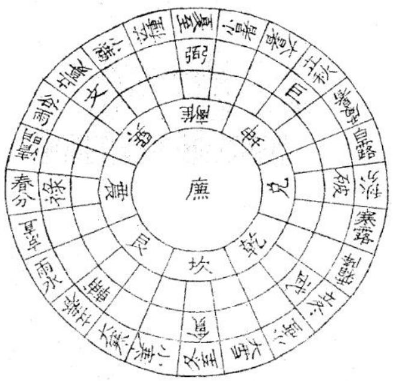

<!-- V3_SOURCE_ID:book031-b000124-p000-1eb598d11e -->

这段文本存在多处OCR识别讹误，可识别的核心内容如下：关于“七星打劫”的含义，就好比比肩兄弟相互往来的意思。这类兄弟类的象中有假财之神，所以称为打劫，本身带有凶的属性。《天玉经》提到相关内容的核心要义在于区分兄弟的真假，以此判定相关的吉凶；还有说法提到观测太岁所属的神煞，就能立刻判断清楚吉凶。其余如“打敏”“員氣”“竹以”“真兌弟”“假又弟節養”“篋馬吉曰社初”等短语识别错误较多，具体所指无法确定。

> **释读存疑：** 原文OCR识别错误较多，大量短语无法准确释读

查看对应原文

<!-- V3_FOLDBACK_BEGIN:book031-b000124-p000-1eb598d11e -->

七星打敏之義卽如比肩兄弟相過之義也其兄弟也有假財之神故曰打刼豈非凶義乎然而員氣也竹以七星打兄弟也真兌弟者同骨肉假又弟節養非出禍福天玉經云但之義全在分别兄弟真假以取篋馬吉曰社初天一看太歲是何神立地見分明

<!-- V3_FOLDBACK_END:book031-b000124-p000-1eb598d11e -->

<!-- V3_SOURCE_ID:book031-b000125-p000-5b4670121e -->

离宫相合应验图诀。

查看对应原文

<!-- V3_FOLDBACK_BEGIN:book031-b000125-p000-5b4670121e -->

離宮相合應驗圗訣

<!-- V3_FOLDBACK_END:book031-b000125-p000-5b4670121e -->

<!-- V3_SOURCE_ID:book031-b000126-p000-6b941ebcf9 -->

符合離宮相合的情况，就叫做“知”。当两个金星并列出现时，要仔细分辨阴阳、区分顺逆，详细推究天地与干支的相合关系。杂宫相合的应验会随时发生，相关规律循环于冬至、夏至以及天地干支之间。

查看对应原文

<!-- V3_FOLDBACK_BEGIN:book031-b000126-p000-6b941ebcf9 -->

離宮相合說名知 兩個金星並體時 細辨陰陽分順逆 詳推天地合干支 雜宮相合應驗隨時 循環二至天地干支

<!-- V3_FOLDBACK_END:book031-b000126-p000-6b941ebcf9 -->

<!-- V3_SOURCE_ID:book031-b000128-p000-99ab7cf55d -->

離宮要相合。

查看对应原文

<!-- V3_FOLDBACK_BEGIN:book031-b000128-p000-99ab7cf55d -->

離宮要相合

<!-- V3_FOLDBACK_END:book031-b000128-p000-99ab7cf55d -->

<!-- V3_SOURCE_ID:book031-b000129-p000-ff5c607684 -->

離宮相合的含義，是男女夫婦相逢的意思，也就是彼此和好的意思，難道不是吉兆嗎？然而夫婦的含義有真夫婦，也有假夫婦。真夫婦在十道之內，假夫婦在十道之外。如果是真夫婦，就全爲吉兆；如果是假夫婦，就暗藏凶兆。所以離宮相合的含義，全在於分辨夫婦的真假，以此來判斷吉凶禍福。

查看对应原文

<!-- V3_FOLDBACK_BEGIN:book031-b000129-p000-ff5c607684 -->

離宮相合之義郎男女夫婦相逢之義也卽彼此和好 之義也豈非吉乎然而夫婦之義有真夫婦也有假夫 婦也真夫婦在十道之內假夫婦在十道之外如果真 夫婦則全吉矣若假夫婦則藏凶矣所以離宮相合之 義全在分別夫婦真假以取斷驗吉凶禍福

<!-- V3_FOLDBACK_END:book031-b000129-p000-ff5c607684 -->

<!-- V3_SOURCE_ID:book031-b000130-p000-3c55845a63 -->

陽局順相逢數圖訣。

查看对应原文

<!-- V3_FOLDBACK_BEGIN:book031-b000130-p000-3c55845a63 -->

陽局順相逢數圖訣

<!-- V3_FOLDBACK_END:book031-b000130-p000-3c55845a63 -->

<!-- V3_SOURCE_ID:book031-b000131-p000-04df7378e5 -->

干支（天干和地支组合形成的纪时、纪序系统）重化就是相逢，天地循環九氣通達於坎（八卦之一）位，神交於三極之中，離宮的數合與此相同。

查看对应原文

<!-- V3_FOLDBACK_BEGIN:book031-b000131-p000-04df7378e5 -->

干支重化是相逢天地循環九氣通坎位神交三極裡離宮數合一般同

<!-- V3_FOLDBACK_END:book031-b000131-p000-04df7378e5 -->

<!-- V3_SOURCE_ID:book031-b000132-p000-1a14c97466 -->

干支（天干和地支组合形成的纪时、纪序系统）重化，所以稱爲相逢，天地循環九氣皆通。

查看对应原文

<!-- V3_FOLDBACK_BEGIN:book031-b000132-p000-1a14c97466 -->

干支重化故曰相逢循環天地九氣皆通

<!-- V3_FOLDBACK_END:book031-b000132-p000-1a14c97466 -->

<!-- V3_SOURCE_ID:book031-b000134-p000-9caac2a68a -->

《寶照經》說：星辰流轉要相逢。

查看对应原文

<!-- V3_FOLDBACK_BEGIN:book031-b000134-p000-9caac2a68a -->

寶照經云星辰流轉要相逢

<!-- V3_FOLDBACK_END:book031-b000134-p000-9caac2a68a -->

<!-- V3_SOURCE_ID:book031-b000135-p000-6807a3145f -->

阳顺相逢数，就是北斗七星去打劫之数，也是九星生成之数，还是三卦挨星之数。从一开始到九结束，依次是贪、巨、禄、文、廉、武、破、辅、弼，逐一按族排布，就是顺行、属阳的相逢数。依据“上允”的规则，从甲子起坎，按照六十花甲顺向排布，每逢当年与天地干支处在同宫位的情况，就是相逢数，这一年的吉凶祸福可以据此断定，灵验如神。这里的“上允”具体含义不详。

> **释读存疑：** “上允”的具体含义；“上允”具体含义不详

查看对应原文

<!-- V3_FOLDBACK_BEGIN:book031-b000135-p000-6807a3145f -->

陽順相逢數者郎北斗七星去打刼之數也 九星生成之數也三卦挨星之數也是由一 起而至九止貧巨祿文廉武破輔弼逐一族 去為順為陽相逢數也如上允甲子起坎以 六十花甲順排每逢是年與天地干支同宮 位者卽相逢數也其年可决斷吉凶禍福靈 應如神

<!-- V3_FOLDBACK_END:book031-b000135-p000-6807a3145f -->

<!-- V3_SOURCE_ID:book031-b000136-p000-75c307eb9d -->

这是《陰局逆相逢數圖訣》的相关歌诀内容，其中提到：如果双星聚会的格局相逢，三卦的神通自然会产生功效。如果该地是虚假的穴位，祸福测算就不会灵验；如果是真龙穴位，吉凶预测就会应验。还提到逆数之间相互契合，顺数之间相互贯通；出现双星聚会的格局，代表主方和客方会再次相逢。

查看对应原文

<!-- V3_FOLDBACK_BEGIN:book031-b000136-p000-75c307eb9d -->

陰局逆相逢數圖訣 雙星聚會得相逢 三卦神通自有功 禍福不靈虛假地 吉凶應驗果真龍 逆數相合順數相通 雙星聚會主客重逢

<!-- V3_FOLDBACK_END:book031-b000136-p000-75c307eb9d -->

<!-- V3_SOURCE_ID:book031-b000137-p000-b605a5556a -->

有《囊序》说道：有人识得阴阳的话，何愁大地不相逢。阴逆相逢数，就是离宫要相合的相逢数，也是九星度化的相逢数。原文此处写有“武康”，其中“康”应为讹字，正确应为“廉”。排布顺序从九开始到一结束，依次是辅、破、武、廉、文、禄、巨、贪，逐一挨排，就是逆行、属阴的相逢数。从下元甲子起离，也按照六十花甲顺向排布，每逢当年与天地干支处在同宫位的情况，就是相逢数，这一年的吉凶祸福可以据此断定，灵验如回声呼应。

> **释读存疑：** 1轮自动修复后核义模型仍建议修订，已保守记录。

查看对应原文

<!-- V3_FOLDBACK_BEGIN:book031-b000137-p000-b605a5556a -->

有囊序云有人識得陰陽者何愁大地不相逢 陰逆相逢數者卽離宮要相合之相逢數也卽九星 度化之相逢數也是由九起而至一止解輔破武康 文祿巨貪逐一挨為逆為陰相逢數也如下元甲子 起離亦以六十花甲順排亦每逢是年與天地干支 同宮位者卽相逢數也其年可决斷吉凶禍福靈驗 如響

<!-- V3_FOLDBACK_END:book031-b000137-p000-b605a5556a -->

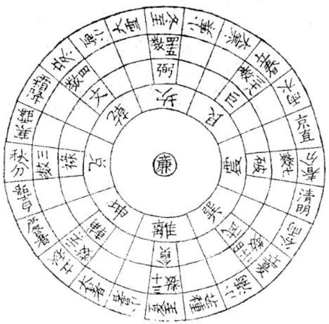

<!-- V3_SOURCE_ID:book031-b000139-p000-b013901a72 -->

这是八卦相逢的数，数到所指的位置对应的数值，就能知道会在几年几月出现什么样的人物、什么样的事情，相关的应验情况可以预先针对年月补充说明如下：从乾到震是五十二数，从乾到离是二十二数，从坎到巽是四数，兑对应的数值是七数，原文未说明该数的计算起点，从艮到坤是十三数，从震到乾是二十二数，从震到离是五十二数，从巽到兑是四数，坡对应的数值是三十四数，原文未说明该数的计算起点，从离到震是六十七数，乾对应的数值是七十五数，原文未说明该数的计算起点，从坤到艮是六十一数，从兑到坎是六十七数，从兑到巽是七十数。

> **释读存疑：** 兑七数、坡卅四数、乾七五数未说明计算起点，具体对应规则不明

查看对应原文

<!-- V3_FOLDBACK_BEGIN:book031-b000139-p000-b013901a72 -->

此八卦相逢之數數至所指處是幾數便知幾年幾月出何等人物事情應驗預先年月增解一乾至震五十二數至離二十二數坎至巽四數兌七數艮至坤十三數震至乾廿二數至離五十二數巽至兌四數坡卅四數離至震六十七數乾七五數坤至艮六十一數兌至坎六十七數兌至巽七十數

<!-- V3_FOLDBACK_END:book031-b000139-p000-b013901a72 -->

<!-- V3_SOURCE_ID:book031-b000140-p000-d65a14d563 -->

《文破陰局圖訣》增解部分记载：从乾到離为六十一数，从震为四数，从坎到兑为六十七数，从坎到巽为五十二数，从艮到坤为六十一数，从震到離为六十七数，从震到乾为七十数，从巽到坎为二十二数，从巽到兑为五十二数，从離到乾为四数，从離到震为七数，从坤到艮为十三数，从兑到巽为二十二数，从兑到坎为四十三数。北斗七星左旋的卦序依次为：坎、艮、震、巽、離、坤、兑、乾；艮、震、巽、離、坤、兑、乾、坎；震、巽、離、坤、兑、乾、坎、艮；巽、離、坤、兑、乾、坎、艮、震；離、坤、兑、乾、坎、艮、震、巽；坤、兑、乾、坎、艮、震、巽、離；兑、乾、坎、艮、震、巽、離、坤；乾、坎、艮、震、巽、離、坤、兑。另有增解记载，冬至之后的阳局，从坎宫起甲子，左旋依次排到艮为丙寅，排到震为丁卯，排到巽为戊申，排到離为辛丑，排到坤为庚午，排到兑为庚午，其余卦象都依照这个规则类推。使用这部分内容时，需要在癸、艮、寅、甲、卯、乙、辰、巽、巳、丙对应的天龍、向、砂、上峯、岳的位置上留意观察。

> **释读存疑：** 原文“已丑”是否为“己丑”讹写未明，排序的对应规则原文表述不完整；1轮自动修复后核义模型仍建议修订，已保守记录。

查看对应原文

<!-- V3_FOLDBACK_BEGIN:book031-b000140-p000-d65a14d563 -->

文破陰局圗訣 增解乾至離六十一數至 震四數坎至兌六十七數至 巽五十二數艮至坤六十一 數震至離六十七數至乾七 十數巽至坎二十二數至兌 五十二數離至乾四數至震 七數坤至艮十三數兌至巽 二十二數至坎四十三數 北斗七星左旋 坎艮震巽離坤免乾 艮震巽離坤兌乾坎 震巽離坤免乾坎艮 巽離坤免乾坎艮震 離坤免乾坎艮震巽 坤免乾坎艮震巽離 兌乾坎艮震巽離坤 乾坎艮震巽離坤免 增解冬至后陽 局坎宮起甲子 左旋已丑排至 艮丙寅排至震 丁卯至巽戊申 至離辛丑至坤 庚午至兑餘卦 倣此此在癸艮 寅甲卯乙辰巽 已丙天龍向砂 上峯岳上著眼

<!-- V3_FOLDBACK_END:book031-b000140-p000-d65a14d563 -->

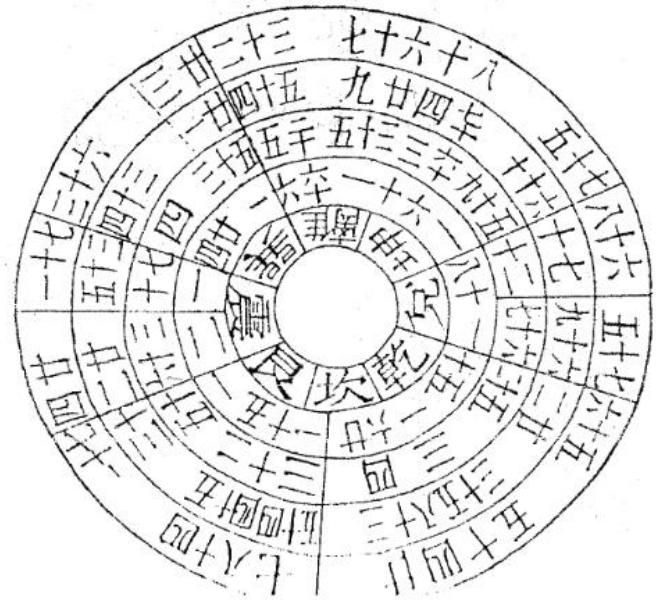

<!-- V3_SOURCE_ID:book031-b000143-p000-2cd813c837 -->

北斗七星右旋圖訣

查看对应原文

<!-- V3_FOLDBACK_BEGIN:book031-b000143-p000-2cd813c837 -->

北斗七星右旋圖訣

<!-- V3_FOLDBACK_END:book031-b000143-p000-2cd813c837 -->

<!-- V3_SOURCE_ID:book031-b000144-p000-d44e252874 -->

对应的卦序依次为：離、巽、震、艮、坎、乾、兑、坤；巽、震、艮、坎、乾、兑、坤、離；震、艮、坎、乾、兑、坤、離、巽；艮、坎、乾、兑、坤、離、巽、震；坎、乾、兑、坤、離、巽、震、艮；乾、兑、坤、離、巽、震、艮、坎；兑、坤、離、巽、震、艮、坎、乾；坤、離、巽、震、艮、坎、乾、兑。增辞部分记载，夏至之后的阴局，从離宫起甲子，右旋依次排到巽为丁亥，到震为辛丑，到艮为戊申，到坎为丁卯，到乾为丙寅，到兑为己丑，到坤为己丑，其余卦象都依照这个规则类推。使用这部分内容时，需要在丁未、坤、申、庚、酉、辛、戌、乾、亥、壬、子对应的龍、向、砂、水、峯的位置上观察。

> **释读存疑：** 原文“呻雖”讹误对应的正确文字未明，“庚年”是否为干支讹写未明；1轮自动修复后核义模型仍建议修订，已保守记录。

查看对应原文

<!-- V3_FOLDBACK_BEGIN:book031-b000144-p000-d44e252874 -->

離巽震艮坎乾兌坤 巽震艮坎乾兌坤離 震艮坎乾兌坤離巽 艮坎乾免坤離巽震 坎乾兑坤離巽震艮 乾兌坤離巽震艮坎 兌坤離巽震艮坎乾 呻雖巽震艮坎乾兌 增辭夏至后陰 局離宮起甲子 右旋丁亥排至 巽庚年到震辛 丑到艮戊申到 坎丁卯到乾丙 寅到兌己丑到 坤餘卦做此 此在丁未坤申 庚酉辛戌乾亥 壬子龍向砂水 峯上看眼

<!-- V3_FOLDBACK_END:book031-b000144-p000-d44e252874 -->

<!-- V3_SOURCE_ID:book031-b000147-p000-0ff51c9879 -->

乾坤變化有千萬種，天地間的氤氳之氣渾然一團，八卦、九星皆有動靜之理，五行、四象共同盤旋往復。

查看对应原文

<!-- V3_FOLDBACK_BEGIN:book031-b000147-p000-0ff51c9879 -->

乾坤爰化萬千端 天地氤氲氣一團 八卦九星皆動靜 五行四象共盤桓

<!-- V3_FOLDBACK_END:book031-b000147-p000-0ff51c9879 -->

<!-- V3_SOURCE_ID:book031-b000148-p000-9ef6494a14 -->

乾坤变化神妙，气浑然一体，五行与四象共同盘旋往复。

查看对应原文

<!-- V3_FOLDBACK_BEGIN:book031-b000148-p000-9ef6494a14 -->

乾坤變化妙氣一團五行四象合共盤桓

<!-- V3_FOLDBACK_END:book031-b000148-p000-9ef6494a14 -->

<!-- V3_SOURCE_ID:book031-b000150-p000-e22c440aa4 -->

唯有挨星最為貴重，其中洩露了上天的機密。

查看对应原文

<!-- V3_FOLDBACK_BEGIN:book031-b000150-p000-e22c440aa4 -->

惟有挨星為最貴洩漏天機秘

<!-- V3_FOLDBACK_END:book031-b000150-p000-e22c440aa4 -->

<!-- V3_SOURCE_ID:book031-b000151-p000-8dd74b93d2 -->

最尊贵的是帝星，挨星就是帝星的行运规律。满数是帝星的极数，也就是天地的合数。极数是九、六、五百四，合数是九九八十一。从前圣贤说过：“此一时也，彼一时也，五百年必有王者兴”，这难道不是泄露了天机吗？所以每五百四年，天地会有一次变动，万物也会随之有一次变动。因此凡是天地万物的生成与变化，总不会超出挨星的作用范围。

> **释读存疑：** 本地硬校验仍未通过，已记录供后续自动处理或人工核对。

查看对应原文

<!-- V3_FOLDBACK_BEGIN:book031-b000151-p000-8dd74b93d2 -->

最貴者帝星也挨星者即帝星之行運也滿數者乃帝星之極數卽天地之合數也極數者九六五百四合數者九九八十一也前者聖賢有言此一時也彼一時也五百年必有王者興豈非洩漏天機乎所以五百四年天地有此一變而萬物亦有此一變故凡天地萬物生成變化總不出挨星範圍

<!-- V3_FOLDBACK_END:book031-b000151-p000-8dd74b93d2 -->

<!-- V3_SOURCE_ID:book031-b000152-p000-be5844bb70 -->

这是《天地生成规矩图诀》的内容：生成的地理与天文相合，气与神相互感应，两仪因此分判，夫妇相交应当闭户，文中提到“雄雌未度不开门”，“度”的具体所指不详，雄雌合气如同夫妇交相辉映，乾坤下种，天地包含各色物象。

> **释读存疑：** 雄雌未度不開门中“度”的含义不明；“雄雌未度不开门”中“度”的具体所指不详

查看对应原文

<!-- V3_FOLDBACK_BEGIN:book031-b000152-p000-be5844bb70 -->

天地生成規矩圖訣
生成地理合天文
氣感神通兩儀分
夫婦相交應閉戶
雄雌未度不開門
雄雌合氣夫婦交光
乾坤下種天地色含

<!-- V3_FOLDBACK_END:book031-b000152-p000-be5844bb70 -->

<!-- V3_SOURCE_ID:book031-b000153-p000-9fc780d075 -->

天地的规则是内柔外刚，能自己运动、自己静止，自己运行、自己藏纳，参合奇数与偶数，一并包含阴阳，清浊不分，处于混沌玄黄的状态，在外形成手足的对应，在内契合心肠的配属，清晰分出四象，与五行相配合，一横一直，自己形成规则体系，生成十道，化生出五皇，东南西北四方共同统理中央，自身居于中正之位，能成圆也能成方，可至穷也可至富，可至善也可至良，五十五数，通过两画推演，雄雌之气相合，夫妇交相辉映，乾坤下种，天地包含各色物象，春季三个月建立功业，十个月后名声传扬，时运通达的时候，子母就会分离，起止、分合与动静都遵循循环的规律，一团神妙的气，就是天地的章法纹理。

> **释读存疑：** 本地硬校验仍未通过，已记录供后续自动处理或人工核对。

查看对应原文

<!-- V3_FOLDBACK_BEGIN:book031-b000153-p000-9fc780d075 -->

天地規矩內柔外剛自動自靜自行自藏參奇合偶並體陰陽無分清濁混沌玄黃外成手足內合心腸分明四象配合五行一橫一直自作紀綱生成十道爰化五皇東南西北統理中央自中自正自圓自方至窮至富至善至良五十五數兩画推雄雌合氣夫婦交光乾坤下種天地色含三春建業十月名揚時通運至子母分張起止分合動靜循環一團妙氣天地文章

<!-- V3_FOLDBACK_END:book031-b000153-p000-9fc780d075 -->

<!-- V3_SOURCE_ID:book031-b000155-p000-7f29fa487a -->

《日月方圆图诀》：乾坤由此化生，天地开辟；子、丑、寅三个时辰一气相连；阴阳顺逆之分对应昼夜交替；日月往来契合方圆之理；支神属地，干神属天；生成的规矩由此化生为方圆。

查看对应原文

<!-- V3_FOLDBACK_BEGIN:book031-b000155-p000-7f29fa487a -->

曰月麥化方圓圗訣 乾坤爰化地開天 子丑寅通一氣連 順逆陽陰分畫夜 往來日月合方圓 支神厲地干神属天 生成規矩爰化方圓

<!-- V3_FOLDBACK_END:book031-b000155-p000-7f29fa487a -->

<!-- V3_SOURCE_ID:book031-b000156-p000-8753b59bdd -->

日月的方圆就是天地的规矩，天地的规矩就是日月的方圆；静止的状态对应天地的规矩，运动的状态对应日月的方圆；变化的属性对应天地的规矩，度量的属性对应日月的方圆；天地的规矩是日月方圆的本体，日月方圆是天地规矩的功用；本体存在于东南西北四个方位之内，以此形成十道；功用运行于春罡、秋冬的时序之中，以此确定天心；所以我的书中专门提出，天心十道的作用完全体现在十道天心之上；因此两幅图以气息相互连通，本体和功用并存，二者不可以相互分离。

> **释读存疑：** 1轮自动修复后核义模型仍建议修订，已保守记录。

查看对应原文

<!-- V3_FOLDBACK_BEGIN:book031-b000156-p000-8753b59bdd -->

日月方圓即是天地規矩 天地規矩便是日月方圓 靜為天地規矩 動為日月方圓 化為天地規矩 度為日月方圓 天地規矩為日月方圓之體 日月方圓為天地規矩之用 體在東南西北之內以成十道 用在春罡秋冬之中以定天心 所以吾書專謂 天心十道作用盡在十道天心 是以兩圖一氣相連 體用相並 不可以相離者也

<!-- V3_FOLDBACK_END:book031-b000156-p000-8753b59bdd -->

<!-- V3_SOURCE_ID:book031-b000158-p000-3034a53ef6 -->

《挨星图诀》中朱雀发源的扶星起例：从乙度向北，北极通天化出九辰；逆步离宫可知妙义，顺行坎位可见精神。

查看对应原文

<!-- V3_FOLDBACK_BEGIN:book031-b000158-p000-3034a53ef6 -->

朱雀發源挨星圖訣扶星起例乙度伸北極通天化九辰逆步離宮知妙義順行坎位見精神

<!-- V3_FOLDBACK_END:book031-b000158-p000-3034a53ef6 -->

<!-- V3_SOURCE_ID:book031-b000159-p000-f60f2f72a2 -->

顺着前行、逆向而来，五星由此化生开端；生入、克出，九星由此变化而成。

查看对应原文

<!-- V3_FOLDBACK_BEGIN:book031-b000159-p000-f60f2f72a2 -->

順往逆來五星化始生入尅出九星化成

<!-- V3_FOLDBACK_END:book031-b000159-p000-f60f2f72a2 -->

<!-- V3_SOURCE_ID:book031-b000161-p000-13a9825aec -->

朱雀发源就是帝星的起例，帝星的起例就是朱雀的发源；帝星是朱雀的本体，朱雀是帝星的功用；本体在紫微垣之内，功用在太微垣之中；所以朱雀对应南方，它的本体实际处在北方；因此紫微宫发源是揆星的起例；挨星是帝星的运行规律，起例就是朱雀的发源；一种是生入，一种是克出，生入指的是在离宫逆向排布，克出指的是在坎、坎位顺向运行；顺行的顺序先是火、金、木、土、水，再排布为火、土、金、水、木，这就是帝星运行的含义，也是五星搭配九星的含义。

> **释读存疑：** 1轮自动修复后核义模型仍建议修订，已保守记录。

查看对应原文

<!-- V3_FOLDBACK_BEGIN:book031-b000161-p000-13a9825aec -->

朱雀發源即是帝星起例帝星起例便是朱雀 發源帝星為朱雀之體朱雀為帝星之用體在 紫微垣之内用在太微垣之中所以朱雀在南 其本體實在北是以紫微宮發源為揆星起例 挨星者乃帝星之行運起例者即朱雀之發源 也一生入一尅出生入者離宮逆步尅出者坎 坎位順行順行火金木土水步火土金水木 此卽帝星行運之義五星配九星之義也

<!-- V3_FOLDBACK_END:book031-b000161-p000-13a9825aec -->

<!-- V3_SOURCE_ID:book031-b000162-p000-e8c2735fc9 -->

《合禄马合官星图诀》

查看对应原文

<!-- V3_FOLDBACK_BEGIN:book031-b000162-p000-e8c2735fc9 -->

合祿馬合官星圗訣

<!-- V3_FOLDBACK_END:book031-b000162-p000-e8c2735fc9 -->

<!-- V3_SOURCE_ID:book031-b000163-p000-9d9682d3ff -->

合禄、合马、合官星，要从本卦的生旺方位去寻找；合凶、合吉、合祥稀，用什么方法能够趋吉避凶？应当看当年的太岁是哪一位神煞，当下就能分辨清楚。

> **释读存疑：** “合祥稀”的具体含义暂不明确

查看对应原文

<!-- V3_FOLDBACK_BEGIN:book031-b000163-p000-9d9682d3ff -->

合祿合馬合官星本卦生旺尋合凶合吉合祥稀何法能趨避當看太歲是何神立地見分明

<!-- V3_FOLDBACK_END:book031-b000163-p000-9d9682d3ff -->

<!-- V3_SOURCE_ID:book031-b000164-p000-b10f4d60ec -->

生旺是全书的核心功用，千万不要忽略过去；该口诀最适合在秋季催福，效果极为神速，极为奥妙，也极容易掌握；总共一百二十家的相关方法，没有能超过这个口诀的。

> **释读存疑：** “最秋”的具体表述含义、“拳”在此处的具体所指暂不明确；1轮自动修复后核义模型仍建议修订，已保守记录。

查看对应原文

<!-- V3_FOLDBACK_BEGIN:book031-b000164-p000-b10f4d60ec -->

生旺乃全書之作用切勿忽過此訣最秋催福極神速極奧妙亦極容易拳凡一百二十家無過於此

<!-- V3_FOLDBACK_END:book031-b000164-p000-b10f4d60ec -->

<!-- V3_SOURCE_ID:book031-b000165-p000-dadb3ad066 -->

《禄马官星生旺图诀》

查看对应原文

<!-- V3_FOLDBACK_BEGIN:book031-b000165-p000-dadb3ad066 -->

祿馬官星生旺圗訣

<!-- V3_FOLDBACK_END:book031-b000165-p000-dadb3ad066 -->

<!-- V3_SOURCE_ID:book031-b000166-p000-e6f10d903a -->

使用方法最看重生旺，处在生旺的方位、得到生旺的气息，就会极为灵验，福运立刻就会应验；另外还有二十四山图，这个时期各种事都可以使用。

> **释读存疑：** “此期”的具体指代范围暂不明确

查看对应原文

<!-- V3_FOLDBACK_BEGIN:book031-b000166-p000-e6f10d903a -->

用法最重生旺在生旺之位得生旺之氣則妙極而福應立至矣另有二十四山圗此期事事可用

<!-- V3_FOLDBACK_END:book031-b000166-p000-e6f10d903a -->

<!-- V3_SOURCE_ID:book031-b000167-p000-d411ee4d46 -->

这里补充说明：正处于当令状态的是旺气，即将到来的是生气，刚开始衰退的是衰气，已经衰退很久的是死气。挨星的妙理契合天心，相关图诀的用法和之前刻印的总指一图相同，如今把这一幅图拆分为三幅，原本的义理没有差别，只是看起来更清楚醒目。三幅图的运用规则全靠修习的人自行体悟把握，所有的口诀都是这样的。

查看对应原文

<!-- V3_FOLDBACK_BEGIN:book031-b000167-p000-d411ee4d46 -->

增解當令者為旺將來者為生方去者為衰去己久者為死挨星妙合天心圗訣用法同上前刻總指一圗今分而為三原無二義但覺醒目三圗規矩全憑修者在人諸訣皆然

<!-- V3_FOLDBACK_END:book031-b000167-p000-d411ee4d46 -->

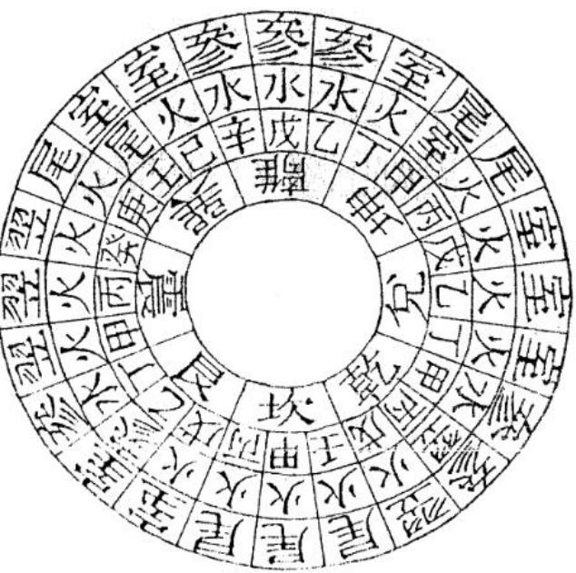

<!-- V3_SOURCE_ID:book031-b000170-p000-b90297df33 -->

天帝太陽合貴圖訣，此圖用處極廣，擇日的人尤其需要。其陰陽平排、交互配合的妙處出於天然，達到了極高的境界，無以復加，得到的人應當重視它。天官賜福貴人圖訣，天官起例，諸君已知十天干加十二地支的規則，到陽陰交合之處，還要歸於日月顯明之時，就是天官上殿、日月合明、陽陰合氣、賓主有情之際。

查看对应原文

<!-- V3_FOLDBACK_BEGIN:book031-b000170-p000-b90297df33 -->

天帝太陽合貴圗訣此圖用處極廣日家尤要其陰陽平排交互配合妙出天然至矣盡矣蔑以加矣得者寶之天官賜福貴人圖訣天官起例諸君知十個干加十二支數至陽陰交合處還歸曰月顯明時天官上殿日月合明陽陰合氣賓主有情

<!-- V3_FOLDBACK_END:book031-b000170-p000-b90297df33 -->

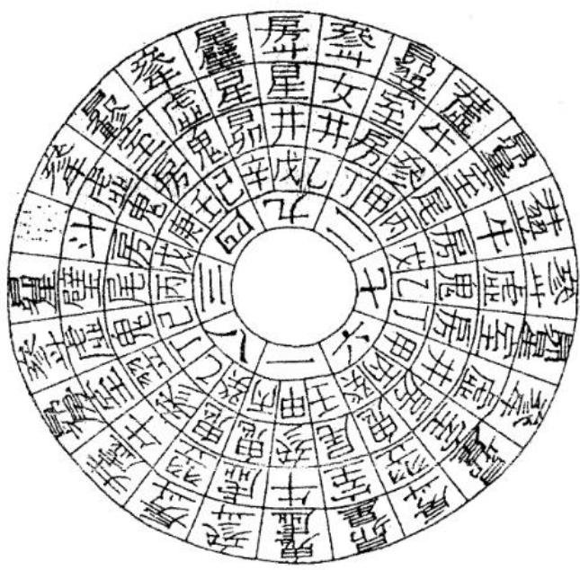

<!-- V3_SOURCE_ID:book031-b000173-p000-d284a4ad84 -->

天官起例即為丙子、乙丑、甲寅、癸卯、壬辰、辛巳、庚午、己未、戊申、丁酉、丙戌、乙亥。如貪狼、巨門星體用事，以甲寅、己未為進福；破軍、左輔星體用事，以庚午、乙丑為進福；祿存、武曲星體用事，以丙子、辛巳為進福；文曲星體用事，以壬辰、丁酉為進福；右弼星體用事，以戊申、癸卯為進福。其中有五福堆貴，是最吉利的格局；更有五福堆祿，也是上等吉利的格局。此說是四垣中的天官星、賜福的真貴人。

查看对应原文

<!-- V3_FOLDBACK_BEGIN:book031-b000173-p000-d284a4ad84 -->

天官起例卽丙子乙丑甲寅癸卯壬辰辛巳庚午己未戊申丁酉丙戌乙亥如貪狼巨門用事以甲寅己未為進福破軍左輔用事以庚午乙丑為進福祿存武曲用事以丙子辛巳為進福文曲用事以壬辰丁酉為進福右弼用事以戊申癸卯為進福內有五福堆貴最為吉格更有五福堆祿亦上吉格也此說四垣中之天官星賜福之真貴人也

<!-- V3_FOLDBACK_END:book031-b000173-p000-d284a4ad84 -->

<!-- V3_SOURCE_ID:book031-b000175-p000-80222130cd -->

这里记载的是《加官进禄八位图诀》，相关内容提到，禄星八位的样貌十分清晰，天地间的神通自然会显现出来，在日月交相辉映的状态中能知晓其中的玄妙义理，当阳春降临各处的时候就能见到其中的真意。

> **释读存疑：** “日月交中”“阳春到處”的具体所指原文未明，译文按字面释读无问题；1轮自动修复后核义模型仍建议修订，已保守记录。

查看对应原文

<!-- V3_FOLDBACK_BEGIN:book031-b000175-p000-80222130cd -->

加官進祿八位圖訣 祿星八位十分清 天地神通自顯明 日月交中知妙義 陽春到處見真情

<!-- V3_FOLDBACK_END:book031-b000175-p000-80222130cd -->

<!-- V3_SOURCE_ID:book031-b000176-p000-352b0f81c6 -->

祿星八位需十字分清，干支（天干和地支组合形成的纪时、纪序系统）配合自有真情。

查看对应原文

<!-- V3_FOLDBACK_BEGIN:book031-b000176-p000-352b0f81c6 -->

祿星八位十字分清干支配合自有真情

<!-- V3_FOLDBACK_END:book031-b000176-p000-352b0f81c6 -->

<!-- V3_SOURCE_ID:book031-b000177-p000-826f179183 -->

祿星的名義是公認的，玄空（结合时间、空间和星数推演的一类风水体系）的用法卻有不同。最貴的是官星與祿星相合，最富的是祿星與馬星相合，都要合在本卦，稱為合祿、合馬、合官星，需在本卦的生旺之處尋找。如貪狼、巨門星體用事，以甲寅、甲午為進祿；祿存、武曲星體用事，以辛酉、辛巳為進祿；破軍、左輔星體用事，以庚申、乙卯為進祿；文曲星體用事，以壬午、丁亥為進祿；右弼星體用事，以癸巳、戊子為進祿。此即四垣中的倉庫星，契合天心十道的真祿星。

查看对应原文

<!-- V3_FOLDBACK_BEGIN:book031-b000177-p000-826f179183 -->

祿星名義公同 玄空用法却異 最貴者以官合祿 至富者以祿合馬 皆要合在本卦 謂之合祿 合馬合官星 本卦生旺尋是也 如貧狼巨門用事 以甲寅甲午為進祿 祿存武曲用事 以辛酉辛巳為進祿 破軍左輔用事 以庚申乙卯為進祿 文曲用事 以壬午丁亥為進祿 右弼用事 以癸巳戊子為進祿 此卽四垣中之倉庫星 應天心十道之真祿星也

<!-- V3_FOLDBACK_END:book031-b000177-p000-826f179183 -->

<!-- V3_SOURCE_ID:book031-b000179-p000-aadd88fcc7 -->

这里记载的是《马上金往四相图注》，相关内容提到，马化作龙驹的时候天地间一片春意，三关四路都有星辰显现，寅位与申位会合的时候就能知晓事物的虚实，巳位与亥位共同参照就能分辨事物的真假。另外还提到马和龙属性相近，活动的特性也都相同，在金街御殿的场景下主和仆会相逢。

> **释读存疑：** “三关四路”“金街御殿”为风水专属隐语，原文未明具体所指，译文按字面释读无问题

查看对应原文

<!-- V3_FOLDBACK_BEGIN:book031-b000179-p000-aadd88fcc7 -->

馬上金往四相圖註 馬化龍駒天地春 三關四路顯星辰 寅申會合知虛實 巳亥同參見假真 馬又屬龍動性皆同 金街御殿主僕相逢

<!-- V3_FOLDBACK_END:book031-b000179-p000-aadd88fcc7 -->

<!-- V3_SOURCE_ID:book031-b000180-p000-c87edbf837 -->

马郎对应寅、申、巳、亥，如果没有主事的星，就是野马；只有帝星升殿归垣、有主事星的时候，才是真马。所以四垣的帝宿正是四马的主星。比如天市垣以辛巳为进马，少微垣以乙亥为进马，太微垣以戊申为进马，紫微垣以甲寅为进马。至于四垣划分宫位之后，各自都有对应的马，各自搭配挨星，类推之后自然就能明白，仔细揣摩本图就更容易看出来，总归要主星处于对应位置才是真的。这种说法讲的是四局中的祥瑞、五妙中的瑞气，是对应天心十道的真马。

> **释读存疑：** 1轮自动修复后核义模型仍建议修订，已保守记录。

查看对应原文

<!-- V3_FOLDBACK_BEGIN:book031-b000180-p000-c87edbf837 -->

馬郎寅申巳亥無主乃是野馬帝星升殿歸垣 有主方為真馬所以四垣帝宿正是四馬主人 如天市垣以辛巳為進馬 少微垣以乙亥為進馬 太微垣以戊申為進馬 紫微垣以甲寅為進馬 至於四垣分宮各自有馬 各有挨星類推自明 細玩本圖更為易見 總以主人得位為真 此說四局中之複祥 五妙中之瑞氣 應天心十道之真馬也

<!-- V3_FOLDBACK_END:book031-b000180-p000-c87edbf837 -->

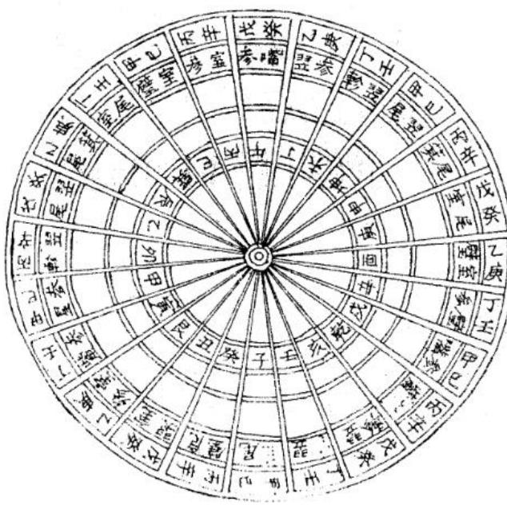

<!-- V3_SOURCE_ID:book031-b000182-p000-b6c4824cbc -->

这里记载的是《天乙贵人上殿图诀》，相关内容提到，贵气对应玄空，昼夜都很清朗，干支相互配合就能显扬声名，阴阳两路终究不足为依据，夫妇双关是最值得凭依的，官星贵宿昼夜都保持清朗，离位通连坎的气脉自然会有真情显现。

> **释读存疑：** “夫妇双关”为风水专属隐语，原文未明具体所指，译文保留原短语无问题；1轮自动修复后核义模型仍建议修订，已保守记录。

查看对应原文

<!-- V3_FOLDBACK_BEGIN:book031-b000182-p000-b6c4824cbc -->

天乙貴人上殿圗訣貴應玄空畫夜清千支配合顯聲名陰陽兩路終非據夫婦雙關最可憑官星貴宿畫夜皆清離通坎氣自有真情

<!-- V3_FOLDBACK_END:book031-b000182-p000-b6c4824cbc -->

<!-- V3_SOURCE_ID:book031-b000184-p000-61aadd7a09 -->

契合天心自然就能进贵，通应月气自然就能显现星辰，这些星辰有真假的区别，并没有昼夜的划分。如果是贪狼、巨门星体当值用事，甲子、己丑、甲申、己未为进贵；禄存、武曲星体当值用事，丙寅、丙午、辛酉、辛亥为进贵；破军、左辅星体当值用事，乙丑、乙未、庚子、庚申为进贵；文曲星体当值用事，丁巳、丁酉、丁卯、丁亥为进贵；右弼星体当值用事，癸巳、癸卯、癸丑、癸未为进贵。这种说法讲的是四垣中的正官星，是对应天心的真贵人。

查看对应原文

<!-- V3_FOLDBACK_BEGIN:book031-b000184-p000-61aadd7a09 -->

合天心自然進貴通月氣自顯星辰却有真偽之別並無畫夜之分如貧狼巨門星體用事甲子已丑甲申已未為進貴祿有武曲星體用事丙寅丙午辛酉辛亥為進貴破軍左輔星體用事乙丑乙未庚子庚申為進貴文曲星體用事丁巳丁酉丁卯丁亥為進貴右弼星體用事癸巳癸卯癸丑癸未為進貴此說四垣中之正官星應天心之真貴人也

<!-- V3_FOLDBACK_END:book031-b000184-p000-61aadd7a09 -->

<!-- V3_SOURCE_ID:book031-b000185-p000-6335acb33a -->

《乾坤生成洛書圖訣》的訣語為：洛書的滿數顯現出乾與坤的含義，八卦圖中化生出九天的意象，北極生成南極的形體，紫微垣演化出太微垣，洛書的兩個部分同屬九天的範疇，先根本後枝末，一氣相連。

查看对应原文

<!-- V3_FOLDBACK_BEGIN:book031-b000185-p000-6335acb33a -->

乾坤生成洛書圖訣 洛書滿數顯乾坤 八卦圖中化九天 北極生成南極體 紫微爰化太微垣 洛書兩個同共九天 先本後末一氣相連

<!-- V3_FOLDBACK_END:book031-b000185-p000-6335acb33a -->

<!-- V3_SOURCE_ID:book031-b000186-p000-1397cd51a8 -->

洛書的道理本質是一個整體，我所著的書將其分為兩部分，卻不知道一即是二、二即是一的道理。凡是讀書的人，若能明白先後的次序，就能將道理弄明白。比如前一部分的洛書，講的是天地變化的道理；後一部分的洛書，講的是乾與坤生成的道理。前一部分的洛書，是天地分別運用的道理；後一部分的洛書，是乾與坤合為一體的道理。前一部分的洛書，是乾與坤創業的道理；後一部分的洛書，是天地成功的道理。前一部分的洛書，是從根本到枝末的道理；後一部分的洛書，是從枝末回歸根本的道理。這些道理都出於天理的自然，沒有一點主觀臆斷的成分。

查看对应原文

<!-- V3_FOLDBACK_BEGIN:book031-b000186-p000-1397cd51a8 -->

洛書道理止一 吾書分而為二 不知一卽是二 二卽一也 凡讀者知所先後 則道理明矣 如先之洛書 乃天地變化 後之洛書是乾坤生成 先之洛書是天地分用 後之洛書是乾坤合體 先之洛書為乾坤創業 後之洛書是天地成功 先之洛書是由本而至末 後之洛書是由末而復本 皆出乎天理之自然 未有一毫私議者也

<!-- V3_FOLDBACK_END:book031-b000186-p000-1397cd51a8 -->

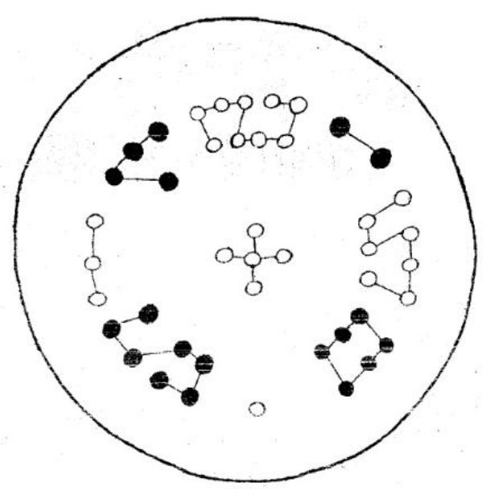

<!-- V3_SOURCE_ID:book031-b000188-p000-9a6ba67611 -->

《治書爰化河圗圖訣》的訣語為：河圖的兩個部分要仔細推究詳察，本末根苗的道理是一樣的，四象與中央如同臟腑，五行內外如同心腸。河圖的兩個部分道理是一條，五行與四象的本末根苗也是如此。

查看对应原文

<!-- V3_FOLDBACK_BEGIN:book031-b000188-p000-9a6ba67611 -->

治書爰化河圗圖訣 河圖兩個細推詳 本末根苗一樣裝 四象中央同臟腑 五行內外共心腸 河圗兩個道理一條 五行四象本末根苗

<!-- V3_FOLDBACK_END:book031-b000188-p000-9a6ba67611 -->

<!-- V3_SOURCE_ID:book031-b000189-p000-ec0e6b5f69 -->

河图的道理是公共共通的，我这本书的解释方法略有不同，目的是让后学的人看了心中清楚明白，能了解我这本书的解释简明切实，所讲的道理真实不虚，既能体现道理的极深奥之处，也能体现道理的极浅近之处。浅近的是“一”，源头也是“一”，两个“一”之中，演化出无穷的道理，没有不具备的。前代的圣贤大概已经把这些道理阐明了，无奈世人大多不能领会。程子所说的“一开始讲的是一个理，中间分散为万事，最后又回归为一个理”，难道说的不是河图的妙义吗？所以我这本书的图诀，以河图衰洛书为开端，以洛书化河图为终结，以河图爰洛书为根本，以洛书化河图为枝末，其余各图的作用，都包含在本末始终的关系里。《大学》所说的“事物有根本有枝末，事情有终结有开端，知道了先后的次序，就接近道了”，所以这部书叫《大学》。《大学》是大人的学问，怎么能和平庸的人谈论呢？

查看对应原文

<!-- V3_FOLDBACK_BEGIN:book031-b000189-p000-ec0e6b5f69 -->

河圗道理公同吾書解法畧異使後學者心目了然以見吾書解法簡切所說道理真實不虛以見道理之極深以見道理之至淺也淺者一也源者亦一也兩一之中無窮爰化道理無不具備前者聖賢概己發明無如世人多不領會程子所謂始言一理中散為萬事末復合為一理豈非云河圖之妙義乎所以吾書圖訣以河圗衰洛書為始以洛書化河圗為終以河圖爰洛書為本以洛書化河圖為末其餘各圗作用盡在本末始終之中大學所謂物有本末事有終始知所先後則近道矣所以謂之大學大學者大人之學也豈可與庸人而語哉

<!-- V3_FOLDBACK_END:book031-b000189-p000-ec0e6b5f69 -->

<!-- V3_SOURCE_ID:book031-b000191-p000-84df4665bb -->

增著《天元龍歌圖訣》，增解的天元歌说：取得辅星成五吉，山中有此是真龙，这是从龙上取辅星来补龙。天元兼收辅弼，是一元而兼两元，龙的力量更厚重，发福的时间更长久。取辅星的方法，比如子方来的龙脉兼带癸方，就从癸方倒排父母，癸和巳相交为夫妇，又为父母，就在巳位起贪狼，顺排到子宫，就是辅星。如果是午、丁、卯、乙、酉、辛这些情况，都按照这个方法操作。增著《地元龍歌圗訣》，增解的地元歌说：甲庚丙壬为正向，从向上取贪狼来补龙。聚貧狼的方法，比如辰龙坐丙向壬，就从壬向倒排父母，壬和辰相交为夫妇，又为父母，就从辰位起贪狼，那么贪狼就在辰龙的位置。如果是甲未、庚丑、丙戌这些情况，都按照这个方法效仿操作。

> **释读存疑：** 1轮自动修复后核义模型仍建议修订，已保守记录。

查看对应原文

<!-- V3_FOLDBACK_BEGIN:book031-b000191-p000-84df4665bb -->

增著天元龍歌圖訣 增解一天元歌云取得輔星成五 吉山中有此是真龍此從龍上取 輔星以補龍也天元兼收輔弼是 一元而兼兩元龍力更厚發福愈 長取輔星如子來脉兼癸卽從癸 倒排父母癸與巳交為夫婦又為 父母卽在已起貪狼順揆至子宮 卽輔星也如午丁卯乙酉辛做此 增著地元龍歌圗訣 增解地元歌云甲庚丙壬為 正向脉取貪狼護正龍此從 向上取貪狼以補龍也聚貧 狼法如辰龍坐丙向壬卽從 壬向倒排父母壬與辰交為 夫婦又為父母即從辰起貪 狼則貧狼卽在辰龍也若甲 未庚丑丙戌倣此

<!-- V3_FOLDBACK_END:book031-b000191-p000-84df4665bb -->

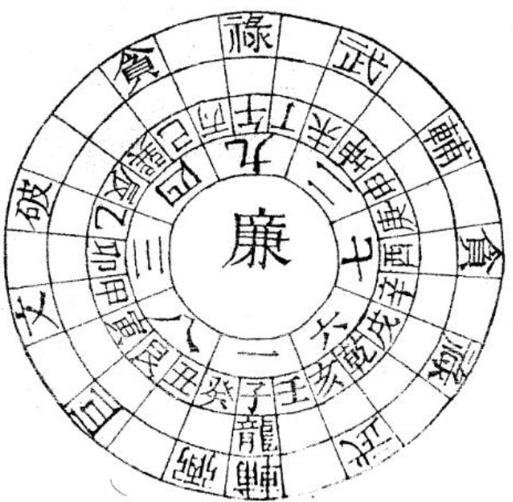

<!-- V3_SOURCE_ID:book031-b000193-p000-25f65499ca -->

增著《人元龍歌圖訣》，增解的人元歌說：乙辛丁癸水來催，這是從水上取貪狼來補龍。取貪狼的方法，比如寅龍、辛水，就從辛倒排父母，寅與辛交為夫婦，又為父母，就在寅起貪狼，那麼貪狼就在寅龍。如果是乙申、癸巳、丁亥，就按照這個方法來做。這天地人龍向水分三圖，實際是活法，各立一圖，舉一可以反三。

查看对应原文

<!-- V3_FOLDBACK_BEGIN:book031-b000193-p000-25f65499ca -->

增著人元龍歌圖訣
增解人元歌云乙辛丁癸水來催此從水上取貪狼以補龍也取貪狼法如寅龍辛水卽從辛倒排父母寅與辛交為夫婦又為父母卽在寅起貪則貪狼卽在寅龍也若乙申癸巳丁亥做此此天地人龍向水分三圖實是活法各立一圖舉一可以反三

<!-- V3_FOLDBACK_END:book031-b000193-p000-25f65499ca -->

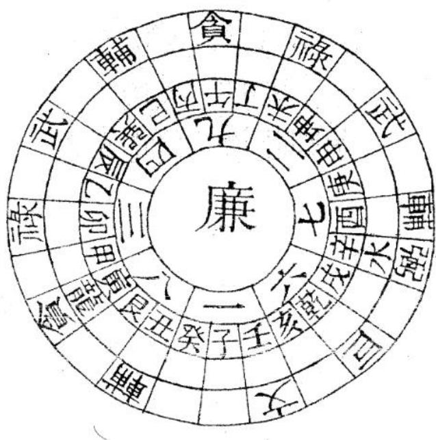

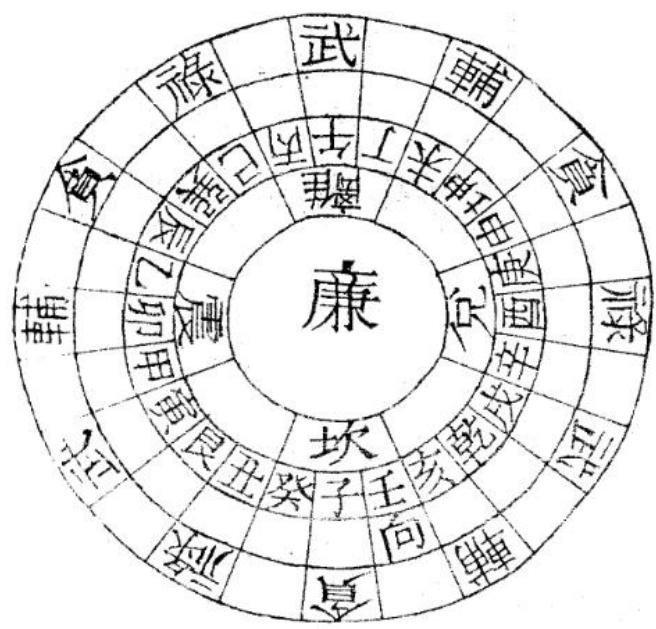

<!-- V3_SOURCE_ID:book031-b000196-p000-de765bafa5 -->

增《坎離交媾掌訣》，訣語為：坎離水火中天過，龍墀移帝座。又說：泥鰍落汾躍龍門，渤海便翻身。

查看对应原文

<!-- V3_FOLDBACK_BEGIN:book031-b000196-p000-de765bafa5 -->

增 坎離交媾掌訣 坎離水火中天過 龍墀移帝座又曰 泥鰍落汾躍龍門 渤海便翻身

<!-- V3_FOLDBACK_END:book031-b000196-p000-de765bafa5 -->

<!-- V3_SOURCE_ID:book031-b000198-p000-352ae3eeca -->

增解的内容提到：坎对应坤，离对应乾，水对应坎，火对应离，离在东，坎在西，日月从坎离的方位出入，所以要取法坎离。先天的乾坤，就是后天的坎离，先后天的阴阳配对，奇妙到了极点。粗略看起来，是一四七、二五八、三六九的排布，仔细探究其中的道理，就能感受到天地氤氲的状态，它的气运转变化神妙莫测，因此编成掌诀以便于学习者理解掌握。具体的方法是从坤位起乾，顺转九宫，坎离一起一落，点到震中艮的位置，就是所谓的“坭落汾”；到巽坤离的位置，就是所谓的“跃龙门”；挨排完毕之后再从离宫开始逆转，就是所谓的“渤海翻身”。这里只是举坎卦作为例子，其余的卦都可以按照这个方法类推。

> **释读存疑：** “坭落汾”“跃龙门”“渤海翻身”为术数专用口诀，具体操作细节原文未详；“坭落汾”“跃龙门”“涕海翻身”为术数专用口诀，具体操作细节原文未详；1轮自动修复后核义模型仍建议修订，已保守记录。

查看对应原文

<!-- V3_FOLDBACK_BEGIN:book031-b000198-p000-352ae3eeca -->

增解坎是坤離是乾水是坎火是離離東坎西日月 出入坎離故有取乎坎離先天之乾坤郎後天之坎 離其先後陰陽配對奇極妙極粗視之是一四七二 五八三六九精求之則天地氤蓋其氣化神妙實葉 言立成掌訣以便易曉其法從坤起乾順輪九宮坎 離一起一落點至震中艮所謂坭落汾也至巽坤 離所謂躍龍門也挨盡復在離宮逆輪轉前謂涕海 翻身也此舉坎卦以為例餘可類推

<!-- V3_FOLDBACK_END:book031-b000198-p000-352ae3eeca -->

<!-- V3_SOURCE_ID:book031-b000199-p000-71feef3bca -->

增《春立向分金掌訣》，訣語為：陰陽配合要分明，審定玄空認九星，辨別三才知入氣，交光夫婦見真情。

查看对应原文

<!-- V3_FOLDBACK_BEGIN:book031-b000199-p000-71feef3bca -->

增 春 立向分金掌訣陰陽配合要分明審定玄空認九星辨別三才知入氣交光夫婦見真情

<!-- V3_FOLDBACK_END:book031-b000199-p000-71feef3bca -->

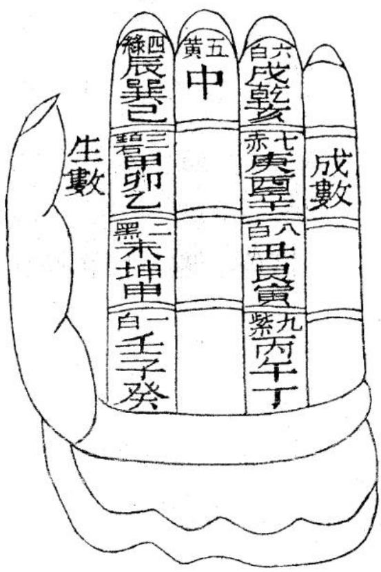

<!-- V3_SOURCE_ID:book031-b000201-p000-5e874ea0be -->

增解《宝照经》的内容说：如果龙脉真确、穴位端正，却在立向的时候出了阴差阳错的问题，就会生出悔吝灾祸。就像多少次为了仕途奔赴朝廷，刚到朝廷就触怒帝王，得不到任用一样，这是当时的地师不明白龙脉对应的朝向，在坟头下葬之后就会出现被剥官削职的凶兆。由此可知，主向分金、认龙点穴是风水中最紧要的事。地理风水本来最看重峦头形势，就算得到了吉地，如果向首分金出现阴阳差错，也没有能获得福报的情况，有的福报发得不均匀，有的发福同时吉凶参半，甚至还有发福之后很快败绝的，这些都是立向错误导致的。地理家立向，大多从五行起长生作为消纳的依据；有的从坐向起长生；有的从来水、水口归入某局起长生；还有的以辰戌丑未为四大水口，比如“乙丙交而趋戌”“辛壬会而聚辰”这类说法；还有的谬误太多难以全部说清，这些都是没弄懂“龙何向”里的“龙”字的含义。所谓的龙，并不是把山当作龙，如果把山当作龙，那没有山不是龙了。龙是天的阳气，看金龙就是看这个阳气，看雌雄也是看这个天气和地气的配合。现在把看雌雄来立向分金的方法简单指出来说：壬子癸、甲卯乙、辰巽巳、未坤申是生向；丙午丁、庚酉辛、戌乾亥、丑艮寅是成向。蒋公《玉尺辨伪》里说：山陇和平地都有固定的穴位，天然生成的朝向，说的就是河图的生数成数的道理。《青囊补注》说：地有至阴之气，用来招摄天的阳精，说的是雌雄交会的地方。入气是雌，金龙是雄，先看出水的位置来确定入气，就是所谓“水对三必细认踪”的说法；其次看卦掌的起止，起弦止，辅弼同宫，用贪、巨、禄、文、廉、武、破、辅作为消纳标准的，还有和翻卦掌取方位配合判断吉凶，名目上用生、五、延、六、祸、天、绝、伏作为消纳标准的；有用“庚丁坤上是黄泉”“坎龙坤兔为八煞”这类说法的；还有用癸兼丑、寅兼甲这类情况当作出卦的；近年又有认为用张心言的六十四卦盘定向才是得到真传的。他们不知道张氏把希夷先生《性理大全》的卦图加在蒋盘里面，已经是节外生枝，而且他的盘里画出的大爻和《周易》的六爻演化相差很大，更是画蛇添足，用这个盘去核验名山古墓，完全没有确切的依据。各书讲的道理有很多错误，至于金音对应哪个方位，向首分金坐哪个宿度，“年没身方六曰蒸然可坐而定”一句有讹脱，具体含义不详。如果明白这些道理那天心就在这里，十道也在这里，结穴也没有不在这里的。现在立向牵线的地师，真的能明白这些道理吗？而且还没使用罗盘之前，分金的深浅真的已经有确定的见解了吗？有人问师父说：立向的人都讲分金，请问分金两个字是什么意思？师父说：分金两个字不多解释，妇孺都能明白，为什么从事这行的人还昏昧不懂呢？那人没明白，又问：那分金是在罗盘上吗？还是在山头上呢？师父说：先在山头上，之后再用罗盘来对应，是峦头理气合而为一的。那人连声答应，心里默默领会了意思就不再问了。新增《地理辨正图解掌诀》全文结束，陈凤招撰写。

> **释读存疑：** “年没身方六曰蒸然可坐而定”存在讹脱，具体所指不详

查看对应原文

<!-- V3_FOLDBACK_BEGIN:book031-b000201-p000-5e874ea0be -->

增解寶照經云龍真穴正誤立向陰差陽錯悔各生幾為奔走赴朝廷纔到朝廷帝怒形時師不曉龍何向墳頭下了剝官星此以知主向分金認龍點穴而後最為緊要地理固首重峦頭卽得吉地而向首分金或陰陽差錯未有能發福者或有發而不均發而吉凶參半甚且發而敗絕皆由立向之誤也地理家立向多從五行起長生為消納或從坐向起長生或從來水水口作某局起長生或有以辰戌丑未為四大水口如乙丙交而趨戌辛壬會而聚辰之類或有謬難以盡述皆未曉龍何向之龍字耳所謂龍耆非以山為龍也若以山為龍則無山非龍矣夫龍也者天之陽氣也看金龍卽看此陽氣看雌雄亦看比天氣與地氣也今將看雌雄以立向分金略指而言之壬子癸甲卯乙辰巽巳未坤申是生向丙午丁庚酉辛戌乾亥丑艮寅是成向蔣公玉尺辨偽云山隴平壤皆有一定之穴生成之向卽言此河圗之生數成數也青囊補註云地有至陰之氣以招攝天之陽精是說雌雄交會之處入氣是雌金龍是雄先看出水以定入氣所謂水對三必細認蹤也次看卦掌中起中止弦起弦止輔弼仝宮以貪巨祿文藤武破輔為消納者更有與翻卦掌取方位全此吉凶爰其名目以生五延六禍天絕伏為消納者有以庚丁坤上為黃泉坎龍坤兔為八煞者又有以癸兼丑寅兼甲等類為出卦者近復有以張心言六十四卦盤定向為得真傳者不知張氏將希夷先生性理大全卦圗加於蔣盤之內已見節外生枝而其盤內麦出大爻與周易六爻爰化懸殊尤為畫蛇漆足用以覆驗名山古墓珠無確據諸書說理種種錯金音屬某方其向首分金坐某宿度年沒身方六曰蒸然可坐而定知此則天心在此十道在此而結穴亦無不在此矣今之立向牽線者果能見及此否且未用羅盤之先其分金之深淺果有定見否或問之師曰立向者皆言分金請問分金二字是何說法師曰分金二字不下片言孺婦可曉何業此道者尚昧昧也或不喻又問曰且分金在羅盤耶抑在山頭耶師曰先在山頭後用羅經蓋頭理氣合而為一者也或曰唯唯乃默喻於無言而不復問新增地理辨正圖解掌訣終 陳鳳招撰

<!-- V3_FOLDBACK_END:book031-b000201-p000-5e874ea0be -->

<!-- 原书漏识别页：doc015 PDF 第 53 页；早期空白判定已纠正；高清原页图 -->

