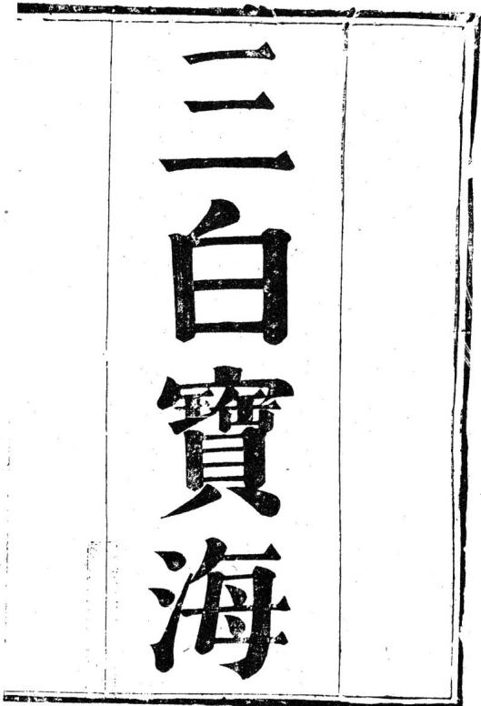
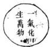
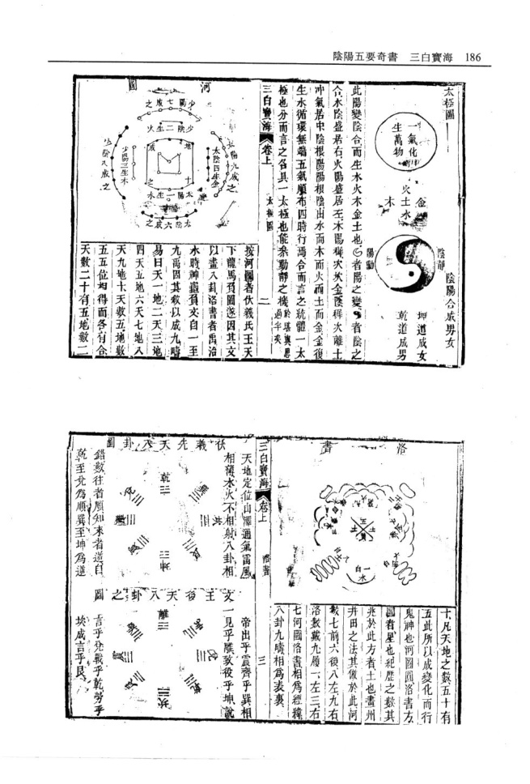
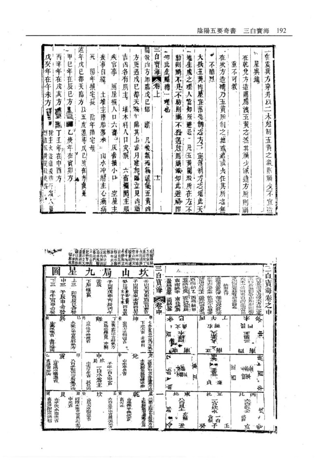
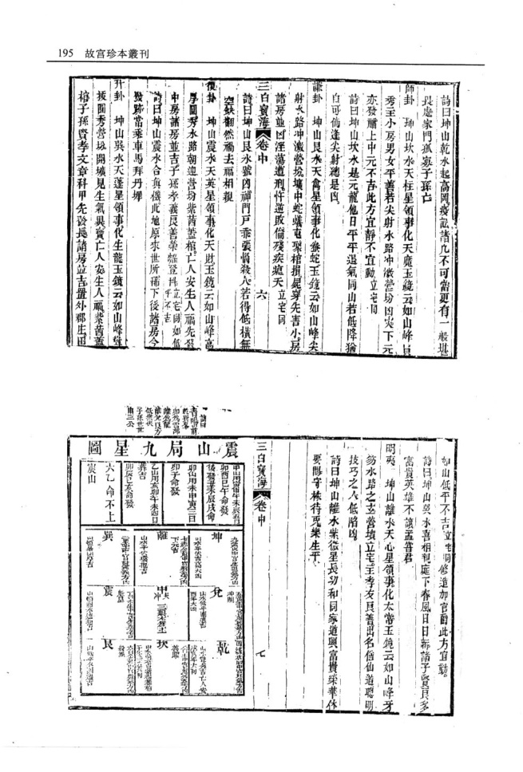
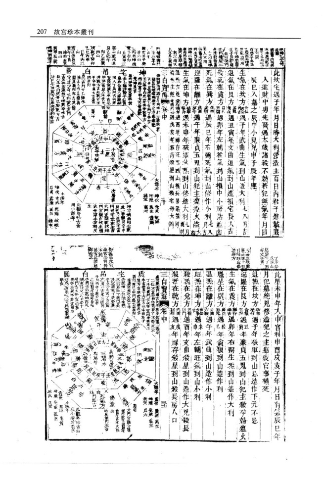
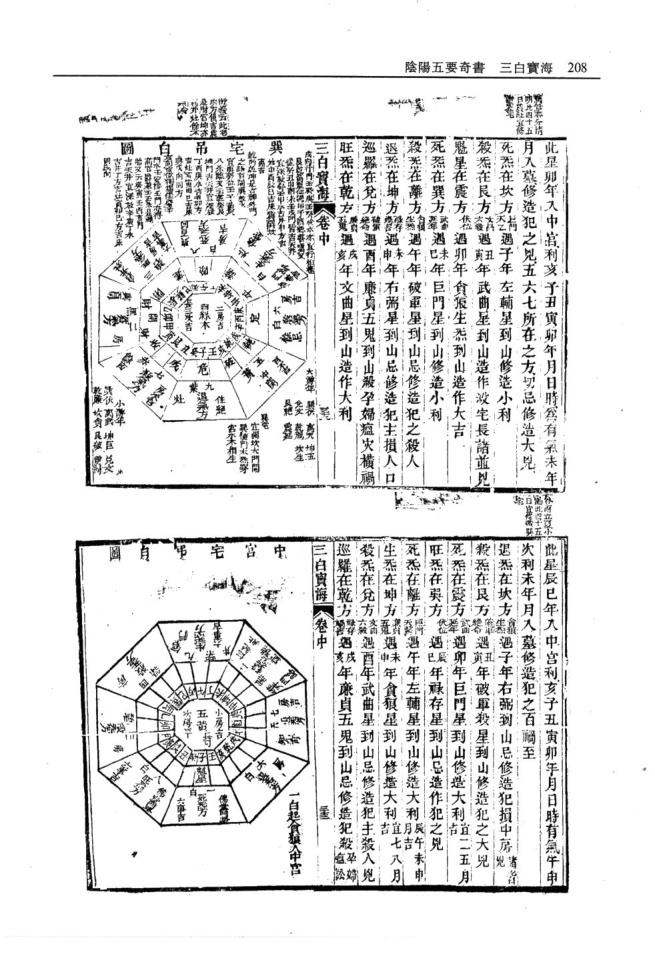
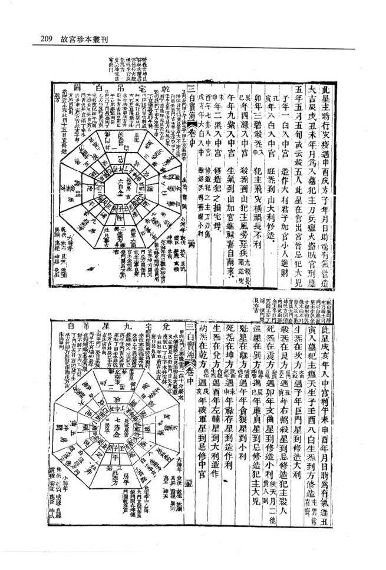
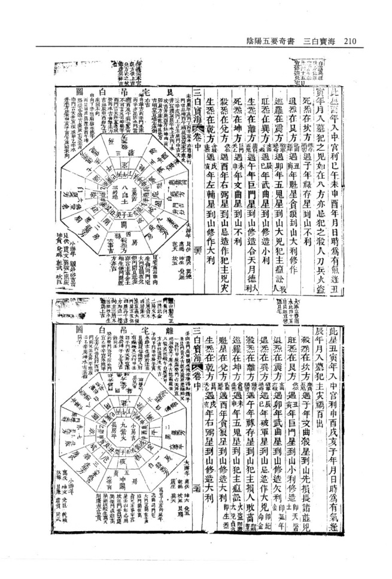
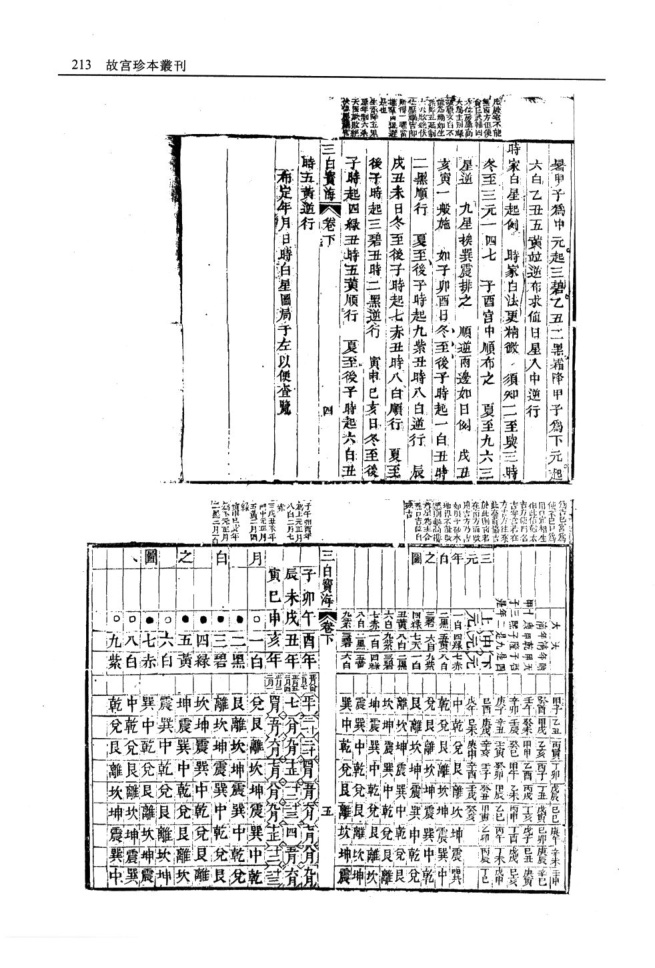

# 三白宝海（幕讲禅师）

> V3 AI 全自动白话释读版。专业术语保留，释读内容可展开核对原文。

> 来源：明 幕讲禅师 三白宝海.pdf

<!-- V3_SOURCE_ID:book034-b000003-p000-221d36fd17 -->

我是武林味水居士李日华，我的门人丁道冲和他的亲戚吴君，拿着他们收藏的《三白宝海》来拜见我，请我为这部书作序，还告诉我说：这部书汲取了河图洛书的精髓，是形家的核心要旨，其学说源自上古的至人，到元代有位幕讲禅师，精心钻研其中的奥义，梳理得条理分明。要是按照他的方法去验证，没有不应验的，难道鬼神所掌管的机要，全都能被人掌控在手掌之中，天地造化的根本规律，真的可以被人窥见吗？我听了之后觉得这事很不寻常。我说：这并不值得惊异。万物生成就有表象，表象衍生之后就有数、有位、有形，形有顺逆的分别，事理有奇偶的不同，位置有偏正的差异，情理有好恶的区别。至人掌握了其中的消长规律，制定了制约与化用的方法，还有灵活的权变法则。权变的法则由人内心设定，运用起来十分巧妙，能通晓极细微的道理，所以鳌足可以截断，熊可以锁住，卜洛的神龟可以食用，补天的石头可以炼制，各种纵横变化，都超不出人寸心的灵性。即便是《三白宝海》，所探究的内容和《丘索》记载的、箕文创制的内容相比，也只是余下的言论罢了。只是你们二位穿着宽袍、举止端方，从事文字校勘相关的事，博览群书还涉及到青鸟、幕讲禅师的学说。我不知道幕讲禅师是什么人，想来也是佛门弟子，修学佛法主张一切皆空，恒河沙数的世界都被当作幻尘看待，怎么还会涉足这些尘俗的事务，做种种测算谋划呢？这才是真正值得惊异的事。虽然如此，身处天地造化之中的人去测算天地造化的规律，要把它揉合为一体，要摧破它就使之消解，要汇合它就使之融通。正是因为空才有活性，正是因为有活性才有灵性，正是因为有灵性有活性，方正持守就是儒家的执著，圆融通透就是佛家的观照。二位一定要明白我说的话，才能避免被小道的局限所拘泥，我也把这番话一并告诉那些得到这部书就觉得惊异的人。

查看对应原文

<!-- V3_FOLDBACK_BEGIN:book034-b000003-p000-221d36fd17 -->

三白寶海 武林味水居士李日華擢予門人丁生道冲偕其戚吳君以所藏三白寶海謁予且請敘且告予曰是書也河浴卦疇之髓而形家之密諦也其說溫源於古至人迄元有幕講禪師者研精抽奧條流井然試按其法求之無不歷歷奇中將鬼神所司械鑰悉不出運掌而大化根帶果可窺耶意盖灑然異之予曰此不足異也物生而有象象有滋滋有數有位有形有情形有逆順致有奇偶位有旁正情有好惡至人消息之有制有化而因有權權設於心妙於用通於微故鼇可斷熊可鎖卜洛之龜可食補天之石可煉縱橫攘落不越寸靈郎三白寶海 鉤玄丘索所陳箕文所制亦剩語耳唯是二君褒衣矩步有事鉛槃而汎濫之觀乃及靑鳥暮講禪師予不知何許人計亦佛之徒治佛之說悉空一切恒沙世界無不以幻塵撥之柰何入是塵沙中作種種籌量也是則大可異者雖然以大化中人籌量大化一揉而團之一摧而滅之一會而融之惟空故活惟活故靈惟靈惟活故方之財儒之執圓之則佛之照二君必通予言而後免夫小道之泥亦併以告夫得是書而灑然異之者

<!-- V3_FOLDBACK_END:book034-b000003-p000-221d36fd17 -->

<!-- V3_SOURCE_ID:book034-b000004-p000-1f34d294a4 -->

《二白宝海》目录编次如下：李味水先生叙文、太极无着序、太极圆河围乙、洛书乙、先后天八卦图乙；卷上内容：五镇正经论、紫白原本连山洪范论、山头白星起例、流年白星起例、九星公位克应、三元元龙主管山水生气论、魁星论、退气论、死气论、殷气论、关论、五行相关、自太岁巡山罗旷既和论、身纳气、关煞生气混杂论、起建方论、认水相局诗、祖墓暗建杀论、阴阳二宅侵杀论、建造所为五行谕、五黄临村落论、关煞临戊己都天论、逐年戊己临方定局；卷中内容：洛书本图乙局、山局吊白方属、九局乎原谕（“乎原”疑似讹误，具体所指不详）、建宅宅局吊白圆图（“圆圆图”疑似“圆图”讹误，具体所指不详）、总论宅白。

> **释读存疑：** “九局乎原谕”中“乎原”疑似讹误，具体所指不详；“弔白圓圗”疑似“吊白圆图”讹误，具体所指不详；1轮自动修复后核义模型仍建议修订，已保守记录。

查看对应原文

<!-- V3_FOLDBACK_BEGIN:book034-b000004-p000-1f34d294a4 -->

二白寶海目錄詮次 李味水先生叙文太極無着序 太極圆河圍乙洛書乙 先後天八卦圗乙卷上五鎮正經論 紫白原本連山洪範論山頭白星起例 流年白星起例九星公位尅應 三元元龍主管山水生氣論 魁星論退氣論 死氣論殷氣論 關論五行相關三白寶海卷 自太歲巡山羅曠 既和論身納氣關煞生氣混雜論 起建方論認水相局詩 祖墓暗建殺論陰陽二宅侵殺論 建造所爲五行諭五黃臨村落論 關煞臨戊已都天論遮年戌已臨方定局卷中洛書本圖乙局 山局吊白方屬 九局乎原諭 建宅宅局弔白圓圗 總論宅白

<!-- V3_FOLDBACK_END:book034-b000004-p000-1f34d294a4 -->

<!-- V3_SOURCE_ID:book034-b000005-p000-492059b95b -->

住房孤绝诗；卷下内容：论井、灶、厕所、畜栏、碓磨、门路、论生气吉方、修造迁移论、报工论、太岁飞官生克宜利、天元运身起白例、五生命忌自中杀论、年头白起例并图、月白起例并图（原文“井国”疑似“并图”讹误）、日白星起例并图、时白星起例并图、白中有杀并图（原文“并国”疑似“并图”讹误）、修方要诀、三元暗制杀例、月建起黄道修方诀、三白宝海（原文“三白宝汉”为讹写）目录：1.三元兴废断诀（原文“与废”疑似“兴废”讹误）、定局辨龙论、以下集九星、三元龙运生克数论、三吉论、十恶论、三瑞五不祥论、三吉六秀与九星相参论、吉凶相反论、择日法、停丧捷径、诸穴选忌论、暗黄法、三白宝海目录。

> **释读存疑：** “月白起例井國”“白中有殺并國”中“井國”“并國”疑似“并圖”讹误；“三元與廢斷訣”中“與廢”疑似“興廢”讹误

查看对应原文

<!-- V3_FOLDBACK_BEGIN:book034-b000005-p000-492059b95b -->

住房孤絕詩 卷下 論井竈廁畜欄確磨門路論生氣吉方 修造遷移論 報工論 太歲飛官生尅宜利 天元運身起白例 五生命忌自中殺論 年頭白起例并圖 月白起例井國 日白星起例并圖 時白星起例并圖 白中有殺并國 修方要訣 三元暗制殺例 月建起黃道修方訣 三白寶漢 目錄 1 三元與廢斷訣 定局辨龍論 以下集九星 三元龍運生尅數論 三吉論 十惡論 三瑞五不祥論 三吉六秀與九星相參論 吉凶相反論 擇日法 停喪捷徑 諸穴選忌論 暗黃法 三白寶海自錄

<!-- V3_FOLDBACK_END:book034-b000005-p000-492059b95b -->

<!-- V3_SOURCE_ID:book034-b000006-p000-ec02620572 -->

太极数：《周易》说易有太极，太极生出两仪，两仪生出四象，四象生出八卦，用来镇守八方。乾是天、是父，方位在西北；坤是地、是母，方位在西南，所以说天地定位。艮是山，方位在东北；兑是泽，方位在正西，所以说山泽通气。震是雷，方位在正东；巽是风，方位在东南，所以说雷风相薄。坎是水，方位在正北；离是火（原文“龍爲火”为“離爲火”的讹写），方位在正南，所以说水火不相射。八卦各有对应的配偶，化生出万物，由此可知，乾、坤是二老相配，震、巽是长男长女相配，坎、离是中男中女相配（原文“相弦”为“相配”的讹写），艮、兑是少男少女相配。乾的卦画数是三，坤的卦画数是六，加起来是九画；震的卦画数是五，巽的卦画数是四（原文两处“異”均为“巽”的讹写），坎的卦画数是五，离的卦画数是四，艮的卦画数是五，兑的卦画数是四，加起来都是九画。造化的开端、夫妇的道理、生育的根本、吉凶的源头，全都来自天数。所以说分阴分阳，交替使用刚柔的属性。乾处在北方，坎、艮、震三个阳卦排在它后面，是儿子跟从父亲；坤处在南方，巽、离、兑三个阴卦在它两侧排列，是女儿跟从母亲。以辰位以南、戌位以北斜着划一条界线，东边和北边属于阳，南边和西边属于阴。乾、兑属金，震、巽属木（原文“霞”为“震”的讹写），坤、艮属土，坎属水，离属火，这是五行生旺制化的自然规律。八卦在八个方位静止不动就不会产生吉凶，一旦变动吉凶就会随之出现，所以说吉凶悔吝都是从变动中产生的。从地形来说，八山的气运流动变化，有凶煞的方位尤其忌讳被冲克；从年月日时的择取来说，如果误犯了凶煞的方位，会有对应的应验（原文“應區不而”为讹误，具体含义不详），尤其是关煞、都天凶煞降临的报应格外猛烈，绝对没有凭空错过的道理。我隐居在山林之中，潜心研究佛学，私下感叹前代贤人的正经学说被埋没在世间，于是按照古本编纂校订，分成九九八十一局，通过飞星布运的方法来度化世人，让他们不至于在祸患中迷惑。此序作于至正辛卯年仲春，元代沙门法心无着序。

> **释读存疑：** 原文“應區不而”为讹误，具体含义不详

查看对应原文

<!-- V3_FOLDBACK_BEGIN:book034-b000006-p000-ec02620572 -->

太極數 易有太極生兩儀兩儀生四象四象生八卦以鎮八方乾 爲天爲父位西北坤爲地爲母位西南故曰天地定位艮 爲山位東北兌爲澤位正西故曰山澤通氣震爲雷位正 東巽爲風位東南故曰雷風相簿坎爲水位正北龍爲火 位正南故曰水火不相射各有配偶化生萬物則知乾異 坤二老相配震巽長男婦相配坎離中男婦相弦艮兌少 男婦相配乾三坤六合成九畫震五異四坎五離四艮五 兌四皆成九畫造化之端夫婦之道生育之本吉凶之原 俱由天數故日分陰分陽迭用剛柔乾居北坎艮震三男 三白寶海卷上 次之促子父也坤居南巽離兌三女夾之從乎母也以辰 南戌北斜分一界在東輿北爲陽在南與西爲陰乾兌屬 金霞巽屬木坤艮屬土坎水離火此五行生王制化之自 然也八卦居入方不動則無吉凶動則吉凶生矣故曰吉 凶悔吝生乎動者也以地言八山飛流動變而隔煞之方 尤忌冲刑以年月日時言誤犯煞方應區不而關煞都 天報應尤烈決無空過之理之晦跡林泉究心緇學竊 嘆先賢正經沉理于世茲按古本纂校分九九八十一局 飛星布運以度世人不致迷於禍患云貴 至正辛卯歲次仲春元沙門法心無着序

<!-- V3_FOLDBACK_END:book034-b000006-p000-ec02620572 -->

<!-- V3_SOURCE_ID:book034-b000007-p000-ac59f550a9 -->

以下内容出自《二白宝海》卷上：天地之数总和为五十五，这就是成就变化、驱动鬼神的依据。河图为圆形，洛书为方形，圆形对应星辰，历法的纪数就是从这里起源的；方形对应土地，划分州域、规划井田的制度就是效仿它制定的。河图的数序是七在前、六在后、八在左、九在右；洛书的数序是九在上方、一在下方、三在左、七在右。河图与洛书互为经纬，八卦与九畴互为表里。天地定位，山泽通气，雷风相薄，水火不相射，八卦相互关联。“王众关次、养先、免川三”为OCR讹误，具体所指不详。推算数序，往者为顺，来者为逆，从乾到兑为顺，从巽到坤为逆。天帝从震位出来，在巽位整齐万物，在离位相见（原文“關”为“離”的讹误），在坤位致力劳作，在兑位喜悦和乐，在乾位阴阳交争，在坎位劳苦疲倦，在艮位完成一年的事功。

> **释读存疑：** 原文“王众关次、养先、免川三”为OCR讹误，具体所指不详；原文表格结构混乱，部分内容对应关系已据文义调整；本地硬校验仍未通过，已记录供后续自动处理或人工核对。

查看对应原文

<!-- V3_FOLDBACK_BEGIN:book034-b000007-p000-ac59f550a9 -->

<table><tr><td rowspan="9">洛 2 单 x# 1 公 空 0O0 个 2 J 二白寶海</td><td>十凡天地之數五十有</td></tr><tr><td>五此所以成變化而行</td></tr><tr><td>鬼神也河國圓洛書方</td></tr><tr><td>圓者星也紀歷之數其</td></tr><tr><td>兆於此方者土也畫州</td></tr><tr><td>井田之法其倣於此河</td></tr><tr><td>載七前六後八左九右</td></tr><tr><td>洛數載九履一左三右</td></tr><tr><td>七河國洛書相爲經緯</td></tr><tr><td>卷上 </td><td>八卦九疇相爲表裏 三</td></tr><tr><td>天地定位 山澤通氣雷屬 相薄水 相射入卦相 关王众关 次 养 先 免川三 錯數往者順知來者逆自 國 乾至兌爲順異至坤爲逆</td><td>帝出乎震齊乎巽相 一見乎關致役乎坤說 三 #l 舞 1 言乎兌戰乎乾勞乎 坎成言乎艮</td></tr></table>

<!-- V3_FOLDBACK_END:book034-b000007-p000-ac59f550a9 -->

<!-- V3_SOURCE_ID:book034-b000010-p000-395f4a4e22 -->

这是阳气变化、阴气交合而生出水、火、木、金、土的过程。阳气变化、阴气交合的过程中，木为阴气旺盛，处在右方；火为阳气旺盛，处在左方。木是阳气初生，接下来对应坎卦；金是阴气初生（原文“蔭穉”指阴气初生），接下来对应离卦；土是中和之气，处在中央。阴的根扎在阳里，阳的根扎在阴里，从水开始，接着生木、生火、生土、生金，金又再生出水，循环没有尽头。五行之气顺畅分布，四季就正常运行。统合起来说，整体就是一个太极。以上内容出自《三白宝海》卷上，太极区二（原文“太框區”为“太極區”的讹写）。

> **释读存疑：** “蔭穉”具体所指不详；本地硬校验仍未通过，已记录供后续自动处理或人工核对。

查看对应原文

<!-- V3_FOLDBACK_BEGIN:book034-b000010-p000-395f4a4e22 -->

此陽變陰合而生水火木金土也者陽之變者陰之 合木陰盛居右火陽盛居左木陽穉次坎金蔭穉次離士 冲氣居中陰根陽陽根陰出水而木而火而土而金金復 生水循環無端五氣順布四時行焉合而言之統體一太 三白寶海卷上 太框區 二

<!-- V3_FOLDBACK_END:book034-b000010-p000-395f4a4e22 -->

<!-- V3_SOURCE_ID:book034-b000012-p000-e37e750941 -->

所谓河图，是伏羲氏（原文“伏義氏”为“伏羲氏”的讹写）统治天下的时候，有龙马背负着图（原文“負圓”的“圓”为“圖”的讹写）出现，伏羲就根据图上的纹路画出了八卦。所谓洛书，是大禹治水的时候，有神龟背负着文迹出现，纹路上的数字从一到九，大禹就根据这个次序制定了九畴。《周易》说：天一地二，天三地四，天五地六，天七地八，天九地十。天数有五个，地数有五个，五个位置各相匹配且有对应的配合关系，天数总和是二十五，地数的内容此处有缺漏（原文仅存“地數二”，缺后续内容）。以上内容出自《三白宝海》卷上。

> **释读存疑：** 原文“地數二”后内容有缺漏，后续地数总和无可靠依据补充

查看对应原文

<!-- V3_FOLDBACK_BEGIN:book034-b000012-p000-e37e750941 -->

按河圖者伏義氏王天 下龍馬負圓遂因其文 以盡入卦洛書者禹治 水時神龜負交自一至 九禹因其敘以成九疇 易曰天一地二天三地 四天五地六天七地八 天九地十天數五地數 五五位烟得面各有合 天數二十有五地數二 三白寶海卷上

<!-- V3_FOLDBACK_END:book034-b000012-p000-e37e750941 -->

<!-- V3_SOURCE_ID:book034-b000014-p000-2e1986c44e -->

元沙門幕講禪師集

查看对应原文

<!-- V3_FOLDBACK_BEGIN:book034-b000014-p000-2e1986c44e -->

元沙門幕講禪師集

<!-- V3_FOLDBACK_END:book034-b000014-p000-2e1986c44e -->

<!-- doc019 PDF 第 4 页：HTML 表格 OCR 供搜索；图表以原页图为准。 -->

<!-- V3_SOURCE_ID:book034-b000016-p000-1a6d4d79b9 -->

这部分内容由龙门正宗愿阳全成九道人校订。

> **释读存疑：** 1轮自动修复后核义模型仍建议修订，已保守记录。

查看对应原文

<!-- V3_FOLDBACK_BEGIN:book034-b000016-p000-1a6d4d79b9 -->

龍門正宗願陽全成九道人校

<!-- V3_FOLDBACK_END:book034-b000016-p000-1a6d4d79b9 -->

<!-- V3_SOURCE_ID:book034-b000017-p000-be06b13174 -->

于鏡正經論

查看对应原文

<!-- V3_FOLDBACK_BEGIN:book034-b000017-p000-be06b13174 -->

于鏡正經論

<!-- V3_FOLDBACK_END:book034-b000017-p000-be06b13174 -->

<!-- V3_SOURCE_ID:book034-b000018-p000-439896b8f2 -->

三吳地區的鄭鼎和、守中道人校閱。

查看对应原文

<!-- V3_FOLDBACK_BEGIN:book034-b000018-p000-439896b8f2 -->

三吳鄭鼎和守中道人閱

<!-- V3_FOLDBACK_END:book034-b000018-p000-439896b8f2 -->

<!-- V3_SOURCE_ID:book034-b000019-p000-05e17dbef4 -->

伏羲、神农、皇帝三位圣人承接天命确立准则，制定了三坟、五典、九丘、八索，用卦象划分州域，推演阴阳、阐明造化的规律，判定吉的指向，指明趋避的方法。所谓阴阳，是天地的本元之气，是万物生长的根基；八卦是阴阳存驻的处所，是造化运行的关键，起源于河图，具象化于洛书。文中提及“貧巨武亥廉祿硤輔弼”九星，以及金、木、水、火、土五行。五行分布对应十于，属天运行不息，十二支属地镇守恒常，二者配合三元、匹配四时，从而化生出万物。万物所禀受的气理，各类法则的运行逻辑都同出一源。人的寿命长短、境遇顺逆、贫富贵贱、善恶福祸乃至宗族延续或断绝，都源自这一运行规律。气机顺畅，万物就能生长繁育；气机逆乱，万物就会受挫衰败。世间一切动静变化，无不是阴阳造化作用的结果，更何况长期居住在天地之间、承受天地之气的人呢？因此建造住宅、营建坟地，必须选择适宜的处所。选到好的地方，就能获得纯正的气，子孙就会昌盛繁茂，人也会神清气爽、品行正直忠贞；选到不好的地方，就会获得乖戾的气，人就会顽劣愚钝、贫苦夭折，确实会导致宗族断绝。气的禀受自有其根源，怎么能随意更改呢？这都是气的运化造成的既定结果，事物本身怎么会有“领覆”的主观意愿呢？古代圣人根据世间情况，给人指点龙穴的真正要诀，解析飞星卦象的原理，让人们“營打獲吉”，妥善安顿生者与逝者“於不聲”。凡是选择地形，首先看地势形态，其次辨认来脉走向，中间区分顺逆，来势急促的就取缓势处，来势平缓的就从。

> **释读存疑：** “洪阴阳”“定吉内”“十于”“誠宗斬”“定物豈有心領覆哉”“營打”“不聲”等表述语义不明，此处仅按字面直译；原文末尾“勢緩從”后有缺字，未补译内容；本地硬校验仍未通过，已记录供后续自动处理或人工核对。

查看对应原文

<!-- V3_FOLDBACK_BEGIN:book034-b000019-p000-05e17dbef4 -->

伏義神農皇帝三聖繼天立極而制三墳五典九丘八索 盡卦別州洪陰陽明造化定吉內指趨避夫陰陽者乃天 地之元氣萬物之根荄八卦者乃陰陽之窟宅造化之樞 紐原于河圍竅于洛書貧巨武亥廉祿硤輔弼九星也金 木水大土五行也五行分布十于屬天運而不止十二支 三白寶海卷上 屬地鎮而有常會合三元配偶四時而生萬物物物其稟 百法同塗人之壽天窮通貧賤富貴善惡繼絕皆原于此 蓋氣機順則萬物生而育焉氣機逆則萬物拂而蔽焉凡 一靜一動靡非陰陽造化之所爲而況常居此以受天地 之氣者乎故立宅營坋必擇善而處擇之善者得氣之正 則于孫昌茂彌清氣爽正直忠貞擇之不善者得氣之戾 則頑蠢昏迷貧苦天折誠宗斬能稟受有原安能改易是 皆氣化使然定物豈有心領覆哉古聖人倜世據人指點 龍穴眞機剖示飛星卦象俾營打獲吉妥存歿於不聲 凡擇地先看形勢次認來脈中分順逆勢急從緩勢緩從

<!-- V3_FOLDBACK_END:book034-b000019-p000-05e17dbef4 -->

<!-- V3_SOURCE_ID:book034-b000020-p000-eb3fb4ffea -->

文中提到“世第五行一大江水戊坎申垂水亦同失為景”，该句语义模糊，难以准确断句和释读，具体所指不详。

> **释读存疑：** 整句语义模糊，无法拆分准确语义单元

查看对应原文

<!-- V3_FOLDBACK_BEGIN:book034-b000020-p000-eb3fb4ffea -->

世第五行一大江水戊坎申垂水亦同失為景

<!-- V3_FOLDBACK_END:book034-b000020-p000-eb3fb4ffea -->

<!-- V3_SOURCE_ID:book034-b000021-p000-f0dd505a8f -->

文中称高山为主将，“高同”为主星，偏好来势雄伟高耸，“來圖迥遠，頓峰軒是重矗秀麗”，左右地势趋迎，宾主位置拱顾，生炁、魁曜耸立在高峻的山峦之上。文中还提到“羅嚴開煞環衛降伏之鄉”，风门、水口处星卦比和，诸多吉势辅佐，各类凶煞潜伏，具备这样的形势就算是符合规格的地。再得到年月吉星照临，太乙、太阳合向合坐，二德、三奇临局临方，避开凶煞就可以大力兴工；旧有建筑改造，也要选取对应吉星的山冈、水路立向以及生方，挖池穿井，设置门路，主三十年之后大发，世代荣华。如果本山低陷，开煞偏高，水口呈笑开状，明堂倾倒堵塞，“卦父驗雜”，形势散漫，气色萧条，很快就会出现灾祸，三十年之后败落，七十二年之后绝嗣。祸福没有固定的趋向，全由所居的地决定，所以吉人有天相护佑，凶人有鬼怪相扰，“趨進之道，可不三自”。以上内容出自《寶海卷上 二》。

> **释读存疑：** “高同爲主星”“來圖迥遠頓峰軒是重矗秀麗”“羅嚴開煞”“卦父驗雜”“三自”语义不明，无法确定准确含义

查看对应原文

<!-- V3_FOLDBACK_BEGIN:book034-b000021-p000-f0dd505a8f -->

言如高山為主將也高同爲主星也唯喜來勢雄聳來圖迥遠頓峰軒是重矗秀麗左右趨迎賓主拱顧生炁魁曜峙列嵬峩之上羅嚴開煞環衛降伏之鄉風門水口星卦比和衆將扶佐諸凶潛伏形勢得此爲入格之地再得年月吉星照臨太乙太陽合向合坐二德三奇臨局臨方避吉凶惡發大可興工舊造更取吉星之山岡水路立向及生方閱池穿井置立門路主三十年後大發世代榮華若本山低陷開煞高尋水口笑開明堂傾塞卦父驗雜形勢散漫氣色蕭然立見災禍三十年後敗七十二年絕禍福無門惟地所主故吉人天相凶人鬼相趨進之道可不三自寶海卷上 二

<!-- V3_FOLDBACK_END:book034-b000021-p000-f0dd505a8f -->

<!-- V3_SOURCE_ID:book034-b000022-p000-99cfc0e990 -->

要谨慎啊。如果生炁星峰“吏合”关煞星峰，就属于善恶各半的情形，即便做官也不得善终，即便家境富裕也不符合忠孝标准，家门不正，“心衡不良”。如果走生炁方的门路，饮用关煞方的水，在阔杀方修造灶、房、厕以及进行各类动工事项，即便当下富贵，也主子孙必定会患上恶疾，“更方惡心”，报应分毫不差。这部书原本是秘藏的，现在流传到人间，我尽心将内容推演出来，研习这部书的人，一定要选择合适的对象再传授。

> **释读存疑：** “吏合”“心衡不良”“更方惡心”语义不明，无法确定准确含义

查看对应原文

<!-- V3_FOLDBACK_BEGIN:book034-b000022-p000-99cfc0e990 -->

慎歟若生炁星峰吏合關煞星峰名善惡相半縱爲官不善終雖富厚不中忠孝家門不正心衡不良若行生炁方門路飲關煞方水作闊殺方灶及房廁動用之類雖富貴主于孫必帶惡疾更方惡心毫髮不爽是書入秘人間茲悉心演出業是書者其待人而行哉

<!-- V3_FOLDBACK_END:book034-b000022-p000-99cfc0e990 -->

<!-- V3_SOURCE_ID:book034-b000023-p000-bcec5235eb -->

紫白原本連山範論。

查看对应原文

<!-- V3_FOLDBACK_BEGIN:book034-b000023-p000-bcec5235eb -->

紫白原本連山範論

<!-- V3_FOLDBACK_END:book034-b000023-p000-bcec5235eb -->

<!-- V3_SOURCE_ID:book034-b000024-p000-69a87d7c21 -->

北方九九八十一炁，除一白得八十數，故甲寅、辰、巽、戌、坎、辛、申八山屬水，水為炁君之長；外有一白。南方七七四十九炁，除九紫餘得四十數，離、壬、丙、乙四山屬火，火炁者炁君之長；外有九紫。

查看对应原文

<!-- V3_FOLDBACK_BEGIN:book034-b000024-p000-69a87d7c21 -->

北方九九八十一炁除一白得八十數故甲寅辰巽戌坎辛申八山屬水水爲炁君之長外有一白南方七七四十九炁除九紫餘得四十數離壬丙乙四山屬火火炁者炁君之長外有九紫

<!-- V3_FOLDBACK_END:book034-b000024-p000-69a87d7c21 -->

<!-- V3_SOURCE_ID:book034-b000025-p000-c72a055d07 -->

十年。凡是三元所管的山方，得生炁比和，主六十年大吉；得死退气，也主六十年小吉；得煞气，主六十年平稳。弘治十七年甲子为上元，嘉靖四十三年甲子为中元，“二天故四年甲子”为下元，康熙二十三年甲子又为上元，如今乾隆九年甲子为中元。

> **释读存疑：** 开头“十年”语义独立，未找到与后文的明确逻辑关联；“二天故四年甲子”表述语义不明，未做改译

查看对应原文

<!-- V3_FOLDBACK_BEGIN:book034-b000025-p000-c72a055d07 -->

十年凡三元所管之山方得生氣比和主六十年大吉得死退氣亦六十年小吉得煞氣六十年平穩弘治十七年甲子爲上元嘉靖四十三年甲子爲中元二天故四年甲子爲下元康熙二十三年甲子又爲上元今乾隆九年甲子爲中元

<!-- V3_FOLDBACK_END:book034-b000025-p000-c72a055d07 -->

<!-- V3_SOURCE_ID:book034-b000026-p000-e69317b7ea -->

九星所屬公位尅應。

查看对应原文

<!-- V3_FOLDBACK_BEGIN:book034-b000026-p000-e69317b7ea -->

九星所屬公位尅應

<!-- V3_FOLDBACK_END:book034-b000026-p000-e69317b7ea -->

<!-- V3_SOURCE_ID:book034-b000027-p000-f830e3f6cc -->

坎官为一白一宫，对应贪狼天尊星，坎卦主管中男，正北方属水，天建休门，“值率二旬一月一年應生正發中男”，相克则会伤害中男。坤宫为二黑二宫，对应巨门地福屋，坤卦主管宅母，西北方属土。以上出自《三白寶海卷上 1、》。按传统易学认知坤卦通常对应西南方位，此处记载为西北方，与常说存在差异。

> **释读存疑：** “坎官”是否为“坎宫”讹误无法确定，按原文保留；“天建休門值率二旬一月一年應 生正發中男”断句不明，按原文整体引用；坤宫方位原文记为西北，与传统坤位西南不符，已标注差异

查看对应原文

<!-- V3_FOLDBACK_BEGIN:book034-b000027-p000-f830e3f6cc -->

坎官一白一宮貪狼天尊星坎卦管中男正北方屬水天建休門值率二旬一月一年應 生正發中男相尅殺中男坤宮二黑二宮巨門地福屋坤卦管宅母西北方屬土三白寶海卷上 1、

<!-- V3_FOLDBACK_END:book034-b000027-p000-f830e3f6cc -->

<!-- V3_SOURCE_ID:book034-b000028-p000-e7cf98d4eb -->

震宫包含三碧、三官禄存、天星星，对应震卦，震卦主管长男，方位在正东方，文中提到“属衣”，具体含义不详，天冲伤门当值，应验时间为三旬、三月、三年，生旺时会使长男发达；若出现相克的情况，相关的飞、反男、异宫、四缘、四官文曲、地计星对应巽卦，巽卦主管长女，方位在东南方，属木，天辅杜门当值，应验时间为四旬、四月、四年，文中提到“生发长端”，其中“长端”疑为讹字，具体含义不详；另有杀、中宫、五黄、五宫巡罗、五鬼、廉贞星，文中提到“居中史”，“中史”具体含义不详。

> **释读存疑：** 属衣含义不明；长端疑为讹字，含义不明；中史含义不明；“属衣”疑为“属木”讹误，原义不明；“长端”疑为“长女”讹误，原义不明；“中史”疑为“中宫”讹误，原义不明；1轮自动修复后核义模型仍建议修订，已保守记录。

查看对应原文

<!-- V3_FOLDBACK_BEGIN:book034-b000028-p000-e7cf98d4eb -->

震宮三碧三官祿存天星星震卦管長男正東方屬衣天冲傷門值事三旬三月三年應生旺發長男相尅飛 反男異宮四緣四官文曲地計星巽卦管長女東南方屬木天輔杜門值事四旬四月四年應生發長端相尅殺中宮五黃五宮巡羅五鬼廉貞星居中史

<!-- V3_FOLDBACK_END:book034-b000028-p000-e7cf98d4eb -->

<!-- V3_SOURCE_ID:book034-b000029-p000-94b2298863 -->

乾宫包含六白、六宫武曲、地尊星，对应乾卦，乾卦主管宅长，方位在西北方，属金，天心开门当值，应验时间为六旬、六月、六年，文中提到“生服发宅长”，其中“生服”具体含义不详；若出现相克杀的情况，相关的宅具对应兑宫体系，兑宫包含七赤、七宫破军、天计星，对应兑卦，兑卦主管少妇，方位在正西方，属金，天柱惊门当值，应验时间为七旬、七月、七年，文中提到“生正梦少女”，其中“生正梦”具体含义不详；原文末尾残剩“少女”二字，语义不明。

> **释读存疑：** 生服含义不明；生正梦含义不明；末尾少女二字为残句，语义不明；“生正梦”原义不明；1轮自动修复后核义模型仍建议修订，已保守记录。

查看对应原文

<!-- V3_FOLDBACK_BEGIN:book034-b000029-p000-94b2298863 -->

乾宮六白六宮武曲地尊星乾卦管宅長西北方屬金天心開門值事六旬六月六年應生服發宅長相尅殺 宅具兌宮七赤七宮破軍天計星兌卦管少婦正西方屬金天柱驚門值事七旬七月七年應生正夢少女相尅飛 少女

<!-- V3_FOLDBACK_END:book034-b000029-p000-94b2298863 -->

<!-- V3_SOURCE_ID:book034-b000030-p000-63881032f2 -->

文中开头提到“妙用雨时宪书”，其中“雨”疑为讹字，具体含义不明；原文为“所数年圗月圗”，“数”疑为“载”的讹误，这些年图、月图都源自《夏易》《连山》《洪范》，研究这门学问的人，怎么可以忽视这些内容？山头白星起例的内容为：子山对应一白，是贪狼；丑山对应六白，规则明确；卯龙对应三碧，天罗起；辰已对应四绿，地都寻；午山对应应龙足，紫布；未、申山对应二黑，地福星；酉龙对应七赤，推天计；戌山对应六白，地尊星。比如酉山龙，就以七赤入中宫，顺飞八白到乾为吉。还有流年白星起例的内容为：申、子、辰年，一白入中宫；寅、午、戌年，九紫入中宫；巳、酉、丑年，七赤入中宫；亥、卯、未年，三碧入中宫。文中提到“开山移据用”，其中“移据”具体含义不详。

> **释读存疑：** 雨疑为讹字，含义不明；数疑为载的讹误；移据含义不明；“雨”疑为“于”讹误，原义不明；“数”疑为“载”讹误，原义不明；“移据”疑为“移居”讹误，原义不明

查看对应原文

<!-- V3_FOLDBACK_BEGIN:book034-b000030-p000-63881032f2 -->

妙用雨時憲書所數年圗月圗悉原本於夏易連山洪範也志斯道者詎可忽諸山頭白星起例子山一白是貪狼丑六白定分明卯龍三碧天羅起辰已四綠地都尋午山應龍足紫布未申二黑地福星酉龍七赤推天計戌六六自地尊星如酉山龍卽以七赤入中宮順飛八白到乾爲吉更乾流年白星起例申子辰年一白入中宮寅午戌年九紫入中宫已酉丑年七赤入中宫亥卯未年三碧入中宮開山移據用

<!-- V3_FOLDBACK_END:book034-b000030-p000-63881032f2 -->

<!-- V3_SOURCE_ID:book034-b000031-p000-aea7d266b5 -->

九星按照顺序排布在九宫之中，需要和原本的原值官星属性相生才是吉兆，如果属性相克就为凶，属性比和、处于旺相状态也为吉，出现克、泄、冲、关的情况就为凶。这套用法适用的范围包括年、月、日、时四个维度。

> **释读存疑：** 原值官星、比和、洩、冲關等术语具体所指及含义不详；本地硬校验仍未通过，已记录供后续自动处理或人工核对。

查看对应原文

<!-- V3_FOLDBACK_BEGIN:book034-b000031-p000-aea7d266b5 -->

右九星順布九宮須與原值官星相生吉相尅凶比和 旺相吉尅洩冲關凶此爲用一年月日時同

<!-- V3_FOLDBACK_END:book034-b000031-p000-aea7d266b5 -->

<!-- V3_SOURCE_ID:book034-b000032-p000-5f47bbfb25 -->

上元甲子年起贪狼星，水由元龙掌管入山的排布，入山的风水格局如果带有贪狼之气，周边的山冈、水都朝向、环绕着宅址所在的穴，这样的格局预示着能享有六十年的富贵。

> **释读存疑：** 上元甲子、貪狼、元龍等术语具体所指及含义不详

查看对应原文

<!-- V3_FOLDBACK_BEGIN:book034-b000032-p000-5f47bbfb25 -->

上元甲子起貪狼水自元龍管入山風水入山得貪氣山岡水路朝顧宅穴主六十年富貴

<!-- V3_FOLDBACK_END:book034-b000032-p000-5f47bbfb25 -->

<!-- V3_SOURCE_ID:book034-b000033-p000-6f638467e8 -->

中元甲子年起文曲星，四元龙掌管八山的排布，八山对应的风水格局如果带有文曲之气，周边的山冈、水都朝向、环绕着宅址所在的穴，这样的格局预示着能享有六十年的富贵。

> **释读存疑：** 中元甲子、文曲、四元龍、八山等术语具体所指及含义不详

查看对应原文

<!-- V3_FOLDBACK_BEGIN:book034-b000033-p000-6f638467e8 -->

中元甲子起文曲四元龍管八山風水八山得文曲山岡水路朝顧宅穴主六十年富貴

<!-- V3_FOLDBACK_END:book034-b000033-p000-6f638467e8 -->

<!-- V3_SOURCE_ID:book034-b000034-p000-c952bb31d6 -->

下元甲子起破军金星，元龙主管八山，文中提到“属水”，其主语不明确，八山得破军，山冈、水路朝向拱顾宅穴，主六十年富贵。

> **释读存疑：** 属水的主语不明确；“属水”的主语原文未明确，可能指元龙也可能指八山，存疑

查看对应原文

<!-- V3_FOLDBACK_BEGIN:book034-b000034-p000-c952bb31d6 -->

下元甲子起破軍 金星 元龍管八山屬水八山得破置山岡水路朝顧宅穴主六十年富貴

<!-- V3_FOLDBACK_END:book034-b000034-p000-c952bb31d6 -->

<!-- V3_SOURCE_ID:book034-b000035-p000-53b2a0bafe -->

此處所說的三元，下元完復起上元，每元六十年。其三六弟日入山處世癸用，東方三十四炁除四餘得三十數，故震、艮、巳三山屬木，木庚未注中，炁臣之禪合天三生木之數。

> **释读存疑：** 三六弟日、炁臣之禪等術語具體所指及含義不詳；三六弟日、癸用、炁、木庚未注中、炁臣之禪等内容具体所指及含义不详

查看对应原文

<!-- V3_FOLDBACK_BEGIN:book034-b000035-p000-53b2a0bafe -->

此三元者下元完復起上元每元六十年其三六弟日入山處世癸用 東方三十四炁除四餘得三十數故震艮巳三山屬木木庚未注中 炁臣之禪合天三生木之數

<!-- V3_FOLDBACK_END:book034-b000035-p000-53b2a0bafe -->

<!-- V3_SOURCE_ID:book034-b000036-p000-cbd65fef58 -->

西方有二十六炁，除去六余得到二十数，二黑戊土在巽巳得禄，金炁生于巳，所以得到巽四缘之炁，而兑丁、乾亥四处的属性是冬生春，春生夏，夏不能生秋，所以金借助戌土的禄位来寄生中央地炁，辰、戌、丑、未四地承应天数，对应炁为一伯，每墓分属五数，四墓都有五炁，五五二十五，所以丑、癸、坤、庚、未五山属土，而土又是五行之中最尊贵的，所以五黄居于中位。

> **释读存疑：** “一伯”疑为“一白”讹误，原义不明；1轮自动修复后核义模型仍建议修订，已保守记录。

查看对应原文

<!-- V3_FOLDBACK_BEGIN:book034-b000036-p000-cbd65fef58 -->

西方二十六炁除六餘得二十數二黑戊土得祿于巽已金炁生巳故得巽四緣之炁而兌丁乾亥四出屬冬生春春生夏夏不能生秋故金資戌土祿處以寄生中央地炁辰戌丑未地承天數該炁一伯每墓分數於五四墓皆五炁五五二十五故丑癸坤庚未五山屬土而土又五行之尊故五黃居中

<!-- V3_FOLDBACK_END:book034-b000036-p000-cbd65fef58 -->

<!-- V3_SOURCE_ID:book034-b000037-p000-17ea221b6b -->

又西北六白得六炁，正北一白得九炁，東北八白得八炁，止南九紫得七炁，皆孕炁盈復。綜之，六六三十六，九九三白，廣海卷上五。

> **释读存疑：** 止南、三白等術語具體所指及含義不詳，末句“廣海卷上五”疑為卷末題記或書名相關信息；止南、孕炁盈復、九九三白等内容具体所指及含义不详，末句“廣海卷上 五”疑为卷次页码标注

查看对应原文

<!-- V3_FOLDBACK_BEGIN:book034-b000037-p000-17ea221b6b -->

又西北六白得六炁正北一白得九炁東北八白得八炁止南九紫得七炁皆孕炁盈復綜之六六三十六九九三白廣海卷上 五

<!-- V3_FOLDBACK_END:book034-b000037-p000-17ea221b6b -->

<!-- V3_SOURCE_ID:book034-b000038-p000-23c73dfc8e -->

八十一、八八六十四、七七四十九，所以六白、一白、八白、九紫都是吉利的。正西的七赤得一炁，正东的三碧得三集隶之成九；西南的二黑偶之为四；东南的四緣综之六，这些炁都不足，要借中黄一伯炁来补足。兑卦对应的一，借用中黄二十五，凑成二十六；震卦对应的九，借用中黄二十五，凑成三十七加四？不对，原句是震九借中黄二十五成三七四，这里保留原数字：震对应的九，借用中黄二十五，凑成三七四；巽对应的十六，备足中黄二十五，凑成四十一；坤对应的四，备足中黄二十，凑成二十九。所以赤、碧、绿、黄、黑这些都不足以成为吉利的。这部书按照洛书的方位，阐释道气化的周流运转，首先论述山白，其次论述宅白，再其次论述年月日时的相关内容，以备择取使用。运用时以月建为基础，搭配九星，综合五行相生相克的关系，吉凶悔吝就由此产生，祸福的凭据也由此确定。这些都是古代先哲的论述：艮宫对应八白，八宫左辅对应明龙户，长卦管少男，东北方属土；离宫对应九紫，九宫右弼对应应龙星，离卦管中女，正南方属八。天任生门当值主事，对应八旬、八月、八年，应验在公位，主旺发少男，若是相克就会杀伤少男。9天英景门当值主事，对应九旬、九月、九年，应验在生位，食中亥位相克，公位生气相关论述：左生气就是母印缓星，五行相生，万物得以滋养发育。中女如果禀得生气，哪怕门路插在凶地，也会先富足之后才贫穷；如果禀得辰气，门路插在吉地，最初几年不顺利，时间久了就会变得高贵。如果遇上星峰高耸挺拔、连绵秀丽，就像母亲眷顾子女、宾客眷顾主人，再和魁星两全相配，这就是属于大贵格局的地。有的绵延百里，有的绵延数十里，龙脉行脉作礼的，名叫发将山，主家中会生育三男九子，后代孝义良善，科甲功名连绵相传，族人寿命延长。以上是《三白宝海》卷上第六部分的内容。

> **释读存疑：** “三集隸之”“四緣綜之”“中黃一伯炁”原文语义含混，“正南方屬八”缺字，“被脉作禮”“食中亥”存在讹字或断句问题；1轮自动修复后核义模型仍建议修订，已保守记录。

查看对应原文

<!-- V3_FOLDBACK_BEGIN:book034-b000038-p000-23c73dfc8e -->

八十一八八六十四七七四十九故六白一白八白九紫皆為吉也正西之七赤得一炁正東之三碧得三集隸之成九西南之二黑偶之爲四東南之四緣綜之六其炁皆不足分借中黃一伯炁成之兌一借中一二十五成二十六震九借中黃二十五成三七四巽十六備中黃二十五成四十一坤四備中黃二十成二十九故赤碧綠黃黑皆不足爲吉也是書布洛書之方位道氣化之周流首論山白次論宅白又次論年月日時之自以備擇之用運以月建錯以九星綜以五行相生相尅而吉凶悔吝生焉福福券焉皆古先喆之艮宮八白八宮左輔明龍戶長卦管少男東北方屬土離宮九紫九宮右弼應龍星離卦管中女正南方屬八 天任生門值事八旬八月八年應公左旺發少男相尅殺 少9天英景門值事九旬九月九年應生 食中亥相尅公生氣論 左生氣卽母印緩星也五行相生萬物照育 中女稟得生然門路縱扦凶地選一生富次後貧窮稟得辰氣門路殺扦吉地初年不利久後高貴若值星峰聳拔綿亙秀麗如母之顧子賓之顧主更與魁星兩全此爲大貴入格之地或百里或數十里被脉作禮者名發將山也主生三男九子孝義良善科甲傳芳壽命延長三白寶海卷上 六

<!-- V3_FOLDBACK_END:book034-b000038-p000-23c73dfc8e -->

<!-- V3_SOURCE_ID:book034-b000039-p000-e51ee0ffa6 -->

若是山冈旁的小水距离近促，也主富贵贤良；若距离遥远，也主丰足。若是问不吉利的情况，

> **释读存疑：** 原文“問不吉”语义残缺，无法完整释读；原文“如問不吉”语义残缺，无法完整释读

查看对应原文

<!-- V3_FOLDBACK_BEGIN:book034-b000039-p000-e51ee0ffa6 -->

或山岡小水近促者亦富貴賢良隔遠相去亦主豐足如問不吉

<!-- V3_FOLDBACK_END:book034-b000039-p000-e51ee0ffa6 -->

<!-- V3_SOURCE_ID:book034-b000040-p000-17f5984896 -->

有诗写道：生气完聚之地会出贤人，孝义忠良之人辅佐圣君，兄友弟恭，家庭和顺，自然能富贵万年春。

查看对应原文

<!-- V3_FOLDBACK_BEGIN:book034-b000040-p000-17f5984896 -->

詩曰生氣完聚出賢人孝義忠良佐聖君兄友弟恭家 和順自然富貴萬年春

<!-- V3_FOLDBACK_END:book034-b000040-p000-17f5984896 -->

<!-- V3_SOURCE_ID:book034-b000041-p000-01f541d170 -->

关于魁星的论述：魁星就是贪狼星，是九宫的魁首，是主掌文章、牙笏的星曜，在天界是万灵的主宰，在地面是百脉的权衡，是最为吉利的曜星。如果有大江大水送迎此山，原文作“重蠱廻環”，应为“重冈回环”之讹，指山峦重叠回绕、朝向拱护，在此地营建宅墓，主家中子孙聪明出众，世代为官，文章德业显赫一世。就算山路隔绝，气脉隐现露出地表，也会出清奇儒雅的高才达士；原文有“衣長饑一足”讹字，含义无法确定。如果此星处于死炁的状态，也会出名僧高士；如果处于退炁的状态，也会出旧能人。有诗写道：魁星叠叠耸高峰，九九星中第一龙，扑泚年年生福德，子孙世代沐重封。原文“星見一自狼水”应为“星见一白狼水”之讹，原文“左禎上”断句应为“左祯，上火星”，木星对应八白左祯，火星对应六白武金，山遇见火会导致本山泄气，才属于这种情况。在这个方位兴造，周边有井、灶、房舍、门路的话，主家中损退田产、损失六畜，小人浅薄度量小，施恩多反而招来怨恨，重情义反而招惹是非，对做客的人有利对主人不利。有诗写道：退炁繇来最不夏，“最不夏”应为“最不祥”之讹，家宅如果犯了这种煞灾祸难以抵挡，经营谋划亏失本钱还会招来怨恨，产业萧条之后家运不兴旺。

> **释读存疑：** 衣長饑一足的具体含义；扑泚的具体含义

查看对应原文

<!-- V3_FOLDBACK_BEGIN:book034-b000041-p000-01f541d170 -->

魁星論魁星貪狼星也乃九宮之魁首爲文章牙笏之星在天爲萬靈之主宰在地爲百脉之權衡最吉之曜也若大江大水送此山重蠱廻環朝觀得此營造主子孫聰明邁衆世代爲官文章德業屋偈一世卽山路隔絕氣脉隱起徹露者亦出清奇儒雅高才逵士衣長饑一足此星若爲死炁亦出名僧高土若為退炁亦出舊能人詩曰魁星疊疊聳高峰九九星中第一龍扑泚年年生福德子孫世代沐重封 星見一自狼水 木星見八白左禎上火星見六白武金山見火本山泄氣方是此方造作有井灶房屬門路主退田產損六畜小人淺度恩多成怨義重招非利客不利主詩曰退炁繇來最不夏家紛犯著禍難當營謀失本仍招怨產業瀟條後不昌

<!-- V3_FOLDBACK_END:book034-b000041-p000-01f541d170 -->

<!-- V3_SOURCE_ID:book034-b000042-p000-1e3c8985f7 -->

关于死炁的论述：符合相关判定的都属于死炁。凡是普通人家在这个方位建造房屋、走这个方位的路，以及开这个方位的门，主家中多生女儿，之后家道败范、失去规制。比如火山遇金、金山遇木、本山遇土、山遇水、水山遇火，都属于死炁的情况。有诗写道：水路山冈犯死神，家。【卷次标注】三白寶海 卷上 七

> **释读存疑：** 敗範的具体所指

查看对应原文

<!-- V3_FOLDBACK_BEGIN:book034-b000042-p000-1e3c8985f7 -->

死炁論者悉就爲死炁凡人家作此方屋行此方路及開此 方門主生女後敗範如火山見金金山見木本山見 土山見水水山見火皆是詩曰水路山岡犯死神家 三白寶海 卷上 七

<!-- V3_FOLDBACK_END:book034-b000042-p000-1e3c8985f7 -->

<!-- V3_SOURCE_ID:book034-b000043-p000-a00720816a -->

门户冷冷清清主家中孤苦贫穷，原文“呤退速”应为“运退速”之讹，指家运退败很快，遗留的族人遭遇灾祸，后代还会断绝子嗣。关于被气的论述：火山遇水、水山遇土、土山遇木、木山遇金、金山遇火，这是自然造化失了常度，阴阳颠倒逆反，互相刑伤克制，结成仇怨造成危害。凡是山冈、水路形成这种格局，煞气前来冲撞克制，主家中有人得恶疾、受刑伤，家人忤逆凶顽，出现溺水、自缢、遭雷击处死、吃官司、战死的情况，原文“孤天寡弱”应为“孤夭寡弱”之讹，指孤寡夭折、势单力弱，家道贫穷荡尽，原文作“厥絕”，具体含义指向绝嗣类情况，暂无法完全确定。

> **释读存疑：** 厥絕的准确含义

查看对应原文

<!-- V3_FOLDBACK_BEGIN:book034-b000043-p000-a00720816a -->

門寂寂主孤貧呤退速遺類見禍看看後代又無人 被氣論我火山見水水山見土土山見木木山見金金 山見火是造化失常陰陽反逆相刑相尅爲仇爲害凡 山岡水路爲此局殺氣來冲來尅主惡疾刑傷忤逆凶 頑溺縊雷誅遭官歿陣孤天寡弱貧蕩厥絕

<!-- V3_FOLDBACK_END:book034-b000043-p000-a00720816a -->

<!-- V3_SOURCE_ID:book034-b000044-p000-29c4188875 -->

有诗写道：六趣生来受此殃，只因定局欠思量，急须移改凶为吉，免得儿孙患久长。

查看对应原文

<!-- V3_FOLDBACK_BEGIN:book034-b000044-p000-29c4188875 -->

詩曰六趣生來受此殃只因定局欠思量急須移改凶爲吉免得兒孫患久長

<!-- V3_FOLDBACK_END:book034-b000044-p000-29c4188875 -->

<!-- V3_SOURCE_ID:book034-b000045-p000-48bacb6df3 -->

关论述：所谓关就是巡山罗獷五黄廉贞星。若是山冈水路，需案平横绕，称为开杀，势伏名为护龙，在此处起造营造，大吉。若是关方山峰高耸，或大水刑冲、波涛响关，名为绝龙，此地大凶，主子孙凶顽恶逆、奸盗徒流、刀缢横亡、伶仃败绝，种种恶事都会发生。金关木主绝，木关金主瘟，水火相关主绝，土关土主亡。有诗写道：五炁相关恶逆侵，山家冲破对朝临，于上相关犹自可，支内相关立见凶。

查看对应原文

<!-- V3_FOLDBACK_BEGIN:book034-b000045-p000-48bacb6df3 -->

關論封中夫關卽巡山羅獷五黃廉貞星也若山岡水路須案平橫遶謂之開殺勢伏名爲護龍此地起造營紛大吉若關方山峰昂聳或大水刑沖波濤响關名爲絕龍此地大凶主子孫凶頑惡逆奸盜徒流刀縊橫亡伶仃敗絕件件有之金關木主絕木關金主瘟水火相關主絕土關土主亡詩曰五炁相關惡逆侵山家冲破對朝臨于上相關猶自可支內相關立見凶

<!-- V3_FOLDBACK_END:book034-b000045-p000-48bacb6df3 -->

<!-- V3_SOURCE_ID:book034-b000046-p000-4b4f7313af -->

关于太岁巡山罗猴的论述：每年太岁所在的方位为建，对冲的朝向方位为破，建是天罡游都大杀，破是河魁巡山罗猴。太岁是一年的主宰、众煞的首领，动土兴造触犯太岁的话，会遭遇飞来的灾祸、财物损耗、突发急病突然死亡，还会损伤家中尊长、妨害田蚕收成。如果处在煞方，再叠加年、月、日、时的煞气，原文“其禍尤品”应为“其祸尤甚”之讹，灾祸会格外严重。原文有“作於離方三果入中”内容残缺，具体语义不详。有诗写道：太岁伤家长，巡风小宫忌作艮坤方，余饭。【卷次标注】二白寶海卷上 人

> **释读存疑：** 作於離方三果入中的具体含义；余饭的具体含义；卷次标注中‘人’是否为讹字

查看对应原文

<!-- V3_FOLDBACK_BEGIN:book034-b000046-p000-4b4f7313af -->

太歲巡山羅猴論每年太歲方爲建對宮向方爲破建爲天罡遊都大殺破爲河魁巡山羅猴太歲爲一年之主衆煞之王動作犯之飛灾橫禍財物消耗暴疾卒亡更損家長害田蠶若在殺方併年月日時之煞其禍尤品作於離方三果入中詩曰太歲傷家長巡風小宮忌作艮坤方餘飯此二白寶海卷上 人

<!-- V3_FOLDBACK_END:book034-b000046-p000-4b4f7313af -->

<!-- V3_SOURCE_ID:book034-b000047-p000-3c87d4fc8d -->

房山家合太岁至室，祸事非常。

> **释读存疑：** 原文“房山家合大歲至室”语义不明；原文“房山家合大歲至室”语义不明，仅做保守释读

查看对应原文

<!-- V3_FOLDBACK_BEGIN:book034-b000047-p000-3c87d4fc8d -->

房山家合大歲至室禍非常

<!-- V3_FOLDBACK_END:book034-b000047-p000-3c87d4fc8d -->

<!-- V3_SOURCE_ID:book034-b000048-p000-3681fd6536 -->

旺炁星方又叫做納氣星方，适合进行各类建造活动。凡是山图中标注的水路、房屋、灶、门、厕所位于这个方位的，会对生气运势有助益，如果恰逢管龍之运，尤其吉利，主家会获得富贵、文章显达、子孙繁盛、家庭和睦、兄长友爱弟弟恭敬的好结果。如果有关煞搭配作用，家中兄弟手足都会受到克制，相关的吉凶要和关煞的论断规则一致。有诗记载：比和兄弟旺诸星，管漏之时运逾兴；若遇失时关与煞，依然驳杂祸来侵。关煞和生气混杂的情况有专门的论断方法：如果关煞所在的山峰高度和生气所在的山峰高度相等，或是对应方位的水路形态也呈现对等的状态，这种情况叫做善恶相半。在这类地块建造住宅、营建坟墓，家主虽然能获得财富但没有礼法约束，身份显贵也不得善终，家中会出现内心狠毒的人，习惯强词夺理，喜好打官司与人争斗，靠损害他人利益起家，家业容易建成也容易败落。如果在生方开门、房屋朝向取凶方、走生方的路、在鑾殺方修水池、在生方取用殺方的水作为饮食用水，家中虽然有人丁但会常被火灾相关的灾祸纠缠，就算能保证衣食不愁也会有莫名的财物损耗，初始会生出痴呆、面貌凶恶的子女，后续还会出现骨肉亲人互相伤害的情况。还有诗记载：山家阅破祸非常，瘟毒、有见、血光三类灾祸接连出现；只因为善恶星相混杂，所以看似安稳的居所其实隐藏着危机。

> **释读存疑：** “火于生气”的具体作用机制原文未详细说明，此处按有助益生气运势的语境释读

查看对应原文

<!-- V3_FOLDBACK_BEGIN:book034-b000048-p000-3681fd6536 -->

旺炁星方又名納氣星方宜造作凡山圗水路房灶門廁在其方者火于生氣如值管龍之運尤吉主富貴文章子孫繁熾家和意協兄友弟恭若關煞相使則手足俱受其尅與關煞同論詩曰比和兄弟旺諸星管漏之時運逾興若遇失時關與煞依然駁雜禍來侵關煞生氣混雜論關煞峰高與生氣相等或水路亦然名爲善惡相半此地立宅營坋雖富而無禮貴不善終出人口善心狼強言奪理好訟喜爭尅衆起家易成易敗若開生方門立凶方向行生方路鑾殺方池作生方飲殺方水糧有人丁常纏火害縱有衣食破耗無端癡呆惡相初男女骨肉相傷詩曰山家閱破禍非常瘟毒有見血光只因善惡星相雜故令安處隱危

<!-- V3_FOLDBACK_END:book034-b000048-p000-3681fd6536 -->

<!-- V3_SOURCE_ID:book034-b000049-p000-3171a7815d -->

起建方诀：之前的论述以太岁为建，岁破为破；这段的论述以山峰为建，低近水边的位置独为破。平地选址以坐山的中心为基准，起造方位以对应的水为破，进方为主、破方为客。举例来说，离山对应的坎方位有水，就是离山坎水；坎山对应的离方位有水，就是坎山离水；又比如乾山对应的巽方位是水，就是乾山巽水；艮山对应的坤方位是水，就是艮山坤水；震山对应的兑方位……以上内容出自《二白宝海》卷上，第九部分。

> **释读存疑：** 1轮自动修复后核义模型仍建议修订，已保守记录。

查看对应原文

<!-- V3_FOLDBACK_BEGIN:book034-b000049-p000-3171a7815d -->

起建方訣前論太歲爲建歲破爲破此論山峰爲建低 處水際獨破姉平地以坐心爲主起建以水爲破進為 主破爲客且如離山坎方有水便是離山坎水如坎山 離方有水便是坎山離水又如乾山巽方是水便是乾 山巽水如艮山坤方是水便是艮山坤水如震山兌方 二白寶海卷上 九

<!-- V3_FOLDBACK_END:book034-b000049-p000-3171a7815d -->

<!-- V3_SOURCE_ID:book034-b000050-p000-47bd16e262 -->

是水便是震山兌水，兌山震方有水便是兌山震水，都以水爲獲、以山爲建。如果四關晉水，便作中官局論。凡是定局不可執一，假如乾山來脈，便作乾山局論；郊萱華竟來，亦宜作兌山局，轉展兼論；如帶壬坎氣，可將坎局吉凶通融取用，庶無失也，餘局倣此。

> **释读存疑：** 原文中“二白寶海卷上 九”爲卷次信息，未納入釋讀範圍

查看对应原文

<!-- V3_FOLDBACK_BEGIN:book034-b000050-p000-47bd16e262 -->

是水便是震山兌水兌山震方有水便是兌山震水皆 以水為獲以山爲建若四關晉水便作中官局論 凡定局不可執一假如乾山來胍便作乾山局論郊萱 華竟來亦宜作兌山局轉展兼論如帶壬坎氣可將 坎局吉凶通融取用庶無失也餘局倣此

<!-- V3_FOLDBACK_END:book034-b000050-p000-47bd16e262 -->

<!-- V3_SOURCE_ID:book034-b000051-p000-6c948b074e -->

水相局起例詩：東南乾局，西南艮，東北爲坤，西北巽，北離，西震兌。因東南方水路與坎山四方相等，是牛寫遠近須從香火論。

> **释读存疑：** “是牛寫”三字含義不明，具體所指不詳

查看对应原文

<!-- V3_FOLDBACK_BEGIN:book034-b000051-p000-6c948b074e -->

水相局起例詩東南乾局西南艮東北爲坤西北巽北離西震兌因東南方水路坎山同四方相等是牛寫遠近須從香火論

<!-- V3_FOLDBACK_END:book034-b000051-p000-6c948b074e -->

<!-- V3_SOURCE_ID:book034-b000052-p000-cc85354659 -->

旭墓暗建杀：凡是入山进行造葬活动，都忌讳触犯祖墓暗建方，这个方位的凶煞也叫暗建杀，犯煞会导致长房子孙死亡。所谓建方，是阴宅的主位，如果在祖墓的建方下葬，会导致子孙忤逆长辈、互不和睦，长幼尊卑的次序完全混乱。有诗记载：建主长房伤，破主杀小房；魁罡中房死，犯者自身当。后续的“作建山家杀 全家主恭亡君”一句语义不通，具体所指不详。如果想要祈求保佑，要赶紧向在生左祷告，具体所指不详。

> **释读存疑：** “全家主恭亡君”语义不明，无法准确释读；“急報在生左”的具体所指不详；1轮自动修复后核义模型仍建议修订，已保守记录。

查看对应原文

<!-- V3_FOLDBACK_BEGIN:book034-b000052-p000-cc85354659 -->

旭墓暗建殺凡入山造葬忌犯祖墓暗建方亦名暗建 殺主殺長房子孫建方者陰宅之主位著葬祖慕建方 主子孫忤逆不和尊舉無序故也詩曰建主長房傷 破主殺小房魁罡中房死犯者自身當作建山家殺 全家主恭亡君如求保佑急報在生左

<!-- V3_FOLDBACK_END:book034-b000052-p000-cc85354659 -->

<!-- V3_SOURCE_ID:book034-b000053-p000-43b7a36b74 -->

陰陽二宅侵殺論：陽炁道侵陰，陰炁道侵陽，侵陰則陰受尅，侵陽則陽受傷。比如陰宅殺方忌起屋，是侵陰；陽宅殺方忌安廁，是侵陽。如先有陽宅後作陰宅，在陽宅生方則吉，殺方則凶；作陰宅亦然。故二宅同方，惟取皆作吉方爲妙。更值山局乘龍氣生王之年月日時，必主驛發；二宅相犯，陰陽反背，更遇死退闕殺之年月日時，發解尤烈。

查看对应原文

<!-- V3_FOLDBACK_BEGIN:book034-b000053-p000-43b7a36b74 -->

陰陽二宅侵殺論陽炁道侵陰陰炁道侵陽侵陰陰受 尅侵陽陽愛傷如陰宅殺方忌起楚是侵陰也陽宅 殺方忌安切是侵陽也如先有陽宅後作陰坊在陽宅 生方則吉殺方則凶作陰宅亦然故二宅同方惟取皆 作吉方爲妙更值山局乘龍氣生王之年月日時必主 驛發僞二宅相犯陰陽反背更遇死退闕殺之年月日 時發解尤烈

<!-- V3_FOLDBACK_END:book034-b000053-p000-43b7a36b74 -->

<!-- V3_SOURCE_ID:book034-b000054-p000-25921eebb2 -->

建造类事物的五行归属规则如下：房屋属土，是依据它的固定方位属性来判定的；水的归属是依据它的流动属性来判定的；井属木，是依据它的纵深形态来判定的；圆形的建造相关事物属金，是依据它的圆形特征来判定的；方形的厕所又属土；锥子属火，是依据它的尖锐形态来判定的。

> **释读存疑：** 1轮自动修复后核义模型仍建议修订，已保守记录。

查看对应原文

<!-- V3_FOLDBACK_BEGIN:book034-b000054-p000-25921eebb2 -->

建造所屬五行屋屬土以其方也確屬水以其動也井屬木以其深也屬屬金以其圓也廁方又爲土錐屬火以其尖也

<!-- V3_FOLDBACK_END:book034-b000054-p000-25921eebb2 -->

<!-- V3_SOURCE_ID:book034-b000055-p000-3933886110 -->

論五黃在宮在方在村落：五黃所在之處皆忌修造動土，犯之主災火橫亡，應以五數論，以五黃爲瘟瘞之主，宮數五故也。

查看对应原文

<!-- V3_FOLDBACK_BEGIN:book034-b000055-p000-3933886110 -->

論五黃在宮在方在村落五黃所在處皆忌修造動玉犯主癌火橫亡應以五數以五黃爲瘟瘞之主宮數五故也

<!-- V3_FOLDBACK_END:book034-b000055-p000-3933886110 -->

<!-- V3_SOURCE_ID:book034-b000056-p000-7f6c5b36e6 -->

在离方位建造锥子形的建筑，会用二火的属性助长五黄的凶煞之气，会导致五户人家遭遇损毁，对应五个数量的人死亡。“殺一五數人造確則滅禍”一句语义含混，其中“造確”具体所指不详，仅能知道灾祸可因为水克火的属性被消除。

> **释读存疑：** “殺一五數人造確則滅禍”语义不明，“造確”具体含义无法确认

查看对应原文

<!-- V3_FOLDBACK_BEGIN:book034-b000056-p000-7f6c5b36e6 -->

在離方建錐子以二火助五黃之殺主燬五數人家殺一五數人造確則滅禍水尅火也

<!-- V3_FOLDBACK_END:book034-b000056-p000-7f6c5b36e6 -->

<!-- V3_SOURCE_ID:book034-b000057-p000-5b408edd1f -->

在坤艮方造屋，以二土結成局，必主發瘟；連穿井則減禍，木尅土也。

查看对应原文

<!-- V3_FOLDBACK_BEGIN:book034-b000057-p000-5b408edd1f -->

在坤艮方造屋以二土結成局必主發瘟連穿井則減禍木尅土也

<!-- V3_FOLDBACK_END:book034-b000057-p000-5b408edd1f -->

<!-- V3_SOURCE_ID:book034-b000058-p000-172dedda83 -->

其一，在震、巽方位开凿水井，用二木来克制五黄之杀，这样灾祸会减少；不适宜在此处建造房屋与镌刻。

查看对应原文

<!-- V3_FOLDBACK_BEGIN:book034-b000058-p000-172dedda83 -->

一在震巽方穿井以二木尅制五黃之殺則禍少不宜造屋與鐫

<!-- V3_FOLDBACK_END:book034-b000058-p000-172dedda83 -->

<!-- V3_SOURCE_ID:book034-b000059-p000-787c5db283 -->

在乾、兑方位建造圃庙，可以泄去五黄的气；后文提到“其通少漢遺方順則禍重不可報”，该句断句与具体含义暂时无法确定。

> **释读存疑：** “其通少漢遺方順則禍重不可報”句读、释义无可靠依据；“不可報”具体含义不明

查看对应原文

<!-- V3_FOLDBACK_BEGIN:book034-b000059-p000-787c5db283 -->

在乾兌方造圃廟洩五黃之炁其通少漢遺方順則禍重不可報

<!-- V3_FOLDBACK_END:book034-b000059-p000-787c5db283 -->

<!-- V3_SOURCE_ID:book034-b000060-p000-ad3ac2a4fb -->

在坎方位“造確”，此处是五黄所克制的方位；后文提到“或遇或火任其所之無不酷烈”，该句中“造確”“或遇”的具体所指无法确定，整句含义不明。

> **释读存疑：** “造確”释义无可靠依据；“或遇”指代内容不明；“或遇或火任其所之無不酷烈”整体释义存疑

查看对应原文

<!-- V3_FOLDBACK_BEGIN:book034-b000060-p000-ad3ac2a4fb -->

在坎方造確乃五黃所制之地或遇或火任其所之無不酷烈

<!-- V3_FOLDBACK_END:book034-b000060-p000-ad3ac2a4fb -->

<!-- V3_SOURCE_ID:book034-b000061-p000-40d0766fd2 -->

大致来说，五黄对应的凶屋、雀落、受制的方位，还有宦落、制方的方位，这是天一地一的生成之理，人们应当知晓并加以避忌。但凡五黄关煞所在之处，左边不动，灾祸就不会显现；不助长，灾祸就不会剧烈；遇到克制，灾祸就会满溢。知晓这个道理来避祸，就和卯此生属的道理是同一类。

> **释读存疑：** 雀落、宦落、卯此生属具体所指不详；1轮自动修复后核义模型仍建议修订，已保守记录。

查看对应原文

<!-- V3_FOLDBACK_BEGIN:book034-b000061-p000-40d0766fd2 -->

大抵五黃凶屋雀落受制之方宦落制方之地此天一地生成之理人當知所避忌一凡五黃關殺所在左不動則禍不見不助則禍不烈遇尅則禍滿知此避禍卽卯此生屬總一理也

<!-- V3_FOLDBACK_END:book034-b000061-p000-40d0766fd2 -->

<!-- V3_SOURCE_ID:book034-b000062-p000-814d91aa0c -->

第二条内容出自《宝海》卷上的《关煞自方那廓戊已部》，其中判定：凡是义气、死气、退气、五黄凶方，再遇上戊已都天降临此处，或者月建加临，立刻会出现凶祸。吉凶各有对应的主事情况：堆放木料会招致人口受灾受损；设置六畜栏围会招致“服疾”“宮事”，这两个短语具体所指不详；建造厕屋会招致人口、“六壽”受损，“六壽”具体所指不详；建造灰舍会招致年幼的人口受损；空屋会招致丧事、“自繼”，“自繼”具体所指不详；堆土堆会招致堕胎、落水；有山水冲射会招致心痛病死；阳年损伤家宅的男主人，阴年损伤家宅的女主人。

> **释读存疑：** “宮事”具体所指不详；“六壽”具体所指不详；“自繼”具体所指不详

查看对应原文

<!-- V3_FOLDBACK_BEGIN:book034-b000062-p000-814d91aa0c -->

二自寶海卷上關殺自方那廓戊已部 斷凡義氣死氣退氣五黃凶方更遇戊已都天臨其上或月建加臨立見凶禍吉凶各有所主堆木料人口灾損六畜欄圍主服疾宮事廁屋損人口六壽灰舍損小口空屋主喪事自繼土堆主墮胎落水山水冲射主心痛病死陽年損宅長陰年損宅母

<!-- V3_FOLDBACK_END:book034-b000062-p000-814d91aa0c -->

<!-- V3_SOURCE_ID:book034-b000063-p000-1490e4b660 -->

推算远年戌已都天降临的方位，用“五虎道”来寻找戌巳所在的位置，“五虎道”疑为“五虎遁”，暂依原文保留：甲巳年在辰巳方，乙庚年在寅卯方，丙辛年在戌亥方，丰义丁王年在巾酉方，戊癸年在午未方。后文提到“肥主火盜瘟疫橫不為人量”，该句具体含义无法确定。又有“刀有 水 遮是”，原文此处句读不明，无法可靠释读。后文记载：一白水入中宫，天蓬管局，羽音居北方，“王子癸”卦属中男，“王子癸”为原文存疑内容，暂依原文保留；贪狼星属水，是半阴半阳山。

> **释读存疑：** “五虎道”疑为“五虎遁”，无充分校勘依据；“橫不為人量”释义无依据；“刀有 水 遮是”句读、含义均不明；“王子癸”为原文识别存疑内容，含义不明；本地硬校验仍未通过，已记录供后续自动处理或人工核对。

查看对应原文

<!-- V3_FOLDBACK_BEGIN:book034-b000063-p000-1490e4b660 -->

遠年戌已都天臨方以五虎道尋戌巳所在考衡是甲巳年在辰巳方乙庚年在寅卯方丙辛年在戌亥方豐義丁王年在巾酉方戊癸年在午未方 肥主火盜瘟疫橫不為人量 五黃撰殺便坎山局 刀有 水 遮是 一白水入中宮天蓬管局羽音居北方王子癸卦屬中男貪狼星屬水半陰半陽山也

<!-- V3_FOLDBACK_END:book034-b000063-p000-1490e4b660 -->

<!-- V3_SOURCE_ID:book034-b000064-p000-d6a5d416f4 -->

<table><tr><td colspan="4">三白寶海 二白寶海卷之中 品業西 h 長聖疑 望</td></tr><tr><td>東市的字東北庚 西市約乙西北納甲 2H家9 卷中 和 日 r x 电 辰 </td><td>津離民卷 </td><td>有站 凶不一收取甫白四柔 米 雪</td><td>不者浦國谷山外市以 事</td></tr><tr><td>2 国 N 東正 卯入甲 </td><td>兼 貞 廉</td><td>三卫</td><td>率 显本 秦 破</td></tr><tr><td>北 皇 康 </td><td>北 正 豪水 鑫 癸</td><td>孔 王</td><td>西 前</td></tr></table>

> **释读存疑：** 表格内存在大量无法识别的字符，具体含义不详

查看对应原文

<!-- V3_FOLDBACK_BEGIN:book034-b000064-p000-d6a5d416f4 -->

<table><tr><td colspan="4">三白寶海 二白寶海卷之中 品業西 h 長聖疑 望</td></tr><tr><td>東市的字東北庚 西市約乙西北納甲 2H家9 卷中 和 日 r x 电 辰 </td><td>津離民卷 </td><td>有站 凶不一收取甫白四柔 米 雪</td><td>不者浦國谷山外市以 事</td></tr><tr><td>2 国 N 東正 卯入甲 </td><td>兼 貞 廉</td><td>三卫</td><td>率 显本 秦 破</td></tr><tr><td>北 皇 康 </td><td>北 正 豪水 鑫 癸</td><td>孔 王</td><td>西 前</td></tr></table>

<!-- V3_FOLDBACK_END:book034-b000064-p000-d6a5d416f4 -->

<!-- V3_SOURCE_ID:book034-b000065-p000-86db992ace -->

<table><tr><td colspan="3">圖 星 九</td><td>山 坎</td></tr><tr><td>下三羊寅申 中三子辰申命發巽 上三卯四辰巳命發</td><td>下后極富 震</td><td>局 子山用戊申丙辰丙午</td><td>子山用寅未百四 壬山用寅中四四吉</td></tr><tr><td>嵩書四 九紫治富教方</td><td>B 丙 降 泉低</td><td>丁五索市言給藥方 宋 X城中国</td><td>坤 岩湖 下元大吉未申档</td></tr><tr><td>震 m 山城嫩理古 八百尅無凶</td><td>分 局 中西吉风四 一百水爲主</td><td>子年一百入中官</td><td>申七赤中毛氣之庚天甲高 竟 一卡氣免城之典 山 成二屬土離色氣方</td></tr><tr><td>黃高鼎射宗湖棺 艮 中 平伏水吉</td><td>裂 山大水橱进吉</td><td>坎 王 六白金中宮幾雲</td><td>貴高六 乾 山水依平拱伏吉 +条盐餐划电</td></tr></table>

> **释读存疑：** 表格内存在大量无法识别的字符，具体含义不详

查看对应原文

<!-- V3_FOLDBACK_BEGIN:book034-b000065-p000-86db992ace -->

<table><tr><td colspan="3">圖 星 九</td><td>山 坎</td></tr><tr><td>下三羊寅申 中三子辰申命發巽 上三卯四辰巳命發</td><td>下后極富 震</td><td>局 子山用戊申丙辰丙午</td><td>子山用寅未百四 壬山用寅中四四吉</td></tr><tr><td>嵩書四 九紫治富教方</td><td>B 丙 降 泉低</td><td>丁五索市言給藥方 宋 X城中国</td><td>坤 岩湖 下元大吉未申档</td></tr><tr><td>震 m 山城嫩理古 八百尅無凶</td><td>分 局 中西吉风四 一百水爲主</td><td>子年一百入中官</td><td>申七赤中毛氣之庚天甲高 竟 一卡氣免城之典 山 成二屬土離色氣方</td></tr><tr><td>黃高鼎射宗湖棺 艮 中 平伏水吉</td><td>裂 山大水橱进吉</td><td>坎 王 六白金中宮幾雲</td><td>貴高六 乾 山水依平拱伏吉 +条盐餐划电</td></tr></table>

<!-- V3_FOLDBACK_END:book034-b000065-p000-86db992ace -->

<!-- doc019 PDF 第 10 页：HTML 表格 OCR 供搜索；图表以原页图为准。 -->

<!-- V3_SOURCE_ID:book034-b000067-p000-da3ce482bd -->

如果坎、巽、垟三方的山峰陡然高耸厚实，主子孙英俊豪杰、孝义贤良，一次考试就能登科；如果艮、震、离、兑的山峰高耸，水势冲射，主子孙天亡刑伤、官灾绝灭；横案环绕远方则为吉。

> **释读存疑：** 垟具体所指不详

查看对应原文

<!-- V3_FOLDBACK_BEGIN:book034-b000067-p000-da3ce482bd -->

若坎巽垟三方山峯頓起高厚主子孫英俊豪杰孝義賢 良一舉登科或艮震離兌峯高水射主子孫天亡刑傷官 災絕滅橫案環遠則吉

<!-- V3_FOLDBACK_END:book034-b000067-p000-da3ce482bd -->

<!-- V3_SOURCE_ID:book034-b000068-p000-77830dc92f -->

有诗说：坎局原本是帝王之乡，坤方的水路坐生长，在此处营修建宅都能荣贵，这个局必须要认准水场。还有说法是山讲究坐向，水讲究局，水路朝迎的坐吉凶，坤坎方位水势汪洋，关煞没，不论三元，福泽都相同。其中“坐吉凶”“關煞没”的具体含义暂时无法确定。

> **释读存疑：** “坤方水路坐生長營坌立宅皆榮貴”句读存疑；“坐吉凶”具体含义不明；“關煞没”具体含义不明

查看对应原文

<!-- V3_FOLDBACK_BEGIN:book034-b000068-p000-77830dc92f -->

詩曰坎局原來帝王鄉坤方水路坐生長營坌立宅皆 榮貴此局應須認水場又山言坐向水言局水路朝 迎坐吉凶坤坎汪洋關煞没不問三元福澤同

<!-- V3_FOLDBACK_END:book034-b000068-p000-77830dc92f -->

<!-- V3_SOURCE_ID:book034-b000069-p000-d003709427 -->

此星遇子年、子月、子日、子時，對營造事宜極為有利，百日之內，君子會升官，庶人會進財，中男會率先發跡，縱使遇到太藏諸殺，也不會有危害。若犯無氣年月，則應併入三白實海中卷。

查看对应原文

<!-- V3_FOLDBACK_BEGIN:book034-b000069-p000-d003709427 -->

此星遇子年月日時大利營造王百日內君子遷官庶人進財中男先發縱值太藏諸殺無害若犯無氣年月併入三白實海中卷

<!-- V3_FOLDBACK_END:book034-b000069-p000-d003709427 -->

<!-- V3_SOURCE_ID:book034-b000070-p000-525b810ff8 -->

如果在墓对应的辰位、中房的方位见到申、子、辰相关的年份感应，适合在一白星当值的年月进行修造。此时如果恰逢生氣方位，会应验在三年、六年、九年内有官职晋升，羽音对应的财物会从北方而来。

> **释读存疑：** 一白年月的具体对应规则未做额外说明，仅按原文表述呈现；本地硬校验仍未通过，已记录供后续自动处理或人工核对。

查看对应原文

<!-- V3_FOLDBACK_BEGIN:book034-b000070-p000-525b810ff8 -->

墓之辰中房見中申子辰年應脩造一白年月值生氣 主三六九年進宮羽音財物從北方來

<!-- V3_FOLDBACK_END:book034-b000070-p000-525b810ff8 -->

<!-- V3_SOURCE_ID:book034-b000071-p000-1c36e18f44 -->

坐向为坎山、对应坎卦（八卦之一）的阴宅或阳宅，由武曲星主管主事，相关记载里称这种格局为地尊曜玉镜。如果此处山峰耸立厚实，周边土层堆积齐整，有紫色云气覆盖棺椁，那么亡者会得到安稳，后世子孙会富贵和睦、行事有道，在此处修建住宅也能世代荣华，相关的吉兆会在申、子、辰年应验。如果对应的本山位置低陷，就属于不吉的格局。

查看对应原文

<!-- V3_FOLDBACK_BEGIN:book034-b000071-p000-1c36e18f44 -->

坎山坎卦武曲星領事名地尊曜玉鏡云山峯頓聳同厚營坌紫炁蓋棺亡人安穩子孫富貴和義立宅世代一榮華應申子辰年如本山低陷不吉

<!-- V3_FOLDBACK_END:book034-b000071-p000-1c36e18f44 -->

<!-- V3_SOURCE_ID:book034-b000072-p000-002ec7ae1a -->

有相关诗文中提到：如果是坎位的山配合坎位的水系，又有吉星降临，再有冈地的水系朝拱相迎，这样的风水格局价值万金。这样的地方居住，世世代代子孙家族都能兴旺繁盛，家族中有人做官的话不仅仕途显达，还能享有高龄。

查看对应原文

<!-- V3_FOLDBACK_BEGIN:book034-b000072-p000-002ec7ae1a -->

詩曰坎山坎水吉星臨岡水朝迎値萬金世代子孫家鼎盛居官顯達且遐齡

<!-- V3_FOLDBACK_END:book034-b000072-p000-002ec7ae1a -->

<!-- V3_SOURCE_ID:book034-b000073-p000-4dcec26517 -->

对应蹇卦、坐向为坎山（坎为八卦之一）、周边水系（风水语境中的河流、水系及其来去形态）为艮水（艮为八卦之一）的格局，由天辅星主管主事，相关记载里称这种格局化地都玉镜。如果此处山峰尖锐朝向穴位、水流直冲而来、施工时水浸泡到棺椁、有树根穿入棺椁贯穿尸体，会先损害小房的男女，之后各房都会遭遇凶祸，出现盗窃、奸淫、恶疾、后代断绝的情况；如果山水位置低矮平缓就没有妨害，阳宅的判断规则与此相同。相关的诗记载：“坎山艮水號同無限家寶，雪見湯休望子孫丞後業，中元方前保出生”，这段诗文的具体含义不明。

> **释读存疑：** 附引诗文语义无法准确释读，按原文保留并说明；本地硬校验仍未通过，已记录供后续自动处理或人工核对。

查看对应原文

<!-- V3_FOLDBACK_BEGIN:book034-b000073-p000-4dcec26517 -->

蹇卦坎山艮水天輔星領事化地都玉鏡云如山峯尖射水路冲激營坋水浸棺太木根貫屍先殺小房男女諸房並凶盜奸淫惡疾天絕山水低降不妨宅同詩曰坎山艮水號同無限家寶雪見湯休望子孫丞後業中元方前保出生

<!-- V3_FOLDBACK_END:book034-b000073-p000-4dcec26517 -->

<!-- V3_SOURCE_ID:book034-b000074-p000-8b85757e45 -->

对应屯卦、坐向为坎山（坎为八卦之一）、周边水系（风水语境中的河流、水系及其来去形态）为震水（震为八卦之一）的格局，由天任星主管主事，相关记载里称这种格局化明龍玉镜。如果此处山峰尖锐朝向穴位（风水中认为气脉聚结、适宜安葬或营建的位置）、水流冲刷穴位周边、施工时有异常状况损坏棺木、东边墙体出现位移，会先损害长房，之后各房都会遭遇凶祸，出现火灾、盗窃、刑罚、疾病、产妇血光之灾、意外横祸导致绝后的情况；如果有山冈环绕就属于吉格，阳宅的判断规则与此相同。相关的诗记载：“坎山震水犯河魁，萬鑑倉籍花作灰，剛有作房無暉礙，其餘移改莫胡為”，这段诗文的具体含义不明。

> **释读存疑：** “營场狐議”“讓東墻”具体含义无法确定，已按场景做合理转述；附引诗文语义无法准确释读，按原文保留并说明；本地硬校验仍未通过，已记录供后续自动处理或人工核对。

查看对应原文

<!-- V3_FOLDBACK_BEGIN:book034-b000074-p000-8b85757e45 -->

屯卦坎山震水天任星領事化明龍玉鏡云如山峰尖射水路冲滋營场狐議入穴損棺木讓東墻先殺長房諸皆凶火盜刑疾血產橫絕如岡遶吉宅同一詩曰坎山震水犯河魁萬鑑倉籍花作灰剛有作房無暉礙其餘移改莫胡為

<!-- V3_FOLDBACK_END:book034-b000074-p000-8b85757e45 -->

<!-- V3_SOURCE_ID:book034-b000075-p000-bb69f55bc4 -->

对应井卦、坐向为坎山（坎为八卦之一）、周边水系（风水语境中的河流、水系及其来去形态）为巽水（巽为八卦之一）的格局，由天英星主管主事，相关记载里称这种格局化應龍五鐘。如果此处山峰形态圆润，在此处修建墓葬，亡者会得到安稳，家道容易富足，各房都能获得吉运，只是后代子孙会出现人丁冷清的情况，阳宅的判断规则与此相同。

> **释读存疑：** “人冷絕”的具体指向未明，仅按原文表述为人丁冷清转述；本地硬校验仍未通过，已记录供后续自动处理或人工核对。

查看对应原文

<!-- V3_FOLDBACK_BEGIN:book034-b000075-p000-bb69f55bc4 -->

井卦坎山巽水天英星領事化應龍五鐘云如山峰圓作墓亡人安中易富諸房亦吉但後代人冷絕宅同

<!-- V3_FOLDBACK_END:book034-b000075-p000-bb69f55bc4 -->

<!-- V3_SOURCE_ID:book034-b000076-p000-f694ed80b9 -->

三白寶海卷中

查看对应原文

<!-- V3_FOLDBACK_BEGIN:book034-b000076-p000-f694ed80b9 -->

三白寶海卷中

<!-- V3_FOLDBACK_END:book034-b000076-p000-f694ed80b9 -->

<!-- V3_SOURCE_ID:book034-b000077-p000-4f30dfe12b -->

还有说法提到：坎位的山配合巽位的水系，格局呈现昂起的状态，福气能荫蔽家中，家族中人行事端正肃穆，懂得积攒财富，持家俭省不浪费，家业能安稳存续。就算子孙数量不多，也能像孟尝君那样有足够的财力供养门客，家底丰厚。

> **释读存疑：** “變昂昂”“福蔭春家中身肅”“積蓄慳貪家業惟”“則孫雖少养孟嘗”的具体表述存在古书传抄可能带来的语序、用字误差，以上释读为结合风水语境的通顺化处理

查看对应原文

<!-- V3_FOLDBACK_BEGIN:book034-b000077-p000-4f30dfe12b -->

曰坎山巽水變昂昂福蔭春家中身肅積蓄慳貪家業惟則孫雖少养孟嘗。

<!-- V3_FOLDBACK_END:book034-b000077-p000-4f30dfe12b -->

<!-- V3_SOURCE_ID:book034-b000078-p000-926ae5410a -->

对应瓦濟格局、坐向为坎山（坎为八卦之一）、周边水系（风水语境中的河流、水系及其来去形态）为离水的格局，由禽星主管主事，相关记载里称这种格局化巡繩镜。如果此处山峰尖锐朝向穴位、水流直冲而来、施工时出现不祥征兆、棺椁倾斜尸体移位、棺椁周边有蛇虫聚集，会导致小房生育的后代出现聋哑的情况，遇到金水对应的气运时，家中会有人患上传染疾病凶死，各房都会遭遇凶祸；如果前方有平缓的案山横亘就属于吉格，阳宅的判断规则与此相同。相关的诗记载：“坎山離水是羅曉，巖蠱費財百龍稠，常被瘟火相龍書，更來怪妒總堪愁”，这段诗文的具体含义不明。

> **释读存疑：** “瓦濟”“歷金水氣”具体含义无法确定，已按场景做合理转述；附引诗文语义不通，无法准确释读，按原文保留并说明；本地硬校验仍未通过，已记录供后续自动处理或人工核对。

查看对应原文

<!-- V3_FOLDBACK_BEGIN:book034-b000078-p000-926ae5410a -->

瓦濟坎山離水蓋禽星領事化巡繩鏡云如山峰尖 射水路冲激營不祥棺欹屍亂縷聚蛇藏小房育聾 喑歷金水氣人隔疾凶死諸房凶出平案橫吉宅目 一詩日坎山離水是羅曉巖蠱費財百龍稠常被瘟火相 龍書更來怪妒總堪愁

<!-- V3_FOLDBACK_END:book034-b000078-p000-926ae5410a -->

<!-- V3_SOURCE_ID:book034-b000079-p000-8816771ea8 -->

比卦的格局是坎山坤水，天柱星主事，化破军，文中提到“玉獲云”，这一专名具体所指不详，其内容为：若山峰圆秀，水路朝迎，安葬后“葬理業炁蓋棺亡人安稻小房旺財置虛”，该段短语具体含义不详。诗中写道：坎山坤水的格局对小房有利，圆形的水朝迎而来百事昌隆，后代官高位重、仁义且富足丰厚，若是扦葬此地，主人家姓名会传扬得很远。

> **释读存疑：** “玉獲”具体所指不详；“葬理業炁蓋棺亡人安稻小房旺財置虛”具体含义不详；“玉獲云”具体所指不详

查看对应原文

<!-- V3_FOLDBACK_BEGIN:book034-b000079-p000-8816771ea8 -->

比卦坎山坤水天柱星領事化破軍玉獲云和山峰圓秀水路朝迎葬理業炁蓋棺亡人安稻小房旺財置虛詩曰坎山坤水小房強圓水朝迎百事昌後代官高義富厚如扦此地姓名香

<!-- V3_FOLDBACK_END:book034-b000079-p000-8816771ea8 -->

<!-- V3_SOURCE_ID:book034-b000080-p000-bf467bcb6d -->

文中提到“節封”，疑为“节卦”，具体所指存疑，其格局是坎山兑水，天冲星主事，化天罗，玉钟云：若“山峰星水路直營坋”，在此处立宅会妨害长房，各房都会遭遇火灾、盗窃、官讼刑罚、家业破败的情况。诗中写道：坎山兑水的格局号称天罗，下葬之后儿孙会受疾病折磨，恶曜刑伤，峯廩耗损，更要提防“絕滋”，灾祸繁多。

> **释读存疑：** “節封”疑为“节卦”，存疑；“山峰星水路直營坋”具体含义不详；“絕滋”具体所指不详

查看对应原文

<!-- V3_FOLDBACK_BEGIN:book034-b000080-p000-bf467bcb6d -->

節封坎山兌水天沖星領事化天羅玉鐘云如山峰星水路直營坋立宅殺長房諸房火盜官刑破敗詩曰坎山兌水號天羅下後兒孫疾病磨惡曜刑傷峯廩耗更防絕滋禍灾多

<!-- V3_FOLDBACK_END:book034-b000080-p000-bf467bcb6d -->

<!-- V3_SOURCE_ID:book034-b000081-p000-cc4b0ae4a9 -->

需卦的格局是坎山乾水，天芮星主事，化杀鬼，玉镜云：如果山水冲压，主“殺宅字”，该短语具体含义不详，中房先受损，各房都有凶祸，会遭遇瘟疫、火灾，与“天絕宅”的情况相同，“天絕宅”具体所指不详。

> **释读存疑：** “殺宅字”具体含义不详；“天絕宅”具体所指不详

查看对应原文

<!-- V3_FOLDBACK_BEGIN:book034-b000081-p000-cc4b0ae4a9 -->

需卦坎山乾水天芮星領事化殺鬼玉鏡云如山水冲壓主殺宅字中房先減諸房並凶瘟火天絕宅同

<!-- V3_FOLDBACK_END:book034-b000081-p000-cc4b0ae4a9 -->

<!-- V3_SOURCE_ID:book034-b000082-p000-8fff1d50b0 -->

诗中写道：坎山乾水的格局怕“守流”，该短语具体含义不详，“敗殿凶灾巳可憂”，句中“巳”具体含义不明，会有各种恶疾，还会遭遇火灾、盗窃，更要提防官讼，蚕桑的收成少。

> **释读存疑：** “守流”具体含义不详；“敗殿凶灾巳可憂”中“巳”含义不明

查看对应原文

<!-- V3_FOLDBACK_BEGIN:book034-b000082-p000-8fff1d50b0 -->

詩日坎山乾水怕守流敗殿凶灾巳可憂惡疾百般并 火盜更防官訟少蚕收

<!-- V3_FOLDBACK_END:book034-b000082-p000-8fff1d50b0 -->

<!-- V3_SOURCE_ID:book034-b000083-p000-acdb261294 -->

三百寶津卷中四

查看对应原文

<!-- V3_FOLDBACK_BEGIN:book034-b000083-p000-acdb261294 -->

三百寶津卷中四

<!-- V3_FOLDBACK_END:book034-b000083-p000-acdb261294 -->

<!-- V3_SOURCE_ID:book034-b000084-p000-00dd37db1d -->

坤、未山可选用西、申、午这三日的辰时；未为后，对应卯、午。涉及坤、乾两山的内容里提到“萬大國秀吉”，具体所指不详。坤山可选用寅、甲、午、巳这四日，德入安平局，寅卯方位事业会得到发展，六白星全居中宫生刻方；提及严、三黑盘、坎、九相关内容，具体所指不详。申山可选用申、酉、未这三日，黑星大吉，下元声，巳亥命的人会发迹；白水中宫克制飞气方，“一染市宮尖旁雪”具体所指不详，六丙命的人不会应吉。涉及震、良、图的相关内容，具体所指不详。坤山的山宗商舍位置如果低陷，属于凶相。

> **释读存疑：** 萬大國秀吉；严；三黑盘；九；下元声；一染市宮尖旁雪；良；图；山宗商舍；西（纪日）、萬大國秀吉、严、三黑盘、九、下元声、一染市宮尖旁雪、图、生刻方、尅飛氣方、六丙命不上、山宗商舍具体所指不详；1轮自动修复后核义模型仍建议修订，已保守记录。

查看对应原文

<!-- V3_FOLDBACK_BEGIN:book034-b000084-p000-00dd37db1d -->

坤 未山用西申午三日辰 未爲后為卯午 坤 乾 山 萬大國秀吉 坤山用寅甲午巳四日 德入安 平 局 寅卯業發 六白全中宮生刻方 -严 三黑盤坎 九 申山用申西未三日 黑大吉下元声 巳亥命發 星 白水中宮尅飛氣方一染市宮尖旁雪 六丙命不上 震 良 圖 坤山 山宗商舍低陷凶

<!-- V3_FOLDBACK_END:book034-b000084-p000-00dd37db1d -->

<!-- V3_SOURCE_ID:book034-b000085-p000-8ed71fd0cc -->

坤山局，二黑星入中宫，天芮星掌管该局，宫音属土，方位在西南，刑煞主应宅母，属于纯阴山。

查看对应原文

<!-- V3_FOLDBACK_BEGIN:book034-b000085-p000-8ed71fd0cc -->

坤山局二黑入中宮天芮星管局宮音屬土居西南刑主宅母純陰山也

<!-- V3_FOLDBACK_END:book034-b000085-p000-8ed71fd0cc -->

<!-- V3_SOURCE_ID:book034-b000086-p000-00483b7e93 -->

如果坤、震、吳、离方位有高耸的山峰朝顾，主“子孫溫艮孝義富肯優遊武”，该段短语具体含义不详；如果艮、兑、乾三方有山冈、水路朝顾，主家中有人遭刑犯法，男女夭折，出现奸淫、恶疾的情况；如果地势低平，有横案山在中间遮挡，就能获得福气，“上元莊”具体所指不详。

> **释读存疑：** “吳”具体所指不详；“子孫溫艮孝義富肯優遊武”具体含义不详；“上元莊”具体所指不详

查看对应原文

<!-- V3_FOLDBACK_BEGIN:book034-b000086-p000-00483b7e93 -->

若坤震吳離頓峰朝顧主子孫溫艮孝義富肯優遊武 艮兌乾三方山岡水路朝顧主遭刑犯法男女天亡奸 淫惡疾若低平橫案間遮獲福上元莊

<!-- V3_FOLDBACK_END:book034-b000086-p000-00483b7e93 -->

<!-- V3_SOURCE_ID:book034-b000087-p000-1b10a99651 -->

诗中写道：致役原属太阴，雷门为母，巽为金，杂大不鸣，生虎伏，自然声价重南金。

> **释读存疑：** ‘致役’‘雷门’‘杂大不鸣’‘生虎伏’等内容含义不明；致役、太阴、雷门、杂大不鸣、生虎伏、南金具体所指不详

查看对应原文

<!-- V3_FOLDBACK_BEGIN:book034-b000087-p000-1b10a99651 -->

詩曰致役原來屬太陰雷門爲母巽爲金雜大不鳴生虎伏自然聲價重南金

<!-- V3_FOLDBACK_END:book034-b000087-p000-1b10a99651 -->

<!-- V3_SOURCE_ID:book034-b000088-p000-fe2919981c -->

坤卦的格局是坤山坤水，天任星主事，化司命，玉钱云：如果山峰雄秀，水路朝迎，“營場紫舊蓋棺”，该短语属于丧葬相关内容，具体含义不详，亡人安妥，对小房有利，各房都吉利，子孙繁盛，富贵良善；“掌立宅同”具体含义不详，立宅的吉凶情况与上述安葬的情况相同，如果地势低平，水路背向，就是平平的格局。

> **释读存疑：** “營場紫舊蓋棺”具体含义不详；“掌立宅同”具体含义不详

查看对应原文

<!-- V3_FOLDBACK_BEGIN:book034-b000088-p000-fe2919981c -->

坤卦坤山坤水天任領事化司命玉錢云如山峰雄秀歷水路朝迎營場紫舊蓋棺亡人安益小房諸並吉子孫繁衛富貴良掌立宅同如低平水背平平

<!-- V3_FOLDBACK_END:book034-b000088-p000-fe2919981c -->

<!-- V3_SOURCE_ID:book034-b000089-p000-244e826c64 -->

二白寶海卷中

查看对应原文

<!-- V3_FOLDBACK_BEGIN:book034-b000089-p000-244e826c64 -->

二白寶海卷中

<!-- V3_FOLDBACK_END:book034-b000089-p000-244e826c64 -->

<!-- V3_SOURCE_ID:book034-b000090-p000-48b10cfd31 -->

有诗说：坤位的山、坤位的水搭配耸立的峰峦，家族的富贵荣华能延续百代，众多子孙都俊秀出众，家中积蓄的珍宝有上千种。原文中的两处“干”为“千”的通假字，“家蘇珍寶”的“蘇”在此处指积蓄、累积的意思。

> **释读存疑：** 1轮自动修复后核义模型仍建议修订，已保守记录。

查看对应原文

<!-- V3_FOLDBACK_BEGIN:book034-b000090-p000-48b10cfd31 -->

詩曰坤山坤水起峰巒富貴榮華百代備百子干孫都 俊秀家蘇珍寶有干般

<!-- V3_FOLDBACK_END:book034-b000090-p000-48b10cfd31 -->

<!-- V3_SOURCE_ID:book034-b000091-p000-aeaaa64c75 -->

该卦象对应坤山兑水的格局，由天辅星主事，化形为狂龙。《玉镜》记载：如果山峰尖利直射、逼近压迫营坋，墓穴中积水达到八分深度，会有蛇蚁聚集，先妨害长房，各房都会遭遇凶灾，包括疯病、痨病、痈疮、瘫痪、自缢、溺水、遭遇贼寇等祸事。原文“中元三十年每姑立宅月”语义不明，具体所指不详；原文“長諸房”应为“长房”，疑似存在文字讹误。还有诗说：坤山兑水的格局忌讳水流朝冲，会先导致长女死亡，灾祸接连发生，家业很快就会衰败荒凉，即便有兴旺的情况也只是中元时期的短暂兴盛。

> **释读存疑：** 中元三十年每姑立宅月；長諸房；中元三十年每姑立宅月语义不明，“長諸房”疑似文字讹误

查看对应原文

<!-- V3_FOLDBACK_BEGIN:book034-b000091-p000-aeaaa64c75 -->

卦坤山兌水天輔星領事化狂龍玉鏡云如山峰尖 射逼壓營坋壙中水滿八分蛇蟻屯聚先殺長諸房並 凶瘋癆癰癱縊溺天賊中元三十年每姑立宅月 詩曰坤山兌水忌朝冲長女先亡禍患生一旦荒涼家 道絕中元也是暫興隆

<!-- V3_FOLDBACK_END:book034-b000091-p000-aeaaa64c75 -->

<!-- V3_SOURCE_ID:book034-b000092-p000-40ac7d8bb5 -->

泰卦坤山乾水，天冲星領事化病龍，《玉鏡》云：如山峰尖射水路，坤激營勞，狐蟻八塚棺損骨游，先殺長諸易藍，凶子孫忤逆、火盜、瘟瘧、刑傷、滅絕，立宅同，如低降不妨。

> **释读存疑：** 易藍二字原義不明

查看对应原文

<!-- V3_FOLDBACK_BEGIN:book034-b000092-p000-40ac7d8bb5 -->

泰卦坤山乾水天冲星領事化病龍玉鏡云如山峰尖射水路坤激營勞狐蟻八塚棺損骨游先殺長諸易藍凶子孫忤逆火盜瘟瘧刑傷滅絕立宅同如低降不妨

<!-- V3_FOLDBACK_END:book034-b000092-p000-40ac7d8bb5 -->

<!-- V3_SOURCE_ID:book034-b000093-p000-2b7756d674 -->

公，子孫世世，低，卯為部，書鳴前。

> **释读存疑：** 此段文字殘缺，含義不明

查看对应原文

<!-- V3_FOLDBACK_BEGIN:book034-b000093-p000-2b7756d674 -->

公 子孫世世 低 卯為部 書鳴前

<!-- V3_FOLDBACK_END:book034-b000093-p000-2b7756d674 -->

<!-- V3_SOURCE_ID:book034-b000094-p000-290af24f14 -->

有诗提到：若是出现坤山搭配乾水、地势隆起成高冈的格局，相关的疫记内容里说遇到这种情况难以抵挡；还有一种更值得担忧的情形，会导致家族里出现孤寡的情况，子孙也会败亡。

> **释读存疑：** “疫記請九”原義不明；1轮自动修复后核义模型仍建议修订，已保守记录。

查看对应原文

<!-- V3_FOLDBACK_BEGIN:book034-b000094-p000-290af24f14 -->

詩曰坤山乾水起高岡疫記請九不可當更有一般堪畏處家門孤寡子孫亡

<!-- V3_FOLDBACK_END:book034-b000094-p000-290af24f14 -->

<!-- V3_SOURCE_ID:book034-b000095-p000-aaa42f6699 -->

师卦对应坤山坎水的格局，由天柱星主事，化形为天魔。《玉镜》记载：如果山峰圆润秀丽，最小的一房的男女都会平和良善；如果山峰尖利直射、水路冲犯“冲徽營坊”，就会突发凶祸，下元时期也会出现“發禰”的情况，上元和中元时期都不吉利，这个方位适合保持安静不宜动工，修建住宅也是同样的道理。原文中“冲徽營坊”“發禰”语义不明，具体所指不详。还有诗说：坤山坎水是元龙，日后气运平平，会逐渐退气，如果山势低矮平缓还勉强可以，要是遇到山峰尖利直射的情况，总归是凶兆。

> **释读存疑：** 冲徽營坊；發禰；“冲徽營坊”“發禰”语义不明，具体所指不详

查看对应原文

<!-- V3_FOLDBACK_BEGIN:book034-b000095-p000-aaa42f6699 -->

師卦坤山坎水天柱星領事化天魔玉鏡云如山峰員 秀至小房男女平善若尖射水路冲徽營坊凶突下元 亦發禰上中元不吉此方宜靜不宜動立宅同 詩曰坤山坎水是元龍他日平平退氣同山若低降猶 自可倘逢尖射總是凶

<!-- V3_FOLDBACK_END:book034-b000095-p000-aaa42f6699 -->

<!-- V3_SOURCE_ID:book034-b000096-p000-40cde9bf87 -->

谦卦对应坤山艮水的格局，由天禽星主事，化形为蛇。《玉镜》记载：如果山峰尖利直射，“火路冲瀨營坑”，土壤中蛇蚁聚集，棺椁损坏、尸体暴露，会先妨害小房，各房都会遭遇凶灾，出现淫荡受刑、“忤逆取倫”、残疾、“瘟天”等情况，修建住宅也是同样的道理。原文中“火路冲瀨營坑”“忤逆取倫”“瘟天”语义不明，具体所指不详。

> **释读存疑：** 火路冲瀨營坑；忤逆取倫；瘟天；“火路冲瀨營坑”“忤逆取倫”“瘟天”语义不明，具体所指不详

查看对应原文

<!-- V3_FOLDBACK_BEGIN:book034-b000096-p000-40cde9bf87 -->

謙卦坤山艮水天禽星領事化蛇玉鏡云如山峰尖 射火路冲瀨營坑壤中蛇蟻屯聚棺損屍穿先害小房 諸房並凶淫蕩遭刑忤逆取倫殘疾瘟天立宅同

<!-- V3_FOLDBACK_END:book034-b000096-p000-40cde9bf87 -->

<!-- V3_SOURCE_ID:book034-b000097-p000-b8ef5f8710 -->

有诗说：坤山艮水被称为凶神，会导致家宅门户失和、“惱殺八”的情况，如果山势低矮横亘没有空缺，就会转而祸事消散、福运来临。原文“坤山艮永”的“永”为“水”的讹误，“惱殺八”语义不明，具体所指不详。

> **释读存疑：** 惱殺八；“惱殺八”语义不明，具体所指不详

查看对应原文

<!-- V3_FOLDBACK_BEGIN:book034-b000097-p000-b8ef5f8710 -->

詩曰坤山艮永號凶神門戶乖張惱殺八若得低橫無 空缺翻然禍去福相親

<!-- V3_FOLDBACK_END:book034-b000097-p000-b8ef5f8710 -->

<!-- V3_SOURCE_ID:book034-b000098-p000-6791e6afc1 -->

便卦坤山震水，天英星領事化天財，《玉鏡》云：如山峰高厚圓秀，水路朝迎營切，紫蓋舊棺，亡人安，生人福，先發中房，諸房並吉，子孫孝義良善，榮雜登，立宅周如低，千不吉。詩曰：坤山震水合眞機，此地原來世所稀，下後諸房今發跡，當乘車馬拜丹墀。

> **释读存疑：** 紫蓋舊棺、榮雜登、千不吉等詞原義不明

查看对应原文

<!-- V3_FOLDBACK_BEGIN:book034-b000098-p000-6791e6afc1 -->

便卦坤山震水天英星領事化天財玉鏡云如山峰高厚圓秀水路朝迎營切紫舊蓋棺亡人安生人福先發中房諸房並吉子孫孝義良善榮雜登 立宅周如低 千不吉詩曰坤山震水合眞機此地原來世所孺下後諸房今發跡當乘車馬拜丹墀

<!-- V3_FOLDBACK_END:book034-b000098-p000-6791e6afc1 -->

<!-- V3_SOURCE_ID:book034-b000099-p000-4bd0cc03d7 -->

起卦为坤山巽水，天蓬星主事化生龙。《玉镜》记载：如果山峰高耸圆润清秀，在此营建城邑、开凿墓穴，能感应到生气与奇异宝物，亡者得以安宁，在世的人获得福报。有“紫齿盖棺”的征象，主子孙贤良孝顺，文章科甲先在长房兴起，其余各房都吉利，还能在外地购置田产。如果此处山势低平则不吉利，修建住宅、修造动土可加官进爵。这个方位适宜动土。有诗写道：坤山巽水喜相亲，庭下春风日日郗，诸子贤良多富贵，英雄不让孟咎君。

> **释读存疑：** “明修造”具体含义不明确，暂按修造动土释读；“紫齿盖棺”为风水专业表述，具体所指暂无权威解读

查看对应原文

<!-- V3_FOLDBACK_BEGIN:book034-b000099-p000-4bd0cc03d7 -->

开卦坤山巽水天蓬星領事化生龍玉鏡云如山峰聳拔圓秀營城開壙見生氣異寶亡人安生人福紫齒蓋棺子孫賢孝文章科甲先發長諸房竝吉置外郡生田如山低平不吉立宅明修造加官爵此方宜動詩曰坤山巽水喜相親庭下春風日日郗諸子賢良多富貴英雄不讓孟咎君

<!-- V3_FOLDBACK_END:book034-b000099-p000-4bd0cc03d7 -->

<!-- V3_SOURCE_ID:book034-b000100-p000-03cf2ded9c -->

明夷局为坤山离水，天心星主事化太常。《玉镜》记载：如果山峰形状如同牙笏，水路曲折回环，在此营造坟墓、修建住宅，会呈现孝顺友爱的风气、艮位吉祥，能出名僧、仙道，以及聪明灵巧的人。如果此处地势低陷则为凶兆。

> **释读存疑：** “呈孝友艮善”为风水专业断语，具体对应逻辑暂无权威解读

查看对应原文

<!-- V3_FOLDBACK_BEGIN:book034-b000100-p000-03cf2ded9c -->

明夷坤山離水天心星領事化太常玉鏡云如山峰牙 笏水路之玄營墳立宅呈孝友艮善出名僧仙道聰明 技巧之人低陷凶

<!-- V3_FOLDBACK_END:book034-b000100-p000-03cf2ded9c -->

<!-- V3_SOURCE_ID:book034-b000101-p000-2db624f84b -->

有诗写道：坤山离水紫微星，长功和同家道兴，富贵荣华休要胶，守林待兔乐生平。意思是对应坤山离水的格局有紫微星照临，长久修习功业、人事和顺，家道就会兴旺，获得富贵荣华之后不要过于固执拘泥，不要抱着守株待兔的刻板心态，就能安乐度日。

> **释读存疑：** “长功和同”“胶”的具体风水含义暂不明确；原句“長功和同家道輿”的“輿”疑为“興”的讹字，暂按“家道兴旺”释读

查看对应原文

<!-- V3_FOLDBACK_BEGIN:book034-b000101-p000-2db624f84b -->

詩曰坤山離水紫微星長功和同家道輿富貴榮華休 要膠守林待兎樂生平

<!-- V3_FOLDBACK_END:book034-b000101-p000-2db624f84b -->

<!-- V3_SOURCE_ID:book034-b000102-p000-e28dc4924c -->

<table><tr><td colspan="5">圖 星九局 山震</td></tr><tr><td>宸山六乙命不上卯辰</td><td>己亥命發罪吉乙山用玄卯午未四口</td><td colspan="2">卯子命發卯山用未申寅三日後登</td><td>未辰戌命卯酉巳午命發甲山用寅售午未辰五日</td></tr><tr><td>峰设和 重宫方</td><td>麻下器七法念中立秀內山水平婆把古</td><td></td><td colspan="2">川水平伏吉高大山坤生或</td></tr><tr><td>震唇</td><td>洪 四米三</td><td></td><td colspan="2" rowspan="2">大出山水低平竟 五黃市宮通與四議本昭中官凡氣方大山寶吉亡人安靴</td></tr><tr><td>良集质</td><td>箱坎擦琴C</td><td></td></tr></table>

> **释读存疑：** 部分文字OCR识别不清，无法准确释读；表格内多数文字OCR识别不清，语义无法明确

查看对应原文

<!-- V3_FOLDBACK_BEGIN:book034-b000102-p000-e28dc4924c -->

<table><tr><td rowspan=1 colspan=5>圖 星九局 山震</td></tr><tr><td rowspan=1 colspan=1>宸山六乙命不上卯辰</td><td rowspan=1 colspan=1>己亥命發罪吉乙山用玄卯午未四口</td><td rowspan=1 colspan=2>卯子命發卯山用未申寅三日後登</td><td rowspan=1 colspan=1>未辰戌命卯酉巳午命發甲山用寅售午未辰五日</td></tr><tr><td rowspan=1 colspan=1>峰设和  重宫方</td><td rowspan=1 colspan=1>麻下器七法念中立秀內山水平婆把古</td><td></td><td rowspan=1 colspan=2>川水平伏吉高大山坤生或</td></tr><tr><td rowspan=1 colspan=1>震唇</td><td rowspan=1 colspan=1>洪 四米三</td><td></td><td rowspan=2 colspan=2>大出山水低平竟 五黃市宮通與四議本昭中官凡氣方大山寶吉亡人安靴</td></tr><tr><td rowspan=1 colspan=1>良集质</td><td rowspan=1 colspan=1>箱坎擦琴C</td><td></td></tr></table>

<!-- V3_FOLDBACK_END:book034-b000102-p000-e28dc4924c -->

<!-- doc019 PDF 第 13 页：HTML 表格 OCR 供搜索；图表以原页图为准。 -->

<!-- V3_SOURCE_ID:book034-b000104-p000-39f337d3b7 -->

震山局，三碧入中宫，大冲星领局，三宫角旧居东方甲乙木卦，管长男正阳山。宜有坎、巽、乾位的峰峦，主子孙孝义贤良，登科及第。若艮、离、坤、兑位有峻削的峰峦，或有水路冲射，主子孙残疾、官灾刑伤、败绝。

查看对应原文

<!-- V3_FOLDBACK_BEGIN:book034-b000104-p000-39f337d3b7 -->

震山局三碧入中宮大沖星領局三宮角舊居東方甲 乙木卦管長男正陽山也宜坎巽乾峰巒顧從王子孫 孝義賢良登利及第若艮離坤兌頓峰峻削水路冲射 主子孫殘疾官災刑傷敗絕

<!-- V3_FOLDBACK_END:book034-b000104-p000-39f337d3b7 -->

<!-- V3_SOURCE_ID:book034-b000105-p000-c66a8250b7 -->

有诗写道：东来帝旺福与元武青青百里迎，管取上中元内运，科名荣贵值千金。意思是从东方而来的帝旺气与青绿的元武方山势绵延百里相迎，只要赶上、中、下三元中的上、中元运势，就能获得科名荣贵，价值千金。

> **释读存疑：** “元武”“上中元内运”为风水理气术语，具体对应规则需参考对应风水体系；1轮自动修复后核义模型仍建议修订，已保守记录。

查看对应原文

<!-- V3_FOLDBACK_BEGIN:book034-b000105-p000-c66a8250b7 -->

詩曰東來帝旺福與元武青青百里迎管取上中元內運科名榮貴值千金

<!-- V3_FOLDBACK_END:book034-b000105-p000-c66a8250b7 -->

<!-- V3_SOURCE_ID:book034-b000106-p000-e0b769af69 -->

震卦对应震山震水格局，天蓬星主事化鸾举。《玉镜》记载：如果山峰、水路有“国秀之元”的征象，回龙顾祖，在此营建营场，有紫炁盖棺的瑞象，亡者安宁，中房先发达富贵，能在外地购置田庄，各房都有英才出众，荣登科第，修建住宅的吉凶判断与此相同。有诗写道：本山矗矗起高峰，下后赀财胜石崇，子孙英迈多三日，宝海卷中。其中“水路国秀之元”“下后赀财”“子孙英迈多三日，宝海卷中”具体含义不详。

> **释读存疑：** “国秀之元”“下后赀财”“子孙英迈多三日，宝海卷中”为晦涩表述，暂无可靠释读依据

查看对应原文

<!-- V3_FOLDBACK_BEGIN:book034-b000106-p000-e0b769af69 -->

震封震山震水天蓬星領事化鸞舉玉鏡云如山峰水 路國秀之元回龍顧祖營場紫炁蓋棺亡人安中房先 發富貴置外郡田庄諸房英才特達榮登科第宅同 詩曰本山矗矗起高峰下後貲財勝石崇子孫英邁多 三日寶海卷中

<!-- V3_FOLDBACK_END:book034-b000106-p000-e0b769af69 -->

<!-- V3_SOURCE_ID:book034-b000107-p000-b324c1590b -->

集贵上中元内作三八。

> **释读存疑：** 此句含义无法明确释读；句子过短无上下文，含义无法明确

查看对应原文

<!-- V3_FOLDBACK_BEGIN:book034-b000107-p000-b324c1590b -->

集貴上中元內作三八

<!-- V3_FOLDBACK_END:book034-b000107-p000-b324c1590b -->

<!-- V3_SOURCE_ID:book034-b000108-p000-7f70aaae64 -->

悦卦对应震山巽水格局，天芮星主事化丽龙。《玉镜》记载：如果山峰圆厚，水流朝迎，在此营造坟墓，有“紫旧盖棺”的征象，亡者安宁，有“程先旺长”的征兆，各房都均匀得福，子孙处于艮位吉祥的状态，富贵昌盛。如果山峰凹陷则运势平常，修建住宅的吉凶判断与此相同。

> **释读存疑：** “悦卦”的卦象对应关系暂无明确依据；“紫旧盖棺”“程先旺长”为风水专业表述，具体所指不详

查看对应原文

<!-- V3_FOLDBACK_BEGIN:book034-b000108-p000-7f70aaae64 -->

悅卦震山巽水天芮星領事化麗龍玉鏡云如山峰圓 厚水朝迎營墳紫舊蓋棺亡人安程先旺長諸房均 子孫艮善富貴昌盛如山凹陷平常宅同

<!-- V3_FOLDBACK_END:book034-b000108-p000-7f70aaae64 -->

<!-- V3_SOURCE_ID:book034-b000109-p000-b7736c4bc3 -->

诗曰：震山巽水正相当，财物年年满库仓，宅长应招贵子，门闲先彩不寻。

> **释读存疑：** “门闲先彩不寻”含义不详；“门闲先彩不寻”具体所指不详

查看对应原文

<!-- V3_FOLDBACK_BEGIN:book034-b000109-p000-b7736c4bc3 -->

詩曰震山巽水正相當財物年年滿庫倉宅長應招 貴子門閒先彩不尋

<!-- V3_FOLDBACK_END:book034-b000109-p000-b7736c4bc3 -->

<!-- V3_SOURCE_ID:book034-b000110-p000-325a6414de -->

豐卦的震山離水，由天柱星主事，化絕命。《玉鏡》中提到：如果山峰尖锐，直射向水（指风水语境中的河流、水系及其来去形态），水流冲击导致营坋损毁，棺木破损、尸体外露，首先会伤及长房的男女，各房都会遭遇凶祸，家宅中出现悖逆伦常的事，还会暴发瘟疫、火灾，家人多有残疾，出现各类怪异反常的现象，该格局在下元时期可平稳度过，修建住宅时遇到这类格局的判定也与此相同。3、诗曰：震山離水如果出现冲刑的情况，千灾万祸都会接连发生，家中骨肉亲人孤苦伶仃，多有天降的拆损灾祸，到下元时期才可死里逃生。豫卦的震山坤水，由天英星主事，化權龍。《玉鏡》中提到：如果山峰尖锐，正对着水（指风水语境中的河流、水系及其来去形态），水路冲射，或出现营髣骨损坏、尸体外露的情况，首先会伤及中房，其余各房也都有凶祸，子孙痴呆愚钝，患上恶疾，家族内部失和，修建住宅时遇到这类格局的判定也与此相同。

> **释读存疑：** 本地硬校验仍未通过，已记录供后续自动处理或人工核对。

查看对应原文

<!-- V3_FOLDBACK_BEGIN:book034-b000110-p000-325a6414de -->

豐卦震山離水天柱星領事化絕命玉鏡云如山峰尖 一射水路中激營坋壞棺穿屍先殺長房男女諸藍凶莊 逆亂倫瘟火殘疾變怪絕該下元平過立宅同 3 詩曰震山離水若冲刑萬禍千灾盡發頭骨肉伶仃多 天拆下元死裏可逃生 豫卦震山坤水天英星領事化權龍玉鏡云如山峰尖 明水路冲或營髣骨壞屍穿先殺中房諸房並凶子孫 癡杲惡疾家門不和立宅同

<!-- V3_FOLDBACK_END:book034-b000110-p000-325a6414de -->

<!-- V3_SOURCE_ID:book034-b000111-p000-16a6c8e68c -->

有诗提到：震山、坤水的格局下有“損中募”的情况，每年都会出现有血光的疾病，不仅有刑伤，还会有“火祠”相关的情况，人丁稀少，还有“誤汪汪”的表述。其中“損中募”“火祠”“誤汪汪”的具体含义暂不明确。

> **释读存疑：** 損中募；火祠；誤汪汪；誤汪汪的具体含义暂不明确

查看对应原文

<!-- V3_FOLDBACK_BEGIN:book034-b000111-p000-16a6c8e68c -->

詩曰震山坤水損中募疾病年年見血光不但刑傷併 火祠人丁寂寂誤汪汪

<!-- V3_FOLDBACK_END:book034-b000111-p000-16a6c8e68c -->

<!-- V3_SOURCE_ID:book034-b000112-p000-652490b985 -->

归嫁对应的震山、兑水格局，由天禽星主事，化五鬼。《玉镜》记载：如果山峰尖削直射，水路冲激，下葬后会出现“垛柞損屍”、蚂蚁聚集、狐狸盘踞的情况，六年六旬的时段会有火灾、盗贼、官刑、天亡、李死的灾祸；如果山水低平，大致可以选作葬地，立宅的规则和葬地规则相同。其中“垛柞損屍”“李死”的具体含义暂不明确。

> **释读存疑：** 垛柞損屍；李死；李死的具体含义暂不明确；1轮自动修复后核义模型仍建议修订，已保守记录。

查看对应原文

<!-- V3_FOLDBACK_BEGIN:book034-b000112-p000-652490b985 -->

歸嫁震山兌水天禽星領事化五鬼玉鏡云如山峰尖 射水路冲激葬後垛柞損屍蟻聚狐屯六年六旬火盜 官刑天亡李死如山水低平畧可立宅同

<!-- V3_FOLDBACK_END:book034-b000112-p000-652490b985 -->

<!-- V3_SOURCE_ID:book034-b000113-p000-9664644630 -->

有诗提到：震山、兑水对应廉贞，干犯带来的万千灾祸，苦难难以承受，不仅有风声传扬，相关内容记载于《三白寶海卷中》第九部分。其中“干灾”的“干”具体所指、“風聲”的具体含义暂不明确。

> **释读存疑：** 干灾的具体含义；風聲的具体所指；“干灾”的“干”具体所指、“風聲”的具体含义暂不明确；1轮自动修复后核义模型仍建议修订，已保守记录。

查看对应原文

<!-- V3_FOLDBACK_BEGIN:book034-b000113-p000-9664644630 -->

詩曰震山兌水是廉貞干灾萬禍苦難禁不但風聲傳 三白寶海卷中 九

<!-- V3_FOLDBACK_END:book034-b000113-p000-9664644630 -->

<!-- V3_SOURCE_ID:book034-b000114-p000-680efa5a17 -->

文中提到“外境”相关的内容，会出现全家败绝的情况，更令人伤心。其中“外境”作为风水相关术语，具体所指暂不明确。

> **释读存疑：** 外境的具体含义；外境的具体含义暂不明确

查看对应原文

<!-- V3_FOLDBACK_BEGIN:book034-b000114-p000-680efa5a17 -->

外境全家敗絕更傷心

<!-- V3_FOLDBACK_END:book034-b000114-p000-680efa5a17 -->

<!-- V3_SOURCE_ID:book034-b000115-p000-88e0f2174a -->

大壮卦的震山、乾水，由天辅星领书，化出六合。玉镜记载：如果山峰秀丽，水朝迎，就会出现營坋、紫炁盖棺的情况，亡人可以得到安稳，最先兴旺的是长房，出现諸畫旺盛的局面，也可用来立宅。

> **释读存疑：** “領書”具体含义不明；“營坋”具体所指不详；“諸畫旺盛”具体含义不明，原文“畫”是否为“房”的形近字无法确认；“立宅”后续效果原文未提及，无法确定

查看对应原文

<!-- V3_FOLDBACK_BEGIN:book034-b000115-p000-88e0f2174a -->

大壯震山乾水天輔星領書化六合玉鏡云如山峰秀水路朝迎營坋紫炁蓋棺亡人安穩先旺長房諸畫旺盛立宅

<!-- V3_FOLDBACK_END:book034-b000115-p000-88e0f2174a -->

<!-- V3_SOURCE_ID:book034-b000116-p000-3b1e39884d -->

有“詩白”提到：“地都”的星曜两者分明，秀丽的龙冈拱卫宅庭，只有中元时期家业兴盛，上元、下甲时期只属平常。其中“詩白”“地都”“下甲”的具体含义暂不明确。

> **释读存疑：** 詩白；地都；下甲；下甲的具体含义暂不明确

查看对应原文

<!-- V3_FOLDBACK_BEGIN:book034-b000116-p000-3b1e39884d -->

詩白地都星曜兩分明秀麗龍岡拱宅庭惟有中元家 業盛上元下甲只平平

<!-- V3_FOLDBACK_END:book034-b000116-p000-3b1e39884d -->

<!-- V3_SOURCE_ID:book034-b000117-p000-9b093ccca8 -->

“那卦”对应的震山、坎水格局，由天任星领事，化左辅。《玉镜》记载：如果山峰圆顿，水路朝迎，“營坋”八九尺的位置出现古铜异物，或是金雀、金鱼，紫一炁盖棺，亡人安稳，首先发旺小房，各房都吉祥，立宅的规则与之相同。有诗提到：震山、坎水朝向财宫，二子丰饶荣显如同石崇，满堂都是朱紫官员。其中“那卦”“營坋”的具体含义暂不明确。

> **释读存疑：** 那卦；營坋；營坋的具体含义暂不明确

查看对应原文

<!-- V3_FOLDBACK_BEGIN:book034-b000117-p000-9b093ccca8 -->

那卦震山坎水天任星領事化左輔玉鏡云如山峰圓頓水路朝迎營坋八九尺見古銅異物或金雀金魚紫一炁蓋棺亡人安穩先發小房諸房並吉宅同詩曰震山坎水向財宮二子豐榮似石崇朱紫滿堂官

<!-- V3_FOLDBACK_END:book034-b000117-p000-9b093ccca8 -->

<!-- V3_SOURCE_ID:book034-b000118-p000-390d78ca87 -->

“職顓滔涵”对应的时段在上元之中。小过卦对应的震山、艮水格局，由天心星领事，化六律。《玉镜》记载：如果山峰尖射，水路在中间冲激，“營坋”处棺木损坏、尸身穿破，先妨害宅长，“請房竝凶”，子孙受祸，孤寡伶仃；如果山形低平环绕则吉祥，立宅的规则与之相同。其中“職顓滔涵”“營坋”“請房竝凶”的具体含义暂不明确。

> **释读存疑：** 職顓滔涵；營坋；請房竝凶；請房竝凶的具体含义暂不明确

查看对应原文

<!-- V3_FOLDBACK_BEGIN:book034-b000118-p000-390d78ca87 -->

職顓滔涵應在上元中 小過震山艮水天心星領事化六律玉鏡云如山峰尖 射水路中激營坋棺壞屍穿先殺宅長請房竝凶子孫 受禍孤寡伶仃山低平環遶吉立宅同

<!-- V3_FOLDBACK_END:book034-b000118-p000-390d78ca87 -->

<!-- V3_SOURCE_ID:book034-b000119-p000-ad49272d95 -->

有“詩口”提到：震山方位有艮水来冲破，犯之必然带来祸患没有差错，首先宅长会遭受刑伤，之后各房也会多有事故。其中“詩口”的具体含义暂不明确。

> **释读存疑：** 詩口；詩口的具体含义暂不明确

查看对应原文

<!-- V3_FOLDBACK_BEGIN:book034-b000119-p000-ad49272d95 -->

詩口震山艮水來冲破犯主禍患無差錯先須宅長受 刑傷次後諸房亦多故

<!-- V3_FOLDBACK_END:book034-b000119-p000-ad49272d95 -->

<!-- V3_SOURCE_ID:book034-b000120-p000-406452b6bb -->

平洋地区寻找龙脉难度大，判断水势相对容易，所以确定风水格局的方法本身就是用来辨识龙脉的。要先依据“龙到头也先求龙砂本之”的说法判定地形形态，再按照生旺的方位来确立格局，立向要朝向来水、背对去水。文中提到“其生下生而之上多立局飾乃是真蹤”，这部分内容语义暂不明确，可确定的是卦气绝对不能混杂，这是迎官取的方法。这段内容出自《地三白宝海》卷中，卷末有“十”的字样，具体卷次信息不全。

> **释读存疑：** 其生下生而之上多立局飾乃是真蹤语义不明；卷末“十”仅为残字，无法确定是否为卷第十；“其生下生而之上多立局飾乃是真蹤”语义不明

查看对应原文

<!-- V3_FOLDBACK_BEGIN:book034-b000120-p000-406452b6bb -->

平洋之注尋龍難水易故定局卽所以認龍也是部龍到頭也先求龍砂本之辭以定形次就生旺之方以立局其向朝水而背去水其生下生而之上多立局飾乃是真蹤卦氣必不可雜此迎官取之法地三白寶海卷中 十

<!-- V3_FOLDBACK_END:book034-b000120-p000-406452b6bb -->

<!-- V3_SOURCE_ID:book034-b000121-p000-4d07a80d3f -->

巽、辰山、星庚、未、申、寅四地，坤位、竟、乾中关的山出天代殿，山太平伏环吉，山水干降环吉局，襄山用申、未、巳三日，八公幸势，九若遗名中星巳山、寅、甲、午、未、酉，吾、离四缘为主，坎九，巳、卯、子、午人命发，山水国秀吉，午柒年吉，田水平伏团速吉星，六甲命不上，三碧木中官气三市富，男七赤金中官秒分，震、艮图，异山，山水高六秀吉。

> **释读存疑：** 部分内容语义模糊，具体所指不详

查看对应原文

<!-- V3_FOLDBACK_BEGIN:book034-b000121-p000-4d07a80d3f -->

巽 辰山星庚未申寅四且坤 竟 乾中關山出天代殿 山太平伏環吉 山水干降環吉局 襄山用申未巳三日 八公幸勢 九若遺名中星巳山寅甲午未酉吾 離 四緣爲主 坎九 巳卯子午人命發 山水国秀吉 午柒年吉 田水平伏團速吉星六甲命不上 三碧木中官氣三市富男七赤金中官秒分震 艮圖 異山 山水高六秀吉

<!-- V3_FOLDBACK_END:book034-b000121-p000-4d07a80d3f -->

<!-- V3_SOURCE_ID:book034-b000122-p000-3a9f29300d -->

摇文曲五行属木，对应风卦，主管长女，属于正阴山。如果它处在巽位、离位的地域，有形状圆厚的顿峰，预示子孙能登科及第，在外地购置田产，名声传扬天下，富贵绵远。如果乾位、坎位、艮位、兑位有山冈、水路冲射或朝顾，预示会出现疯痨恶疾、潘荡、自刎等情况，“诸九”不吉，“潘荡”“诸九”的具体含义暂不明确。

> **释读存疑：** 潘荡具体所指不详；诸九具体所指不详；“潘荡”具体所指不详；“诸九”具体所指不详

查看对应原文

<!-- V3_FOLDBACK_BEGIN:book034-b000122-p000-3a9f29300d -->

搖文曲屬木爲風卦管長女正陰山也若處巽離地 頓峯圓厚主子孫登科置外郡田地名傳天下富貴綿 遠乾坎艮兌若有山岡水路冲射朝顧主瘋癆惡疾 潘蕩自刎諸九不吉

<!-- V3_FOLDBACK_END:book034-b000122-p000-3a9f29300d -->

<!-- V3_SOURCE_ID:book034-b000123-p000-d0825bb153 -->

有诗说：十有文曲号天辅，六秀之中我为祖，午、坤方位生炁发动，可得荣华，中上二元没有阻滞。

查看对应原文

<!-- V3_FOLDBACK_BEGIN:book034-b000123-p000-d0825bb153 -->

詩曰十有文曲號天輔六秀之中我爲祖午坤生炁發 榮華中上二元無開阻

<!-- V3_FOLDBACK_END:book034-b000123-p000-d0825bb153 -->

<!-- V3_SOURCE_ID:book034-b000124-p000-6c48fce50a -->

共卦对应巽山、巽水，天中星领事，化天罗。《五镜》说：如果山峰圆润秀丽，水路朝迎，营坊有紫炁盖棺的征兆，亡者安宁，在世的人良善富贵；如果山峰丑恶凹陷，预示子孙忤逆、飘荡，“立宅阿”的具体含义暂不明确。

> **释读存疑：** 立宅阿具体所指不详；“立宅阿”具体所指不详

查看对应原文

<!-- V3_FOLDBACK_BEGIN:book034-b000124-p000-6c48fce50a -->

共卦巽山巽水天中星領事化天羅五鏡云如山峰圓 秀水路朝迎營坊主紫炁蓋棺亡人安生人福良善富 貴如醜惡凹陷主子孫忤逆飄蕩立宅阿

<!-- V3_FOLDBACK_END:book034-b000124-p000-6c48fce50a -->

<!-- V3_SOURCE_ID:book034-b000125-p000-76c53df7af -->

诗中说：巽山巽水起重峰，细看原来是本宫，更得中元星又吉，定生贤子显家风。

查看对应原文

<!-- V3_FOLDBACK_BEGIN:book034-b000125-p000-76c53df7af -->

詩曰巽山巽水起重峰細看原來是本宮更得中元星又吉定生賢子顯家風

<!-- V3_FOLDBACK_END:book034-b000125-p000-76c53df7af -->

<!-- V3_SOURCE_ID:book034-b000126-p000-4758c90050 -->

小人对应巽山、离水，天任星领事，化凤笔。《玉镜》说：如果山峰圆润秀丽，水路朝迎，营坋有紫炁盖棺的征兆，亡者清泰，小房富贵，诸房董吉，能在外州购置庄田，孝义夷华，立宅的情况与此相同。“董吉”“孝义夷华”的具体含义暂不明确。

> **释读存疑：** 董吉具体所指不详；孝义夷华具体所指不详；“董吉”具体所指不详；“孝义夷华”具体所指不详

查看对应原文

<!-- V3_FOLDBACK_BEGIN:book034-b000126-p000-4758c90050 -->

小人巽山離水天任星領事化鳳筆玉鏡云如山峰圓秀水路朝迎營坋紫炁蓋棺亡人清泰小房富貴諸房董吉置外州庄田孝義夷華立宅同

<!-- V3_FOLDBACK_END:book034-b000126-p000-4758c90050 -->

<!-- V3_SOURCE_ID:book034-b000127-p000-3fa08b6993 -->

诗中说：巽山离水正当权，日日家门进宝钱，守掘优悠林下士，定教脱自禄高遥。

查看对应原文

<!-- V3_FOLDBACK_BEGIN:book034-b000127-p000-3fa08b6993 -->

詩曰巽山離水正當權日日家門進寶錢守掘優悠林 下士定教脫自祿高遙

<!-- V3_FOLDBACK_END:book034-b000127-p000-3fa08b6993 -->

<!-- V3_SOURCE_ID:book034-b000128-p000-f2d4a44a1d -->

观卦对应吴山、坤水，天蓬星领事，化天宝。《玉镇》说：如果山峰从远处而来，厚重圆润秀丽，水路立朝拱的形态，营坋儿生炁，“第茜绕”的具体含义暂不明确，亡者安宁，中房先发达考中科第，在外郡置产，诸房都吉，立宅的情况与此相同。有诗说：重重牙笏叠嵯峨，置立庄田财产多，莫道中房偏折柱，诸房还许尽登料。折桂诸房还许尽登料。

> **释读存疑：** 第茜绕具体所指不详；登料具体所指不详；“第茜绕”具体所指不详；“登料”具体所指不详

查看对应原文

<!-- V3_FOLDBACK_BEGIN:book034-b000128-p000-f2d4a44a1d -->

觀卦吳山坤水天蓬星領事化天寶玉鎮云如山峰遠 來重厚圓秀水路之立朝拱營坋兒生炁葬後第茜繞 當亡人安中房先發科第置外郡生諸房並吉立宅同 詩曰重重牙笏疊嵯峨置立庄田財產多莫道中房偏 折柱諸房還許盡登料 折桂諸房還許盡登料

<!-- V3_FOLDBACK_END:book034-b000128-p000-f2d4a44a1d -->

<!-- V3_SOURCE_ID:book034-b000129-p000-0f5b1416af -->

中孚卦对应巽山、兑水，天心星领事，化绝命。《玉镜》说：如果山峰尖锐直射，水路冲荆，营扮开扩的情况出现，见到砂、水窠，会先危及宅长的子孙，出现火灾、盗窃、刑罚、残疾、继溺荡败、忤逆天绳等不吉的情况；如果水波平缓、山体平阔就没有妨害，建宅的情况与此相同。有诗说：巽山兑水起峰高，百出无端祸自来，任尔赀财千万石，如汤向雪没分毫。“水路冲荆”“营扮开扩”“继溺荡败”“忤逆天绳”的具体含义暂不明确。

> **释读存疑：** 水路冲荆具体所指不详；营扮开扩具体所指不详；继溺荡败具体所指不详；忤逆天绳具体所指不详；“水路冲荆”具体所指不详；1轮自动修复后核义模型仍建议修订，已保守记录。

查看对应原文

<!-- V3_FOLDBACK_BEGIN:book034-b000129-p000-0f5b1416af -->

中孚巽山兌水天心星領事化絕命玉鏡云如山峰尖射水路冲荊營扮開擴見砂石水窠先殺宅長子孫火盜刑廢殘疾繼溺蕩敗忤逆天繩水漣山平無妨宅同詩曰巽山兌水起峰高百出無端禍自來任爾貲財于萬石如湯嚮雪没分毫

<!-- V3_FOLDBACK_END:book034-b000129-p000-0f5b1416af -->

<!-- V3_SOURCE_ID:book034-b000130-p000-7e5182c1de -->

小畜卦对应巽山乾水，由天禽星主事，化地狱。《玉镜》记载：如果有山峰尖射、水路冲破，营域旁狐蚁屯聚，会导致棺木受损、尸身穿破，子孙患上疯痨、恶疾、盲聋、喑哑，还会遭遇火灾、盗窃、官刑，陷入孤贫、败绝的境地；如果山形是横案且低平，则为吉兆，相关内容有一半和《三白宝海》卷中的记载相同。

> **释读存疑：** 1轮自动修复后核义模型仍建议修订，已保守记录。

查看对应原文

<!-- V3_FOLDBACK_BEGIN:book034-b000130-p000-7e5182c1de -->

小畜巽山乾水天禽星領事化地獄玉鏡云如山峰尖射水路冲破營切狐蟻屯聚棺損屍穿子孫瘋癆惡疾盲聾喑啞火盜官刑孤貧敗絕如山橫案低平吉半同三白寶海卷中

<!-- V3_FOLDBACK_END:book034-b000130-p000-7e5182c1de -->

<!-- V3_SOURCE_ID:book034-b000131-p000-e9f51e70fe -->

詩曰：山乾木遠來冲，在此處營建宅舍、庵堂，會遇禍凶；若得低平環作案，則可化凶為吉，不必懷疑猜測。

查看对应原文

<!-- V3_FOLDBACK_BEGIN:book034-b000131-p000-e9f51e70fe -->

詩曰山乾木遠來冲此地營基菴禍凶若得低平環作案化凶爲吉莫疑猜

<!-- V3_FOLDBACK_END:book034-b000131-p000-e9f51e70fe -->

<!-- V3_SOURCE_ID:book034-b000132-p000-08730a8e65 -->

渙卦对应巽山坎水，由天英星主事，化獨火。《玉鏡》记载：若有山峰尖射、水路冲激，营域旁狐蚁屯聚，先会危害小房，之后諸房皆凶，主患惡疾、官灾、大盜、忤逆；上元時凶象明顯，中元時略可立宅。相关内容同詩曰：巽山坎水不相傷，若在中元也不妨；木見火時為退炁，箕裘不振實堪傷。

查看对应原文

<!-- V3_FOLDBACK_BEGIN:book034-b000132-p000-08730a8e65 -->

渙卦巽山坎水天英星領事化獨火玉鏡云如山峰尖 射水路冲激營切狐蟻屯聚先殺小房諸房垂凶主惡 疾官灾大盜忤逆上元凶中元畧可立宅同 詩曰巽山坎水不相傷若在中元也不妨木見火時爲 退炁箕裘不振實堪傷

<!-- V3_FOLDBACK_END:book034-b000132-p000-08730a8e65 -->

<!-- V3_SOURCE_ID:book034-b000133-p000-2f5d374ecc -->

新卦对应巽山艮水，由天柱星主事，化泣龙。《玉镜》记载：如果有山峰尖射、水路冲激，营域旁狐蚁屯聚，会先危害小房，之后各房都遭遇凶祸，共同的凶祸和巽山乾水的情况相同；仅在下元六十年期间，略微适合立宅，原文末尾单独的“周”字语义不明。

> **释读存疑：** 原文末尾“周”字具体含义不详；1轮自动修复后核义模型仍建议修订，已保守记录。

查看对应原文

<!-- V3_FOLDBACK_BEGIN:book034-b000133-p000-2f5d374ecc -->

新卦巽山艮水天柱星領事化泣龍玉鏡云如山峰尖射水路冲激營切先殺小房諸房並凶共凶禍與巽山乾水同惟下元六十年畧可立宅周

<!-- V3_FOLDBACK_END:book034-b000133-p000-2f5d374ecc -->

<!-- V3_SOURCE_ID:book034-b000134-p000-728068b1b1 -->

有诗写道：巽山艮水起，峻虫声叠难挡，祸患发生、绝嗣灭宗无可奈何；下元甲子时，可保康宁。益卦对应巽山震水，由天芮星主事，化幅龙。《玉镜》记载：如果山峰园秀（“國”为形近错字，应为“園”）、水路朝迎，出现“营坋开圹”的情况（该短语具体含义不详），开圹时见到生气、异物，有紫气烧棺，主兆子孙文章豪华，能在外地购置田产堆积如山；如果水直流则为凶兆，立宅的判定规则与此相同。又有诗写道：巽山震水最值得夸赞，巨土临门富贵双全，诸子贤明出众，常能让世代享有荣耀。

> **释读存疑：** “营坋开圹”具体所指不详；本地硬校验仍未通过，已记录供后续自动处理或人工核对。

查看对应原文

<!-- V3_FOLDBACK_BEGIN:book034-b000134-p000-728068b1b1 -->

詩曰巽山艮水起峻蟲聲疊難當禍患生絕嗣滅宗無 可柰下元甲子保康寧 益卦巽山震水天芮星領事化幅龍玉鏡云如山峰國 秀水路朝迎營坋開壙見生炁異物紫炁燒棺主于孫 文章豪華置外郡田產如山氏水直凶立宅同 詩曰巽山震水最堪誇巨土臨門富貴篆諸子英賢多 特達嘗教世代享榮書

<!-- V3_FOLDBACK_END:book034-b000134-p000-728068b1b1 -->

<!-- V3_SOURCE_ID:book034-b000135-p000-6744b22c06 -->

此处原文存在缺字与错乱，可确认的内容为：中六自金木宮生退葬方官；坤山水冲園；乾山舞麗水朝迎人貴局；離九第火生中皆生義芳真；五黃為伏吟；一日水中呂克死無方凶；九星百擬木克臣考私方凶；震艮國山水畜射門綜機。

> **释读存疑：** 原文存在缺字与错乱，部分内容无法准确释读

查看对应原文

<!-- V3_FOLDBACK_BEGIN:book034-b000135-p000-6744b22c06 -->

中 六自金木宮生退葬方官 坤 山水冲园 乾 山舞麗水朝迎人貴局 離 九第火生中皆生義芳真 五黃爲 伏 吟 一日水中呂克死無方凶九星 百擬木克臣考私方凶翼 震 良国 山水畜射門综机

<!-- V3_FOLDBACK_END:book034-b000135-p000-6744b22c06 -->

<!-- V3_SOURCE_ID:book034-b000136-p000-d926249e76 -->

孫羅五鬼星居中央卦，屬坤；此山喜坎、艮、離、坤方的山峰圓厚，主子孫溫良賢德、富貴壽考；若遇震、兌方的山峰、水路冲射，則會遭刑犯法、患惡疾、橫夭、鰥寡敗絕；若地形低平、橫案廻抱，則吉；此星主時行瘟疫，遇申、酉、戌、亥、子年月日時為有炁，營造大吉；辰、戌、丑、未年八墓凶，在官出宮皆忌犯此，大凶。

查看对应原文

<!-- V3_FOLDBACK_BEGIN:book034-b000136-p000-d926249e76 -->

孫羅五鬼星居中央卦坤也此山喜坎艮離坤方山峰圓厚主于孫溫良賢德富貴壽考與震兌山峰水路冲射主遭刑犯法惡疾橫夭鰥寡敗絕若低平橫案廻抱則吉此星主時行瘟疫遇申酉戌亥子年月日時爲有炁營造大吉辰戌丑未年八墓凶在官出宮皆忌犯此大凶

<!-- V3_FOLDBACK_END:book034-b000136-p000-d926249e76 -->

<!-- V3_SOURCE_ID:book034-b000137-p000-2ecd4eb5b6 -->

有诗句提到，周边被水环绕的区域被称为中宫，坎和离交合的话运势必然顺利亨通，只有上元时期能带来福运，家族才俊的美名能一直传到九重高位。

查看对应原文

<!-- V3_FOLDBACK_BEGIN:book034-b000137-p000-2ecd4eb5b6 -->

詩曰四水週圍號中宮坎離交媾必亨通惟有上元能發福蘭玉傳芳到九重

<!-- V3_FOLDBACK_END:book034-b000137-p000-2ecd4eb5b6 -->

<!-- V3_SOURCE_ID:book034-b000138-p000-8fc90bf97d -->

坎卦对应中宫坎水，由天蓬星主事，作魁星。《玉镜》记载：“如山峰重三白”，该句原文存在残缺，语义不完整，相关内容记载在《三白宝海》卷中（原文“三白實海”为《三白宝海》的省写或形近讹写）。

> **释读存疑：** “如山峰重三白”原文残缺，语义不完整

查看对应原文

<!-- V3_FOLDBACK_BEGIN:book034-b000138-p000-8fc90bf97d -->

坎卦中宮坎水天蓬星領事作魁星玉鏡云如山峰重三白實海卷中

<!-- V3_FOLDBACK_END:book034-b000138-p000-8fc90bf97d -->

<!-- V3_SOURCE_ID:book034-b000139-p000-0570cbe8f6 -->

叠临秀水路朝迎，营场有紫气盖棺，亡人安妥，先发的是科名、财和禅（“财禅”具体所指不详）；如果恰逢太岁、生气到对应的方位，在此处修造，主兆加官进爵，相关判定规则与之前的内容相同。有诗写道：魁星叠叠印重重，起伏迢迢远脉通；有福之人来此地居住，能官封五马，俸禄丰足。

> **释读存疑：** “财禅”具体所指不详；1轮自动修复后核义模型仍建议修订，已保守记录。

查看对应原文

<!-- V3_FOLDBACK_BEGIN:book034-b000139-p000-0570cbe8f6 -->

疊臨秀水路朝迎營場紫氣盖棺亡人安奏先發中是 科名財禪如值太歲生炁到方脩造加官進縣主同 詩曰魁星疊疊印重重起伏迢迢遠脈通有福人來居 此地官封五馬祿于鍾

<!-- V3_FOLDBACK_END:book034-b000139-p000-0570cbe8f6 -->

<!-- V3_SOURCE_ID:book034-b000140-p000-527b768f94 -->

艮卦中宫的艮水，属于风水语境中的河流、水系及其来去形态，由天任星领事，化为天官。王镜记载：如果有山峰从远方延伸而来，形态厚重，水路朝向环绕，出现“营坋柴炁盖棺”的情况，则亡人安稳，预示小房富贵贤良，各房都吉利，子孙繁衍，修建住宅也是同样的预兆。有诗写道：明龙拱顾势昂昂，塟后家门百事昌，更得好屋来一助，子孙忠孝佐朝廊。

> **释读存疑：** 营坋柴炁盖棺的具体含义不详；营坋柴炁盖棺具体所指不详；1轮自动修复后核义模型仍建议修订，已保守记录。

查看对应原文

<!-- V3_FOLDBACK_BEGIN:book034-b000140-p000-527b768f94 -->

艮卦中宮艮水天任屋領事化天官王鏡云如山峰遠 來厚重水路朝顧營坋柴炁盖棺亡人安穩主小房富 貴賢良諸房並吉子孫繁衍立宅同 詩曰明龍拱顧勢昂昂塟後家門百事昌更得好屋來 一助子孫忠孝佐朝廊

<!-- V3_FOLDBACK_END:book034-b000140-p000-527b768f94 -->

<!-- V3_SOURCE_ID:book034-b000141-p000-8f2406cf6f -->

震卦中宫的震水，属于风水语境中的河流、水系及其来去形态，由天冲星领事，化为天刑。玉镜记载：如果有山峰尖锐对射，水路冲激，出现“营切狐屯蚁聚”的情况，棺椁损坏、尸身被筑，先克长房，会有恶疾、好懦、火盗、官刑的情况，家人投军作贼，荡败天诚，各房都凶险，上宅国。有诗写道：中宫震水杀星临，无限凶危百漂與，莫道长房先天丧，全家败绝可伤情。

> **释读存疑：** 营切狐屯蚁聚、好懦、荡败天诚、上宅国、百漂與的具体含义不详；屍築的具体含义未明确

查看对应原文

<!-- V3_FOLDBACK_BEGIN:book034-b000141-p000-8f2406cf6f -->

震卦中宮震水天冲星領事化天刑玉鏡云如山峰尖 射水路冲激營切狐屯蟻聚棺損屍築先殺長房惡疾 好懦火盜官刑投軍作賊蕩敗天誠諸房並凶上宅國 詩曰中宮震水殺星臨無限凶危百漂與莫道長房先 天喪全家敗絕可傷情

<!-- V3_FOLDBACK_END:book034-b000141-p000-8f2406cf6f -->

<!-- V3_SOURCE_ID:book034-b000142-p000-3ee2bbaa8f -->

巽卦中宫的巽水，属于风水语境中的河流、水系及其来去形态，由天辅星领事，化为哭曜。玉镜记载：如果有山峰尖射，水路坤刑，出现“营切狐蚁屯聚”的情况，竹木穿入尸身，先克长房，子孙会遭遇“火益”“官灾”“缢溺”“摇酗”“荡逆”“残形于灾”“百祸”等情况，“各房绝懇”，“国家犯之祸同”，如果山形低矮、水流曲折，不妨碍立宅。

> **释读存疑：** 营切狐蚁屯聚、火益、摇酗、残形于灾、绝懇、国家犯之祸同的具体含义不详

查看对应原文

<!-- V3_FOLDBACK_BEGIN:book034-b000142-p000-3ee2bbaa8f -->

巽卦中宮巽水天輔星領事化哭曜玉鏡云如山峯尖射水路坤刑營切狐蟻屯聚竹木穿屍先殺長房子孫火益官灾縊溺搖酗蕩逆殘形于災百禍各房絕懇國家犯之禍同如山低水曲不妨立宅同

<!-- V3_FOLDBACK_END:book034-b000142-p000-3ee2bbaa8f -->

<!-- V3_SOURCE_ID:book034-b000143-p000-2bd55473e9 -->

有诗写道：中宫巽水起高峰，造化逢之百事凶，人口赀财如扫地，上元一见便和同。

查看对应原文

<!-- V3_FOLDBACK_BEGIN:book034-b000143-p000-2bd55473e9 -->

詩曰中宮巽水起高峰造化逢之百事凶人口貲財如掃地上元一見便和同

<!-- V3_FOLDBACK_END:book034-b000143-p000-2bd55473e9 -->

<!-- V3_SOURCE_ID:book034-b000144-p000-7752d769e6 -->

离卦中宫的离水，属于风水语境中的河流、水系及其来去形态，由天英星领事，化为进财。玉镜记载：如果“山峰秀振”，水路朝迎，“营坊紫炁遮棺”，“凶人安泰”，中房先发财，应验富贵忠良，在外州置办田产店铺，各房都吉利，“如低陷平平立宅同”。有诗写道：太阴会合是眞龍，來去廻龍左右逢，一片完全鍾秀地，于孫代代祿重重。

> **释读存疑：** 秀振、营坊、凶人安泰、如低陷平平立宅同的具体含义不详

查看对应原文

<!-- V3_FOLDBACK_BEGIN:book034-b000144-p000-7752d769e6 -->

離卦中宮離水天英星領事化進財玉鏡云如山峰秀振水路朝迎營坊紫炁遮棺凶人安泰中房先發財應富貴忠良置外州田店諸房並吉如低陷平平立宅同詩曰太陰會合是眞龍來去廻龍左右逢一片完全鍾秀地于孫代代祿重重

<!-- V3_FOLDBACK_END:book034-b000144-p000-7752d769e6 -->

<!-- V3_SOURCE_ID:book034-b000145-p000-a332e51dde -->

坤卦中宫的坤水，属于风水语境中的河流、水系及其来去形态，由天芮星颂事，化为明堂。玉镜记载：如果山峰厚重圆秀，“营坋立宅”，子孙聪明和睦，如果山形丑劣则凶险。

> **释读存疑：** 营坋立宅的具体含义不详；1轮自动修复后核义模型仍建议修订，已保守记录。

查看对应原文

<!-- V3_FOLDBACK_BEGIN:book034-b000145-p000-a332e51dde -->

坤卦中宮坤水天芮星頌事化明堂玉鏡云如山峰厚 重圓秀營坋立宅子孫聰明和睦如山醜惡凶

<!-- V3_FOLDBACK_END:book034-b000145-p000-a332e51dde -->

<!-- V3_SOURCE_ID:book034-b000146-p000-a85d8e1ac8 -->

有诗写道：巨門圓厚起高峰，子媳明福祿崇，冰拱山朝人口旺，长幼和同万事通。

> **释读存疑：** 1轮自动修复后核义模型仍建议修订，已保守记录。

查看对应原文

<!-- V3_FOLDBACK_BEGIN:book034-b000146-p000-a85d8e1ac8 -->

詩曰巨門圓厚起高峰子媳明福祿崇氷拱山朝人 口旺長幼和同萬事通

<!-- V3_FOLDBACK_END:book034-b000146-p000-a85d8e1ac8 -->

<!-- V3_SOURCE_ID:book034-b000147-p000-b642b44916 -->

兑卦中宫的兑水，属于风水语境中的河流、水系及其来去形态，由天柱星领事，化为勾陈。玉镜记载：如果山峰尖射，“水路冲徽”，“营功立宅”，此星为“带甲金禄”，小房男女孤寡贫穷，有残疾、血刃的情况，男少女多，下元六十年可。

> **释读存疑：** 水路冲徽、营功、带甲金禄的具体含义不详

查看对应原文

<!-- V3_FOLDBACK_BEGIN:book034-b000147-p000-b642b44916 -->

兌卦中宮兌水天柱星領事化勾陳玉鏡云如山峰尖射水路冲徽營功立宅此星爲帶甲金祿小房男女孤寡貧窮殘疾血刃男少女多下元六十年可

<!-- V3_FOLDBACK_END:book034-b000147-p000-b642b44916 -->

<!-- V3_SOURCE_ID:book034-b000148-p000-8f1e05e459 -->

诗写道：西方太白夜猴情，自古称为血刃星，耗尽家资伤小口，下元阴极又阳生。

> **释读存疑：** “夜猴情”具体含义原文未明

查看对应原文

<!-- V3_FOLDBACK_BEGIN:book034-b000148-p000-8f1e05e459 -->

詩曰西方太白夜猴情自古稱爲血刃星耗盡家資傷小口下元陰極又陽生

<!-- V3_FOLDBACK_END:book034-b000148-p000-8f1e05e459 -->

<!-- V3_SOURCE_ID:book034-b000149-p000-08aa1fde0b -->

乾卦中宫的乾水，属于风水语境中的河流、水系及其来去形态，由天心星领事，化为福德。玉镜记载：如果山峰圆秀，水路朝拱营坟，亡人安稳，“先旺宅长子孙贤孝”，世代享受荣华，声名远摄，“立宅主出老人”。

> **释读存疑：** 先旺宅长子孙贤孝的断句及具体含义不详；立宅主出老人的具体含义不详；1轮自动修复后核义模型仍建议修订，已保守记录。

查看对应原文

<!-- V3_FOLDBACK_BEGIN:book034-b000149-p000-08aa1fde0b -->

乾卦中宮乾水天心星領事化福德玉鏡云如山峰圓秀水路朝拱營墳亾人安先旺宅長子孫賢孝世享榮華聲名遠攝立宅主出老人

<!-- V3_FOLDBACK_END:book034-b000149-p000-08aa1fde0b -->

<!-- V3_SOURCE_ID:book034-b000150-p000-1a7b966465 -->

有诗写道：武曲之水（风水语境中的河流、水系及其来去形态）从远方流来，朝向庄田汇聚，福运自然丰厚。家族清白传家，族人和睦相处，主人长寿康健，晚年生活顺遂。

查看对应原文

<!-- V3_FOLDBACK_BEGIN:book034-b000150-p000-1a7b966465 -->

詩曰武曲之水遠來朝進入庄田福自饒清白傳家娟族睦長年康健晚年高

<!-- V3_FOLDBACK_END:book034-b000150-p000-1a7b966465 -->

<!-- V3_SOURCE_ID:book034-b000151-p000-e447c62240 -->

三白宝海卷中 十K

> **释读存疑：** “十K”含义不明

查看对应原文

<!-- V3_FOLDBACK_BEGIN:book034-b000151-p000-e447c62240 -->

三白寶海卷中 十K

<!-- V3_FOLDBACK_END:book034-b000151-p000-e447c62240 -->

<!-- V3_SOURCE_ID:book034-b000152-p000-523bb2c223 -->

乾、乾山的甲中甲位，对应的是三碧本中宫被克死，八白土生中宫，七赤金毗动于中宫，右方旺于寅、庚午、乙酉日，遇一炁方为凶。柔方声山，辰、戌、巳、亥四方位对应白号地，山水平伏的话国运可快速获吉，需要正确搭配使用。山城、峰、水层层朝迎为大吉。乾对应的山水高秀朝迎，属星九局。亥山、壬寅、甲申、壬，一白水生中宫，生助之下为有利。旧有记载：二鼎土生中宫，生申三日，万吉，寅、申、巳、亥年命的人会发迹。中沃六白金主坎茂山，不双，五黄土墓山，五星车四县木中宫被克死，为紫六刻甲宫初一方，中元吉。一乘方前不可用。巽、震、艮方位的山水冲射为凶，山水同秀朝迎为吉，山水种业低伏为吉。戊来亢，属金卦，管宅长，天门之位是正阳山，此山适宜在坎、离、兑方向响特生，主子孙登科及第、富贵长寿；忌艮、震、巽、坤方位的山冈水路冲射，主恶疾、夭凶，诸九不吉。

> **释读存疑：** 毗动中右旺寅的具体逻辑不明；响特生的具体含义不明；诸九不吉的具体指向不明；1轮自动修复后核义模型仍建议修订，已保守记录。

查看对应原文

<!-- V3_FOLDBACK_BEGIN:book034-b000152-p000-523bb2c223 -->

乾 乾山甲中甲上主三碧本中宮尅死八白土生中宮生之七赤金毗動中右旺寅庚午乙酉日一炁方凶 柔方声山 辰戌巳亥白號地 山水平伏國速吉直配作 山城峯水朝朝吉大 乾 山水高秀朝迎星九局 亥山壬寅甲申壬一白水中宮生追為利未舊紀 二鼎土生中宮生申三日 万吉寅申巳亥命發 中沃六白金主坎茂山不双 五黃土墓山五星車四縣木中宮尅死為力紫六刻甲宮初一方中元吉 一乘方前不上 巽 震 良山水冲射凶 山水同秀朝迎吉山水種業低伏吉戊來亢 属金卦管宅長天門之位正陽山也此山宣坎離兌方響特生子孫登科及第富貴壽耇忌艮震巽坤山岡水路冲射主惡疾天凶諸九不吉

<!-- V3_FOLDBACK_END:book034-b000152-p000-523bb2c223 -->

<!-- V3_SOURCE_ID:book034-b000153-p000-c20444b95a -->

有诗写道：足跟一跳来自天门，魁曜从南方而来，气势愈发尊贵。坎（八卦之一）、兑方位的山水相绕护佑，主子孙科举登第，声名远播西昆。

查看对应原文

<!-- V3_FOLDBACK_BEGIN:book034-b000153-p000-c20444b95a -->

詩曰足跟一跳自天門魁曜南來勢益尊坎兌齊來相 繞護子孫科甲勒西崑

<!-- V3_FOLDBACK_END:book034-b000153-p000-c20444b95a -->

<!-- V3_SOURCE_ID:book034-b000154-p000-4996235bd9 -->

乾山、乾水对应的是天柱星主事，化天计。《玉镜》记载：如山峰相愿，水路朝迎，在此处营坋立宅，主小房兴旺，孝义忠良，下元六。

> **释读存疑：** 山峰相愿的具体含义不明；下元六的具体指向不明

查看对应原文

<!-- V3_FOLDBACK_BEGIN:book034-b000154-p000-4996235bd9 -->

卦乾山乾水天柱星主事化天計玉鏡云如山峰相 願水路朝迎營坋立宅主小房興旺孝義忠良下元六

<!-- V3_FOLDBACK_END:book034-b000154-p000-4996235bd9 -->

<!-- V3_SOURCE_ID:book034-b000155-p000-f5bd6fca61 -->

主十年富贵荣显。有诗说：乾山乾水势昂扬，最是紫炁金精不磷刚，长勿和著家一白宝海卷中 七。

> **释读存疑：** 长勿和著家一白的具体含义不明；宝海卷中之后的七具体指向不明

查看对应原文

<!-- V3_FOLDBACK_BEGIN:book034-b000155-p000-f5bd6fca61 -->

十年富貴榮顯詩曰乾山乾水勢昂最紫炁金精不磷剛長勿和著家一白寶海卷中 七

<!-- V3_FOLDBACK_END:book034-b000155-p000-f5bd6fca61 -->

<!-- V3_SOURCE_ID:book034-b000156-p000-4de77e98a4 -->

道盛下元运时，应自出朝廊。

查看对应原文

<!-- V3_FOLDBACK_BEGIN:book034-b000156-p000-4de77e98a4 -->

道盛下元應自出朝廊

<!-- V3_FOLDBACK_END:book034-b000156-p000-4de77e98a4 -->

<!-- V3_SOURCE_ID:book034-b000157-p000-da3e17584d -->

心卦对应的是乾山、坎水，天芮星领事，化紫微。《玉镜》记载：如山峰圆秀，水路朝顾，营坋时紫炁绕棺为凶，（对应吉局则）人安泰，主旺宅，长子孙，富贵良善，能获得外州的田庄，各房都吉利，立宅的情况与此相同。

> **释读存疑：** 紫炁绕棺对应的具体吉凶判定逻辑原文表述存在歧义；本地硬校验仍未通过，已记录供后续自动处理或人工核对。

查看对应原文

<!-- V3_FOLDBACK_BEGIN:book034-b000157-p000-da3e17584d -->

心卦乾山坎水天芮星領事化紫微玉鏡云如山峰圓秀水路朝顧營坋紫炁遶棺凶人安泰主旺宅長子孫富貴良善進外州田庄諸房並吉立宅同

<!-- V3_FOLDBACK_END:book034-b000157-p000-da3e17584d -->

<!-- V3_SOURCE_ID:book034-b000158-p000-92e4b172a4 -->

有诗写道：乾（八卦之一，卦象及五行、方位依原文语境确定）山遇水（风水语境中的河流、水系及其来去形态）吉星，主大喜，仓箱积满财宝，更主登科得官，俸禄丰厚，即使是白衣之人也能官至凤台。

查看对应原文

<!-- V3_FOLDBACK_BEGIN:book034-b000158-p000-92e4b172a4 -->

詩曰乾山以水吉星來大喜倉箱積寶財更主登科官 祿至白衣身到鳳風臺

<!-- V3_FOLDBACK_END:book034-b000158-p000-92e4b172a4 -->

<!-- V3_SOURCE_ID:book034-b000159-p000-714651be3e -->

遯卦对应的是乾山、艮水，天英星领事，化天罗。《玉镜》记载：如山峰尖（此处原文内容断裂）。有诗说：乾山艮水主刑伤，产后疯痨又血光，淫盗官少蕴，疫死更防绝灭败田月。

> **释读存疑：** 如山峰尖之后原文内容不全；官少蕴的具体含义不明；败田月的具体含义不明

查看对应原文

<!-- V3_FOLDBACK_BEGIN:book034-b000159-p000-714651be3e -->

遯卦乾山良水天英星領事化天羅玉鏡云如山峰尖 詩曰乾山艮水主刑傷産後瘋癆又血光淫盜官少蘊 疫死更防絕滅敗田月

<!-- V3_FOLDBACK_END:book034-b000159-p000-714651be3e -->

<!-- V3_SOURCE_ID:book034-b000160-p000-5971826f22 -->

这段内容讲乾山相关的风水格局，属天冲星主事，对应化病龙。《玉镜》中记载，如果此地山峰圆润挺秀，水系朝向营建的住宅或坟地，那么立宅初期会旺长房，家中长子聪明俊秀有出息，但之后会变得孤苦贫困；中元时期六十年间都吉利，下元时期则会败落绝后。

查看对应原文

<!-- V3_FOLDBACK_BEGIN:book034-b000160-p000-5971826f22 -->

乾山雲水天冲星領事化病龍玉鏡云如山峰圓秀水路朝營坋立宅先旺長男聰明秀發後孤貧中元六十年吉下元敗絕

<!-- V3_FOLDBACK_END:book034-b000160-p000-5971826f22 -->

<!-- V3_SOURCE_ID:book034-b000161-p000-b735a13dac -->

还有相关的诗记载：乾山方位对应震方来水，远处有山峰，长子能够获得荣华富贵，只有中元的时候运势向好，到了下元依旧会孤苦贫穷。

> **释读存疑：** 麗陳崇具体所指不详

查看对应原文

<!-- V3_FOLDBACK_BEGIN:book034-b000161-p000-b735a13dac -->

詩曰乾山震水遠來峰長子榮華麗陳崇惟有中元春 色好下元依舊主孤窮

<!-- V3_FOLDBACK_END:book034-b000161-p000-b735a13dac -->

<!-- V3_SOURCE_ID:book034-b000162-p000-3a985855bb -->

姤卦对应的乾山、巽水格局，属天禽星主事，对应化血曜。《玉镜》中记载，如果山峰尖锐直射，水系冲撞营建的渔营，就会有蛇蚁进入穴中，引发瘟疫、疟疾，还会出现奸邪偷盗之事，家人孤苦贫困、患上恶疾，灾祸和艮山对应的情况没有区别。如果山势平缓拱护形成案山，反而吉利，适合在此立宅。

> **释读存疑：** 漁營毋具体所指不详；立宅旬表述残损，具体含义不明

查看对应原文

<!-- V3_FOLDBACK_BEGIN:book034-b000162-p000-3a985855bb -->

姤卦乾山巽水天禽星領事化血曜玉鏡云如山峰尖 射水路冲漁營毋蛇蟻入穴瘟瘧奸盜孤貧惡疾灾禍 與艮無異如山平拱作案反吉立宅旬

<!-- V3_FOLDBACK_END:book034-b000162-p000-3a985855bb -->

<!-- V3_SOURCE_ID:book034-b000163-p000-df97efa05d -->

还有相关的诗记载：乾山对应巽方来水的格局，在这里建房居住会遭遇无尽灾祸，家中人口多遭横祸、夭折，即便有百万积蓄也会散尽化为尘土。

> **释读存疑：** 1轮自动修复后核义模型仍建议修订，已保守记录。

查看对应原文

<!-- V3_FOLDBACK_BEGIN:book034-b000163-p000-df97efa05d -->

詩曰乾山巽水不豈來此地營居無限灾人口顛凶併天折倉糟百萬化塵埃

<!-- V3_FOLDBACK_END:book034-b000163-p000-df97efa05d -->

<!-- V3_SOURCE_ID:book034-b000164-p000-4bcb8cb19e -->

同人卦对应的乾山格局，属天逢星主事，对应化绿称。《玉镜》中记载，如果山峰秀丽，水系朝向拱护营建的墓地，开墓时看见有生气相关的异象，旧物环绕棺木，亡人就会安宁，中房的男女俊秀出众，富贵忠良，各房都吉利，上元时期六十年间都会发旺。还有相关的诗记载：乾山对应离方来水的格局在上元时期兴旺，家中会出现穿紫衣佩红绶的官员，不要以为这种格局一直吉利，之后也会有运势不佳的时候。

> **释读存疑：** 離杰、屋頌事、綠稱、國秀、生炁異物業具体所指不详；1轮自动修复后核义模型仍建议修订，已保守记录。

查看对应原文

<!-- V3_FOLDBACK_BEGIN:book034-b000164-p000-4bcb8cb19e -->

同人乾山離杰天逢屋頌事化綠稱玉鏡云如山峰國秀水路朝拱營坋開墉見生炁異物業舊繞棺亡人安泰中房男女英秀富貴忠良諸房並吉上元六十年發詩曰乾山離水上元興衣紫按緋上帝京莫道此屋常吉利他年也有不相應

<!-- V3_FOLDBACK_END:book034-b000164-p000-4bcb8cb19e -->

<!-- V3_SOURCE_ID:book034-b000165-p000-a5a4f958cd -->

否卦对应的乾山、坤水格局，属天仲星主事，对应化天绳。《玉靖》中记载，如果山峰尖锐直射，水系冲犯营建的墓地，有蛇蚁进入穴中，竹子穿入棺尾，长房会先绝后，各房都会被囚困、贫困，遭遇军贼、凶祸，在此立宅的应验情况相同。还有相关的诗记载：乾山坤水的格局本来就相互妨害，首先会祸及家中长房的男子，即便有田产也都会败落，妻儿父子彼此离散不能相见。

> **释读存疑：** 天繩、八穴、竹大穿尾、逆軍賊飄凶具体所指不详

查看对应原文

<!-- V3_FOLDBACK_BEGIN:book034-b000165-p000-a5a4f958cd -->

否卦乾山坤水天仲星領事化天繩玉靖云如山峰尖射水路冲刑營坋蛇蟻八穴竹大穿尾長房先絕諸房竝囚頭貧逆軍賊飄凶立宅同詩曰乾山坤水本相傷先禍其家長位郎卽有田國皆退落妻兒父子各參商

<!-- V3_FOLDBACK_END:book034-b000165-p000-a5a4f958cd -->

<!-- V3_SOURCE_ID:book034-b000166-p000-1212d0a035 -->

属卦对应的乾山、兑水格局，属天任星主事，对应化天宫。《玉镜》中记载，如果山峰从远处而来，高耸秀挺，水系朝向拱护营建的墓地，开墓时看见棺椁内温暖，有紫色的瑞藤环绕棺木，亡人就会安宁，首先会旺小房，家中子弟聪明能科举及第，各房都吉利，家人孝义忠良，世代荣华连绵，适合在此立宅。

> **释读存疑：** 凶人安秦、科節、立宅厕表述残损，具体含义不明；1轮自动修复后核义模型仍建议修订，已保守记录。

查看对应原文

<!-- V3_FOLDBACK_BEGIN:book034-b000166-p000-1212d0a035 -->

屬卦乾山兌水天任星領事化天宮玉鏡云如山峰遠來矗秀水路朝拱營墳開壙見槨內溫暖紫茜瑞藤繞棺凶人安秦先主小房聰明科節諸房並吉孝義忠良世世榮連立宅厕

<!-- V3_FOLDBACK_END:book034-b000166-p000-1212d0a035 -->

<!-- V3_SOURCE_ID:book034-b000167-p000-52c498c057 -->

还有相关的诗记载：龙脉明晰从西方滚滚而来，宅主家日常会有横财入账，先是小房能够科举得中，其他儿子也会相继入朝做官。

查看对应原文

<!-- V3_FOLDBACK_BEGIN:book034-b000167-p000-52c498c057 -->

詩曰明龍滾滾自西來日見門庭進橫財先許小房登甲第諸子相繼上雲臺

<!-- V3_FOLDBACK_END:book034-b000167-p000-52c498c057 -->

<!-- V3_SOURCE_ID:book034-b000168-p000-816a8e38ab -->

这段记录了不同五行属性对应中宫的吉凶情况：四样木对应中宫，克元希方，属凶；九紫火充入中宫，相关歌诀未分四类；八白土对应中宫，是生气门，方位吉凶需要核查；坤申方位为优；还有乾技山、三米国和局相关的内容，记载山水平缓的状态属吉声；二二土对应中宫，是生演方；三转木对应中宫，克柔芳，属凶；坎九方位相关，0,029.02020对应的格局，山水高、树木高耸秀丽属吉，山水平缓拱卫属吉星；大金配快中宫推方属吉；五士巡理属凶；一白对应中宫，生过柔方巽、震、艮国；山水开阔秀丽朝拱拂护属大吉，山水平缓代属吉，山形高大圆润秀挺属吉。

> **释读存疑：** 本段原文多有讹误、残损，尅元希方、九紫火充中官歌無分四、入白土生中宮生氣方查低、乾技、三米国和、生演方、三轉木中宮克柔芳凶中、坎九 0,029.02020、大金配快中官推方吉、五士巡理凶、一白中宮生過柔方巽、良国、山水平代吉、山九高大圓秀吉这些表述具体所指均不详

查看对应原文

<!-- V3_FOLDBACK_BEGIN:book034-b000168-p000-816a8e38ab -->

化 四樣木中宮尅元希方凶 九紫火充中官歌無分四 入白土生中宮生氣方查低 坤申 优 乾技 山 三米国和 山水平状吉声： 局 二二士生中宮生演方 天 三轉木中宮克柔芳凶中 坎九 0,029.02020-山水高木聳秀吉 山水平供吉星 大金配快中官推方吉 五士 巡理凶 一白中宮生過柔方巽 震 良国 山水開秀朝拂大吉 山水平代吉 山九高大圓秀吉

<!-- V3_FOLDBACK_END:book034-b000168-p000-816a8e38ab -->

<!-- V3_SOURCE_ID:book034-b000169-p000-ce105ffc39 -->

22号方位在西方，对应庚辛卦，是少女正阴山。这个方位喜好艮、巽、离、乾方位的山峰耸立秀挺，主家中世代为官，积累大量财富；忌讳坎、震、坤、兑方位的山势逼近压迫、直冲直射，主家中男女受刑伤、患上恶疾、横遭夭折，各种事都不吉利。

> **释读存疑：** 卦曾少女、堆金積五、百几不吉表述存在讹误，具体含义不明

查看对应原文

<!-- V3_FOLDBACK_BEGIN:book034-b000169-p000-ce105ffc39 -->

22号 位西方庚辛卦曾少女正陰山也喜艮翼離乾山峰頓秀主世代爲官堆金積五忌坎震坤兌逼壓冲射主男女刑傷惡疾橫天百几不吉

<!-- V3_FOLDBACK_END:book034-b000169-p000-ce105ffc39 -->

<!-- V3_SOURCE_ID:book034-b000170-p000-4560b5232c -->

有诗说：少女山前方有属于离卦、巽卦方位的山峰，乾位是吉曜，艮位为龙，兑、震两个方位没有破损，这种风水格局会让后代身着朱紫官服，世代归顺朝贡。

> **释读存疑：** 1轮自动修复后核义模型仍建议修订，已保守记录。

查看对应原文

<!-- V3_FOLDBACK_BEGIN:book034-b000170-p000-4560b5232c -->

詩曰少女山前離巽峰乾為善曜艮爲龍兌震二方無破損拖朱紆紫世朝宗

<!-- V3_FOLDBACK_END:book034-b000170-p000-4560b5232c -->

<!-- V3_SOURCE_ID:book034-b000171-p000-a13964e7c7 -->

兑卦对应的是兑山、水，天英星主事，化天灭。玉镜经中说：如果山峰矮小，有射水路冲刑，营坊、蛇蚁屯聚，先杀小房，诸房都凶，子孙会叛逆作乱、投军、孤寡、夭折，灾祸百出，立宅也是如此。

> **释读存疑：** 原文中“天英星領事化天滅”“玉鏡云”“營坊蛇蟻屯聚”“光役”等表述含义模糊，难以完全确定；原文中“天英星領事化天滅”“玉鏡云”“營坊蛇蟻屯聚”含义模糊，难以完全确定

查看对应原文

<!-- V3_FOLDBACK_BEGIN:book034-b000171-p000-a13964e7c7 -->

兌卦兌山兌水天英星領事化天滅玉鏡云如山峰小 射水路中刑營坊蛇蟻屯聚先殺小房諸房並凶子孫 讀逆作賊投軍孤寡天折灾禍百出立宅同

<!-- V3_FOLDBACK_END:book034-b000171-p000-a13964e7c7 -->

<!-- V3_SOURCE_ID:book034-b000172-p000-8169c3487d -->

有诗写道：本山火星高起，横祸飞来，怎么能逃？中少二房俱二白，宝海卷中。

> **释读存疑：** 原文中“中少二房俱二白”表述残缺，含义不明

查看对应原文

<!-- V3_FOLDBACK_BEGIN:book034-b000172-p000-8169c3487d -->

詩曰本山灾發火星高橫禍飛來怎得逃中少二房俱二白寶海卷中

<!-- V3_FOLDBACK_END:book034-b000172-p000-8169c3487d -->

<!-- V3_SOURCE_ID:book034-b000173-p000-c1c3d702b7 -->

杀尽诸房也不会相互饶恕。

查看对应原文

<!-- V3_FOLDBACK_BEGIN:book034-b000173-p000-c1c3d702b7 -->

殺盡諸房也自不相饒

<!-- V3_FOLDBACK_END:book034-b000173-p000-c1c3d702b7 -->

<!-- V3_SOURCE_ID:book034-b000174-p000-608e52415a -->

大卦对应的是兑山、乾水，由天任星主事，化武相。《玉镜》记载：如果山峰高大厚重、形态圆润结聚，水路朝向拱迎，在此建造坊舍、开设坟墓，产下的孩童不会长紫齿，棺木周边状况正常，亡人安宁妥帖，小房会先获得财禄，各房都吉利，子孙贤良，富贵双全，世代为官。有诗写道：夬卦来自西北方向，兑山得到这样的格局就可以营建居所，富贵会在来日交付给你，胜过万石的俸禄和陶朱公的财富。

查看对应原文

<!-- V3_FOLDBACK_BEGIN:book034-b000174-p000-608e52415a -->

大卦兌山乾水天任星領事化武相玉鏡云如山峰高厚圓結水路朝迎造坊開墳兒生無紫齒繞棺亡人安妥小房先發財祿諸房並吉子孫賢良富貴世代爲官詩曰夬卦繇來西北宜兌山得此可營居富貴明天付與勝如萬石及陶朱

<!-- V3_FOLDBACK_END:book034-b000174-p000-608e52415a -->

<!-- V3_SOURCE_ID:book034-b000175-p000-d333418222 -->

因卦对应的是兑山、坎水，天冲星主事，化白露。玉镜经中说：如果山峰逼压，冲射水荡反飘激，营坋、蛇蚁入宅、竹木穿尸，光役长房，诸房都凶，凶顽飘荡、贫贼孤寡，百祸齐至；如果地势低平没有碑石，有诗写道：兑山坎水不宜朝，葬后家资像雪一样消失，祸患贫穷还会……

> **释读存疑：** 原文中“天冲星領事化白露”“營坋”“光役”等表述含义模糊，难以完全确定；“禍患貧窮猶”一句残缺，含义不明

查看对应原文

<!-- V3_FOLDBACK_BEGIN:book034-b000175-p000-d333418222 -->

因卦兌山坎水天冲星領事化白露玉鏡云如山逼壓 冲射水蕩反飄激營坋蛇蟻入宅竹木穿屍光役長房 諸房並凶兇頑飄蕩貧賊孤寡百禍齊至如低平無碑 詩曰兌山坎水不宜朝塟後家貲似雪消禍患貧窮猶

<!-- V3_FOLDBACK_END:book034-b000175-p000-d333418222 -->

<!-- V3_SOURCE_ID:book034-b000176-p000-88db449d62 -->

自可长房先灭，次房难逃。卦对应的是兑山、艮水，天蓬星主事，化天后。玉镜经中说：如果山峰属秀，水路朝拱，造埸，紫炁绕棺，亡人安泰，甲房男女良善聪明，文章冠世，诸房荣贵；如果山水无情则不吉，立宅……有诗写道：兑山艮水本元微，艺卫方能事事奇，就守生涯应待鬼，上元方许步云榜。

> **释读存疑：** 原文中“天蓬星領事化天后”“造埸”“鬼上元”“步云榜”等表述含义模糊，难以完全确定

查看对应原文

<!-- V3_FOLDBACK_BEGIN:book034-b000176-p000-88db449d62 -->

自可長房先滅次難逃卦兌山艮水天蓬星領事化天后玉鏡云如山峰屬秀水路朝拱造埸紫炁繞棺亾人安泰甲房男女良善聰明文章冠世諸房榮貴如山水無情不吉立宅國詩白兌山艮水本元微藝衛方能事事奇就守生涯應待鬼上元方許步雲榜

<!-- V3_FOLDBACK_END:book034-b000176-p000-88db449d62 -->

<!-- V3_SOURCE_ID:book034-b000177-p000-beb99fc115 -->

随卦对应的是兑山、震水，由天禽星主事，化天瘟。《玉镜》记载：此处原文存在“山峰矣射”“遣切”“官到宋”等残缺讹误内容，无法准确释读，可辨内容提及蛇蚁进入穴中，预示子孙会患瘟疟、恶疾，灾祸一并到来，和兑山兑水的格局同样凶险；平拱作案的情况，建造住宅的吉凶判断也与之相同。还有相关诗句，其中“冲閩”“江二百”“1+1”等内容讹误残缺，无法准确释读，末尾标注内容出自“宝海卷中”。

> **释读存疑：** 山峰矣射；遣切；官到宋；冲閩；江二百；1+1

查看对应原文

<!-- V3_FOLDBACK_BEGIN:book034-b000177-p000-beb99fc115 -->

隨卦兌山震水天禽星領事化天瘟玉鏡云如山峰矣 射水路冲激遣切蛇蟻入穴主子孫瘟瘧惡疾一如官 到宋禍並至與兌山兌水同凶平拱作案青立宅同 詩曰兌山震水要潛露出冲閩百禍從産尼血光江 二百寶海卷中 1+1

<!-- V3_FOLDBACK_END:book034-b000177-p000-beb99fc115 -->

<!-- V3_SOURCE_ID:book034-b000178-p000-93ce9489d0 -->

悍女定然孤寡，一场空。

查看对应原文

<!-- V3_FOLDBACK_BEGIN:book034-b000178-p000-93ce9489d0 -->

悍女定然孤寡一塲空

<!-- V3_FOLDBACK_END:book034-b000178-p000-93ce9489d0 -->

<!-- V3_SOURCE_ID:book034-b000179-p000-24699d86d8 -->

大过卦对应的是兑山、巽水，原文写“天心屋領事”，应为“天心星領事”的讹误，化文秀。《玉镜》记载：原文开头写“婦山峰圓秀”，“婦”应为“如”的讹误，即如果山峰圆润秀丽、回望祖山，水路朝向拱迎，此处的“遣切”具体含义不明，后续提到紫炁覆盖棺木，原文写“凶人安泰”，应为“亡人安泰”的讹误，这种格局会先旺宅主，长房聪明仁善，安宁长寿，名声传到外县；如果山峰形态丑恶、水路反背则不吉利，末尾“立宅何”存在残缺，无法释读完整含义。

> **释读存疑：** 天心屋領事；婦山峰圓秀；凶人安泰；遣切；立宅何；1轮自动修复后核义模型仍建议修订，已保守记录。

查看对应原文

<!-- V3_FOLDBACK_BEGIN:book034-b000179-p000-24699d86d8 -->

大過兌山巽水天心屋領事化文秀玉鏡云婦山峰圓秀顧祖水路朝迎遣切紫炁蓋棺凶人安泰先旺宅長長房聰明長善巖寧壽考名傳外邑如山醜惡水反背不吉立宅何

<!-- V3_FOLDBACK_END:book034-b000179-p000-24699d86d8 -->

<!-- V3_SOURCE_ID:book034-b000180-p000-a83988ea2a -->

有诗写道：兑山、巽水，子孙昌盛，宗族和睦，仁义堂家长房得福庆，寿数如同彭祖，享安康。

查看对应原文

<!-- V3_FOLDBACK_BEGIN:book034-b000180-p000-a83988ea2a -->

詩曰兌山巽水子孫昌宗族和譜仁義堂家長長房飾福慶壽同彭祖享安康

<!-- V3_FOLDBACK_END:book034-b000180-p000-a83988ea2a -->

<!-- V3_SOURCE_ID:book034-b000181-p000-1f10b7860a -->

卦象为兑山、离水，天芮星主事化贵人。《玉镜》中说：若山峰从远方重重矗立，同朝向水路朝迎，元运到堂浅坋，紫炁环绕，皆主之人安泰，先旺宅，后旺母子，子孙孝义忠良，世代登科第，翰苑中人辈出，播名天下，进外州庄田，诸房皆吉，下元尤其有利；若山周低，水城反背，则不吉，不宜立宅。有诗写道：兑山、离水从远方来迎，得此滔滔之势，福祉自生，不但仓箱无限积聚，还能高迁禄位，旺人丁。

查看对应原文

<!-- V3_FOLDBACK_BEGIN:book034-b000181-p000-1f10b7860a -->

卦兌山離水天芮星領事化貴人玉鏡云如山峰遠來重矗同顧水路朝迎之元到堂淺坋紫炁繞皆也人安泰先旺宅母子孫孝義忠良世登科第翰苑輩登播天下進外州庄田諸房竝吉下元尤利如山周低階水城反背不吉立宅司詩曰兌山離水遠來迎得比滔滔福祉生不但倉箱無限積高遷祿位旺人丁

<!-- V3_FOLDBACK_END:book034-b000181-p000-1f10b7860a -->

<!-- V3_SOURCE_ID:book034-b000182-p000-aa2c9efac4 -->

莽卦对应兑山、坤水，由天辅星主事，代六合。《玉镜》记载：如果山峰呈圆形聚拢，水路朝向迎合，在此修建场地、建造住宅，居住的男女都聪慧明敏，中元时期可得富贵，涉及上丁元的相关内容原文未作进一步说明。有诗写道：兑山、坤水在中元时期运势旺盛，日后仍会退失福田，要么不在萧条的林下栖居，要么出家为僧道可免于孤寒。

> **释读存疑：** 上丁元的具体含义原文未明确说明

查看对应原文

<!-- V3_FOLDBACK_BEGIN:book034-b000182-p000-aa2c9efac4 -->

莽卦兌山坤水天輔星領事代六合玉鏡云如山峯圓 結水路朝迎造場立宅男女聰明中元富貴上丁元 詩曰兌山坤水旺中元他日仍敎退福田不作蕭條林 下容也爲僧道免孤寒

<!-- V3_FOLDBACK_END:book034-b000182-p000-aa2c9efac4 -->

<!-- V3_SOURCE_ID:book034-b000183-p000-d3bbc4a95e -->

这段文本存在多处识别错乱，可辨识的内容包含：一白位于中宫，对应方位为艮，主世代富贵，属吉；会克制乾山；涉及六季命、不豆山、山四吉、十午寅申五永命大村、三局離九、山供平水吉、山吉七中系方六自方三市中之星、吉有斯巽、震、艮副、巳年位、山水吉、山水路吉相关表述，其余错乱部分无法准确释读。

> **释读存疑：** 文本存在大量识别错乱内容，仅能保留可辨识的“水、乾、震、巽、艮”等术语，其余错乱部分含义无法确定；文本存在大量OCR识别错乱内容，仅可辨识部分术语，其余含义无法确定

查看对应原文

<!-- V3_FOLDBACK_BEGIN:book034-b000183-p000-d3bbc4a95e -->

一白中宮方艮 代富贵 吉A 克 乾山 六季命不豆山 山四吉ERE十午寅申五永命大村 三局離九 山供平水吉 山吉七中系方六自方三市中之星 吉有斯巽 震 良副 冬E NE巳年位 山水吉 山水路吉

<!-- V3_FOLDBACK_END:book034-b000183-p000-d3bbc4a95e -->

<!-- V3_SOURCE_ID:book034-b000184-p000-4f84ee0842 -->

四南方属土位，东北卦管少男，为正阳山。此山震、乾、兑位起高冈，秀丽朝拱，主中房男女发福，各房皆吉，小房登科；巽、离、坤方忌山水冲射，主子孙不吉。

> **释读存疑：** “四南方属土位”表述原文语境未明，具体指向待考

查看对应原文

<!-- V3_FOLDBACK_BEGIN:book034-b000184-p000-4f84ee0842 -->

四南方屬土位東北卦管少男正陽山也此山震乾兌起高岡秀麗朝拱主中房男女發福各房吉小房登科巽離坤方忌山水冲射于孫不吉

<!-- V3_FOLDBACK_END:book034-b000184-p000-4f84ee0842 -->

<!-- V3_SOURCE_ID:book034-b000185-p000-30832467b0 -->

有诗写道：龙脉从东北秀方延伸而来，左辅明星善曜呈开启的态势，如果能得到乾山紫气作为印星，上元时期的声望地位可达到三台的级别。

查看对应原文

<!-- V3_FOLDBACK_BEGIN:book034-b000185-p000-30832467b0 -->

詩曰脉從東北秀方來左輔明星善曜開若得乾山紫爲印上元聲價到三台

<!-- V3_FOLDBACK_END:book034-b000185-p000-30832467b0 -->

<!-- V3_SOURCE_ID:book034-b000186-p000-6cd6d4a540 -->

卦象为艮山、艮水，天芮星主事化天鉴。《玉镜》中说：若山岸圆结，水路朝迎，营葬立宅，子孙衣禄自饶，贤良孝义，秀慧聪明，对宅母有益；若山低水有平平。

> **释读存疑：** “加山低水有平平”原文表述简略，含义待考

查看对应原文

<!-- V3_FOLDBACK_BEGIN:book034-b000186-p000-6cd6d4a540 -->

民卦艮山艮水天芮星領事化天鑒玉鏡云如山岸圓結水路朝迎營毋立宅子孫衣祿自饒賢良孝義秀用聰明宅母有益加山低水有平平

<!-- V3_FOLDBACK_END:book034-b000186-p000-6cd6d4a540 -->

<!-- V3_SOURCE_ID:book034-b000187-p000-9bb49ba16b -->

有诗写道：艮山、艮水的格局能积蓄充足的金银，脉络清晰的吉水会催生富贵人家，下葬之后子孙能留下三白宝海相关的记载在卷册之中。

> **释读存疑：** 1轮自动修复后核义模型仍建议修订，已保守记录。

查看对应原文

<!-- V3_FOLDBACK_BEGIN:book034-b000187-p000-9bb49ba16b -->

詩日艮山艮水足金銀好水分明出富人下後兒孫遺三白寶海卷中

<!-- V3_FOLDBACK_END:book034-b000187-p000-9bb49ba16b -->

<!-- V3_SOURCE_ID:book034-b000188-p000-ee02a41d65 -->

茂盛贤良孝义福如春。

查看对应原文

<!-- V3_FOLDBACK_BEGIN:book034-b000188-p000-ee02a41d65 -->

茂盛賢良孝義福如春

<!-- V3_FOLDBACK_END:book034-b000188-p000-ee02a41d65 -->

<!-- V3_SOURCE_ID:book034-b000189-p000-372694509b -->

风卦对应艮吉、震水，由天心星主事，化少微。《玉镜》记载：如果山峰圆润秀丽，水系归聚于此，适合办理朝愿相关事宜、修建坟墓与住宅，后代子孙孝义良善，会出名于僧界。有诗写道：艮局的东方如果有山，一家人会相处和睦，安闲自在，风清月白的吉象遗留下来是值得赞许的，锦帐藏春的贵气一般人难以企及。

> **释读存疑：** 立朝愿的具体所指原文未明确；出名僧域的准确含义存在歧义；1轮自动修复后核义模型仍建议修订，已保守记录。

查看对应原文

<!-- V3_FOLDBACK_BEGIN:book034-b000189-p000-372694509b -->

風卦艮吉震水天心星領事化少微玉鏡云如山峯圓 秀水歸之立朝願管墳立宅子孫孝義良善出名僧域 詩曰艮局東方若有山一家和氣自幽閒風清月白遺 堪許錦帳藏春一不可攀

<!-- V3_FOLDBACK_END:book034-b000189-p000-372694509b -->

<!-- V3_SOURCE_ID:book034-b000190-p000-a7ab2120ec -->

玉卦的艮山、巽水，天柱尾星主事，化白虎。玉镜经说：若山峰尖秀，水路曲折朝营，在此处立宅，会使子孙孝义忠良；下元六十年内会丰亨，上中运则会退耗，此方宜静不宜动。

查看对应原文

<!-- V3_FOLDBACK_BEGIN:book034-b000190-p000-a7ab2120ec -->

玉卦艮山巽水天柱尾領事化白虎玉鏡云如山峯尖 秀水路曲朝營坋立宅于孫孝義忠良下元六十年豐 亨上中退耗此方宜靜

<!-- V3_FOLDBACK_END:book034-b000190-p000-a7ab2120ec -->

<!-- V3_SOURCE_ID:book034-b000191-p000-c49a2021e0 -->

诗中提到：艮山、巽水对应下元龙，中、上二元时则孤苦穷困；如果水和山的形态都属丑恶，子孙会漂泊流浪，更有“头儿”相关的情况，“头儿”的具体含义不详。

> **释读存疑：** “头儿”具体所指不明

查看对应原文

<!-- V3_FOLDBACK_BEGIN:book034-b000191-p000-c49a2021e0 -->

詩曰艮山巽水下元龍中上二元孤且窮若是水山俱醜惡子孫飄蕩更頭兒

<!-- V3_FOLDBACK_END:book034-b000191-p000-c49a2021e0 -->

<!-- V3_SOURCE_ID:book034-b000192-p000-7a37bd3a9f -->

这一卦象为艮山、离水，由天冲星主事，化天刑。《玉镜》记载：如果山峰尖锐直射，水路冲激，会导致管坊有蛇蚁进入墓穴，草木穿进尸身；先克长房男女，各房都会出现儿盲、龔、喑哑、瘟煌、暴天、瘫痪、忤逆怪异之事，最终人命断绝；如果山形低平没有砖石，在此处立宅的应验情况和上述相同。其中“龔”“瘟煌”“暴天”的具体所指不详。

> **释读存疑：** “龔”具体所指不明；“瘟煌”具体所指不明；“暴天”具体所指不明

查看对应原文

<!-- V3_FOLDBACK_BEGIN:book034-b000192-p000-7a37bd3a9f -->

卦艮山離水天冲星領事化天刑玉鏡云如山峯尖 射水路冲激管坊蛇蟻入穴草木穿屍先殺長房男女 諸房並兒盲龔喑啞瘟煌暴天癱瘓忤逆怪異人命終 歸絕滅如山低平無磚立宅同

<!-- V3_FOLDBACK_END:book034-b000192-p000-7a37bd3a9f -->

<!-- V3_SOURCE_ID:book034-b000193-p000-de8176cc86 -->

诗中提到：艮山、离水“是兒神”，这一表述的具体所指不详；如果水来冲，定会导致孤寡；出现荒淫的情况尚且还有其他后果，更需要担忧的是一旦化为灰尘的情况。其中“水善來冲定員入孤寡”的断句及“定員入”的具体含义暂不明确。

> **释读存疑：** “是兒神”具体所指不明；“水善來冲定員入孤寡”断句及“定員入”含义不明

查看对应原文

<!-- V3_FOLDBACK_BEGIN:book034-b000193-p000-de8176cc86 -->

詩曰艮山離水是兒神水善來冲定員入孤寡荒淫猶自可更愁一且化灰塵

<!-- V3_FOLDBACK_END:book034-b000193-p000-de8176cc86 -->

<!-- V3_SOURCE_ID:book034-b000194-p000-79d05ea529 -->

河卦为艮山、坤水，由天禽星主事，化天牢。《玉镜》记载：如果山峰尖射，水路冲刑，在此处造坊会出现蚁聚在墓穴的情况，还有“亡人魂蕩于孫盜竹逆”的表述，这一短语的具体所指不详；会出现杀人、军徒、天灭的情况，“军徒天灭”的具体含义不明；如果山形平坦无水则为吉，在此处立宅的应验情况和上述相同。

> **释读存疑：** “亡人魂蕩于孫盜竹逆”具体所指不明；“军徒天灭”具体含义不明

查看对应原文

<!-- V3_FOLDBACK_BEGIN:book034-b000194-p000-79d05ea529 -->

河卦艮山坤水天禽星領事化天牢玉鏡云如山峯尖 射水路冲刑造坊此蟻聚穴亡人魂蕩于孫盜竹逆 殺人軍徒天滅如山平無水吉立宅同

<!-- V3_FOLDBACK_END:book034-b000194-p000-79d05ea529 -->

<!-- V3_SOURCE_ID:book034-b000195-p000-65d4f6cbe3 -->

诗说：艮山坤水两相冲，葬后儿孙去不遗；坤水自来名为二白，宝海卷中有相关记载。

> **释读存疑：** “二白”的具体数理或风水含义未明，此处仅按原文表述释读

查看对应原文

<!-- V3_FOLDBACK_BEGIN:book034-b000195-p000-65d4f6cbe3 -->

詩曰艮山坤水兩相冲塟後兒孫去不遺坤水自來名 二白寶海卷中

<!-- V3_FOLDBACK_END:book034-b000195-p000-65d4f6cbe3 -->

<!-- V3_SOURCE_ID:book034-b000196-p000-43d48a4cb0 -->

孤寡之运若逢此地，会更加伤残。

查看对应原文

<!-- V3_FOLDBACK_BEGIN:book034-b000196-p000-43d48a4cb0 -->

孤寡况逢此地愈傷殘

<!-- V3_FOLDBACK_END:book034-b000196-p000-43d48a4cb0 -->

<!-- V3_SOURCE_ID:book034-b000197-p000-6e9c632aab -->

这一卦象为艮山、兑水，由天蓬星主事，化迎财。《玉钱》记载：如果山峰圆润秀丽，回龙水路朝向来迎、拱揖，造坋开圹时见到生气、异物，首先应验中房有人文章出众、登科及第，各房都吉利，世代英才忠良，能在外郡置办田庄，在此处立宅的应验情况和上述相同。有“詩白”内容提到：艮山兑水喜昂昂，金玉贵财足万箱，子嗣文荣超等列，水来屈曲万年昌。

查看对应原文

<!-- V3_FOLDBACK_BEGIN:book034-b000197-p000-6e9c632aab -->

卦艮山兌水天蓬星領事化迎財玉錢云如山峯圓 秀回龍水路朝迎拱楫造坋開壙見生炁異物先主中 房文章登第諸房並吉世代英忠置外郡田庄立宅同 詩白艮山兌水喜昂昂金玉貴財足萬箱子嗣文榮超 等列水來屈曲萬年昌

<!-- V3_FOLDBACK_END:book034-b000197-p000-6e9c632aab -->

<!-- V3_SOURCE_ID:book034-b000198-p000-0653bdcd43 -->

大商对应的卦象为艮山、乾水，由天英星主事，化进宝。《玉镜》记载：如果山峰从远处结形，圆厚愿翘，水路之立环绕，造坋时有紫气盖在棺上，亡人安秦，“愿翘”“之立”“亡人安秦”中的“秦”具体所指不详；首先应验中房得财禄，各房都吉利，子孙聪明出众，文章冠绝当世，科举接连及第；如果山形飞动、水相背则不吉，此处关于立宅的表述原文未说明后续内容，不做额外增补。

> **释读存疑：** “愿翘”具体所指不明；“之立”具体所指不明；“亡人安秦”中“秦”的含义不明

查看对应原文

<!-- V3_FOLDBACK_BEGIN:book034-b000198-p000-0653bdcd43 -->

大商艮山乾水天英星領事化進寶玉鏡云如山峯遠 結圓厚願翹水路之立環遶造坋紫炁蓋棺亡人安秦 中房先財祿諸房並吉子孫聰明特達文章冠世科 甲聯芳如山飛水背不吉立宅

<!-- V3_FOLDBACK_END:book034-b000198-p000-0653bdcd43 -->

<!-- V3_SOURCE_ID:book034-b000199-p000-4ced734bc7 -->

二山平作。

> **释读存疑：** “二山平作”具体含义不详

查看对应原文

<!-- V3_FOLDBACK_BEGIN:book034-b000199-p000-4ced734bc7 -->

二山平作

<!-- V3_FOLDBACK_END:book034-b000199-p000-4ced734bc7 -->

<!-- V3_SOURCE_ID:book034-b000200-p000-8934345778 -->

有诗写道：艮位有山、乾位有水且处于旺相状态，后代子孙富贵程度可与陶朱公相比，尊贵程度超越同辈。中房会先在对应方位发迹，至于“利第诣房相罗得明君”，该短语具体所指不详。

> **释读存疑：** “利第诣房相罗得明君”具体含义无法确定

查看对应原文

<!-- V3_FOLDBACK_BEGIN:book034-b000200-p000-8934345778 -->

詩曰艮山乾水旺見孫富比陶朱貴邁倫中房先方發 利第詣房相羅得明君

<!-- V3_FOLDBACK_END:book034-b000200-p000-8934345778 -->

<!-- V3_SOURCE_ID:book034-b000201-p000-82fe930557 -->

蒙卦对应艮山、坎水，天辅星主事，化为哭曜。《玉镜》中说：如果山峰尖锐直射，水路从坤位冲激，造坋动作的大致情况与艮山、离水的格局同样凶险，只是上下元时期的凶势略有差别，中元时期会出现绝灭的情况。至于“无适如山平水去无妓”，该短语具体所指不详。

> **释读存疑：** “造坋”具体含义无法确定；“无适如山平水去无妓”具体含义无法确定；1轮自动修复后核义模型仍建议修订，已保守记录。

查看对应原文

<!-- V3_FOLDBACK_BEGIN:book034-b000201-p000-82fe930557 -->

蒙卦艮山坎水天輔星領事化哭曜玉鏡云如山峯尖射水路坤激造坋動作大畧與艮山離水同兇但上下元小差中元絕滅無適如山平水去無妓

<!-- V3_FOLDBACK_END:book034-b000201-p000-82fe930557 -->

<!-- V3_SOURCE_ID:book034-b000202-p000-bb38b58fc7 -->

有诗写道：艮山、坎水的方位不适合扦葬墓地、修建住宅，墓宅如果遇上这种格局福运必然会降临，可刚到中元时期就会生出各种灾祸，往后的状况更是糟糕得说不出口。

> **释读存疑：** 1轮自动修复后核义模型仍建议修订，已保守记录。

查看对应原文

<!-- V3_FOLDBACK_BEGIN:book034-b000202-p000-bb38b58fc7 -->

詩曰艮山坎水不宜扦墓宅逢之福必躔纔到中元生百禍他年亦自不堪言

<!-- V3_FOLDBACK_END:book034-b000202-p000-bb38b58fc7 -->

<!-- V3_SOURCE_ID:book034-b000203-p000-1a5f11771d -->

三自寶海卷中 孟

查看对应原文

<!-- V3_FOLDBACK_BEGIN:book034-b000203-p000-1a5f11771d -->

三自寶海卷中 孟

<!-- V3_FOLDBACK_END:book034-b000203-p000-1a5f11771d -->

<!-- V3_SOURCE_ID:book034-b000204-p000-9b99a40aa4 -->

这段内容是零散的条目，依次为：離、坤下元首、乾、山、子午巳得猴、山水溪吉、與吉、局、離、中靈坎、九、八皇生選、十名、三生中生方、星、吉、巽、震、良、圖、0、朝皇。其中“良”疑为讹字，所有条目均未给出完整释义，具体所指无法串联解读。

> **释读存疑：** 原文为零散无连贯语境的术语条目，无法明确整体含义；“良”疑似讹字，具体对应内容不详

查看对应原文

<!-- V3_FOLDBACK_BEGIN:book034-b000204-p000-9b99a40aa4 -->

離 坤下元首 乾 山 子午巳得猴 山水溪吉 與吉 局 離 中靈坎 九 八皇生選 十名 三生中生方 星 吉 巽 震 良 圖 0 朝皇

<!-- V3_FOLDBACK_END:book034-b000204-p000-9b99a40aa4 -->

<!-- V3_SOURCE_ID:book034-b000205-p000-15c4173afa -->

適宜艮、巽、離方位的山峰聳立秀美，主家中出文章秀士，早年登科及第。不宜有坎、乾、震、兌方位的山水衝射，否則會導致子孫孤貧、敗落絕嗣。

查看对应原文

<!-- V3_FOLDBACK_BEGIN:book034-b000205-p000-15c4173afa -->

宜艮巽離峯轡聳秀主出文章秀士早登科甲不宜坎 乾震兌山水冲射主子孫孤貧敗絕

<!-- V3_FOLDBACK_END:book034-b000205-p000-15c4173afa -->

<!-- V3_SOURCE_ID:book034-b000206-p000-1254d8d35a -->

有詩寫道：大德從南方而來，是應龍之象，雲氣連接午馬方位，虎生風，中元得氣，熾盛發達，科名及第，官至三公。

查看对应原文

<!-- V3_FOLDBACK_BEGIN:book034-b000206-p000-1254d8d35a -->

詩曰大德南來是應龍雲連午馬虎生風中元得氣熒熒發科名及第作三公

<!-- V3_FOLDBACK_END:book034-b000206-p000-1254d8d35a -->

<!-- V3_SOURCE_ID:book034-b000207-p000-5f5f16fb1f -->

离卦对应维山、离水，天辅屋领事，化声。《玉镜》中说：如果山峰从远处延伸而来，形态厚重紧实，水路绵长曲折，回龙营坋，开圹时可见生炁；“異寶中茜繞棺”具体所指不详，亡人安察，长房首先科考得中，各房都吉利，世代为官。“峯茜節田庄子孫孝義英才”具体所指不详，如果没有山水朝向拱顾就不吉利，修建住宅的判断规则与此相同。

> **释读存疑：** “天辅屋领事”具体含义无法确定；“化声”具体含义无法确定；“異寶中茜繞棺”具体含义无法确定；“峯茜節田庄”具体含义无法确定；“亡人安察”具体含义无法确定；“长房先发科卑”具体含义无法确定；1轮自动修复后核义模型仍建议修订，已保守记录。

查看对应原文

<!-- V3_FOLDBACK_BEGIN:book034-b000207-p000-5f5f16fb1f -->

離卦維山離水天輔屋領事化聲玉鏡云如山峯遺 來厚結水路迢遞回龍營坋開壙見生炁異寶中茜繞 棺亡人安察長房先發科卑諸房並吉世代爲官峯茜 節田庄子孫孝義英才如無山水朝顧不吉立宅同

<!-- V3_FOLDBACK_END:book034-b000207-p000-5f5f16fb1f -->

<!-- V3_SOURCE_ID:book034-b000208-p000-686cdf89e5 -->

有詩寫道：本山聳立在萬山叢中，百里迢迢，華舉山峰，一片洞天，真是福地，官運世代襲封侯爵。

查看对应原文

<!-- V3_FOLDBACK_BEGIN:book034-b000208-p000-686cdf89e5 -->

詩曰本山聳出萬山叢百里迢迢華舉峯一片洞天眞 福地官教世代襲侯封

<!-- V3_FOLDBACK_END:book034-b000208-p000-686cdf89e5 -->

<!-- V3_SOURCE_ID:book034-b000209-p000-575d5c6c49 -->

晋卦对应离山、坤水，天心风领事，化为金龙。《玉镜》中说：如果山峰圆润秀丽、重叠排布，水路朝向拱迎、回环顾望，营切，主家子孙聪慧贤良，拥有富贵、道德与技艺，会出现年高德劭的贤能人士。修建住宅的判断规则与此相同。

> **释读存疑：** “营切”具体含义无法确定；“天心风领事”具体含义无法确定；1轮自动修复后核义模型仍建议修订，已保守记录。

查看对应原文

<!-- V3_FOLDBACK_BEGIN:book034-b000209-p000-575d5c6c49 -->

晉卦離山坤水天心風領事化金龍玉鏡云如山峯圓 秀重疊水路朝迎回顧營切主子孫聰慧賢良富貴德 道藝老人出賢士立宅同

<!-- V3_FOLDBACK_END:book034-b000209-p000-575d5c6c49 -->

<!-- V3_SOURCE_ID:book034-b000210-p000-c7a2264a70 -->

有诗写道：离山坤水值地尊，子息贤良孝义门；更得山冈圆侔秀，万年福祥荫儿生。

查看对应原文

<!-- V3_FOLDBACK_BEGIN:book034-b000210-p000-c7a2264a70 -->

詩曰離山坤水值地尊子息賢良孝義門更得山岡圓侔秀萬年福祥蔭兒生

<!-- V3_FOLDBACK_END:book034-b000210-p000-c7a2264a70 -->

<!-- V3_SOURCE_ID:book034-b000211-p000-38ced91d2e -->

胜卦离山兑水，天芮星领事，化天罗。《玉镜》云：如山峰尖射水路冲刑，营切蛇蚁入穴，子孙飘荡，孤贫残疾，先损宅母，家破人亡；如山横拦作案，水环抱回，吉，立宅同。

查看对应原文

<!-- V3_FOLDBACK_BEGIN:book034-b000211-p000-38ced91d2e -->

勝卦離山兌水天芮星領事化天羅玉鏡云如山峰尖 射水路冲刑營切蛇蟻入穴子孫飄蕩孤貧殘疾先損 宅母家破人亡如山橫攔作案水環抱回吉立宅同

<!-- V3_FOLDBACK_END:book034-b000211-p000-38ced91d2e -->

<!-- V3_SOURCE_ID:book034-b000212-p000-f2f7809b89 -->

有诗记载：离山配兑水的格局不合适，若在此处立宅安坟，各类事情都不顺利，亲属之间关系疏远如同路人，家境贫寒家徒四壁，境况让人不胜悲伤。有“大有离山乾水”的格局，由天蓬星管事，化气为大英。《玉镜》中说：如果有山峰尖锐直射、水路冲激的情况，在此处营建后出现水浸尸棺的状况，会先殃及中房，之后各房都会出现问题，子孙会患上疯痨病症，遭遇瘟疫、火灾、盗贼、官司刑罚，还有忤逆的子女凶悍妄为，家族祭祀的相关应验对应中下元；如果是在上元，前三十一年运势兴旺，之后三十三年运势平稳，过了这个时段立宅的应验情况与前述相同。

> **释读存疑：** 原文“立宅安曰”的“曰”应为“坟”类字的讹误，此处按文意补正为“坟”；原文“斂家滋祀”表述晦涩，此处暂按祭祀相关应验处理；本地硬校验仍未通过，已记录供后续自动处理或人工核对。

查看对应原文

<!-- V3_FOLDBACK_BEGIN:book034-b000212-p000-f2f7809b89 -->

詩曰離山兌水不相宜立宅安曰百事非骨內相看如 陌路冢徒四壁不勝悲 大有離山乾水天蓬星管事化大英玉鏡云如山峯尖 射水路冲激營造水浸屍棺先被中房諸房並見子孫 瘋勞瘟火盜賊官刑忤逆兒悍斂家滋祀應中下元如 在上元前三一年旺後三十三平過立宅周

<!-- V3_FOLDBACK_END:book034-b000212-p000-f2f7809b89 -->

<!-- V3_SOURCE_ID:book034-b000213-p000-7001db54de -->

有诗写道：离山乾水忌相逢，葬下子孙一旦空；所喜上元生意好，下元中甲祸尤儿。

查看对应原文

<!-- V3_FOLDBACK_BEGIN:book034-b000213-p000-7001db54de -->

詩曰離山乾水忌相逢葬下口孫一旦空所喜上元生意好下元中甲禍尤兒

<!-- V3_FOLDBACK_END:book034-b000213-p000-7001db54de -->

<!-- V3_SOURCE_ID:book034-b000214-p000-54eda668a3 -->

未济格局为离山次水，由天禽星领事，化气为死龙。《玉镜》中说：如果有山峰尖射、水路冲刑的情况，在此处造坟后会有蛇蚁进入墓穴，主子孙出现耳聋、音哑的情况，会积蓄灾祸。以上内容出自《大三白宝海》卷中。

> **释读存疑：** 原文“次水”疑似讹字，具体含义暂不明确；原文“育聾喑啞”的“育”表述存疑，暂按出现相关病症处理

查看对应原文

<!-- V3_FOLDBACK_BEGIN:book034-b000214-p000-54eda668a3 -->

未濟離山次水天禽星領事化死龍玉鏡云如山峯尖射水路冲刑造坋蛇蟻入穴主子孫育聾喑啞蘊災大三白寶海卷中

<!-- V3_FOLDBACK_END:book034-b000214-p000-54eda668a3 -->

<!-- V3_SOURCE_ID:book034-b000215-p000-54d219cda9 -->

益卦相关的“炸座”格局属于败绝的情况，立宅的应验与此相同。有诗记载：离山配坎水的格局灾祸滚滚而来，会遭遇火灾、盗贼，人心涣散，人口逐渐凋零，任凭你家原本大富大贵，最终也一定会让门户衰败，变得杂草丛生。

> **释读存疑：** “益炸座”为讹误内容，具体所指不详；诗中“禍酒滔”“風心”“不崇家富貴”“變蓬高”均疑似原文讹误，此处仅按字面文意做大致释读，准确含义暂不明确

查看对应原文

<!-- V3_FOLDBACK_BEGIN:book034-b000215-p000-54d219cda9 -->

益炸座敗絕立宅同 詩曰離山坎水禍酒滔火盜風心人漸消任爾不崇家 富貴定教門戶變蓬高

<!-- V3_FOLDBACK_END:book034-b000215-p000-54d219cda9 -->

<!-- V3_SOURCE_ID:book034-b000216-p000-bd52a9b1e0 -->

旅卦对应的格局是离山艮水，由天冲星领事，化气为禄存。《玉镜》中说：如果山峰呈“圆甲秀”的形态，水路朝向迎送，在此处营建、开掘墓穴时见到有生气的异物、紫气环绕棺木，亡人会得到安妥。此处有“释先误”的相关记载，之后长房会科举登科，各房出贵人，行事孝义忠良，子孙聪明俊秀，立宅的应验与此相同。有诗记载：离山配艮水的地脉连绵不绝，在此处葬坟或立宅，儿孙福禄齐全，首先应验长房科举及第早，全族的名声会传遍天下。

> **释读存疑：** “圆甲秀”为风水专有表述，具体含义暂不明确；“释先误”语义不明，原文未做进一步说明，具体所指不详；1轮自动修复后核义模型仍建议修订，已保守记录。

查看对应原文

<!-- V3_FOLDBACK_BEGIN:book034-b000216-p000-bd52a9b1e0 -->

旅卦離山艮水天冲星領事化祿存玉鏡云如山峯圓 甲秀水路朝迎營坋開壙見生炁異物紫炁繞棺亡人安 釋先誤長房登科諸貴孝義忠良聰明俊秀立宅同 詩曰離山艮水脈綿綿塟宅兒福祿全先主長房科 第早一門名達九重天

<!-- V3_FOLDBACK_END:book034-b000216-p000-bd52a9b1e0 -->

<!-- V3_SOURCE_ID:book034-b000217-p000-58a0e95ea9 -->

噬嗑卦对应的格局是离山震水，由天柱星领事，化气为星池。《玉镜》中说：如果山峰圆润秀丽，水路朝向迎送，在此处造坟立宅，主小房的男女聪明孝义，下元的六十年间会发福，中、上元时期会孤苦贫穷，女多男少，之后会衰败灭绝。有诗记载：离山配震水的格局“不相谱”，下甲时期运势兴隆，中、上元时期运势衰败，如果山水“纹粗魂恶”，纵使龙脉合格也会生出不好的变故。

> **释读存疑：** 诗中“不相谱”“下甲奠隆”“纹粗魂恶”“生乖”均为风水晦涩表述或疑似讹误，准确含义暂不明确，此处仅做大致释读

查看对应原文

<!-- V3_FOLDBACK_BEGIN:book034-b000217-p000-58a0e95ea9 -->

噬嗑離山震水天柱星領事化星池玉鏡云如山峯圓 秀水路朝迎造坋立宅主小房男女聰明孝義下元六 十年發福中上元孤貧女多男少後敗絕 詩曰離山震水不相譜下甲奠隆中上衰山水若紋粗 魂惡縱然龍過也生乖

<!-- V3_FOLDBACK_END:book034-b000217-p000-58a0e95ea9 -->

<!-- V3_SOURCE_ID:book034-b000218-p000-003fa1cb64 -->

飞卦离山巽水，天任星领事，化青龙。《玉镜》云：如山峰圆秀，水路朝迎，营坟立宅，主小房男女聪俊魁梧，贤良贵禄，出名士高僧，文章技巧；如山飞水背，不吉。

查看对应原文

<!-- V3_FOLDBACK_BEGIN:book034-b000218-p000-003fa1cb64 -->

飛卦離山巽水天任星領事化青龍玉鏡云如山峯圓秀水路朝迎營墳立宅主小房男女聰俊魁梧賢良貴祿出名士高僧文章技巧如山飛水背不吉

<!-- V3_FOLDBACK_END:book034-b000218-p000-003fa1cb64 -->

<!-- V3_SOURCE_ID:book034-b000219-p000-21288b6d85 -->

有诗记载：离山配巽水的格局运势只是平常，在此处立宅会家庭和睦、万事兴旺，如果能有大冈来脉的格局，主子孙荣贵显达，会遇见公卿级别的贵人。

> **释读存疑：** 原文“難山”应为“离山”的讹误，此处予以修正；原文“來願主”语义晦涩，此处按大冈来脉的格局应验处理，准确含义暂不明确

查看对应原文

<!-- V3_FOLDBACK_BEGIN:book034-b000219-p000-21288b6d85 -->

詩曰難山巽水只平平立宅家和萬事興若得大岡來 願主子孫榮顯遇公卿

<!-- V3_FOLDBACK_END:book034-b000219-p000-21288b6d85 -->

<!-- V3_SOURCE_ID:book034-b000220-p000-e4a37276ae -->

这里论述的是平原、高山坡原、水国三类场景通用的图。像平原广阔平坦，一眼望去绵延千里，气怎么会不通行、理怎么会不明晓？明智的人对这些道理通透领悟。相关内容记载在《三白宝海》卷中。

查看对应原文

<!-- V3_FOLDBACK_BEGIN:book034-b000220-p000-e4a37276ae -->

論平原以上乃高山坡原水國兼用之圖如平原廣漢一望千里氣何不行理何不明哲之士胸腸洞達三白寶海卷中

<!-- V3_FOLDBACK_END:book034-b000220-p000-e4a37276ae -->

<!-- V3_SOURCE_ID:book034-b000221-p000-dcbb0e3c7e -->

“丁百了”：难道平原地区另有一套法则，不能触类旁通、引申运用吗？任凭平原、陆地的龙脉屈伸俯仰，变化千态万状，没有办法摸清头绪，也自有水（风水语境中的河流、水系及其来去形态）路交错分布，如同棋子排布、星辰散布，有止聚、界合的规律。只是好的地块，土豚隆起厚实，祥瑞之气旺盛；不好的地块，地气阴冷，沙层薄弱、水成洼窠。关键要点是在平原中仔细辨认沙水的朝迎态势，趋向吉地避开凶方，收聚夹合来水、导引去水。如果地局范围内没有水，就以道路作为判断的主要依据。还要看龙脉从哪个方位来，到尽头符合什么格局。如果四周没有水也没有倚靠的边界，也按中宫局来论定。总的来说要符合三元（以三元、九运等时序结构为核心的一类体系）的气数，辨识九星的善曜，避开官煞的刑冲，这样才算掌握了正确的方法。

> **释读存疑：** “丁百了”具体所指不详；“土豚”的具体风水含义需结合专业典籍确定；1轮自动修复后核义模型仍建议修订，已保守记录。

查看对应原文

<!-- V3_FOLDBACK_BEGIN:book034-b000221-p000-dcbb0e3c7e -->

丁百了豈平原另有一種道押不可類而觸之引而伸 之乎任爾平洋陸阜龍之屈仰變化千熊萬狀莫可端 倪亦自有水路相錯棊布星分止聚界合但地之善者 土豚隆厚瑞氣榮靄兒者地氣寒沙藥水窠大要於 平原中細認沙水朝迎趨吉避光收夾水合去水如地 局無水以路爲主又看來脉何方來到頭合何局如四 圍無水及無邊靠者亦作中宮局論總要合三元之氣 數識九星之善曜避關煞之刑冲斯得之矣

<!-- V3_FOLDBACK_END:book034-b000221-p000-dcbb0e3c7e -->

<!-- V3_SOURCE_ID:book034-b000222-p000-b3c52b3150 -->

论述建宅的方法：凡是建宅兴造，先在煞方搭建茅屋作为临时居宅，设立香火，暂时安置家眷，之后再选生气吉方开工动土。旧宅里所有忌讳的厨房、厕所都要全部拆除，不能留下。如果旧屋仍然保留，就会以旧屋为主，这样起造新屋会有大凶。就算新屋全部建成，其中宫以及标注的“杀儿方”要一直保持安静；生比星方适合经常有活动。凡是开门、行路、设置灶位、床位、厕所，供奉六神香火，迎宾待客，安置碓磨，所有事都要符合法度，会主子孙英俊、艮（八卦之一）善，福寿双全。三元（以三元、九运等时序结构为核心的一类体系）主龙星方，如果不犯阙煞，也适合动工使用。关煞凶方只可以安床、存放货物、盖房。床最忌讳坐生向（建筑或穴位所朝的方位）煞，属于阴阳反背；尤其喜好坐煞方位朝向生方，这样是大吉的格局。

> **释读存疑：** “杀儿方”具体所指不详；“生比星方”具体所指不详；1轮自动修复后核义模型仍建议修订，已保守记录。

查看对应原文

<!-- V3_FOLDBACK_BEGIN:book034-b000222-p000-b3c52b3150 -->

論建宅凡立宅興造先于殺方雄蓋茅屋舍宅立香 火暫安人眷後好向生氣吉方與工動作所有舊忌厨 廁盡行拆卸不得停留若舊屋仍在是以舊屋爲主起 造大凶卽新屋完備其中宮併圖殺兒方常宜安靜生 比星方常宜動作凡開門行路并灶床廁六神香火迎 賔款客置立確磨事事合法主子孫英俊艮善福壽雙 全三元主龍星方不犯闕煞亦宜動用其關煞凶方只 可安床貯貨蓋房床最忌坐生向殺爲陰陽反背兒最 喜坐煞方向生方大吉

<!-- V3_FOLDBACK_END:book034-b000222-p000-b3c52b3150 -->

<!-- V3_SOURCE_ID:book034-b000223-p000-2b5b135e94 -->

现将各宅吊白吉凶及六事宜忌，详细标注在各局之内，以便查考。

查看对应原文

<!-- V3_FOLDBACK_BEGIN:book034-b000223-p000-2b5b135e94 -->

今將各宅吊白吉兇及六事宣忌詳註各局之內以便查考

<!-- V3_FOLDBACK_END:book034-b000223-p000-2b5b135e94 -->

<!-- V3_SOURCE_ID:book034-b000224-p000-a8dfdf268a -->

修造年月宜利附个至小索，此四十五日旺，出自《三白宝海》卷中。

> **释读存疑：** 原文中"附个至小索"含义不明

查看对应原文

<!-- V3_FOLDBACK_BEGIN:book034-b000224-p000-a8dfdf268a -->

修造年月宜利附個至小索此四十五日旺三白寶海卷中

<!-- V3_FOLDBACK_END:book034-b000224-p000-a8dfdf268a -->

<!-- V3_SOURCE_ID:book034-b000225-p000-1c1b25646c -->

门法相关内容：丙内丙位甲度设门，乙丁方位放水（风水语境中的河流、水系及其来去形态），水府官于建大舞年，坎伏艮五震天二，以坐山为主。此处“周华申辰买”字迹模糊，含义不详。后文提到午坤方位平脉加德动千般，天井适宜排放丁、癸、艮、甲方位的水为吉，打井在乙方吉，申方黑左。六事吉，巽（八卦之一）生次吉，兼辰、巳、申、酉、玄方位吉，三房吉，一层瓜室阳巽，大气方午向（建筑或穴位所朝的方位）午门，庚及丁方位水流动，适宜开坎位便门，能吸纳午丁坤气，丁乙自然生热与未运坤坎气辅助离火，门户六事要契合丙午坤百吊，乙、庚方位门吉，天井宜深，收纳申、壬、癸方位的水。此处“食水白车”“建六合坎潮念英”“四吉位真犯”“襄坤风兑四”“南方曲因山可副于的丁门庚乙隆西”字迹模糊，含义不详。后文“住不绝衍善云”：本宅判白乙，所以水也亨通，开门富全吉，其余方位作门则凶，门通在午坤未破，盛家明事事凶，先观外局吉向，三难壬寅城。又说开辰、巽方位的门为上吉，西丁此处字迹模糊，使用小游年法，四山可四门次吉，天井适宜排放巽方位的水。小游年上吉明乙参次吉，打井在中、丙方吉，此处“一百林伏风巨震武贪”字迹模糊，含义不详。初法说：哪个方位不利，乾（八卦之一）境坤（八卦之一）具不相配，轻离坤破合群，此处“爸文”为OCR识别错误，内容无法辨明。

> **释读存疑：** 文中多处字迹模糊，存在OCR识别错误，部分短语具体所指不详；本地硬校验仍未通过，已记录供后续自动处理或人工核对。

查看对应原文

<!-- V3_FOLDBACK_BEGIN:book034-b000225-p000-1c1b25646c -->

門法 丙內丙位甲度門乙丁放水水府官於建大舞年 坎伏艮五震天二以坐為主 周华申辰买 知午坤其位平脈加德动千般天井宜 宗放丁癸良甲水吉井乙方吉申方 黑左 六事吉 翼生次吉兼辰已申西玄方吉 三 房吉 一層瓜室陽巽大氣方午向午門庚及丁水流 門宜開坎便門能異午丁坤 丁乙自熱與未運坤 坎氣而助離火門戶六事要乞丙午坤百 吊 乙西庚門吉天井 宜深教申壬癸水 # 4 L 食水白车 建 六 合坎潮念英 四吉位真犯 襄坤风兌四 南方曲因山可副 于的丁門庚乙隆西 住不絕 衍善云本宅判白乙故水亦亨通開 富全吉他总作4門通在午坤未破 e盛家明事事凶 先觀外孙吉向三難壬寅城 又云行辰翼門上吉西丁 用小游年2四山可四 门次吉天井宜機放異水 4件 小游年上吉明乙参次吉井中丙一百 林伏風巨震武貪初法云誰方不利乾境坤具不相配 輕離坤破合群爸文

<!-- V3_FOLDBACK_END:book034-b000225-p000-1c1b25646c -->

<!-- V3_SOURCE_ID:book034-b000226-p000-155e581249 -->

此处为残缺的风水类表格内容，部分字迹漫漶无法完整释读，可识别的相关内容如下：1. 坎宅相关：坎宅遇到子年、子月、子日、子时，非常适合营造修建，主事主百日内君子获得进升、庶人获得进财，中男率先发迹，遇到太岁等诸般凶煞也没有妨害；如果犯无气的年月日，辰、午、丁酉相关时段有凶。生气在坎方，遇到子年武曲生気到山，营造大吉；退気在艮方，遇到丑年、寅年文曲通気到山，营造会损伤宅中长辈。魁星在巽方，遇到巳年贪狼到山，营造修作吉利；退炁在离方，遇到午年武曲到山，营造修作小吉；旺炁在坤方，遇到对应年份左辅旺気到山，小吉；殺炁在兑方，遇到酉年支曲殺星到山，营造修作大凶，会伤殺长房。巡罗在离方，遇到午年廉贞五鬼到山，犯之主事主遭遇瘟疫、火灾、盗灾，灾祸较重。另外提到这颗星在未年、申年对大中官有利，申、酉、戌、亥、子相关的年月日有气，辰年、巳年相关月份犯墓绝，修造犯之主事主遭遇瘟疫、官讼、横死；辰、巳为入墓之辰，中小房见凶，申子辰年应验。八月吉利。还提到殺星在乾六宫，遇到戊亥年破军靑星到山，会损伤宅母，大凶；遇酉年禄存殺星到山，会伤殺长房人口。2. 涉及典籍与其他方位论断：相关内容出自《三白宝海》卷中，还提到游年歌相关内容“六游年坤伏免天乾延”，有“新玄壬子屏”“三白”相关表述。还提到：大门适宜朝向乾、坎、坤方；门适宜开在坎生方；武曲属金土相关；子、冬、中庚方位为大吉位；丑向相关；有2、3、4、5、6、7、8、11、40、0相关数字标注，有2页相关标识。涉及的风水要素还有：砂、水、向、白虎，其中提到“白虎井”“外砂吉”“朝癸壬纯水”相关内容，西门、西、己申门相关方位论断，乙巳、甲辰相关干支内容，二年相关时间表述，天井宜修治规整相关要求；还提到有部分残缺的日文表述，无法准确释读，其余模糊内容具体所指不详。

> **释读存疑：** 表格内大量内容残缺漫漶，夹杂的日文片段无法准确释读，部分零散文字的关联逻辑无法完全梳理清楚；部分神煞、星曜名称的对应指向无法完全确定；表格内大量内容残缺漫漶，夹杂的日文片段不属于中文释读范畴，部分零散文字的关联逻辑无法完全梳理清楚；部分神煞、星曜的残损名称无法准确辨识；‘磁池味年’‘支曲’‘軍靑星’等短语因原文漫漶或识别误差无法确定准确含义；1轮自动修复后核义模型仍建议修订，已保守记录。

查看对应原文

<!-- V3_FOLDBACK_BEGIN:book034-b000226-p000-155e581249 -->

<table><tr><td>冀さ 木米は 常号 不有国 自座子血星</td><td>此坎宅遇子年月日時大利營造主百日內君子進載庶 山</td><td rowspan="8">人 +2 2 EAE</td><td>此星未申年大中官利申酉戌亥子年月日有氣辰巳年 月犯墓絕見修造犯之主嘉疫官事橫死</td></tr><tr><td></td><td>人進財中男先發遇太歲諸殺不妨若犯無氣年月日 辰午丁酉 画</td></tr><tr><td>辰巳入墓之辰中小見兄申子辰年應 NEKGHE</td><td>通在坎方 力帶過于年破軍到山忌造作下元不忌 八月吉 不英量 新+</td></tr><tr><td>甲较尚用 生氣在坎方穀遇子年武曲生氣到山造大利 巳午地电</td><td>日卷</td></tr><tr><td>退氣在艮方遇丑寅年文曲通氣到山造損宅長入古 子 </td><td>造場方</td></tr><tr><td>专米前书</td><td>魁星在巽方遇巳年貪狼到山造作利</td></tr><tr><td>+1以时 至人不用</td><td>退炁在離方遇午年武曲到山造作小利 2</td></tr><tr><td>巡羅在離方君遇午年廉貞五鬼到山犯主瘟差火盜 重</td><td>旺炁在坤方磁池味年左輔旺氣到山小利</td></tr><tr><td>第星草餐 考x</td><td>退主兑梁等退西年祿存死王到山頓長房將盖凶</td><td>殺炁在兌方遇酉年支曲殺星到山造作大兜殺長</td></tr><tr><td>人不無</td><td>校無在乾六遇戊亥年軍靑星到山穀宅母大凶</td><td>年祿存殺星到山殺長房人口</td></tr><tr><td>EOPEL</td><td>三白寶海卷中 手</td><td></td></tr><tr><td>.</td><td>垂向琴六門源吉門水り連來若 六游年坤伏免天乾延</td><td>三白寶海卷中 i 興是門是吉學教水為第二年 大魏年盒供異廷高生</td></tr><tr><td>.低 新玄壬子屏 本六</td><td>開只位垂明然方之方義病む # 天義宜執舞七生內丁來吉 星 以絕風生雲端 壬八集中白虎井井手就南古 净 魏高六</td><td>二位不宜存動化青象了不得尺云 单 丁手向貴門吉天井宜垣事雲其乙 3 如 坤娜愛肥乾五 教天良六</td></tr><tr><td></td><td></td><td></td></tr><tr><td>と丙米坤成</td><td>坤 竹处言子中方吉每 区 4 建 維氣左</td><td>三 爱 命</td></tr><tr><td>なり</td><td>星肉茶甲社星水放 北量业 划 坤宅武曲全 大事さ</td><td>西門西己申門座最共型 餐 4 旺 eew</td></tr><tr><td>以演三 山</td><td>宅壬乙解子貴 8 # 北易韓司宅中</td><td>在学農水必年 福 of 楼 树 里 置</td></tr><tr><td>康著</td><td>泉如位事人家足 汉人丁良門古天井 h 本 5 小房吉 2 x 次易言 長向ろ生所字當 門司宅堂在生吉</td><td>宅 电 h 香水火板</td></tr><tr><td></td><td></td><td></td></tr><tr><td>その午 吻乙成翼</td><td>宜通灰美之水香化 日 王</td><td>其以禁ーのが界 米 世 韩 真 全 佛堂生 在い井ミ四丁方注成 11</td></tr><tr><td>E3</td><td>+ 4 三 定 代 大門宜蘭乾坎坤 家 上 t 赤 門宜閘在坎生順</td><td>血官今明 品之吉 4 1 三木 子 友 北民便門亦庫 不雜</td></tr><tr><td>只献激品</td><td>共載方吉起就亡主 長平次 多 武全土金相友 子冬中庚大吉位 鲜计 学</td><td>林达坏起业 帝自丙半了親王止年 多み 3 紫房平 有 門吉</td></tr><tr><td>乙巳キ</td><td>2页甲 州 白尚丑向</td><td>家 A E</td></tr><tr><td></td><td></td><td>N 白水勇乾地天 我1物</td></tr><tr><td></td><td>川出門そ乙強水 货 者不き 流王乙亦立離再 7 危 5 40</td><td>神東上卒丁 有 SA 6 Y 多</td></tr><tr><td>黄王风医</td><td>七觀女砂吉☆ 春 明小瓣年 開貝義亦き共餘 </td><td>雙門吉大井宜屯放 果 4 星 S0 凡觀外砂吉 朝癸壬純水非宜帝力 è</td></tr><tr><td>やった 地中</td><td>斷定主少年亡行寅巳去門 九 势 P1 路 </td><td>以小等年有 國方吉 W 油 白 小</td></tr><tr><td>E</td><td>吉天井宜湖粒丁坤美辛水吉 生芳 小排年</td><td>4 历</td></tr><tr><td></td><td></td><td>路位 寶食</td></tr><tr><td>寅甲辰奖</td><td>最八深來自成井巳癸東方吉 六 # 坤伏也式乾解城破</td><td>第</td></tr><tr><td>味坤育季子</td><td>社巳午里寅古古床岡要向安吉 以食處康美旦離中</td><td>六商 LL 3 中康を旅乾巨</td></tr><tr><td></td><td></td><td>武</td></tr><tr><td></td><td></td><td></td></tr><tr><td></td><td></td><td></td></tr><tr><td></td><td></td><td></td></tr><tr><td></td><td></td><td></td></tr><tr><td></td><td></td><td></td></tr><tr><td></td><td></td><td></td></tr><tr><td></td><td></td><td></td></tr><tr><td></td><td></td><td></td></tr><tr><td></td><td></td><td></td></tr><tr><td></td><td></td><td></td></tr><tr><td></td><td></td><td></td></tr><tr><td></td><td></td><td></td></tr><tr><td></td><td></td><td></td></tr><tr><td></td><td></td><td></td></tr><tr><td></td><td></td><td></td></tr><tr><td></td><td></td><td></td></tr><tr><td></td><td></td><td></td></tr><tr><td></td><td></td><td></td></tr><tr><td></td><td></td><td></td></tr><tr><td></td><td></td><td></td></tr><tr><td></td><td></td><td></td></tr><tr><td></td><td></td><td></td></tr><tr><td></td><td></td><td></td></tr><tr><td></td><td></td><td></td></tr><tr><td></td><td></td><td></td></tr><tr><td></td><td></td><td></td></tr><tr><td></td><td></td><td></td></tr></table>

<!-- V3_FOLDBACK_END:book034-b000226-p000-155e581249 -->

<!-- V3_SOURCE_ID:book034-b000227-p000-8147630b16 -->

此处为《三白宝海》卷中的内容，涉及风水方位修造相关宜忌，包含坤、震、坎、艮、兑等八卦方位及廉贞、五鬼、右弼、破军、魁星、贪狼、武曲、巨门、左辅等星曜的修造宜忌，另有井、床、天井、门、水等风水相关事项的说明，涉及1、4、15、8等数字，以及二五月的相关宜忌说明，部分文字因OCR识别存在残缺错乱，具体所指不详。

> **释读存疑：** 部分文字因OCR识别存在残缺错乱，具体所指不详

查看对应原文

<!-- V3_FOLDBACK_BEGIN:book034-b000227-p000-8147630b16 -->

<table><tr><td rowspan=1 colspan=10> 设并灶會1                     新印博管分结</td></tr><tr><td></td><td rowspan=1 colspan=8>圖  白商 吊E  宅を終的近坤見方神外     三白寶海 巡羅在兌方等通酉年廉貞五鬼到山殺孕婦瘟灾橫禍退炁在坤方解斷過年右弼星到山忌修造犯主損人口殺無在離方遇午年破軍星到山忌修造犯之殺人 魁星在震方過卯年貪狼生炁到山造作大吉殺炁在艮方過年武曲星到山造作波宅長諸並見死炁在坎方遇子年左輔星到山修造小利BE吉井丁方吉純員和已方吉床吉天井宜派於辛庚丁水聯又六葵寅毛吉香門與漢向同方有社吉湖門排立八系臨裏月買明於社生動其民放公出甲以吉井和方吉实未月入墓修造犯之見五六七所在之方切忌修造大兇此星卯年入中富利亥子丑寅卯年月日時爲有氣未年丁西庚水き部方日善卷中基三电4谢XKX吉属吉欣秀四緑木二萬吉定勢15举建稳定R子多笔危店参五中岗4大薄年康公身风被世義體灶小澤1住纪能生製費望景宜岡坎大門開m柔木相生昆衡門水热穿</td><td></td></tr><tr><td rowspan=1 colspan=10></td></tr><tr><td rowspan=2 colspan=1></td><td rowspan=2 colspan=1>圖自书宅宫中 三白實海卷中重入中宫</td><td rowspan=1 colspan=1>裴炁在兌方</td><td rowspan=1 colspan=1>生炁在坤方死炁在離方遇午年左輔星到山修造大利丑</td><td rowspan=1 colspan=1></td><td rowspan=2 colspan=3>殺炁在艮万8遇卯年巨門星到山修造大利誼二五月古</td><td rowspan=1 colspan=1></td><td rowspan=2 colspan=1>退炁在坎方次利未年月入墓修造犯之百禍至</td></tr><tr><td rowspan=1 colspan=1>力遇酉年武曲星到山忌修造犯主殺入兇</td><td rowspan=1 colspan=1>月吉辰午未申</td><td rowspan=1 colspan=1></td><td></td></tr></table>

<!-- V3_FOLDBACK_END:book034-b000227-p000-8147630b16 -->

<!-- V3_SOURCE_ID:book034-b000228-p000-3d9a9bd1b4 -->

这颗星主掌时节运行、安布疫气，遇上申、酉、戌支以及子年、子月、子日、子时，便属于有气的状态，此时进行营造活动非常吉利；遇上辰、戌、丑、未的年月，就属于入墓的状态，触犯它会应验刀兵、瘟疫火灾、盗贼、官刑等灾祸。还有说法称此星对应的应期是五年五月五旬，也有说法称犯之会杀五人，此星在宫、出宫的时候都忌讳触犯，冒犯后对家中长男不利。子年一白星入中宫，进行修建营造非常吉利，为官的人能够加官进爵，平民百姓能够获得财富，全车出 内制武由延 天土实工。当旺气到达山向的时候，非常适合进行修造活动。死气在震方，遇上卯年文曲星到此方位，修造能得小利，涉及天人月、侯天月二德。卯年三碧为杀气，触犯它会遭遇意外的灾祸，长期都不顺利，首先会伤害家中长房。杀气到山的话，触犯它会使人患上风痨类的恶疾，对老年人不利。午年九紫星入中宫，生气到山，此时行事能加官进禄，喜事会从南方而来。此时修造如果触犯相关禁忌，会损伤家中的母亲。此时修造如果触犯相关禁忌，会导致有人被刀刃所伤。戌、亥年六白星入中宫，虽然属于退气的状态，但如果能遇上善曜，还是能获得小利。《三白宝海》卷中记载：嚼 生凶贯例小年梦贝哉 月丙长门甲乙丁地水子甲乙方气甲午 坤位有持质要系大不宁之 曾有破 行股未里门古速界宜深癸中工。《三白宝海》卷中还有盖字相关的内容。草生的隶体字，页下标注只在坤方、旦方位吉利，乐，空，外派米市以观测外砂的情况。家内部门从方位出来能生下中，就山县宅发吉万宅，义，下立华语斗所 a 周 强能 ¥，空在坤方开大 l 诊 VE 民宅，四家，空，门的旁边开便门。甲向开丙门，乙葵隆，两一位十分荣衣 S 大游年兑伏蓝坎，置 贝延为异六，浅故巳丁壬车水井寅奖 雅 室坤天 "4" 等 业 能 生方 星幸山乙向 白吉。免 印民益 吉社巳午丑寅吉床宜 宅卯的和开车发昌更行。还有说法称行具男门 装 我 吉六井宜汉放丁生 埃吉 当。B X 尚 交甲乙去 辛位亦高强政水育 六百路 大门宜开在 V 使门四七坤使 そ。吊方吉 水谷坤有车次吉井 NERNE 1 六白金 然 商。总要多巳 丙午于门吉天秀宜 班 满 具饮房吉 房平 E 汇国。午二床典风尚司 南丁间最汉 转 安 姓凡事吉 海。深放丁甲未水井技 卡 丁午丙 七赤金 平 死柔方 巳方吉社版じあ方ね 1 5。白乙方坐客异黄 只包莫记印午 机 限 EE 氏 市。在床湖取向 F 房平 乙的甲门一登水放 学 色。尹前又说自有巳 尼 门吉天井宜派丁章外 S 效芳。丙甲不定墙如长午 5 th 杜井。国 会 段四。始福宫泉 御 a 。吉井在申寅方位吉利，灶吉则家中出孝子，员 大双华 方库的辰肉。操不解夕云兩て孔。集 帝阳於小章此四十五日宜修地 乾伏於方艮天议。丁门吉，天井宜平坦，放水到丁位 黄五。艺 逆端高绝庭卷生。赠 水吉，井在卯方き各申酉戌方位吉利，冲肉 房 心 床病甲向 免伏谦罗 小游年。

> **释读存疑：** 原文存在多处错讹、脱漏及日文假名、无意义字符，无法准确释读；原文存在大量OCR识别错误、残损脱漏、日文假名、无意义乱码字符，多处语句无法准确释读；原文表格左右栏部分内容对应关系不明确，存在语义断裂；本地硬校验仍未通过，已记录供后续自动处理或人工核对。

查看对应原文

<!-- V3_FOLDBACK_BEGIN:book034-b000228-p000-3d9a9bd1b4 -->

<table><tr><td>此星主時行安疫遇申酉戌支子年月日時爲有氣營造 大吉辰戌丑未年月爲入墓犯主刀兵瘟火盜賊官刑應</td><td rowspan="16">山可 化乃理土司 此星戌亥年入中宮利牛未申酉年月日時爲有氣逢丑 門名位藏 司 星土生金 柳木師石</td><td></td></tr><tr><td>五年五月五旬或云殺五人此星在宮出宮皆忌犯大兒</td><td>生炁在坎方遇子年巨門星到修造大利</td></tr><tr><td>子年一白入中宮 造作大利君子加官小人進財 全车出 内制武由延 天土实工</td><td></td></tr><tr><td>旺炁到山大利修造 </td><td>死炁在震方遇卯年文曲星到修造小利天人月 侯天月二德</td></tr><tr><td>卯年三碧殺炁 犯主飛灾橫禍長不利 先殺長</td><td>巡羅在巽方遇張年廉貞星到忌修造犯主大兒</td></tr><tr><td>殺炁到山犯主風勞惡疾老</td><td>魁星在離方遇午年貪狼星到小利</td></tr><tr><td>午年九紫入中宮 生氣到山加官進祿喜自南來</td><td>死炁在坤方遇味年祿存星到造作利</td></tr><tr><td>修造犯之損宅母</td><td>生炁在兌方遇酉年左輔星到大利造作</td></tr><tr><td>修造犯之主刀刃傷 戌亥年六白入中 雖退炁得善曜小利</td><td>納炁在乾方過或 年破軍星到忌修中官</td></tr><tr><td>三白寶海卷中 嚼 生凶貫例小年夢貝哉 月丙長門甲乙丁地水子甲乙方氣甲午 坤位有持質要系大不寧之 曾有破 行股未里門古速界宜深癸中工</td><td>三白實海卷中 盖</td></tr><tr><td>草なま 隸 頁下言味坤只旦方吉 乐 空 外派米市以觀外砂育！ 家内部門ア出方が生下中 就山縣宅發吉萬宅 义 下立華語斗所 a 周 强能 ¥ 空在坤方開大 l 诊 VE 宅さ民 四 家 空 門旁開便門</td><td>甲向丙門乙葵隆兩一位十分榮衣 S 大游年兌伏藍坎 置 貝延為異六 淺故巳丁壬車水井寅獎 雅 室坤天 &quot;4 等 业 能 生方 星幸山乙向 白吉</td></tr><tr><td></td><td>免 印民益 吉社巳午丑寅吉床宜 宅卯的和開車發昌更行</td></tr><tr><td>体又云行具男门 装 我 吉六井宜漢放丁生 埃吉 当</td><td>B X 尚 交甲乙去 辛位亦高强政水育 六百路 大門宜開在 V 使門四七坤使 そ</td></tr><tr><td>吊方吉 水谷坤有車次吉井 NERNE 1 六自金 然 商</td><td>總要多巳 丙午于門吉天秀宜 班 满 具饮房吉 房平 E 汇国</td></tr><tr><td>午二床典風尚司 南丁間最漢 转 安 姓凡事吉 海</td><td>深放丁甲未水井技 卡 丁午丙 七赤金 平 死柔方 巳方吉社版じあ方ね 1 5</td></tr><tr><td>白乙方坐客異黃 只包莫記印午 机 限 EE 氏 市</td><td>在床湖取向 F 房平 乙的甲門一登水放 学 色</td></tr><tr><td>尹前又云自有巳 尼 門吉天并宜派丁章外 S 效芳 </td><td>丙甲不定墙如長午 5 th 杜井</td></tr><tr><td>国 会 段四</td><td>始福宮泉 御 a </td></tr><tr><td>吉井申寅方吉灶孝子耶 员 大雙華 方库的辰肉</td><td>操不解夕云兩て孔</td></tr><tr><td>集 帝陽於小章此四十五日宜修地 乾伏於方艮天議</td><td>丁門吉天井宣坦放丁至 黄五</td></tr><tr><td>藝 逆端高絕庭卷生</td><td>赠 水吉井卯方き各申酉戌方吉 冲肉 房 心 床病甲向 免伏謙羅 小游年</td></tr></table>

<!-- V3_FOLDBACK_END:book034-b000228-p000-3d9a9bd1b4 -->

<!-- V3_SOURCE_ID:book034-b000229-p000-127f886869 -->

此年入中宫，利于巳、午、未、申、酉、年、月、日、时，这些时辰为有气；若逢丑年、辰年入墓，犯之则主灾祸接连出现。寅年、月入墓，犯之则会出现如在八方也忌讳犯之的杀人刀兵火盗之事。死炁在坎方；杀炁在坎方，若遇子年文曲杀星到山，先损伤长子，且有凶险。退炁在艮方，福国；旺炁在艮方，若遇年巨门星到山，小利于修造，即天医土。巡罗在震方，繁烧，若遇卯年五鬼星到山，长子犯之则会遭遇瘟病、讼事，之后退烈在震方，若遇卯年武曲星到山，修造不利，即延年。旺炁在巽方，通张年武曲星到山，修造小利；退炁在巽方。生炁在离方；杀无在离方。死炁在坤方，若遇未年文曲星到山，不利；巡罗在坤方，若遇未年五鬼星到山，犯之则会遭遇瘟病、讼事、火盗之事，长子贞。杀炁在兑方，若遇酉年右弼星到山，忌造作，犯之则主凶险灾祸；魁星在兑方，若遇酉年贪狼星到山，修造大利，武即生炁。生炁在乾方，若遇靠以数年左辅星到山，修造大利；生炁在乾方，过年右弼星到山，修造大利。此处为《三白宝海》卷中。大诗年贝伏曲天巽绝惠属坤生兑起三华皮门上吉米广门中书天米吉义建正品艮井宜酒在异平水上吉丙水，奠创，勋正次吉并与百方社坤曲真C否卯长方床乾地且于方金，福居22，三站金吉明堂直塘左永倒业4豆宅南山申向能中二层文水宅，生会问门宅，三寒食3坤自最吉西来门水流，2，语，大门宣开在兑，日大西辛亦足折水门当，三房吉，屑，便门间具武金，燕百及午病，靠，王，四，穿宫主事金士考八自土开我力，酒再十不可言云坤转半相生他门间乾方加近一地吊，深楼渊，绿西门天井直港放P三粉地方亦吉，两主三层木癸丙水吉典华未方X4六海机西泄坎永生BM白吉延辰申酒报方吉，上吉床同未向，福11除中向丁辛出厢移水学，籍秀国路小验台美基RX，品丙兰田走奠业申西个坤，c中门古天井宝深成甲乙率本井未方基染申真子寅方速同未向是伏实文巽张惠坤贪兑峰乾武坎巨德常兔俞，小海年亲处砂吉，S，壬向壬门广甲关水流李齐得和谱于，大办年高伏坤六分五发葬方定新申世垂贝门合不吉装考黄资老福前又，卡，就邑坎延艮扇一提行甲辰广齐门古天井宜用广云儿下广水吉乾两飞强为生异天雏入般亥香般年白成井甲I车方吉社富剪成亥吉白，寓名丁山百向延平+1子向子门率甲发坐寅日武曲可门宅六器宅水路亦生成于逢，大门堂开在制车骑，静，店门开在离，有鼎机又二行甲壬小为吉席用计机易万段出人财用学，2昂于门吉天奔宣汉，五，山山处心用吊然坤子乙吉，牌，九紫火，碳，甘国0国坎门含堤徐国州长房平黄异便门或超高癸的禁门券可宗处门5，等育危屏治达较生高白宣之甲空宫乐地甲，Y，则广与富贵七方吉县长西四，E24，放潘收门与又全天井平端板五乙辛广坤水吉共位圗，金，小游年9佳股，寓氏坤文凭巨乾破以禄旦廉震贯思武

> **释读存疑：** 部分文字因OCR识别残缺，无法完全确认具体含义；原文存在大量OCR识别残缺的乱码、字符，部分内容无法确认具体含义，均按识别出的内容保留，未做无依据补全

查看对应原文

<!-- V3_FOLDBACK_BEGIN:book034-b000229-p000-127f886869 -->

<table><tr><td></td><td rowspan=1 colspan=3></td><td rowspan=1 colspan=2>此年入中宮利巳午未申酉年月日時爲有氣逢丑</td></tr><tr><td rowspan=1 colspan=1>寅年月入墓犯之見如在八方亦忌犯之殺人刀兵火盜</td><td></td><td></td><td></td><td rowspan=1 colspan=1>辰年月入墓犯主灾禍百出</td></tr><tr><td rowspan=1 colspan=1>死炁在坎方</td><td></td><td></td><td></td><td rowspan=1 colspan=1>殺炁在坎方實遇子年文曲殺星到山先損長詣並兇</td></tr><tr><td rowspan=1 colspan=1>退炁在艮方福国</td><td></td><td></td><td></td><td rowspan=1 colspan=1>旺炁在艮方体遇年巨門星到山小利修造卽天醫土</td></tr><tr><td rowspan=1 colspan=1>巡羅在震方繁烧遇卯年五鬼星到山大兒犯主瘟訟後</td><td></td><td></td><td></td><td rowspan=1 colspan=1>退烈在震方遇卯年武曲星到山修造欠利卽延年</td></tr><tr><td rowspan=1 colspan=1>旺炁在巽方通張年武曲星到山修造小利</td><td></td><td></td><td></td><td rowspan=1 colspan=1>退炁在巽方</td></tr><tr><td rowspan=1 colspan=1>生炁在離方</td><td></td><td></td><td></td><td rowspan=1 colspan=1>殺無在離方</td></tr><tr><td rowspan=1 colspan=1>死炁在坤方遇味年文曲星到山不利</td><td></td><td></td><td></td><td rowspan=1 colspan=1>巡羅在坤方遇味年五鬼星到山犯主瘟訟火盗大兒貞</td></tr><tr><td rowspan=1 colspan=1>殺炁在兌方遇酉年右弼星到山忌造作犯主兇灾</td><td></td><td></td><td></td><td rowspan=1 colspan=1>魁星在兌方翠遇酉年貪狼星到山修造大利武卽生炁</td></tr><tr><td rowspan=1 colspan=1>生炁在乾方遇靠以數年左輔星到山修作大利</td><td rowspan=1 colspan=2></td><td></td><td rowspan=1 colspan=1>生炁在乾方過年右弼星到山修造大利具</td></tr><tr><td rowspan=1 colspan=1>三白寶海卷中               票</td><td rowspan=1 colspan=2></td><td></td><td rowspan=1 colspan=1>三白寶海卷中               H</td></tr><tr><td rowspan=1 colspan=4>        大詩年貝伏曲天巽絕惠屬坤生兌起三華皮門上吉米廣門中書天米吉義建正  品艮井宜酒在異平水上吉丙水   奠创     勲正次吉并與百方社坤曲真C否卯長方床乾地且於方金 福 居 22            三站金吉明堂直塘左永倒业4豆宅南山申向能中二層文水宅  生會問門宅 三寒食3坤自最吉西來門水流     2       语     大門宣開在兌 日大西辛亦足折水門當        三房吉     屑 便門間具武金 燕百及午病  靠        王  四  穿宮主事金士考八自土開我力 酒再十不可言云坤轉半相生他門間乾方加近一地吊     深楼渊         {tM  緑西門天井直港放P三粉地  方亦吉   兩主三層木癸丙水吉典華未方X4六海机西泄坎永生BM白吉延辰申酒報方吉           上吉床同未向     福      11除中向丁辛出廂移水学    籍秀国路小验台美基RX       品丙兰田走奠業申西个坤                            c中門古天井宝深成甲乙率本井未方基染申真子寅方速同未向是伏實文巽張惠坤貪兌峰乾武坎巨德常兔俞  小海年親处砂吉  S</td><td rowspan=1 colspan=1>壬向壬門廣甲關水流李齊得和譜于         大辦年高伏坤六分五發葬方定新申世垂貝門合不吉裝考黃資老福前又      卡    就邑坎延艮扇一提行甲辰廣齊門古天井宜用廣雲兒下廣水吉乾兩飛強爲生異天雛入般亥香般年白成井甲I车方吉社富剪成亥吉白            寓名丁山百向延平+1子向子門率甲發坐寅日武曲可門宅六器宅水路亦生成於逢           大門堂開在制车骑 静     店門開在离。有鼎機又二行甲壬小爲吉席用计机易萬段出人財用学 2昂于門吉天奔宣漢               五  山山处心用吊然坤子乙吉    牌  九紫火  碳 甘国0国坎門含堤徐国州長房平黄異便門或超高癸的禁門券可宗处門 5          等育危屏治达較生高白宣之甲空宫乐地甲       Y                則廣與富貴七方吉县长西四   E 24   放潘收門與又全天井平端板五乙辛廣坤水吉共位圗                 金  小游年9佳股   寓氏坤文凭巨乾破以祿旦廉震貫思武</td></tr></table>

<!-- V3_FOLDBACK_END:book034-b000229-p000-127f886869 -->

<!-- doc019 PDF 第 25 页：HTML 表格 OCR 供搜索；图表以原页图为准。 -->

<!-- doc019 PDF 第 26 页：HTML 表格 OCR 供搜索；图表以原页图为准。 -->

<!-- doc019 PDF 第 27 页：HTML 表格 OCR 供搜索；图表以原页图为准。 -->

<!-- doc019 PDF 第 28 页：HTML 表格 OCR 供搜索；图表以原页图为准。 -->

<!-- V3_SOURCE_ID:book034-b000234-p000-0b5fe9e6d7 -->

我对此的注解提到“此宅17”，该短语具体所指不详。对应某星在午年进入中宫，在寅、卯、辰、巳、午的年、月、日、时时段该星有气，行事有利；若该星在戌年、戌月进入墓位，则忌讳修造，触犯禁忌会引发瘟疫、疟疾、横祸，相关应验会在九月、九旬、九日到来，之后坤、艮、中宫三个方位行事非常有利，能获得横财，有吉庆之事，若同时有天月德、黄道共同照临，会更为吉利。

> **释读存疑：** “此宅17”具体所指不详

查看对应原文

<!-- V3_FOLDBACK_BEGIN:book034-b000234-p000-0b5fe9e6d7 -->

我義云此宅17 此星午年入中宮利寅卯辰巳午年月日時有氣逢戌年月入墓忌修造犯主瘟瘧橫禍九月九旬九日應到坤艮中宮大利獲橫財吉慶過天月德黃道併照更吉

<!-- V3_FOLDBACK_END:book034-b000234-p000-0b5fe9e6d7 -->

<!-- V3_SOURCE_ID:book034-b000235-p000-7db54f63be -->

巡罗在坎方位，如果子年五鬼星到山，会犯主，引发瘟疫、疟疾，导致孕妇死亡；生气在艮方位，如果五年禄存星到山，修造非常有利，适合耕种，夏至前后共四十五日适宜操作；死气在震方位，如果卯年破军星到山，此时修造会犯主，造成三个月的损伤；善曜在巽方位，如果引年左辅星到山，修造稍有利益。

> **释读存疑：** “翠遇”“刀學”“五年”“書種夏至小 集”“無過”“引年”具体所指不详；本地硬校验仍未通过，已记录供后续自动处理或人工核对。

查看对应原文

<!-- V3_FOLDBACK_BEGIN:book034-b000235-p000-7db54f63be -->

巡羅在坎方 翠遇子年五鬼星到山犯主瘟瘧殺孕婦生炁在艮方 刀學遇五年祿存星到山修造大利書種夏至小 集四十五日 死炁在震方 無過卯年破軍星到山修造犯主損三月善曜在巽方遇引年左輔星到山修造小利

<!-- V3_FOLDBACK_END:book034-b000235-p000-7db54f63be -->

<!-- V3_SOURCE_ID:book034-b000236-p000-8270d75ee3 -->

生气在离方位，若午年文曲星到山，又有天月德照临，修造住宅非常有利。

查看对应原文

<!-- V3_FOLDBACK_BEGIN:book034-b000236-p000-8270d75ee3 -->

生炁在離方遇午年文曲星到山更天月德大修 造大利

<!-- V3_FOLDBACK_END:book034-b000236-p000-8270d75ee3 -->

<!-- V3_SOURCE_ID:book034-b000237-p000-5a2eec30ac -->

退气在兑方位，若酉年巨门星到山，忌讳在此处进行造作之事。

查看对应原文

<!-- V3_FOLDBACK_BEGIN:book034-b000237-p000-5a2eec30ac -->

退炁在兌方竟遇酉年巨門星到山忌造作

<!-- V3_FOLDBACK_END:book034-b000237-p000-5a2eec30ac -->

<!-- V3_SOURCE_ID:book034-b000238-p000-6012874403 -->

杀气在乾方位，若对应年份贪狼星到山，忌讳在此处进行营造活动，触犯凶煞会对中房不利，原文此处有“以上吊自”字样，语义残缺，具体所指不详。九局是专门针对阳宅六事的体系，依照这套方法行事，万无一失。

> **释读存疑：** “以上吊自”语义残缺，具体所指不详

查看对应原文

<!-- V3_FOLDBACK_BEGIN:book034-b000238-p000-6012874403 -->

殺炁在乾方遇或年貪狼到山忌造作犯殺中房以上吊自九局專爲陽宅六事依法而行萬無一失

<!-- V3_FOLDBACK_END:book034-b000238-p000-6012874403 -->

<!-- V3_SOURCE_ID:book034-b000239-p000-8797f0a3d2 -->

以结局山卦入中宫为主，顺布加临为客；又以方白为体，时白为用，体和用同出一源，天地便会依此规律运行。

查看对应原文

<!-- V3_FOLDBACK_BEGIN:book034-b000239-p000-8797f0a3d2 -->

以結局山卦入中宮爲主順佈加臨爲客又方白爲體時白爲用體用一源天地乃動

<!-- V3_FOLDBACK_END:book034-b000239-p000-8797f0a3d2 -->

<!-- V3_SOURCE_ID:book034-b000240-p000-e68eedc08f -->

论述住房主孤绝的断诗原文为：乾坎西南震绝同，坤艮东南离亦淫，惟有巽山并兑局，东南正北绝同宫。断诗后附有“大言古年南看宅吉凶”字样，具体语义不详。后续是相关歌诀：乾对应六天五祸绝延生，巽对应天五六祸生绝延，坎对应五天生延绝祸六，离对应六五绝延祸生天，艮对应六绝祸生延天五，坤对应天延绝上祸五六，其后说“延主祸绝五天六”，兑对应生祸延绝大五天，其中“大”字疑似讹误，具体含义不明。

> **释读存疑：** “大言古年南看宅吉凶”具体语义不详；“兌生禍延絕大五天”中的“大”疑似讹误，含义不明

查看对应原文

<!-- V3_FOLDBACK_BEGIN:book034-b000240-p000-e68eedc08f -->

論住房主孤絕斷詩乾坎西南震絕同坤艮東南離亦 淫惟有巽山併兌局東南正北絕同宮大言古年南 看宅吉凶 乾六天五禍絕延生巽天五六禍生絕延 坎五天生延絕禍六 離六五絕延禍生天 艮六絕禍生延天五 坤天延絕上禍五六 雲延主禍絕五天六 兌生禍延絕大五天

<!-- V3_FOLDBACK_END:book034-b000240-p000-e68eedc08f -->

山

<!-- V3_SOURCE_ID:book034-b000242-p000-6cd0fe8f98 -->

《二白宝海》下卷记载，井、灶、厕、畜拦、确、磨、门、路都有相关宜忌：凡是开池穿井，取贪狼方位的王癸水，主家中出文才富贵、聪明的人；武曲方位的庚申水，主一家孝义、福寿双全；如果在本局的生气方以及吉星方取水，也为吉利。最忌讳在间煞方开掘池井，触犯禁忌必然主家中有人患上风劳恶疾，应验关煞带来的凶祸。在三元主龙的生气方修建灶，大吉，触犯关煞主家中有人患上眼疾、腹痛，遭遇刑伤、夭折，修建厕所的宜忌与此相同。凡是建造“畜國馬廢”相关设施，该短语具体所指不详，适宜选在贪狼星方与生王星方，就会吉利，最忌讳选在破军位与关煞方，触犯禁忌主六畜遭遇偷盗、被野兽伤损、出现疯癫损耗等情况。安置碓磨也适宜选在吉方，忌讳选在关煞方。凡是门、路开设在本宅的关煞凶方，会有难以言说的灾祸，这个方位如果连通邻居往来，主百祸相继侵扰，卷末再次标注“二白宝海下卷”。

> **释读存疑：** “畜國馬廢”具体所指不详；“或被他家門”后原文内容残缺，语义不明；1轮自动修复后核义模型仍建议修订，已保守记录。

查看对应原文

<!-- V3_FOLDBACK_BEGIN:book034-b000242-p000-6cd0fe8f98 -->

二白寶海下卷井竈廁畜攔確磨門路凡開池穿井取貪狼王癸水出文才富貴聰明之人武曲庚申水主一家孝義福壽雙全或就本局生氣方及吉星方取水亦吉最忌間煞方開掘池井必主風勞惡疾以應關煞凶禍三元主龍生炁方作竈大吉犯關煞主目疾腹痛刑傷天折廁同凡造畜國馬廢亦宜取貪狼星方與生王星方則吉最忌破軍位與關煞方犯主六畜賊偷獸殘瘋耗安碓磨亦宜吉方忌關煞方凡門路開置本宅關煞凶方禍不可言此方或通隣人往來主百禍相侵或被他家門二白寶海下卷

<!-- V3_FOLDBACK_END:book034-b000242-p000-6cd0fe8f98 -->

<!-- V3_SOURCE_ID:book034-b000243-p000-de2752491d -->

路冲射凶方，也主灾祸重叠。

查看对应原文

<!-- V3_FOLDBACK_BEGIN:book034-b000243-p000-de2752491d -->

路冲射凶方亦主災非重疊

<!-- V3_FOLDBACK_END:book034-b000243-p000-de2752491d -->

<!-- V3_SOURCE_ID:book034-b000244-p000-c096aa9594 -->

八要以中宫星为主体，再看生克在哪个方位，以此知晓吉凶；生中宫的是生气星方，中宫生的是退气星方，克中宫的是杀气星方，中宫克的是死气星方，与中宫相和的是助旺星方，这就是一气流通的说法。

查看对应原文

<!-- V3_FOLDBACK_BEGIN:book034-b000244-p000-c096aa9594 -->

八要以中宮星爲主再看生剋在何方以知凶吉生中宮爲生氣星方中宮生者爲退炁星方剋中宮者爲殺炁星方中宮剋者爲死炁星方與中宮毗和者爲助旺星方卽一氣流通之說

<!-- V3_FOLDBACK_END:book034-b000244-p000-c096aa9594 -->

<!-- V3_SOURCE_ID:book034-b000245-p000-368382f257 -->

普通人家如果在生炁方位开门，在生炁方位的道路通行，在生炁方位凿井，饮用生炁方位的水（指风水语境中的河流、水系及其来去形态），在生炁方位修造碓、厕所、圈栏，那么这类设施修建得越多，家宅就越兴旺，修缮得越勤，家宅就越吉利，切莫轻忽这些规则，否则会招致各种祸患。

> **释读存疑：** 本地硬校验仍未通过，已记录供后续自动处理或人工核对。

查看对应原文

<!-- V3_FOLDBACK_BEGIN:book034-b000245-p000-368382f257 -->

凡人家開生炁方門行生炁方路穿生炁方井食生炁 方水造生炁方碓生炁方廁造生炁方欄愈造愈旺 愈脩愈吉值母輕忽以溢百禍

<!-- V3_FOLDBACK_END:book034-b000245-p000-368382f257 -->

<!-- V3_SOURCE_ID:book034-b000246-p000-cc544e5603 -->

关于修缮、建造、迁移相关事宜的论述：凡是迁居、丧葬、建造房屋，都适宜选择本宅的生正方，这样君主能加官进禄，平民能获得横财，应验的时间有的是九十天，有的是二百天，有的是满一年就会应验。

> **释读存疑：** “塟扮”具体所指不详；本地硬校验仍未通过，已记录供后续自动处理或人工核对。

查看对应原文

<!-- V3_FOLDBACK_BEGIN:book034-b000246-p000-cc544e5603 -->

脩造遷多論凡遷居塟扮造屋俱宜本宅生正方主君 子加官祿庶人進橫財或九十日或二百日周年應如

<!-- V3_FOLDBACK_END:book034-b000246-p000-cc544e5603 -->

<!-- V3_SOURCE_ID:book034-b000247-p000-e80ef13381 -->

如果误犯本宅的图煞方位，会先损伤宅中的长者，其次伤害幼小的孩童；要是再遇上天罡、洞魁、关煞对应的年月日时，应验的灾祸会更加严重，会招致飞来横祸、火灾、盗窃以及官府刑罚。前七吉巳位，或是在干关煞玄方位开设店铺集市，也会招来盗劫、官非，应当尽快迁移更改；如果原本的吉方位触犯了年月日时的凶煞，应当尽快报工；20 要是别家的施工犯到本宅，也必须报工。

> **释读存疑：** “年月日時之南”“干關煞玄方”“報工”具体所指不详；1轮自动修复后核义模型仍建议修订，已保守记录。

查看对应原文

<!-- V3_FOLDBACK_BEGIN:book034-b000247-p000-e80ef13381 -->

悞犯本宅圖煞方主損宅長次傷小口更值天罡洞 魁關煞年月日時其應尤迍主飛灾橫禍火盜官刑 前七吉巳位 或干關煞玄方開張市肆亦招盜刧官非急宜遷改 或本吉方犯年月日時之南急宜報工或他家作犯本 20 宅亦須報工

<!-- V3_FOLDBACK_END:book034-b000247-p000-e80ef13381 -->

<!-- V3_SOURCE_ID:book034-b000248-p000-30519032e4 -->

論報工：凡是修繕建造犯了本山關煞，以及年月魁罡的凶方，或者他家犯了囟方，必須報工。報工的方法是，在本家的囟方，選擇與年月飛白吉星、天月德、貴祿馬、太陽、庫樓、黃道諸吉星一同臨的方位，在那裡報工，可化凶為吉。庫禮周具佐玄。

> **释读存疑：** 庫禮周具佐玄，原義不確定

查看对应原文

<!-- V3_FOLDBACK_BEGIN:book034-b000248-p000-30519032e4 -->

論報工凡修造犯本山關煞及年月魁罡凶方或他家 犯囟方必須報工法在本家囟方合年月飛白吉星 天月德貴祿馬太陽庫樓黃道諸吉併臨方所報之化 凶爲吉庫禮周具佐玄

<!-- V3_FOLDBACK_END:book034-b000248-p000-30519032e4 -->

<!-- V3_SOURCE_ID:book034-b000249-p000-236cfa46e8 -->

太岁飞宫生克宜忌法的内容为：凡是兴建工程或者修缮中宫，或是修造某个方位，都需要参照《三白宝海》卷下的相关内容。

查看对应原文

<!-- V3_FOLDBACK_BEGIN:book034-b000249-p000-236cfa46e8 -->

太歲飛宮生剋宜忌法凡興造或修中宮或方向須以 三白寶海卷下

<!-- V3_FOLDBACK_END:book034-b000249-p000-236cfa46e8 -->

<!-- V3_SOURCE_ID:book034-b000250-p000-bc8f51eb09 -->

当年的太岁进入中宫后，顺着方位遍历八方，查看太岁的生炁方位，该方位利于修造。比如太岁为辛卯，纳音属木，将辛卯置入中宫，壬辰对应乾位，癸巳对应兑位；壬辰、癸巳对应长流水，水能生木，乾、兑两个方位是太岁的生方，在此处修造非常吉利；甲午对应艮位，乙未对应离位；甲午、乙未对应沙中金，金能克木，这两个方位是太岁的杀方，属凶；丙申对应坎位，丁酉对应坤位；丙申、丁酉对应火，火会耗泄太岁的木气，坎、坤方位也属凶；戊戌对应震位，己亥对应巽位，二者都属木，能和太岁的木气相助，在此修造是吉利的。其余的情况都依照这个方法推演生克关系，就能知晓吉凶。

查看对应原文

<!-- V3_FOLDBACK_BEGIN:book034-b000250-p000-bc8f51eb09 -->

當年太歲入中順尋八方看大歲生炁方方利修造如太歲辛卯納音木將辛卯入中宮壬辰乾癸巳兌壬辰癸巳長流水水能生木乾兌二左乃太歲生方修造大利甲午艮乙未離甲午乙未沙中金能剋木乃太歲殺方凶丙申坎丁酉坤丙申丁酉火火泄太歲木坎坤亦凶戊戌震巳亥巽一屬木與太歲毗助修之吉余倣此推生剋以知吉

<!-- V3_FOLDBACK_END:book034-b000250-p000-bc8f51eb09 -->

<!-- V3_SOURCE_ID:book034-b000251-p000-fe3e7b9c3a -->

天元身運起白例說：三元（以三元、九运等时序结构为核心的一类体系）通利之年，男人從三九六宮推算，女人從二八五宮推算，男順女逆，布於周天。上元二十起距縣，中元二十九鐵，下元二十起，大者起零年，逐位推。如修造宅舍，先推行年值紫白吉星，可興工；再將所值之星入中宮，順飛八方，若得三白、九紫併臨年月日時，所修作的方位尤其有利。

> **释读存疑：** 中元二十九鐵，原義不確定；上元二十起距縣，原義不確定；下元二十起大者起零年逐位推，语义模糊

查看对应原文

<!-- V3_FOLDBACK_BEGIN:book034-b000251-p000-fe3e7b9c3a -->

天元身運起白例說三元通利年男人三九六宮連女命當推二八五男順女逆佈周天上元二十起距縣中元二十九鐵下元二十起大者 起零年逐位推如修造宅舍先推行年值紫自吉可興工再以所值之星入中宮順飛八方若得三白九紫併年月日時之紫白皆到所修作之方尤爲大利

<!-- V3_FOLDBACK_END:book034-b000251-p000-fe3e7b9c3a -->

<!-- V3_SOURCE_ID:book034-b000252-p000-96db4b186d -->

属五生命的人需要忌讳白中煞：金命的人忌讳九紫火，木命的人忌讳六白金，水命的人忌讳八白土，火命的人忌讳一白水，这些都是依据三白吉星来论断的。

查看对应原文

<!-- V3_FOLDBACK_BEGIN:book034-b000252-p000-96db4b186d -->

五生命人須忌白中殺 金命人忌九紫火木命忌六白金水命忌八白土火命忌一自水此皆取三白吉星論之

<!-- V3_FOLDBACK_END:book034-b000252-p000-96db4b186d -->

<!-- V3_SOURCE_ID:book034-b000253-p000-742e80071a -->

此处为年家白星起例的规则：原文存在形近讹字“自星”，实际应为“白星”。上元甲子年从一白开始起算，中元以四绿作为起算的首位，下元对应七赤、位于兑方。起算规则为按年份逆向推算，再顺着宫位排布运行。

> **释读存疑：** 1轮自动修复后核义模型仍建议修订，已保守记录。

查看对应原文

<!-- V3_FOLDBACK_BEGIN:book034-b000253-p000-742e80071a -->

年家自星起例上元甲子起一白中元四綠却爲頭下元七赤兌方是逆尋年分順宮遊

<!-- V3_FOLDBACK_END:book034-b000253-p000-742e80071a -->

<!-- V3_SOURCE_ID:book034-b000254-p000-344a469003 -->

月家白星的起算方法是：逢子午卯酉年的正月，从八白开始起算；逢辰戌丑未年的正月，从五黄开始起算；逢寅申巳亥年的正月，从二黑开始起算。

查看对应原文

<!-- V3_FOLDBACK_BEGIN:book034-b000254-p000-344a469003 -->

月家白星起例子午卯酉年正月起八白辰戌丑未年正月起五黃寅申巳亥年正月起二黑

<!-- V3_FOLDBACK_END:book034-b000254-p000-344a469003 -->

<!-- V3_SOURCE_ID:book034-b000255-p000-5cf18f232e -->

月家白法并不难掌握，正月里顺着顺序寻找一白的位置，四孟年对应巽宫，四仲年对应兑宫，四季年则依次推移。比如寅、申、巳、亥属于四孟年，正月的一白在巽宫，二黑在中宫，三碧在乾宫这类情况；二月的一白在中宫，三月的一白在乾宫，每月推移一宫，其余月份的方位排布以此类推。

查看对应原文

<!-- V3_FOLDBACK_BEGIN:book034-b000255-p000-5cf18f232e -->

月家白法不難求正月順尋一白頭四孟巽宮四仲兌四季之年逐次遊假如寅申巳亥是四孟年正月一白在巽二黑在中三碧在乾之類二月一白在中三月一白在乾每月過一宮余類推

<!-- V3_FOLDBACK_END:book034-b000255-p000-5cf18f232e -->

<!-- V3_SOURCE_ID:book034-b000256-p000-89e404397c -->

这是日家自星的起例方法，日家白法并不难掌握，二十四炁对应六宫循环轮转。冬至、雨水及谷雨期间，阳局顺行，一、四、七依次在中宫推移排布；夏至、处暑、霜降之后，按九、六、三的顺序逆行。原文此处有“水”字，相关内容未明。例如冬至后的甲子日为上元，起一白，乙丑日为二黑；雨水后的甲子日为中元，起七赤，原文此处有“乙丑入自”的讹误表述，具体含义不明；谷雨后的甲子日为下元，起四绿，乙丑日为五黄，都顺着排布，求取值日星入中宫后顺行。夏至后的甲子日为上元，起九紫，乙丑日为八白，原文在此处内容未完，有缺漏。

> **释读存疑：** “乙丑入自”为讹误，具体所指不明；原文结尾“處”字后内容缺漏；“夏至處暑霜降後九六三星逆行水”中“水”的具体语境含义未明

查看对应原文

<!-- V3_FOLDBACK_BEGIN:book034-b000256-p000-89e404397c -->

日家自星起例日家白法不難求二十四炁六官周冬至雨水及谷雨陽順一四七中遊夏至處暑霜降後九六三星逆行水如冬至後甲子爲上元起一白乙丑二黑雨水甲子爲中元起七赤乙丑入自谷雨甲子爲下元起四綠乙丑五黃並順布求值日入中宮順行夏至後甲子爲上元起九紫乙丑八白處

<!-- V3_FOLDBACK_END:book034-b000256-p000-89e404397c -->

<!-- V3_SOURCE_ID:book034-b000257-p000-bb17084e3c -->

这张表格记载的内容，涉及三元、砂、水、乾、坤、震、巽、坎、艮相关的图示与说明，还有时家白星起例、白星圆局排布、九星顺逆排布、三元排布规则、不同节气及不同日期的时辰起星方法等内容，其中提到的具体信息包括4、九六三時、三時、乙丑、甲子、2年、五二月、2、000、00、七卷、1、壬午、癸未、乙酉、丙戌、丁亥、庚寅、癸酉、甲戌、乙亥、戊寅、庚辰、辛巳、庚申、辛酉、癸亥、辛亥、丙辰、丁巳、庚子、癸卯、甲辰、乙巳、丙午、戊申、丁卯、戊辰、辛未。表格中的日文内容翻译为：“吉学合れ在”即吉学存在于此，“台な位だ名”即台位之名，“そ”是日文假名，“和出合”即和合，“地内不能”即地内不能，“朋于砂水”即关联砂水，“创此州古者”即创立此州的古人，“社合志”即社志相合，“力子方注藥”即在子方注药。其余部分文字因为OCR识别存在残缺或错乱，具体所指不详。

> **释读存疑：** 部分文字因OCR识别存在残缺或错乱，具体所指不详；原文存在大量OCR识别残缺、错乱及文字混排的情况，除可明确识别的术语、干支、规则内容外，其余乱码部分具体所指不详。；1轮自动修复后核义模型仍建议修订，已保守记录。

查看对应原文

<!-- V3_FOLDBACK_BEGIN:book034-b000257-p000-bb17084e3c -->

<table><tr><td></td><td></td><td></td><td></td><td></td><td>希定年月日時白星圗局于左以便查覽 紫</td><td>三白貴海 時五黃逆行 卷下</td><td></td><td>子時起四綠丑時五黃順行 夏至後子時起六白丑</td><td>果 4 後子時起三碧丑時二黑逆行寅申巳亥日冬至後 戌丑未日冬至後子時起七未丑時八白順行夏至</td><td>商 二黑順行夏至後子時起九紫丑時八白逆行辰</td><td>亥寅一般施如子卯酉日冬至後子時起一白丑時</td><td>屋逆 九星挨巽震排之順逆雨邊如日例</td><td>即伏制生不擎高四便能 冬至三元一四七子酉宮中順布之夏至九六三</td><td></td><td>時家白星起例時家白法更精微須知二至與三時</td><td>大白乙丑五黃竝逆布求值日星入中逆行 暑甲子爲中元起三碧乙丑二黑霜降甲子爲下元起</td></tr><tr><td></td><td></td><td></td><td></td><td></td><td></td><td></td><td></td><td>R</td><td></td><td></td><td></td><td></td><td></td><td></td><td>戌丑</td><td></td><td></td><td></td></tr><tr><td></td><td></td><td></td><td></td><td></td><td></td><td></td><td>月 元配月 2年</td><td>五二月四 </td><td></td><td></td><td></td><td></td><td></td><td>+2 そ</td><td>和出合 </td><td>地内不能 朋于砂水</td><td></td><td>创此州古者</td><td>社合志 力子方注藥</td><td>吉学合れ在</td><td>台な位だ名 </td></tr><tr><td></td><td></td><td></td><td></td><td></td><td></td><td></td><td></td><td></td><td>寅 辰 已 未戌</td><td>三白寶海 子卯午</td><td>九柔大白</td><td></td><td></td><td></td><td>圖</td><td>之</td><td>白</td><td>年</td><td>元 三</td><td></td><td></td><td></td><td></td></tr><tr><td></td><td>0</td><td>0</td><td></td><td>0 八七六</td><td>● 五</td><td>四</td><td>三</td><td>0</td><td>0 申 读</td><td>丑 酉 年</td><td>卷下</td><td>八白惠吾</td><td>七卷一自四</td><td>六自九紫</td><td>丑黃八白三</td><td>四七天一白</td><td>三六自九紫</td><td>三萬垂八</td><td></td><td>F</td><td>是年二是九是四</td><td>子三脏子陛子当</td><td>甲1点甲乾甲天 *</td></tr><tr><td></td><td>九 紫</td><td>白赤</td><td></td><td>白 中巽震坤坎 巽</td><td>黄</td><td></td><td>緑 碧</td><td>黑</td><td>白</td><td>年 年 西 月 七</td><td>真</td><td>吴 中</td><td>震</td><td>坎</td><td></td><td></td><td></td><td></td><td>一自四爆七赤 元元元</td><td>中下</td><td></td><td></td><td>满年清年助 大</td></tr><tr><td></td><td>乾中</td><td>乾</td><td>中</td><td></td><td>震</td><td>坤</td><td>坎</td><td>離艮 離</td><td>兌 良</td><td>年</td><td></td><td>界</td><td>坤 震</td><td>坤</td><td>雅 坎</td><td>艮</td><td>乾</td><td></td><td></td><td></td><td></td><td></td><td></td></tr><tr><td></td><td>兌</td><td>兌乾</td><td>中</td><td>巽</td><td>震</td><td>坤</td><td>坎</td><td>離</td><td></td><td>得</td><td>乾 中乾</td><td>巽中</td><td>震</td><td>坤</td><td>離</td><td></td><td>兌 艮</td><td></td><td></td><td></td><td></td><td>壬午癸未甲甲乙酉丙戌丁亥戊于巳丑庚寅 癸酉甲戌乙亥丙十丁五戊寅巳卯庚辰辛巳</td><td>中乾兌艮 戊年巳未庚申辛酉義癸亥 巳酉庚戊辛亥五子癸世寅之卯丙辰丁巳 庚子皇寅癸卯甲辰乙巳丙午十未戊申</td></tr><tr><td></td><td>艮</td><td>良 兌</td><td>乾</td><td>中</td><td>巽</td><td>震</td><td>地</td><td></td><td>青</td><td>育</td><td>免 良</td><td></td><td>異中</td><td>巽</td><td></td><td>離坎</td><td></td><td></td><td></td><td></td><td></td><td></td><td>甲子乙丑酉寅丁卯戊辰巳巳庚辛未壬</td></tr><tr><td></td><td>離</td><td>離 艮</td><td>兌 艮</td><td>乾</td><td>中</td><td></td><td>震</td><td>坎坤</td><td></td><td>青</td><td>兌 離 艮</td><td>乾 凭</td><td></td><td></td><td>坎坤震</td><td>坤</td><td>離坎</td><td></td><td></td><td></td><td></td><td></td><td></td></tr><tr><td></td><td>坎</td><td>離</td><td>兌</td><td>兗</td><td>乾</td><td>巽中乾</td><td>巽</td><td>震</td><td></td><td>玉</td><td>坎 離</td><td></td><td>乾 竟</td><td>中</td><td>巽</td><td>震</td><td>坤</td><td></td><td></td><td></td><td></td><td></td><td></td></tr><tr><td></td><td>坤坎 坤 震</td><td>離 坎</td><td>艮離</td><td>夏</td><td></td><td></td><td>中 異</td><td></td><td>四片</td><td></td><td>坤次</td><td>良 離</td><td>貝</td><td>乾</td><td>申</td><td></td><td></td><td></td><td></td><td></td><td>帝震登卑至甲吉盛長</td><td></td><td></td></tr><tr><td></td><td>震</td><td>坤 坎</td><td></td><td></td><td>兌</td><td>乾</td><td>中</td><td></td><td>月月角</td><td></td><td></td><td></td><td></td><td>兌</td><td>乾</td><td></td><td></td><td></td><td></td><td></td><td></td><td></td><td></td></tr><tr><td></td><td>巽 中異</td><td>震坤 坎</td><td>離</td><td>艮</td><td></td><td>兌乾</td><td>二</td><td>育</td><td></td><td></td><td>震坤坎</td><td>離</td><td>艮</td><td>免</td><td>巽中乾</td><td>震巽中</td><td>吹坤震巽</td><td></td><td></td><td></td><td></td><td></td><td></td></tr></table>

<!-- V3_FOLDBACK_END:book034-b000257-p000-bb17084e3c -->

<!-- doc019 PDF 第 31 页：HTML 表格 OCR 供搜索；图表以原页图为准。 -->

<!-- V3_SOURCE_ID:book034-b000259-p000-9c697cfc08 -->

此处为零散排列的术语，涉及的干支、卦名包括T、五、未、百、秦、羅、中、巽、震、坤、坎、離、一、艮、兌、乾、百、黃、乾、中、巽、震、坤、坎、離、艮、兗、紫、皆、兌、乾、中、巽、震、坤、坎、離、艮、羃、一、自、秦、艮、兌、乾、中、巽、震、坤、坎、離、畫、熏、省、離、艮、兌、乾、中、巽、震、坤、坎、尋、築、坎、離、艮、兌、乾、中、巽、震、坤、赤、羅、白、坤、坎、離、八、旦、五、二、里、震、坤、坎、艮、乾、中、巽、離、艮、兌、乾、中、艮、巽、震、九、業、六、自、碧、巽、震、坤、坎、離、良、乾、大，其中乾、坤、震、巽、坎、艮均属八卦，相关内容具体所指不详。

> **释读存疑：** 除明确的locked_terms外，其余零散字符的含义均不明确，整体组合的具体指向无法确定

查看对应原文

<!-- V3_FOLDBACK_BEGIN:book034-b000259-p000-9c697cfc08 -->

T 五未 百秦羅中巽震坤坎離一艮兌乾 百黃乾中巽震坤坎離艮兗 紫皆兌乾中巽震坤坎離艮 羃一自秦艮兌乾中巽震坤坎離 畫熏省離艮兌乾中巽震坤坎 尋築坎離艮兌乾中巽震坤 赤羅白坤坎離 八旦五二里震坤 坎 艮乾中巽 離艮兌 乾中 艮巽震 九業六自碧巽震坤坎 離良 乾 大

<!-- V3_FOLDBACK_END:book034-b000259-p000-9c697cfc08 -->

<!-- V3_SOURCE_ID:book034-b000260-p000-cf57f85667 -->

此处为零散排列的术语，涉及的内容包括夏、內、寅、丁卯、乙、两、午、酉、于、戊辰、巳、巳、庚午、18、工、中、癸亥、穴、自、屬、畫、異、中、乾、中、乾、兌、艮、離、坎、兌、艮、離、坤、坎、坤、震、坤、震、巽、七、赤、一、白、鼎、震、異、中、乾、兌、艮、離、坎、皆、集、云、坤、震、巽、中、乾、兌、艮、離、坎、五、入、白、二、黑、坎、累、素、白、離、坎、坤、震、巽、中、乾、兌、艮、乾、兌、艮、離、六、百、九、紫、艮、離、坤、震、巽、中、乾、書、合、兌、艮、離、坎、坤、震、巽、中、一、白、亦、乾、兌、艮、離、坎、坤、震、中，其中穴为风水术语，乾、坤、震、巽、坎、艮均属八卦，丁卯、戊辰、庚午、18、癸亥均为原文标注的保护内容，相关内容具体所指不详。

> **释读存疑：** 除明确的locked_terms与保护项外，其余零散字符的含义均不明确，整体组合的具体指向无法确定

查看对应原文

<!-- V3_FOLDBACK_BEGIN:book034-b000260-p000-cf57f85667 -->

夏 內寅丁卯 乙两 午酉于 戊辰巳巳庚午 18 工中癸亥穴自屬畫異中乾 中乾兌艮離坎 兌艮離 坤 坎 坤震 坤震巽七赤一白鼎震異 中乾 兌艮離坎皆集云坤震巽中乾兌艮離 坎五入白二黑坎 累素白離坎 坤震巽中乾兌艮 乾兌艮離六百九紫艮 離 坤震巽中乾書合兌 艮 離 坎坤震巽 中一白亦乾 兌艮 離 坎坤震 中

<!-- V3_FOLDBACK_END:book034-b000260-p000-cf57f85667 -->

十

<!-- V3_SOURCE_ID:book034-b000262-p000-154d687c5b -->

此处内容多为零散排列的术语，涉及的干支、卦名包括午、C、D、辰、巳、午、申、巽、震、坤、坎、離、良、兌、乾、中、卯、巽、辰、未、巳、申、午、艮、酉、卯、乾、中、異、震、坤、坎、離、艮、兌、成、中、巽、震、坤、坎、離、艮、兌、乾、一、震、坤、中、巽、震、坤、坎、離、良、発、乾、震、震、坤、震、坤、坎、我、艮、乾、離、良、坎、方，其中乾、坤、震、巽、坎、艮均属八卦；仅末尾提及相关方位需要有气才能带来厚重的福运，如果没有气福运就会消失，其余零散排列的内容具体所指不详。

> **释读存疑：** 除末尾可通顺释读的语句外，其余零散字符的含义均不明确，整体组合的具体指向无法确定

查看对应原文

<!-- V3_FOLDBACK_BEGIN:book034-b000262-p000-154d687c5b -->

午 C D 辰巳午 申 巽震坤坎離良兌乾中卯 巽辰未 巳 申 午 艮酉卯 乾中異震坤坎離艮兌成 中巽震坤坎離艮兌乾 一震坤 中 巽震 坤坎離良発乾 震 震坤 震坤坎 我 艮乾 離 良 坎 方更須有氣則福重無氣滅

<!-- V3_FOLDBACK_END:book034-b000262-p000-154d687c5b -->

<!-- V3_SOURCE_ID:book034-b000263-p000-e9add9b0f4 -->

凡是修造事宜，必须先做到“紫”自行抵达对应的方位，而且该方位要有气，这样获得的福运就厚重，如果方位无气，就会折损福运。三白宝海卷下还提到，修造时还应当避开又墓等杀，所谓白中暗藏杀的道理，很少有人知道。

> **释读存疑：** “紫”具体所指不明；“又墓”具体所指不明

查看对应原文

<!-- V3_FOLDBACK_BEGIN:book034-b000263-p000-e9add9b0f4 -->

凡修造必先通紫自到其方更須有氣則福重無氣滅福三白寶海卷下又當避又墓等殺所謂白中有殺少人知

<!-- V3_FOLDBACK_END:book034-b000263-p000-e9add9b0f4 -->

<!-- V3_SOURCE_ID:book034-b000264-p000-39754f9b25 -->

此处为零散排列的术语，涉及的内容包括白、闻、交、穿、受、暗、六、中、牛、劍、心、尅、建、捷、殺、殺、殺、殺、殺、殺、圆、坎、坎、離、茂、坎、辰、辰、兌、巽、離、乾、丑、乾、震、離、兌、丑、艮、辰、坤、震、巽、中、中、賈、興、乾、乾、兌、翼、坤、離、艮、兌、乾，其中乾、坤、震、巽、坎、艮均属八卦，相关内容具体所指不详。

> **释读存疑：** 除明确的locked_terms外，其余零散字符的含义均不明确，整体组合的具体指向无法确定

查看对应原文

<!-- V3_FOLDBACK_BEGIN:book034-b000264-p000-39754f9b25 -->

白 闻交穿受暗六中 牛劍心尅建捷殺 殺殺殺殺殺殺圆 坎坎離茂 坎辰 辰 兌巽離乾丑 乾震離兌丑 艮辰坤震巽 中中 賈興乾乾兌 翼 坤離 艮兌乾

<!-- V3_FOLDBACK_END:book034-b000264-p000-39754f9b25 -->

<!-- V3_SOURCE_ID:book034-b000265-p000-993176790a -->

修方要诀很少有详细的阐释。凡是修造方位，首先要察看本山命星所到的方位，绝对不能在该方位动土施工，触犯的话会主杀宅长。比如坎山吊一列就是这类情况，其余类似的情形可以参照类推。再察看杀星所在的方位，绝对不能在该方位动土施工，触犯的话会主杀宅长。欧仙师解释方位相关的规则，提到这是“以母出尅水”，具体含义不详；还要察看是否触犯本山的墓绝方位，触犯的话会有对应的祸事，其余情况都依照这个规则类推。扑杀的要诀是，先查明山头白杀星抵达哪个方位，再查明三元年头自杀星抵达哪个方位，又查明月白杀星抵达哪个方位，以此来确定趋避的方向。比如上元壬子年，本宅处于乾位，想要修造离位，这一年从中宫起七赤顺次排布，八白到乾位，九紫到兑位，一白到艮位，二黑到离位，土能生金，在这个方位修造是吉利的。又比如九紫到离位，就是上文所说的本山所到的方位。又比如上元癸丑年，从中宫起六白顺次排布，一白到离位，原文此处“二里到竺碧到坤”存在讹误，含义不明，仅知相关方位对应的是吉星。原文“白利水定離大名列二名 坎土翹水也”表述含混，具体所指不详。三碧到坤未刻，三元按剑杀，倒一白入中，不作坎；二黑入中，不作坤；自宝海卷下记载，三碧入中，不作震；四緣入中不作幾，此处“幾”无法确认具体对应八卦中的哪一宫，含义不明；五黄入中，不作乾、坤、艮、巽；六白入中，不作乾；七赤入中，不作兑；八白入中，不作艮；原文“九案入中不作能”存在讹误，推测“九案”应为“九紫”、“能”应为“离”，但无确切依据，具体所指不详。月建起黄道修方诀提到，月建属于九星，以黄道为最吉，原文“犯自號治明堂犯天牢治玉掌”表述含混，仅知按照规则以吉制凶可以消灾迎福，建为青龙，原文“用爲頭除是明堂黃道逝滿”存在讹误，“逝”推测应为“满”，“头除”具体含义不明，满为天刑，平为朱雀，原文“寇爲金匱吉神求執”断句存在讹误，“求”字无法确认具体含义，仅知定执为天礼真黄道，破为白虎、危为玉堂，成为天牢坚固杀，收为玄武主盗贼之忧，开为司命真黄道，勾陈为闭主徙流之刑。

> **释读存疑：** “以母出尅水”具体含义不明；“二里到竺碧到坤”存在讹误，含义不明；“白利水定離大名列二名 坎土翹水也”表述含混，所指不明；“四緣入中不作幾”的“幾”具体所指不明；“九案入中不作能”存在讹误，具体所指不明；“犯自號治明堂犯天牢治玉掌”表述含混，所指不明；“头除”具体含义不明；“寇爲金匱吉神求執”存在讹误，“求”字含义不明

查看对应原文

<!-- V3_FOLDBACK_BEGIN:book034-b000265-p000-993176790a -->

修方要訣鮮加不大凡修方先看本山命星所到方偶切忌動作犯主殺宅長如坎山吊一列是餘似生一再看殺星所在方偶切忌動作犯主殺宅長歐仙師解方所 是以母出尅水也又看不犯本山墓絕否犯主 餘倣此撲 殺 長其要訣先查山頭白殺星到何方次查三元年頭自殺星到何方又查月白殺星到何方以知避趨假如上元壬于年本宅是乾欲修離方本年中宫起七赤順輪八白乾九紫兌一白艮二黑離土能生金此方修之吉又如九紫到離卽上文本山所到方隅又如上元癸丑年中宮起六自順輸一白到離二里到竺碧到坤並是穀星白利水定離大名列二名 坎土翹水也 三雞到坤未刻三元按劍殺倒一白入中不作坎二黑入中不作坤自寶海卷下三碧入中不作震四緣入中不作幾五黃入中不作乾坤艮巽六白入中不作乾七赤入中不作兌八白入中不作艮 九案入中不作能月建起黃道修方訣月建屬九星以黃道為大吉犯自號治明堂犯天牢治玉掌以此伏彼能消灾迎福建爲青龍用爲頭除是明堂黃道逝滿爲天刑平朱雀寇爲金匱吉神求執爲天禮眞黃道破爲白虎危玉堂成爲天牢堅固殺收爲玄武盜賊愁開爲司命真黃道勾陳爲閉主徙流

<!-- V3_FOLDBACK_END:book034-b000265-p000-993176790a -->

<!-- V3_SOURCE_ID:book034-b000266-p000-c12214db68 -->

《三元選擇歌》为麻衣先生所著，内容提到百姓家起造房屋以及修缮作业，选择时日必须仔细斟酌，遇上吉星就能获得福泽，遇上恶星就会遭遇祸事。要先将年月日时依次排布，推算行年与家长的命数，就能明确判定吉凶。要确认进官吉宿所在的退宫方位，若是对应方位左方出现灾殃，就要区分天地临阳、日月与五行的分别，三元是其中最精要的根本，五兆讲究相生，若是出现相克对冲的情况就会家道破败，这就是导致灾怪的缘由。相生的情况灾鬼会逐爻区分，涉及父母以及子孙辈，还要论及“磧筭三元祖”，九躔的规则从古传到今，连珠、迩甲替宫飞的规则，都需要逐一了解清楚。年月日时四课之上要仔细查看，“體樸忽決白一時”，加在对应方位实在值得称道，吉时要有气才算真正的吉，九紫三壮一时玄，黄黑都是同样的吉兆，这里的玄理特意说明白，最忌讳的是遇到临墓绝的情况。五行还有筹箭杀，要逐一分别清楚，刑杀若是临照会带来损伤，相关内容载于《三百賓海卷下》。九厄以本命为蟠的，白中带有杀很少有人知道，临死位却要寻求异路，六犍杀罹要查看四墓，辰戌丑未这四个方位若是犯煞，三年之内会频频遭遇灾祸，家道退败还会损伤人口。太岁这颗星最为凶恶，不要贸然触犯，犯了就会家破人亡、瘟疫火灾不断，家中的妇人也会有忧患。入白的情况仍旧要反复审核金木的情况，三元五行要充足，本宫如果属木，外来的金就会与木内外相冲。乾对应父、坤对应母，震对应长子，艮对应少子、坎对应中子，巽对应长女，兑对应少女、离对应中女。甲对应首、乙对应喉、丙对应两目、癸对应足、丁对应心、戊巳对应厩、庚对应膜、辛对应胜领、壬对应乾首，坤对应腹、震对应手足，三元耳官的推算不能轻视，五行也是同样的规则。金入水位必定会遭殃，水土相会主会有瘟疫，木居土上会多生疮毒，还会出现产妇损伤、肢体折断的情况，火入金位会有红光显现，带来瘟疫和灾殃。若是犯了太岁和月建，会让人家庭破败，时下的方术之士只知道白居方位，到了这个位置就属于残生杀之宫，原本的规则是这样。

> **释读存疑：** 磧筭、邇甲替宮飛、體樸、三壯、籌箭殺、三百賓海、蟠的、六犍殺罹、勝領等术语的具体含义没有足够资料明确，部分语句的释读存在偏差可能；磧筭、邇甲替宮飛、體樸、三壯、籌箭殺、蟠的、六犍殺罹、勝領等术语的具体含义没有足够资料明确，部分语句的释读存在偏差可能；1轮自动修复后核义模型仍建议修订，已保守记录。

查看对应原文

<!-- V3_FOLDBACK_BEGIN:book034-b000266-p000-c12214db68 -->

三元選擇歌 麻衣先生著人家起造併修作選用須斟酌吉星貢福惡星處年月日時排先課行年家長命吉凶分明定進官吉宿退宮方左見有灾殃天地臨陽併日月五行分明別三元根本最爲精五兆要相生相剋對冲家破敗只此爲灾怪相生灾鬼逐爻分父母及見孫且論磧筭三元祖九躔傳今古連珠邇甲替宮飛一一要君知年月日時四課上仔細看體樸忽決白一時加方道實堪誇吉時有氣方爲吉九紫三壯一時玄黃黑總皆同吉玄爲爾分明說切怕臨墓絕五行有籌箭殺逐一要分別刑殺若臨傷兼三百賓海卷下 九厄本命爲蟠的白中有殺少人知臨死却求異六犍殺罹看四墓辰成丑未處三年兩載禍頻頻退敗又傷人太歲一星名最惡莫教優犯著破家瘟火事無休夫婦女人憂入白仍復審金木三元五行足本宮是木外來金內外自相征乾父坤母震居長艮少坎中相巽爲長女妹中宮兌少離女中甲首乙喉丙兩目癸足丁心戊巳廄庚膜辛勝領壬居乾首坤腹震手足三元耳官莫容易五行亦同例金來入水必遭殃水土主瘟煌木居土上多瘡鄉産婦併傷折火入金位心紅光瘟癘及灾殃犯着太歲併月建令人家破敗時師只道白居方到了便爲殘生殺之宮元來

<!-- V3_FOLDBACK_END:book034-b000266-p000-c12214db68 -->

<!-- V3_SOURCE_ID:book034-b000267-p000-e18d5dcb33 -->

原文开头“吉聰明多官珊修營”表述含混，仅知相关方位吉利的话，修造经营必定会增添田产庄园，牛马增多、遍布山冈。二黑是凶星，不要触犯，很多人被庸师误导，触犯后会家破人亡、遭遇瘟疫火灾，妻子受损，相关应验和水土有关，要特别注意。原文“王碧爲生發”表述含混，仅知相关星曜吉利的话，长房的福禄难以估量，如果该星曜为杀，长房会遭殃，甚至暴死，“見問王”具体所指不详。四绿为杀的时候不要动工，否则长子会灾祸重重；如果四绿是恩星，福运自然会到来，长子的家产会一直丰足。五黄是囟神位，“囟神”具体所指不详，触犯的话会得疯病、遭遇官非、被鬼祟侵扰，田园和六畜都会受损，家人骨肉分离。七赤吉利的话，会发小房，少女能得到充足的衣物粮食；如果七赤处于杀位，“須阬少”具体所指不详，不可以在对应的方位修造。二元还有暗建杀，这里简单和研习风水的人说明：原文“一白二里至中宮”的“二里”应为“二黑”的讹误，坤、坎对应的是囟，“囟”具体所指不详。九星的墓绝方位确实很难辨识，要在五行的数理中探寻。乾、坤、艮、巽四个宫位，星气流入就为休。原文“水使火土黃虛腫土木奸邪重同牛交創煞難當”表述含混，仅知对应的情况会有虚肿、奸邪之类的祸事，煞非常难抵挡；金木对应的是白刑伤。原文“甲于辰水居一六土五十三日”表述含混，具体所指不详，出自宝海卷下。原文“十尋逐火數”含义不明，寅午戌对应的灾殃，二七不要触犯；木杀怕遇到亥卯未，三八是明确的忌日；金逢四九不要随意行动，巳酉丑年对应的囟相关事宜，奉劝风水师仔细推算，要诀是判定诸星的应验，只需要依据五曜和三元，这个方法万代流传。这就是三元兴废断诀。

> **释读存疑：** “吉聰明多官珊修營”表述含混，所指不明；“王碧”具体所指不明；“見問王”具体所指不明；“囟神”“囟”具体含义不明；“須阬少”具体所指不明；“水使火土黃虛腫土木奸邪重同牛交創煞難當”表述含混，所指不明；“甲于辰水居一六土五十三日”表述含混，所指不明；“十尋逐火數”具体含义不明

查看对应原文

<!-- V3_FOLDBACK_BEGIN:book034-b000267-p000-e18d5dcb33 -->

吉聰明多官珊修營必定進田庄牛馬逼山岡二黑凶星君莫犯多被時師賺破家瘟火損其妻水土報君知王碧爲生發長房福祿更難量若然爲殺長房殃暴死見問王四綠爲殺莫興工長子禍重重如作恩星福自來長子庫常開五黃眞是囟神位瘋病遭官鬼田園六畜盡皆傷骨肉見分張七赤爲生發少房少女得衣糧如臨殺地須阬少不可修方道二元且有暗建殺畧與時師話一白二里至中宮坤坎却爲囟九星墓絕眞難識五行數中覓乾坤艮巽四宮流入着便爲休水使火土黃虛腫土木奸邪重同牛交創煞難當金木白刑傷甲于辰水居一六土五十三日寶海卷下 十尋逐火數寅午戌爲殃二七莫商量木殺怕逢亥卯未三八分明忌金逢四九莫匆匆巳酉丑年囟奉勸時師仔細筭訣定諸星斷但求五曜及三元萬古總流傳三元興廢斷訣

<!-- V3_FOLDBACK_END:book034-b000267-p000-e18d5dcb33 -->

<!-- V3_SOURCE_ID:book034-b000268-p000-ecacfa5518 -->

凡是知晓九山兴废的运势，应当先观察本山的局势属于哪座山，再探究所作之事属于哪个元，以及所作所居的主属哪个命，将这三者配合起来，就能知晓吉凶了。三元龙星主管九山风水，上元甲子六十年由一白管，中元甲子六十年由四绿管，下元甲子六十年由七赤管，每一元又分作三元，各管二十年，其应验不同，消长各异，虽统属龙星所管，但初二十年分属一。

> **释读存疑：** 原文末尾“盖虽统属龙星所管而初二十年分属一”表述不完整，无后续内容

查看对应原文

<!-- V3_FOLDBACK_BEGIN:book034-b000268-p000-ecacfa5518 -->

凡畿知九山興廢之運當先觀本山之局勢屬某山次究所作之時屬某元及所作所居之主屬某命合三者而配合之則吉凶可知矣三元龍星主管九山風水上元甲子六十年一白管中元甲子六十年四綠管下元甲子六十年七赤管每一元又分作三元各管二十年宛其獲應不同而消長各別蓋雖統屬龍星所管而初二十年分屬一

<!-- V3_FOLDBACK_END:book034-b000268-p000-ecacfa5518 -->

<!-- V3_SOURCE_ID:book034-b000269-p000-d091bffc03 -->

原文开头“白水惟坎麗異三山”存在讹误，“麗異”推测应为“离巽”，具体所指不详，仅知这三座山喜爱生旺之气，所以能获得福运。坤、艮二山遇到对应的气，乾、兑二山遇到退气，属于平年，没有大的吉凶。离山遇到克杀之气，就会有灾祸。到中元二十年，由四绿木主事，只有震、巽、离三山得到生旺之气，属于上等格局；乾、兑、坎三山遇到死退之气，属于次等格局；坤、震二山遇到克杀之气，属于更次的格局。下元二十年，由七赤金主事，只有乾、兑、坎三山得到生旺之气，属于上等格局；离、坤、艮三山遇到死退之气，属于次等格局；震、巽二山遇到克杀之气，会有祸事，属于中下等格局。上中下三元都依照这个方法推算。只要是在本元甲子之内修造的山向，就算有不吉的情况，也不会遭遇大祸，等到了其他元的甲子，就会随着对应的死退、克杀之气应验祸事，应验速度非常快，如同声响和回音、形体和影子一样对应。还要看主人的年命，如果刚好遇到山家的生旺之气就吉利，遇到山家的死退、克激之气就凶险。星卦和谐、人和地相契合，才是尽善尽美的格局。原文末尾“凡欲三白寶海卷下 土”表述不完整，具体所指不详。

> **释读存疑：** “白水惟坎麗異三山”存在讹误，具体所指不明；“愛生王之氣”的“王之氣”应为“旺之气”的讹误，无确切依据；“坤艮二山值炁”表述不完整，所指不明；“震巽二山愛剋殺之炁”的“愛”应为“遇”类含义，表述存疑；“凡欲三白寶海卷下 土”表述不完整，所指不明

查看对应原文

<!-- V3_FOLDBACK_BEGIN:book034-b000269-p000-d091bffc03 -->

白水惟坎麗異三山愛生王之氣故獲福坤艮二山值炁乾兌二山值退炁平年離山值剋殺之氣有禍至中元二十年屬四綠木管惟震巽離受生旺之氣爲上乾兌坎值死退之氣次之坤震值尅殺之氣又次下元二十年屬七赤金管惟乾兌坎值生旺之氣爲上離坤艮值死退之氣次之震巽二山愛剋殺之炁爲禍中下二元倣此推但在本元甲子中所作之山雖有不吉猶未及于大禍推廢至他元甲子中隨其死退尅殺之炁而驗其禍敗應如影响又當觀主人之年命如值山家生旺之炁則吉值山家死退剋激之氣凶星卦比和人地相得方爲全美凡欲三白寶海卷下 土

<!-- V3_FOLDBACK_END:book034-b000269-p000-d091bffc03 -->

<!-- V3_SOURCE_ID:book034-b000270-p000-f42256eba6 -->

要判断与九、辰对应的年份，应当从本年的甲子出发，顺着宫位逆推，数到本山对应的位置，得到某千亥，随即将其入中宫，再把干支顺着宫位顺排，若遇到生旺则为吉，死退则为凶，克杀则为大凶。但必须以中宫的干支为根本，以六甲为大根本。中宫的干支是专门临位的君主，六甲是纯粹临位的君主，统临和专临都属吉善，这是不必多说的。若统临的君主不吉而专临的君主善，仍不失为吉；若统临的君主虽寿长而专临的君主不善，就不免于凶，但这种凶还不算严重；若纯临、专临都不善，那么凶祸到来就无法挽救了。凡是中宫的干支每十年变动一次，吉凶祸福也随之变迁，因此用这种方法占卜，百次都不会有差错。要知晓六亲兴废的气数，应当用本宫的星配合本宫的卦，考察它们的生克原理，以此来验证固定的荣枯结果。比如坎山为倒一白八。

> **释读存疑：** “知九也與辰之年”“某千亥”“飲知”原文存在讹误，具体含义无法确定；1轮自动修复后核义模型仍建议修订，已保守记录。

查看对应原文

<!-- V3_FOLDBACK_BEGIN:book034-b000270-p000-f42256eba6 -->

知九也與辰之年當以本年甲子隨宮逆數去數至本山 當得某千亥卽殺入中宮將千支隨宮順去如遇生旺則 吉死退凶剋殺大凶然必以中宮干支爲本以六甲爲大 本蓋中宮千支者專臨之君六甲者純臨之君統臨專臨 皆善吉不待言如統臨者不吉而專臨者善不失爲吉統 臨者雖壽而專臨者不善則不免于凶然凶猶未甚也至 純臨專臨皆不善焉則凶禍之來不可救藥凡中宮干支 每十年而一易吉凶禍福亦隨而遷以是占之百不差一 飲知六親興廢之數當以本宮之星合本宮之卦察其 生剋之理數以驗其一定之榮枯假如坎山爲倒一白八

<!-- V3_FOLDBACK_END:book034-b000270-p000-f42256eba6 -->

<!-- V3_SOURCE_ID:book034-b000271-p000-96e0262b68 -->

中二黑处于乾位，二黑属土，土中纳金，是本山的杀炁，主父母虽受福却带有损耗。属火的三碧在兑位，木受金克，主长房多有夭折，又属本山的退炁，因此财运不聚；四绿在艮位，木来克土，主长妇恃强凌弱，也属本山的退炁，财运同样不聚；六白在坎位，金中纳水，主宅长初期运势退败，但属本山的生炁，钱财常有富余；七赤在坤位，金受土生，主少妇得福顺利，又属本山的生炁，财产、谷物常年丰足；八白在震位，土受木克，主小房被长房压制，与长房一同居住；九紫在巽位，火受木生，主中妇称心如意、家境宽裕，但属本山的死炁，常常难免遭遇灾祸。不仅如此，还可以用这套理论占测病患的生死。二黑在乾位，土被金损耗，二黑生于先天正北之位，六白会耗损它的作用力，相关内容记载于《三白宝海》卷下。

查看对应原文

<!-- V3_FOLDBACK_BEGIN:book034-b000271-p000-96e0262b68 -->

中二黑乾是土中納金爲本山之殺炁主父母雖受福而帶耗有火三碧在兌木受金剋主長房多夭折又爲本山退炁則財亦不聚四綠在艮木來剋土主長婦恃強凌幼亦爲本山退炁財亦不聚六白在坎金中納水主宅長初退但爲本山之生炁財常有餘七赤在坤是金受土生主少婦獲福順利又爲本山生炁財産谷粟常豐八白在震土受木剋主小房受制于長而與長同居九紫在巽火受木生主中婦遂意慍裕然爲本山死炁常不免于災不特此也併可以是而占病患死生焉夫二黑在乾是土爲金耗其生于先天正北之位而六白耗之用于後天西南之三白寶海卷下

<!-- V3_FOLDBACK_END:book034-b000271-p000-96e0262b68 -->

1

<!-- V3_SOURCE_ID:book034-b000273-p000-8b20ecc896 -->

七赤又会耗损它的作用力，且属本山的杀炁，主宅母有终身羸弱的疾病，无法自理。此处原文“嬴性”应为“羸性”的讹误。三碧在兑位，木受金克，主长子早亡；三碧生于先天东北之位，有四绿辅助它，当三碧用于后天正东之位时，八白反而会被它克制，因此主即便祷告求治疾病，也终究不能享尽天年。此处原文“八自”应为“八白”的讹误。四绿在艮位，木本就克土，主有好争的病症。此处原文“四隸”应为“四绿”的讹误。四绿生于先天西南之位，七赤会亏损它的作用力，当四绿用于后天东南之位时，九紫会耗损它的气，因此寿命也不长。六白在坎位，金被水耗，本就有寒邪类的疾病；六白生于先天正南之位，有五黄养育它，当六白用于后天西北之位时，二黑又会生助它，且六白属本山的生炁，因此应当寿命更高、福分更厚。七赤在坤位，金受土生，又属本山的生炁，也应当福寿双全；七赤生于先天东南之位，九紫会灼烧它的气，当七赤用于后天正西之位时，三碧会被它克制，虽能保全性命，但终究免不了患上痰疾。八白在震位，土受木伤，应当早亡；八白生于先天西北之位，有二黑辅助它，当八白用于后天东北之位时，四绿会克制它，且八白属本山的杀炁，主痼疾缠身、九死一生，只是依赖气脉尚未断绝罢了。九紫在巽位，火受木生，本应有吉庆无灾病，但九紫生于“先天正因大宋之位”，此处为OCR识别讹误，具体所指不明；当九紫用于后天正南之位时，五黄又会耗损它的气，且九紫属本山的死炁，因此终身有虚损类的疾病，无药可医。其余情况都依照这个方法类推。凡是要知晓六亲兴衰的年份，就在后天八卦之上各自叠加本山所属的卦，观察对应得到的是哪一卦，再看对应的人是哪一卦的子孙，应当属五行中的哪一类，就取本宫星的次第依次叠加，根据它们之间的生克关系推导出确定的吉凶定数。相关内容见于《三白宝海》卷下，吉。

> **释读存疑：** “嬴性”为“羸性”讹误风险；“八自”为“八白”讹误风险；“四隸”为“四绿”讹误风险；“先天正因大宋之位”为OCR讹误，具体所指不详

查看对应原文

<!-- V3_FOLDBACK_BEGIN:book034-b000273-p000-8b20ecc896 -->

位而七赤又耗之且爲本山殺炁主宅母有終身嬴性之疾而不能自支三碧在兌木受金剋長子早亡然生于先天東北之位而四綠輔之用于後天正東之位而八自反爲所剋故主禱疾終不能享還齡也四隸在艮是本來剋土木有好爭之疾然生于先天西南之位而七赤虧其覩用于後天東南之位而九紫耗其氣故壽亦不永六白在坎是金爲水耗本有寒邪之疾然生于先天正南之位而五黃育之用于後天西北之位面二黑又生之且爲本山之生炁故宜壽彌高而福彌厚也七赤在坤是金受土生又爲本山生炁亦宜福壽兩齊然生于先天東南之位而九紫焚其身用于後天正西之位而三碧受其剋雖得不死而終不免于痰八白在震是上受木傷宜早喪矣然生于先天西北之位而二黑助之用于後天東北之位而四緣剋之又爲本山殺炁主痼疾纏綿九死一生但賴源未斷耳九紫在巽火受木生本有慶而無恙然生以先天正因大宋之位用于後天正南之位而五黃又耗之又爲本山之死炁故終身有虛癥之疾而莫可杖藥也餘倣此凡欲知六親巽廢之年于後天八卦之上各加本山屬卦觀其百得某卦而某人是某卦之子孫當屬何五行乃取本宮星次第加之因其生剋以得其吉凶一定之數如星生三白寶海卷下 吉

<!-- V3_FOLDBACK_END:book034-b000273-p000-8b20ecc896 -->

<!-- V3_SOURCE_ID:book034-b000274-p000-b80f83c3cb -->

对应卦的情况，如果吉星克制卦象，就要先以此为根本，再用火珠林的卦象、卦气配合六爻，将本元、流年的甲子逐爻推演生克来判断，这样祸福的推算就能准确了。

> **释读存疑：** 原文开头“卦則吉星剋卦則”存在缺漏，语义不完整；1轮自动修复后核义模型仍建议修订，已保守记录。

查看对应原文

<!-- V3_FOLDBACK_BEGIN:book034-b000274-p000-b80f83c3cb -->

卦則吉星剋卦則蓋先以此爲大本然後以火珠林 卦象卦氣配合六爻將本元流年甲子逐爻推生剋斷之 庶禍福有准矣

<!-- V3_FOLDBACK_END:book034-b000274-p000-b80f83c3cb -->

<!-- V3_SOURCE_ID:book034-b000275-p000-dcf5a54ffd -->

所谓龙，指的是气脉所起的位置；所谓局，指的是气脉所止的位置。山地的风水立向规则是：坐坎向离、坐离向坎、坐兑向震、坐震向兑、坐巽向乾、坐乾向巽、坐坤向艮、坐艮向坤。此处原文“向巽卽乾何乾卽巽”中的“何”应为衍字或讹误，“艮邯坤”中的“邯”应为讹误。而水网地区的墓葬选址规则，和山地有很大差异，大致以山的朝拱环绕作为山的气脉到头的标志，因此有兑山坎作、乾山坎作、离山坎作、震山坎作、巽山坎作、艮山坎作、坤山坎作、兑山震作、坎山艮作、乾山艮作、巽山艮作等情况。此处原文“震州坎作”中的“州”应为讹误。只有四正方位的地域，靠近南侧的水就以坎为相关方位，原文到“北水卽”处内容中断。

> **释读存疑：** “何”为衍字或讹误风险；“邯”为讹误风险；“州”为讹误风险；原文末尾内容残缺，语义不完整

查看对应原文

<!-- V3_FOLDBACK_BEGIN:book034-b000275-p000-dcf5a54ffd -->

夫龍者乘其所起也局者塟其所止也在山之法向坎卽 離向離卽坎向兌卽震向震卽兌向巽卽乾何乾卽巽向 坤卽艮向艮邯坤而澤國之阡大有異于山者大抵以山 之朝遶爲山之到頭故兌山坎作乾山坎作離山坎作震 州坎作巽山坎作艮山坎作坤山坎作兌山震作坎山艮 作乾山艮作異山艮作惟四正之地近南水卽坎北水卽

<!-- V3_FOLDBACK_END:book034-b000275-p000-dcf5a54ffd -->

<!-- V3_SOURCE_ID:book034-b000276-p000-afb3a9b846 -->

正东的水对应兑，正西的水对应震，东南的水对应乾，西北的水对应巽，西南的水对应艮，东北的水对应坤，都以先到的水流位置来确定局。如果是四隅的位置，偏左对应坤，偏右对应艮，靠近前方对应乾，靠近后方对应巽。这套方法的操作流程是，先看龙、砂、水三处优势要素，确认没有偏移、缺陷的问题，之后看水从哪个方向来，砂从哪个方向起。比如坎的生气在坤，艮的关煞在坤，现在水从西南来，砂从西南起，寺观楼台这类建筑也在西南，就按坎局算，不按艮局算；又比如巽方来水朝向穴位，艮方的砂高耸，这是兑局喜见、乾局忌讳的情况，就按兑局算，不按乾局算；如果兑方水流到堂，坎方的砂高耸，这是乾局乐见、兑局厌憎的情况，就按乾局算，不按兑局算；如果丙丁位的水流到堂，乾亥位的高峰耸立，就按乾、兑局算，不按坎、巽局算；如果午方的砂和水一同朝向穴位，丑寅位的山冈和泉水长势都好，就按离、兑局算，不按乾、坤局算。以上内容出自《三白宝海》卷下，古本。

查看对应原文

<!-- V3_FOLDBACK_BEGIN:book034-b000276-p000-afb3a9b846 -->

維東水卽兌西水卽震東南水卽乾西北水卽巽西南水卽艮東北水卽坤皆以先到水際取局也若係四隅之地偏左爲坤偏右爲艮近前爲乾近後爲巽其法先看龍砂水三美殊無走作缺陷然後看永自何方來砂自何方起假如坎之生氣在坤艮之關煞在坤今水自西南來砂自西南起而寺觀樓臺之類亦在西南則作坎不作艮又如巽水來朝艮砂高時是兌所喜而乾所畏則作兌不作乾如兌水到來坎砂昂起是乾所樂而兌所惡則作乾不作兌如丙丁爲水來堂乾亥高峯聳則作乾兌不作坎異如午方砂水相朝丑寅岡泉並茂則作離兌而不作乾坤三白寶海卷下 古

<!-- V3_FOLDBACK_END:book034-b000276-p000-afb3a9b846 -->

<!-- V3_SOURCE_ID:book034-b000277-p000-38f4c0a800 -->

总而言之，避开煞气、趋近生气，是转凶为吉、迎取宫位禄位、脱离龙势就取吉局的精妙方法。立向要朝向来水、背向去水，坐山要让出下砂、避开上砂，气脉到头的节点才是真迹。所以说众山停止的地方就是真穴，众水汇聚的地方就是明堂，这句话说的是定局的方法，龙的走势也包含在其中了。如果不是这样，高山高耸隆起，辨认气脉尚且不难，可平原地区水砂浩荡，田墩之类的地形混杂排列，哪有什么起伏？地师判断过峡的方位走向，不过是选取其中绵延修长的地形，将它命名为龙，比如墓葬朝向巽位就说龙来自东南，墓葬朝向乾位就说龙来自西北，至于墓葬朝向艮位就说龙来自东北，墓葬朝向离位就说龙来自正南，坎、兑、震、坤四个方位的情况也都是如此。可这不过是一小块区域的土地罢了，要说龙头龙尾到处乱窜，有这样的道理吗？书上说：“来不来，只要金鱼水荫来；落不落，细看交襟与合角。”又说：“有分无合就成虚穴，有合无分，其素不必有来。”此处“其素”为讹误，具体所指不明。啊，这下明白其中的道理了，这就是吊白之法能够穷究山川奥秘的原因。论述三元龙运的生克定数：上元甲子对应一白贪狼，那么震、巽得生气，乾、兑得退气，艮、坤得克气，离得杀气；中元甲子起于四绿，离得生气，震得旺气，乾、兑得鬼气，坤、艮得克气，坎得退气；下元甲子起于七赤，坎得生气，乾得旺气，离得财气，坤、艮得退气，震、巽得杀气。得生就主运势逐步发显，得旺就主运势一同兴盛，得财就主运势骤然兴起，得鬼就主家业败灭绝后，得退就主运势冷退消散，这是大致的规律。但也有不同的情况：得生带来的福运比得旺更盛，得退带来的灾祸比得鬼更轻；形气纯粹的卦，生助别的卦时作用力更厚，被别的卦克制时受损伤也更深；形气驳杂的卦，受别的卦损伤时程度更浅，滋生助力的作用也更微弱。比如震为真木，离为真火，坎为真水，相关内容记载于《三白宝海》卷下。

> **释读存疑：** “撓棹”所属主语需结合风水语境理解，原文表述简略；“其素”为讹误，具体所指不详；“体之与者”“惱之雜者”表述古奥，语义存在一定模糊性

查看对应原文

<!-- V3_FOLDBACK_BEGIN:book034-b000277-p000-38f4c0a800 -->

要之避煞就生變爲吉迎宮取祿脫龍就局之妙法也其向則朝來水而背去水其坐則饒下砂而滅上砂到頭節乃是眞蹤故曰衆山止處爲眞穴衆水會處是明堂此言局而龍在其中矣不則高山隆聳認脉何難而平洋水砂蕩洋田墩之類相雜而陳有何起伏撓棹知過峽東西不過取其地之違而長者命之曰龍如阡巽則曰龍自東南阡乾則龍自西北以至阡艮則龍自東北阡離則龍自正南坎兌震坤莫不皆然則此一區之士耳而龍頭龍尾東竄西奔有是理哉書云來不來只要金魚水蔭聰落 不落細看交襟與合角又曰有分無合成虛穴有合無分 其素不必有來噫得之矣此吊白之法所以窮山川之妙也論三元龍運生剋之數上元甲子得一白貪狼則震巽得生氣乾兌得退氣艮坤得剋氣離得殺氣中元甲子起四綠離得生氣震得旺氣乾兌得鬼氣坤艮得剋氣坎得退氣下元甲子起七赤坎得生氣乾得旺氣離得財氣坤艮得退氣震巽得殺氣生則主漸發旺則主並盛財則主驟起鬼則主敗絕退則主冷消此大畧也然亦有不同者生之福壯於旺而退之禍減于鬼體之與者其施生也厚而受剋也深惱之雜者其受傷也淺而滋生也微如震爲眞木離爲眞火坎爲眞水三白寶海卷下

<!-- V3_FOLDBACK_END:book034-b000277-p000-38f4c0a800 -->

<!-- V3_SOURCE_ID:book034-b000278-p000-26ac364fdb -->

坤为真土，兑为真金，以坎克离，以兑克震，以震克坤，三元之中的生克关系都已经涵盖无遗。而艮是生木之土，巽是生金之木，如果艮值某星，此处原文“如艮值 1”存在OCR缺字，具体内容不明，即便在中下二元发福的程度也不会减弱；如果坎有六、七的朝应，没有二、五、八的煞气，乾有二、八的生助，没有五、九的克制，即便在中上二元也会兴旺不止。如果善曜少而恶星多，即便逢到生旺的时节，也是福祸各半，此处原文“福禍相一”应为“福禍相半”类讹误，一旦遇到杀退的时期，必然没有存活的人。只有兑金之气纯刚不毁，东西方安置都妥当，在整个三元周期内都安稳如常。善于择地的人，先寻觅龙、穴、砂、水的优渥之处来确定形局，再参照生旺退杀的方位来匹配格局，最后遵循三元吉星的规则，选取六秀方位来乘当旺的运势，就算羲、禹重生，郭、杨再世，能改变我这套说法吗？

> **释读存疑：** “如艮值 1”存在OCR缺字，内容不明；“福禍相一”为讹误风险；本地硬校验仍未通过，已记录供后续自动处理或人工核对。

查看对应原文

<!-- V3_FOLDBACK_BEGIN:book034-b000278-p000-26ac364fdb -->

坤爲眞土兌爲真金以坎剋離以兌剋震以震剋坤三元 之中靡有不盡而艮乃生木之土巽乃生金之木如艮值 1 卽在中下二元發福不減如坎有六七之朝無二五八之 煞乾有二八之生無五九之剋卽在中上二元興旺無息 若少善曜而多惡星雖逢生旺之際福禍相一遇殺退 之時必無噍類惟兌金之氣純剛不燬西東安妥三元如 一日矣善擇地者先求龍穴砂水之美以定形次就生旺 退殺之方以合局卒之循三元吉星取六秀以乘運雖羲 禹復生郭楊再起能易我言乎

<!-- V3_FOLDBACK_END:book034-b000278-p000-26ac364fdb -->

<!-- V3_SOURCE_ID:book034-b000279-p000-6c0e885d9e -->

三吉地论：凡是山前更有吉星朝顾，水路到局潺湲不绝，为一吉地；有车马往来朝顾，草木丛茂，瑞气温暖，为二吉地；山前吉星方近庵观寺院，闻皷钟声，为三吉地。得三吉者，一遇山开运利，不避将军、太岁诸煞，便可兴工营建。若在本山关煞方，神前佛后，鸣钟击鼓，主亡人不稳，忧惊失道，因气受病，子孙痼狂恶疾缠身，破耗没灭，不可枚举。

查看对应原文

<!-- V3_FOLDBACK_BEGIN:book034-b000279-p000-6c0e885d9e -->

三吉地論凡山前更有吉星朝顧水路到局潺湲不絕爲一吉地有車馬往來朝顧草木叢茂瑞氣溫暖爲二吉地山前吉星方近庵觀寺院聞皷鐘聲爲三吉地得三吉者一遇山開運利不避將軍太歲諸煞便可興工營建若在本山關煞方神前佛後鳴鐘擊皷主亡人不穩憂驚失道因氣受病子孫痴狂惡疾纏身破耗沒滅不可枚舉

<!-- V3_FOLDBACK_END:book034-b000279-p000-6c0e885d9e -->

<!-- V3_SOURCE_ID:book034-b000280-p000-ae52492cb4 -->

一被霹灵龙神涣散，二流水冲破流作坑坎，三穷山独峰，四畔深陷，案山险恶，临大江无回顾，隔水方案，四八风交，出自《三白宝海》卷下，共。

> **释读存疑：** 末尾“共”字语义不明，疑为标注文字

查看对应原文

<!-- V3_FOLDBACK_BEGIN:book034-b000280-p000-ae52492cb4 -->

一被霹靈龍神渙散二流水冲破流作坑坎三窮山獨峰四畔深陷案山險惡臨大江無回顧隔水方案四八風交三白寶海卷下 共

<!-- V3_FOLDBACK_END:book034-b000280-p000-ae52492cb4 -->

<!-- V3_SOURCE_ID:book034-b000281-p000-bd7a24d330 -->

有十种恶地，在此处营建或安葬会有凶险：一、四兽不附的穴，位置高而四周低，会破坏前方的明堂；二、明堂狭窄，容不下人站立；三、死地，堂中浑浊的水四时涌溢，常年潮湿腐烂；四、天囚地，明堂有深坑、天井，破损塌陷；五、天盐地，往下挖深一尺就有石头，案山逼近反而偏高，左右的龙虎山高过本主山；六、天都地，土色焦枯，不长草木；七、天魔地，挖掘一尺就是湿泥，泥土色黑腐烂不干燥。凡是安葬童子，选新地最为吉利，如果遇到旧地，就不宜直接在原穴上安葬，要在原穴的上方或下方，距离一丈多的地方选址；如果合适的穴就在旧地范围内，不能上下移位，也必须完全清除旧葬遗留的物品，四周挖低直到露出新土才妥当。

> **释读存疑：** 本地硬校验仍未通过，已记录供后续自动处理或人工核对。

查看对应原文

<!-- V3_FOLDBACK_BEGIN:book034-b000281-p000-bd7a24d330 -->

吹四獸不附坐穴處高四邊低破五明堂窄狹不容人存 立六愛死地堂中濁水江湧四時濕爛七天囚地明堂深 坑天井損陷八天鹽地地深一尺有石案山逼近反高左 右龍虎高于本主九天都地土色焦枯不生草木十天魔 地掘深一尺卽是濕泥土色黑爛不乾此十惡地造之卽 囟凡塟童子新地上吉或值舊地不宜仍在穴上或上或 下相去丈餘如穴在此中不可上下亦須盡去舊物四圍 低下削見新土方妙

<!-- V3_FOLDBACK_END:book034-b000281-p000-bd7a24d330 -->

<!-- V3_SOURCE_ID:book034-b000282-p000-a8b869d8c0 -->

青乌白鹤说：如果要迁改坟墓，见到三种祥瑞就不可迁移，迁移就会受灾：一是见到龟蛇有生气，二是见到温暖如雾的状态，三是见到紫藤交缠的情况。文中又提到“棺水急止弗改”，其中“水”为原文保留术语，整句具体含义暂不明确。另有五种不祥的情况，遇到就适宜改葬：一是坟墓没有原有的土壤，自行塌陷；二是坟墓上的草木自行枯死；三是家中有淫乱的风闻；四是家中男女忤逆长辈、癫狂痴呆、做盗贼，出现“被封刑傷訟天”的情况，此短语具体所指不详；五是出现“田泰”的情况，以及六畜没有收成、家产衰败、鬼怪显现的状况，也适宜改葬。

> **释读存疑：** 棺水急止弗改具体含义不明；被封刑傷訟天具体所指不详；田泰具体所指不详；1轮自动修复后核义模型仍建议修订，已保守记录。

查看对应原文

<!-- V3_FOLDBACK_BEGIN:book034-b000282-p000-a8b869d8c0 -->

青烏白鶴云若遷改墳墓如見三瑞則不可移移卽受一見龜蛇生氣二見溫暖如霧三見紫藤交合棺水急止弗改五不祥者一塚無故土自陷二塚上草木自死三家有淫亂風聲四男女忤逆顛痴爲盜被封刑傷訟天五田泰六畜無收家產退敗鬼怪見形並宜改之

<!-- V3_FOLDBACK_END:book034-b000282-p000-a8b869d8c0 -->

<!-- V3_SOURCE_ID:book034-b000283-p000-b5b03180c3 -->

三吉六秀与九星相互参照，有的可用有的不可用。大三吉六秀的起源是地母卦，其说法是从七星中选取贪狼为生气，巨门为天医，武曲为福德；贪狼居艮，而艮纳丙；巨门居巽，而巽纳辛；武曲居兑，而兑纳丁，所以将贪狼、武曲、巨门作为三吉，将艮丙、巽辛、兑丁作为六秀。它们各自所属的属性，比如属木的，就会被火喜爱、被土忌讳；属水的，就会被木喜爱、被火忧虑；金、火、土的情况也都是这样。因此六秀固然是吉祥的星曜，但关键在于各有适用之处，比如九星的坤局，就喜欢巽、丙、丁，而忌讳艮、辛、兑；巽局就喜欢丙、丁，而飞临艮、辛、兑的中宫局，就喜欢艮丙、丁，而忌讳巽；乾局就忌讳艮、巽、丙、丁、兑、辛；兑局就忌讳兑、辛，而喜欢丙、丁；艮、巽局就忌讳丙、丁，而喜欢辛、兑；离局没有对应的忌讳方位，而喜欢丙、丁；触犯艮、巽所忌讳的方位，就算得到六秀也会立刻有灾祸；靠近所喜的方位，六秀与星曜相合，福气会加倍隆盛。即使是震、坎二局，没有对应喜用的方位也能大发财禄，这是可以作为借鉴的。现在的人见到三吉六秀就像喜爱蜜糖一样趋之若鹜，见到三煞退气就像躲避仇敌一样远远避开，却不问喜忌，不辨别生克，对于古人设立这些规则的用意一点都不契合，那么三尺童子熟读市面上流传的书，也能早晚诵读，口耳相传的说些道听途说的内容，又有什么困难呢？按照图籍选地就像按图索骥、拿着簿册点名一样，反倒有应当避开的不避开，反而靠近不该靠近的，误人的情况太多了。以上是《吉凶相反论》的内容。

> **释读存疑：** 1轮自动修复后核义模型仍建议修订，已保守记录。

查看对应原文

<!-- V3_FOLDBACK_BEGIN:book034-b000283-p000-b5b03180c3 -->

三吉六秀與九星相参有用不用 大三吉六秀之原起于地母卦其說于七星之中取貪狼 爲生氣巨門爲天醫武曲爲福德貪狼居艮而艮納丙巨 門居巽而巽納辛武曲居兌而兌納丁故以貪武巨爲三 吉而以艮兩巽辛兑丁爲六秀夫所屬各居一行如屬木 者則火所樂而土所忌屬水者則木所喜而火所憂金火 三白寶海卷下 七樂真堂 與土莫不皆然是六秀固爲吉曜而要之各有攸用卽如 九星坤局則喜巽丙丁而惡艮辛兌巽局則喜丙丁而飛 艮辛兌中宮局則喜艮兩丁而惡巽乾局則惡艮巽雨 丙丁兌辛兌局則惡兌辛而喜丙丁艮巽艮局則惡丙丁 而喜辛兌離局則惡所無而喜丙丁艮巽惡者犯之卽得 六秀其禍立至喜者就之秀與星合其福倍隆卽震坎二 局有聽無喜而大發財祿斯可鏡矣今人見三吉六秀甘 之如飴見三煞退氣遠之如敵而不問喜忌不辨生尅于 古人立法之意毫不相泰則三尺童子市書熟讀亦能朝 誦暮言口耳相傳亦能道醢途說何難之有按圖棗驥執 簿呼名乃有當避不避而反近其不當避誤人多哉 吉囟相反論

<!-- V3_FOLDBACK_END:book034-b000283-p000-b5b03180c3 -->

<!-- V3_SOURCE_ID:book034-b000284-p000-62fc8d0c87 -->

文中提到所喜的情况是“行囟坐善”，所忌的情况是“行善坐囟”，其中“囟”疑为讹字，具体所指不详。凡是山冈、水路（这里的“水”指风水语境中的河流、水系及其来去形态）从关煞方发源，在生煞方结作，名为“行囟坐善”，在此处营建居所、修造墓穴（“穴”指风水中认为气脉聚结、适宜安葬或营建的位置），会遇到“逢化吉遇難有林險中得財”的情况，此短语中“林”疑为讹字，整体语义不详，还会在患难中成事，外出会招惹怨恨，在家则平安无事，这叫做短中求长，但终究不是能长久富足丰厚的地。如果山冈、水路从生气方发源，却在关煞方结作，名为“行善坐囟”，在此处营建，必然会好事多磨，弄巧成拙，对客人有利却对主人有害，变祥瑞为灾祸，惹是生非，没有缘故就发生灾变，终日忧愁，终究难以享受福分。

> **释读存疑：** 囟疑为讹字，所指不明；行囟坐善、行善坐囟具体含义不明；逢化吉遇難有林險中得財中林为讹字，语义不明；本地硬校验仍未通过，已记录供后续自动处理或人工核对。

查看对应原文

<!-- V3_FOLDBACK_BEGIN:book034-b000284-p000-62fc8d0c87 -->

所喜者行囟坐善所忌者行善坐囟凡山岡水路在關煞方發來在生煞方結作名行坐善此地營居作穴逢化吉遇難有林險中得財患中成事出外招尤在家無事此謂短中求長然終非久遠富厚之地若山岡水路在生炁方發來却在關煞方結作名行善坐凶此地營作必主好事多磨弄巧成拙利客害主變祥爲禍惹是與非不足憂愁無端灾變終難受福

<!-- V3_FOLDBACK_END:book034-b000284-p000-62fc8d0c87 -->

<!-- V3_SOURCE_ID:book034-b000285-p000-564e3746e6 -->

择日法有太岁、三煞、退气、值杀、值恩等相关理论。

查看对应原文

<!-- V3_FOLDBACK_BEGIN:book034-b000285-p000-564e3746e6 -->

擇日法太歲三殺退氣值殺值恩之論

<!-- V3_FOLDBACK_END:book034-b000285-p000-564e3746e6 -->

<!-- V3_SOURCE_ID:book034-b000286-p000-e3b4083ad4 -->

《三白宝海》卷下《大乐真堂》中说：太岁是一年中统领诸杀、诸恩的尊神，而三煞、退气、金神等诸杀，都按年次占据方位，各自对应五行中的一气。九局既然属于五行，就有喜欢的、忌讳的，喜欢的是生我之方就趋向它，忌讳的是克我之方就避开它。为何要拘泥于老生常谈，而一概指为不祥之物呢？所以善于选择的人，不拘泥于应当如此的说法，而直接推究之所以如此的原因，那么趋向和避开都能适宜。古人立法自有深意，要知道一切以生克为主，所以君子未尝不厌恶仇杀，盗贼未尝不喜爱其子，生克的道理尽在其中了。生克的道理体现在五行中，五行的道理根源于阴阳，自古以来谈论阴阳的，没有比《易》更明晰的；叙述五行的，没有比《书》更详尽的。所以说八卦九章相互表里，河图洛书相互经纬。即使不说地理，只说仰观俯察，那么地理的本源确实由此开始。遵循这个道理，杨、郭、曾、廖的著述，吕才、一行、淳风、天罡的选择，难道能超出阴阳五行之外吗？由此可知，河图洛书如同四书五经，后世的著述如同汉宋儒的训诂，各有得失。比如三煞的说法、退气的理论，原本出自理气：申子辰年煞在南方，巳酉五年煞在东方，而亥卯未、寅午戌年煞在西北方，这是为什么呢？因为木火在春夏发生之气，此时阳气舒展，主于受克；金水在秋冬的时令，其气阴气收敛，主于被克。所以申子辰、巳酉丑的煞在东南方，而亥卯未、寅午戌的煞在西方与北方。至于申子辰年，就退去天之水气，以生东方之木；亥卯未年，就退去天之木气，以生南方之火；巳酉丑年，就退去天之金气，以生北方之水；至于寅午戌年相关内容，《三白宝海》卷下此处标注为“尤”，文意不全。

> **释读存疑：** 寅午戌相关内容原文标注为“尤”，文意不全；1轮自动修复后核义模型仍建议修订，已保守记录。

查看对应原文

<!-- V3_FOLDBACK_BEGIN:book034-b000286-p000-e3b4083ad4 -->

三白寶海卷下 大樂眞堂太歲乃一年管領諸殺諸恩之尊神而三殺退氣金神諸殺之屬皆以年次居方各得五行之一氣九局既屬五行則有所喜有所忌喜者生我則趨之忌者剋我則避之奈何拘老生之常譚而一切指爲尤物哉故善擇選者不泥其所當然而直原其所以然則趨避皆得其宜矣聲古人立法自有深意要知一以生剋爲主故君子未嘗不惡其仇盜賊未嘗不愛其子尅與生盡之矣顧生剋之理具于五行而五行之理根于陰陽自古譚陰陽者莫辨于易敘五行者莫悉于書故曰八卦九章相爲表裏河圗洛書相爲經緯卽不言地理而惟曰仰觀俯察則地理之原實肇於此循是楊郭曾廖之著述吕才一行淳風天罡之選擇豈能有出于陽五行之外者乎則知河洛者四書五經也後世之作述者漢宋儒之訓話也互有得失矣且如三煞之說退氣之論原出理氣申子辰年煞在南巳酉五年煞在東而亥卯未寅午戊之年煞在西北者何也則以木火春夏發生之氣其時陽舒主于受剋金水秋冬之令其氣陰憐主于麓剋故申子辰巳酉丑之煞在東南而亥卯未寅午戍之煞居西與北也乃若申子辰年則退天之水氣以生東方之木亥卯未年則退天之木氣以生南方之火巳酉丑年則退天之金氣以生北方之水至于寅午戌三自寶海卷下 尤

<!-- V3_FOLDBACK_END:book034-b000286-p000-e3b4083ad4 -->

<!-- V3_SOURCE_ID:book034-b000287-p000-b2b2130fd9 -->

文中开头提到“年而退反在西北者正於夏秋相接金火參商而賴火以生士土以生金也不然巳火也何以長生金耶”，此段表述存在讹误，具体含义不详。因此必须以九星为主，分九局来确定五行（“五行”指木、火、土、金、水五种分类及其关系体系），再用生克制化的方法在其间调整运作。比如坎（“坎”为八卦之一）山一局，东方及西北是坐山（“坐山”指建筑或穴位背靠的一方）的煞位，万世都不会改变，文中提到“入白二黑有流年之煞及五黃所歸之方”，其中“入白二黑”疑为“一白二黑”的讹字，此方位绝对不能轻易动用。文中还提到“其六七所值方位”，其中“六七”具体所指不详，该方位要按年推算月份，按月推算日期，必须查核太阳黄道、天月二德等各类吉辰，以及通书中入选的十全吉日，还有各类需要回避的禁忌神煞。之后再根据日期推算时辰，也需要黄道四大吉时和本山的“六七生气”相合，“六七生气”具体所指不详。如果原本坐于恩方，流年恩星到位，“萬分之利卽過太歲”语义不详，这种情况叫做填恩，就像星命家所说的日犯岁君、五行有救的情况；如果遇到三煞，叫做化难，就像星命家所说的煞旺生印的情况；如果遇到退气，叫做制杀，就像星命家所说的食神生财的情况。如果处于本山的关煞方位，而年月的恩星旺气恰好到来，就可以放心修造；如果处于本山的生旺方位，而年月的仇难星煞前来填充，绝对不可动工。至于开山立局，就应当根据本山的纳音，查看年月中宫有什么恩星和难星，太岁所临的方位是生是杀，再用五山墓运的方法验证，符合条件就开山，不符合就停止。这样九星理气的体和用就都兼备了，龙、局、水（“水”指风水语境中的河流、水系及其来去形态）三者首尾照应，完全可以摒弃各家不符合常理的说法。那些小小的神煞，就算是三奇、单个太阳星都能制住，更何况众多吉兆汇集、所有吉神都来护佑呢？这就是生克制化的奥妙，是万古不传的秘法。

> **释读存疑：** 开篇年而退反在西北者……何以長生金耶语义不详；入白二黑疑为一白二黑讹字；六七、六七生气具体所指不详；萬分之利卽過太歲语义不详；本地硬校验仍未通过，已记录供后续自动处理或人工核对。

查看对应原文

<!-- V3_FOLDBACK_BEGIN:book034-b000287-p000-b2b2130fd9 -->

年而退反在西北者正於夏秋相接金火參商而賴火以生士土以生金也不然巳火也何以長生金耶故必取九星爲主分九局以定五行而以生剋制化之法運量其間假如坎山一局東方及西北爲坐山之煞萬世不改而入白二黑有流年之煞及五黃所歸之方決不能輕動矣其六七所值方位因年求月因月求日必務查太陽黃道天月二德諸許吉辰及通書入選十全之吉與其橫歷禁忌之神然後因日求時亦須黃道四大吉時與本山六七生氣相合如原坐恩方流年恩到萬分之利卽過太歲謂之填恩若星家所云日犯歲君五行有救者也卽值三煞謂之化難若星家所云煞旺生印者也即逢退氣謂之制殺若星家所云食神生財者也如在本山之關煞而年月恩旺適到修之無疑如卽本山之生旺而年月仇難來填斷不可動至于開山立局則當據本山之納音看年月中宮有何恩難大歲所臨是何生殺而又證之五山墓運之法合則開之否則止之則九星理氣體用兼該龍局水破首尾照應師盡黜諸家不經之論可也彼區區神殺即一三奇一太陽亦能制之而况衆美交集羣吉皈依他哉此生尅制化之妙萬古不傳之秘也

<!-- V3_FOLDBACK_END:book034-b000287-p000-b2b2130fd9 -->

<!-- V3_SOURCE_ID:book034-b000288-p000-c7380abdcd -->

此为《停丧捷径论》。

查看对应原文

<!-- V3_FOLDBACK_BEGIN:book034-b000288-p000-c7380abdcd -->

停喪捷徑論

<!-- V3_FOLDBACK_END:book034-b000288-p000-c7380abdcd -->

<!-- V3_SOURCE_ID:book034-b000289-p000-f710b21202 -->

此处标注为“三自寶海卷下”，其中“自”疑为“白”的讹字。

> **释读存疑：** 三自寶海中自疑为白的讹字

查看对应原文

<!-- V3_FOLDBACK_BEGIN:book034-b000289-p000-f710b21202 -->

三自寶海卷下

<!-- V3_FOLDBACK_END:book034-b000289-p000-f710b21202 -->

<!-- V3_SOURCE_ID:book034-b000290-p000-49c43cb6f3 -->

凡是人家停放灵柩不适合太久，文中提到“則以陰仕陽灾咎百出自燒以來”，其中“仕”“燒”疑为讹字，整句含义不详。自古制度是天子去世后停灵七个月，诸侯停五个月，大夫停三个月，士人停一个月，何况是“庚人”，“庚人”具体所指不详，怎么能长久停灵呢？只要得到吉地，山开运利，出现“金鷄鳴、玉大吹、天牛吼”的情况，“玉大吹”具体所指不详，就算诸多星象不利，也可以安葬。《青乌经》说：好年不如好月，好月不如好日，好日不如好时，好时不如好地，因为时是果，地是根，所以不用避开各种凶煞。

> **释读存疑：** 則以陰仕陽灾咎百出自燒以來中仕、燒为讹字，语义不明；庚人具体所指不详；玉大吹具体所指不详；本地硬校验仍未通过，已记录供后续自动处理或人工核对。

查看对应原文

<!-- V3_FOLDBACK_BEGIN:book034-b000290-p000-49c43cb6f3 -->

凡人家停喪不宜久遠則以陰仕陽灾咎百出自燒以來天子七月諸侯五月大夫三月士踰月况以庚人豈可久停但得吉地山開運利金鷄鳴玉大吹天牛吼卽橫歷諸星不利亦可安葬青鳥經云好年不如好月好月不如好日好日不如好時好時不如好地蓋時爲果地爲根故不避諸凶也

<!-- V3_FOLDBACK_END:book034-b000290-p000-49c43cb6f3 -->

<!-- V3_SOURCE_ID:book034-b000291-p000-9485cbd23e -->

这是关于各类穴的避忌的论述

查看对应原文

<!-- V3_FOLDBACK_BEGIN:book034-b000291-p000-9485cbd23e -->

諸穴避忌論

<!-- V3_FOLDBACK_END:book034-b000291-p000-9485cbd23e -->

<!-- V3_SOURCE_ID:book034-b000292-p000-05c78c8c8f -->

凡是选择风水用地，就算原本符合十吉的标准，要是所选的地下有伏尸旧冢，就会导致地气外泄，绝对不能选用；如果贸然用了这类地，很快就会出现家道衰落、人丁健康受损、运势不顺的情况。再比如地块四周有旧穴处在“关煞友”的位置，也应该避开。大致来说，要是能找到从未被开垦、从未用于安葬的童子新地，就算这块地原本只有七分的吉地资质，也能当作十分的吉地来用；至于有旧冢的土地，要等几百年之后，旧冢留存的痕迹、积存的气脉完全散尽断绝，才可以使用。不过有的地块虽然在旧的地界旁边，但只要正好契合当下的元运，就可以挑选旁边位置相对合适的区域，只要不选在旧穴的正中间就可以。

> **释读存疑：** “关煞友”的具体含义不明，仅按原文保留表述；“人丁天爽”的具体语义无法完全确定，此处释读为对人丁健康、运势的负面影响

查看对应原文

<!-- V3_FOLDBACK_BEGIN:book034-b000292-p000-05c78c8c8f -->

凡擇地卽得十吉若其地有伏屍舊塚者泄氣莫用用此 立見家道蕭索人丁天爽且如四畔有舊穴在關煞友亦 宜避之大槩得童子新地卽七分地亦作十分舊塚之地 直待幾百年後開集盡絕地此用也然或雖在舊垓之傍 而其地正得元運則宜擇其傍之差可者但不在以穴之 中可也

<!-- V3_FOLDBACK_END:book034-b000292-p000-05c78c8c8f -->

<!-- V3_SOURCE_ID:book034-b000293-p000-32c2d45393 -->

暗黄法名为飞天大煞

查看对应原文

<!-- V3_FOLDBACK_BEGIN:book034-b000293-p000-32c2d45393 -->

暗黃法名飛天大煞

<!-- V3_FOLDBACK_END:book034-b000293-p000-32c2d45393 -->

<!-- V3_SOURCE_ID:book034-b000294-p000-ed85322e98 -->

这种方法的规则是从中元甲子开始起一白，后续的飞星排布按照相关方法顺推。原文提到“甲丙戌庚壬陽年在對冲乙丁巳辛癸陰陽懼夫五”，这段文本的断句和具体含义存在歧义，通行干支体系中甲、丙、戊、庚、壬为阳干，乙、丁、己、辛、癸为阴干，此处原文存在文字差异，无法确定准确含义；仅能确认文中提到相关方位如果被冲犯，引发的灾祸会比明黄更严重。另外在九局的排布当中，如果关煞所在的方位有物体相冲直射，等到对应星曜飞到这个方位的时候，就会立刻触发灾祸，应验的效果非常灵验，不能不了解这一点。

> **释读存疑：** “甲丙戌庚壬陽年在對冲乙丁巳辛癸陰陽懼夫五”这段文本断句、含义均不明确，未做强行解读

查看对应原文

<!-- V3_FOLDBACK_BEGIN:book034-b000294-p000-ed85322e98 -->

其法以中元甲子起一白法徒順飛甲丙戌庚壬陽年在對冲乙丁巳辛癸陰陽懼夫五其所到之方犯之則禍烈于明黃或九局之中關煞之方有物冲射此星一到便通發禍其驗如神不可不曉也

<!-- V3_FOLDBACK_END:book034-b000294-p000-ed85322e98 -->

<!-- V3_SOURCE_ID:book034-b000295-p000-e2ab7817f0 -->

三白寶浮卷下 州

> **释读存疑：** “三白寶浮”疑为“三白寶函”的讹误，“州”字含义不明，具体所指不详

查看对应原文

<!-- V3_FOLDBACK_BEGIN:book034-b000295-p000-e2ab7817f0 -->

三白寶浮卷下 州

<!-- V3_FOLDBACK_END:book034-b000295-p000-e2ab7817f0 -->

