# 入地眼全书

## 现代白话版

> 本版面向对传统风水文献感兴趣的普通读者。书中的吉凶、福祸、子嗣、疾病及官禄判断均属传统观念，不代表现代科学或医学结论。

## 编者导读：这本书在讲什么

《入地眼全书》把传统地理知识组织为“龙、穴、砂、水、向”五条线索，又用八卦、天星、河图洛书和纳甲等系统解释方位关系。阅读时可先辨认书中所说的可观察形势，再理解古人如何以术数规则赋予吉凶意义。

## 编者导读：阅读路线

- **卷前材料：牌记、序跋、例言与目录**：先了解版本来历、编次说明和全书结构，再进入术法正文。
- **卷一·天星**：以二十四山、八卦与星宿为框架，依次说明各宫天星及相关龙法。
- **卷二·龙法**：回答如何寻龙、辨帐、辨峡，以及如何识别九星行龙与平洋龙。
- **卷三·穴法**：说明点穴的基本观察顺序，并讨论四势、怪穴、阴阳、明堂、葬法与土色。
- **卷四·砂说与看砂法**：先辨砂的形体、方位和情势，再进入拨砂、吊冲等判断方法。
- **卷五·砂法**：展开分金消砂、二十四山砂法，并分论印砂、青龙白虎、乐山与星体砂。
- **卷六·水法基础**：从水势与五种水局起步，进入河图洛书、纳甲、干支与各类水法关系。
- **卷七·水法判局**：讨论水的来去、聚散、水口与明堂，并以合局、破局条目记录传统判断。
- **卷八·向法与分房**：说明立向、翻卦、洛书紫白与分房方法，并保留原书对罗经用法的辨论。
- **卷九·合局与破局图说**：将河图、洛书和方位组合落到具体坐向，并列举黄泉、八煞等传统忌例。
- **卷十·阳宅**：从东西四宅、游星与竹节贯井法，讲到门、主、灶及宅元生克的传统说法。

## 阅读提示：怎样区分原书与编者内容

正文是对原书的现代白话转述。所有“编者导读”“术语说明”“阅读提示”和“图版说明”均为后加内容，不属于原作者。对原页残损、OCR 难识或多义之处，本版不猜补，用“具体所指不详”等语句显式保留。

## 卷前材料：牌记、序跋、例言与目录

> **编者导读**：先了解版本来历、编次说明和全书结构，再进入术法正文。

### 原书第 1 页

#### 镌新戌内光道

#### 文星堂藏板宋奏地书南昌万树华编

> **阅读提示**：本页含已登记的残损、校勘或释读不确定项，可在原文对照版与审校账本中逐项核查。

### 原书第 2 页

《辜托长老入地眼全书序》中提到，同乡的秀才万仁邨是一位好学的士人。自从失去帖之后，他便开始筹划买山的计划。在读礼的闲暇时间里，他专心研究地理之学，依据形势来确立根本，参照河图洛书来妙用其理，这不是寻常谈论青乌术的人所能达到的。庚辰年，我请假南归，为亡父选择吉地，将他延请到家。刚过一年，万君遭逢母亲去世的丧事，丧期将满时，他想要通过科举事业来丰户，便辞去了在我家的事务。我每遇到一座山或一块墓地，仍会与他商讨。如今有托长老……

> **术语说明**：**河图**：术数传统中的数理图式，本书用于解释生成关系。；**洛书**：术数传统中的九宫数理图式。

这部《地理全书》刻印时，请我写序言。长老生活在宋代，他主持的安葬与建造之事屡屡显现神异，其遗址至今仍有留存。此书原本没有刻本，传抄数百年，被堪舆家视为珍宝。万君得到此书并刻印流传于世，可谓大公无私。关于地理之说，我素来未曾深入研究，不知此书优劣。但每见万君前往墓地、登上土丘，考察向的得失，毫无差谬，这难道不是遵守其说而显现了明效吗？将来他若将所学公之于世，其建树必有可观之处。我因此相信此书的刻印。时值道光丁亥年春，由授奉政大夫、掌广西道监察御史、前翰林院编修加三级范亭黄中模拜撰。

> **术语说明**：**向**：建筑或穴位所朝的方位。

> **阅读提示**：本页含已登记的残损、校勘或释读不确定项，可在原文对照版与审校账本中逐项核查。

### 原书第 3 页

序言：地理的说法繁杂不一，古今不同，甲乙各异。同一师门的学问，或许彼此各显所长；同一个人，或许前后说法突然改变。善于立论的人，辞藻通达但道理未举；妙有心得的人，言语晦涩但笔触不灵。理气明晰未必能贯穿，形势龙脉的审辨甚至常有错谬。阴阳方面擅长的人，虽然心中明白，但口舌表达未必清晰。再加上人们吝惜珍贵秘传，随意移易颠倒，使得读者茫然眩惑，失去依据。没有聪明才辨的实力，就不能分辨并做出抉择。虽然如此，儒者的言论可以折衷是非。晋朝的郭景纯、唐朝的卜则巍、宋朝的磔牧堂、明朝的刘青田，都是儒生而精通地理的人。从术士的角度说，理论或许受世俗局限；从儒者的角度说，技艺可以进升为道。南昌的万子树华，识见爽朗，跟随我游学，在讲业论文的之余，旁涉堪舆，便有所契悟。他箱中藏有《采托长老入地眼》一书，地无遁形，理有实际，不同于世上那些情恍支离的说法，可谓是“释其行而儒其言”，长老正是这样的人。树华不再吝惜珍秘，刻印行世，并向我索求序言。我年老困于科场，疲于举业，穷愁所寄，流览《葬经》，性之所欣，时有创获，本想编辑一书融会众说，自愧文采不足而未果。如今得到托长老的著作，对诸家之言都有所折衷，虽然其中有些不够雅驯，但道理举出、辞藻通达，不像那些晦涩而不灵活的书。这使得仁孝之人不忍薄待亲人，在相度原野时有所依据而不致眩惑，其益处岂有边际？他日树华若得志科名，在石渠芸阁之间畅谈纂述，必有鸿篇扬声儒雅，而此书的刊刻也足以见其存心。建昌周兆熊风余序。文中提到的“一栢联芳刊者”语意不明，具体所指不详。

> **术语说明**：**理气**：以卦、干支、五行、方位和时序关系进行推演的方法。；**龙脉**：风水文献中对山脉及其走势的称呼。；**龙**：指山脉或地势连续起伏的走向，不是神话生物。

> **阅读提示**：本页含已登记的残损、校勘或释读不确定项，可在原文对照版与审校账本中逐项核查。

### 原书第 4 页

跋：从前我为亡父谋求葬地的时候，每天跟着青乌家登山越岭，脚走得非常疲乏。到了傍晚，就收集前贤的地理类书籍，点上蜡烛夜读，直到蜡烛燃尽、烛灰落尽也不停止。像这样持续了很多年，然而用自己实地见到的情况和读到的内容相互印证，发现都牵强附会，偏离了自然的规律，我心里暗自感到怀疑。东乡的徐寿山先生是一位学识深厚的士人，在学校里很有声望，家境原本丰裕，因为安葬父亲的缘故，断绝了进取科举的念头，专门研究堪舆技艺，但不屑于靠堪舆之术扬名。丁卯年他来到省城，我有幸跟随他七年，他为我卜算安葬亡父的地点，我也跟在他身边，听他口头讲解、用手比画，得以听到从前从未听过的知识。这之后我才知道，山川河岳本身有真实的性情，判断、布局的方法本身有真实的见识，牵强附会是没有用的。我又得到《托长老入地眼全书》，一共十卷，都是手抄本，秘藏不向外传播。我伏案诵读这本书，它的宗旨以河图洛书为根本，方法采用挨星，在理气方面极为神妙，让人恍然像拨开云雾见到青天。对于世家大族的阴阳两宅，它们的兴盛、衰败、兴隆、更替，和书中的内容没有不吻合的。之前我暗自怀疑的地方，到这时全都消解了。虽然地理之学十分精微，我算什么人呢，知识浅薄，还没能窥见它的边际，怎么敢盗用前贤留下的成果？况且我想要考取科举功名，忙着诵读经书都没有空闲，哪里有时间顾及这些？只是想到和棺椁相关的事必须诚心可信，做儿子的都有这个责任，那么我按道义应当尽心力去做这件事，想必一定有和我想法相同的人。我得到这部书，怎么忍心自己秘藏起来？于是交给刻工刊印，和有相同爱好的人共享。这或许就是韩子所说的“用它来为自己谋事就顺利吉祥，用它来为别人做事就仁爱公正”吧？书刻印完成后，我叙述它的缘起像上面这样。道光柒年岁次丁亥仲春月望后五日，南昌万树华仁村氏在省城的宗祠恭敬地作这篇跋。文中“睹青天之故家巨族”语意断裂，具体所指不详。原文中的“冈”疑为“罔”的误写，译为“无不”是合理的推测。文中提到的“韩子”具体指谁，原文未明。

> **术语说明**：**挨星**：玄空等体系中按规则排布、推移星数的方法

> **阅读提示**：本页含已登记的残损、校勘或释读不确定项，可在原文对照版与审校账本中逐项核查。

### 原书第 5 页

例言：这本书从宋代到现在，一直被世家大族抄写编成册，秘密收藏了很久。有的抄本前后顺序错乱，有的内容散失不全。我不衡量自己的浅陋，经过好几年的时间，进行“闻心汇正”，才编成完整的集子，“闻心汇正”具体所指不详。至于其中偶尔有不够雅正通顺的地方，每一个字都质朴自然，明白易懂，所以我不敢随便删改。

第一，这本书道理通透、方法巧妙，原文写为“言简意贼”，疑为“言简意赅”的讹误。其他书有和它互为表里的，比如赖氏的《催官》、陈氏的《拨砂》、吴氏的《夹竹梅花》、叶氏的《理气三诀》、张陈两家的《四弹子》就是这类。只是各家坊间刻印的版本，往往只传书籍内容不传核心诀窍，有的人就算读了书也不会运用书中的方法。这部集子内容条理分明，精妙的道理都清晰呈现，接下来有“能入地眼全书例言”的表述，具体所指不详，能让阅读的人明白清楚，容易学习。

> **术语说明**：**砂**：穴场周围起护卫、朝应作用的山丘或地形。

地理之书，讲“峦头”的往往遗漏“理气”，讲“理气”的又遗漏“峦头”，彼此偏胜，大多无效。至于“立向”这一法门，更没有详细讲及的。这本书将“龙”、“穴”、“砂”、“水”、“向”五字互相发明，讲“峦头”就兼讲“理气”，讲“理气”就带讲“峦头”，体用兼备，确实是完璧。这本书引用古经，其他书籍有时因为奥语难明，导致妄加注解、强行牵合。这本集子证佐详明，见解独出于古经，意义无不透彻。学者切勿因为引用处多、习见语多，就视为寻常坊本。因为逐字逐句细心体认，每在“峦头”与“理气”结合之处，尤多闻所未闻。读此书真可力破群痴。此书已经考证，凡是富贵名墓，无论高山平洋，无不符合。况且长老手作的案例很多，阴阳二宅经过他建造，至今不替。学者试观其“峦头”作法，再审其“理气”应用，方知此书神效。此书宜先熟看“峦头”，然后细玩“理气”。因为“阴阳五行”微妙难言，“峦头”就是“理气”的显现。若舍弃“峦头”而重视“理气”，开卷了然，登山茫然，便是“屋里先生”。只有深知“峦头”又明“龙”，通晓“理气”，知所先后，技艺才能达到神妙。文中“辩头又龙”语意不明，具体所指不详。

> **术语说明**：**五行**：木、火、土、金、水五种分类及其关系体系；**峦头**：以地形、山水外观与空间关系为主的观察方法。；**立向**：依特定规则确定坐与向的操作。；**水**：风水语境中的河流、水系及其来去形态；**穴**：风水中认为地势收束、气脉聚结的位置。

这是东田万树华（仁村氏）所识的《入地眼全书》。

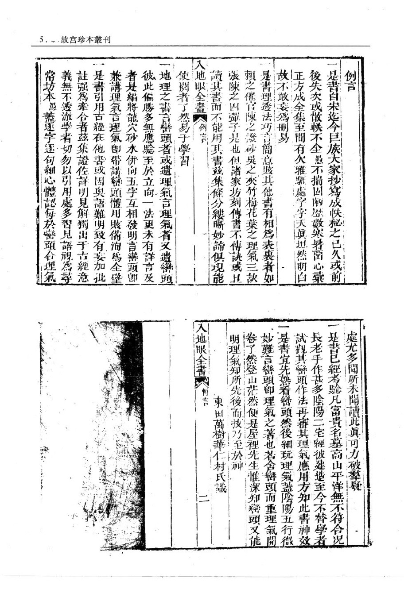

> **图版说明**：本页含图式或表格。请先核对方位标签，再按附近正文的顺序阅读；模糊或缺失标签不作推定。

> **阅读提示**：本页含已登记的残损、校勘或释读不确定项，可在原文对照版与审校账本中逐项核查。

### 原书第 6 页

入地眼全书目律

天星卷一文堂

天星卦序包括：干宫天星干龙法、亥宫天星亥龙法、壬宫天星壬龙法、坎宫天星坎龙法、癸宫天星癸龙法、丑宫天星丑龙法、艮宫天星艮龙法、寅宫天星寅龙法、甲宫天星甲龙法、震宫天星震龙法、乙宫天星乙龙法、辰宫天星辰龙法、巽宫天星巽龙法、己宫天星己龙法、丙宫天星丙龙法。文中“离也艮全书目律 明”具体所指不详。

> **术语说明**：**干**：八卦之一，卦象及五行、方位依原文语境确定；**坎**：八卦之一；**巽**：八卦之一；**艮**：八卦之一；**震**：八卦之一

宫天星离龙法、丁宫天星丁龙法、未宫天星未龙法、坤宫天星坤龙法、申宫天星申龙法、庚宫天星庚龙法、兑宫天星兑龙法、辛宫天星辛龙法、戌宫天星戌龙法。文中“脆法卷二”具体所指不详。

> **术语说明**：**坤**：八卦之一，卦象及五行、方位依原文语境确定

龙说龙法：寻龙、辨帐、辨峡、辨贪狼木星行龙、巨门土星行龙、禄存土星行龙、文曲水星行龙、廉贞火星行龙、武曲金星行龙、破军金星行龙、左辅金星行龙、右弼水星行龙、附平洋论、平洋龙论、穴法卷三。

穴法包括：点穴法、四落四势、五星九曜怪穴点法、四真三法、穴辨阴阳点法、作用穴、审背面穴、辨真彼穴、观动静生死穴、看明堂穴、看前后左右砂水穴、观风水朝向穴、有吉凶穴、辨五星穴、观前后左右砂应穴、内等物穴、有浅深葬法穴。文中“芳土色覆攻断墓不可像改砂法卷四”具体所指不详。

> **术语说明**：**明堂**：穴前相对开阔、有收聚关系的空间。

入地眼全书年

砂说看砂法：砂法、拨砂要诀、三关一局诀、吊冲之法、暗生之法。

砂法卷五：拨砂法、拨砂分金诀、拨砂分房分法、辨砂方位大小高低、二十四山砂法、朝案砂、印砂、朱雀元武砂、靑龙白虎砂、官鬼禽曜砂、应乐砂、禽兽砂、星体砂。

> **术语说明**：**二十四山**：将周天分为二十四个方位的系统。；**分金**：罗盘中进一步细分坐向度数的方法。；**朱雀**：穴场前方形势的传统称呼。；**白虎**：穴场右侧形势的传统称呼。

这部分内容论述了水法，包括朝水局、横水局、摅水局、顺水同、无水局以及水城的详细义理。文中还辨析了干支，并收录了河围生成篇、何图四局、洛书生成篇、洛书四局等篇章。此外，还涉及伏羲先天八卦中的对待夫妇关系、文王后天八卦中的合十夫妇关系、纳甲归元、海天甲子论、禄马贵人、三合局、泉煞、桃花煞、羊及水三刑、水六害以及水四破水等概念。其中提到的“羊及”具体所指不详，可能是“羊刃”或“羊刃煞”的误写或简称；“水四破水”中“水”字重复，原文含义不明。

> **术语说明**：**三合**：以地支三合等关系构成的一类风水体系或方法；**先天**：术数中表示先天卦序或本体关系的概念；**八卦**：干、坤、震、巽、坎、离、艮、兑八种卦象；**干支**：天干和地支组合形成的纪时、纪序系统；**纳甲**：将八卦与天干、地支等相配的术数方法。；**合局**：按本书规则，来水、去水、坐向等相互配合的情形。

> **阅读提示**：本页含已登记的残损、校勘或释读不确定项，可在原文对照版与审校账本中逐项核查。

### 原书第 7 页

这部分内容涉及水法、停基浮眉、风水问答、明堂水、天也水等主题。文中还提到了“水山水观界送朝聚”和“向依水立”等短语，但“停基浮眉”以及“水山水观界送朝聚”的具体含义不详。此外，还列出了二十四山和地眼全书。

合局破局、九星断语、向法卷八。

> **术语说明**：**破局**：按本书规则，水、向或方位关系不合的情形。

这部分内容论述了向法、立向法、翻卦法，以及黄石公翻卦掌诀、洛书紫白掌诀、翻卦辅星向法、辅星翻卦掌诀等具体技法。文中还涉及文王后天八卦水法、水法分房分图、阴阳破局、理气分房分法。关于立向，文中提到“一宜立子向”、“一宜立生向”、“一宜立卯向南”以及“一宜立酉向”。其中“一宜立卯向南”的表述语义不明，可能是指卯山向南或卯向兼南等具体情况，原文未明。此外，还收录了论用罗经诀一篇。

> **术语说明**：**翻卦**：按特定次序变换卦爻，以排定星曜或方位吉凶的方法。

阴宅图说、纳甲根源、先天四合局、后天四金局、天干六合局、三合相生八合局、黄泉八煞破局、破禄文廉煞破局、纳甲八煞破局、三煞会局煞破局、两曜双煞破局、四破桃花煞破局、阳宅说卷十。

> **术语说明**：**天干**：甲乙丙丁戊己庚辛壬癸

这部分内容包含阳宅总论、游星竹节贯井法、宫星生克方位要诀、三元命诀、又提诀、东西四命宅图、灶法偏气致应、天井放水以及元髓经。文中还提到了“七政九昭之说”，但“九昭”具体所指不详，可能是“九曜”或“九星”的误写或别名。

> **术语说明**：**三元**：以三元、九运等时序结构为核心的一类体系；**游星**：八宅等体系中依门宅方位排布的星名序列。

由宋南昌辜托长静道和尚著，瀑泉裒泰开树庭黄中楷。

> **阅读提示**：本页含已登记的残损、校勘或释读不确定项，可在原文对照版与审校账本中逐项核查。

## 卷一·天星

> **编者导读**：以二十四山、八卦与星宿为框架，依次说明各宫天星及相关龙法。

### 原书第 8 页

云门黄中植稔安袁丰年同参

理斋剧是训恬真徐孝先。

东田万树华仁村氏编次

胞姪万基德修校字

天星卦序

天尊地卑，乾坤定矣；卑高以陈，贵贱位矣；动静有常，刚柔断矣。

事物以类别聚集，万物以群体区分，吉凶由此产生。在天上显现为象，在大地形成为形，变化由此显现。因此刚柔相互摩擦，八卦相互激荡；一阴一阳，一上一下，一外一内，有时上临下，有时下临上，变化莫测。所以用雷霆来鼓动，用风雨来滋润；一寒一暑，日月光明，运行化育不停。因此干代表刚健，坤代表柔顺，震代表震动，巽代表进入，坎代表陷落，离代表附丽，艮代表停止，兑代表喜悦。所以雷用来震动万物，风用来吹散万物，雨用来滋润万物，日用来温暖万物，艮用来止住万物，兑用来使万物喜悦，干用来统御万物，坤用来藏纳万物。乾道成就男性，坤道成就女性。干知晓万物的开始，坤成就万物的形成。干以平易被知晓，坤以简约显功能。平易则容易知晓，简约则容易顺从；容易知晓则有亲近，容易顺从则有功绩；有亲近则可长久，有功绩则可广大；可长久是贤人的德行，可广大是贤人的功业。平易简约而天地的道理就得到了，天地的道理得到就能在其中确立位置。大概天昼夜旋转不停，日月五星随之运行。天帝顺行十二宫，布下四时之令；太阳逆行十二宫，宣示八节之功。因此八卦阴阳变动，应合四时八节，在大地交会。太寒时节，天帝在丑位，太阳临子位，在子丑之间交会，所以子与丑相合，万物成终成始。《易》说：成言乎艮。雨水时节，天帝到寅位，太阳在亥位，寅亥交会，所以寅与亥相合，丑寅辅助艮卦，这是东北之卦。春分时节，天帝临卯位，太阳在戌位，所以卯与戌相合，卯戌交会，甲乙辅助震卦，这是正春之令，万物发生。《易》说：帝出乎震。谷雨时节，天帝在辰位，太阳到酉位，所以辰与酉相合，辰酉交会，万物洁齐。《易》说：齐乎巽。小满时节，天帝到巳位，太阳在申位，巳与申相合，申巳交会，辰巳辅助巽卦，这是东南之卦。夏至时节，天帝到午位，太阳临未位，所以午与未相合，午未交会，丙丁辅助离卦，这是正夏之令，万物皆茂。《易》说：相见乎离。大暑时节，天帝在未位，太阳居午位，午未交会，万物致养。《易》说：致役乎坤。处暑时节，天帝到申位，太阳到巳位，申巳交会，申未辅助坤卦，这是西南之卦。秋分时节，天帝到酉位，太阳在辰位，酉辰交会，庚辛辅助兑卦，这是正秋之令，万物悦成。《易》说：悦言乎兑。霜降时节，天帝到戌位，太阳居卯位，戌卯交会，阴阳相薄。《易》说：战乎干。小雪时节，天帝在亥位，太阳在寅位，亥寅交会，戌亥辅助乾卦，这是西北之卦。冬至时节，天帝回归北极，进入垣中，太阳复命告功，壬癸辅助子位，这是正冬之令，万物归藏。《易》说：劳乎坎。山气出而齐，而相见，这是天帝鼓动出的生机，而成由入，以向乎出。起于震终于艮，这是一岁之终，而循环的妙处就在其中了。

> **阅读提示**：本页含已登记的残损、校勘或释读不确定项，可在原文对照版与审校账本中逐项核查。

### 原书第 9 页

入地眼全书 卷一天星 111

干宫天星部分引用《易》说：乾道行健，元亨利贞。其性质燥急，是阳气的亢盛，位居西北。乾卦统摄六子，使其分职听命。文中提到冬季时令曰“战乎干”，意指阴阳相薄、肃杀相攻，即纯阳克阴。霜降时节，天帝到戌位，太阳居卯位，文中写作“戊卯交会”，此处“戊”可能是“戌”的误写，具体所指不详。《易》再次提到“战乎干”。小雪时节，天帝在亥位，太阳到寅位，亥寅交会，文中提到“戌亥辅干西北之卦”，但前文写作“酉北之卦”，此处“酉”可能是“西”的误写，具体所指不详。天星名为“阳机”，又称“天玑”。奎宿有十六星，赤色居其所。若五星聚奎，则天下世盛文明。文中又称“封豕”，主文章之府，又主天子武库，故主兵权，用于禁暴横行，又主沟渎。其星数为四。

下九尺乃日月五星之中道。干在天皇之左，是以圣人画卦，以干为八卦之首，为天，为父，为龙，为焉。故天地万物亦以干为首。干三爻俱阳，万物资始；坤三爻俱阴，万物资生。是以圣人以乾坤为天地定位，地理家用之为权德。

凡是干龙作为起祖，高耸入云霄，形态如同龙楼凤阁的，出脉、过峡，起伏盘旋，布气、行度，到头结穴的形态都与众不同。这种龙不能与亥同行，因为亥是龙的曜鬼，为先贤所忌讳，务必要仔细勘察。如果龙脉单清过脉，地局端正，砂、水齐全完备，属于龙的上格。如果主星高耸，后代会功绩垂于社稷，恩泽惠及百姓，恩宠荣耀传及世代，属于中格龙结穴，后代会有翰林院的声价，日常接近帝王。下格龙结穴的，也会发科甲，出巨富，人丁兴旺。如果有殿上贵人，是聚气的火星。上格龙主后代出将入相，建立大的功绩，名闻四海。中格龙结地的，主后代出任尚书、侍从，获得翰林院的荣封。下格龙结地的，主后代科举及第，大富。如果是火星变土结穴的，会出状元、宰辅；如果是木星结穴的，会出尚书、侍郎；如果是金星结穴的，主后代科甲及第，出任屏翰重臣；水星结穴的，一定会出翰林学士；土星结穴的，主后代出科贡秀士，拥有百顷田庄，富裕程度冠绝一郡。总体要看龙的强弱、穴的有无、砂的拱峙状态，原文末尾作“水 玉i”，存在OCR识别错误或原文损坏，内容不完整，无法释读。

> **术语说明**：**结穴**：传统上认为山水形势在某处收束、聚集并形成穴场。；**过峡**：龙脉行度中相对收窄、连接前后山体的地段。

> **阅读提示**：本页含已登记的残损、校勘或释读不确定项，可在原文对照版与审校账本中逐项核查。

### 原书第 10 页

之澄清，案之朝拱，五种俱备，方为是地。而有缺陷，便是鬼气。庸师到此，欢天喜地，假者好看，真者天秘。明师到此，圆规方矩，自有道理。有德之家，遇著此地；无德之家，反是掏气。

亥宫天星

《易》说：亥属木，位于西北方位，纳卦属于震。地支共有十二个，亥是木的长生位。时令对应冬季，原文记载“太阳京直到亥”，此处“京直”可能是“躔至”或“经至”的传抄或识别错误，指太阳运行到亥位；白露时节太阳到巳向。小雪时节天帝到亥山。原文此处断句存在歧义，既可能读作“天星曰天皇，堡宿二星”，也可能读作“天星曰天皇堡，宿二星”，两种断句对应的星名含义均不明确，原文未给出进一步说明。星宿有两颗，一颗对应东、一颗对应壁，名为东壁二星，赤色，居于固定的位置，其下九星尺为天的中道，主管文章、图书的秘府。又主士工，如果星象明亮，就会图书聚集、道术通行，小人退避、君子进用，天下的贤良士子众多，世上的诗人之才堪比谪仙。原文“向天帝小雪到亥山”的断句和具体含义不明确，暂按现有语序引述。

> **术语说明**：**地支**：子丑寅卯辰巳午未申酉戌亥

#### 亥龙法

《易》说：亥在天门之左，是紫微“幼照”之所，天极太乙常居之地。亥是木的长生位，又得天皇之星下照亥地。若亥龙起祖，单清过脉，为龙之上吉。凡亥龙过峡出脉，到头结穴，东咽处必须要一亥字到头，结穴者为吉。二十四龙中惟有五龙难下：亥龙左干右壬，一辛龙左酉右戌，一午龙左丙右丁，一巽龙左辰右巳，一卯龙左甲右乙。这五龙阴阳驳杂，原文此处写作“此五龙阴阳”，后接“六”字，可能意为“驳杂”或“混杂”，但原文有缺损。其中“紫微幼照”的“幼照”可能是“右弼”或“右照”的误写；“东咽处”的具体含义也不详。

若龙脉驳杂兼带煞气，但若得单清过脉，发福更大更悠久。不但来龙如此，五向必作丑向，方得房分不偏；若兼左兼右，则三房受害，若无三房则二房受害。凡亥龙起祖山，旋入艮结穴者，定主科甲及第，富贵显耀。若卯龙起祖，入丙转亥结穴者，主文武双全，宰辅三公。如兑龙起禄，转丙入庚结穴者，主巨富，又主“输苑”才名，此处“输苑”可能是“翰苑”或“词苑”的误写。如正亥结穴者，主科甲连绵，官居台阁。最后提到壬宫天星。

《易经》中提到壬属于北方的阳水，纳卦于离卦，是天干中的第九个数。文中接着说“离火巳卯巳酉亲巳壬二于隶离”，这一短语的具体所指不详，且原文可能存在错漏或特殊术语，无法确认为四个独立干支与“巳壬”并列的确定事实。时令在仲冬，太阳运行到壬山，处暑运行到丙向。天帝在大暑时到达壬山。天星方面提到“阴权”和“室宿”二星，呈赤色，居于其位，象征太庙，是天子的官署，又称元官，一说为清庙，同时也是军粮的府库，并主管土工之事。其下九天是日月五星运行的中道，其中土星一星象征天子宫，下一庙为大庙，因此羽林军负责护卫。若有土工之事，古时认为当营室星明亮正当时，国家就会昌盛文明；若星象不明，则鬼神不享用祭祀，天下多生疾病瘟疫。

> **阅读提示**：本页含已登记的残损、校勘或释读不确定项，可在原文对照版与审校账本中逐项核查。

### 原书第 11 页

紫微帝座一白星在旁边照耀壬地，又得到四辅、六相在左右辅佐。

这是龙的上等吉兆，其龙脉不可与亥同省，称为龙身带曜，是兑贤所忌讳的，务必详细考察。如果干龙起祖，由坤入午正出面结穴，定主科甲翰苑，官居极品；如果坎龙起祖，由甲出乙转壬结穴，主富贵双全，科甲联登；如果午龙起祖，入坤转乙向甲结穴，主巨富，田连阡陌，官居台省。

《易经》说：坎代表陷，文中引用“坎陷也习坎有手维心亨行有尙”，但“有手维心亨”这一表述不通，疑为“有孚维心亨”之误，原文未明。坎位居正北，雨水滋润万物使枯槁复苏。时令在仲冬，称为“劳乎坎”，意为终年的勤动在此得到慰劳，一阳之气藏蓄休息。冬至时，天帝回归北极的子垣，太阳复命告功于丑位。壬癸辅佐子位，是坎卦正冬的时令。万物归藏，天帝慰劳之后，一元之气告成。文中再次引用《易经》“劳乎坎”。天星方面提到“阳光”、“虚”、“危”二宿，二星赤色，居于其位，象征冢宰，主管北方城邑、庙堂祭祀之事，同时也主管风云、死丧、哭泣。下九尺是日月五星的中道。若这些星明亮宏大，则天下安泰。文中又提到危宿三星，赤色，也居于其位，象征天府，一说为天市，又说架屋，是天庙堂。下九尺是日月五星的中道，主管架屋、受藏、风雨、墓坟、祠礼，也是冢宰之官，主管天下五谷丰稔，象征海涵珠滋万物之所。一白正临，九紫对照，八白居左，六白居右，两相辅佐，天帝成八。

评坎龙

凡是坎龙起祖，骨脉分明，地居端正，到头结穴，是龙的上等吉兆。如果转坤龙结穴，定主双生之子，富贵可许。如果旋申起势，转正坎出面结者，也主科甲富贵。又有翻身逆势，旋申由午结，回龙顾祖，必得局法端正，砂水秀丽，定主翰苑才名，目近天颜，富而好礼，又主双生之子，又生六指之人。如果壬癸起祖，旋山八辰转乙出面者，主产武略将帅之职，英俊雄伟之才。如果巽山起祖，由坎出面结者，主生双女。兑龙也同，主家财消败。

> **阅读提示**：本页含已登记的残损、校勘或释读不确定项，可在原文对照版与审校账本中逐项核查。

### 原书第 12 页

《易》中提到，癸属于北方的阴水，纳卦属于坎，在十个天干中排序为第十。卜易中说“坎水戊寅外戊申，癸戊二干隶坎”，这一表述的具体含义需结合专门的卜易体系解读，此处按原文引述。时令对应仲冬末尾，原文记载“大阳大寒到山，大著到向”，“大阳”“大著”属于专有表述，具体所指未明确；天帝小寒时到山。天星名为“阴光”，女宿有四颗星，赤色，居于固定的位置，是天的少府，掌管文书机要；又称为须女，是贱妾的称谓，代表低微的妇职，原文此处有“十”字，疑为“主”或“司”的讹误，后面接布帛裁制、嫁娶相关的职掌。其下九尺是日月五星运行的中道，原文“月月”应为“日月”的传抄或识别错误。如果这些星明亮，就会文士辈出，五谷丰登，女工兴旺，府库充盈。

入地眼全书卷一天星

癸龙法

凡是癸龙起祖，旋申入辰转乙出面结穴者，主生英雄豪杰，才堪将帅。如果旋申起势，转正坎出面结者，主科甲富贵。如果转坤龙结穴者，富贵双全。如果翻身逆势，旋申由午结，回龙顾祖，定主利甲翰苑，又主双生之子，六指之人，与坎宫回推。

丑宫天星

《易经》说：丑属于阴土，是东北之界，纳甲于兑金库，是地支中的第二数。时令在季冬，太阳小寒到丑山，小暑到未白，天帝大寒到丑山。天星方面提到“金牛”，又称“斗牛”。牛宿六星，赤色，居于其位，象征天之关梁，主管牺牲之事。文中提到“吕月五星贯之”，此处“吕月”极可能是“日月”的误写，具体所指不详。五星贯之，为中道。上二星主道路，次一星主关梁，又次二星主南夷。其上二星，一曰积路，一曰积火，主道币。中间一大星主关梁牛马。次下三星主南越。若星明亮宏大，则王道昌盛，天下安泰，牛马众多；若星不明，则牛马发生瘟疫。

《易经》说：丑居东北，文中提到“以入白今宫”，此句不通，“白今宫”疑为“北辰宫”或“紫微宫”之误，具体所指不详。贪狼一星在紫微之北，下照丑地。在天为四金，在时为四季。然而天市垣中“天机一入地眼，卷一天星，十”，这一短语的具体所指不详。

星傍照丑地，故丑龙起祖，骨脉分明，为龙之上吉，定产富贵之人。其龙不可卯癸同行，切宜详细。如果兑龙起祖，入艮由震出面结穴者，主产文武全才之士，威镇边夷。如果艮龙起祖，由丙入庚结穴者，主科甲奕世，丁财大旺。如果亥龙起祖，入艮转未结穴者，主大富，乃得牛羊发家。艮宫天星。

《易经》说：艮代表止，引用“艮其背不获其身，行其庭不见其人，无咎”。艮位居东北，以止之而生意收敛，不过时。时令在春，称为“成言乎艮”，生克嗣续，成终开始，则一阳凝止于外，面为之有待。北帝无为而为，不为也。大集天帝司丑，阳临子，交书于子丑之间。万物成终成始，太阳逆行，天帝颂行，故五寅辅艮，艮得上爻，一阳初生，故春之时以之阳爻而发。天星方面提到“阳机”，又称“阳枢”。斗宿大星七，其所为天庙也。文中提到“五星买中”，此句不通，“买中”疑为“贯中”或“居中”之误，具体所指不详。五星贯中，为日月之正道，五帝坐宫，天中，其星最明，亦者主之。天市全货之府，为永相太宰之位，酌政事之宜，袭进贤良，永受爵禄。南二星克天以也，中央二星天相也，北二星天府庭也。亥为受命之邑，将有天子之事。占丁南斗，其魁第一星士，十。

> **阅读提示**：本页含已登记的残损、校勘或释读不确定项，可在原文对照版与审校账本中逐项核查。

### 原书第 13 页

吴第二星，会积三星，主月阳，第四星主豫章，第五星主庐江，文中提到“第六尾土江州”，此句不通，“尾土”疑为“主”或“属”之误，具体所指不详。六星若均明，则天下安泰，风雨顺时，君民安康，五谷丰熟。

凡是艮龙之祖，卓拔高拱，如华盖，如文笔，如五印，如武金，如贪狼。辛盖者，盖下出木星，如此出五过峡，一起一伏，一湾一曲，起伏旋到头结穴者，文中提到“为馆之上吉”，此处“馆”字疑为“龙”字之误，因上下文皆论龙脉吉凶，具体所指不详。其谁不可与寅同行，谓之八煞龙，以宜详细。先贤所忌。若得单清过脉，地局端正，砂水全备，主星故峡吉，为龙之麓古也。卯华然出脉有木星结穴者，主出侍郎尚书之宫，中于乱主出科甲翰林。下格龙主科贞秀士。如文星上木下木结穴者，上格龙主文章显述，兼文武。中格龙主甲道院。下格龙主科贡人才。如上印力正之也。小土星出脉结穴者，上格龙主祥名高运霄脉，万逆。中格十腰金五马。下格龙主富，出重义之人。如武金者，其皇传体势亭严，故谓之武印。献天金云中出脉结穴，名上洛龙，主出大将，征代边境，名传四海。中格龙三曰头阡陷，出台阃府。下格龙主巨富，主出蚕俗燥地照全书卷一天星，土烈之人。如华盖盖下有木星而出结穴者，上格龙土万桌台，中格龙主尚书侍从，下格龙主杵甲府道。如全皇结者，主科甲屏治，大发文章。如木星者，主暴台开府。如水星结者，主出科贡秀士。如火集结者，主生娱列之人。如土星结者，主巨富。

《易经》说：寅地东北之也，木纳卦于离，地之二数，火土之长生位。合春，太阳大雪到寅，文中提到“种到申向”，此句不通，“种”字疑为“芒种”节气名的一部分，或为“到”字之误，具体所指不详。天帝两水到寅山。六星大又口功，此节但四星赤居其所。箕为天津，又为后宫，后妃之府。上六尺为日日五星之中道。若五星临箕壁势，轸四宫，则风雨骤及不开，则久雨不。又主口舌之神，前二星为舌端而则大风，不出三日即应。其星明，则五谷熟。其星赤，不人旱。

> **阅读提示**：本页含已登记的残损、校勘或释读不确定项，可在原文对照版与审校账本中逐项核查。

### 原书第 14 页

#### 与龙法

寅乃天培所居之位，文中提到“天培”，此处疑为“天枢”或“天驷”等星名之误，具体所指不详。又得贪狼天枢一星下照寅地，北斗之天柱尺白之傍照，为龙之上吉。如果也，其龙不可与臣同行，谓之八唯行龙，先贤所忌，切宜详细。如果坤七龙起祀，由坎入离结穴者，定产富贵显室之人。如果说龙人限，全书卷一天星。

气脉从坎方起势，转入乙方结穴，主家发富贵，出显赫官宦；若离方龙脉起于神山，转入壬方，再转至寅方正出结穴，主离乡发展而发贵。

甲宫天星

《易经》说：甲属于东方的阳木，纳卦于干，是天干之首，所以文中提到“下见曰”，具体所指不详，后文接“干金甲子”和“外壬午”。时令是仲春惊蛰节，即二月。原文中有“天t司甲”的记载，其中“t”字疑似OCR识别错误，具体含义不明。八月太阳运行到庚位，对应的天星称为“阴尾宿”。凡是红色的星，位于其本位，是后妃的府邸。向北一丈是天之中道。室宿和尾宿这两颗星，文中称“是九之也”，具体含义不详。如果这些星明亮且大，就主壬、甲两个方位的坟墓多子孙。《易经》又说：甲是阳木，纳卦于干，是天干中的阳。小帝宿初出时，北斗第五权星照耀其旁，这是主文章的府邸，也是辛相的宫位。如果甲龙起祖，单清过脉，地局端正，砂水合备，止于山南的，是龙的十种吉象之一。如果干龙起祖，由坤转乙，正甲出面结穴，定主少年科甲，名声魁首。如果坤龙起祖，入坎转寅结穴，会产下文武双全的人才，获得甲才名之贵。如果午龙起公转干，六次山辰出脉结穴，会产状元、宰相，出主侯六夫丁君，具体所指不详。如果次龙起祖曰坤，入癸转申结穴，主大富，但小胥人丁不旺，多主贵。

天地眼全书卷一天星

震宫天星

《易经》说：震代表动，震卦亨通，震来时人们谈笑自若，震惊百里却不丧失“七鬯”，具体所指不详，可能指祭祀用品。震位居正东，书中以此言动，激发其生机。又说：天帝出于震，阳气开始，气机由此萌动。时令是正春春分，天帝到达卯位，太阳在戌位，卯戌交会，所以说“与戌言”，具体含义不明。甲乙辅助震，是正春的配合，万物发生，所以说“帝出乎震”。天星称为“阳衡”，又称“天冲”。天命氏宿有四颗星，红色，位于其本位，是天子休解之宿，文中提到“吕后如之府”，具体所指不详。又被称为“天根”，向下五尺是“口月”五星的中道，“口月”具体含义不明。如果吴渠明亮，则君臣百姓共享太平。房星有四颗，红色，位于其本位，是明堂，文中称“天子希政之言”，具体含义不明。房星又被称为四辅、天驷、天马，主车驾、土武大将军之位，掌管众兵三军的号令。如果这些星明亮且大，则天下太平，人民乐业。震是乾坤的长子，得天地之正气。天帝火星主宰辅佐天帝，就是震，为廉贞，都从“曰之方”升起，“曰之方”具体含义不明。天帝出，得一阳初生，这是震龙法。

> **阅读提示**：本页含已登记的残损、校勘或释读不确定项，可在原文对照版与审校账本中逐项核查。

### 原书第 15 页

凡震龙起祖，出脉过峡，地局端正，震龙行度，骨脉分明，大星结六者，主产文武全才、三公将相之人。若廉贞起祖，四神拱峙，灵山出而庚水朝来，定产燥烈之人，必为上将，斩砍自伏，武镇边夸。如良龙起祖，出面由亥入庚，五（此处原文残缺，具体所指不详）。

骨脉分明，地局端正，结穴者，主产文武人才，定出贤士。如果亥龙起祖，一峰独出，由丙入艮，出脉结穴，定出科甲、苑才名之贵。震龙出脉，左边不可兼甲，右边不可兼乙。甲纳于干为孤，乙纳于坤为虚。震是坤的八煞，恶人来了，所以甲孤乙虚，带乾坤龟甲之气，必主灭门绝户。古语说：阴阳相乘，祸咎踵门。意思是龙不可阴阳双来，所以祸咎绳门，切宜谨慎。比如卯龙不可兼甲乙之类。阴阳相配，福禄永贞。意思是水与向宜阴阳相配，如坤水来立干向，干水来立坤向，巽水来立卯向，卯水来“占”巽向，“占”字具体含义不明，可能是“立”字之误。寅水来立“十前”，“十前”具体含义不明；水来立寅向，酉水来立艮向，艮水来立“西向”，“西向”可能指“酉向”，具体所指不详。这是阴阳相配之法：老父配老母，长男配长女，中男配中女，少男配少女。这是水配向的八卦夫妇相配法。水是自然生成，向是人为设立，所以立向有转移之巧。乾坤老父老母是八十之数，震巽长男长女是六十之数，坎离中男中女是四十之数，艮兑少男少女是二十之数。数代表寿命。所说：艮龙西水立丙向，少年科甲显文章。又说：巽水滔滔走入庚，震龙未向状元生。所以阴阳相配，福禄永贞。水是天地生成，向是先贤传度，可知矣。这样看来，双山长生水法全不用了。长生水法世人未探究其解，半假半真。其法称为左右旋：左水到右为甲庚丙壬四阳局。甲木生在亥，丙火生寅，庚金生在巳，壬水长生在申。如亥水来立甲向，未水去为归墓，而不在未上去，则又说“水出辰巽是衰方”，文中“曰”字可能为“日”字之误或引文起头，具体含义不明，说惟有衰方可去来，称为甲木局。若依八卦水法算，犯禄存水上堂。禄存一名孤曜，一名绝体，不吉明显。又寅甲水来作火局，立丙向。丙火生在寅，水出戌，而不能出戌者，则“口出”未坤是衰方，“口出”具体含义不明，可能为“水出”之误。伏八卦水法，寅是廉贞，甲是破军，必主痨病恶疾，人命官事，家则不了，官事不休。伪书云：亥龙丙向来蛇扦，富贵旺牛田。寅甲水来逐穿红井著绿，庸师一见亥龙入首，寅甲水来，就言此四句俗话。殊不知卖尽牛田，恶疾染身，身上红红县绿，果如穿着绿的郎君，一世也不脱下，除死方休。又巳水来作庚金局，立庚向。庚金生在巳，水出丑。此局为后云夫妇相配则上吉，而若放戌干衰方水，则重妻瞽目不吉矣。又申水来作壬水局，立壬向。壬水生在申，水出辰，则大富大贵之局。此水不可出衰方丑艮，水一去则主乞，再出僧道。又有右水到左为乙丁辛癸四阴局。乙木七（此处原文残缺，具体所指不详）。

> **术语说明**：**入首**：龙脉进入结穴区域前的关键一段。

> **阅读提示**：本页含已登记的残损、校勘或释读不确定项，可在原文对照版与审校账本中逐项核查。

### 原书第 16 页

生在午，丁火生在酉，辛金生在子，癸水生在卯。如午水来立乙向，为乙木生在午，水出戌，而不能出戌，子水去为病水去，最妙。若出衰方则不吉，称为吉地葬凶，反生祸。酉水来立丁向，为丁火生在酉，水出丑，上吉。丁纳于兑为纳甲，水最秀，主少年发达，男清女秀。若放辰水去则不吉，主投河自缢，缺唇露齿。子水来立辛向，为辛金生在子，水出辰则不吉。子属坎卦，坎为中男，“四卜岁”具体含义不明，可能为“四十岁”之误。辛属巽卦，巽为长女，六十岁。四十岁男子娶六十岁妇人，有生育吗？无生育吗？子水来破了阴局，子为沙浴之水，又为军盗之水，主男为盗，女为娼，文中称“说也吓人”，此句语义突兀，具体所指不详。若水出未方，则二房有救了。辛巽卦，巽为风，为长女；未震卦，震为雷，为长男，得夫妇相配之义，又得雷风相薄局，则主丁财大旺，富贵绵远。右论归藏一事，全在一局。见阳水来阳水去，立阳向；阴水来“阴水上”立阴向，“阴水上”具体含义不明，可能为“阴水去”之误，则万无一失。虽无龙与穴，却无祸到，平安。而癸水生在卯者，与此同推。可恨吕方作铜函经，用此双山五行，将来日后预习成风，不知要害几多良民，则知其心大不良。虽奉上谕欲害蛮夷，古语云：害人终害己，杀人一万，自损大（此处原文残缺，具体所指不详）。

三千又标出歌句以哄人：乙丙交而趋戌，辛壬会而聚辰，斗牛纳庚丁之气，金羊收癸甲之灵。词句虽好，读则甘甘有味。这多书驼子习地者，无一人不遵其法。贫衲力止不听，苦口逆耳，无奈我和尚学问不佳，眼精又瞎，文理不通，叫贫衲哪里去讲起，是以只得各从天命，事且出他。

《易经》说：乙属于东方的阴水，乙纳于坤，为天干之二数。所以卜易曰：坤上乙未癸丑，凭乙癸二干隶坤。时令在仲季之间，原文称“大阳”霜降到乙，“大阳”可能为“太阳”之误，具体所指不详；谷雨到辛向，天帝清明到乙山。天星称为“天官氏宿”，有四颗星，红色，位于其本位，是天子休解之宿，宫后妃之府。前二星大，主后；后二星小，主妾媵。又为天根，下一尺五寸，为日月五星之中道。其星则后妃奉君命，文中提到“天下绵花朝亭布广贤女多贞”，此句语义不明，具体所指不详。

> **阅读提示**：本页含已登记的残损、校勘或释读不确定项，可在原文对照版与审校账本中逐项核查。

### 原书第 17 页

乙龙法

《易经》说：太乙一星赤在右，阳衡一星赤在左，二星夹辅下照乙地。其星在紫微之北，下照先天之坤。凡乙龙起祖，骨脉分明，地局端正，单清过脉，为龙之上吉。其龙入脉（此处原文残缺，具体所指不详）。

必须单独使用乙向，绝不可兼向。左兼是卯，右兼是辰，卯和辰都是八煞，辰也是如此。如果得坤龙起祖，从坎方进入，在离方结穴，必定主科甲功名、名利双全。如果得干龙起祖，进入甲方，转壬方结穴，主官居极品，又主女性显贵。如果子龙起祖，从午方进入，在甲方结穴，主丁财大旺，富贵绵远。坤龙入穴，辛山乙向，乙水朝来催官，是第一吉。壬龙入首，乙水来，坤向当朝，主宰相之职。

《易经》中提到，辰属于阳，位居东南的界限，纳甲于坎，对应地支中的第五数。时令在季春，太阳从寒露节气运行到辰位，清明节气运行到戌位，天帝运行到辰山，谷雨节气也运行到辰山。天星称为天罡，又称亢金。亢宿由四颗赤色星组成，安居其位，是日月运行的中道，作为天府和天子内朝，总管天下卿大夫的治理，如同尚书一职。它也指疏庙，并主管疾疫。如果这颗星明亮，则卿大夫清正，贤士获得爵位，百姓安居乐业，疾病灾祸消除。

辰龙法

《易经》说：辰在地支五位中最为尊贵，是天罡所治理的宫位，也是太乙星旁照的地方，同时又有亢金这一颗星下照辰地。辰属龙，亢金也属龙。所以辰龙过峡时，必定结成大地的格局。凡是辰龙起祖，必定踊跃而来，大开帐幕，气势起伏，跌峡时大顿小伏，行进数百里才结成一穴。小的也有数十里，原文此处接续“下”字后似有缺漏，提及“极小者数星”，具体所指不详。

今以小者言之。辰龙出脉，起伏盘旋，入甲转干结穴者，为龙之上吉，主产状元，出辅弼。如干龙起祖山，坤入甲结穴者，主科甲翰苑，官居开府。若坤龙起祖，由干入甲转乙出面结穴者，主大富大贵，人兴位显。凡结大地，必是辰戌丑未四龙所有。辰戌丑未四龙出脉，必是干龙。不信，看京都省郡州城府县所结之处，皆是辰戌丑未之龙所结，方知辰戌丑未四龙为大龙。不知是何人将此视为墓龙而轻之。

> **阅读提示**：本页含已登记的残损、校勘或释读不确定项，可在原文对照版与审校账本中逐项核查。

### 原书第 18 页

这都是官天星。《易经》说：巽，是人。小亨，利于有所前往，利于见大人。位居东南，风以此消散，解开郁结，这是生养万物的功效。时令在夏季，原文此处“口”字疑为“曰”之误，即“曰巽，齐乎巽”，一阴顺从二阳，井行出整齐而气均布。谷雨时节，天星在辰，太阳到酉，所以辰与酉相合。辰酉交会，万物洁净整齐。《易经》说：齐乎巽。小满时节，天帝到巳，太阳在申，所以巳与申相合（原文“巾”疑为“申”，“父”疑为“交”）。巳申交会，辰巳辅助巽，这是东南的卦。天星称为阳玑，又称天乙。角宿有两颗星，赤色，安居其位，主管造化万物，布施君主的威信，作为天关。其门为天门，内部又为天庭，所以黄道经过其中，是七曜运行的路径。如果其尾部明亮宏大，则贵人出现，天下安泰。

巽龙法

凡是巽龙起祖的形态，有的是一峰独出，有的是双峰对峙，高耸入云霄，比如“双也香”形态，具体所指不详；或是帐下贵人形态，或是蛾眉凤辇形态，还有如玉圭、镜台等各类形态。这类龙出脉布气、行度过峡的过程中，山势起伏屈曲盘旋，最终能够结穴的，属于上吉的龙。这类巽龙不能与辰相伴同行，这种情况叫做龙身带煞，是先贤所忌讳的，非常不吉利，这属于八煞之外的另一种八煞。如果龙身同时兼有巳，也不可取用，都应当详细勘察。巽龙的左侧是辰，右侧见巳，巳属于纳卦的八煞，辰属于卦外的八煞，所以都不吉利。世人没有探究其中的道理，所以不了解这个规则。正五行中，辰属土，巽属木，木克土所以为煞；巳纳于兑，兑属金，巽忌讳金。凡是遇到这种辰、巳与巽龙相伴双行的情况，哪怕是看起来很好的地，也不能获得福分。考证过往的古坟，“力知道双木精”，这里“力”字可能有误，或为“方知道”的讹写，具体含义不确定。有些平庸的风水师不懂这个道理，给人安葬时说：“好个仓板水在面前，占干山巽向兼八辰，或口兼亥巳，包管发福。”这里的“八”可能是衍文，“口”可能是“曰”之讹误，实际上他不知道面前的仓板水是两股煞水流来，会导致三房先绝，接下来二房绝，再接下来长房绝。如果真气饱满气旺，二房可能不会绝后，但就算有子孙，也注定贫穷彻骨。这难道不是巽巳双流水克水的情况吗？怎么可能一勺水就能救贫呢？又有说法称：巽向见辰水，主文曲星游荡无依，会绝人丁。巽方水来是水克向，巽方水去是向克水。又说山向克水，原文末尾“酝 主”语义不全，含义不明。

这等人看来，龙也绝人，水也绝人。水关祸福更速。若论干山巽向地，必须作正向，左不可兼辰，右不可兼巳。庸师不知天足理气，原是乱来。庸不知就是作书者能有几人？有等俗师见有正向者，曰落了空，坐了戊己煞，不能管事。独不知古来明师与人下一地，独向者广多，房房均匀，家家获福。请往古冢间考，方进学问。巽为天帝，文章之府，居河洛四龙之宝，为龙之上吉。若兑上起祖，由丙入丁转辛入亥，往巽出面者，脉分明，地局端正，上格，主产公卿之职，文秀之士，金玉之贵，又产大富之人。如震山起祖，由庚结穴，如帐下贵人出脉者，入艮由巽到头，八将峙立，四神高从朝，与巽山齐云，双峰侵汉，龙真局正，定主出将入相。如只一峰独出，亦出状元，少可峰峦，亦出泰军司户经略之士。一峰秀出，一登科变，峰拱峙同科举，低员方正，钱无数。蛾眉山现，女为妃。六秀中独巽山宜高不宜低，及凹风射穴，又不宜朝流而去，主人亡财散杀戮之事。虽龙真局正，犯此水者，亦不可用。或转丙向，立别向，乃可在乎活法，否则必败。切宜详细。

> **阅读提示**：本页含已登记的残损、校勘或释读不确定项，可在原文对照版与审校账本中逐项核查。

### 原书第 19 页

巽山无足，不堪行。惟向蛇头斩脚筋。辰龙惟怕兼巽走。巳山不要巽同行。孙膑家祖塍，巽巳双来龙脉，故别足巳宫天星。

《易经》中说：巳属火，处于东南的边界，纳卦属于兑，对应地支的第六数，是金的长生位。时令对应夏季，太阳从白露运行到巳位，“京直”到亥向，这里“京直”疑为“惊蛰”之讹误，小满时天帝运行到巳山。天星名为天屏，轸宿有四颗赤色的星，处在对应的位置。这四颗星是天的四辅，又称为冢宰，也叫辅臣，主管察验殃害的事，还主管车骑运输、贼盗征伐、丧事相关的事，“辅颤”也主管风雨，“辅颤”具体所指不详。轸属于水星，它的位置向北五尺是日月五星运行的中道。如果轸宿的星明亮，就预示天下安康，万民和乐，风调雨顺。原文末尾“质人叠山”语义不明，具体所指不详。

《易经》说：巳得天屏一星，在紫微之东，虽不合河洛之贵，天帝照临，又是金之长生地，中之福德，可谓上吉。其龙行度，骨脉分明，地局端正，为龙之上吉。其龙不可与巽同行，谓之曜鬼带煞，先贤所忌，切宜详编。若卯龙起祖，由亥入艮结穴者，主出科甲及第，产巨富之人。如艮龙起祖，入亥转卯结穴者，主出文武全才之士，腰悬金印。如亥龙起祖，由艮转卯结穴者，定出富贵双全，田联阡陌。

《易经》中提到，丙属于南方的阳火，丙纳于艮，是“天于之三数”，具体含义不详。所以卜易中有“艮土丙辰外丙戌”的说法。时令对应仲夏五月芒种，此时天帝运行到丙位，太阳处在申位；七月处暑时，太阳运行到丙山；正月雨水时，太阳运行到壬向。天星名为阴枢，也叫赦文。翌宿有二十二颗赤色的星，处在对应的位置，是天子的乐府，主管俳唱嬉乐、文物声名相关的事，还主管太庙、三公的教化道统、文籍，以及蛮夷远客、四海滨海区域的事务。它的位置向北十三尺是日月五星运行的中道。如果这些星光明亮盛大，就预示君主贤明、臣子忠良，礼乐兴盛，“礼乐巽四夷来”中“巽”字含义不明，可能指四夷来归，具体不详。

> **阅读提示**：本页含已登记的残损、校勘或释读不确定项，可在原文对照版与审校账本中逐项核查。

### 原书第 20 页

丙龙法。丙居离明之府，九紫傍照之官，太微垣（原文“大微”疑为“太微”）月星下照丙地。凡是丙龙起祖，骨脉分明，单清过脉，地局端正，为龙的上吉。这种龙不可与午同行，那是廉贞火龙，定主火灾。兼巳也可以，定产富贵之人。艮龙起祖，由兑入丁（原文“八丁”疑为“入丁”）转亥结穴者，定主翰苑才高，省台官贵。如辛龙起祖，由亥入兑转入丁（原文“八丁”疑为“入丁”）结穴者，主富贵双全，尚书侍从。若卯龙起祖，入艮由亥转巽结穴者，主文武全才之士，出将入相之贵。原文末尾“离官天星”语义未尽，具体所指不详。

入地眼全书卷一天曷

离卦象征附丽，利于守正亨通，如同畜养母牛般柔顺，其方位位于正南。太阳照耀使万物干燥，阴气湿润，这是长养万物的功效。时令正值夏季，《易经》说："万物相见乎离"。此时一阴爻在中间，二阳爻在外，炽热化机宣发暑气，万物因此光辉灿烂。相见之后，必有委曲滋养之物。夏至时天帝到达午位，太阳在未位，所以午与未相合，丙、丁辅助离卦，正合夏季时令，万物皆茂盛。《易经》说："万物相见乎离"。天星称为太阳，又称阳权星。星宿七星，赤色，居其所，又称天都，为朱雀，是文明精粹、羽仪之所主，掌管衣裳文绣，也主盗贼。此星明亮，则天下大丰收，年景丰饶。张宿六星，赤色，居其所，主珠宝金玉及宇宙所用之物。天子内宫衣服收藏贡物的库房，也主厨饮食赏赐之事。凡离龙起祖，起伏的源头屈曲而来，星体端正，骨脉分明，到头结穴的，是龙的上吉，主科甲王侯之地。此龙不可与丙龙同来，若是廉贞双行，主火灾，是先贤所忌，切宜详细考察。若壬龙起顶出脉过峡结穴，主出科甲、翰林、侍郎、学士。子、癸二龙，或由甲入坤转坎，正面出脉结穴，主出公卿宰相。如坤龙入坎，向甲正面出脉结穴，主半出翰苑才名，富贵双全。艮龙一变，坤为贪狼，坎为巨门，兑为禄存，震为文曲，离为廉贞。离龙一变，震为贪狼，兑为巨门，坎为禄存，坤为文曲，艮为廉贞。丙纲在艮，所以丙、午二龙不可双行，这是廉贞火龙，此必要用制化之法。火绝于亥，干属金，金能生水，一属水，壬亦属水。南方之丙火，北方之壬水，壬水克丙火，亥水克午火。二水制一火，所以天地阴阳各各不同，生克制化各有所喜所忌。如人也有相喜相恶者。相喜者，孝顺至诚，和睦亲邻；相恶者，谋财害命，行凶叛逆。因此也有制化。圣人设礼义以化民心，设王法以制恶人。所以昆虫草木皆然。如蛇喜虾蟆，虾蟆喜蜒蜷，蜒蜷喜蜈蚣，蜈蚣喜蛇，蛇畏蜈蚣，蜈蚣畏蜒蝼，蜒蜷畏虾蟆，虾蟆畏蛇。此四者若遇在一处，则俱不敢相持，而不分开则四者俱死一处。如医家冢用药，药有君臣佐使，此相喜者也；亦有相畏相反者，此相恶者也。世上万物各有制化，天地日月五行相生相克，皆一理也。如山川峦头皆以分金坐度为主，遇难生恩，化煞生权，全在理气上功夫，活泼泼而取用。

> **阅读提示**：本页含已登记的残损、校勘或释读不确定项，可在原文对照版与审校账本中逐项核查。

### 原书第 21 页

丁宫天星

《易经》说：丁属南方之阴火，纳卦于兑，为天干之第四数，故卜...（原文此处有缺漏，具体所指不详）。

《易经》中说：兑金相关，丁巳之外还有丁亥，丁干隶属于兑。时令处于仲夏之末，太阳运行到大暑时到达丁山，大寒时到达癸向。“天帝小著到丁山”，此句疑断句或用字有误，可能是“天帝，小暑到丁山”，“小著”疑为“小暑”之讹误，具体所指不详。天星名为南极，也叫阴间宿，有八颗赤色的星处在对应位置，主人的福寿，也主管文章大会，属于朱雀；又有说法叫天相，也叫天库，是天上的厨房，主管御膳饮食、仓库、酒醋的位置，还主管雷雨、工匠相关的事。它的位置向北六尺是日月五星运行的中道，这里的“六尺”是古代天文度量单位，并非实际地面距离。如果这些星宿明亮盛大，就预示人长寿、年成丰收、酒食充足。文末提到“不丁龙法”，具体含义不明，原文语意似乎未完或存在缺漏。

《易经》说：丁寄离明之位，九紫帝星傍照之所，天干之次南极老人一星下照丁地。凡丁龙起祖，骨脉分明，地局端正，起伏而来，到头结穴的，为龙之上佳，产文武全才之士，富贵清高之人。若兑龙由亥入艮，出面结穴者，主王侯庙食，与国为姻。丙龙起祖入艮转丁结穴者，定主才高北斗，翰苑官贵。丙龙转丁，丁龙转丙，为赦文龙。丙丁二砂起为赦文砂，丙水朝丁，丁水朝丙，为赦文水，主家无凶祸，犯罪即赦。

《易经》中说：未属于阴土，处在西南的边界，纳甲属于震，木库在未，对应地支的第八数。时令对应季秋，太阳运行到小暑时到达未位，小雪时到达丑向。“天帝大 天暑到未山”中“大”与“天暑”之间有脱字，疑为“天帝，大暑到未山”的讹误，具体所指不详。天星名为金羊，也叫鬼气，鬼宿有四颗赤色的星处在对应位置。“其四星古四角”中“古四角”疑为“居四角”或“占四角”之讹误，指这四颗星占据四角位置，中央有一颗星时隐时现，主管文魁，掌管天下士子的阴德。如果这颗星明亮，就是阴德星在掌管阴德相关的事。“龙凡人”具体所指不详，大意是凡人每天有德行，就会被记录下来。这颗星的气是白色的，像粉絮一样，似云非云，似星非星，只能看到它的气。世间有士子参加科场考试，本该考中却没考中，人们说是命，其实不是，是德行不够的缘故。这四颗星主管明察奸谋，是天的眼睛，是“目月五星之中道”，“目月”疑为“日月”之讹误，这里称为天庙，主管祠祀，也主管疾病、死亡。东北方的一颗星主管精马，东南方的一颗星主管精兵，西南方的一颗星主管精布，西北方的一颗星主管精金。德行圆满的人用金赏赐，德行半满的人用布赏赐，劳苦多的人赏赐马匹乘坐，罪孽多的人用兵诛杀。

> **阅读提示**：本页含已登记的残损、校勘或释读不确定项，可在原文对照版与审校账本中逐项核查。

### 原书第 22 页

#### 未龙高

《易经》说：未是鬼金所在之处，然而得到南极老人星下照未地，又有羽林太常在旁辅助。如果未龙出脉，起伏盘旋且走势端正而结穴，则是龙之土吉。这条龙不可与坤同行，因为龙身带有曜气，需要仔细辨别。如果巽龙起祖，进入辛方转至艮方结穴，会出科举官员，获得禄位。例如卯龙入穴，作甲山庚向，如果未水来则如雷击般兴盛，未水去则如雷击般衰败。不仅是卯龙遇未水如此，未龙遇卯水也是如此。艮龙起祖，由亥方进入未方结穴，主巨富但不大贵。文中提到“如兑龙起祖入工”，此处“入工”具体所指不详，原文似有缺漏或讹误。

这种向内结穴的格局，主掌翰苑的人财大旺，少年发达，为官清正。如果是卯龙配未水，会有雷击现象；未水来则因雷击而兴，未水去则因雷击而败。若是卯龙、未水配合庚向，雷击会发生在门上，若朝向不对则不击。不仅坎位会被击，像石山也会被击。为什么？石头是龙的骨头，生成在山中数十年都不被击，唯独今天被击，这是为什么呢？这座山来龙之后有一节，也是从卯方过来的，山面也逆向西，数千年都不被击，原本也没有未水。现在阿南方向的未水，或是因为山崩倒，或是因为水消破，形成一个小演，具体所指不详，所以有了门缺，形成了未水的势态，因此被雷击。如果不信，请去雷击之处看看。有人只信命而不信地，圣人虽然也说有命，但命是后天，地是先天，先有地而后才有命。生出的富贵贫贱、寿夭穷通，都不出这个范围。孔子说：天所覆盖的，地所承载的，世间万物都出于地而不出于天，由此可知关键在于地而不在天。地有灵气，山川有秀气，但没有主人；尸骸有主人但没有气。如果得到山川的地气和尸骸的骨气，两者合一，不愁不生。对于有命之人，比如卯龙庚向未水，雷就会击之。卯、云、庚、亥、末都纳于震卦，震为雷，所以被击。另外，庚龙卯向未水，也应当被击。卯向配巽水，是雷风鼓舞，主击。后龙地既然这样，那么地是平还是不平呢？

又地限全书卷天

“易目”说坤道顺行，“易目”疑为“易曰”之讹误，坤道具有元亨利牝马之贞的属性，性质柔顺，因为属于阴所以主藏，位置在“酉南”，“酉南”疑为“西南”之讹误，坤以此藏纳万物，六子卦都被它包含且顺应时节运行，这是方圆卦位两两对峙的结果，所以能涵盖造化的全部功效。时令对应秋季，有“致役乎坤”的说法，坤有宏大的法则，竭力发挥效用，养育万物没有穷尽，纯阴代替阳气运行，有始有终。致役之后的内容还有很多可以解说。“人暑天帝在未”中“人暑”疑为“大暑”或“小暑”之讹误，太阳“居羊午未交”，“羊”疑为“于”或“在”之讹误，指太阳处在午未交接的位置，万物得到养育。《易经》说“致役乎坤”，处暑时天帝运行到申位，太阳在巳位，“交会市未”辅助坤这一西南方位的卦，“市未”疑为“于未”之讹误，具体所指不详。天星名为依戈，也叫阳戈，井宿有八颗赤色的星处在对应位置，位于银河中，主管泉水，又是天的南门，“日月五是贯之”为中道，“五是”疑为“五星”之讹误，这个位置叫做天井，也叫东井，主管诸侯、帝威、三公的职位，是天上“停侯水衡发今之所”，此句原文讹误较多，推测是天上负责水衡事务、发布命令的机构，具体含义不明。所以圣人把干当作父，把坤当作母，坤卦六爻都是阴，是万物资生的基础；乾卦三爻都是阳，是万物资始的源头。乾坤所生的六子，地理家各有分辨的方法。先贤说：不懂天文怎么能懂地理？天文在上面显现，地理在下面对应，在天要考察星宿缠舍，在地要考察方位，这样才能得到地理的要旨。原文末尾“得”字后语意未完。

> **阅读提示**：本页含已登记的残损、校勘或释读不确定项，可在原文对照版与审校账本中逐项核查。

### 原书第 23 页

#### 坤龙法

凡坤龙起祖，卓拔如旗如圭，如贵人如御屏，如玉堂如笋者，出脉过峡，起伏盘旋，到头结穴者，为龙之上吉。其龙不可与未相兼，谓之带煞，先贤所忌，切宜详细。或行主（原文此处似有缺漏，具体所指不详）。

气力充沛、气脉旺盛且坐山端正无偏的地局，若四山环抱、砂水齐备，便是龙脉中的上等格局。若结穴处有大小贵人峰，且一峰低小、两峰高大，属于士人格局，主出父子、兄弟、叔侄同朝为官；中等格局的龙脉主父子兄弟皆有文名；下等格局的龙脉主小贵中富，人丁兴旺。若结穴如玉堂金马，后有御屏山、前有马山，是上等龙脉，主文章盖世、高科及第；中等格局主担任大藩、侍从等职；下等格局主长寿，多仆从。若如圭文星般高从体顶，“要卒甘”具体所指不详，身形要清秀，结穴处上等龙脉主出正世之人，古朝理崇儒；中等格局主贵有忠贞、文名远播；下等格局主富秀科第。若如符似火草拔般清秀端正，结穴处文中提到“失元学七中各龙”，具体所指不详；还提到主“币苑清贵及谏垣之职”，具体所指不详；下等格局主和贡秀士，仓库满乡。若金星结穴，主出科甲富学；木星结穴，主翰苑才名、尚书侍读；水星结穴，主“诗清籍”，具体所指不详；火星如旗粘者，定主男将女帅；火星尖而利者，出状元；土星结穴，出巨富，千箱万箱。干龙为父，坤龙为母。乙纳于坤，亦为老母，喜见相关格局的情况包括“庚龙过云”，具体所指不详，还有辛龙过巽、丙龙遇艮、壬龙过离、丁龙遇兑、癸龙遇坎、甲龙遇干、乙龙遇坤。这些都属于纳甲龙，最喜纳甲砂、纳甲水经过，自然会发福。

> **术语说明**：**坐山**：建筑或穴位背靠的方位。

窝发贵，巳二十四龙，二十八砂，各依坐度分金，遵循金木水火土五行消息之则，无不准确。书中说：依戈行龙，兼鬼气，主少亡、孤寡并尼僧。又说：龙身带得四金行，寡天尼，何出有？因此说：坤未二龙同来到头，入首穴处，右边是坤，左边是未，从缝针正中看，一边是未，一边是坤，切不可用。所以习此道者，若未得传授，只知绞而不知真数。若论正五行，坤属土，未亦属土，乃兄弟也。以天星论，坤属井木，未属鬼（此处“鬼”指星宿名，非鬼怪）金，金来克木，为煞曜。入煞歌云：坎龙坤兔忌见之。殊不知未纳于震，震属鬼（星宿名），未亦属兔矣。故坤未龙不可地行，非但龙不可同行，即坤向不可见未水，未向不可见坤水，是谓八煞，必主绝丁倒户。行此道者，未索其解。如艮寅、卯乙、巽巳、丙午、未坤、酉辛、干亥、壬亥，此入者龙不可相兼，水不可同来，向亦不可相兼，是入煞相见，可谓仇人相见。至于“分外气净”一句，具体含义不详，原文不可不慎。

> **阅读提示**：本页含已登记的残损、校勘或释读不确定项，可在原文对照版与审校账本中逐项核查。

### 原书第 24 页

贫家阳基，离龙入首，是丙午双行。每五年两次回禄，可谓残伤。后得道时，将入脉处掘作两段，深入尺阔五尺，以泄煞气。又离尾四百步，向北起造一门楼，立正午山子向。门楼外开小阿池，作明堂，是四水归聚处，取入坤眼。全书卷一，天星。

金来生水之义，将来川后，子孙人兴财旺。虽不能大富大贵，惟愿子孙后日富不上万，贫不讨饭，足矣哉。江省亦是离龙，丙午双行入脉，喜得洋子洲宝塔在干方以制之。而若不然，火灾难免。将来日后塔去，火盛，必是大患。又不如将入脉处右边午字上掘一大池，深又余聚水于池中，泄其火气，永保太平。

净化元年庚寅岁五月，衲在丰城家葬令祖令妣。见其阳基乃干亥双行龙入首，劝其将左边干脉掘下一半，留右边亥脉。曰：住居来龙，掘去一半，岂不伤龙？何差错将何处之？遂不听。将来日后富贵盛，印可必遭杀戮。天地数定，不敢多言。

《易》中说：中属西南之阳金，纳卦于坎，地支为九数，处于水土的长生位，时令在秋季。关于“太阳然种到申大雪到寅”一句，具体所指不详。文中提到“向天帝处到中山”，其中“中山”具体所指不详。天星名为传送，又称瑞光，参宿七星，赤色居其所，一名天市，一名天钺，一名自兽。其中横列四星，东北名为背七左将，两北（可能为“西北”之误）名为右背七右将，东南名为左足，主正将，阿南名为右足，主副将。所以占卜参宿以应七将，其中央有三颗小星。

管权衡书：凡支簿大小官员将相，其星明则风雨调顺，五谷丰稔，文名昌盛，贤集诗书。

《易》曰：申乃水土长生之位，故传送一星居其所，又得弼星居傍下照申地，为龙之上吉。其龙不可与庚同行，谓之龙身带曜鬼，切宜详细，此为先贤所忌。若得与坤龙同行，真正出脉，由干结穴者，定产大富大贵之人。如干龙起祖入离，转坎龙真局正结穴者，“七出”具体所指不详，主科甲翰苑，官居极品。若坎龙起祀山辰入中结穴者，主交武双全，“发连”具体所指不详。如卯龙结穴者，申水来，必须扦申向，是化煞为官。若作别向，则绝矣。大地来龙必带煞，凡龙遇入煞来，就扦八煞向，是化煞为官。须看左右二水合局不合局，若不今何（具体含义不详），切不可扦，必须详细。如卯龙中水非中向，如巽龙自水，离龙亥水，坤龙卯水，酉龙巳水，艮龙寅水，天下“韭”（可能为“岂”之误）有此等结地之理。言丙龙寅水，龙与水亦有相反者。申龙卯水，酉龙巽水，亥龙离水，卯龙坤水，巳龙酉水，寅龙丙水。八煞之水，乃八卦之官鬼爻相克者也。今只六卦，干坎二卦，怎的不言？盖干忌马，午属马，干龙午水，干（句子未完）。

> **阅读提示**：本页含已登记的残损、校勘或释读不确定项，可在原文对照版与审校账本中逐项核查。

### 原书第 25 页

先天在南，午之后天亦在南，是先后天相见。干属阳，午水亦属阳，故不忌。坎龙忌辰，辰属龙，此后天纳卦之方位。眷属一家，中子辰会成水局，何忌之有？是以此二龙不为八煞。地理家辨水最是清楚，不得混谈。又不比卜易而算，龙与水只有六卦而易辨，可一隅三反。行龙又兼有纳甲在内，又多曲折。如卯龙不可兼乙，乙龙不可兼卯，坤纳乙，乙即坤也。坤忌卯乙，岂不忌卯乎？卯亦忌也。古语云：狼怕虎，虎怕狼，两相仇敌。如辰巽、巽巳、丙午、午丁、未坤、巾庚、酉辛、辛戌、干亥、亥壬、癸丑、艮寅、甲卯、卯乙，此俱不可相兼。非但龙不可相兼，“井未亦不旦双潮”具体所指不详。凡龙有兼一二一分者，则减地福力。若是平分，谓之蠲行，切不可用。如有“误花”双行龙者，“军流绞斩”四字难免，二子必绝。是以行此道，必须明师山传心授，看书亦要一隅三反，可矣。

庚宫天星

《易》曰：庚属两方阳金，庚纳于震，为“天千”（可能为“天干”之误）之第七数。故“卜汤”（具体所指不详）曰：震木，庚子庚午，临时令仲秋白露八月也。天帝司庚，太阳临甲，四月小满，大阳到庚山，十月小雪，“大阳美”具体所指不详。

甲向天星曰天汉，又“口”（可能为“名”之误）长庚嘴三星，亦居其所，形如鼎足，主天之关，又主三军之令，行军之藏府，又主“葆旅收狱”（具体所指不详）。万物明则五谷熟，军储盈，将得势，动而明主贼盗成群，明而赤主“丘多将勇”（具体所指不详）。

《易》曰：庚在紫微“龙惠”（具体所指不详）之西，一星最明，赤者主之伤。有二星下照庚地。凡庚龙起祖，由丁入巽，向震结穴者，为龙之上吉，定产威武权谋之士、“忠勇男杀”（具体所指不详）之人。若艮龙起礼，骨脉分明，地局端正，四砂全备，定主“爻武全才”（具体所指不详），官居极品。若亥龙起祖，由艮入兑，出丙结穴者，定主科甲翰苑，才名“台之贵”（具体所指不详）。若巽龙起祖，庚砂高拱，结穴者为官清正，或出“理峰”（具体所指不详）。壬龙午向，庚砂高耸，出有名强盗。兑宫天星。

> **阅读提示**：本页含已登记的残损、校勘或释读不确定项，可在原文对照版与审校账本中逐项核查。

### 原书第 26 页

《易》中说：兑，就是悦的意思，亨利贞，方位在正西。兑以悦的属性让万物生长之气充足，与坎相通，成就万物生长的功用。它能执掌纲维，对应秋季的时令，说“觅”生意各足而欢欣流通，具体所指不详，就是一阴在外收敛，依从于阳的状态。秋分时节天帝到酉位，“太阳任辰西辰交会”具体所指不详，庚辛辅助兑，行正秋的时令，万物喜悦成熟。《易》中说：兑对应悦。兑对应的天星叫做阳关，又叫做阳闿，对应昴宿。

七星呈赤色，安居其位，其下方五尺处是日月五星运行的中道，也是天的耳目。它主管狱讼之事，也主管口舌之争与奏对之礼，又被称为‘旄头胡星’。昴宿星明亮，则狱讼公平，牢狱空虚，没有奸佞之臣，天下安泰。毕宿有八颗星，也呈赤色，安居其位，主管边境兵事与父辈的射猎之事。若毕星大而明亮，则天高；原文又说‘边兵不立’，若星明亮且大，则天下安素。

#### 兑龙法

兑龙属于少微垣中的一颗星，最为明亮，下照酉地，是阳围所居的司枢机之府，位于河洛四龙之中，是龙的上吉之地。凡是兑龙起祖，由亥入卯，骨脉分明，地局端正，砂水完备，是为龙的上格，主产文武全才的上将相，分茅裂土之位，有英雄横霸的资质。如丁龙起祖，转卯入丙，出脉者局面端正、单清，过脉定主富中出贵，科甲及第，言居台省。如丙龙起祖，由丁入艮，正面出脉者，龙虎抱卫，主官居极品，位列三公。若艮龙起祖，向丙结穴者，定出神仙。

辛宫天星易经中提到，辛属于西方之阴金，纳卦于巽，是天干中的第八数。因此占卜时提到巽木辛丑之外，还有辛未，辛在隶巽之时，对应仲秋之末。太阳运行至谷雨节气到达辛山方位，霜降节气到达乙向方位。天帝紫露星到达辛山方位。天尾星又称阳璇，也叫太乙。胃宿包含三颗星，红色星体居于其位，主管文章之府，也主管图书之府，还主管天之厨藏，即储存五谷食物的地方。此外，它还主管讨捕和诛杀之事。向南延伸五尺是日月五星运行的中道。如果群星明亮盛大，则亥年名声兴盛，贤人出现，四时调和，谷物满仓，百物繁盛。

#### 辛龙法

《易》中说：辛主管文章之府，位置在紫微的西面，是天乙贵人的治理区域。区域内有一颗文吕星，向下照临辛地。凡是辛龙起祖，单清过脉，地局端正，属于龙的上吉格局。这种龙的左侧是酉，右侧是戌，二者不可相互兼杂，否则就是八煞龙，是首先要忌讳的，一定要仔细考察。如果辛龙起神，内丙入亥，朝向艮位结穴，主家会出“状元魁百”，该表述具体所指不详。坤龙出脉后转向艮位结穴，主家会出科甲文秀的大贵人。如果是朝向巽位结穴，主家会出现“大当”，该占辞具体所指不详，还主女性显贵，男子能得到显贵的妻子，女子能得到显贵的丈夫。坎龙起祖的情况，和坤龙相同。如果卯龙起祖，转向亥位进入庚位结穴，主家富贵双全，名声传播到中原和边远地区，世代显贵。接下来的内容是戌宫天星相关。

> **阅读提示**：本页含已登记的残损、校勘或释读不确定项，可在原文对照版与审校账本中逐项核查。

### 原书第 27 页

易曰：戌属阳土，西北之界，纳甲于离，为地支之十有一数。时令季秋，太阳清明到戌，寒嘉到辰。向天帝霜降到茂。曰天星，曰河魁，又曰文魁。娄宿三星，赤居其所，为天之狱，主苑牧牺牲，供给郊祀，又主兴兵会众，合聚文墨。

之事，占之于娄。其下九尺为日月五星之中道。其星明，则郊祀得礼，文人治世，天子加福，天下安，大臣庆。曰年戊龙法。

《易》中说：戌是文库，对应天上的奎、娄二宿，是文章之府，天下的相关事物都包含在其中。六为河魁，是天河的首位，又称文魁，是文章的首位，居于中间的叫做文魁，说的就是这个意思。奎宿内有一颗星叫封豕，主管文之府，向下照临戌地。凡是戌龙起祖，骨脉分明，地局端正，四砂都齐备，属于龙的上吉格局，后续原文“完产理学名上忠臣孝子”语句不通，具体含义不详。如果干龙之祖对应“八坤之乙”结穴，该表述中“八坤”具体所指不详，主家会出俊秀的贵人，生活富足。如果离龙从坎位进入乙位结穴，主家会出现“目富”的情况，具体含义不详。如果是辰龙结穴，也是同样的情况。按语提到，戌是东鲁兖州的分野，对应天上的奎、娄文宿，所以东周出现了孔子。如今我大宋时期五星聚集在奎宿，所以天下文人才能出众，学识渊博，实在是我朝的大福。普通的术士不知道天星的道理，怎么能懂得地理？普通的术士只喜欢亥龙，见到亥龙就说是好龙，叫做天皇龙。亥龙朝向丙位，采用夹蛇扦的方法，怎么能够发福？他们也不知道寅水来会破坏阴局，犯了破甲水上堂的忌讳，一定会导致家人患疯疾、惹上官非，家财耗散，官司不断。由此可知长生水法是真确的，原文后续“兴是候”具体所指不详。戌龙得到天星的吉气，所以凡是戌龙行度、过峡、出脉，只有“大翰龙”才能做到，该风水术语具体所指不详。普通的术士见到戌龙就说是墓龙不吉利，却不知道禹陵就是戌龙格局，原文到此处中断。

可圣人吴之孙墓是辰，虽不能为正主，三国中亦称一国。俗士何知，乱言者耳。

> **阅读提示**：本页含已登记的残损、校勘或释读不确定项，可在原文对照版与审校账本中逐项核查。

## 卷二·龙法

> **编者导读**：回答如何寻龙、辨帐、辨峡，以及如何识别九星行龙与平洋龙。

### 原书第 28 页

入地眼全书龙法卷一宋南昌辜托长静道和尙者

瀑泉袁秦、开树庭黄中楷，云门黄巾、植稔安袁丰年共同参订，理斋刘是训、恬真徐孝先。

东川万树华仁村氏编次。

#### 龙说

胞姪万基德修校宁。

龙者何？山之脉也。山脉曷为以龙？各取其如龙之神也。圣。

#### 龙法

龙之神，见而在田，飞而在天，跃而在渊，变化万测。山龙亦取其理也。山龙自峻岭而下，落脉于平岗，至洋亦似变化，以神其灵也。然神龙纯阳无阴，山龙纯阴无阳，平岗则为太阴，平洋又为少阴，曰有间矣。至若土乃龙之肉，石乃龙之骨，草乃龙之毛，穴有五色者乃龙之心肝脾肺肾也。四围缠护之砂为龙之云。龙必要得水，龙无水不行。左右随龙之水，亦如龙之御天，云行而雨施也。先贤以山取象于龙者，夫亦可以得观龙之法矣。

寻找龙脉首先要寻找祖山和宗山，如果不能分辨祖宗，就不值得谈论风水。原文“太山高从是真龙”中的“从是”具体所指不详，山势踢跃奔腾，没有能与之相比的。龙脉从大祖山往下延伸，有远神、太宗，还有“少视”和少宗，“少视”可能为“少祖”的讹误，具体所指不详，一直到父母山。距离穴近的，对祸福的影响也近；距离穴远的，对祸福的影响也远。所以谈论祖山，以少祖山为主，不必一直追溯到极远的地方，因为龙气长福泽就长，龙气短福泽就短。龙脉在高山的要看起伏，在平地的要看收敛。如果是一望无边的平地，必须要有水。水不会流过的地方，就是“楚龙脊迎离荣断”的位置，该短语具体所指不详，原文后续“继亦必低”具体含义不明。

寻找龙脉要向上追溯到少祖山，少祖山是龙脉出身的地方，父母山是龙脉入首的地方。龙脉出身的地方要“星体”耸拔，要“开帐”，要符合“星体”的形态，要“中出”，要“转换”，要过“峡”，要看“枝邶”，要看“继绫”，要看“迎送”，要看“死生、强弱、顺逆、进退”，要看有没有“定穴处”。要知道父母山的气脉一路贯穿，原文“而奈”具体所指不详，所谓父母山，在“元武”山顶的后方，“穴”中所乘的“气”正是这座山的气。父母山下发脉的地方叫做“胎”，如同禀受父母的血气而形成胎。它下方束气的地方叫做“息”，如同父母怀胎养育胎儿。再看“迟面”的起伏，就是“元武顺”，也就是“化生脑”、“太极晕”、“土缩”，这就是所说的“孕”，如同怀孕成形，就像人有了头面手脚的形体。融结“穴”的地方叫做“育”，也就是“毬髯”之中、“罗纹”的位置，如同孩子出生养育。这就是龙脉的入首处，要看“来势”，要看“束胍”，要看“有气无气”，要有“形势”，要看“结局”。“寻龙”总归以少祖山为主，少祖山的形态要明了“五星”，“五星”的形态要识别“五障”。原文“俾弥岷翻驰”具体所指不详，若对应木形、火形山，一定会出“元宰”；对应金形、土形山，多会使家中田产牲畜兴旺，形态清俊高大的，也主文章高贵；对应水星形态的多主显贵，形态粗陋的煞气较轻。不管是哪种星形，高大秀丽的主显贵，低矮混浊的福运微薄。每个地方都有每个地方的祖山，要考察祖山从哪里起，“水”源从哪里发，在哪里分枝，“水”从哪里来，在哪里汇合，“砂”从哪里起，在哪里交锁，就可以知道相关的风水情况。

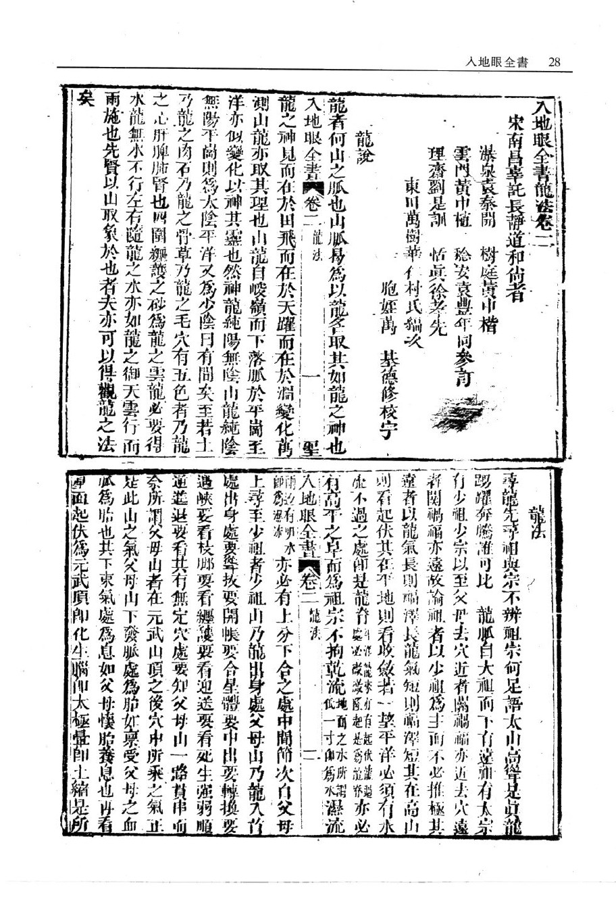

> **图版说明**：本页含图式或表格。请先核对方位标签，再按附近正文的顺序阅读；模糊或缺失标签不作推定。

> **阅读提示**：本页含已登记的残损、校勘或释读不确定项，可在原文对照版与审校账本中逐项核查。

### 原书第 29 页

水来之处是背，合处是面。砂身向外是背，砂头向内是面。既知背面，再看随龙水趋向何处，护龙砂弯抱何方，则知砂水有情之处是龙，无情之处非龙。又有回龙顾祖结者，以祖山作案，有大回受，有小回受，多是尽龙所结，翻身逆势，收本身砂水，其力愈大。静道谆谆指点，无非言山言水，所以认龙一道，此为顶门之针。

记长老说：地理这门学问有什么难的？要义都在阴阳两个字里。原文提到“仝任”明师亲自指点，打破“元机”，就能很好地察看山的“峦头”和“理气”两方面内容，不先明白这个道理是很可怜的。等我独自传授奇妙的口诀，无愧于人间行地仙的名号。山原本属阴，“水”属阳，“水”动山静，要从这两方面察看。阳是夫，阴是妇，夫妇恩爱彼此相当。夫主施与，妇主承受，妇不承受就不能孕育子嗣。山没有“水”的界划，“气”就停留不住，“精无枯”后原文有缺字。历代的风水经验都认为，夫妇相交才能孕育产生，山和“水”相交的时候“真气”会聚。一动一静互为根本，阴中有阳，阳中有阴，“干”“坤”“咒合”是《易》的入门道理。如果“山飞水走”，阴阳“二气不交”，这块地就不是真地。原文“词之”具体所指不详，阳的形态高，阴的形态平，高山为阳，平地为阴。“乳矢窝针”也符合这个道理，阴阳颠倒就是出于这个原因，原文最后提到“以断阴牲四”，该短语具体所指不详。

翁兮阳舒散，垅龙凝聚，枝散漫。此等论用义攸深。窝钳书乳矢同兹判，以此气。

#### 寻龙辨

寻龙首先要识别“行”和“止”，对于去、来、分、合的区别不要糊涂。原文有“龙自游鳞风翼非真落殖”“龙顿与劝马横弓识所之”“颂独房 1雌也”的内容，这些表述具体所指不详，其中“1”为原文原有字符。龙脉走动没有停住叫做“行”，停下不离去叫做“止”。怎么知道龙在走？是“水”分开的地方，也是山发源的地方。怎么知道龙停住？是山交汇、“水”会合的地方。原文有“毗礼之剔舻”的表述，具体所指不详。龙因为“水”的界划，气回旋而停止。“分牙布瓜”说明龙要行走，“藏牙缩瓜”说明龙要停止。原文“以挠悼闪后龙后去离前半足向前龙欲住有前谋徃”的表述具体所指不详。要识别龙在行走，看山峦都脱卸向前；要识别龙停住，看山峦都合围收聚。原文“之以而边分出陵乡均前是立之体”表述晦涩，具体所指不详。普通的风水师不知道，把它指为全星，觉得是好地。现在金星形态不对，还这么判断，这是正龙的牙上分脉，从枝脉曲下，在前方开窝，是死气的表现。它的形态虽然高耸，作为金星“砂”上分脉，如果有出脉的情况，一定有自然的来势，一定有分水引导它。龙如果停住，一定有自然的“水”来界划它。只有合水没有分水，那么来脉的情况不明；只有分水没有合水，那么龙停住的情况不真。这就是通过“水”的分合来识别龙的起止。原文最后有“此游上分下合是为 五i.”的内容，其中“五”为原文原有字符，后续内容残缺。

> **阅读提示**：本页含已登记的残损、校勘或释读不确定项，可在原文对照版与审校账本中逐项核查。

### 原书第 30 页

正圣有分无合，同是虚花。若有合无分，火多结作。不问后读，木不来，要鱼荡腰。木若有禽鱼荡腮，水后龙不禁也。自自以发，不然心日昏迷，起止莫辨，徒尝龙称旧地，多是如此。身挠掉溜下，指为乳头点人，混认左有枝脚，畧海俗边，作龙虎褊场，糊涂认过，亦有门户堪观，精细看。

真龙仕结点，略他向嘶挠溜下，认作乳头。大龙处忽作开窝，迎送二砂，曰龙虎，又曰好个大地，此纪也。这等瞎眼地师，真真盲主，有实害人非浅。小则败家，大则绝嗣，可不痛哉？阿弥陀佛。看地有一大殷待，贫份说来尔听。此是大龙身上过气，不是结作之所。若结地之所，本龙耸起高顶，精光门烁，背后拖出鬼撑撑，后又有乐山罔抱。前面脱去老亮，从起顶处腰间细出细脉，名东气伏，起微泡串珠。今大一个小跌断，过峡再起，是体。或走一二节，脱胎换息，束咽起顶，结成星体，窝钳乳哭穴，情脉气融和。穴前微茫，虾须合衿之水流入小明堂。左右二砂环抱于穴前。二砂内又分出小枝砂来，抱护本身，出脉处名蝉翼砂。外堂之水，或左水到右，要右于砂长出去，勒转作案，横拦于穴前，遮住外洋之水面。面前外案也要清秀，或外朝山特来端正拱穴，或两傍。

> **术语说明**：**朝山**：穴前较远、与穴场形成朝拱关系的山体。

有高大星峰，远抱穴塲。三方帛起生旺之砂，叠叠。或内外之水，明朝暗朝。内堂之水往左，外堂之水往右。本宫之水，左右合局。此峦头砂水俱已得之。方言是地，而外水徃左出，亦要左砂长收，作案法与右同。有此等证佐，地亦不假。此乃大龙腰结，正合劝马横弓之句。所以地理不明，害败多人。信矣哉。请教地理不明者，何走到一方，不论山龙、平岗龙、平洋龙，或见一堆一泡，就言是地。畧畧门户可观，曰输苑才名，闲诵休题。即于此等龙身挠掉，不认得，还讲甚么峦头理气。尔说吐乳开窝，窝是阳窝，乳是死乳。全不想龙不起顶，又无鬼落，前不脱卸，又无脉落。上大下小，一泒死气。既知面前窝钳乳突，虾须合衿，明堂案山，件件俱无。只见一泒汪洋之水，左右大龙迎送砂，你作龙虎，虽然弯抱，却是斜侧。仔细看来，上重下轻，面前之山隔远，借来作案，也是无情。用上圭格之，无向可立，煞泄齐起。此乃虚花之地也。称今说破，方知道术未精，不可误人大事。

> **术语说明**：**案山**：穴前较近、形如案几的山体。

> **阅读提示**：本页含已登记的残损、校勘或释读不确定项，可在原文对照版与审校账本中逐项核查。

### 原书第 31 页

#### 帐辨

寻龙须要寻帐，峡无峡，有峰空雄甲，就中寻穴，穴岂无。

难比夫地真融结。帐者龙之铺张宏厚，而龙挺身转翅，乃龙之旺气发舒，穴之根本。峡者龙之趺断细嫩，而脱胎换骨，乃龙之真精收敛，为穴之咽喉。非贵龙不有此也。若夫夹从缠护之龙，气不逢旺，从何发舒？气不凝聚，从何收敛？此从龙之小帐峡也。帐峡之龙，则虽龙身顿起高峰，祇为他人旗鼓，护卫之具。所谓正龙身上不生峰，生峰定主枝叶送。惟有真人帐慢，多贵人出入。星高耸欲是横人，卧峡中脱换更重重，穴结情形。小龙必帐多峡，硖加动，龙行开帐，龙方贵。服出穿心脉始尊。歌发字品，极战。一重数重为上格，偏脉偏出为下局。

#### 峡辨

龙若过峡脱卸处，名曰结咽。咽是人之性命。峡关龙身生死。研制来则于此换骨，去则于此养成体局。后林烂论脉，有长短正倒过之不同，泥田石水之不一。继县一师嵯，或来大去小，或来小去大。大或有迎而无送，或有送而无迎之继，或欲渡而起。

天狐天角，或者即将形成而结出鹤膝蜂腰之形，美丑不拘。阴脉阳脉，最喜重重包裹众山。眼过峡宜近不宜远，宜窄不宜宽。馈力继加，劾善扫龙者，峡中之奥妙岂可不穷？姒邻善审峡者，穴中之情形自可预料。裸盖正遇者，人穴亦正；理侧过者，人穴亦侧。歌要点：山护者，穴结山薮旁看；水护者，穴结水边峙看。石脊与玉池殊峡，故漱石之与捉月，质分燥湿。秋泥峡与田峡异体，故山谷之与田际，局别高低。看去山小而无迎者，气将敛伏，而知其结作之在近；矫诚去山大而有迎者，气正发泄，而知其涉历之必巡。地转关出峡，最怕风吹火期。前人首结胎，尤嫌水尿。水亦物，明过峡处乃龙脱煞之所。龙不过峡，即为砂也。所以砂无峡，过峡处两边必要有两砂弯抱于峡，名曰送砂。送砂之外，又要二砂夹护缠送向前，左右不离，乃贴身之班长也，最是得力。及至夹送到头，翻身逆势，一砂向穴，可谓龙虎者，实是得力之砂。所云三山并出缩者为先，是也。龙过峡，脱去老壳，必起高势，特立之星星，后两边溜下枝脚，伏往后返，要与送砂相抱，名曰迎砂。此谓有迎有送有散。

> **阅读提示**：本页含已登记的残损、校勘或释读不确定项，可在原文对照版与审校账本中逐项核查。

### 原书第 32 页

过峡之处的地势宜低不宜高，宜细不宜粗，宜短不宜长。地势低就能藏风，高就容易露风；短的话气脉力量强劲，长的话气脉力量就迟缓。过峡经过的位置有“单清”和“双清”的区别。什么是单清、双清？龙脉从一个方位字的正位经过，就叫单清；从两个方位字的界线上经过，就叫双清。比如亥龙如果是从亥位正线经过，叫作单清；如果一半在壬位、一半在子位经过，叫作双清；如果一半在亥位、一半在壬位经过，就是双过而不清。单清过峡的龙脉，往前去会结出正常的吉地；双清过峡的龙脉，往前去可能结吉地，也可能结为庙场之类的用地。凡是看风水的人，要是能弄懂过峡上的这个关键窍门，就算得上半个地仙。连注释这类书籍的人都还不知道这个道理，你们又怎么会懂？等贫僧说给你们听：如果龙脉行进时分出一枝向东、一枝向西，就要懂得分辨阴阳的关键玄机；辨明阴阳才能确定方位，哪怕龙脉绵延千里，也能知晓前方结穴的位置。龙脉分出一枝向南、一枝向北的时候，要按“谨经分帛”所说的，用“奇毛异骨”的特征来识别龙脉的雌雄属性。能识得雌雄，龙脉的走势吉凶就能判断清楚。虽然这几句是“漆话”，具体所指不详，但其中确实蕴含着精深的奥妙。龙脉有单行、双行的分别，单行的龙脉吉利，双行的龙脉有吉有凶。共有二十四种单龙、二十四种双龙。双龙过峡的格局里，有十局是吉局，十四局是凶局。吉局能让阴宅、阳宅都长久平安吉庆，凶局的话灾祸很快就会到来。这些内容不涉及龙、穴、砂、水的相关判断，全是过峡上的关键窍门。所有龙脉不能兼带的方位，一旦兼带就会不吉利。所以有歌诀说：辛戌干亥亥壬加，癸丑艮寅竹虎牙，甲卯卯乙休相见，辰巽巽巳莫逢他，丙午午丁双煞曜，未坤申庚乱如麻，酉辛双峡不宜过，此是夹煞定无差。这首歌诀说的就是龙脉兼带夹煞的定论，绝对没有差错。凡事都要以准确确凿为标准，哪里会有假话欺骗世人？不信的话我再逐条指出来。

峡处上色青黄，河白黑。穴内之土亦青黄红白黑。过峡石，穴中亦石，名石占穴。过峡水，穴即水，名龙泉穴。过峡泥，穴中亦泥，名龙髓穴。要逼山无穴，中有此为真的。开穴有门，出异物者，乃前朝名士所藏之物也。开穴有开出飞兽怪石，此都要在峡上细心会意方可得知。书传难一，须面授方得有。开出蛇虫虾蟆小绝螺蛳螃𫐌之属为生气，此不足奇。虫类山中广多，何足道哉。

至道元年乙未岁，我（衲）来到丰城孤罗山圣母庵住持了三个月，随后前往山下为姓化的施主妆点圣母神像。施主告诉我：前几天嫦弟安葬母亲时，请了一位先生来打井，结果挖出了泥水。我问他离这里有多远，他回答说不过二里。于是我便随他一同前往。走到穴位前，我环顾四周，辨认山头走势。接着我踏勘了后龙三四节，看见一方尊星呈现玉屏的体势，穿心脉跌落形成玉池峡，两旁有护经砂，展开一大帐，随龙脉缠绕抱护，夹带向前延伸。本龙脉伏起呈大武金之势，落下后行金水行度，行了一节便跌断，在东气束气之处，两龙入首，旋转向东，又微微张开窝形，结成一个螺蝉吐肉的形状。仔细查看时，发现此地是八首龙金水的体格，束气如一线过脉，气脉细而且短。气细则气饱，短则力劲。左手有两块玉屏砂，右手来龙金星张开而紧密护持穴场。案山好似御街天马，高金特来作朝。龙虎之外，右水倒左，从巽巳方来，向丑艮方去，正合酉山卯向。此地格局不小，本应生出文武全才之士，享受科甲翰苑之乐，只因福德未满，才将此地挖去。你说好笑不好笑？开井时，上面锄起一层砂石土，深二尺余，下面却是黑湿泥土。再往下挖，剔出白泥土，腥秽之气令人无法忍受。工人见到这种土色，气不过，便将穴内的土全部挖去。四围连同底部挖出了一个石壳。此地本是天生地结，却遇到愚昧粗俗之人，不懂地理，一见有泥水湿土和腥秽气味，便无法分辨，胡乱挖掘一番。这样的堪舆师两眼昏迷，胸中无确切把握，眼中无确切见解。书上又哪里记载了如何识别这种结作呢？如果有懂行的人，往峡上开看便知明白。善哉善哉！所以地理之道广大，一实万分，万一各正。虽然下有地理，上有天理，中有道理，这三者可以共存却不可缺失。因此必须积累愚钝以尽人事，然后才能得到中和之穴。天文昭示于上，地理响应于下，所以说地理之道广大。又说：凡是寻龙的人，必须掌握诀窍，若不得诀窍，指鹿为马，又有什么益处呢？总要在过峡处定下罗经，才能知道是何龙出身，罩脉双脉，龙从何处去。仔细考证星体是何星，起势行度往何方，就能知道此去是否结地。结地的，就寻往前去；不结地的，便是枉费心机。富贵人地，艮主书卷二龙法三。

> **阅读提示**：本页含已登记的残损、校勘或释读不确定项，可在原文对照版与审校账本中逐项核查。

### 原书第 33 页

贫贱寿夭穷通在此辨别。龙虽在地，关实在天。天者何以见？圣人曰：为政以德，譬如北辰，居其所而众星拱之是也。辰在斗内，斗有九星，居其建极以运四方。二十八宿周天，经星布列于其外，环拱北辰者，堪舆之法也。穴场者，北辰也；龙神者，九星也；砂者，二十八宿也；水者，虾须也。用九星看龙神，用二十八宿看砂，所谓二十八宿正谓此耳。至若五星正体、九星九变怪法，则皆搜寻北辰居其所也。九星者，天之斗柄，随月而转，昼夜不停。书云：斗柄指寅，天下皆春。正月在寅，二月在卯，三月在辰，一年十二月，一月则指一字。北斗七星，左有辅，右有弼，故称九星。九星者，贪巨禄文廉武破辅弼是也。此九星在天成象，在地成形，以龙身之行度变态无穷，故以此九星星体在龙神行度处辨其有。共北斗第一星艮丙贪狼木，第二星巽辛巨门上，第三星干甲禄存土，第四星离壬寅戌文曲水，第五星震庚亥未廉贞火，第六星兑丁巳丑武曲金，第七星坎癸申辰破军金，第八星辅弼坤乙土。九星只有八位何也？左辅右弼共一卦，各管一卦，一卦三山。此九星纳甲所属，又有九星之方位不同。贪狼一白坎，巨门二黑坤，禄存三碧震，文曲四绿巽，廉贞五黄中，武曲六白干，破军七赤兑，左辅八白艮，右弼九紫离。此洛书之戴九履一，左三右七，四为局，六八为足，五黄中宫，所谓九宫八卦是也。用法以斗柄之贪狼、洛书之紫白两下合而为一，看峦头之砂无不的确。譬如贪痕木龙往扎行北，白水水生木，结大地。证定星体在峡上，用罗经格定某龙往某方，则知前去结地不结地，地之大小皆在此峡上而定之，方见手段。贪狼即紫气，木身直而长，头员而正。

> **阅读提示**：本页含已登记的残损、校勘或释读不确定项，可在原文对照版与审校账本中逐项核查。

### 原书第 34 页

文中提到本星龙行一白坎位，涉及子、癸三方，但后续‘林生贪银特起如潜龙出海结王侯毕辅之地’等语句语义不通，具体所指不详。又提到木星龙行二黑坤位，涉及未、坤、申三方，但‘不结社人’一句含义不明，无法确知具体所指。

木星龙行三碧处甲卯乙方，林帽如枯木逢春之象，结大地，出人襟怀潇洒，资性聪明，科甲联登，应甲卯乙生人，寅卯辰发福。

文中提到木星龙行四绿巽位，涉及‘杖曲’（具体所指不详）以及辰、巽、巳三方。文中称辰为天罡，出异术，贤士名驰海内；巳位‘检出巨流之辈’（具体所指不详）。若正龙有此特征，则涉及丙辛化（具体所指不详）。

木星如果位于中宫穴的后方，并且作为主星，就叫作贵人星。这种格局的上等格会出仙人圣贤，中等格会出翰林学士、开府级的官员，下等格会出科考及第的人才。贞的含义是直，所以燕对应廉贞木星。廉贞木星龙行至六白干位、属金的戌干亥三方，其中亥龙是上吉的格局，说的是“武隐金之木生在亥”，“武隐金”具体所指不详。亥对应紫微垣，艮对应天市垣，在这个位置结地，出生的人会既富且贵，福禄没有尽头。如果是干龙遇到这种木星格局，木会被金克得灰飞烟灭，出现“烟包灰袋”的情况，具体含义不详，会出作乱的军贼。戊龙遇到这种格局，会遭遇火灾。

木星龙行到七赤兑位的庚、酉、辛三方。庚纳于震，会出威武贤能的人才，在边疆建立功业。酉龙遇到这种格局，此处有“水故”的表述，原文语义不通，疑有讹误，大致是说贤人没有处在合适的位置，出生的人会隐居山林。辛龙遇到这种格局，会结出大的吉地，天上出现贵人星的征兆，一定会生出宰辅、状元这类有出将入相贵格的人。木星龙行到八位，从“艮林”所在的丑、艮、寅三方经过，呈现出麒麟游郊、凤凰来仪的吉象，主“自曰升仙”，“自曰”具体所指不详。丑龙遇到这种格局，不算大吉，如果有旗鼓、戈矛类的砂形，会出武官。“贞艮龙”遇到这种格局，往前去会结成大的吉地，出生的人是忠臣孝子，能享有三公九卿的荣耀。寅龙遇到这种格局，寅是三阳之地，往前去会有拱护的水，日星作为华表捍门。

> **阅读提示**：本页含已登记的残损、校勘或释读不确定项，可在原文对照版与审校账本中逐项核查。

### 原书第 35 页

木星龙行九紫离，涉及‘沐秋’丙、午、丁三方，但‘沐秋’具体所指不详。午为圣人之门，文星高捕，‘霍汉’产奇人异士，学贯天人，号为‘独步舟宾’之格，但‘霍汉’和‘独步舟宾’具体所指不详。丙乃‘大微垣’，峰起贪狼，却也难得。前去结影光穴，生科第公卿之人。丁龙见之，丁为南极，此峰秀拔，若转西兑结穴，贵入‘干林’而多寿者，但‘干林’具体所指不详。

巨门方正如楯，微长而方，稍带斜侧。在天为天医，在人为救贫之神，喜生六秀方。

土星龙行一，自‘坎州十’壬、子、癸三方，但‘坎州十’具体所指不详。壬天于阳水未兑，呈现阳清土浊不静之象，不结。子癸龙见此星，出‘填宦’，为水土归垣，流行数里外结大地，但‘填宦’具体所指不详。

龙脉得位的话，往前去会结天财体穴，或是大金星开窝穴，出生的人家品行端方正直，家中多有金帛，田地连片跨越多个地界。土星龙行到三碧震位的甲、卯、乙三方，原文此处写作“七”，疑为“乙”的讹误。甲是狂龙，遇到巨门土木克土的情况，往前去气脉懒缓，不会结地，只能作为水口的拱护砂。卯龙是雷佩鼓舞的格局，此处原文有“处勇为诚为”的表述，语义不畅，疑有讹误，整体所指不详。乙是天罡傍伏的龙，巨门发足，属性纯阳，不会结地。

> **术语说明**：**水口**：水流进出一地或局势收束的位置。

土星龙行‘四丝’巽，涉及辰、巽、巳三方，但‘四丝’具体所指不详。辰为天罡藏金煞，‘县身’为巨门，会‘羊及’龙舆吉会，出将功成名誉，但‘县身’和‘羊及’具体所指不详。与凶星会，产屠宰之辈。‘麒识明胡’辰龙出脉，结京城会省，但‘麒识明胡’具体所指不详。巽龙本巨门吉星，行度大山落脉，结州城府县行山谷‘夫’，但‘夫’具体所指不详。

结土腹藏金之局，定主巨富小贵而已。巳龙见之，金长生之地，巨门土生金，谓之地不爱宝，‘精’大富小贵地，但‘精’具体所指不详。土星入中宫穴后见之，结流金挂角，生端方正直之人，开展基业致富。

1。原文此处开头写作“王星龙”，疑为“土星龙”的讹误，行至六白干位的戌、干、亥三方。戌对应娄金煞，如果和吉星相会，会出开国建功的武将；如果和“因星”相会，“因星”疑为“凶星”的讹误，会出屠宰行业的人，还有“顿犍、龙刑、邠独信”的相关应兆，具体所指不详。干龙遇到这种格局，属于孤龙，独自高耸云霄，如果落脉就会结成大的吉地，不落脉的话只能做小型的神坛用地。亥龙遇到这种格局，亥是天门，遇到巨门星，上土生金，会结成大的吉地，出生的人有宰辅、状元，还有“输苑才名之贵”，“输苑”疑为“翰苑”的讹误。原文此处写作“上星龙”，疑为“土星龙”的讹误，行至七赤兑位的庚、酉、辛三方。庚龙是天溃龙，纳于震，巨门属巽，原文此处有缺字，语义不通，大致说对应雷风相薄的格局，又是长女配长男、夫妇相配的格局，会结成大的吉地，出生的人有功名富贵，声名显赫。酉龙遇到这种格局，是三合龙格，有“麒弥醉辛”的表述，具体所指不详，往前去会结蟠龙穴或是伏虎形的大吉之地，能让家族兴旺，出显贵之人。原文此处写作“灵辛龙”，疑为“辛龙”的讹误，遇到这种格局是鸣凤朝阳格，有“窃风大山耸拔”的表述，具体所指不详，一定会出状元、宰相，中等的龙脉也能出开府、翰林院的官员，下等的龙脉能出科贡的秀才。

> **阅读提示**：本页含已登记的残损、校勘或释读不确定项，可在原文对照版与审校账本中逐项核查。

### 原书第 36 页

原文此处开头写作“士星龙”，疑为“土星龙”的讹误，行至八白艮位的丑、艮、寅三方。“馆卿”见丑为武库，和巨门星相逢属于金临库地，往前去不会结地，只能作为仓库类的护砂，“馆卿”具体所指不详。艮龙见七，原文至此不完整。

土星号天财，主大富，为禄存。得位寅龙见之，龙带天刑，贱格也。‘同记毕’，阴阳不配，多生‘盲佛跋跎’之人，但‘同记毕’和‘盲佛跋跎’具体所指不详。

土星龙行九紫离，涉及丙、午、丁三方，内乃‘大薇垣’，得此星为主，号天岳峙，对纵横十数里，必起势。龙行十余里，必起龙楼凤阁，结地平洋，或曰边水边方，结大地。今龙见之，乃阴曜辅金，‘潜伏断绢仇燥端’，具体含义不详，或转变木星，始结大地。不变不结。丁龙见之，丁纳于兑，武曲见巨门，前去十数里，必结大地，‘芦鞭龙’结铺地梅花形，但‘芦鞭龙’具体所指不详。

禄存形类巨门，但脚如耙齿斜侧，无收拾，‘为人问’，但‘为人问’具体所指不详。

祸患之神，禄存上星龙行一白坎，涉及壬、子、癸三方，克壬见之，‘玉为’文曲为游魂龙，不结，但‘玉为’具体所指不详。子癸一龙见之，为六煞星，又为破败龙，不结。

禄存土星龙行二黑坤，涉及未、坤、申三方。未龙见之为刚暴，不结。坤龙见之，坤先天在北，干先天在南，是为夫妇。若得此星峰耸起云霄，前去必结纯阳之地，出神仙羽客飞升之人。‘串龙’为禄存，与破军相会，凶恶之极，必水冲风射，崩陷破碎，不结，但‘串龙’具体所指不详。

入地眼全书卷二龙法

#### 大

禄存土龙行三碧震，涉及甲、卯、乙三方。‘于木无枝叶’，主人家零落，但‘于木无枝叶’具体所指不详。卯龙见之，形如瓜匏联延数里，前去再起穴，平洋‘四候你地’，‘玉钟鉴粝缺黼’，但‘四候你地’和‘玉钟鉴粝缺黼’具体所指不详。乙龙见之，与‘禄如存’会，乃‘羊及煞’，不结，但‘禄如存’和‘羊及煞’具体所指不详。

禄存土龙行四绿巽，涉及辰、巽、巳三方。辰为天罡亢金龙所居，若起高大雄星，前去数十里或数百里，结京城省会。六龙过峡，总不离辰戌丑未四龙，无此不为大结。作亢金与禄存会，乃‘及煞’，也多结河泊旷野之所，但‘及煞’具体所指不详。若巽龙见之，委靡鬼诈，进退不果，得干刚健济之，前去飞扬鼓舞，变吉宿，结大地。不可因禄存而去之也。巳龙见之，‘也烟休献也公’，离虽起伏结穴，出人无寿，但‘也烟休献也公’具体所指不详。凡龙神最忌‘剥6’，但‘剥6’具体所指不详。

> **阅读提示**：本页含已登记的残损、校勘或释读不确定项，可在原文对照版与审校账本中逐项核查。

### 原书第 37 页

上龙人中宫穴后见之为禄存鬼，与吉星会则吉，与凶星会则凶，谓之群邪欺主。

禄存上星行六白干，涉及戌、干、亥三方。戌为娄金煞，纳于离，文曲与禄存遇，甲木死于午，龙神死地不吉。干见之，纯阳禄存相会，谓之干归干位，前去必结阳基阴砂阳水，阳基以午戌结局大吉。亥龙见之，亥乃天皇龙，‘禄存大十’，但‘禄存大十’具体所指不详。

凶星如同武将奉君王之命去镇制四方。凡是亥方来龙，禄存星起顶，必然变为吉星，结穴于众山之中，所以有凶星变吉星的说法。结穴处有吉星变出懒坦形，结穴之地尚且遥远。

禄存土星龙行至七赤兑位的庚、酉、辛三方。庚是天潢龙，遇到禄存星，属于火虾刚金覆盖的格局，庚对应嘴火之气，又属阳金，是干甲方位的燥暴之神。禄存属土，由火所生，土又能生金，被称为寒谷回春的征象。龙脉从火星凶方过来，往前去结地，出生的人能在短时间内成就功业，这是龙穴的特殊情况。酉龙属金，遇到此地是得旺地，再得到干甲方位的禄存土临照，就像有宝光映照，叫作强龙，往前变换形态结地，会出在边疆建立功绩的武职官员。原文此处写作“辛尨天乙贵人”，“尨”疑为“龙”的讹误，遇到禄存土，属于贵人登将地的格局，是朱雀乘风格，一定会变出六秀穴，出人才，获得科甲功名。

禄存土龙行于八白、艮、丑、艮、寅三方。丑为贵人星，得此禄存土星起顶，如太山乔岳，人所共仰，万仞壁立。前去脱卸或转西兑，会六秀烟称，结穴必大。艮龙见之，艮天市垣，禄存大煞星，艮见禄存为破败。艮嗣丙，丙入午为羊及不吉，前去必生峻险石壁，不结。寅阳龙火长生之地，见之谓火旺于火，刚暴不结。

禄存土龙行经九紫、离、丙、午、丁三方。文中提到“丙龙阳火见禄存土手”，但“禄存土手”这一短语的具体所指不详，原文在此处结束。

文中描述火气向外散发，火焰愈发猛烈，这类气脉多聚结在龙潭、社庙所在的地方。午龙出现这种情况，是一阴初生的时节，所处为木的死绝之地，木都烧成灰飞散，灵气无法汇聚，往前延伸的龙脉枝脉分散杂乱，数量虽多但不能聚结为穴。文中还提到“枇识岬丁龙见之”，其中“枇识岬”具体所指不详。丁龙出现这种情况，丁对应南极寿星，又有禄存星临照，丁的禄位在午方，往前延伸必定会结“土金穴”。

文曲水星的气峰，在人间被称为“游魂”。文曲水星行经一白、坎、壬、子、癸三方。壬龙处于死绝状态，子、癸二龙处于刑位，这些地方是塘坑、池沼、溪涧、渊湖的所在。文曲水星行经二黑、坤、未、坤、申三方。未纳震，壬纳药，干支相战，不结“耗”，此处“耗”字含义不明。坤龙见到这种情况，坤为地，与文曲相刑，往前延伸多是溪渊、田塘、污泥之处。申龙对应的申是壬水的长生地，见到这种死绝之气，不能结穴。原文此处为“文出水龙行三碧震甲卯乙三方”，“文出水龙”可能为“文曲水星”之误。文曲水星行经三碧、震、甲、卯、乙三方，甲对应“羊及”，此处“羊及”含义不明。卯龙见到这种情况不能结穴，是因为卯破午。乙龙见到这种情况，乙木生在午，午是乙木的长生之地，往前延伸变换形态，有吉星相会，会结“金水三台穴”。

> **阅读提示**：本页含已登记的残损、校勘或释读不确定项，可在原文对照版与审校账本中逐项核查。

### 原书第 38 页

文曲水龙行经四绿、巽、辰、巽、巳三方。辛金生癸水，有金白水清之象。辰龙见到这种情况，辰纳于坎，午、壬、寅、戌，文曲水出现，水火济持，身清洁，日月同光，结地，理学传家。巽龙见到文曲，如同枯苗得雨，逶迤前去结地，结“飞凤冲霄”或“长虹饮水”，主（此处原文“主”字后内容缺失，含义不明）。其中“曰月同光”的“曰”字可能为“日”字之误。

或蝴蝶戏风等穴。水星扦动处，最的人财雨旺，科甲联登。巳龙见文曲，乙庚化金，夫从妻化，全生在天乙太乙峰起，结地合六秀，生人资性瞻敏，杲断有为。入中宫穴后见之，必要水木摆动方吉。

文曲水龙行六白、干、戌、干、亥三方。戌龙见之，乃文曲本宫，多游荡，少成实，多结荒郊旷野。亥龙见之，木归大海，前去必换木星，结穴。

文曲水龙行经七赤、兑、庚、酉、辛三方。庚为阳金，与乙木相配，乙庚化金，属于夫从妻化，往前延伸必定会结“太阳开窝”或者“悬乳”形的穴，金水无动穴，所生的人勇武、智谋广多，原文提到“多味”，该词含义不明。酉龙见到这种情况，是水土沐浴的处所，又遇到文曲星的败荡无收之气，不能结穴。辛龙见到这种情况，原文有“二继乎子额”的表述，这一短语具体所指不详。“辛王会合”中的“王”字可能为“壬”字之误，龙脉往前延伸跌断后又重新隆起，结穴的形态为“风吹罗带形”、“铺地梅花形”。

文曲水龙行八白、艮、丑、艮、寅三方。艮见之，文曲水生贪狼木，蛟龙得雨，龙气飞扬，前去结木星穴，伏虎形象，鼻卷湖形，生八激浊扬清，沾名吊誉。丑寅一龙乃鬼劫也，不结。

文中提到“亥曲水龙”行经九紫、离、丙、午、丁三方，为入本宫火，见水不结穴。“亥曲水”可能指亥方的文曲水星。文中还提到“八卦离壬实戌”，这一短语具体所指不详，可能为术语或误写，为火，离木属火，九星位又属文曲水。

寻龙以水为主，卜卦以火为主。文曲水星乃懒缓之神，多见于龙身上转换之处。若论五行中，非水不生，非上不载。论峦头，若得水星起顶作势，前去转换吉星，结大地。若与凶星会，又卸陷，则凶。凡天下之名山，起眼一看，总是一个大涨天水星，包涵万象。

廉贞星的方位起始于东方，是天帝所出的方向，九星之中只有这颗星地位最尊。廉贞是第五星，对应正五黄，位居中宫。八山如果没有这颗星作为祖龙，龙脉即使变换形态出官，也难以做到三公的高位。只有亥龙最为吉利，亥对应紫薇垣，是上帝居住的地方，原文提到“康贞在帝位之傍”，“康贞”可能为“廉贞”之误，是左执法宿。凡是穴后对应中宫，或者在刚旁当前的位置，就叫做“照穴”。这颗星与艮宫相连，变换为贪狼星，就称为木生于亥，是学堂的文馆星。这颗星高耸的会出圣人、仙人，稍低的会出魁元，再低的会出解元。原文提到“前翻性贼艰”，这一短语语义不明，因此说联气。高耸的对应火星，稍低的对应木星，再低的对应金星。不论高低，只要顶部尖耸的就判定为火星。高的力量刚猛，低的力量微弱。原文末尾的“靖地”一词含义不明。

> **阅读提示**：本页含已登记的残损、校勘或释读不确定项，可在原文对照版与审校账本中逐项核查。

### 原书第 39 页

廉贞火龙行一白、坎、壬、子、癸三方。上阳水，廉贞火盛大，灭破败之乡，不结。子癸一龙见之，与破军相犯。破军本刚金，遇廉贞阳火，火龙游坎水，必前去迢迢变换星体，结公侯将相之地。

入地眼全书卷二藏法

垂

廉贞火龙行经二黑、坤、未、坤、巾三方，此处“巾”字可能为“申”字之误。未中藏有鬼金，不适宜见到火，原文提到“不结钦鬼”，“钦鬼”语义不明，不能结穴。坤龙对应老阴，处于丙火的死绝之乡，属于伤残龙，不能结穴。申龙对应的申是水的长生地，先天卦位为艮，后天卦位为申，与廉贞形成六冲，不能结穴。

原文提到“康贞火龙”，“康贞”可能为“廉贞”之误，它行经三碧、震、甲、卯、乙三方。甲为阳木，遇到火就会被烧为灰飞散，不能结穴。卯龙见到这种情况，原文提到“木生万伋”，“万伋”含义不明，往前延伸出现“开肺展超”的状态，这一短语语义不明，变换为贪狼木星，结“飞凤冲霄”、“黄龙出海”、“帐下贵人”等穴相。乙龙对应的木性质阴柔，以此星作为祖龙，相当于让小人承担重任，龙脉散漫跌断，不能结穴，只会结庙场而已。

原文提到“康贞火龙”，“康贞”可能为“廉贞”之误，它行经“四丝”、巽、辰、巽、巳三方，此处“四丝”可能为“四绿”之误。辰龙对应亢金，遇到火，原文此处“不”字后可能缺漏文字，语义不完整。巽龙对应的巽是六秀之一，以火星作为祖龙，辛金遇到艮、震直接变换，才能出入山海，“风需显赫，飞舞扬成”语义不明，必定会结大地，科甲连绵，人烟众多。巳龙对应的巳是金的长生地，与火星相克，往前延伸是峻岭壁立的地貌，原文提到“万似龙酒”，这一短语语义不明，有蛟龙栖息在这里。

人中宫前言之

廉贞火龙行经六白、干、戌、干、亥三方。戊龙文曲水，廉贞火相克，不结穴。干老阳见到这种情况，过于燥暴，多粘假穴。若无变换星体，误扦者绝嗣。亥龙见到廉贞，照耀天门，向明出治之象，起龙楼凤阁，变一阳金水作穴，贵居一品，“细”（此处“细”字含义不明，可能为“显”或特定术语）。

廉贞火龙行进至七未、兑、庚、酉、辛三方。庚龙见火星，钦苍龙飞跃前去，转化为辅弼星，临近田畔水边，变为天财土星，结成大地。西龙武曲星相随，称为山泽经气，前去必结三台金水穴。辛龙见此星，称为天门地户，前去必结巨门太阳金水穴。

廉贞火龙行进至八白所对应的艮、丑、寅三方。丑龙若见牛金煞气再起，廉贞火与金刚火交烈，其煞气更重，此时只宜用来拱护水口，不宜结地。艮龙若见此星象，称为“虚涵太乙”。若此龙脉傍依长江大河，连接郡邑市镇，或生于山谷之中，必能博得天财、三台之贵，生出三公九卿。至于寅龙，寅纳于离卦，若经过廉贞则化为羊，又属狂龙，不结穴，其方位在巳。

> **阅读提示**：本页含已登记的残损、校勘或释读不确定项，可在原文对照版与审校账本中逐项核查。

### 原书第 40 页

廉贞火龙行进至九紫离、丙、午、丁三方。丙太薇垣气属贪狼，火星出见，木火通明，前去金永行龙，得紫微星照，为上格，发大族名家。午龙正阳之位，火气大旺，文曲乃游魂之神，与星相克，前去必散慢不结，为河泊池湖。丁龙丁寿星化气，得木纳于兑，又为武曲，廉贞火克武曲金，武曲金克化气木，三气相问，前去无局可结。

武曲形类大阳，头圆而高耸，气降人开，为福德之神，金星是也。

武曲金龙行进至一白坎、壬、子、癸三方。壬龙阳水见武曲，水美。

龙脉遇到沐浴位，难免会有伤残，难以结穴。原文此处为“任发 子癸二 壬化木兑龙一阳初生逢武曲六阳盛大前去转换至巳六阳之地金水三台结大地”，存在文字缺漏，语序有断裂：原文提到壬化木，兑龙一阳初生，遇到武曲星后六阳之气盛大，往前转换到巳的六阳之地，会结金水三台大地。文中还有“龄狂燔岭面体尉六储如姓地融”的表述，具体所指不详。武曲金龙行经二黑、坤、未、坤、申三方。未龙藏有金煞，见到武曲金的形制会克制龙气，不能结穴。鬼金气势雄大健旺，往前延伸会结为州城府县的地脉。坤中一龙如果以武曲金作为祖山，土金相生，气势盛大，龙脉转到酉、辛方位，再变换到干、亥方位，会结金水穴，是出将入相的福地。

武曲金龙行进至三碧震、甲、卯、乙三方。甲乙一龙起武曲，早木气伤残，枝枯叶落，真气不聚，去必散漫，文曲破局，当为窄狭岩谷之所。权生法乱血，卯龙见武曲，震生在纳庚，庚金生在巳，巳为武曲，灵气聚行数里，必变金水脉，出帐结成梅花贵龙格局。武曲金龙行四绿巽、辰、巽、巳三方。巳龙合六秀，武曲金，金水扶阳，前去转巨门，上结穴，富贵寿考。辰龙凡金见武曲金，前去结金水穴，或结省会。巽为阳璇之龙，武曲丙丁互换，必开玉关金锁，断跌平洋，转巳，再转坤申，后归巽巳，水木行龙作穴，明堂宽大，应龙高起，大旺人财，阴阳两结，富贵不绝。

大地眼全书卷一蓝法

美

入中宫穴后有此武曲金星应穴，乃六秀大吉。武曲金星行六白干、戊、干、亥三方。戌龙纳离，武曲见之，气泄不纪，立庙可也。干龙有此星，干纯阳，武曲起顶，煞气太重，须脱卸变换，干艮丙辛四龙方可结穴。亥龙西北紫薇垣，是真武登坛格，前去变金水，三台起五脑芙蓉帐，必结木星开口穴，有三穴天地人。

武曲金龙行进至七赤兑、庚、酉、辛三方。庚龙纳于震，气行于亥，武曲兑，兑纳丁，丁庚相配，夫归相会，诸结左矩。丁壬化木，开帐木火转换，木星结飞凤形。酉龙旺气刚暴，转换金水，开芙蓉帐，结将军大座宝剑出匣形。辛龙于巽遇六秀星，前去变金丝坠落帐下，贵人转诰轴天财穴。

> **阅读提示**：本页含已登记的残损、校勘或释读不确定项，可在原文对照版与审校账本中逐项核查。

### 原书第 41 页

武曲金龙行进至八白所对应的艮、丑、寅三方。丑龙武库得武曲金，武将当专城之任，前去变为金水帐，文曲星过峡换贪狼，或倒地木流山木，转为金鹅展翅、长虹饮水、金水梅花穴。艮龙纳丙，若逢武曲则光辉灿烂，但木逢金克，煞气尽后还魂，转为金木芙蓉帐，取木气结穴大吉。寅龙纳于离，武曲气不相通，不结金穴。

入地眼全书卷二龙法君

武曲金龙行进至九紫离、丙、午、丁三方。丙太薇垣得武曲，为武将登坛控制四方，是真贵格。前去必转至西兑，应六秀穴，或呈蟠龙形，或呈白象卷湖形。午龙位于午正阳之位，金居午位，号金乌，当天光照临四海，亦为贵格。前去若见“号旒土”，必变为金水结穴，具体所指不详。丁龙为南极星，午为赦文星，不易得者，转六秀结穴，乃科甲将相封侯代祭之地，贵而多寿。文中提到“打锵武出居之序，是本卦”，具体所指不详。

破军头高大，形类武金，但脚散乱拖出，飞斜形如破伞。此破军星作祖，正出不结。角茗变金水，乃结在天，肃杀之权，气降人间，为绝体。此星行龙，不怕风吹水刼，能再兴营寨作穴也。

破军龙行进至一白坎、子、癸三方。壬阳水为破败散龙，不结穴。子、癸二龙见破军，为万水朝宗之象，去必威武奋扬，起伏至数百里或千余里，起伏盘旋，开牂开帐，分杖。大则结京省，次则结州城府县，小则结大镇市、大乡村、大战场、名山胜景。及至尽处，结虎形、二龙戏珠形，贪狼出顺王侯地也。余气散漫，散于江边，作州麦地，一片平洋，行百余里之地方。文中提到“如是人见辰戌天”，语义断裂，具体所指不详。

该段原文严重破碎，存在大量缺字，语句无法连贯，仅能识别部分零散内容：先查看余龙的动静，其次看血脉。文中出现“亢金戌娄金丑 金未鬼金”“乃十定来龙”“得金通古”“云此是徐龙不须时庸法师 不知此紧怎知看地之”等零散表述，其中“徐龙”“时庸”“此紧”等内容的具体含义完全无法确定，整段无法进行可靠释读。

破军龙行进至二黑坤、未、坤、申三方。未鬼金二十八宿惟鬼宿二度半，龙身上有此破军星出现，如大将乘权，四方畏惧，行龙必是干龙，前去必结大地。

坤申二龙为老阳，申水长生之位，破鬼见之，纯阴秉政，后妃掌位之象，前去必成深渊，阴气凝聚，寒洽之所。

破军龙行进至三碧震、甲、卯、乙三方。甲乙二龙见破军，金旺木湾剥削，不结。卯见之，前去必转西兑，变金水结穴。破军龙行四缘巽、辰、巽、巳三方。辰龙见破军，金煞会金煞，为破旗，结神坛社庙之所，或作旗鼓水口之砂。巽龙会破军，必起水星帐，辅正龙左右，砂形如令旗，又作罗城水口。巳龙有破军龙作祖，得三合酉方金气，前去必变武曲金水行龙，穴结祥云捧月形。

> **阅读提示**：本页含已登记的残损、校勘或释读不确定项，可在原文对照版与审校账本中逐项核查。

### 原书第 42 页

八中宫穴后见之破军为主星，金气大盛，肃杀之气，时令为秋，凶恶之星。穴吉辅吉，穴凶辅凶。

破军龙行进至六白干、戌、干、亥三方。戌、干二龙见之，为破军张纲，凶恶之极，不结穴。亥龙见破军，为小人居贵垣，不祥之兆，必须前去变换脱卸，自兴营寨，自立门户，方可结穴。文中提到“卦附狐纬，惟移自衣食一字，按历”，语义不明，具体所指不详。

破军龙行进至七赤兑、庚、酉、辛三方。庚见破军，庚纳于震，金克木，乃败伤龙，不结，必变换乃可，否则水口砂也。酉正西乃旗星也，坐万山之中，有众星拱衞，正西方倦旗星出，威武专城之职，星体尊严，出将入相之地。辛天乙星见破，为得贵乘权之象，前去必起巨门尊星，变金水。

行龙结荷花形

文中提到“破军龙行八白良丑艮寅三方”，其中“良”为原文用字，疑为“艮”的讹字。在丑地武库见破军旌旗，原文有“旌加优”三字连读，整体语意不明，所述是扰乱行兵的征象。如果庚、丁二气相合，往前去必然变为金水行龙，结成黄龙。原文有“出 J 艮龙见之”，其中“J”为原文残存字形，具体含义不详，此处若见艮龙，对应的是血光星。往前去形成“让卫之砂”，遮护贵龙，可成就郡邑规模。如果灵气不聚就不能结作，临规致事。真龙火的长生位，破军藏有戊土。上戊与丙会合，龙气就会隐迹潜逃，往前数十里必然有修仙炼丹的场所，名山大川之间难以结穴。原文还有“军成生候辉 兄其所指之 虚仰为月建”，“军成生候辉”含义不明，“兄”为原文用字，疑为讹字，整段语意不明，具体所指不详。

八地眼全书卷一龙法

破军龙行经九紫离、丙、午、丁三方。午为正阳，是君主临朝听政的方位，此处见到破军是不祥的征兆，不能结穴。丙对应太微，主管人间祸福的权柄。破军在酉的西方位，是财货之神，往前去必然会顿伏，转变为金水龙，带巳前行，结成人口聚集的市镇所在。文中提到“所生𫗧栢辉醇丁南极星见破军”，“𫗧栢辉醇”与“丁”连读，整体断句存疑，“丁南极星”为原文表述，未明确定义，此处见到破军，往前去会转变为文曲星，散漫不纠。

左辅属金，多生过峡结穴之所。过峡有此星，是迎送二砂。结穴有此星，为飞鹅。辅星结穴与众不同，所以正龙过峡处有结地者，皆辅星所结。正大大之结，作出人正大富秀长久。或峡前结，或峡后结。古云：峡前峡后好转龙。辅星本属金，九星坤乙辅弼土，则取土生金。五行中非土不生，有辅佐之义焉。

> **阅读提示**：本页含已登记的残损、校勘或释读不确定项，可在原文对照版与审校账本中逐项核查。

### 原书第 43 页

左辅星生一白坎、壬、子、癸三方。壬为阳水，左辅微弱之金，必怠缓不结。子、癸二龙有左辅星，如月照寒潭，令人可爱，前去必变整腰鹤膝，或金水行龙，结大地。左辅星龙生二黑坤、未、坤、申三方。未合震木，木气收藏不结。坤申水土龙，龙气发泄不结。

辅星龙生三碧震、甲、卯、乙三方，皆为贱龙。左辅贵秀。文中提到“辅韭主”，其中“韭”字极可能为“弼”或“星”的讹字，此句语意不明，具体所指不详。

其主金木相克不结。震为庚帝，出乎震，起顶脱卸，起一高冈，弯弯向前，是左辅结大地。

左辅龙生于四绿巽、辰、巽、已三方，“已”为原文用字，疑为“巳”的讹字。巽为柔水，辅助柔金，灵气不振，不能结作。辰对应在渊之龙，忌见到这种情况，不能结作。原文提到“己乃金长生地”，“己”为原文用字，疑为“巳”的讹字，以金助金，气脉必然大振，生出武曲或巨门后结穴，进入中宫廉贞的位置。艮气旺盛的方位，是左辅所居的地方，与天地同气。廉贞作为龙脉的祖山，得左辅在穴旁的，是大结的宝地。原文提到“中吉属十艮亦辅星”，“属十艮”为原文连读，断句存疑，“十”字疑为讹字，语意不明。艮也属于辅星。龙生于六白干、戌、干、亥三方。戌干一脉为阳枢，阴阳混杂，不能结作。亥龙对应天皇，左辅是贵宿，起护佐作用，艮与亥相合，木气盛大，必然生出出阵贪狼木星，结成大地。文中提到“天民根合是”，整体语意不明，具体所指不详。

辅星龙生七赤兑、庚、酉、辛三方。庚纳于震，后大与艮相联，其中“后大”含义不明。见左辅前去飞舞振作，成金水三台帐下贵人格，失之“雌后”，其中“雌后”可能为“雌雄”或“雌伏”之讹。酉龙酉金旺，见之顺缓不结。金天毗辛，能纳于巽，见左辅为贵人，秉印。文中提到“印天闲地轴是也”，其中“天闲”可能为“天关”或“天门”之讹，语意不明。前去开帐展翅，变木火行龙，结穴。

辅星龙生八白艮、丑、艮、寅三方，为居木宫。艮大市垣，文中提到“掌主”，此处语意不完整，可能为“掌管”或“主宰”之意，但后文缺失。

天下财富之星也。龙格难得，此星结局富贵双全之地。辅星龙生九紫离、丙、午、丁三方。两纳于艮，左辅居之，形长而方，为归木宫。结穴午、丁一龙，见之与右弼相合，前去变成金水穴。

右弼属水，位居九宫，盖与帝星州见乎离。五行非水不生。九星巾巨门坤乙土，阳气极于午。穴上一星流动不滞，屈曲如蛇，近看似有，远看则无。最要细心体认。

右弼龙生一白坎、壬、子、癸三方。坎北方阳水也，弼阴水也。九星辅弼坤乙土，克壬子癸三方之水。弼水坎水，二水大旺，水多则流水旺，则荡不结。右弼龙生二黑坤、未、坤、申三方。未合卯枯木，发生必转换倒地木，结穴。坤乙龙士与右弼土，二土混杂不结。右弼龙生三碧震、甲、卯、乙三方。甲龙禄存见弼土不结。乙龙见弼土不结。卯龙见右弼，如蛟龙得云雨之象，如生蛇屈曲起伏，盘旋翻身，逆势仰面张潮，大结作四神八将来拱峙，名播华夷，镇大藩。

> **阅读提示**：本页含已登记的残损、校勘或释读不确定项，可在原文对照版与审校账本中逐项核查。

### 原书第 44 页

右弼龙生四绿巽、辰、巽、巳三方。辰龙尤金不结。文中提到“巽巳二”，此处原文至此中断，意未完。

龙见右弼，未必纵横。龙行水，水星结穴。

入中宫有此龙穴者，谓蝉翼砂，大吉。

右弼龙生于六白干、戌、干、亥三方。戌纳离，文中提到“得六不给”，语意不明。干、亥二龙，干为老阳，见到右弼木，虽然有生气，但结地不大。亥龙见到右弼，亥为天皇，见到左辅，就像忠臣护卫国家、赤子依附父母，结地可以长久。右弼龙生于七赤兑、庚、酉、辛三方。庚纳于震，遇到水就能得到生助。酉辛金龙见到右弼水，金见到水就像古镜重新打磨，光辉灿烂，往前去转变为水木龙结穴，富贵“编远”，“编远”为原文用字，疑为“绵远”或“遍远”的讹字。

原文提到“右弼龙生八自艮丑艮寅三刀”，其中“自”为原文用字，疑为“白”的讹字，“刀”为原文用字，疑为“方”的讹字。丑寄于兑，见到弼水，生化艮丙贪狼。本见弼水，坐化二龙，逢生结水，原文有“结水水芦鞭穴”，“结水水”疑有讹误，语意不明，对应水芦鞭穴。寅龙寄于离，右弼是微弱的水，行到离火位不能结作。右弼龙生于九紫离、丙、午、丁三方。丙的气不隐藏，明曜发怒，原文提到“略 石”，语意不明。往前去发生变换。丁龙结盘龙形，所出的人多富贵长寿。原文提到“留则缘敬妯脉潮丁龙见之”，“缘敬妯”含义不明，断句存疑。丁属不逢水生，水气会合，往前数十里变换结穴。原文有“仰 明今み红合町主”，此处混入日文字符，含义不明。午龙见到这种情况，是水扶助阳，阳光踊跃，往前去“发换”，“发”为原文用字，疑为“变”的讹字，结“七星宝每形”，“每”为原文用字，疑为讹字。原文提到“虎雨包砂水秀公侯将相贵无疑”，“虎雨包砂”疑有讹误，整体语意不明，若是砂水秀丽，出公侯将相这样的贵人是没有疑问的。

以上贪、巨、禄、文、慊、武、破、辅、弼，是大上之九星也。龙虽善。

判断一处土地是否结地，首先要从帐峡开始观察，确认峦头是由哪颗星曜起势，因此需要结合天象来审视。至于结穴的情况，各地各不相同，变化多端，有的地方能结穴，有的则不能，关键在于在过峡处使用罗经来辨别其吉凶。只有掌握了这个关键窍门，才能判断前方是否真的能结地。仔细研读这一篇内容并熟记于心，这样在实地看地时就能掌握要领。

有人问：好地是如何好的？回答说：龙脉耸拔且活动，砂形秀丽，水势有情。衲说：如果龙脉美好，但砂和水有瑕疵，结出的穴也是龙有瑕疵；虽然有美好的砂和水，若龙脉有瑕疵，便无法结穴。总之要重视龙脉，龙是根本，穴中的暖气全靠龙脉行来。又问：如何辨别龙的美与恶？如何辨别龙的真与假？如何辨别龙的行与止？如何辨别龙的游？回答说：龙美则峰峦磊落，星辰端正，有盖帐，有顿跌，有起伏，有个字、飞鹅等形态，这是美龙。若峦头臃肿，星体斜侧，不变化、不起伏，无盖帐、无挠掉，到头只是为他人做护卫，这是劣龙。衲说：确实如此。常见有美峰结地却不住，有星辰不佳却反结大地，文中提到「得不麻妍怕类」，具体所指不详。有盖帐飞鸦而出者贵，无盖帐飞鹅亦出贵者；有个字未必贵，无个字未必贱，这又该如何说？回答说：打心龙。衲说：穿心龙百不得一，而极贵之龙未必穿心。文中提到「卿姒不依」，具体所指不详。恶龙之辨人人易知，有等俗士无知，误认好龙葬下，绝人宗祀。明观问：龙何为真？何为假？

> **阅读提示**：本页含已登记的残损、校勘或释读不确定项，可在原文对照版与审校账本中逐项核查。

### 原书第 45 页

回答说：有顿跌、有曲折，一脉之清，一星之正。衲说：确实如此。常见有顿跌曲折、脉清星正却不结穴的，这又该如何说？回答说：是花假吗？衲说：龙有顿跌曲折、脉清星正，自然结一大地；行至尽处，现一花假，门面可观，但砂水不合，立向阴不得阳，又不得阳，所谓阴阳破局。但是真龙行度明明白白，人人尽知。谁知龙起一大势，踊起为山，就在山之脚下变成挠掉一般，早已溜去。顿跌行走二三节，开门立户，四山园抱，朝案对坐，砂水合法，所谓真龙藏住，穴难寻，惟有朝山识作「心毗轮」，具体所指不详。谁知余气不结，往前「介去」，具体所指不详，至两下水交会处，一现花假。所云龙真而不结者，此之谓也。问：龙何为行？回答说：「张不布瓜」，具体所指不详，势如跑马，有送有迎。衲说：确实如此。问：龙何为止？回答说：有蜂腰、触膝，砂交水会，细嫩方止。衲说：确实如此。常见有蜂腰鹤膝而不止者，有细嫩而不止者，有不细不嫩而止者，有不止于砂水尽处而腰结闪结者，这又该如何说？指点说：总是人不得窍，便叫怪叫奇；得了窍甚是平常。总之有一大窍，登了穴场，行止于此，辨真假于此，辨美恶于此，辨富之大小、贵之轻重、生死祸福吉凶、房分。有龙无美。

穴有砂无水，有水无砂，风蚁干混，皆于此辨。人人识得，人人不识得。识得，登山教之；不识得，古冢上察之。此关一破，则地之有无、大小，了然在心目间矣。龙既得矣，还要穴法、砂法、水法、葬法、向法，此五法配合，方龙发福。五者不明，吉地葬凶，祸不旋踵。陈和拨砂经宜熟，布衣催宫篇要明。河图水法是先天，洛书水法更有情。先天后天二八卦水来配向，发福真不知此法来配合。得龙得穴，枉劳心。无奈今之习此道者，买几部地理书，常看常念，记熟几就与人谈地。他不如我，又无明师传授，自作聪明，上山东走西走，空空跑了几回，又把死书看看。书中又无真传，久无真诀，看他何益？岂不是瞎看瞎跑，劳神费力？总是一得自矜，不肯虚怀善下，礼拜明师，遂误一生。古云：看书千卷不如登山一回，登山千回不如口诀一句。总要明师登山指点，方得此道。无师之学，亦如医理，庸医杀一人，地师杀一家，可知罪孽深否？过了三年五载，就来行道，鼓舌弄唇，欺世如自欺也。倒运之家邀请至屋，听其巧言，将父母尸骸葬下，福未至，祸先来。小则败家，大则绝嗣。竟有三扦四扦者，将父母毛散骨碎，尸厌秽天地，岂不痛哉？

> **阅读提示**：本页含已登记的残损、校勘或释读不确定项，可在原文对照版与审校账本中逐项核查。

### 原书第 46 页

不要以为只有高山才有龙，来到平地就失去了真踪。平地的龙从局岭发源，高起星峰低落脉。高山认好星峰，平地则在两旁寻水势，两旁水界是真龙。水缠即是山缠，理霜降水涸龙不现，春夏水高龙背见。这是平洋看龙法，过处如丝或如线，必须形迹明显。若落茫渺无凭，终究不可信。高水一寸即为山，低水一寸水回环，寸之备只为时师眼力浅，便说此处好峰峦。要知道高山落平里，退卸愈多德有力。祖宗父母数程遥，灰线草忭寻脉，眷隐隐隆隆，须细认。文中提到「蛱丝马 共」，具体所指不详。

迹要分明，如发如珠是真峡，一断一续莫离踪。赈愿方三尺，平洋一突更为奇。活动尤须求束气，忽然人穴口钳开，两水夹护星真息。

又想地理一道，乃世之大事。富贵贫贱、寿天兴废、吉凶祸福、善恶死生，皆是地理所关。业斯道者，怎不拜明师登山指授？究竟几多儒家，造书千言万语，总是这些套。一登山，钳口结舌，无一定见。书呆子原来屋里先生，木明此道，何苦殃及后人，竟作儿戏。一开口讲峦头，一大如天；讲平洋，一细如粟。此从那里说起？天下之大，山者莫如五岳，中华之老祖也。可见有游鳞风翼、万马奔驰乎？譬如葫芦能有几大？其葫芦生藤，其藤上且有三四分围，莫说一平洋过脉乎？将此一论，皆是说元说谬，可信不可信？贫神生于南昌，出家于丰城，在敝处地名中州，见一平洋局。其龙省龙分枝起势，结禅师岭。从岭脚下一脉，不尙半里，向北一铺，往前四围方圆。从其右六七十里宽阔，可谓一大平洋否？其处人烟也有，田塘也有，州地也有。其地高低不等，洪水泛涨也有，水海处也有，不淹的涨水不大不小，一望千枝万叶，犹如书工画云一般。

> **阅读提示**：本页含已登记的残损、校勘或释读不确定项，可在原文对照版与审校账本中逐项核查。

### 原书第 47 页

其龙宽大者是干，细小者是枝，是谓枝中干、干中枝。弯弯曲曲，一钩一搭，不计其数。左有一河水，从江前岭来，往砂浦潭辅向南流；右有一河，从堑顾流来，至棉墅港，两水合袷，往杨家涝去。左省龙从潢溪渊洪渡河，共此河结省会；右边从堑岭出一枝，结南昌下乡。此局背有白湖岭作座，前有五曲冈作案，左有江省龙作护，右有结下乡一枝循护。此是南昌中畑一大平泮局。诸看过脉处，如丝如线乎？龄定日后，此局内人烟满处，衣冠济济，出将入相，可谓南昌第一局也。

龙论平洋。龙落平洋，最且夷渺漠之中行渡，稀转换。虽无大顿，小须知平地有精奇。平地龙又无秀丽耸拔之峰，不过隐隐隆隆，彷徧高低，依稀厚薄。高尺寸即为起，低尺寸即为水。如此体段，最难捉摸。平地之龙，虽落平洋，亦必微作堆阜，断续于断处考其续，续处考其断。又即其盘旋转折之处，而求其归宿。若稍阔大之土，必有肩翼帐慢，无此是无应护，便非真龙。及至结穴处，必微微涌虺，铺褥开钳，周切不可铺展太大，谓之真气不聚也。

跟随龙脉的水在左右两边交合，这水既不离开龙脉，也不离开穴位。“牛洋看水为先”，“牛洋”具体所指不详，这是看地的要诀。千里来龙，只看到头的关键之处，到头结穴的地方，左右必然有两股水流兜抱拱卫，把气脉送入穴中。穴前必然有小明堂，左右随龙的水送到堂局交互，前方有朝案之砂，横拦的水弯曲环绕朝向穴位，四周护从的砂回头驻留，面面都有情意。明堂平整端正，水口交牙，前方有兜收，后方有拱送，左砂向右，右砂向左，如同贵人坐于衙署、大将登上坛台，没有不拱卫的，这是天然的结作格局。所以说平地的一处穴位，胜过山地的十处穴位。北龙不要取用水神，应当审视近处地势的高低；南龙兼而论水象，也取“近威微茫”，“近威微茫”具体所指不详。微茫的判断标准，第一是特生墩阜，第二是“眼且形局”，“眼且形局”具体所指不详，第三是“剪水裁局”，“剪水裁局”具体所指不详，这些都以朝山印证穴位最为紧要。平洋地带有高地逆绵盘绕结地的，有平田平地长远被两边水流分界结地的，有大水面之中高地如同平冈龙结地的，有墩阜连绵忽起忽伏结地的，有旷野坡地之中有微微高低的界水、“高春”盘旋结地的，“高春”具体所指不详，这些都应当察明它的脉络，观察它的朝拱情况来确定。平洋地带有“师续高上”，“师续高上”具体所指不详，叫做墩阜，圆形的叫墩，长形的叫阜。众多墩阜之中，应当辨别主从，审察生死，特别大、特别小的是土，或是众多都是圆形唯独它是方形，或是众多都是方形唯独它是圆形，和众不同的就是主。其中一个为主，其余的都是从，从属的作为朝、作为护，原文为“过为主之用神而已”，“过”疑为“不过”的漏字，只是主的用神而已。

> **阅读提示**：本页含已登记的残损、校勘或释读不确定项，可在原文对照版与审校账本中逐项核查。

### 原书第 48 页

作为主用的神气而已。脉气薄，湖中「哭起」墩阜，「哭起」具体所指不详，煞气脱尽，吉气所钟，必结大地。所以湖中的墩，十有七结。

过水之龙必有「石春」，「石春」具体所指不详。自过之后，似无形影，而平地之上已有小墩累累微露。若见界水拦前，则真脉自住，必结穴。若是一片老阳地面，无甚高之处，无特起之墩，而水道环绕收束，地气亦自成穴。文中提到「灿冰魄之依」，具体所指不详，有结于通河中者，有结于深滨者，有结于「天池渡」中者，「天池渡」具体所指不详。通向水动，最易发，易收。深滨之中，滨上生滨，则易收束，又有门户穴结地，其力深厚。至于「池溇」结穴，「池溇」具体所指不详，其水停而不走，盈而后聚，故最绵远悠久。然其土必微高微动，方为有气。若平板不动，则为死土，亦不可以水道之可观而取焉。

四面被水环绕的地方叫做圩头。如果站在圩上却看不见四周的水流，那么就算地的结聚格局宏大，也不能算作圩。圩地结穴的方法有三种：第一种是「大圩白下」，具体所指不详；第二种是「漾则独行」，具体所指不详；第三种是「六圩盘龙」，具体所指不详。所谓大圩包小圩，要么是一个大圩开口包裹着内部的「小埒」，「小埒」具体所指不详；要么是两个大圩夹着中间的「小坪」，「小坪」具体所指不详。「漾则独行」的情况，是在靠近大水流的位置，靠着大圩延伸出一个小圩。至于「圩上盘龙」的形态，是圩的规模略大，中间地势偏低，四周偏高，中间四面水弯曲环绕的区域内部地势较低。

田为内明堂，自相朝拱，应当以眠耳式取之。

空旷的平地之中，如果四周有水浇灌，同时田埂层层叠叠像浪涛涌动的，都按照龙来论断。判断这类龙的方法有三种：第一种叫拱来，形状像初升的月亮，两角向下，「发宜」而来，「发宜」具体所指不详，一直延伸到结穴的地方，横向变成弯曲田埂的位置就是真地。第二种叫收来，形状也像初月，两角向上，缓缓而来，势态如「叠源」，「叠源」具体所指不详，一直延伸到像方板一样平整不动的位置就是真地。第三种叫「龙鳞缁」，「龙鳞缁」具体所指不详，势态像米裂开的纹路，两边都适宜「巾月」，「巾月」具体所指不详，气脉运行直到重新张开大口的位置结穴，或者到方正宽大、平整不动的位置结穴。平洋地的看法和「尚山」没有区别，「尚山」具体所指不详。分水的地方龙气到来，合水的地方龙气停驻，一片平整开阔的土地，起初没有枝脚，径直前行一段路程没有中断，过了这个位置就会重新形成咽喉地带，枝脚相向环抱，能看到水像玉带一样环绕，砂像金城一样护卫，高低情况如「云寸」所说，「云寸」具体所指不详。结在水口处的，上手平坦的位置就是发祖之地，顺着水流结穴，所以叫做顺结。如果下手平整开阔，没有枝脚相护，逆行一段路程才看见枝脚逆上，重新形成咽喉地带，面对局地水势环绕、地形开面，一定是下手平坦开阔的位置作为发祖，逆行向上到分水的位置结穴，这就是逆结。所以结在水口处的是顺结，结在分水处的是逆结。

> **阅读提示**：本页含已登记的残损、校勘或释读不确定项，可在原文对照版与审校账本中逐项核查。

### 原书第 49 页

平洋之结，有四畔无水，皆平取而无峡者，必飞边或吊角而结。飞边者，必是平舖之脉，身上不带微水而来，直冲至水边，略开堂局者，即结穴；或横堂局者，亦结吊角。

者固龙身，无蜂腰鹤膝之状，兼之雄奔厚重，锋芒尽敛，直到角处，微露精华而结地。

寻龙要法

寻龙格局分偏正格，取梧桐为最胜，次之芍药、杨柳。龙字个一诀传心印。梧桐枝两畔平抽，正字个格，「辰好」，「辰好」具体所指不详，双送双迎。杨柳枝边有边无，偏字个，兼葭、芍药左右五传，草字个格。杞梓蓁芽，半有「牛无」，「牛无」具体所指不详，「夙字个格」，「夙字个格」具体所指不详。停匀，惟有「梧祸枝」，「梧祸枝」具体所指不详，双送双迎，两手势对节，分生作穿心。此龙百中无一二。左有右无，过一节，右有左无，亦非异。此处名元是兼葭，但要星辰还得位。星辰得位是真龙，递会生枝，不偏废。多因木火作星辰。芦叶尖尖，左右至一等，名为芍药龙。「左石相生」，「左石相生」具体所指不详，本不同，分处光员有枝叶，此是木龙带水逢。又有「蒸芽」，「蒸芽」具体所指不详，杞梓枝牛有半无，似人字。此龙决是木星传，只喜星辰无杂忌。更有偏生杨柳枝，偏左偏右，极乖异。此星原是受偏处，半枯半荣，无意味。凡看地到一处，先看龙之峦头体格，五星中是何星体行龙行度，又看何格，正落偏落反落，或梧桐或芍药或。

杨柳或杞梓蓁芽蒹葭，都要得知。一来自巳精熟，二来有师盘诘，随口答应，不得丢丑。

寻找龙脉必须要识别龙局，通过观察水流的上下走向判断顺逆。顺着水流而下的情况要在顺局中评判，逆着水流而上的情况一定要仔细辨别。文末提到「田胜」，具体所指不详。

寻找龙脉必须要识别龙星，如果不认识龙星，所有的勘察都是徒劳。文中教人分辨四凶和五吉，通过方、圆、曲、直、尖的形态来区分星体。后面提到「试班补之人 首处燔人填星虽互政 形向加小而负雨头低太阴至」，这段内容具体含义不详。

太阴本是右弼传，形迹长带见峒眉。砂形金水，元来是武曲，「三脂如金宿」，「三脂如金宿」具体所指不详，「起一伏连中三脑」，「起一伏连中三脑」具体所指不详。木星紫气号贪狼，一尖直更长，「人独立马砂体分」，「人独立马砂体分」具体所指不详。

> **阅读提示**：本页含已登记的残损、校勘或释读不确定项，可在原文对照版与审校账本中逐项核查。

### 原书第 50 页

天罡星的形态和破军星相同，脚下生出尖峰，属于「金火府」，「金火府」具体所指不详，两者不粘连。孤曜星和禄存星属于同一类，形态像「撚拳」，「撚拳」具体所指不详，二者非常相似。「冷扫荡」属于水，「冷扫荡」具体所指不详，配合文曲星的形态像「斜拖帛一幅」，「斜拖帛一幅」具体所指不详。看这一段内容，是教人到了地头要辨认形体，进入穴场之后观察左右的砂形最为重要。

关紧要。又九星九九八十一变之说，更无所用。龙有转换，君须明识变由来。更有情，教君先论峦头体，知五行之书有转换也。

再从山体的角度来说，脉气发出的线条都很细小，有的时候气脉旺盛会涌成高冈，龙行的态势巍巍高大；有的时候气脉弱小会变成微小的土墩，脱角或者侧峰翻成「玉陇」，「玉陇」具体所指不详；还有的老干会生出嫩枝孙。有的气脉逞势形成「逞而岩石土穴」，「逞而岩石土穴」具体所指不详，像「湖口 上钟岸下钟岸」，「湖口 上钟岸下钟岸」具体所指不详；有的气脉示弱形成「冈阜拓落云扁供却」，「冈阜拓落云扁供却」具体所指不详；有的山从高处脱落到平麓，陇带枝体呈现「麟面秀」的形态，「麟面秀」具体所指不详；还有的情况如「邓云恪落其中烝气」，「邓云恪落其中烝气」具体所指不详；有的平地脉气偏硬，枝带陇情呈现「枝带陇情脉拔」的状态，「枝带陇情脉拔」具体所指不详；有的龙遇到水界，呈现「石骨疫江而重兴营」的状态，「石骨疫江而重兴营」具体所指不详。举步之间的门道说不尽，真龙的变化没有固定形态，无非是高下相生，大小相续，肥瘦相间，俯仰相承，雌雄相配，子孙相肖，就是这样的规律。

退卸转换，粗出细，凶星变吉气，秋老龙博出嫩枝柯，跌龙皆峦头上有，自然而然之形与势，不作八力为之者也。又论生尅制化之谈，切不可听依他所论，最为精妙。

这本书的内容最能让普通人心生认同，那些没有学识的呆子就靠着它成天津津乐道、挂在嘴边。谁知道从「旧垓」的角度来看，这些内容「全无牛点关系」，「旧垓」和「全无牛点关系」具体含义都不详。

有人托长老传话问寻龙的方术：看龙诀里，贪、巨、武、辅这几种星最难得。如果能寻到完全符合这几类星的入局格局，后代就能世代富贵没有止境。还有辨别的凶龙的口诀：破、禄、文、廉这几类星最是凶险，遇上这类格局会出军贼、遭遇瘟疫火灾，这类地只适合用来建神庙、社庙，用来祭祀先人则不利。“妣则离”这一表述具体所指不详。文中还提到：九个天罡，人们多认为其性凶恶；六个吉星，其名变化对应金水土星辰，这类星辰最适合用来救人贫困。九个孤曜名称不好，但其中四个藏有金宝，生水与开金穴的方法要在这其中寻找。九个燥火有吉有凶，其中七个对应仙踪。龙效前人的剪水法，使用后必定能登科甲。九个扫荡算不上奇特，其中七个蕴含天机，应当依法度裁剪扫荡，夺天地神功，世代都会产生英雄人物。你如果能识得龙的真义，外形奇特的星龙所到之处，在乡村里也可以寻到。龙如果不是行度久远，所得的全气容易盛也容易衰，这不是人力能改变的。文中提到“坻姓佛欢力母”的俗言，说家族发展壮大出大人物，必须得到龙身全气。要得到龙身全气，前提是龙身行度久远，这确实是千古不变的论断。而得道的风水师，不只会寻求行度久远的龙来获取全气，尤其会在拨砂法里区分格局的醇正与驳杂。格局醇正的福运长久，格局驳杂的只会暂时发福。还要掌握卜地的方法：有的地刚下葬就发福，发福几十年就停止；“水愿”具体所指不详，有的地下葬几十年后才突然兴旺；“局遗关”具体所指不详，有的地刚下葬就有不同的吉凶表现，是因为龙身本身有大小的区别。有人说这是水的作用，水法本身就有发福快慢长久的区别。我（衲）说：都不对。提出这种说法的人都是抄袭伪书，不知道造化运行的规律，编造这类说法来欺骗世人。地虽然出现这类情况的很多，但未必每座山都是这样。地运有兴有废，有的偏发一房，有的完全绝后，很难一概而论，总要是因为没有掌握关键诀窍。但凡山川融结，一块地自有一个格局，局中只有生砂、旺砂环绕拱卫、凝聚对峙，没有煞砂、泄砂夹杂，就叫纯粹。精通这个道理的人，下葬后立刻发福，发福几百年都不会衰败。如果局里有生气的同时还潜藏着煞气，有旺神的同时还夹杂着退神，那么靠生气发贵之后，等到煞气主事就会绝丁；靠旺气发富之后，等到退神主事就会贫困匮乏。所以发福几十年就会衰败，这个关键诀窍不在于龙，不在于水，而总在于砂，山麓和平地的情况都是这样。古话说：收得一宫的砂水端正，自然就能荣华富贵不用怀疑。尖山秀丽挺出，只要有一两座就足够，就是担心砂太多反而福运不长久。生气对应生砂，旺神对应旺砂，煞气对应煞砂，退气对应泄砂。还有奴砂，属于我克的方位，对应妻财。这段只是大略说明，后面有具体的点诀方法，在拨砂篇里查看。

> **阅读提示**：本页含已登记的残损、校勘或释读不确定项，可在原文对照版与审校账本中逐项核查。

### 原书第 51 页

相贵芳入地眼全书卷二龙法

> **阅读提示**：本页含已登记的残损、校勘或释读不确定项，可在原文对照版与审校账本中逐项核查。

## 卷三·穴法

> **编者导读**：说明点穴的基本观察顺序，并讨论四势、怪穴、阴阳、明堂、葬法与土色。

### 原书第 52 页

人地眼全书穴法卷三

宋南辜托长静道和尙著

瀑泉袁泰开树庭中楷

云门黄中植稔安袁丰年同参词

理斋刘是训恬真徐孝先

东田万树华仁村氏编次

胞姪万基德修枝字

#### 穴法

俗话说寻龙容易点穴难，我却认为寻龙实在不容易，点穴也没有那么难。“袁正秀利难此河以故”表述存在讹误，推测大意是“其中的原因在这里”，具体所指不详。因为穴是由龙决定的，如果能识得真龙，那么真龙自然会有真穴。我曾观察七尺深的龙土，经常发现有龙的地方必定有真穴，穴土比龙土更加细嫩油腻，土必定是五色坚实的，各处的土都有区别。有人回答说：老师您有道眼，能看见穴内的土色所以容易明白，我们的眼睛看不见穴内的土，连穴的外貌尚且不能识别，怎么敢谈论点穴呢？既然这样，等我教你分辨四落四势、分阴分阳、正体交度、乘气接脉的方法，按照局势和形象点穴就不会出错了。有穴的龙才可以点穴，没有穴的山就没有穴。也有大龙大势结成的大山，气脉旺盛饱满，可以安葬数百棺，没有具体的穴位可点，如果安葬在气脉饱满的地方，人丁财运都会大旺。整座山上的土质色相都一样，叫做大葬山，凡是大家族聚居的州郡必定有这样的山，有这样的山必定会孕育出大家族。你说穴难点，是因为还没有识得龙的缘故。高山上的龙有形状可以依据，有形象可以推求。“今字落脉”的“字”疑似讹误，具体所指不详。龙脉八字分开，阴来的脉要阳受，阳来的脉要阴受。“朔眼虾须”的“朔眼”疑似讹误，具体所指不详，还有金鱼、蝉翼的形局，点穴要“去死挨生”，按照窝、钳、乳、突的形态判断，这些都是判断山能否结穴的佐证。如果是平地，气脉隐藏，怎么验证呢？要知道只要是有龙来，必定有高低起伏，结成完整的体段，开出门户、立出朝向，生气团聚的地方就是穴场。还要观察大局，水从什么地方发源，在什么地方兜收，左边环绕右边抱护，阴阳交媾的地方就是定穴的位置，这是太极的根本。俗话说太极主穴内的说法，是因为不了解其中的道理，说太极其实说的是穴外的太极。

皆是穴内的你都不知，此非道眼不能。也有等煞气龙，不能博换，一迳前去，平平溜下，结一带平冈，煞气不脱，在土中结成圆晕，长长短短，斜斜侧侧，不计其数。不信，但到平冈上有水消破之处，请之。或庸师与人安葬，开井开出此晕，即曰大极。却也帐事，有石山土穴，有土山石穴，砂子穴，清水穴，种种不同，难以尽言。下文补注，又有奇龙怪穴，自非常理可拘。而观象取形，亦必定有天然之则。故曰：苟能识龙，则点穴亦无难也。衲书中点穴诸法，愿与同志者共究心焉。

> **阅读提示**：本页含已登记的残损、校勘或释读不确定项，可在原文对照版与审校账本中逐项核查。

### 原书第 53 页

点穴的方法：山势高昂、局域狭窄的，要在高处点穴；四周平和的，要在低处扦葬；砂局均匀的，要在中正的位置点穴；边侧聚气的，穴就应当点在偏处。“题水斜山乱窠中隐”表述存疑，具体所指不详。“妣胡乐空下短定番身”表述存疑，具体所指不详。水有来有去的，要寻找结局的位置；山穷水尽的，要在腰部点穴。四周高而逼压的，穴容易被压制，要到岭上去寻找踪迹。四周低矮空旷的，穴怕暴露，要在山麓下留情寻找。左边高而逼压穴位的，就往右边寻穴；右边高而逼压穴位的，就往后边扦穴；后方逼压的，穴就应当往前方选。根据实际情况进退调整。“雄酸是身”表述存疑，具体所指不详。“栢贵方藏而求窝聚”表述存疑，具体所指不详。“读下阁之意”表述存疑，具体所指不详。四周山形围弯的，要懂得识别穿过围弯的上方的情况；有的远看粗丑、近看秀丽，有的外面狭窄、里面宽阔，点穴的方法要放低位置，识别隐藏的形迹。“换形中林山”表述存疑，具体所指不详。山和水都好的局很少见，官运和福禄都能兼顾的方法必须知道。“燃明名”表述存疑，具体所指不详。如果水的形态不如山的秀拱，官星当迎就迎；来脉如果是天然形成的，不要贪图朝山的秀丽而错误转朝向。“以翰同失向”表述存疑，具体所指不详。水如弓一样反弓的，好在有砂遮蔽就可以深藏。众多山形都大，只有一个细小的，要取像室女一样坐在中间不暴露的位置；众多山形都细小，只有一个特别突出的，要取像鹤立鸡群一样独自奇特的位置。坐穴忌讳后方空荡，不忌讳龙身短，这是常理，怎么能拘泥于翻身回结的局面？好像背后没有乐山，直来的龙穴要横来受气，这类情况大多犯了普通的忌讳，一般人哪里知道脱龙就局的变通妙用？确实咽穴、离结这类格局难以精通。“杯柯说抗绿水朝砂抱”表述存疑，具体所指不详，要知道这样的地好救贫困。“晚介背自然”表述存疑，具体所指不详。三座山一起来，要找缩藏的地方寻穴。众多山脉杂乱而出，有跌断的才是真龙。要知道山川的变化形态不一，咫尺之间的转换就会有很大差异，有的低看很丑，高看就很好；有的左边看很妍丽，右边看就很秀丽。气在下方的，点在高处就不对。“四栢”具体所指不详。

情意偏右，扦左则亏。得此合看，可知点穴裁取矣。四落。

立穴先要知道分辨四落，初落、未落、腰落、分落都可以结穴。初落的龙离祖山很近，局势必须完整；腰落的龙用余枝作为城郭，吉气就停聚在这里；未落叫做大尽龙，气势最是豪雄。“雄献处卧雕分落后”表述存疑，结合上下文推测是描述龙气分落后的形态，具体所指不详。龙华脉去之后如果还能连贯串起，还可以取用。“体怀教君结局要精微”中的“体怀”疑似“体会”的讹误、“精徽”疑似“精微”的讹误，具体所指不详，要想把穴点得准确分明，需要先懂得什么是结局。“合”字疑似“何”的讹误，什么是结局？龙直来而撞背的叫做顺结；龙顺来而斜出的叫做闪结；龙正来而侧落的叫做横结；还有翻身顾祖的、转向当朝的、倒骑龙之类的，都属于逆结。通过这些就能知晓四落的分别。

> **阅读提示**：本页含已登记的残损、校勘或释读不确定项，可在原文对照版与审校账本中逐项核查。

### 原书第 54 页

印有门穴矣

教你点穴要详察四势，四势之中首要选取罗城紧密。四势就是前后左右的关局曲折。具体来说：详察前方、观察后方，要防止空旷导致风吹胸、背后受劫；忌讳左边有机关、右边有缺失；忌讳凹缺导致割耳或射煞。如果有形状能遮蔽空旷进行补救，那就是天造地设的好地，由此可知四势必须周密。罗城有内外的区分，穴场所在的山，内罗城宜小、宜周密，不可松散，要有城郭的形态；外罗城不必过分要求，大小聚散可以根据情况裁定，高低偏正都在四势的范围内判断。山是因为气止聚才结穴，不在于山势宏大或多分歧，所以诸峰散乱的地方就不用留意了。“谢水”具体所指不详，水要气势完整而不杂乱，以上内容出自《入地赋》全书卷三的穴法部分。

众多水流往回走的地方，不必费心察看。如果两处水流的源头和水尾没有大范围的平整地块，这类格局通常凶多吉少。两股水来的路径短、去的路径长，很少有真正的气脉聚结，这种格局本身就意味着灾祸重而福泽轻。谪神前佛后的位置，大多是遭遇鬼劫的地方。山石相映、水声作响的地方，原文写有“饼有真气之钟”，具体含义不详。赋中提到一山顾盼、一水归流的情况，不要因为局部有小的聚结，就忽略了整体大势分散的格局。文中出现“歌姨妙外胜”这一短语，具体所指不详。四水环绕、四山聚结的格局，应当先看清整体大势，再忽略小节上的瑕疵。两处精要的观察点在于，一山一水都有情致的，是普通人可以停留的地方；大形大势都符合入局要求的，是君子适宜居住的处所。如果只看到局部的小好处，就忘了整体的大缺陷，就好比用管子看豹子，在众多不利的条件里硬找一处吉利的地方，几乎就像“禄水以水鱼粮”，该短语具体所指不详。没有情致、没有心意的地方，就随意轻率地游历。成千上万的山峰和山岗，如果没有得到传承的要点，幽深丑陋的形态纵列，就算前面的山大多秀丽，也必须补救穴的问题。穴如果是虚浮的，就要观察整体大势：如果大势聚结，就算是奇形怪状的穴也是真的；如果大势分散，就算是天然生就的巧穴也是虚假的。综合这些就能判断四势是否团聚了。

用五星九曜的方法点穴，需要先识别星体的正体、变体和怪形，这些形态很难用统一的比例来取用。分辨星体要从顶部到足部逐一区分，原文提到“肃在高人心日禅”，具体所指不详。穴的形态以五星正体为上，原文提到“将端临城多九关之变体次之”，具体所指不详。金星形态开窝的就打取，没有窝的就挂角，以水泡为吉；如果窝和角的界限不清晰，就会招来灾祸。原文有“冷 海木 窝南一水泡”的表述，存在缺漏，具体含义不详。原文提到“星有节节巾取无节锹皮软处扦”，具体所指不详。直木形态开口的属于奇特格局，阴穴的判断没有疑问。原文有“休星 一西大发人”的表述，存在缺漏，具体含义不详。火星结穴需要取土入穴，原本要带有木乳，没有土就很难扦点。在尖尽的位置使用剪法才是正确的。原文有“缺程釉枕补三釉弓离变”的表述，存在缺漏，具体含义不详。炼水星形态的不宜点下水穴，点了之后，土星形态的不宜再见到土。作穴要寻找腹里金，原文提到“忽而因归角禅落流金方可作针”，具体所指不详。原文有“星堵 三法一前两藏观此可以知 2 一崖角金五星之正体结穴矣”的表述，存在缺漏，其中数字“2”原样保留，整段具体含义不详。

木体自身无龙虎借护，隔水补平，面例地成星象礼准。高山上上起顶下垂脉，龙虎均白者名曰悬乳。土有顶下无乳，左右分抱者名曰开口。引明中边有边无，为单挑，须防直奔窜。一长一短名仙弓，切忌脚斜飞。弹中强分无顶，扦凹寻没骨，贵右近乐去，正就斜安，侧脑喜要密。龙长虎长直出，当防。观此可得九曜之变体结穴。

> **阅读提示**：本页含已登记的残损、校勘或释读不确定项，可在原文对照版与审校账本中逐项核查。

### 原书第 55 页

怪穴点法

存在常人识别不了的怪穴，但天地造化的规律原本是可以推测的，穴的体格从来不会混乱，九星的形态乍一看见会让人觉得惊奇。骑龙穴要骑在龙脊上，龙停住的位置应当是无敌的吉地。原文提到“也藏龟闪珠 七 漱石不宜安石罅”，其中“七 漱石”具体所指不详，意为不宜安放在石缝之中。土穴端正的价值无比，原文有“此是作月离云在水中还要土来封”的表述，其中“作月离”具体所指不详。原文提到“焜斩关巳见 前人下暂发久嫌假”，其中“焜斩关”具体所指不详，意为前人下了这类穴，只会暂时发福，时间长了还是虚假不吉。原文有“新 师 坐转面去张朝 不怕八风摇”的表述，存在缺字，具体含义不详。原文有“龙不 龙身不怕 仰高山顶现星辰平面最为 龙”的表述，存在缺字，具体含义不详。已经识别出是真龙就没有可怀疑的，朝向如果有疑问，就要对着穴仔细思考。大概临到落穴的时候，先看是否是虚穴，贴身的情况随早晚明暗而定。穴有乳突形态，原文提到“及钳日”，具体所指不详。还有平坡上没有的形态，原文提到“在平洋回畔通图无高阿烦币而易杯减略险驱离”，存在缺漏，具体含义不详。左右也有高峰，下面带垂势，还有昂首处在垄首的，原文提到“称也会见穴 大发福秀平洋乃明 也贫见穴临水际”，存在缺漏，具体含义不详。普通人看见这类临近水的穴没有外山包裹，因此不予采信，却不知道其中的道理。曾经见过穴像反掌的形态，和仰掌的形态没有两样。水相关的格局里，仰掌形态的有穴，反掌形态的小格局有穴，覆掌形态的少有穴，位置在虎口的也有出穴，直得像枪一样的，两边的水射向胁部就无法承受。还有两条龙合为一气，两条水、三座山共处一场的格局。你如果只认识普通的穴，不认识怪穴，只喜爱左右有山环抱的，就和普通人没有区别，大多会葬在虚花假穴里。虚花假穴左右看起来有情致，仔细推究就能发现问题。奇妙的怪穴形态奇特，常人都嫌弃不愿看，为什么葬了之后子孙能世代为官？只因为看起来不是正形。形态的细节要静察，虚花假穴还有更巧的伪装，仔细看起来没有生气。怪穴你还没认识到，真认识到了，裁穴就没有难度。原文提到“在微明 方 手识得真认得明方能”，存在缺漏，具体含义不详。

高调和，此可得怪穴之体矣。

点穴讲究化气，叫做度，阴阳交度才不会有错。如果没有度，穴就很难安立，一定会招致凶祸、削除福运。所谓化气，指的是阴阳交媾、雌雄交度。因此乳穴有凹的形态，哭穴有僭的形态，戏窝穴有突的形态，钳穴有泡的形态。高处的穴要寻找宾应的形态，平地的穴要寻找堆阜的形态。原文提到“岐顺虽是惟作与支 支葬其岭股陇葬其麓”，具体含义不详。原文提到“姣是谓阴阳有化气则穴真矣”，其中“姣”字存疑，整句大意为阴阳有化气的穴才是真穴。昭真的阳气来的，不要下杀硬的穴；阴气来的，不要下虚腐的穴。原文提到“从离 阴中有阳阳中有阴看穴生成而已”，其中“从离”具体所指不详，大意为看穴是阴中有阳还是阳中有阴的天然生成状态即可。如果突中间有窟，窟中间有突，要审察水底眼是否相合。相关的论述有很多，合起来无非是说穴有化气才是真的结作。如果是孤阳孤阴，刚柔不分，原文提到“顶农抑或非阴非阳形势杂乱花众葬”，其中“顶农”“花众葬”具体所指不详，大意为形势杂乱的情况。只要有一点小差池，灾祸马上就会到来。穴星本来有八种病，有病的就不必下定。折痕在项下拖出，是碎脑、山石嵯峨的病；断肩有水穿膊而出，是剖里陷、长窟的病；折臂的，本来就是左右低，是破面、浪痕下垂的病；坠足的，头脚窜入水中，是吐舌生尖嘴的病。这些都是星体有大的亏损，误用了灾祸就会跟着来。穴面还有四种病，有病的都是恶症。贯顶的脉从脏上抽出，星峰不显现，头坠足的，脉从脚下去，灵光没有地方聚集。原文提到“仁 编舻红系烂面横落脉数条生气自然消饱肚但如覆箕样丑恶那堪 九相”，存在缺漏，具体含义不详。这里只是大略剖析穴的病状，难以全部说尽，比如头长翅短、童头瓮弘、竹箭水视鼈裙、牛轭拥膝、摇拳反肘、露骨弩嘴、锹面佛五空窝、元武壁立、白虎入堂之类的情况，总的来说都是穴没有化气、形体是恶相。如果是这类形态，绝对不可扦点，都是没有吉地的。教你点穴要先乘气，首先根据龙的形势分辨强弱，其次区别山体是坐、立还是眠的形态，再次看脉上显现的荣枯状态。凡是细小、弱、强硬的穴，都会导致败亡。地虽然分为龙、穴、砂、水四个字，但核心的方法不外乎“葬乘生气”这一句。地理类的书有几百卷，不管怎么说，只要这两句话就能全部概括。因此龙是用来运行生气的，穴是用来聚集生气的，砂是用来护卫生气的，水是用来滋养生气的。顺着这个规律，砂的要点在于能乘气，原文提到“离录之瑞芍”，具体所指不详。乘气的位置有的在泥九，有的在两耳，有的在腰腧，有的在涌泉，乘气的位置不同，总不外乎根据龙势、山体、气脉三者来推求。原文提到“托长老曰泥凡明脑顶也腰耳诸事皆乘气巾闲之事而其妙要在人能乘之”，存在缺漏，具体含义不详。“能”字的工夫全在点穴的时候，选取龙势、山体、气脉三者一以贯之，综合推求。在这个贯穿的过程中，虽然要确定气脉，也需要花费很多心力。不可以只顾着取脉气，就忘了消纳的工夫；也不可以因为消纳过程中趋避太过，就脱离了龙气。

> **阅读提示**：本页含已登记的残损、校勘或释读不确定项，可在原文对照版与审校账本中逐项核查。

### 原书第 56 页

既不能在没有意念的情况下忽略斡旋之力的运用，也不能因刻意造作而失去自然的作用。若能尽到这四种“不可”的功夫，点穴就不会出错，因此必须再三警诫，切切记牢。若龙势趋向左边，左边便是生气；若龙势趋向右边，右边便是生气；不趋向之处则是死气。右龙顺来要逆受，龙逆来要顺受。文中提到“频求斜势正安正势斜捕融枞分征直龙却向横中撞宇横龙却向直中接黻生杂”，具体所指不详，但由此可从龙势推知乘气之法。山体星辰耸立，气结于高处；峰峦端正，气凝于中部；山势或偃或仰，气聚在低下之处；形态向左右顾盼，气闪动在两边。形质肥厚的山体要取相应的脉痕，形质瘦削的山体要取气脉饱满的位置。一个星辰有坐、立、眠三种形态，各不相同：立是身形耸起，气向上浮，天穴就在其中寻找；文中提到“欲余止而毗”，具体所指不详，后文说到身仰的状态是气向下坠，地穴就属于这类；离下而坐是身形屈收，气藏在中部，人穴最为合宜。由此从山体的形态推究，就可以得到乘气的方法。不只有穴有坐、立、眠三种形态，砂也有这三种形态。砂的坐、立两种形态人们容易知晓，唯有眠的形态，有人暗中承受它带来的福运却不知情。在山垄地区眠砂不过是影响人丁和财运，在平洋地区却能让人获得显贵的地位。这是为什么呢？平洋地区原本少有坐、立形态的砂，如果能得到坐砂、立砂就更好，也不必像深山里的砂那样高耸，只要高出两三丈，引发的祸事就会很大，正所谓“穷源千仞不如平地一堆”。凡是脉势以灵活活动的为生，硬僵直挺的为死；纤细柔嫩的为生，1祖蠢的为死；圆润洁净的为生，尖锐瘦削的为死。散脉要取聚拢的地方为生，显脉要取隐藏的地方为奇。文中提到“锄欣鹤鲜眺断精踪县隶录”，具体所指不详。点穴首先要分辨四煞，留心不要错乱。恶煞没有比直和尖更让人嫌恶的。穴的两边圆净就能获得全吉，藏煞是第一要务。没有偏移增减，穴点在正中，这样的方法能夺天地神功。相关的口诀是：穴的下方如果生有直脚，穴适合坐向此处；“历煞骑龙高下自无内”，挨金法与这个口诀一致。相关的口诀还有：气脉笔直来，形势急促，脱煞的穴适合立在平缓处。要知道奇特的穴往往落在平地上，不要嫌弃穴边有泥水。相关的口诀还有：一边有尖直的形态相从，肉煞的穴适合采用这种格局。历来的倚穴也是这样，道穴居于偏位。以上这些从气脉的情况详细推究，就能得到乘气的方法。

> **阅读提示**：本页含已登记的残损、校勘或释读不确定项，可在原文对照版与审校账本中逐项核查。

### 原书第 57 页

文中提到“四真三法三法高不鬬煞低不犯冷闪不离册”，语句结构含混，具体所指无法明确。关于真龙，文中描述龙穴顶上有一线之脉，像丝像带，若隐若现，灭落在穴内，这就是真龙。文中提到“吾有道定健访是员龙地人”，具体所指不详。关于真穴，葬口上下之间有毬有簷，像倾覆又像仰放，生气融结在此，这就是真穴。文中出现“女吸相炫离端以作时砂龙状粒”这一短语，具体所指不详。关于真砂，文中说蝉翼、牛角就是真砂。如果穴的后方没有蝉翼遮蔽，穴内的气就会寒冷；穴的下方没有牛角环抱，气就会散逸，这两者是判断真砂的标准。关于真水，文中说虾须、蟒眼、金鱼就是真水。穴上方没有虾须形态的分水，就会有淋头的问题；穴下方没有金角蟒眼形态的合水，就会有割脚的忌讳，这三者是判断真水的标准。文中提到“天星涌哭”，具体所指不详，只说真龙真水夹抱的地方，必然有真穴。立穴的方法一定要有真砂，真砂对应穴位端正没有偏差，砂关拦内部的路，水对应三又相合，由此可知四真和生气密切相关。文中说破开毬就叫鬬煞，大概是脉势过强导致；若脉势柔缓却不知吞吐的分寸，或是脉势急促却过度吐出，点穴不要伤到龙，伤到穴会“洽退”，伤到龙会招致凶祸，这里的“洽退”具体所指不详，由此可知吞吐的分寸不能不谨慎。文中出现“迹 他 常 是 山”这一短语，具体所指不详。要掌握挨闪的方法，来脉有明股暗股的区别，不能不审察；脉到的时间有先到后到的分别，不能不分辨；气先到的地方不能不挨靠，挨闪得当就能乘到生气。收砂收水是葬法的核心，或左或右，要随着砂水的位置确定。文中出现“句离不但明界与暗界先到必须挨”这一短语，具体所指不详。如果能掌握明暗挨闪的方法，左右位置都可以任意裁定，综合这些就能得到偏正换闪的方法。穴和龙没有脉就不能成形，脉显现出来龙才能成立；穴没有气就不能成形，气显现出来穴才能成立。文中出现“趾细敝活动者为脉”这一短语，具体所指不详，只提到脉以清为好。文中出现“虽翻露肉露唇者为气”这一短语，具体所指不详，只提到气以肥为好。文中出现“字加认脉可以观龙识龙可以点穴地”这一短语，具体所指不详。文中出现“超是此气之现亦不一，有穴后见者，有”这一短语，具体所指不详。

> **阅读提示**：本页含已登记的残损、校勘或释读不确定项，可在原文对照版与审校账本中逐项核查。

### 原书第 58 页

气的显现还有在穴中见到、在穴下见到、在左右见到、在穴后见到的不同情况。文中出现“破毬说千穴中见者毬惟 穴下见者就气性”这一短语，具体所指不详。文中提到刚枯故称生。观察脉势要往上看它的来处，往下看它的受气处，从上来说是盖胎，从下来说是乘胎，从旁侧看它的边界是夹胎。阳脉来要取毬的位置，阴脉来要取窝的位置。葬在顶部不要伤到脑，“驴虾”葬窝不要破唇，此处“驴虾”具体所指不详。文中出现“艰宁不即削”这一短语，具体所指不详，由此可以得知气脉的形态附着于此。研习地理的人要“明丁四落”，此处“明丁四落”具体所指不详，能认气认脉，点穴就不会出错。四真三法一路讲下来，如果真的掌握了要领，那么地不需要刻意求发也会自然发福。俗语说“寻龙十年易，点穴百年难”，虽然是两句平常的话，想来看地的人一生一世都未必能点对一个穴。古人说“人主不满百，那有许长寿”。如果依“贫补”的说法，寻龙确实不容易，点穴也不是难事。“衲眼”见到七尺深的穴上，此处“衲眼”具体所指不详，这并不足为奇。这是得到神龟点化，多次见到有龙的地方往往杂有穴，如果没有龙就没有穴。“儿”点穴先看入首束气的地方，此处“儿”具体所指不详，看气从哪里来，到哪里止，脉气不上不下、不左不右的地方，就把穴点在正中。这是正来正受，就像人有上停、中停、下停三停的位置，穴在上部就点在上部，在中部就点在中部，在下部就点在下部。还要看两旁有偷结、闪结的是怪穴，就像人的身上，有穴位不在顶门而在太阳穴的位置。还要看龙势的缓急，龙势急的就在下方点穴，龙势缓的就在上方点穴，不急不缓的就在中间点穴。龙势急的就像人雄勇力大，上部不能承受穴位。

文中提到穴在下三里点之，缓者如人微弱力小，气不足也。穴在上顶门点之，不急不缓者如人温和，不急不缓，不强不弱，穴在中窝从中点之。文中说寝之穴比山龙之穴则易点，服目则易明。文中提到凡有穴之处不离窝、钳、乳、突四字。文中说又有一金星开窝结穴，无乳突，有弦棱，即于弦棱点之。文中说龙不来气，穴亦无；龙有束气，穴不柳，此句具体所指不详。文中出现‘有穴有然，东丁气无穴’这一短语，具体所指不详。文中说无龙山是孤。文中说古人看地而重在龙，龙未尝不重而拘禁太多。文中说要取阳龙、阳水、阳向，阴龙、阴水、阴向。文中说阳水阳向，阴水阴向，此一定而不可移易者也。但龙敢是难拘，行龙之元屈曲转东过西，怎能拘得净净阳的？文中说见有阳龙来，阴水阴向多发；又见阴龙来，阳水阳向更兴。是以龙不拘阴来阳来，总在到头一节结后，来龙东咽过小峡处为主。文中说此是真龙，其余都是闲谈。文中说凡龙结穴必要有东咽，可为真龙；无咽则无穴，无穴则无龙。文中问何谓东咽？如人之颈，气从颈内一土一下，由咽孔鼻而进出，上贯老顶，下止丹田，一呼一吸，生生不已。文中说而龙之有唱，具体所指不详，则地气贯于穴，穴得地之气，如人得生气。文中引用古先师云葬乘生气，脉认来龙，此得看地之真诀。文中说若见有束咽...

> **阅读提示**：本页含已登记的残损、校勘或释读不确定项，可在原文对照版与审校账本中逐项核查。

### 原书第 59 页

虎总以地盘格之。若正春在子上，是谓子龙为单清；若一半在子一半在壬，为壬子龙，此为双清。又如一牛在子，一牛在癸，亦是双清，为子癸龙。此三龙相兼是兼得的可用。如壬龙一半是壬，一牛是亥，此是八煞龙，是兼不得的。壬纳于离，离怕猪，亥属猪，故为八煞，先贤所忌，切不可用。二十四龙俱依此格之。龙有双来单来者，单来者为单清，过脉为龙之上吉；变来者次之；若兼八煞来者，则犯军流、弦斩、绝灭，不可不慎，至嘱至嘱。几龙结一地，必有一局，其主星高拱，两傍有飞鹅抱穴。飞鹅外左右有龙虎摆列，穴前有案山对照，案外要朝山拱峙，俱要面面有情。龙虎外或有一二生旺砂照穴，穴前两傍必安两股虾须水流入小明堂。本局内穴前有窝地，即小明堂内水尽归于其开，左右外水要来长去短。龙虎外四冈之水尽归于中明堂，对面案山下之水或层层朝拜，拜至中明堂，得四水归聚方出外明堂。外明堂外又有罗星或北辰把往水口，名为关锁。古人立说无非教后人寻地之法。龙穴砂水左右龙虎朝案十个字合看来，团团一个太极圈。凡与人寻地必须如此。共

判断风水局的时候绝对不能含糊敷衍、指东说西，随便指定一个地点来哄骗别人。要是判断差了一点，开井的时候遇到水、白蚁，或者石块、砂子，风水师的脸面往哪放？世俗的人常说牛的病好治，地的好坏容易看，可真正做地师的人，最怕遇到“四个碓头”。有人问怎么会有四个碓头，回答说是活碓头、死碓头、硬碓头、软碓头。又请教什么是软硬死活碓头，回答说：开井挖出白蚁是活碓头，挖出古坟是死碓头，挖出石头是硬碓头，挖出水是软碓头。如果没有这四种碓头，地理形势就很好判断了。如果是坎位出现这四种碓头的情况，尚且可以宽恕；要是遇到五百年前的坟上叠坟的情况，那就更加造孽。死者已经归土，怎么能随便掘墓？有些贪图利益的地师花言巧语，把古冢掘开，把新的棺柩葬入原来的穴中，这难道不会遭受天谴吗？

> **阅读提示**：本页含已登记的残损、校勘或释读不确定项，可在原文对照版与审校账本中逐项核查。

### 原书第 60 页

陈希夷撰写了《河洛理数》，以此推算命数，预知人一生的富贵贫贱、寿命长短、穷通顺逆；又创制了《辅星水法》，用以判定阴宅与阳宅的吉凶祸福，使人心目了然。黄石公编撰了《翻卦掌诀》，以此确定三吉六秀的方位，辨别龙神的六十四种变化，从而判断龙脉是否有结穴，以便运用吉凶，使吉凶之理掌握在手中。这两位先贤怀著一片婆心，将这些道理告诉后人，让人明白吉凶，以免子孙遭受灾祸。凡是龙脉经过峡谷，本是一条气行，向前延伸，大的分支数百支，中等的分支数十支，小的分支有数支。书中说：大的是干龙，小的是支龙，中等的是中龙。龙脉来势如同树木一般，一株树上长出枝桠，枝桠上又长出枝桠，极处又生新枝，枝上又生叶，开花结果，总归于此。

枝桠不在叶片上，结子的地方才是龙的穴点；生叶的地方才是龙的护砂。因此黄石公将龙神与翻卦结合，才掌握了纲领之法，无惧千变万化、奇形怪状的穴场。外翻卦之法，人们容易理解；但如果没有掌握此法，就不知从何处看起。即使满腹经纶，登山时也会感到眩目昏沉，不知从何说起，这样的人只能算作平庸的风水师。黄石公创制的翻卦法，涉及干、离、艮、巽、坎、坤、震、兑，其方位与先天、后天八卦不同，与卜易之法相似。卜易从下爻开始变换，此法则从上爻开始变换。在龙脉脱卸、泻气并经过峡口之处，需用罗盘来测量。如果是干龙，乾卦变一次就是兑龙。从穴后推演卦象，从上爻变起：乾卦三连，上爻一变成为兑卦，兑卦缺，代表贪狼；兑卦中爻一变成为震卦，震卦仰盂，代表巨门；震卦下爻一变成为坤卦，坤卦六断，代表禄存；坤卦中爻一变成为坎卦，坎卦中满，代表文曲；坎卦上爻一变成为巽卦，巽卦下断，代表廉贞；巽卦中爻一变成为艮卦，艮卦覆碗，代表武曲；艮卦下爻一变成为离卦，离卦中虚，代表破军；离卦中爻一变成为乾卦，代表辅弼。因此每卦经过八次变换，最终回归本卦，所以每卦变出贪狼、巨门、禄存、文曲、廉贞、武曲、破军、辅弼，其中有一星寄存在纳甲之中，共为九星，这便是天上的斗柄之星。斗柄随著月建而转动：正月建寅，斗柄第一星指向寅；二月建卯，斗柄指向卯；三月建辰，斗柄指向辰。《易经》说：斗柄指向寅，天下皆春；斗柄指向巳，天下皆夏；斗柄指向申，天下皆秋；斗柄指向亥，天下皆冬。一个月指向一个地支，所以是随著月建而转动。石公设立翻卦来确定龙神的三吉六秀，用意就在于此。以一龙过峡为例，确定该龙的三吉六秀方位。此干龙过峡，三吉在兑、震、艮三方；兑纳丁，震纳庚，艮纳丙。丁、庚、丙三方加入兑、震、艮三方，共为六秀。又亥为天门，震为雷门，加入六秀之中，共为八贵。静道和尚说：能得一二处吉地也就足够了，哪里能有那么多？石公必须这样教人确定三吉六秀的方位，其实也不尽然。龙脉脱离祖山，大者数百里，中者数十里，小者数里。现在以小者来说，也有数里。如果在平原，一眼就能看见；如果在高山，四周高壁挡在眼前，上一个岭，下一个坡，晨昏不定，难以分辨。究竟在大山之中，有一处峡口跌断数百丈深，人无法下去，这又该如何解释呢？总而言之，龙脉到头结穴，必会升起主星。主星后面必有束气之处，形成小脉。这小脉龙是干龙老祖山过脉之处，即是干龙。古人说：三伏三关，元伏元是也。此诀多次试验即见灵验。就在主星顶上用罗盘测量，若兑、震、艮三方有砂丘突起，便是三吉；又见丁、庚、丙方有砂丘突起，便是六秀砂。如果见到有一二处突起，就是大地，否则哪有那么多？如果在面前或在两旁，必须是生旺二砂才可以。

> **阅读提示**：本页含已登记的残损、校勘或释读不确定项，可在原文对照版与审校账本中逐项核查。

### 原书第 61 页

要是把本该得福的位置安在煞方或者泄方，灾祸就会接连不断。再举一个巽龙的例子作为示范：如果束咽的位置是巽龙，巽卦的卦形是下爻断开，把上爻一变就成为坎卦，坎卦的卦形是中间爻为实，坎为“合”（原文如此，疑似讹字）；坎卦的中爻一变成为坤卦，坤卦的卦形是三爻全断，坤为巨门；坤卦的下爻一变成为震卦，震卦的卦形是“仰垂”（原文如此，疑似“仰盂”的讹误），为禄存；震卦的中爻一变成为兑卦，兑卦的卦形是上爻缺损，兑为文曲；兑卦的上爻一变成为乾卦，乾卦的卦形是三爻相连，干为廉贞；乾卦的中爻一变成为离卦，离卦的卦形是中间爻为虚，离的星名原文有脱漏；离卦的下爻一变成为艮卦，艮卦的卦形是上爻向下覆盖，艮为破军；艮卦的中爻一变成为巽卦，巽为辅弼。这条巽龙的束咽处是巽龙，三吉六秀在坎、坤、离三个方位，坎纳癸，坤纳乙，离纳壬，癸、乙、壬加上坎、坤、离就是六秀。又比如束咽入首的是离龙，离卦一变是“云”（原文如此，疑似“震”的讹误），震庚是贪狼，兑丁是巨门，巽辛的星名原文有脱漏，这六个方位砂高水秀就是三吉六秀的方位。如果是震龙入首，震卦一变是离卦，原文记载“离王是负”，表述存疑，干甲是巨门，坎癸是武曲，这六个方位砂高水秀就是六秀的方位。唯独水要上堂，砂要朝照穴位。如果是兑龙入首，兑卦一变是乾卦，干甲是贪狼，离壬是巨门，坤乙是武曲，这六个方位砂高水秀就是三吉六秀的方位。如果是坎龙入首，坎卦一变是巽卦，巽辛是贪狼，艮“两”（原文如此，疑似“丙”的讹误）是巨门，震庚是武曲，这六个方位山高水秀就是三吉六秀的方位。如果是艮龙入首，艮卦一变是坤卦，坤乙是贪狼，坎癸是巨门，干甲是武曲，这六个方位山高水秀就是三吉六秀的方位。如果是坤龙入首，坤卦一变是艮卦，艮丙是贪狼，巽辛是巨门，兑丁是武曲，这六个方位山高水秀就是三吉六秀的方位。《洗心镜》里说：每条龙都有对应的三吉六秀。总而言之，阳龙的三吉六秀在阴局，阴龙的三吉六秀在阳局。世人只知道艮、丙、巽、辛、兑、丁是三吉六秀，就觉得掌握了核心，却不知道背后的原理，不知道这些是怎么产生、怎么来、怎么分辨的。只知道见到兑、丁、巽、辛、艮、丙来水，就说有六秀水上堂，原文此处表述为“发聪明日后要出仕”，语义疑似有讹误，还不管是阴局还是阳局。要是阳局来水却立阴局的向，福气还没到，灾祸就先来。破、禄、文、廉这四星都不能取用，一定要谨慎再谨慎。陈希夷创制的辅星水法，是从向上起辅、武、破、廉、贪、巨、禄、文，还是用翻卦掌诀，这就是后天八卦水法，符合局就吉，破局就凶。遇到辅、武、贪、巨四星为吉，是合局；遇到破、禄、文、廉四星为凶，是破局。破局就会家道败落，合局就会家道兴旺，总按照八卦水法来判断，没有不灵验的。古代的先师说：天地阴阳都是生来就定好的，五行生克的道理都要知晓，一正一反就能分辨造化，“无师之学却”，原文此处语意未完。

> **阅读提示**：本页含已登记的残损、校勘或释读不确定项，可在原文对照版与审校账本中逐项核查。

### 原书第 62 页

静道和尚曰：如破、禄、文、廉四龙以为凶龙，若贪、巨、武、辅四龙是为吉龙。殊不知破、禄、文、廉四凶龙结地，更有美穴，发福更大、更悠久。邱公云：问君如何看龙诀？贪、巨、武（原文至此结束，语意未完）。

“辅景”的格局难得，行龙入局纯正，有此星主家世代富贵不会休止。我有诀法能辨别凶龙：破禄文廉四星最为凶险，对应若遇出军或“出数”的情况，会遭遇瘟疫和火灾，这类地只能用来修建礼坛神庙供奉神灵。依照这八句内容，固然可以判定“四书”中记载的凶龙。文中又提到“八个天罡人道恶”，六个吉神落位，若是金水上的星辰，最能救人贫苦。妖罡的踪迹归于晦暗，“八个孤惧”名称不佳，四个藏有金宝，原本主生水与开金穴。文中还说“向此宋寻孤触归品”，具体所指不详。何以入倒？燥火有吉凶之分，其中四个是仙踪。龙效仿前人的剪火法，必定登秤甲。文中提到“燥炒归庙财”，具体所指不详。八个扫荡并不算奇特，五个蕴含天机的法门，适宜用截荡夺神功，累世都会出“夹雄”。以上是开篇说明，这种情况属于龙真穴怪，只要点中真穴就没有不发福的。不要说凶龙完全无法取用，也有凶龙能让家族起家立国，只是世间之人大多不懂。间星龙的贪狼星中夹杂廉贞，“文”有弼星，也有破军中间夹杂辅星的情况。禄存、巨门、武曲与廉贞，每隔十里或五里就耸立一座山峰，小的能变大，弱的能变强。这是龙家的间星法，龙脉大顿小伏才是真踪。一座山断开就对应一代人，看是哪一代生出间龙，就据此判定对应代的富贵。龙脉会从弱转而生旺，困顿弱劣的龙没有气力，形态如同死鳝死蛇。“人砂碛”之地延伸十里五里，没有随从的山，龙脉独自单行，缺少收拾规整。文中提到“当制君”，具体所指不详。如果能识得间星龙，走遍乡村都可以寻到合适的地。“星情地 身上”，懂得这些就能明白龙形怪异的穴位也有吉地。

入地眼全书人卷三穴法

静道和尚说：我有寻龙大法，不必劳烦匍匐前往乡村。远观山峦形势，分辨轻重；近察明堂，识别真假。玄武蛇奔，前有穴；青龙跑马，内无成。教君第一寻龙诀：顿跌、肥圆及水城。

> **术语说明**：**青龙**：穴场左侧形势的传统称呼。；**玄武**：穴场后方形势的传统称呼。

> **阅读提示**：本页含已登记的残损、校勘或释读不确定项，可在原文对照版与审校账本中逐项核查。

### 原书第 63 页

这是辨别穴的阴阳点法的内容：真穴是天然生成的，自有奇异之处，必然有阴阳的分别，体现为窟和突两种形态。阳来阴受，结在府中突上；阴来阳受，结在突中窟里。文中提到“笑中复宾是纯阴”，具体所指不详；“辰中复突是纯阳”，具体所指不详。孤阳不能生发是自然之理，孤阴不能养育也并非虚言。阳必须搭配阴，阴要削减阳，阴阳相互配合才是吉良。上为阳下为阴的，要在阴中取上；上为阴下为阳的，要在阳中裁取。阴多阳少的地，不要凑毬；阳多阴少的地，凑毬才开。文中提到“阴阳牛中间取”，具体所指不详。片阴半阳的地，要挨过阳的一侧。阴盛阳衰就就着弱的一侧，阳盛阴衰就就着强的一侧。分辨阴阳的方法都是如此，不阴不阳的地就白费功夫。依据龙脉定穴必须要审察入首。阴阳窟的中间、突的上方，光洁俊伟的部位，对应太极静而生阴。

突的上方、窟的中间，润泽雄壮的部位，对应太极动而生阳。所以三阴从天生发，因为阴的根在阳中，因此阴脉必然是上部小下部大，出口部位必然尖，结出的穴必然是凸形，都属于脉沉而穴属阴的情况，适宜深葬。另外三阳从地中生出，因为阳的根在阴中，因此阳脉必然是上部大下部小，出口部位必然圆，粘的穴必然是凹形，都属于脉浮而穴属阳的情况，适宜浅葬。地没有阳气就不能生发，山没有阴脉就不能显现。高峻为阴，平坦为阳，乳形为阴，窝形为阳。取用乳形穴的要葬在平坦处，取用窝形穴的要葬在急处。山垄的脉气属阴，多要乘它止聚的位置，所以说葬在山麓。平洋的龙脉气属阳，多要取它的顶部，所以说葬在山巅。地有八分阳二分阴的，也有二分阳八分阴的。阴多的地要收阳，阳多的地要取阴。收阳取阴的方法，总离不开高、钳、乳、突四个字。所以点穴的方法，以窝、钳、乳，葬乘生气、脉认来能这十二个字为祖宗宗法。金星形的地要窝钳，也就是要开口；乳形的地要垂泡，文中提到“笑则见毬气”，具体所指不详。气喜爱显现形态，脉则要微微隆起。点穴时要往上观察脉的走势，往下审察气的情况，往左边看界水，往右边察穴情，自然能找到合适的穴。阴地取窝，阳地取毬。阴的特质类似“文”，阳的特质类似男，男女的位置不能上下颠倒。明白阴阳分受的道理之后，窝、钳、乳、“哭”形的穴就不需要再重复说明了。接下来再讲解盖、枯、倚、撞四种点穴方法，就能明白“盖”指的是高，对应的龙脉是从平洋来的，所以叫做阳来阴受。所说的“山高千丈，不如平地一堆”，结的是突穴，点穴法适宜用盖法，盖法对应的脉气不会跌动，文中提到“井无强弱”，具体所指不详。

顺逆穴略：葬其顶下，名曰佛顶。粘者连也，其龙从高山而来，谓之阴来阳受。结穴要开窝，穴法须用粘。粘者，其脉气转跌走动而来，其气有强弱。穴法强来弱受，名曰佛耳。必须看其龙虎缓急，前亲后倚，不离分寸，乃可。倚者偏也，其龙必阴来，至穴必直便，故用倚，是谓阴来阳受。结穴偏，其气忽转而来，要分顺逆。葬法不可顺，名曰佛耳。又当观其气脉动与不动，动则就下扦之，不动则就上扦之。撞者冲也，其龙坪平而来，故谓阳来阴受。结穴之形必微长，下起微泡如乳，其脉气亦不转跌走闪，无强弱之分，法宜顺打，名曰佛顶，取其气脉佐证，故法宜顺不宜逆。也是盖粘倚撞乃葬法一大作用，若失其情，吉地葬凶，福未至祸先来，慎之慎之。

> **阅读提示**：本页含已登记的残损、校勘或释读不确定项，可在原文对照版与审校账本中逐项核查。

### 原书第 64 页

#### 作用

阳来须要受阴胎，阴若来时阳内裁。纯阴纯阳为死脉，要借阴嘘阳吸焉。凡龙结穴而有不周正者，必须用工以培补，或饱满开锄去之。譬如饱突饿凹，二者裁制得宜，方得房房均匀而富贵两全。或太阳金星结穴不开颜面，又无窝钳，龙真气确，水到砂澄，无穴场可扦去。

之卯非也，只得用工凿开顽面，开金取水，取生气以藏之。兑避风吹。又如倒地木星结地，又不开口，余气向前直铺数十丈者，则水不入口。俗士不知，曰蟒蛇吐箭。殊不知水不上堂，休问穴下砂不护，莫言龙。只得用工，富穴面前开出明堂，则富贵绵远。又如土星结地，结一腹内藏金，左水到右，右砂短缩，风来吹，穴将如之何？去卯用工，培土堆起一下砂，与左手一般样大，则发大富。又如阴能山势雄急跌落，结地开大金水洋窝，浮气上，此用浮葬之法。将棺定向，四围填土，堆起大突，取生气。丁阳中之阴，谓之饥中取饱。又有省龙出一人帐，在自湖岭，纯阴从顶而来，中出一脉，洛下平坦，全无脉脊，中间水窝如漕溜之高，有数自丈。山脚卜起弦棱，此阴极而变阳，真气化为泉，其泉四季不干。下有一塘小注，塘中穴结，塘场下法用架葬，取名骆驼泻宝，献以刘氏。刘氏福禄未就而去之。

寻龙到头的背面要分辨清楚，背面分不清楚穴就不会真。龙脉形态或正或仰，文中提到“寻窝篇”，具体所指不详，“篇”字疑为讹误。如果遇到龙脉转侧的情况，下方必须要有唇毡。寻龙到了尽头，应当观察它的背面，面有三种：正，但原文到此内容不完整。

面分为仰面、侧面。侧面的形态平“夸”和缓，背面的形态粗头拱突。正面的穴要在或心或口的位置裁取，仰面的穴要在如窝如盖的位置取用。侧面的形态多种多样，没有统一的样式，有如同“瓜螣”转面的，节节都可以裁穴；有顺着地势翻身而结的；有闪成半月形横结的，这些都是侧面穴，必须要有唇气显现才是真穴。有顺势翻身的穴，人们错把它当成背，也有闪在背后而结的穴。现在的人溯察龙脉的背面就发表言论，不知道脉归“丁”何处，哪里知道山川的变化无穷。文中提到“血不测穴之偷闪”，具体所指不详。点穴要随机应变，观察出脉的情况，判断生气的所在，不能固执一种方法来取地。观察背面要看方圆的形态，方形的要取动的部位，圆形的要取静的部位，这样辨别穴位就不会有差错。

> **阅读提示**：本页含已登记的残损、校勘或释读不确定项，可在原文对照版与审校账本中逐项核查。

### 原书第 65 页

原文“穴辨分合只假切不可”语义不明，可能为残句，无法进行完整的白话释读。

凡是真龙结穴，会先抛出假穴，之后才闪出真穴的踪迹。假的形局反而会生出龙虎，分合多是孤阴的情况，分不清背面，大多是看起来有脚却没有唇毡，也不是好地。如果大势聚积，就算是奇形怪穴也越是真穴。“止”大势如果散，就算是天然的巧穴，也“辰”虚假。真龙结穴，真水夹护，“佳”天心涌凸的位置，必然有真穴。穴星上承接八字顶，下对着合水交会的位置，这是一条直线，两边的蝉翼砂相对是一条横线，一横一直形成十字，所以叫做天心十道。十字上微微有生气滴落，这就是真龙。天心上有隐隐隆起的状态，这就是真穴。十字左右有影无形的蝉翼，这就是真砂。十字上下有毛，原文到此内容不完整。

“影无形”的分合状态，指的就是真水。由此内乘生气，外接真水，左右相对，真砂在中间排布，真穴就属于四真俱全的状态。文中提到“造化之妙无造也”，具体所指不详。上有来脉、下有合水，才算真；上无来脉、下无合水，就是假。有来脉有应证，交合分明的是真；没有乳突、没有应证、没有合水的就是假。还有“脱龙就局纳前朝”的情况，只能算作半真半假。如果龙气不真但砂水有情，就可以脱龙就局，收纳有情的砂水；要是龙和砂水不相契合，就是半真半假。现在的人看到砂水环抱有情，不管有没有龙，就随便给人安葬，嘴上说是好地，导致“朝贫暮当”，误人不浅，“朝贫暮当”具体含义不明。没有龙没有脉气就不会有生气到来，没有气没有脉，尸骸就容易朽坏。这类砂水有情的地方，用作阳宅基址还可以。阴穴里隐隐起伏的才是生脉，细微柔和的才是正形，隐隐约约有隆突感的才是真穴。粗笨僵硬没有生气的地方，不可能结穴。结穴的地方，必须要验证到有轻微的隆起动态，才算有气。如果平坡完全不动，就是死气。定穴的方法，应当明白生死的分别：死就是静止，生就是灵动。正面看不到特征的，就要观察它的侧面；在动态中观察脉势，在静态中体察气脉。动静之间，气和脉的特征必须分辨清楚。寻势要找动中之静，点穴要找静中之动。点穴必须讲求三静：案山静、龙虎静、水城静。安葬时能满足这三静的条件，就能保平安。文中提到“了地理惟有生气难认”，其中“了”字的含义不明，具体所指不详。除了生气之外，上下左右“莫非是 天”，具体含义不明。

死气认气者，须于百死之中外其一生，一生之外识其百死。趋生去死，脱煞就和，乃真为认得生气也。若模糊乱扦，葬于死地，祸不旋踵矣。

穴看明堂

山脉停驻的地方是真穴，众水汇聚的地方是明堂。古语说：入山寻水口，看穴观明堂。文中提到“明堂管初代酤位仁猷朝刚代武能戏”，这一短语具体所指不详。龙虎砂环抱的区域叫小明堂，是最重要的，因为这里就是穴前虾须水汇聚的地方。势来形止的地方，不管是山谷还是平洋，必须要有小明堂，才是聚气的地方，所谓外接堂气，指的就是这里。堂气是什么？就是小明堂内金鱼水、虾须水二水交合形成的气。有这两种水，穴的位置就准确了。所说的小明堂，位于员晕下方，立穴时要靠它辨别真假。龙虎砂环抱的范围是中明堂，水流交会的情况要仔细研判。大明堂在案山以内，不需要四水都汇聚。又有说法称中明堂在龙虎砂以内，如果本山到头结穴，左右前方伸出的两片砂叫飞鹅帐，不要错认成龙虎砂，本穴前方的微茫之水仍然按小明堂来看待。辨别小明堂的水，无非是为了辨别穴的真假，总归都在龙虎砂以内。中明堂的水关系非常大，富贵、贫贱、寿数、夭亡、穷窘、通达、灾祸、福气、生死，都要靠它来辨别。外明堂不需要另外寻求，世家大族才有资格享用相关的格局。文中提到“若讲那些话的就 羌”，其中“羌”字疑似衍文或残缺，具体所指不详。

> **阅读提示**：本页含已登记的残损、校勘或释读不确定项，可在原文对照版与审校账本中逐项核查。

### 原书第 66 页

如果是眼力不足的地理师，便可知其缺乏真才实学，不过是平庸之辈罢了。所谓明堂，即是财库，贵在平坦洁净、窝聚其中，且四时不干方为吉利，水流停聚于穴前为佳。水势需悠扬平净，关键在于确立朝向以收纳水气。倘若涉及川双山元空等说法，则灾祸会立刻降临。许多有财力的家庭四处寻地，虽偶然撞上好地，却无奈聘请了庸俗的堪舆师，不懂其中奥妙，胡乱折腾，最终一场空。文中提到“千张楠杆共一窍”，又说阴阳祸福虽然分明，但只怕是像木马儿一样徒有其表，担心时下的地理师反而只图表面。外明堂的辨别方法众多，却全无应验。所忌讳的是水流倾泻，不宜在穴场前后左右观察砂水形势。关于穴场前后左右砂水的观察，原文重复提及。

明堂中间最好要像窝一样，穴后要谨防出现仰瓦的形态。再观察前方的官星和后方的鬼星，就能知道穴是不是虚花假穴。神坛适合建在水口位置，罗星切忌出现在正前方。需要忌讳的是水尾源头的位置，需要避开的是大路江边的区域。龙逆水，水流到左侧，穴就依龙而定；虎逆水，水流到右侧，穴就依虎而定。文中提到“柑施左单提雄狱水到左则穴在右点右单提饶纤水到右则穴在左点左仙弓佐纱水到左则穴在右右仙弓佑𠡠水到右则穴在左𠡠张”，这一长段语句读不明，具体所指不详。要知道龙虎砂高，穴的位置也高；龙虎砂低，穴的位置也低；龙虎砂不高不低，穴就在中间位置。龙势强压过穴，就依虎砂扦穴；虎势强压过穴，就依龙砂安葬。龙先到就收龙，虎先到就收虎。有龙无虎就依龙扦穴，有虎无龙就依虎下穴，下 下，“下 下”具体所指不详。龙长虎短，水从右方来，穴就定在左侧，朝向朝右；虎长龙短，水从左方来，穴就定在右侧，朝向朝左。点穴要看有没有包裹，有包裹穴就不会破。要问穴后什么情况是空的？背后仰空、像翻卷的瓦一样的态势就是。仰瓦的态势怎么观察？顶后有漏槽，窝底寒气逼人，钳口处的穴是最好的。穴前最忌讳车槽的形态，穴前的流水像车槽的话，妇人杀夫都不用动刀。点穴要观察风水朝向。

无论是山谷还是平洋，只要有龙存在，阴阳交合就能找到真迹。藏风聚气的地方是真穴，被风吹、被水冲劫的地方，会导致寿命短、人丁衰败，“寿丁穷”语义不明，具体所指不详。平洋地要得水，山谷地要藏风。不要只用水来作为定穴的唯一标准，重点要追求穴内能藏风。到了这一步必须仔细考量，一定要穴旁有多重护卫。凹风射向穴场，一定会有翻棺的情况，“翻棺之听”的“听”字语义不明，具体所指不详。左侧没有包裹，一定会有白蚁满棺的情况，“自蚁”疑似“白蚁”之误，具体所指不详。案山如果虚假微弱，风就会把骸骨吹得往上移；穴后有仰瓦的形态，风就会把骸骨吹得往下移。得水藏风的地方，死者的体魄自然能安稳。文中提到“风吹水劫之地不凶”，与前文逻辑矛盾，具体所指不详。水蚁满棺的情况，是因为安葬没有乘得生气，所以要观察风水的来去。没有护卫就会有风来，水来风就去，这句话逻辑混乱，具体所指不详。风来是凶，水来是吉。风来的话生气就会散掉，穴就会寒冷；风去的话生气就会凝聚，穴就会温暖。温暖的话人丁和财运都会兴旺，寒冷的话子孙都会穷困。高山上的地不用太考虑水，平地上的地不怕风。没有水就没有财运，有风的话骸骨就不得安宁。风是耗散神气的东西。高山属阴，阴气常凝聚，所以怕风来散气；平地属阳，阳气常散逸，所以得水才能收气。江湖河海区域的平洋风水，本来就有另外的规律。能避风避水的才是真妙地，被风吹水劫的地方人寿命不长。又要辨明平洋地不怕风的说法，千万不能信庸师常常拿这话来糊弄人。但这里说的不怕的，是“地而之风”，语义不明，具体所指不详。还有的情况是前后左右有高地，或者有高出一尺多的小土岗，才可以下穴。倘若四周完全没有半点护卫，只是一个光秃秃的突地，难道也算是不怕风吗？如果身边有小涧长坑，就会有风来吹穴，这是特别要忌讳的。因为平地进坑的风，就等于高山的凹风。一定要谨慎对待。水在山地上运行过来，就叫地风。朝前的水直流而去，龙虎砂相对又很长，胁下的风一定会反吹进来，如果前方地势低、案山又远，就挡不住风当胸吹来。剪刀风会导致家中人丁断绝。天有阳风，地有阴风。天风就是阳风，风从山谷起来，容易起来也容易消散，力量弱，除非有龙势加持才会猛烈。雨从云里产生，山气上升形成云，云厚重了就会形成雨。风和雨都随天地之气变化，阳气盛就生风，阴气盛就“生两”，“生两”语义不明，具体所指不详。阴阳两气都旺盛且相互搏击，就会风雨骤至。地风就是阴风，风藏在地中，很难消散，力量很急，没有不浸湿尸骸的。水从地里产生，地气下降就生成水，水盛就会生蚁。蚁和水都秉承阴阳的脉气而生，地气弱就会生水，脉气没有就会生蚁。地脉衰败没有气，就会同时有风有蚁。地气只贯入尸骸不贯入坟墓，山川只朝向坟墓不朝向尸骸。从安葬之后有相关情况的，时人不用长生水法，给人立向只知道左旋右旋，勤手就节，“满不旋萨”语义不明，具体所指不详。得道的人才能通晓其中的道理。

> **阅读提示**：本页含已登记的残损、校勘或释读不确定项，可在原文对照版与审校账本中逐项核查。

### 原书第 67 页

#### 穴有吉凶

世人尽知穴在山，岂知穴在方寸间。不是时师服力浅，吉地留与后人来。穴吉窝藏龙，真气聚。怪穴巉庆登穴则秀气过人（“巉庆登”语义不明，具体所指不详），硬龙跳跃到穴则生意满面。凡穴将入首则有盖有座，山口则有有收。盖座者如人坐有屏帐，所谓有华菩宝盖冠盖是也。三人以兜收者如人坐有铺垫，所谓毬唇智褥是也（“三人以兜收”、“毬唇智褥”语义不明，具体所指不详）。骈觌穴高不论射，水阔岂无箭脉大，何兼割户紧，任君率屈曲无穿意（整句语义晦涩，具体所指不详）。仰荡穴向天，真龙相佳处及侧往君扦（语义晦涩，具体所指不详）。七山石穴泸润为奇石可上，八嵯嗟不吉（“泸润”、“八嵯嗟”语义不明，具体所指不详）。穴在顶上莫嫌石，石中有七一点生机（“七一点”语义不明，具体所指不详），惟宽数尺。或有穴居水底，奇迹异迹。亦有穴在百间博龙换骨水，庶必须巨眼（“百间博龙换骨水”语义不明，具体所指不详）。石间贵得明师也。有好穴结平地，只要有突方为是。也有好穴在四间，只要四面水消涓。也有好穴在高价，只要藏聚始为全。也有好穴在石间，只要有罅始可扦。吉地从来待善人，护持有鬼神。若是恶人与善地，福禄皆反戾。德若丧时穴不遇，德若深时穴明与旨扦也。合神仙路，不善之家罔思虑，难入地眼。全卷三六。2其善也，撞誓内亦得其不善也（“全卷三六”、“2其善也”、“撞誓内”疑似页码标记或衍文，具体所指不详）。瑜师亦是代天行道，极著吉地报（“瑜师”具体所指不详）。请人家旧日坟，十坟葬下九坟贫。惟有以能发福，来山去水尽关情。六辨五星。

> **阅读提示**：本页含已登记的残损、校勘或释读不确定项，可在原文对照版与审校账本中逐项核查。

### 原书第 68 页

金星的山势有仰、覆、湖三种形势，还有太阴、太阳、半门、蛾眉、复钟、串珠、面梭、平而覆釜、侧脑等形态，其中“湖”字的具体所指不详。清秀而灵巧的山体，若右侧倾斜，则主贵事，穴位宜在右侧；若阳面饱满，穴位宜在中间下针；若阴面缺损，穴位宜在口部下针。文中又提到“四奇之穴”，具体包括：一穴旁影光晴中取明、一穴中唇水满中取缺、一穴覆釜金顶中取平、穴弦楞穴死中求生，这些短语的具体所指不详。木星的山势有坐、立、眠三种形势。立势如冲天之木，眼体有多种，如交枝、曲尺、腕缆、浮水、玉枕、玉尺等，出乳作穴为坐势，也称为帖堕。木星多呈金钗之形，有盖、粘、撞三种方法，穴位不宜受煞。文中提到“间立二势”，具体所指不详，其穴位也不同。立势气耸于上，穴位多高结，要求顶正有微窝，又要边旁左右三方山高耸包裹，其山要下粗上嫩才是真势。若山势奔脚拖拽，穴位应在低处；高不避峻，低须得气，两者不错方可下穴。眠势穴位法度多端，有盖、有荡、有芽、有撞、有粘、锹皮、斜倚、腕中、乂口等法。芦鞭多宜横下，当头须防凑煞，下于生气员满处。水星山垄多曲折，平洋如波浪，要在波浪静中取齿。

文中提到“折腕中求火星可作祖作水口神庙为佳”，“折腕”具体所指不详；如果火星变化出土形，主生出卿相的宝地。龙脉跌落到平洋地带也会结出大地。土星有七个角，流金土的腹中藏金，或者在边旁生出角，低低地卧在平洋地带，在它的“口”或者“角”的位置都可以扦穴。木星仰面作为朝应，文中提到“打土宿还从四角坚”，具体所指不详。金星需要从边上下水，文中提到“水象还宜动处扦”，具体所指不详。木星冲天而生，有包节的位置才能形成完整的体段。火性炎上，有火焰窜动的位置才能显现出精神。面貌方正宽大，挂角留情，脚阔头圆，属于开金取水的格局。金星的形态隐隐约约，穴位的痕迹细微如梭，文中提到“假若粗时甲下坡牛月蛾眉扦雨角纯阳满月再寻窝”，具体所指不详。土星行龙脉的时候足部肥厚，就像斗斛一样向前飞动，要观察它开口的位置来裁穴。如果没有钳形的形态，就适合在两角的位置下穴。水星像重叠的波浪，很少有人能认清，在平洋地带出现的势头更显奇异。文中提到“似水洪流息外月如波急涌口中宜东西不漏罗城足前后无钳脚对胜合吐合吞生死别挨心明得世间希”，具体所指不详。土性干燥就难生养，木性干枯就容易折断。火本身空虚而有焰，金偏好坚实而无声。木星倒在地上，在节间的位置形成体段。钟悬挂在边上会响，锅仰放的时候脐部是凹下的。金和火串行，文中提到“尅里藏生”，具体所指不详。火不可以裁用，金不可以倚靠，它的神气归聚在土的洁净之处。形态一圆一尖，是金火同行的龙脉。火怕过于暴烈，金怕过于柔弱，只有能泄去火气生助金气，才能结地。木星和火星夹杂着出现，是在生中受克，木不可以使用，火不可以停留，它的机运流到水的动处。形态一直一尖，迎着龙脉送来的方向而来，生气大量泄露，大多不会结地。所以在木火交替的位置如果有弯转的形态，就是水体。水能克制火、生养木，所以能结穴。土里面流动着金气，穴位分偏正两种。文中提到“金中出水气沮痴肥”，“气沮痴肥”具体所指不详。金和木交媾精气，秉承生生化化的机运，转折的位置要分辨气的出入。水和火交相激射，蕴含着藏潜天地的功用，关合的位置要区分轻重。一片顽金的形态，要寻找它稍微有动势的地方，使用偏的位置转关。一条直木的形态，要观察它皮节的生机，辨别旁边的根脉和接叶。重叠的土星像城墙一样，一旦遇到金的位置就可以裁穴。纷纷浪涌的水星，要和木星、火星串联出现才能结成串珠的格局。一片金星的格局形成水体的形态，文中提到“泼天万点青灯”，具体所指不详，而后神气归于土角。土星不要倚靠，五星都有撞的形态。火和木不可以盖在上方，水和土怎么能粘在一起。平洋地带如果有火嘴的形态，要看它的尽头位置。如果还有闲置的钳口，就叫“火放灰中似见红”；如果还不开口，就叫“死火”，带着煞气，不可以安葬。

> **阅读提示**：本页含已登记的残损、校勘或释读不确定项，可在原文对照版与审校账本中逐项核查。

### 原书第 69 页

辨别穴位前后左右作为朝应的砂山。文中提到“穴丙物等”，具体所指不详，可能是“穴前物等”的讹误；穴前的砂山如果有剑、印、旗鼓、玉笏、报捷、床节，就是应验生男的征兆，由此可以知道是男形。男形的穴场一定有圆光石，颜色洁白莹净，非常分明。有的像鹤卵、鹅蛋大小，有的是光洁圆润的紫石英，还有像钓竿、像渔翁、像下棋的仙人的形态。有的石头像小孩子的样子，遇到紧急情况要埋葬的时候不可以轻视。武形的砂山有古器和刀剑，文中提到“亦是一松甚英灵”，具体所指不详，“松”可能是讹字。僧形的穴场一定有舍利子藏在其中，由软的形态生出坚硬的形态，随情况变化。这类地不论属于文还是武，圆形的石头都是气凝聚形成的。文中提到“前砂有粧 云卖明刊台钗梳及镜”，原文有空格，可能存在排版或字词不清的问题，整体具体所指不详；这类是应验生女的征兆，应当有乳石出现，像白雪一样光洁莹润，不是普通的石头。文中提到“石中有黄胎女”，具体所指不详，可能指某种石纹或征兆。有的石头像滴下的酥油一样洁白，如果见到这类情况，要立刻停止开凿。龙形的穴场一定有龙珠石，颜色红润，有晶亮的光泽，难以形容具体样貌。有的散发着五色的灿烂光芒，有的是五色土凝聚而成，不然也会有火焰石，破碎尖锐，像火的形态。得到真的龙形地的孝子和地师，事先一定会有灵验的梦。虎形的穴场有像雀卵的石头，颜色像玛瑙一样，蕴含着光亮的晶质，不然也会有圆石，这些判断都不会虚假，都是地灵的显现。虎和龙都是神物，如果得到真形而下葬，一定会导致地师死亡，蜈蚣形的地也是这样。凤形的穴场有像珠子一样赤红的石头，有的舒散着五色的光彩，有的是像鸡肝一样的赤红色，不会出现白石，自然也没有黑色的石头。还有细碎的丹砂颗粒，大多是红赤色，不会变色。不然也会有金星和云母，或者像赭石一样夹杂着铺开。狮形的穴场会有铜器、锡器，或者像古瓦器、血精的物件。有的石头是球形的，或者带有鸡肝一样的五色星点。如果有古铃是最好的，不然也会有散发金光的石头。象形的穴场也有圆形的白石，大小不一，很容易辨识。有的带有金星的光彩，或者有鹅管状的石、鸡肝色的石，文中提到“或有黑九如马眼”，具体所指不详，“黑九”可能是讹字。或者有实物作为先兆。羊形的穴场有像鱼肝的石头，又有像羊肾的，都是白色，有的石头带有紫色斑纹，有的石丸是黑白色。狗形的穴位里有圆长的石头，或者有圆骨和破损的筋状物，或者像埋藏的牙骨的样子，或者有形状奇怪的木根。牛形的穴场一定有像舌头的石头，土也带有黑色，还有红黄颜色的砂土，如果能放光就是吉兆。

> **阅读提示**：本页含已登记的残损、校勘或释读不确定项，可在原文对照版与审校账本中逐项核查。

### 原书第 70 页

富敌国。兔形有砂细如粟，或聚如块香簇簇，或如鼠屎间豆子，红黄之土发真福。鹰鹄断有鸡肝土，黄紫微红光洁足。蛇鳖有石如雀卵，或有白石小且长，不然便有粉白土，切莫疑糊不相于。蛇形亦有蛤子石，黄紫微红圆且光，或有赤石如蛙，旧识有班石似枳柳。穴有浅深，葬法。

浅深之法在于阴阳浮沉四字。阳则气从下升，阴则气从上临。下升则气从棺底而起，上临则气从棺盖而入。棺盖入者，葬于脉底；棺底起者，文中提到“葬于安上”，具体所指不详。沉则深，浮则浅。二者凭于生气。山高则深，山底则浅。南边气薄，气浮于上，宜浅；北边气厚，气沉于下，宜深。总而言之，凡开井时看大土为凭。开至三尺多，深土多变色，文中提到“上是客上下有龙士濡”，具体所指不详，此必有穴。土再开一二尺深，若得穴土，文中提到“其非不必再开”，具体所指不详。穴土者何？黄红为上，五色次之，粉白、粉红、粉黄又次之。再看宝色，其色必要润泽坚实洁净放光。干灼为主。若山龙要兼砂，砂龙要带土。其土必要口尝过方可放心。有甘香者，文中提到“有如者”，具体所指不详，有平和者，此皆可用。有不可用者：涩者土燥，酸者土浮，苦者土洽，腥者必水，臭者必泥，不可用。一人水乡，若溪湖河海之间，水有余而土不足，故葬宜浅。文中提到“则进士以葬之”，具体所指不详。顿而仰者，穴巅宜高；顿而立者，文中提到“穴要宜半”，具体所指不详；内顿而侧者，文中提到“穴闪宜傍”，具体所指不详；顿而俯者，穴麓宜下。下粗而脚缩者，穴高；上粗而脚仲者，穴低。坐穴之法，贵乎正，不贵乎偏。要乘其气之止处，乘其气止者，乘其上气之所聚也。文中提到“苍在先开还早落穴从低点发应迟”，具体所指不详。祸福由来有克制，浅深葬法必须知。文中提到“缓受何妓安绝顶急时不怕葬深泥”，具体所指不详。龙虎二开高处点，文中提到“若还十穴宜低”，具体所指不详。

> **阅读提示**：本页含已登记的残损、校勘或释读不确定项，可在原文对照版与审校账本中逐项核查。

### 原书第 71 页

穴辨土色

夫土色各有各处之土，其色不同，皆由地气所生。水亦从地气而变，故各处之水土，各处之人食之，声言谷各不同，是因水土所载。故土得地气而成，穴地气亦有分别，清浊大小精细微弱生死有无，乃受金木水火土之气，故土得气而成青黄赤白黑之色。土者欲细而坚，润而不泽，裁肪切玉，备具五色。干如聚粟，湿如判肉，水泉砂砾皆为凶贼。五色之土，红黄为上，青白次之。纹理聚密，颜色鲜明，土之贵也。体质顽硬，砂魂松散，土之贱也。元

石穴脆嫩似石非石，土穴精强似土非土。盖精而不粗，生气之聚也；润而不枯，真阳之应也。开井之土气如芝兰参荅，贵穴也。若如牛泓猪涔与秽者，贱地也。

五行在大地中运行，金气凝聚就呈现白色，木气凝聚就呈现青色，火气凝聚就呈现红色，土气凝聚就呈现黄色，文中提到“货吉”，“货”字具体所指不详；唯独水气凝聚呈现黑色，主凶险。五行以黄色为正气，所以五色也以黄色为正色，都是大吉的征兆。红黄两色搭配、颜色鲜亮的，尤其吉祥。黄色中夹杂白色的，也属佳好。青色不宜过多出现，多了就接近黑色。又有土色像“棋柳花给”的，这一短语具体所指不详，属于杂气相互掺杂，主吉祥。又有土带黑色斑点的，主凶险。还有开挖的时候挖出“土卵”的，这是暖气凝结而成的，破开之后内部是空的，颜色红黄的为吉。如果内部有一个类似“臣”字的结构，这个“臣”字如同“忝”字的形态，就是生气的体现；如果中空的地方有“臣”字形状的结构向外伸出来，也是吉兆。还有破开之后内部是黑土的，这是风卵，主凶险。总的来说，土色很难用统一的标准来限定，很多大龙结穴的地方，土色会出现在正色之外，总归要以龙真穴的、气脉到位为核心。然而世上有十种恶劣的假术害人，开挖墓井的时候施展术法，声称要开挖出太极晕才可以，哪料得有些愚钝的人听信这种说法，认为这样就是得到了好穴，日后必定发家。殊不知听信这种诈骗的说法，把父母的尸骸葬在泥沙里，实在是可笑。难道不想想太极晕在土的内外，文中提到“容上二三尺深”，“容上”具体所指不详，这么深的地方怎么能看得见？假如在地上铺一张纸，只能看见纸看不见底下的地，那些术士难道是神仙吗？他难道真的像我托和尚亲眼见过七尺深的龙土一样？不过是施展术法哄骗别人罢了，千万不能相信。

入地服全书卷三穴法

山势高大而水流细小，且没有龙穴的，必定生出白蚁；山势微小而水流浩大，且没有龙穴的，必定有泉水涌出。四周生长草木，唯独坟顶没有草木的，是白蚁满棺；坟顶唯独长满青苔，四周都没有的，是泉水满棺。又或者穴中全是砂石，泉水生于穴中兼带煞气的，白蚁滋生；又或葬在虚窝处泉水滋生，葬在顽硬处白蚁滋生。来龙虽然真，但未得其穴，白蚁、泉水难免出现。白蚁主阳，黑蚁主阴。凡是扦穴得到黑白二蚁的，都不可安葬，因为地脉已被蚁虫发泄了。凡是开金井，开出有洞，将烛火伸入则熄灭，名叫风洞；将烛火置于洞中测试，有风则烛灭，无风则烛明。若洞小，点香伸入洞中，有风则烟即出，无风则烟不出。有风是风洞，切不可葬；无风是气洞。或者大树根朽烂，此可葬。墓上生白草，或树叶白，坟内必有水；又有破局之水，主棺内有水，坟增内外土干。这在八卦水法上辨别。又有风吹骸骨的应验：无案山，面前两手直长，前凹风射来，则骨吹往头上背后；若仰瓦凹，风从后射来，则骨吹往脚下。无青龙水往左，则左边凹风以来，骨吹却右边；无白虎水往右，则右边凹风吹来，骨次鄱左边。慎之，最验。

> **阅读提示**：本页含已登记的残损、校勘或释读不确定项，可在原文对照版与审校账本中逐项核查。

### 原书第 72 页

墓不可乱改

文中提到“吹墓”有三种情况不可以迁改：一是开挖墓圹的时候见到龟、蛇等有生气的生物，就不可以改葬；二是土中有温暖的气，或者像乳的气，或者像雾的气，不可以改葬；三是有紫藤缠绕交合在棺上，也不可以改葬。文中提到“毗来”有五种不祥的情况，应该尽快迁改：一是坟墓无缘无故出现白色的凹陷；二是坟上的草木无故枯死；三是家中出现淫乱的名声，六畜死绝；四是家中男女忤逆长辈、有人癫狂、出现劫盗之事；五是家中有人受刑受伤、妇人不孕、原文提到“家财和敬官事不休”，“和敬”具体所指不详，官司不断，出现人命、盗贼相关的祸事，应该尽快迁改。还有朝向犯凶的，尽快把碑石的字向改过来，就会吉利。现在原文写“术上”善于断坟的，“术上”应为“术士”的讹误，文中提到“必谬子葬以断文下穴则穴必败”，“谬子”具体所指不详；用下穴的方法来断坟，文中提到“则断不何也”，语句不通，含义不详。现在的术士没有得到正宗的师传，完全没有相地的眼力，文中提到“言主盲宾”，具体所指不详，怎么可能懂相地的道理，实在可笑。现在的地师一到东家家里，看看情况，要问人家的兴衰情况，问有几个兄弟、几个叔侄，住了多少人口，是读书还是做生意，或者是种田，有多少田产，先问清楚了，牢牢记在心里。这家如果有前辈长者，最喜欢聊天，把两三代的事情一一说给他听，这样的话哪里还要他看坟墓？他如果登山看地，这家要是人财两旺，就称赞这座坟日后要发科甲、要出做官的人，是很不错的富秀之地；就说日后要出翰林、要得封拜。人家要是有不顺心的事，就说这坟不好，日后要家败人亡，坟里水和白蚁满棺。人家听信这种邪说，把坟挖起来，文中提到“缓起”，具体所指不详，一定会导致大的损失。凡是人家的祸福也说不准，得福的人也有是老坟发的。

也有新坟发的，也要有个把柄。老坟怎样祸福，新坟如何故事？果有不顺遂者，也要晓得个根蒂，说将出来。开口就说要扦，而若老坟不好，子孙广多，你肯我不肯，怎然扦得？而有新坟不好，若有二三孝子者，或你肯我不肯，亦有之。惟独一人者，事在由己，无奈现今人丁不旺，稍有差错，岂不害绝了地？独不思地理一道，十难一要：一曰礼拜明师，二曰虚心学习，三曰脚力健旺，四曰登山指点，五曰考验古坟，六曰见多识广，七曰辨得祸福，八曰眼大心细，九曰临时机变，十曰笔定把柄。有此十要，方能习出此道。此道一明，不得误人。古云：世上谁人能我，当世明师，后代仙。

> **阅读提示**：本页含已登记的残损、校勘或释读不确定项，可在原文对照版与审校账本中逐项核查。

## 卷四·砂说与看砂法

> **编者导读**：先辨砂的形体、方位和情势，再进入拨砂、吊冲等判断方法。

### 原书第 73 页

宋南昌辜托长静道和尚著，瀑泉哀秦开树庭黄中楷，云门黄中植稔安袁丰年同参司。

东田万树华仁村氏编次胞姪万基德修校字

古人对砂的论述已经非常详尽。有依据形体来区分吉凶的：比如尖、圆、方、正，以及“结 一柏联芳五 一相雨芳五成珍贵之物类者”，原文此处有缺字，具体所指不详，这类形态的砂为吉；歪斜破碎、长成凶恶器物形状的砂为凶，就是这种判断方法。有依据方位来确定吉凶的：比如震、庚、巽、辛、兑、丁、艮、丙等方位的砂为吉，寅、甲、坤、申、辰、戌、丑、未等方位的砂为凶，就是这种判断方法。有依据理气来辨别吉凶的：比如金、木、水、火、土各星都喜欢处在生旺的宫位，不喜欢处在被克制、被泄气的地方，就是这种判断方法。还有说法认为龙脉应该搭配相应的砂，相应的砂应该搭配相应的向，这也属于理气的学说，比如文骏催官之书，具体所指不详，就是这类著作。凡是论述砂法的，各家都有师承，坚持某一种说法，有的认为应该以形体为准，有的认为应该以方位为上，有的认为应该以审察理气为妙，而各类砂法的论述，最终都有相互契合的地方。得益于师传，关于“金在”拨砂法内的应用，“金在”可能是讹误，具体所指不详，通过查阅古今墓葬的情况，才知道砂以形体为主，同时方位也未尝不重要，理气也未尝不重要。如果砂的形状吉利，又处在吉方，那么应验就会更快；如果是凶砂却处在吉位，福气未必能保全。如果砂的形状吉利却处在凶方，那么吉祥的效应就会减弱；如果是凶砂又处在凶位，灾祸很快就会到来。如果龙脉和朝向都吉利，同时吉砂森然罗列，那么富贵就会更加兴盛。所以拨砂的方法，全在于使用者善于体察辨认形体、方位、理气，必须运用得精细，拨到吉砂就应吉，拨到凶砂就应凶，综合三者来趋吉避凶，差不多就能做到完美了。全书一共二卷。

> **阅读提示**：本页含已登记的残损、校勘或释读不确定项，可在原文对照版与审校账本中逐项核查。

### 原书第 74 页

关于看砂的方法，静道和尚说：凡是看砂，首先要以辨认星体为主。砂分为三种情况判断：形体肥满、圆润、端正的主富，原文此处有“富贱”二字，可能为讹误，具体所指不明；形态尖峭、秀丽的主贵；形态歪斜、臃肿的主贱。还要看星体的形象对应哪一类星，才能知道对应的富贵大小、寿命长短以及命运的顺遂或困顿。总而言之，在天要观察缠舍，在地要观察情势，那么吉凶的判断就尽在掌握了。文中提到“者舍神”和“十八缩”，这两个短语具体所指均不详。火星的形态尖而锐利，略微偏斜，火焰像是要飘动的样子，这是正火体，又名廉贞，也叫燥火。如果火焰不飘动，两座山峰并排出现，名叫双荐砂，也叫友笔。这类星体高耸入云，处在正印的位置，就会出现宰辅、三公这类权贵人物。木星的形态圆润而笔直，身形高耸挺拔，这是正木体，又名贪狼，又名“三”，原文此处语意未完，内容截断。

紫气砂名为贵人，这类星体如果冲天入云，一定会出王侯、状元、宰辅。金星的形态高而圆，是金的正体，又名太阳，也叫左辅砂，称为大武金，还有献天金、云中金星名，其中金星的变体最多，各自的形态都不相同。形态方正带圆的，是金变为土的形态，属于肩部的变化，又名右弼，也叫太阴砂，砂名叫王釜。低矮而长的叫哦曲，形态曲折带圆的，是金变为水的形态，属于腰部的变化，又名武曲，也叫金水砂，砂名叫三台。顶端尖起的是华盖，顶端圆起的是宝盖，两侧向下垂的是飞凤，“糊而小”的是席帽，“糊”字具体含义不明。如果金星身形高耸，头部圆润，也是金的正体，只是比大武金多了交秀的特征，砂名叫覆钟，“交秀”具体含义不明。如果这类星体有一两座山峰耸起，或是远处的山峰依次排列，处在正印的位置，一定会出翰林院的才俊、台省的高官。土星的形态圆而方正，是土的正体，又名巨门，也叫天财，砂名叫御屏。低矮的叫御书台，两侧肩头起角的叫展诰，低矮而长的叫玉几。凹陷的窝形之内有凸起的包状形态叫藏金，一头高一头低的叫天马。如果这类星体高耸，高的部分处在正印的位置，主家会巨富，人丁兴旺，还有小的功名，声名远扬。水星的形态像游动的蛇，或是像起伏的波浪，是水的正体，又名清奇，也叫掘曲砂，名叫文曲。如果这类星上高下低，处在正位，出生的人清秀聪明，只有富足清秀的运势。如果是破、禄、文、廉这类砂，要在大山中将星体合起来看，名叫涨天水星，它的头部像廉贞，身形像巨门，脚部像破军，分岔的地方像禄存。如果这类星辰在老山之中，就是龙脉祖宗的分支所出。原文末尾的“四”为截断内容。

> **阅读提示**：本页含已登记的残损、校勘或释读不确定项，可在原文对照版与审校账本中逐项核查。

### 原书第 75 页

分支到水口处形成天雄星，或到坞底形成天权星，这是火的变体。若居于正印位，预示将产生威武燥烈、文武兼全之人。七五星砂的体形象明显，需分为高、中、低三等来判断。入云霄且高数百丈的砂为第一等，最为有力，定主出将入相；端圆方正、高数十丈的为中等之砂，力量稍次，定主科甲富厚；乱峰低小、高数丈的为下等之砂，力量更次，定主富秀人丁。这是讲山龙结地的情况。另有平冈龙结地者，其砂高数丈，也按高山论；还有平洋龙结地者，比高山更秀丽、最大且最悠久。若前后左右之砂高数丈，也按高山论。山龙结地以高砂为主，平冈龙结地以中砂为主，平泮龙结地以低砂为主。若平洋之地得平冈之砂，力量更强；平冈之地得高山之砂，福气加倍。若高山之地专见平洋之砂，谓之有若无，那是砂的余气，不算真正的砂。凡龙结地，龙与砂需两相配合，砂虽好还需龙好，龙好砂又好，总喜开面有情向我，气势亲近实为我用，全在于消纳的工夫。若是反情无情，又有何益？以龙辨砂，若结大地，天生地成，也有自然之理。依砂坐度，依水立向，所以古仙师有内外两问：内向消砂，外向纳水，以此富贵双全、房分均匀，方见仙人手段。

静追和尚说，拨砂的方法，全在二十八宿的度数上分别，各宿都有对应的所属。七政在虞帝时期齐备，才划分了日、月、金、木、水、火、土，所以消砂以人盘为主，遵循的都是这个方法。二十八宿的度数多寡不一，比如嘴火猴只有半度，井木犴有三十度。消砂的关键全在这里，消得干潘，“干潘”具体所指不明，如果带煞带泄，那么福气还没到，祸患就先来。如果给人安葬，关键全在消砂纳水。挐州当地俗谚说：不会消砂，祸事如庭，“如庭”具体所指不明；不会纳水，百事见鬼。所以这门学问很难通晓，没有师傅传授就无法掌握。书上虽然有拨砂歌，却没有拨砂诀，庸师只能拿着歌本唱诵而已。问你拨砂该怎么拨？二十四山都有口诀，还要分金、木、水、火、土的生、旺、煞、泄、奴，以及日月的关系。原文涉及分金内容，依原文保留。

> **阅读提示**：本页含已登记的残损、校勘或释读不确定项，可在原文对照版与审校账本中逐项核查。

### 原书第 76 页

二十八宿所处的二十四山方位如下：子、午、卯、酉四个方位属于太阳火；甲、庚、丙、壬四个方位属于太阴火；干、坤、艮、巽四个方位本质属木；乙、辛、丁、癸四个方位属于土；辰、戌、丑、未四个方位即是金；寅、申、巳、亥四个方位则属水火。这就是拨砂的真正妙诀，见到砂形时，要依据分金的方法来确定坐向度数。

消砂用人盘

只有消砂这一法门最为详尽明确，需要上下仔细辨别土色，以此来探求穴场的情状。

红是廉贞黄巨门

静道和尚说：过峡处若是土，穴中也是土；过峡处若是水，穴中也是水；过峡处若是石与泥，穴中也是石与泥。只要看峡土的颜色，就知道穴中也是此土色。但人们只知取土色，却不知取石与泥，这是因为不认识龙与穴的根源，心中没有确据，眼中没有确见，耳闻不广，法术未详，所以不敢取用。若知道了凭据，心胸自然明白，既然明白自然敢于作为。若问凭据在哪里，就在龙过峡处锄土查看。庸师不识此窍，见到有石、水、泥就将大地弃之。又不可将上色随意给人，总要取龙真穴确、砂水交会之处，所以说择地无他法，惟取生动紧凑以趋吉避凶。生动则龙真，紧凑则穴确，能趋吉避凶则砂水效用，无破败则吉。

おろ言，推测为“略言”，具体所指不明：观察山川汇聚灵秀之气，水法以河洛的宗旨最为准确。至于砂法，更应当通晓。砂的类别共有五种：奴、旺、煞、泄、生。文中提到“纱冲纳彼”，具体所指不详。对方克制我称为煞，我生对方称为泄。旺神就是我见我，对方来生我叫做食神。食神能催发科甲运势，增添人丁，主管财禄，福泽多应验在子孙身上。文中提到“生不正同止”，具体所指不详。末尾的“七”为原文截断内容。

及旺两旺，高明过一生。渺煞见买鸠绝，泄气便消零。我克奴砂为财帛，居官得禄而和平。智秋武有烛谢郁弢腰禄犹可朝柏子平云，具体所指不详。生我者为贪，复为食神，为催官，为进神，为生气，为生砂。我生者为伤官，为盗气，为退气，为泄砂，为泄气。我见我为兄弟，为比肩，为旺，为七煞，为煞砂。纤则亩命，拨砂全在氏生克御化，皆神为旺砂。我克者为妻财，为奴砂。克我者在分金当坐何度，所属何宿，拨吉则吉，凶则凶。所有旧坟依此断，凶则凶，断吉则吉。食神发曰旺神发科及丁财。若龙身庄严明健，亦发甲。身富遗生在食神单弱欹斜留，亦旌亦只发科。自然旺神砂体秀颕，精光闪烁，娱则丁财大旺，官禄兴美。故得一无力之食神，又不如得一丰厚颕异之旺砂。礼出师顾帽，此诀中之至诀也。假如作一木局，见水星为食神，林离生再会木，号旺神。用林遇火泄气，化为尘豺。离磔木土见制之为奴。宿妹魂社金星高耸为七煞，为破军。举一水局而四局可知也。拨砂要看山顶，第一层高的为主，故见高顶曰砂头，中等低平曰砂身，极低者曰砂脚。看山势亲向何方，有情无情，向我者有情，背我者无情是也。邱延翰先生云：翻来倒地，面向天，总在拨砂尖上论。此言砂中之理气也。数段仙饷唑隆伏传绎，原取织，具体所指不详。凡二十四山，如乙辛丁癸四山土，有回旺砂，土见土，土见金为四泄，土见水为四奴，土见木为四煞，土见火为生。有十二火罗经盘上四金四木门水四土火，有十二拨砂要拨得干净，要拨得明白，恐有界缝相侵。二十四山惟丁向大吉，四围有高峰，自然驳杂，惟土度方可至。若砂形尤可详明。州二字是砂中之形，形中亦非贪。见贪兮翰苑客，食见巨门台阁臣止也。砂太阳金水尙书侍从，金砂廉贞破禄武镇边庭，火祖。若见文曲，小贵驰名。水砂食神之砂体如此，泄煞奴旺不一论。此以下皆反复详明，理气中之峦头，峦头中之理气。峦头无理气不准，理气无峦头不灵，原是两下合一之事。再举一水砂为式而四砂可类推矣。如木砂形也，医居火位，财毗经他方，分金坐土度是贪狼见食，很产翰苑科甲政市。若分全入火局是巨门见理气贪狼也，砂产科贡秀士，诀工诗赋善字画。

> **阅读提示**：本页含已登记的残损、校勘或释读不确定项，可在原文对照版与审校账本中逐项核查。

### 原书第 77 页

才貌聪明、气度俊逸的栗陈贡生，如果龙神精光射向太阳，也能发科甲。若顺龙辅光，分金坐木度，若不逢秋季，人物秀美，文名大著，成为名家，只是家中徒有四壁，无法挽救，甚至绝后。法则如新葬地遇到这种情况，财帛消尽。不好的情况是取后三等，龙弱则绝，不嘴龙强，水远则产人再绝。若分金入水局，则为奴砂。张张字媚开此砂，变作财禄星，又为禄储峰，居官享大禄，龙生又外足衫话坐材。若分金入金局，则立刻损人口，生旺砂从以基定出强盗军徒，终于刑戮。更下好字，每见位至大将元戎，或死于敌手，或受朝廷诛，或无嗣，或螟蛉他人之子荫袭者，皆犯此病。砂远应迟，砂近应速，良可畏也。2

> **阅读提示**：本页含已登记的残损、校勘或释读不确定项，可在原文对照版与审校账本中逐项核查。

### 原书第 78 页

托长老说：想世上人请堪舆看地，天下能有几人？不论好坏一概请来。谈及某先生眼力高、学问好，当老实就该发福，谁知一葬下，三年五载祸不旋踵，又扦起来。又接先生一带庸师，何会识得此道？不过在此猜地耳，接他何用？凡要寻地，必要先遇明师，后才得地。来来，十。

这一木星砂位于火位，如何区分出许多祸福？龙真穴的砂到水澄，难道不是地吗？之所以如此，只因为这一砂，拨凶则凶，拨吉则吉，并非刻意去拨。但见木砂在火位，总以火位为主，也不是指南方的火位，而是二十八宿内有十二宿属火：子午卯酉、甲庚丙壬、寅申巳亥，北俱属火。见木星在火字上，譬如木星生寅甲方，寅甲方乃尾火虎居之，就尾火虎上擎用神，必须合上局方可发福。正合辛山乙向兼酉卯三分，坐胃土五度，向氏土三度，所谓贪狼见食狼也。譬如又作一火局，酉山卯向兼庚甲三分，坐昴自鸡五度，向房日鬼一度，此谓巨门见贪狼也。又譬如作一水局，申山寅向兼坤艮三分，坐参水猿七度，向箕水豹一度，此谓排班听点奴砂是也。又讐如作一木局，坤山艮向兼未丑三分，坐井木犴十三度，向斗木蟒八度，此谓小八穷斯滥矣，一派退气。又譬如作一全局，辛山乙向兼戌辰，坐娄金狗九度，向亢金龙七度，此谓绝子减孙，是可畏也。煞到则绝龙，是此龙砂是此砂，坐度不同，吉凶分明。先下一辛山乙兼酉卯，发富贵；后下一辛山乙兼戌辰，则祸绝。所以此道难明，不传于世。若人人知之，天下无贫士。所以世上人不识好歹，见了我和尙与人家看地，就是他眼中疗疮一般，开口就说：和尚若晓得看地，就不该做和尚。大事毕矣，三关一局决。

泄先生后白屋出公卿，历吸生煞后朱门生饿萃。请信面必好经医礼阳泄先而小旺，后实大始贫终当旺。先实大泄后虽小，始富终贫。幽之煞泄小在先在近，生旺大在后在远，主本支人先贫寒后盛旺富预微寒性命。全于征幸。若煞泄先近而大，生旺后远亦大，土本支人贫绝。承接过房隆盛。煞在左则长绝，仲承在前案或坐山则仲绝，三承无三则仲承思希尔。煞右右则三绝，四承无四房门冲承左右之前四六受殃，左右之后三。

> **阅读提示**：本页含已登记的残损、校勘或释读不确定项，可在原文对照版与审校账本中逐项核查。

### 原书第 79 页

什么是‘吊’法呢？申、子、辰三局构成水局，其吊法可举为例，木局及其他火局等皆依此类推。共有十种吊法：若吊辰方之砂，则水向吉利，因为金生水；而木向则凶，因为金克木。冲亥方则木得滋养，若巳方有砂水，水生木，但若遇火则必遭焚毁。木局遇火必化为火，遇水则力量减弱。吊法与冲法，吉凶可一同推演。吊法利用冲处，主冲之处亦有吊法存在，需结合年、月、日、时综合推算。例如干山巽向的墓地，坐奎木度兼辰，辰方山峰尖锐，克制坐下的奎木，导致申年戌月死人，这就是所谓的‘吊洗’。松亦用冲法，申吊辰，戌冲之。若是巳山亥向的墓地，则又涉及八龙等复杂情况，原文中‘全铀生怕雄钞冰后’一句，具体所指不详。又如壬山丙向的墓地，坐危月火度，亥方山峰起壁水貐（原文作‘水揄’，具体所指不详），属水，水克危火，导致亥年小房损丁。而寅与亥相合，形成相穿相贯之势，吊入长房，虽在富月却忽有人死亡，这就是‘四生穿法’。四旺四墓皆如此穿法。此外，还有不冲不吊而贯度相侵相吊的情况，后文将讲。以上两诀，并非只针对干、壬二山，即便是干、壬二山，也不仅限于辰、亥二峰的情况。其中变换巧法，总由此领悟。综合而言，干、坤、艮、巽四山，忌讳辰、戌、丑、未四个金方有高砂，因为金来克木为煞。甲、庚、丙、壬四山向属火局，忌讳寅、申、巳、亥四个高峰为煞。所以巳亥相冲，寅申相冲，木向吉，火向灭。原文中‘酬水生林子’一句，语义不明，具体所指不详。辰吊申，木向吉，火向凶。水生申，辰吊子，土向吉，金向凶。原文中‘子生寅午戌’等句，‘子生’可能为误写，具体所指不详。至于寅午戌、亥卯未、巳酉丑等局，皆依此类吊法推算。

原文开头的‘日と’是日文，具体含义不详。接下来讲暗生之法要如何拟定：坐子山而辰地有‘怜峋’（原文用词，具体所指不详）外克，这是用坐山遥克的意思。朝向丙方，如今艮峰高耸入云，这是用朝向遥克的意思。一则是虚拱煞气，一则是虚拱泄神，原文此处的‘吉’字位置存疑，可能为衍文。等到申、辛对应的年月，灾祸会忽然来侵扰。比如子山午向的地，辰方为奴砂，原文‘永尅最得帛’语义不明，具体所指不详，遇到申年申月会忽然损金。丙向的地，艮峰隆起为食神，遇到辛年辛月会生病失财。丙与辛相合，辛对应胃土，壬对应危月火，火生土为泄，是因为没有泄的缘故。如果生了人，就会是富屋贫人。大富大贵的人家，忽然生出聪明却败荡的儿子，原文‘何业迹之’语义不明，具体所指不详，这只有拱泄的缘故。不信的话看富贵人家，现在许多出得力之山的，后代多有嫖赌的，世人说是生出扫星来了，不怕家不败，其实不是这样，都是坟墓导致的。大地从来多有巧穴，千言万语都看重龙砂。龙势强、砂体大，会出显宦，子孙代代享受荣华。要知道人家哪一代发迹，详查砂的远近就能知晓情况。原文‘砂若惟穴十余里’中‘惟穴’推测为‘离穴’的讹写，砂如果离穴十余里，流年到的时候会生出英才，也有念旬就发迹的情况。龙神盛，正气聚集，真堪舆的书籍几乎堆满屋子。如果没有这个方法，就不对针。洪范元空左右旋，纸上的虚言是有凭据的，原文‘叮喧嘱明后学者’中‘叮喧嘱’可能为‘叮咛嘱咐’的讹写，叮嘱明白后学的人，得不到这个诀窍总归不灵验。

> **阅读提示**：本页含已登记的残损、校勘或释读不确定项，可在原文对照版与审校账本中逐项核查。

## 卷五·砂法

> **编者导读**：展开分金消砂、二十四山砂法，并分论印砂、青龙白虎、乐山与星体砂。

### 原书第 80 页

入地眼全书卷四砂法入地眼全书砂法卷五

宋南昌华托长静道和尙著一。

乎隶利

瀑泉袁泰开树庭黄中楷云门黄中植稔安袁丰年同参订

理斋刘是训恬真徐孝先

东田万树华仁村氏编次

胞姪万基德修校字

静道和尚曰：陈和所作拨砂经，虽有歌句，未经伸说纳。

按照二十八宿所属的方位：子、午、卯、酉、子虚日鼠、午星日马、卯房日兔、酉昴日鸡，原来这些日子所属的是太阳火，这四宿都算作火。甲庚丙壬：甲心月狐、庚毕月乌、丙张月鹿、壬危月燕，原来月属太阴火，这四宿也作火算。乾坤艮巽：干奎木狼、坤井木犴、艮斗水獬、巽角木蛟，这四宿属木。乙辛丁癸：乙氏上貉、辛胃土雉、丁柳土獐、癸女土蜗，这四宿属土。辰戌丑未：辰亢金龙、戌娄金狗、丑牛金牛、未鬼金羊，这四宿属金。寅申巳亥：寅宫右尾火虎、左质水豹；申右觜火猴、左参水猿；巳有翼火、左轸水蚓；亥右室火猪、左壁水榆，这四宿是右火左水。四君火曰日，四相火月，四正火拨砂法中十一火正，说的就是这些。宿中所属的四金、四木、四土、四水，只有火有十一。凡是坐度消砂，只有金度难坐，火克金为煞；只有土度易坐，火生土为生。《洗心镜》说：世人晓得拨砂法，天地都来在掌中。此言收山出煞、清砂纳水八个字，是地理家的大作用。山岂能收乎？岂能出乎？非山有煞，乃是宿度所属有煞，全在分金坐度时消纳工夫。亦非本身之山，乃前后左右四围之山，细细较方为合法。龙为主，砂为用，砂要有情意，有情方结。二水桂林刊地，再无孤单龙。龙孤不是地，若是结了地，砂水团团聚。砂高穴微低，藏风又聚气。堂局面前开，水绕山环是局前宽百步，当代出贵气。砂远二三里，五代方出贵。是以得龙观局，得局观砂，砂护则堂圆，堂圆则案，案则穴的，穴的则龙真。龙真穴的，砂到水澄，不发而自发也。拨砂分金诀。

> **阅读提示**：本页含已登记的残损、校勘或释读不确定项，可在原文对照版与审校账本中逐项核查。

### 原书第 81 页

静道和尚说：控制山川、打动乾坤，全在拨砂作用，所以分金有转移之巧。若见金火二砂，起分金作水局，则一食神一奴砂；若见金土二砂，起分金作金局，则一旺砂一食神；若见金木二砂，起分金作火局，则一食神一奴砂；或作金局，则一旺神一奴砂。若见水火一砂，起分金作水局，则一旺神一奴砂；或作土局，则一生砂一奴砂。此分金坐度立向消砂之至诀也。又如丁未砂，起形体圆净，特立一方为金局之生砂，富贵吉矣。谁知左肩带午火二分，是带煞也。戌向兼辛，临左则长房大发而绝；七向兼辰，临右三房大发而绝。若用缝针作向，未向兼丁，临案坐，则一房大发而绝。凡煞砂高一丈，胜于生砂十丈。为善难，为易可不惧哉？又如太阳金在巳，为木局之食神，吉矣。谁知右肩砂顶带翼火一一分，是生带泄金形。砂金生水，水生木，木生火，局不应生火，泄了原身，主发科甲，善作诗文，为官清正，子孙萧条，有地理无天理，所以许多名贤子孙往往如是。若依贫衲分金作土局，生奴齐到，岂不为福更大更悠久乎？至于扶抑巧法，妙在分金里寻。《洗心锄》云：火大水小木，雄强用木扶火；水星难大地，由来必带煞。两间公位，从不均分。得诀煞无力，妙夺神功造化全。拨砂分房分法。

### 原书第 82 页

文中提到‘一子满盘是他管’，但后续‘二于左六长房临’等句文字错乱，导致整段关于房分与方位的论述语义完全不通。文中还出现了‘数次菅十’、‘二体九七六’、‘离来六子排’以及‘五子主星凭矫辍’等明显讹误的短语，具体所指不详。最后提到‘变换详砂难泥论’，意指在详细分析砂的形态时，难以拘泥于固定的理论，但前文因文字错乱已无法提供有效依据。

托长老说：关于六子的公位，如果青龙从后方经过，则对应长房的砂；如果从案山过来，则对应四房的砂。如果白虎从后方经过，则对应三房的砂；如果从案山过来，则对应六房的砂。总的原则是看砂的形势亲近哪个公位，就将其吊入该房。如果所值的公位没有砂，则该房断绝。例如子山午向的地，艮寅甲方位的情况。

内青龙长管卯乙辰，外青龙四管干戌辛，内白虎的情况文中未详述。文中提到‘左先绝右空兮右零丁朝坐空旷二五难兴’，这一整段文字语义模糊，可能是传抄过程中的讹误，具体含义不详。最后提到‘一案一主，三长飘零正诀’，意指一个案山对应一个主位，但三长房飘零是正诀，具体逻辑因前文错乱难以确证。

还有青龙平且直的情况，原文‘鳞有也’语义不通，具体所指不详。朝山挨近左侧，原文‘最娉妁獗祖长房几寂所消磨’语义不通，具体所指不详。原文‘四子蒸基万里程’‘张青龙无砂朝偏左’‘吊八长房作龙星’‘纸者个房坐柏为的房’‘明占部山空远’都属于明显讹误的短语，具体所指不详。远龙朝向案山，次子也吊作朝屏，三男与仲子的相吊之法，吉凶祸福都依照这个来推行。

辨砂方位大小高低

托长老说：凡消砂必须辨方定位，细观大小高下，无形势亲左亲右断之则准。如壬砂高在前，干砂低在后，作上局，壬为生砂在前，干为煞砂在后，壬先到在迸，干后到在远，为生内煞外生，高煞低生，大煞小。余四局依此推。如坤低在前，午高在后，作金局为奴，小先到在内，煞太大后到在外。作木局为旺，小先到在内，泄大后到在外。作水局为泄，小先到在内，奴大后到在外。作火局为生，小先到在内，旺大后到在外。作土局为煞，小先到在内，生大后到在外。又如申戌二砂，井高申左戌右，作金局为旺泄并行，作木局为一煞一生并行，作水局为生旺并行，作火局为奴煞并行，作土局为泄奴并行。又如一山高大在乙迍，接低下至内起小尖峰，金局为煞高一丈，过生十丈；水局为煞大先收奴小后收；土局为旺大先收生小后收；木局为奴大先收泄小后收；火局旺小先收泄大后收。到之先后远近相较，大小高低次第思情。二十四山砂法。乞お。

> **阅读提示**：本页含已登记的残损、校勘或释读不确定项，可在原文对照版与审校账本中逐项核查。

### 原书第 83 页

文中描述干峰高耸入云，气势如龙首独占黄金之门。若见到低矮圆润且端正秀丽的山峰，则预示科考及第者将名列前茅。若见杂乱低小的山峰，则主富豪世代显达，占据要路；唯独干峰陡然耸起，可对应经略之士，其地位可拟参军，但原文中‘参军可尸’一句语义不明，具体所指不详。若小峰峦低矮、圆润且方正，则仅主富贵而已。若龙脉真确且具备造化之功，则定能登上台阁，位列三公。此乃关于亥砂的法则。

巳亥山高似插旗，官居枢品富称奇。寅甲夹照天然穴，绵绵科甲福随之。卯酉巽艮四龙结，富主百万更有余。若是离龙来结穴，倾败座绝嗣支。

六壬砂叠登，见坎方四龙阳向好安藏。阳龙阳向归阳去，宽孙富贵代代昌。午水壬水立阳向，有水时朝乃为上。壬砂午砂秀入云，为官及第。至卯向有砂无水，亦登神。有水无砂，富贵长。午方低伏同不起，壬方砂水喜相当。切忌亥峰高照，穴鼓盆次第来为诀。

坎砂法：坎峰沛天秀入云，干峰独步黄金门，艮峰如笔列三台，丙午丁方对照来。癸砂法。

子午卯酉寿相逢，甲庚丙壬是为尊。寅申巳亥为我奴，乾坤艮巽切莫逢。辰戌丑未休相见，乙辛丁癸一般同。掀裙舞袖砂再现，不堪生于沐浴方。子癸丑砂胎主堕，拨砂法内仔细详。

乙辛二峰高且圆，丑未主富发牛羊。艮震双峰齐拱峙，武镇边关保朝纲。兑庚二龙砂水秀，科甲绵绵丁财旺。四全朝流并坐山，州疾横逆出游荡。

#### 艮砂法

文中提到‘七李桂林郁’，这一短语具体所指不详。良峰如笔列三台，三台齐秀催官嵬，与国为姻食天禄。一峰独秀黄甲魁，若然小峰积金帛，被石点破官必颓。文中提到‘驷砚龙穴局势无亏失’，其中‘驷砚’一词语义不明，可能是传抄讹误。吉星到位官可必，吉星或见有高低，便以高下分消息。

寅甲峰高势力雄，尖秀肥圆出三公。低长方圆各有别，师巫博弈有声名。

甲砂洪

甲峰甲龙出富贵，干峰直拔最为美。文中提到‘坤砂如道九生’，这一短语具体所指不详。与山双朝宰相位，印居寅甲。出师巫，里巷厌听‘樗离声’，这一短语具体所指不详。画笔尖欹列寅甲，贼旗斜侧位居辰。

> **阅读提示**：本页含已登记的残损、校勘或释读不确定项，可在原文对照版与审校账本中逐项核查。

### 原书第 84 页

震、庚二方的山峰高耸入云，主家中出英雄将相，能指挥三军。亥峰高高耸立，形状像旗帜一样，必定主家中出武将，能在军前任职。干、巽二方的砂一同拱卫对峙，又主家中出文官，不需要动用武力。未方山峰高耸得像剑戟，主所出的人掌有威勇，人人都信服。

四维方位的山峰层层叠叠地升起，文中提到‘八将朝来真可最’，但‘最’字的具体含义不详，可能是指吉利或聚集。最忌讳的是巽方与辰方两座山过高，如果它们高压住龙神，那真是令人羞耻。

入地眼全书卷五砂法八李辰砂法

丁方山峰高而卓立，癸方山峰尖细，这主科甲连绵不断，寿命增加。坤方与艮方两座山峰高耸入云，富贵兴盛之时会出状元。辛方山峰属木体，实在可喜，做官可达极品，沐浴君恩。酉方龙脉见此，主哑巴、缺唇，说话含糊不清。

一座山峰秀丽，预示一人登科；两座山峰，预示兄弟同科。如果见到双峰排列且云气淡薄，则兄弟联名，亲自受皇帝御笔亲点。唯独巽方山峰虽然兴起，但只是经略之士，可以比拟为恭军司户。小山峰峦低矮方正，主富贵而已。远峰排列在天涯之外，主博学才子天下传颂。外朝山水在外，主外甥贵为半子，节操穷尽。更有如蛾眉般美丽的女人，丈夫有功勋，儿子有俸禄，承受恩荣。男的做驸马，女的做如中。中男与季子夸耀门楣。

巳砂法

巳方的砂像笔，又像火星，预示着能文能武，产生贤能英杰。辰方山峰失去锐气，高耸且‘彝’，‘彝’字的具体含义不详，可能是整齐或其他意思。赤蛇绕印，形状圆平，腰悬斗大，才气纵横。甲、庚、丙、寅方的砂重叠且低矮方正，主富贵而已。

‘与’方山峰高卓，内水朝拜，定主做官长寿。‘与’字在此处可能为误字或异体，具体所指不详。巽、丙、丁三方的砂拱卫，也主食禄在朝中。艮方阜立，‘贵入峰’这一短语的具体含义不详。入地眼全书卷五砂。

有砂有水，出与宦；有水无砂，宫而已；贵显必要砂来应。无水无砂，便不真。

离方山峰独出，文中提到‘当星马’，这一短语的具体含义不详。丙、丁二峰升起，价值无价。壬、子、癸方三砂耸立，山势磊落，像水星。午方砂水若朝穴，龙虎抱卫，出公卿。火星独耸在丙午方，常常‘回禄’见灾殃。若得干、壬山卓拔，泄制火星，文中提到‘产贤艮’，这一短语的具体含义不详。

江省离龙，丙午双行入脉，寿于洋子洲。宝塔在干、壬方以制之。文中提到‘哉生名土’，恐日后塔地必为大患。丙、丁二水势大，四维八将砂分，文中提到‘蕃射策金门朝第一’，这一短语的具体含义不详，可能涉及科举或官职。定主微垣作栋梁。二宫有水，文中提到‘各文天’，这一短语的具体含义不详，无凶祸临门。文中还提到‘隶姑缫丝白如雪老莱戏彩娱晨昏’，这是两个典故，具体所指不详。

> **阅读提示**：本页含已登记的残损、校勘或释读不确定项，可在原文对照版与审校账本中逐项核查。

### 原书第 85 页

丙、丁本为正配，得亥、艮而富货尤奇。这是关于未方砂的法门。

辰、戌、丑、未四高峰，主翰林、进士、状元。公莫谓四墓无用处，二十四龙为独尊。阳龙无我难作势，阴阳欠我少祖宗。庸师不识真龙诀，乱向山头信口哄。

人地眼全书卷五砂法坤砂法

坤峰端拱，正如圭，三甲之中定夺魁。山形卓拔，像旗旄样，男做将军，女帅府。乱峰低小，主郡衙职。山名地母，文中提到‘无亏’，后文接‘如旗斜倚不端正’，断句可能存在缺失或误字。如旗斜倚不端正，官居小职亦英锐。若见圆峰像砵盂样，定出尼姑与和尚。文中提到‘掀裙抱花砂拱位妇女不深招淫风’，其中‘不深’的具体含义不详，可能为误字。这是关于申方砂的法门。

中峰高卓入云霄，状元魁首姓名扬。辰、戌、丑、未天涯外，玉堂金马显文章。寅水、‘巾水’，水来去，‘巾水’的具体含义不详，可能是误字。阳局山水吉无虑。行龙博换入震官，切忌癸向申方中。

庚砂法

文中提到‘兜发劔戟出庚兑’，‘兜发’的具体含义不详。将军成武镇边夷。文中提到‘判笔庚兑辛雷动天潢世无敌’，这一短语的具体含义不详，可能涉及判官笔形的山峰或皇族。庚要雄豪须百步，咸权显赫田阡旺。面结正东居将位，明堂丁、艮问前程。

原文开头有‘VN’，可能是标记或错误。文中提到‘巽峰相照齐云皆辛峰’，‘皆辛峰’的具体含义不详，可能是误字。巽峰同友僚，更兼酉峰山拱抱，君王启沃论功超。

文中提到‘吴酉二峰’，‘吴酉’的具体含义不详，可能是误字。巽巨门，‘曹武曲’的具体含义不详。巨门主富，武曲主贵。鱼袋居西，‘官易期’的具体含义不详。坎、癸、四墓为横尸。

这段话说的是西方有低矮细长的山，形状像鱼泡。禄在西方，如果子、癸、辰、戌、丑、未这些方位的山形像横尸山，就会吉利，但这也不是绝对的，恐怕关键在于人如何调整拨弄。

卯方的山峰如果压住坟墓，初半阶段会停滞不前；酉方的山如果低陷，是因为阵势的问题。这段话的意思是：卯山不宜过高，西方不宜过低。

巽、辛方位有一处砂山形状如同文笔，气势升腾高耸，主家中会出状元。山形虽然秀美，但如果处在囚位，就忌讳四金的克制。如果巽方位的山低伏，辛方位的砂山高耸，也主家中有人能考中副榜，获得明经的功名。坤、坎二龙入首时，见到巽、辛方位的砂山形状像火星，都可以称为文笔。原文关于卦变的部分表述存在混乱，提到“坤卦上爻一变为艮艮为贪狼吴为巨门以卦上爻变为吴巽为贪狼艮为巨门”，其中“吴”字疑为讹字，相关术语逻辑存在矛盾，可能是传抄错误或术语混淆，具体所指不详。后文提到坤申一龙偏好辛方位的强旺砂、水，申纳于坎，吴辛一龙也偏好坤、坎方位的砂、水。砂山要拨到生、旺方位，就会发富发贵；如果拨到煞、池方位，文笔就会变成“尽笔”，衙刀形状的砂山也会变成屠刀，主有凶祸。

> **阅读提示**：本页含已登记的残损、校勘或释读不确定项，可在原文对照版与审校账本中逐项核查。

### 原书第 86 页

辛方的水永远朝拱，能带来金银财宝，更有如花般美丽的女子。穴场秉受巽龙之气，水朝砂秀，登科及第很早。但嫌弃山形破碎、水流斜侧，主风流女子多。吴方见到辛方，主文章之士。如果得到干方和艮方的两处砂冲香，富贵无人能比。在巽方和辛方发出文笔，如果得到坤申一龙入穴，就会发魁元。

辛方两处砂高耸，得到艮方和丙方两条龙脉结穴，世世代代出魁元之贵。巽方见到辛方，辛方见到巽方，两者形成妙用。切忌酉水朝来，辛酉二水朝来，须当西水以收之。艮辛亥三水朝来，乃丁龙之最喜。震庚二龙见巽辛二水，犹正配夫妇，产文武全才。

干位和坤位的两处砂高耸入云霄，定作元笔，主人家姓名会被标榜。巽位和艮位的砂齐齐拱立相对，主家中出忠臣孝子，美名显扬。乙位与辛位相对，文中说“乙辛对留科静苑”，此处文字可能存在讹误，具体含义待考。子午方向的乙龙主家中富贵且无凶戾之气。戌位的砂高耸，双照穴位，主富贵双全。文中还提到“诊市朝朝案砂”，此处文字可能存在讹误，具体含义待考。

所谓朝山和案山，都是穴前的山，本来自有区别，不可混为一谈。近而小的称为案，大而远的称为朝。之所以称为案，是取宾主相对、行对等礼仪的意义，所以案山近而小，朝山高而远。用地来说，贵在有近案，则穴前收拾周密，不使元辰水直长，明堂旷润，气不融聚的祸患有远朝，则有配对、有应，目开豁光明，气局宽大，无逼窄促窒的忧虑。龙真者，必致朝山特来；穴真者，必生拜山俯伏。俯伏者有顺从之情，特来者有趋就之势。朝拜两旁有夹随之水，两水之外有水辅之山，与主山的道理无异。两家之水相会，这是造化的至妙之处。所以朝以……

特来作为上乘，积过分支为次。其两旁的水必须趋向于我，才算是真正的朝案。这就像几案一样，要能关收内堂元辰之水，并横遮外阳朝山的脚，不使其露出欹斜的形状。所以，案山如果是从本身生来逆水横拦在穴前的，算是吉利；或者是顺水而能进抱过宫的，次一等。若此外又有逆砂关截，则更为优胜。文中提到“流之案也”，具体含义不详。又有外山作为案山，低小当前，能关收内堂的小水，不使其直泄的，也称为吉案。案山必须在此山之外又见到外阳秀峰层层耸立，才算佳美。案山宜近，太近则逼促；朝山宜远，太远则忌空旷。龙虎关住穴内之水，案山关住龙虎之水，案山关住龙起神之水，总归是为了关龙、关穴而设。所谓请房虞都要逆水才吉利。案高齐眉，案低齐心，形状或如覆钟，或如笔架横凡，或者有两三重在前则吉利。文中提到“或左不仓库旗张镇吉也”，具体含义不详。有真龙而无朝山，只要诸水聚在中间，穷源千似不如平地一堆，外锁千五不如横弓一案。有案山必须端正，无山则要水朝，能让我心中快意的，必须是被人怀抱的案山。案山与朝山的远近要相当，不宜主弱对宾强，近则低小尤为美，远则高大最为良。只有有情无别意，才是真正的案山。如果朝山无情不相眷恋，秀气就像主笔一样。文中末尾提到“庐闲”，具体所指不详。

> **阅读提示**：本页含已登记的残损、校勘或释读不确定项，可在原文对照版与审校账本中逐项核查。

### 原书第 87 页

人地服全书卷五法

印砂居震位，无非杂职。印砂方象属土，东方克之。印浮水而焕平，其有交章石印，汪湖水面浮，世代出官僚。穴前有印在西方，如书似砚，在边傍。若在南方，多眼疾。真龙真印亦无妨。印山恰似新生月，田心水里决印在坡前，定出官。在岭主逃关。艮与丙丁圭印见公卿，才子出。曾神子午堕胎亡，总巳为赤蛇。有印居之为赤蛇德印命印，浮西庚酉辛干巳有印，皆名金印，主贵。印山瘦直名劳，树木微遮号捡尸，员净如龟为上吉，瘦血蛇虎陵无疑。

朱雀玄武砂。穴前以朱雀名，取其阳明之义。故穴前以明堂为内阳，案山为中阳，朝山为外阳。而近案所关甚速。朱雀有自外来朝拜者，有自本身转向者，皆吉。忌冲心歪斜侧面粗。朱雀若起高峰，或团团如品字，或三峰五峰拱峙，文星近案皆吉。最忌者碎破斜侧顺飞，破头献花伸脚皆不吉。何知人家出富豪，一层高了一层高。何知人家退败财，顺水斜飞两脚开。何知人家出富贵，亥星造梁福禄至。何知人家主离乡，一山顺窜过明堂。何知人家被火烧，四面山脚似芭蕉。何知人家横事来，停尸山在面前排。玄武是本龙身上正脉，故关祸福尤速。玄武却是穴后之主星。若是三华盖高起，定主青云及第。若是仓库重重，定主烂钱堆谷。若是肥员端正，定产忠臣孝子。若得光彩逼穴，定主文武双才。玄武不宜摆头，摆则主星歪斜是也，定主父子东西。玄武是筲箕，定主忤逆妻。玄武若反背，家则年年退。玄武高时朱雀低，必然枉死令人欺。山背有山斜露头，荫人俭城学蜂偷。

> **阅读提示**：本页含已登记的残损、校勘或释读不确定项，可在原文对照版与审校账本中逐项核查。

### 原书第 88 页

青龙白虎砂

龙虎二砂有本身发出者，有他山来抱者，有一边是本身生出一边是他山来护者，有边有边无，有边单边双边者，不可拘也。无龙要水绕左边，无青龙要左水到右畔；右边无白虎要右水绕左边。水自左来即是龙，水自右来即是虎。然必要下砂关收转为妙。龙抱虎似开弓，平洋山谷一般同。东朝水返归东去，下了其家福禄荣。

虎抱龙如新月，弩满弓圆真妙绝。那知酉水返归西，天子唤来朝帝阙。龙让虎则知虎长龙短，必须要龙砂高起方可作用。神虎让龙则知虎短龙长，必须要虎砂昂起。自虎若遇一翻能手，刻间一死不剖，其摇头而不顾，气从左走；虎摆尾而斜飞，气自右行。文中提到“白岁靑龙穷窕长”，其中“白岁”可能为误字，具体含义不详。此中出得人硬直，文中提到“家崖分明播四方”，其中“家崖”含义不明。若还龙虎两非术，富贵播京华。印笏者生龙虎身，英雄敌万人。登山先要看下砂，下他高穴点不差。若是下砂低，雾了人丁不旺，怎发家。青龙生而发长房，青龙煞泄长房当公位，派定不稷易，定主财哉。人日伤自虎生旺势扬扬，三房兴旺大吉昌。若还遇着煞泄位，家财退败人灭。文中提到“古集卫生旺一房当”，其中“古集”含义不明。只恐时师不龙装。穴前之水有吉凶，古则为福。内则列玄武山高二五房，若在生方事事昌。此方煞泄人财败，方知地理细，文中提到“七思星”，具体所指不详。

鬼禽曜砂

砂势逆着水流形成案山，这被称为官水；水流屈曲进入明堂，这被称为禄官。所谓官星，是逆着龙脉龙头、由土形突起形成的员山，它反身朝向穴场。如果在穴中能看到它，就称为朱雀；如果从龙身出去后在穴中看不见，就称为官星。官星就是朝拱应照的秀丽山峰。左右及前方所有照映穴场的山峰都算作官星。在左侧应验于长子，在右侧应验于三子，在中间应验于二子。若在子位，则应在子年；若在卯位，则应在卯年，其余方位依此类推。如果恰逢太岁之年，应验迅速；或者被太岁冲发，也会迅速应验。文中提到“棚郑顺微官星重”，具体所指不详，但官星重叠通常代表一代代显贵，看山外若无官星则不显贵，有官星则显贵，由此可分辨官职大小、清浊，也可分辨贫富，万中无一。一看所在，暗处为官，明处为隐官，属阴；曜属阳。阳而明者可见，阴而暗者不可见。然而官星也有可见的，如现世官、现面官就是。星也有不可见的，如后龙随带、水口交锁的情况就是。然而在龙虎砂之前的称为官，在后方或左右特出的称为庙乐之鬼。鬼也是阴，所以官星与曜不同。官星论及世代：若由龙虎砂自带而来，是第一世受用；若再次重带，是第二世受用。所以第一者为现世官。若明堂开阔且当面可见，就是现世官，自现面可见。现世官有时可见有时不可见，但作为官星的性质是一样的。凡在龙虎砂之前的都称为大官，不可当作曜。横龙结穴必须用鬼，直落必逢官。迎官取穴为贵，鬼立穴后为佳。官若真，则案前例鬼；若鬼真，则穴后控官。官星形状各异，鬼宿名称众多不同：孝顺鬼是两手环抱，雉尾鬼是两脚斜飞，鼠尾鬼是一直溜下，三叉鬼是三条直去，蟹爪鬼是两钳相对，凤尾鬼是三条并出。问君何者谓之官？朝山背后逆拖的山是。问君何者谓之鬼？主山背后撑托的是。官星在前，鬼在后。官要回头，鬼要就官。若不回头、不就官，恐怕是虚花无落首。横龙结穴，自水鬼鬼未止，何足取？鬼不抱身而散漫，恐怕阳气泄漏是假的。顺逆横抱皆是乐，以鬼扦穴受正气。鬼在穴后，是分割龙身结穴之气，因此取气于窃，名之为鬼。曜与穴不相丁，则是余众之气。金木火土四星从九星变出，出服坐以十，不可无两般。如木火者出贵，如金土者则富。瘦三多帐主贱，禄存康贞多为神庙之鬼。鬼山奇巽结穴，贵有二三。鬼者有三四，鬼者端正则为真。又有山脚微微低下、斜飞乱摆的，不是鬼，乃是龙之余气，不可作鬼论。又有水口边如覆钟、覆仓、库肥员高大的，称为鬼，把城门极吉。龙出平洋奇小，无论其鬼天财玉尺之形，亦不多言。若去长远，十九复起结穴者，谓之鬼劫，一发便衰。此言鬼者，无非言龙之余气也。龙有此余气则贵秀。横龙结穴方用此，若是撞背来龙，鬼从何处取？龙虎外余气谓之曜。曜是龙气之所生，生于龙虎之背，如禽之有飞翼，如麟之有焰角。曜之所旺，气之所盛。官曜则尖，鬼曜则圆。官曜冲天，其贵极速；鬼曜守门，其富可知。不问平洋高山，有此二星，财旺。其形多如蛇尾翼尖，与众不同。方的不尖则不贵，不圆则不富，这里的“方的”具体所指不详。左有曜，扦左；右有曜，扦右；左右皆有，穴扦中央。曜在山不如在水。山发迟，水发速。水中更有石尖，生官不出门，取高第。山之曜，水之昭，不怕光来与飞走，这里的“光来”与“飞走”具体所指不详。湖池生角，岸如枪砂嘴，石尖水中宝，欲去仍留，往复来，全家食禄，堆官诰。官鬼曜三星，断不可小。常见发甲发科之祖茔，若舞官曜，虽中进士，亦不能出仕。故贵龙来，必带官曜随身。譬如一官出任，必须有长班家丁随身，才像人规模。所以龙来若是孤单，不成体段，非龙矣。即砂也。习此道者，须当细心。

> **阅读提示**：本页含已登记的残损、校勘或释读不确定项，可在原文对照版与审校账本中逐项核查。

### 原书第 89 页

### 原书第 90 页

大凡结穴之处，后必有真情乐托，前必有真情应案，应干。

在乐山之前，与乐山表里相应，不拘远近，要挺然献秀有情。乐在主山之后，要与主顶相枕对，不拘主山客山皆宜，层高一层，贴身环抱为佳。横龙结穴，必要枕乐，如没骨、门脑、侧脑诸穴尤紧。无乐则穴不真。故乐山在左，依左打；在右，依右引；在中，居中扦。左右俱枕乐托。若结双穴或结一穴，总要居中。乐在此止，穴在此住。过则风摇。若撞背特来者，力大。或如屏帐台盖等形者，此乐之最贵者也。不可太高，雄峙有较轹欺压之势。傍城借主，须详审乎乐托。横无乐，有鬼为佳。立穴之处者，无乐星以蔽之，则地气摇扫而不可扦穴矣。

禽兽砂。禽是飞鸟龟鱼之名，兽是走兽之号。看地与它何干？乃取其把守水口。其山在水日边两旁，即是门户，这里的“水日边”可能为“水口边”之误。高低不等，左右若起高尖峰峦对时，名曰华表。若一边员山，一边略长，曰日月。左边员，右边员，落下砂嘴，曰狮集。左边微高，长带员，右边山低，有嘴溜下屈幽，曰龟蛇。若山高带欹斜，分数痕而下，右山高而员，曰旗鼓。两山员峰对峙，曰城门。左右二山开面相对，曰捍门。一山微。

高而员，寒水中曰罗星。贞而长，背拱曰龟形。长而直曰游鱼，曲曰蛇形。一山若石嵯峨，水中曰北辰。一山于水雨旁，有帐有头曰飞鸦，这里的“水雨旁”可能为“水口旁”之误。北观禽兽，先察聚讲以明其始，后察禽兽以明其终。禽要清秀而头回，兽要特耸而身顾。形类多端，亦难尽述。略表数种，有据者详认。星日多因水滚，牛月形似太阴，伏虾号曰天财，游蟹呼各倒木，这里的“游蟹呼各倒木”语义不通，可能为“游蟹呼为倒木”或“游蟹、倒木”之误。惊蛇扫荡，所出飞鸦，燥火所生。游龟终是金水，王凡土宿生成，这里的“王凡”可能为“凡王”或“土凡”之误，或为特定术语。顿笏乃名孤曜。覆钟都是太阳，伏龟倒贪，入怀拜舞，天罡变体。明堂左右皆见，小目东西实宜禽兽。十二砂多生水口，形类个一横位，这里的“形类个一横位”语义不明，可能为“形类不一，横位”之误。岸边双童，金斗并麒麟，石獭金鱼，其蜃蛤翠屏与石棺相似，这里的“其蜃蛤”可能为“蜃蛤”之误或“及蜃蛤”。卧虎与眠大同推，这里的“眠大”可能为“眠犬”或“眠牛”之误。推游鹅昂头，舞鸡展翅，有此顾护，多富贵。应知干脉出中间。问君何者谓之禽？龟白生在水中心，这里的“龟白”可能为“龟鳖”或“龟鱼”之误。问君何者谓之兽？兽在诸山为领袖。禽星生耳，兽生角。只恐时师不能捉，若要捉得禽和兽，教君水口方裁度。十关砂不及一禽，十禽砂不及一兽，十兽不及一北辰。北辰内有大结，作关砂内结仅小可。

> **阅读提示**：本页含已登记的残损、校勘或释读不确定项，可在原文对照版与审校账本中逐项核查。

### 原书第 91 页

山地之体，必重九星而取形；平洋之体，则重九星而取位。其形、体、方位不一，总之以有情为主，方位合法为的，可请有益者也，这里的“可请”可能为“可以”或“可谓”之误，或为“可请益”之意。再论峦头、方位、星体、形象，合而为一。论其吉凶，逢凶化吉，遇难解祥。刑冲破害，恩逢仇敞，这里的“仇敞”可能为“仇敌”或“仇雠”之误。得吉化生。金宿头圆如半月，木星身耸似石碑。火类犁镜，土同仓柜，水如波浪之动，又似生蛇而走。金有蛾眉太阳，火分廉贞燥火，木辨冲天倒地，水辨曲浪垂帘，土决凡案天财，这里的“决凡”可能为“诀凡”或“即凡”之误，或为“土星决定凡案、天财”之意。又等玉屏诰轴。土星低小，莫类金。看木曜稍尖，难作火。取火上金星，乃开窝面。水木体气，必结乳头。金水二星端正，小尖峰笔架，一同看。土旺田，木生文。十火星不起，官不现，不握重权，或闲散。十主只宾，富饶倚，这里的“十主只宾”语义不明，可能为“只主宾”或某种格局。顿金山，火案穷苦难地。水动木清，聪明理学。金斜水侧，智巧过人。金角出火，克子伤妻。木头带金，败家绝祀。金星融结，三方忌见火星。水宿聚钟，四正怕逢土照。土畏木神作合，火愁水宿相冲。土合火而人豪杰，木冲金而妇守寡。火遭水克，逢土定是解神。水被金伤，遇火乃为救主。土见木位为煞，八方喜见金来。水居墓库为殃，四畔愁逢土出。金低火高，应速祸。土上木下，不为凶。水七雪，具体所指不详。

如果火形的山峦遭遇官鬼煞气，会导致人变成哑巴或瞎眼；土形的山峦若进入水中，会让人频繁患病甚至患上麻风。单独出现火形山峦，而金形山峦出现时，会导致人贫穷彻骨；若水形山峦与火形山峦各出现一次，则令人劳苦奔波并沾染病气。木形山峦过于旺盛反而会导致废弃，此时金形山峦又岂能作祸？金形山峦旺盛却遇到衰败，火形山峦尚且不能说是凶险；火形山峦旺盛而水形山峦清澈，则公私事务都会受到搅扰。水形山峦强盛且土形山峦也旺盛，会引发淫乱之事并招致风声。木星形山峦出现，虽杂乱却能生发文笔秀气。如今龙穴轻浮，笔形山峦倾斜，案山偏斜，真画十双，火焰般的尖笔出现，丹青之色显现。金形山峦若破体，女子会怀有月下之情；禄存山峦若破碎，定出风流女子。金星破体，月亮丧德；木形山峦反形且倾斜，男子会扰乱常理；水形山峦出现，脚部摆动，导致颠邪之事。火形山峦若头部歪斜，则有人投身军伍。若两个火星山峦分居两旁，请问您知道如何断语？姱婆生子能做官，我今将此留传后人。若两个金形山峦夹着一个木星山峦，此地能应验出颠狂之人，又主出蛮横大汉。

> **阅读提示**：本页含已登记的残损、校勘或释读不确定项，可在原文对照版与审校账本中逐项核查。

### 原书第 92 页

兄弟之间不和，自相刑克。若有四座火形山峦环绕金形山峦，在此处扦葬一穴，后代虽有八丁，但已断绝。火星山峦后方双峰突起，高耸入云，经过一双魁星箭状元峰，有此格局定能出三公。火形山峦三五七节节节升起，兄弟同时富贵无比，是文是武要看砂头，若有印笏兜矛之形，定出宫僚。水星山峦道途遥远，又见水离开家乡，可食天禄。若是横木山峦，不必看其停住之处，便能出官。水星见土，人将离开家乡去做客，卖田地，出外路死也不回家，财物被水推走。土形山峦之形出巨富，端正之人开库。高如覆笠，土形真，后出发财人。土星三四重重相连，能买尽世间田，肥头大肚有闲钱，发福不计年数。要辨认龙身上所带的蛮头砂体。五舌星生旺、奴煞泄气，乃后天洛书逆克。金木水火土兼先天河图顺生。五星之中，生我者为印绶，我生者为伤官，我克者为妻财，克我者为七煞，我见我为兄弟。先辨认星体，然后辨别其祸福。如金星，金要空，金空则为开窝，谓之空。木星，木要蓝体或倒地，要有枝节泡，枝柏要开口，不宜空，空则木朽。水星，水宜屈曲如浪下滩，如生蛇活泼，水不宜流，流则浊，宜静，静则清。火星，火宜立体，一尖直上，上宜摆动有烦，若倒地火其稍滞，下尖嘴而不变，土真煞也。土星，土要方正，要肥厚如仓权丰满，不宜瘦削。先辨认其形，然后再看四周星体。或立穴所打之山以金星为主，见后来龙是土，则土生金获福。若青龙是火星，则火克金；若是白虎是木星，则金克木。我克他为妻财，若案山是水星，作案金生水为泄，又为伤官，媛其矣。此只论三兄弟而言，但得来龙土星高厚，则二房有救了。龙身上星体克制案山，水星土克水为财。倘有五六见第者，房分又有变通，详分房分法内自明。所谓化难生恩，看解星者此也。所以看地实难，件件都要知道。我说不难，有了明师指点，也就件件晓得。若无明师指点，又会说牛好医地好看，打鬼弄琶，瞎绞一场。今之看地，百个之中难寻一个好的，千个之中难得一个明师。行此道者，口明心不明，耳明目不明，无非鼓舌欺世耳。

> **阅读提示**：本页含已登记的残损、校勘或释读不确定项，可在原文对照版与审校账本中逐项核查。

## 卷六·水法基础

> **编者导读**：从水势与五种水局起步，进入河图洛书、纳甲、干支与各类水法关系。

### 原书第 93 页

入地眼全书水法卷六

宋南昌辜托长静道和尚著

文中列出了‘瀑臬袁泰开树应黄中楷’这一串文字，具体所指不详，可能是人名或机构名的并列，但原文未加标点且语义不明。

云门黄中植稔安袁丰年同参言

理斋刘是训恬真徐孝先东田万树华仁村氏编次

胞姪万基德修按字。

言水从天，其性动，为干，为阳，祸福之应最速。故古人论葬龙水并重，论厝专论水。盖以厝不取地脉而惟取天气，以其易于应验而发财。但天行健，易发易衰，故葬以龙为主，而水亦其要也。水法之书纷纷不一，衲得白鹤仙师之遗师，全赖邱公之门人青衣子仙师指点明白授受，则言形象方位、纳甲、先天、后天、净阴净阳、理气吉凶，了然心目。总以形象为第一，如斜飞直冲之水，虽合理气，又在吉方，终不免祸。故知之，元屈曲为上格。夫水与砂不相离者也，水曲则砂抱，水直则砂硬，水斜则砂飞。水冲于穴之前后左右，则灾祸立见矣。业是术者，当先择其形象，善者以迎之，像恶者以避之，更兼加以则之法，方位之辨，而立向以消纳之，则吉无不利而祸不侵之矣。凡上下卷。

#### 水法

堪舆之术首先重视仔细察验龙身。原文存在“等简化出及详字妙”的表述，具体含义不明。接下来要详细察验龙势的强弱、偏正，以及“荣以后”相关的冈峦秀气相涉内容，原文有“疑补”的表述，具体含义不明，认为符合自然规律的地方才会有吉地。文中也提到平原地区也有结穴的情况，形容这类地方“静深蛾媚”，具体含义不明，最容易与人的需求契合。世俗之人纷纷对此发表各种议论，但追究起来，这些说法判断祸福向来都没有依据。作者指出，人们不知道水色清秀、砂形明秀的地方就是好地，谁能懂得要在消砂纳水的法度中去寻找吉地呢？原文还有“诱驳杂是也”的表述，具体含义不明，同时解释“砂明”指的是峰头开阔爽朗，形势朝向穴位，与穴场亲合。

原文开头有“教庙有物 寒愿题次”的表述，具体含义不明。接下来论述砂与穴的关系：凡是砂的高度不可超过穴位太多，距离穴位不能超过两寻。原文有“两妇信如”的表述，具体含义不明，如果砂脚端正、砂头明净、砂身润泽，且具备“悃悃欵欵”的形态，具体含义不明，不出半纪就会发福。原文提到“十继凡砂句四十二字”，称这四十二个字都是核心要诀。总的来说，人站在穴场中，砂的山头等相关形态都能看见的，作用力最强。第一等的是逆朝的格局，次一等的是水流横过、停蓄的格局。原文有“书体书人言”的表述，具体含义不明，里面提到好的地局多是顺局，初运贫寒的话很难补救。砂和水的应验有先后之分，砂的应验迟缓，水的应验快速。常见到青龙砂形态很好，却有一侧的恶水长流飘零的情况。原文提到“林丫朝主岫”，具体含义不明，还称“仁称 一来继大二乃与张也”，具体含义不明。溪涧、江湖都是水，原文有“日源塘沼亦同情”的表述，其中“日源塘沼”具体含义不明，这类水体也具备和其他水相同的属性。明堂平坦偏低，砂就会相应形成拱护的形态，山势转折、水流先过的地方，龙是根本，水是功用。两者本来没有轻重之分，但寻找龙脉、确定穴址的时候要以水为先，这里详细把重要的方法传授给你。人们都把龙、穴、砂、水作为风水地理的四大要素，而四者之中唯独把龙放在首位，是因为龙是根本，所以应当先察验龙脉。有真龙就一定会有真穴，结穴的地方砂一定会拱抱，砂拱抱的地方水一定会汇聚。只要龙真穴准，砂水自然会随之符合要求。原文有“断他之腰熟池地理”的表述，具体含义不明，山地的风水有四大功用，第一重要的就是龙，吉凶祸福都从此中生发，必须要察验清楚实际情况。原文有“十门龙 不 三四者之中”的表述，具体含义不明，龙是根本。既然说龙是根本，却又把水的论述放在龙、穴和砂的后面，这是为什么呢？因为水是寻找龙脉的重要方法。古人说：气是水的母体，水是气的子息。来水是用来引导龙脉行进的，停蓄的水是用来止住龙脉行势的。水源有长短，龙脉的远近就可以据此推断；水势有大小，龙脉的枝脉和干脉就可以据此区分。察验水势的回环朝向，原文有“血穴之宝主判然于此”的表述，具体含义不明，观察水流的来去，龙脉和砂的顺逆就可以据此辨别。还没看山的时候先看水，真龙落止的地方水会汇聚，真穴结作的地方水会环绕，有曲流的水就一定会有曲转的砂。原文有“毗柯 时辨也之献助谓极 也”的表述，具体含义不明。原文提到“水育形劳”，具体含义不明，看水要看前合、后合以及两旁的水势，气静止、水交汇的地方才可以结穴，划分出各种名目，水分别汇聚到内外明堂。原文末尾有“自于 四”的表述，具体含义不明。

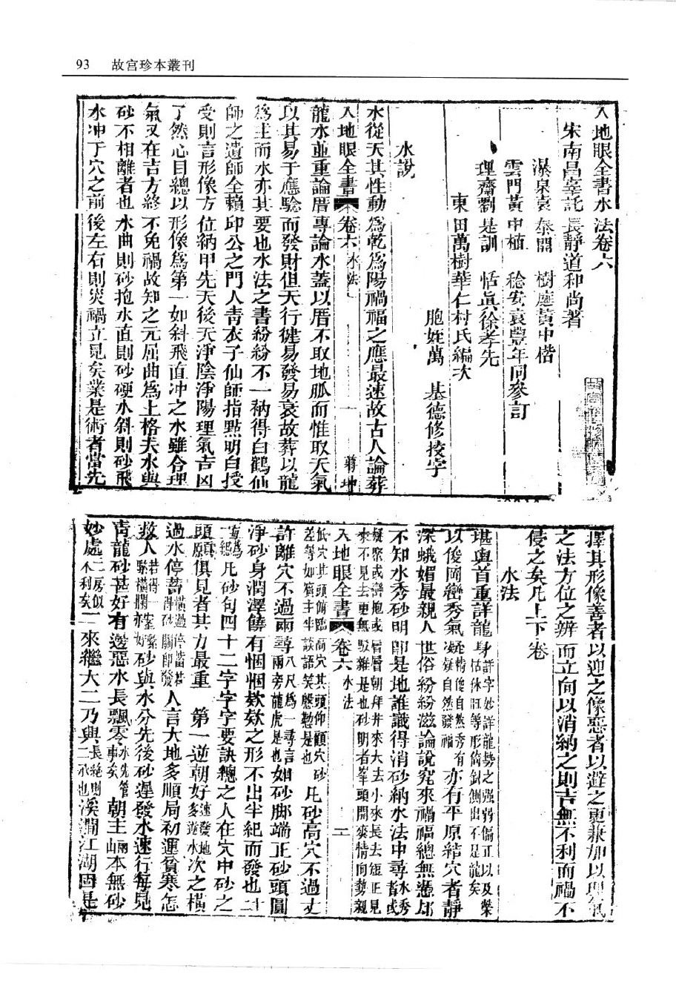

> **图版说明**：本页含图式或表格。请先核对方位标签，再按附近正文的顺序阅读；模糊或缺失标签不作推定。

> **阅读提示**：本页含已登记的残损、校勘或释读不确定项，可在原文对照版与审校账本中逐项核查。

### 原书第 94 页

论水势的结穴格局，逆朝、横抱的水局主家中堆金积玉，是最优的格局；其次可取的是合襟水以及顺流的格局，加上山高无水的情况，一共是五种格局。你现在把这些格局分辨清楚之后，不管是大聚的格局还是小取的格局，都“皆堪锋”，这一表述具体含义不明。文中提到大禹的时候，天上降下神龟，“负荻而出”，这一表述具体含义不明，大禹见到神龟背上的纹路，才懂得治水要先了解水的性情。所以“葬屑”以水为第一重要的要素，这一表述具体含义不明。水的属性是动，属阳，应验速度很快，所以有朝贫暮富的说法，就是取其应验快速的特点。水的来向对应二十四方位，若是阳方来水就立阳向，阴方来水就立阴向，就会吉利；若是阴方来水却立阳向，就会凶险。先代圣人知晓水的性情，水本身没有吉凶，但是来水的方位各有不同。方位是天地运行规律的体现，水是天地的血脉。水本身没有吉凶，方位和朝向才有吉凶，所以收纳吉气就会吉利，收纳凶气就会凶险。朝水局就是逆水局。

> **阅读提示**：本页含已登记的残损、校勘或释读不确定项，可在原文对照版与审校账本中逐项核查。

### 原书第 95 页

朝水局是龙脉翻身逆势结穴，以“受当”逆朝之水，这一表述具体含义不明。逆朝的水局要求穴星高大有余气，或者有低矮的砂横在下方拦挡，不让水冲割穴城、脚根，才是吉局。还有顺流、逆流的水走势屈曲如“之”“元”字形，或是平田洋朝的情况，都是好的格局。原文末尾的“平田”之后似有缺文，具体含义不明。

平田洋朝的格局，有大片的坂田朝向穴场，只要穴场紧凑狭小，能够收纳朝来的水气，就是第一等的好格局。次一等的是有十块左右的田丘朝来，再次一等的是有五六块田丘朝来，都是好格局。甚至穴前只有一块田，其余的田地高过眉毛，四周环绕，穴位在低洼的窝中，这种“哭土”的形态，具体含义不明，反而更得力。如果水流急冲直射，反而会成凶兆，有溪涧的地方多容易犯这个毛病，所以无法发福，普通田坂区域就不用担心这类问题。只有仰高穴不怕远水专程来朝，但是水要流到穴前的开口处，穴前有小明堂承接水流，才能发福，不然就会犯穴高水低、水不入喉的毛病。如果穴场形势卑弱，星峰低小，格局和水势不相称，也是凶象。也有大片坂田洋朝的水势很盛大，而穴场很小，但两边的土峰圆润环抱，遮挡住大水，穴前只见水朝来汇聚入明堂，这类格局的福分反而更大。“托长老曰”，这一表述具体含义不明，不能一概而论地认为逆水局就全是好的。前方有仓板水朝来，有的适合朝向，有的不适合朝向。比如乙卯方来水，就会克妻；丙午方同来水，就会引发痨病、火灾。这类地多结在“水日之间”，具体含义不明，就算下关短缩也不会有妨害。原文有“船但要穴塲藏聚”的表述，其中“船”字疑有讹误，整体要求穴场藏聚，穴位不被风吹，才是真格局。如果翻身逆势朝迎的时候穴场不藏风，就会招致祸患。原文有“麟可篇”的表述，具体含义不明，里面提到“顺似惟藏风魂腰绝弓生方”，具体含义不明，大概是指整体朝迎的形势力量大，是阴阳交会的契机，属阴却有融结的缘故。原文强调“藏聚”二字最为重要。一般来说天理要顺，地理要逆，所以逆朝水是最吉的。原文末尾有“黄水同三到有白到左亦司”的表述，具体含义不明。

横水局是指龙脉结穴处，水流从左边来向右边去，或从右边来向左边去。这种局势要求下关处有山体逆势拦截，将水口紧密关锁，这样才是吉相。此局势极为平稳，水流都要在明堂前方汇聚，才能发福；如果水流径直流去，则力量减弱。所谓据水局，就是聚木局。

据水局是龙脉结穴的位置临近大湖，或者有深水沉静停注在穴前。原文提到“穴前也要财”，具体指向不明。穴场下方的砂关锁得非常紧密，有雄强把持的气势。这类地局以得水为最优，水以“疑聚”为停蓄的标准，此处“疑”可能是“凝”的讹字，疑聚大概率指凝聚。这种格局主富贵绵远。

> **阅读提示**：本页含已登记的残损、校勘或释读不确定项，可在原文对照版与审校账本中逐项核查。

### 原书第 96 页

原文提到“顺水局问去水局”，二者的对应关系具体所指不详。这种水局要求来龙长远、力量强大，四周的形势周密，水口关锁牢固。水虽然流去，但如果山势“山交赵”，具体含义不明，就是好格局；如果山势不交锁牢固，穴场只见水浩荡直去，就绝对不会融结，不需要再留意考量。就算有融结，也绝对不会发财，初年运势不利，要退尽田产房屋之后才可能出官，或者离开家乡才能发贵。但如果穴位稍有不吉，立刻就会退败，甚至绝灭没有补救的可能。不过有一类海滨的地方，不以顺局为忌讳，因为“海水河入又是来也”，具体含义不明，其中“河入”可能是“何如”的讹误。

无水局，又名早龙局。

无水局是指穴位结在山坡上，山势盘聚，明堂里看不见流水。穴位在高山的话，一般先显贵后致富，或者只有清贵之名而不富裕，但也有巨富的情况，是因为“龙天带有仓库”的缘故，其中“天”字疑有讹误。清贵的情况大多是因为山形瘦削，或者穴前没有掌心明堂，原文此处有“为加”的表述，可能是“为佳”的讹误，具体含义有待确认。原文提到“若在谓神有人无财”，具体含义不明，这类情况需要寻求带有仓库的龙脉，或者扦葬在逆水的地方。原文提到“谷贫有财无人”，具体含义不明，这类情况不要扦葬在孤寒的穴位，这确实是很准确的论断。

水城详义

静道和尚说：凡是水城，固以金水一城屈曲郁抱者为吉；木、火、土三城，如果直冲、斜排、横平、尖投，则属于内局。然而箕间的吉凶，也必须看水是否弯曲抱身，或者才过‘穴’前就摆灰去了。又如水入或将到‘明堂’时，如果峻急有声，这都是本行所说的全吉。如果是恒净朝入，与斜来、横平、尖撇者，或者‘穴’前有低小众山落藏不见而去，势又复盘旋环绕，则也不能认为全凶。所以论水者又当详辨之，不可忽略。至于顶朝、掷漏、腮反、挑却、背崇、将流、泥浑流等格局，皆凶，不可按断。然而不可用香水，必须看开闭：来处宜开，去处宜闭。水口不怕辛爪，龙在坡中聚真气。如果咏即繁，则龙低爱凶。罗砥水间，南北辰耸天际，或者得狮象卧水边，或者得皋门雨边峙，地户有此，实为奇。其中应主王侯。地‘明堂’固为来水所聚，水日尤为去水所关，是以登‘穴’看‘明堂’。

进入山中寻地首先要查找水口，原文提到“烛陆要下带绕”，具体含义不详。大地的结作，有的是“印湾水面翁”，有的是“禽帖水口腑”，有的是天关地轴横相拦截，原文出现“任纲”表述，具体所指不详；有的是华表捍门的格局，原文“其时断咸”表述，具体含义不详；有的是日月形状的地形锁住龙喉。更有说法是这类水口之内一定有真龙存在，所以原文说“范侯或北辰绪”，具体所指不详。地户的格局无非是要取它能像砥柱一样挡住狂流，原文此处有“谓交可截辞于未离妇味啡木知平杯结酸道医翰小”的内容，语义不通，具体所指不详；水口处要有交错的牙山截断水流，不让水流直去，不放走一山一水，原文“昫杓叫始如晚”表述，具体含义不详。由此可知水口的重要性，有说法称“不论水平地不怕风”，这三句话是完全错误的，浅薄的风水从业者凭借这句话说平地不怕八方的风吹，却不知道凡是没有关栏遮挡被风吹到的地方，下葬之后一定会导致家道败绝。有长老说：如果是能发富贵的地，一定是它前后左右的山峦高地隐隐隆起，环抱穴场，不会被风吹到。还有左手边的田地、地形高就先发长房，右手边的田地、地形高就先发幼房的区别。由此可知平地最害怕被风吹。还有说法称高山结地不用考虑水的问题，如果元辰水直去，下葬之后人家一定会一败涂地，这种说法也不对。要知道高山的穴前一定有小明堂，小明堂四周必然是环绕的态势，要把周围的山水都汇聚到明堂之中，不让水气走漏，才能发福。凡是说地得到水就可以停聚，不单单是指汪洋流动的明水，最紧要的是穴前两侧的元辰水在穴前汇合，暗暗浸润穴场，就好像人的体液不泄漏，元气不大量走漏，身体自然康健。有诗专门说高山结地最重要的就是得水。结穴的局不要追求太过聚气，大聚还是小聚要看龙的结作情况，龙的结局有三种，分别是大聚、中聚、小聚。帝都的格局，水流一定是大聚；中聚的格局适合作为城市；小聚的格局适合作为坟地或者宅地。龙势绵延千里就会有千里的格局规模，龙势绵延百里就会有百里的格局规模，所以帝都、省城的龙势绵长，格局宽广是很合理的。坟地、宅地的龙势就算绵长，也没法和省城、城市的龙势相比，所以大多是在小聚的地方结作，收拢四方的气势，团聚有情，穴就在四周围护、环抱的中心，也就是所谓的藏风聚气的地方。常常能见到各处的名地，内局紧凑牢固，外面的开阔地宽广通畅，甚至站在穴中向外望看不到外面的景物，远处的秀峰罗列，都是在外层拱护。因为内局紧凑就会风藏气聚，外局过于宽广就会风荡气散。原文出现“店地仍明而旷不”的表述，语义不通，具体所指不详。地理书籍无非是讲龙、穴、砂、水的相关内容，万字千言反复议论，各种说法都是在讲枝节的内容，没有说到关键。又提到常见各处名地内局紧凑牢固，甚至站在穴中向外望看不到外面的景物，加上“紧夹则风藏气聚，宽广则风荡气散”的内容，一共三十三个字，字字都是金玉良言，是一部地理经书的总结要旨。内局紧凑牢固、站在穴中看不到外景物的情况，是因为护砂紧紧夹护着穴场，夹护穴场的砂就是生福的砂，外面的远峰秀色就算拱护也没有什么用处，拱护还是不拱护都不用计较。假如外面的远峰秀色有用的话，为什么那些外露没有护砂的穴，外秀都在面前，却完全不会发福呢？愚笨的人察觉不到这一点，只会去分辨龙力的大小和结聚的等级。

> **阅读提示**：本页含已登记的残损、校勘或释读不确定项，可在原文对照版与审校账本中逐项核查。

### 原书第 97 页

有些旁门左派只想把几百里的山川景色都收进眼里，结果一定被虚假的假象所误导，失去真意。应当斟酌那些有依靠、靠近省府郡县山水大聚结之处结成的穴，称之为“并小品”。凡是学习地理风水的人，看了几部地理书，千言万语都是闲谈，就是这些注书的人，说的也是元谬，都是假的。居士讥讽他们说：“说空，又说空，还说空；指南，指北，指西，指东；山中若有王侯地，早早归家葬祖宗。”这话果然半点不差。贫僧不管许多闲谈，见到一地必有一局，局大发，大局小发，小局者砂、水、案三件完全，山之势脉活动，就在此处安葬，无不获福。这么多时师看地，那是看地吗？原来在此。讲地开口就把“龙、穴、砂、水”四字放在口里，甘甘有味，独不知一大能不过分四落，不过结四大穴矣。天下之人共有几多？除了我和尚莫算，世间之龙有几何？人一穴能得几多？又不思官山之上安葬者，一欲之山塟有数百冢、数千冢者也有，发的也有败的，此何故也？官山原是乱葬，同在一块，隔不过一尺或五尺的，发者就是穴，败者就不是穴乎？非也。发者得丁向法，败者向法不好。所以这么多时师只知道讲“龙、穴、砂、水”四字，一个“向”字全然不知。讲龙峦头上几句套话，讲点穴上些也好，下此也好；讲砂，砂在面前不知何物；讲水，水在面前止知左旋右旋，大事毕矣。今之双山倒裴生旺反用休，因是吕才所作，将来害人非浅。故一行注有哑谜在内曰：“前兼龙，前兼向，拂定阴阳算；后兼龙，后兼向，联珠莫相放。颠颠倒，二十四山有珠宝；倒倒颠，二十四山右火坑。”有人识得倒顿，便是地中仙。“前兼龙，前兼向，排定阴阳算”，言人立向要净阴净阳，阴兼阴，阳兼阳，阴不可兼阳，阳不可兼阴。立阴向，来去二水俱要在阴位上；若见阳水来去，即立阳向。譬如申水来，辰水去，即立子山午向以收之。依先天，干在南，坤在北；以后天算，午在南，子在北。坐子向午，坐山收水，正合申子辰水局。离为火，坎为水，是水火既济之义。坎为中男，离为中女，是夫妇相之道。论向上收水，午向得申水，是口门水上堂，有逆以之，义主富贵丁财两旺。此正合“前兼龙，前兼向，排定阴阳算”，水与向净阳也。“后兼龙，后兼向，联珠莫相放”，是甲子辰三合法，又为隔八相生局。是以二十四山向依此推行，地之师明此立向收水，虽无龙则无祸，主家得平为福；若得气脉，则福来也。累遇行地之师谈及阴阳人地退全书卷六水向三法，全然不知。再问排定阴阳算，片刘三合双山左旋水属阳，右旋水属阴。又问不言非是不实，实不知。累见这多先生，学贯五坤，统是一得自矜，不肯虚怀，谩教我和尚。自问一生与人安葬坟茔，无非代世行事，有缘者遇者，无缘者错过。再将三法述明：砂法、水法、向法。此之谓消砂纳水、收山出煞，堪舆家大作用全在此处，打动山川，纽转乾坤，要分毫不差，方不得误人。待贫僧廷层讲来，你们居士方知。看法必须龙、穴、砂、水与向五字详为讲究，方云全法。世人单说一龙字，以龙取向者，以龙取水者，大事毕矣。殊不知吉凶之转移，祸福之枢机，全在点穴、消砂、纳水、乘龙气、定向五者工夫，方为合法。衲见砂水一法，中正以有龙而后言沙言水，非遗穴也。向正以砂水之吉凶与穴趋避，砂水之祸福与向转移。故水法中言水处，无非言穴言向；砂法中无非言龙言穴。盖有用必有体以立其干，有体必行用以以其被体，体用交需，缺一不可。世人知龙而不知砂与水，是止植联木而削去枝，体用二字则亦止得共一而已，安云尽善尽美哉？要知水阳由阴，两相配合，尚物无水不入地根。全书卷六水法 + 养水法多端难以尽言，今将天一生水遂冬讲起，与同志者共赏。

> **阅读提示**：本页含已登记的残损、校勘或释读不确定项，可在原文对照版与审校账本中逐项核查。

### 原书第 98 页

### 原书第 99 页

托长老说：世纪云黄帝祀天于圜丘，天降十干，帝命大挠氏作十二支以配之，而作甲子。是十天干任土，十二地去在下，世人所知之也，殊未悟。天干本于地下之五方，而地表本于天上之十二辰。甲乙东方木，丙丁南方火，庚辛西方金，壬癸北方水，戊巳中央土。天上五行即地下之五方也。天上每辰有三十，故地下二十日而（原文此处似有缺漏，无法完整译出后续内容）。

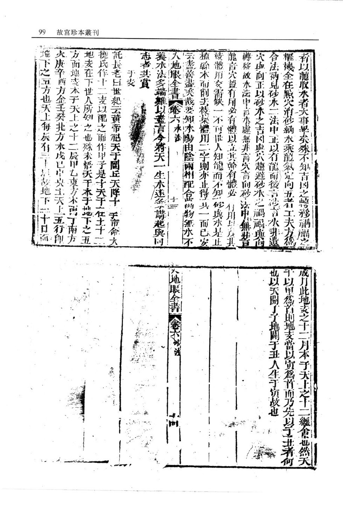

> **图版说明**：本页含图式或表格。请先核对方位标签，再按附近正文的顺序阅读；模糊或缺失标签不作推定。

> **阅读提示**：本页含已登记的残损、校勘或释读不确定项，可在原文对照版与审校账本中逐项核查。

### 原书第 100 页

河图生成篇，泊区生兄篇（注：原文标题或篇名可能有误或为特定称呼，此处按原词保留）。

天一生壬水，地六癸成之；地二生离火，天七丙成之；天三生甲木，地八乙成之；地四生辛金，天九庚成之；天五生成土，地十巳成之。河图顺生：金生水，水生木，木生火，火生土，土生金。

乙水来，立甲向；甲水来，立乙向，会成木局；丙水来，立丁向；丁水来，立丙向，会成火局；庚水来，立辛向；辛水来，立庚向，会成金局；壬水来，立癸向；癸水来，立壬向，会成水局。此四局，合金木水火一生一成，乃天地自然而然之义。一反一覆，共成八局。得生数者而发富贵，得成熟者而旺人丁。12

洛书生成篇：天一生坎水，地六干成之；地二生坤火，天七兑成之；天三生震木，地八艮成之；地四生巽金，天九离成之。此后天合十之法也。一与九合，二与八合，三与七合，四与六合。

#### 洛书昌局

坎水来，立干向；干水来，立坎向，合成水局；卯水来，立艮向；艮水来，立卯向，合成木局。此二局，水归水垣，木归木垣，且一得净阴，一得净阳，纯美无流，最吉之水。

如果坤方有水来，就立酉向；如果酉方有水来，就立地向，这两者合成火局。如果巽方有水来，就立午向；如果午方有水来，就立兴向，这两者合成金局。这两个局属于火入金乡、金居火位的情况，而且阴阳破局，地力轻微，一旦发福很快就会衰败。如果龙身壮旺，比起水水二局的退述更重，其效应更严重也更持久，这又属于合十法。至于水来立甲向、用水火立巽向等四个局，可以参照这个方法类推。文中提到的“立地向”“立兴向”“退述更重”具体所指不详。

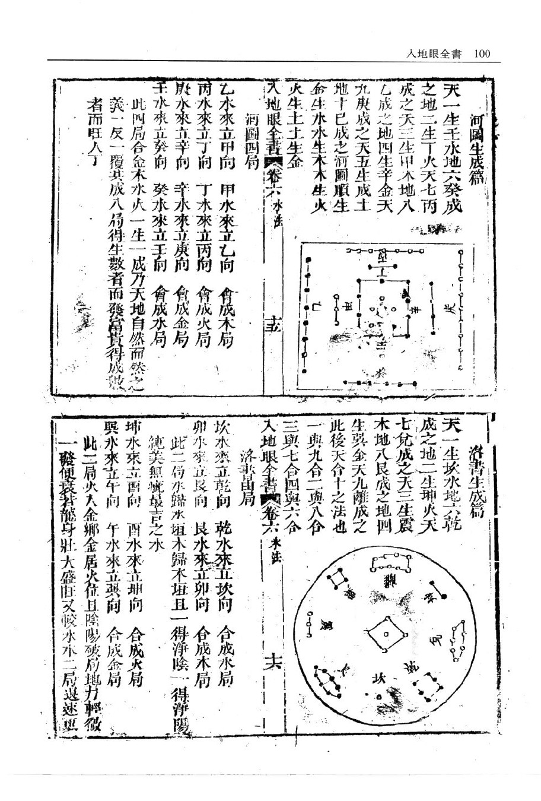

> **图版说明**：本页含图式或表格。请先核对方位标签，再按附近正文的顺序阅读；模糊或缺失标签不作推定。

> **阅读提示**：本页含已登记的残损、校勘或释读不确定项，可在原文对照版与审校账本中逐项核查。

### 原书第 101 页

入地眼全书六沐淮（注：原文似为书名及卷次或篇名，但“沐淮”二字含义不明，可能为误字或特定称呼）。

先天四大局

关于坤水来向的说法：文中提到‘水来立地向’，这对应天地定位；酉水来，立艮向；水来，立酉向，这对应山泽通气；巽水来，立卯向；而水来，立巽向，这对应雷风相薄，但‘而’字可能是‘卯’字之误，或者表示转折，具体含义不详；午水来，立子向；丁水来，立午向，但‘丁’与‘午’的关系在此处不明；最后提到‘水火不相射’以及‘卦’字，原文末尾似有缺漏。其中‘坤水来向说’的具体含义也不详。

干的卦形是三爻相连，地六改，离的卦形中间空虚，坎的卦形中间满实，震的卦形像仰放的盂，艮施，兑的卦形上方有缺，巽的卦形下方断裂。干为天，属阳，地八九纳甲；坤为地，属阳，履一纳乙；离为火，属阳，左三天旺；坎为水，属阳，麟右七。这四卦位于洛书的四正位，皆数也，所以称为净阳。兑为泽，属阴，局四町；艮为山，属阴，足六纳丙；震为雷，属阴，足八谢糠；巽为风，属阴，肩一纳辛。这四卦位于洛书的四隅位，都是偶数，所以称为净阴。文中提到的“地六改”“艮施”“地八九纳甲”“履一纳乙”“左三天旺”“麟右七”“皆数也”“局四町”“足六纳丙”“足八谢糠”“肩一纳辛”具体所指不详。

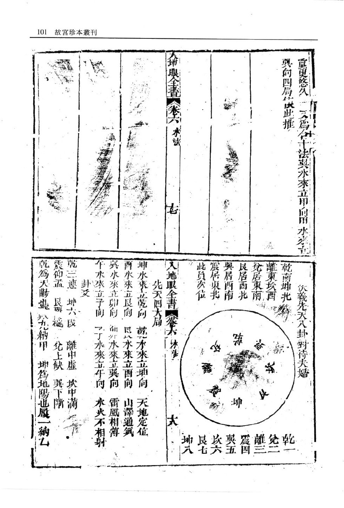

> **图版说明**：本页含图式或表格。请先核对方位标签，再按附近正文的顺序阅读；模糊或缺失标签不作推定。

> **阅读提示**：本页含已登记的残损、校勘或释读不确定项，可在原文对照版与审校账本中逐项核查。

### 原书第 102 页

干代表老父，坤代表老母，震代表‘长里’（原文如此，非长男，具体所指不详），巽代表长女，坎代表中男，离代表‘宁女’（原文如此，非中女，具体所指不详），艮代表少男，兑代表少女。干代表头，坤代表腹，震代表脚，巽代表大腿，坎代表耳朵，离代表眼睛，艮代表手，兑代表口。文末提到‘入地眼全卷六水’，这似乎是书名及卷次，但‘水’字后似有缺漏，具体所指不详。

其法以后天方位用先天理气，如（注：原文此处似有缺漏，无法完整译出后续内容）。

如果是干甲龙或者干甲向，见到坤乙水来或者坤乙水去；如果是坤乙龙或者坤乙向，见到干甲水来或者‘干甲水夫’（原文如此，‘夫’字可能为‘去’字之误，具体所指不详）。这符合天地定位局。原文在‘坤乙水去’与‘坤乙龙’之间没有明确断句，此处断句基于理解，可能存在不确定性。

如果是子癸申辰龙或者子癸申辰向，见到离壬寅戌水来去；如果是离壬寅戌龙或者离壬寅戌向，见到子癸申辰水来去。这符合‘水火不相树’局，原文作‘树’，可能为‘射’字之误，具体所指不详。

如果是丙龙或者艮丙向，看见酉、丁、巳、丑的水流向去，或者看见酉、丁、巳、丑的龙，或者酉、丁、巳、丑向，看见艮、丙的水来去，这符合山泽通气局。如果是辛龙，或者巽辛向，看见卯、庚、亥、未的水来，或者看见卯、庚、亥、未的龙，或者卯、庚、亥、未向，看见巽、辛的水来去，这符合雷风相薄局。

以上四大局，水来配合龙脉，福力最重，这是天造地设的山水。水来配合向，福力也不轻，这可以由人来提升。比如看见乙水，可以立干向，即以干向来收水；看见坤水，可以立干向，更为美好。其余都依此类推。

一与九合十，离壬寅戌向，看见坎、癸、申、辰的水来去；坎、癸、申、辰向，看见离、壬、寅、戌的水来去。二与八合十。

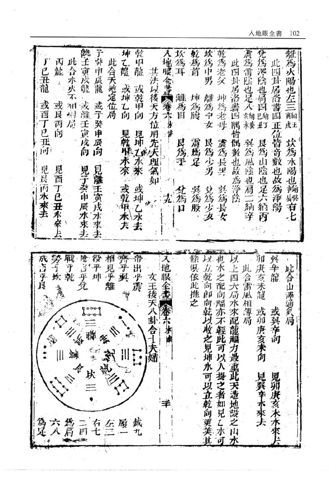

> **图版说明**：本页含图式或表格。请先核对方位标签，再按附近正文的顺序阅读；模糊或缺失标签不作推定。

> **阅读提示**：本页含已登记的残损、校勘或释读不确定项，可在原文对照版与审校账本中逐项核查。

### 原书第 103 页

文中提到‘长向坤水来言艮前乙水来’、‘丙向坤水来去布自艮水来’、‘言坤向内水来’以及‘乙向艮水来去’等说法，由于原文表述简略，这些方位与水流来去之间的具体逻辑关系不详。

如果朝向是震、庚、亥、未，就会见到兑、丁、巳、丑方位的水流来去；如果朝向是兑、己、丑，就会见到震、庚、亥、未方位的水流来去。文中还提到‘四六合十’这一说法。

文中列举了多种情况：巽向遇到干水来，‘与’向遇到甲水来；辛向遇到干水来去；干向遇到‘与’水来为吉；干向遇到辛水来；甲向遇到‘与’水来去。以此推算共有八局，其中只有坎、离二局，无论是先天还是后天都如此，这是极大的格局。而震、兑一局则符合净阴纯粹的原则，最为有利。只是四维四局阴阳驳杂，只有善于立向的人才能巧妙接纳。例如，辛向遇到干水来，必须是干三分、亥七分；甲向遇到‘与’水来，必须是巽三分、辰七分，这样才妙。此诀据说能上应侧室之子，因为这是后天夫妇的缘故，求子嗣会迅速应验。文中提到的‘与’字，在‘与向’、‘干向与’、‘甲向与’等短语中，具体是指‘巽’还是其他含义，原文未明，此处保留原字。

纳甲

干纳甲，属金，十五六望月，金明，三阳俱定象，乾卦八在甲。坤纳乙，属土，三十日初一，悬月纯黑，三阴全备，象坤卦，卯时在乙。艮纳丙，属土，二十四五之月，阴下一阳上，象艮卦，卯时在内。与纳辛，属木，十八九之月，一阴下二阳上，象与卦，卯时在辛。震纳庚亥未，初三四之月，一阳下一阴上，象震卦，戌时在庚。兑纳丁己丑，初八九之月，二阳下一阴上，象兑卦，戌时在丁。离纳壬实戌，属穴，离为太阳，无消无灭，至尊之卦，施光。

于月以变运，前六卦者中爻属阴，故纳己。罗经无己土位，后天居正南朝位，遂以干所纳之外卦天干壬水纳于离。坎两癸申辰属水，坎为太阴，为月本体。前半月消震兑干二卦，自无而为有；后半月灭与艮坤卦，自有消而为无，皆坎为之也。中爻属阳，故纳戊。罗经无戌十位，后天居正北坤位，遂以坤所纳之外卦天干癸水纳丁坎。

> **阅读提示**：本页含已登记的残损、校勘或释读不确定项，可在原文对照版与审校账本中逐项核查。

### 原书第 104 页

母月合朔后，哉生明，目初二至初七日，入戌时，人伽面观天，月明一分，象震卦，月在庚方，故震纳庚，是震卦初九庚子爻，从坤耳初六乙未爻滑出，故造葬坤山乙山，忌月庚日戊子，尤忌八地眼全书卷六。每月上弦，自初八至十二日，归上时，人仰面观天，月明二分，象兑卦，月在丁方，故兑纳丁，是兑卦九二丁卯爻，从震卦六二庚寅爻消出，故浩葬卯庚亥未山，忌用丁曰丁卯日，尤忌。

每月将望，自十三至十七日，八土时，月光尽明，人仰面观天，象乾卦，月在甲方，故干纳甲，是乾卦九三甲 1fxd辰爻，从兑卦六三丁丑爻消出，故造葬兑丁已丑山，忌用甲曰甲辰日，尤忌。每月望后，哉生魄，自十八至二十二日，出卯时，人仰面亲天，月暗一分，象巽卦，月在辛方，故与纳辛，是与卦初六辛丑爻灭去，乾卦初九甲子爻，故造葬干山甲山巳用辛日辛丑，尤忌。经云：干遇巽时为月窟，坤逢雷处见天根，此之谓也。每月下弦，自二十三至二十七日，出卯时，入仰面观天，月暗二分，象艮卦，刀在丙方，故艮纳丙，是艮卦六二丙午爻，灭其与卦九十辛亥爻，故造葬巽山辛山，忌用丙日丙午曰，尤忌。每月二十八至次月初二日，出卯时，人仰而观天，月光尽晦，象坤卦，月在乙方，故坤约乙，是坤卦六三乙卯爻，灭去艮卦九三丙申爻，故造葬艮山丙山，忌用乙日乙卯日，九忌。

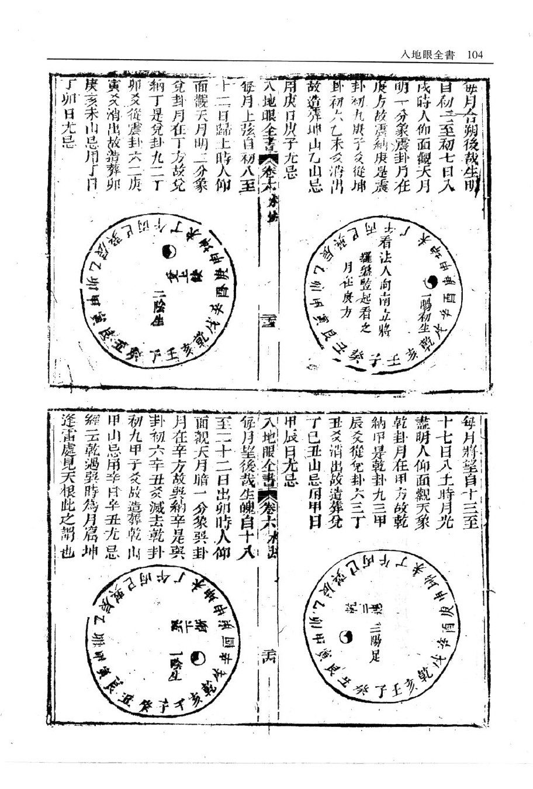

> **图版说明**：本页含图式或表格。请先核对方位标签，再按附近正文的顺序阅读；模糊或缺失标签不作推定。

> **阅读提示**：本页含已登记的残损、校勘或释读不确定项，可在原文对照版与审校账本中逐项核查。

### 原书第 105 页

此指纳甲之原，阅图明矣。至于砂水龙神月法应骑，必须指出登山阅地方可明白了然于心月矣。如干龙入首，甲水来或甲砂起，王水来，壬砂高，坎龙入首，癸水来，癸砂高撰。此局砂易得水，诸符艮龙入首，丙水来，两砂高拱；卯龙入首，庚水来，庚砂高拱；异龙入首，辛水来，辛砂前拱；离龙入首，王水来，主砂高域；坤龙入首，乙水来，乙砂高拱；兑龙入首，丁水来，丁砂高拱。

以上入局水来，名为归元水，无地有局，亦主富秀。若得龙神秀拔，至于砂拱水朝，力可催官。又为纳甲官砂，龙强旺秀出，显宦富贵长久，中等亦发科，人财两旺。又如干水来，干砂高拱，甲龙入首，亦是纳甲龙痢甲砂水。又如巽山干向，甲水来，又庚山甲向，干水来，俱是新甲归元水也。所以干龙甲水，甲龙干水，干水甲向，甲水干向，此八局变出三十二局矣。故立向有转移之巧，在人提之也。此邱公之旨，一行师之有前兼龙后兼龙之作，且发明此义。今之注函经，将此纳甲正义面之度外面，不讲竟将双山左右旋生旺墓四水口以为实，所以卖真不不卖假横行。

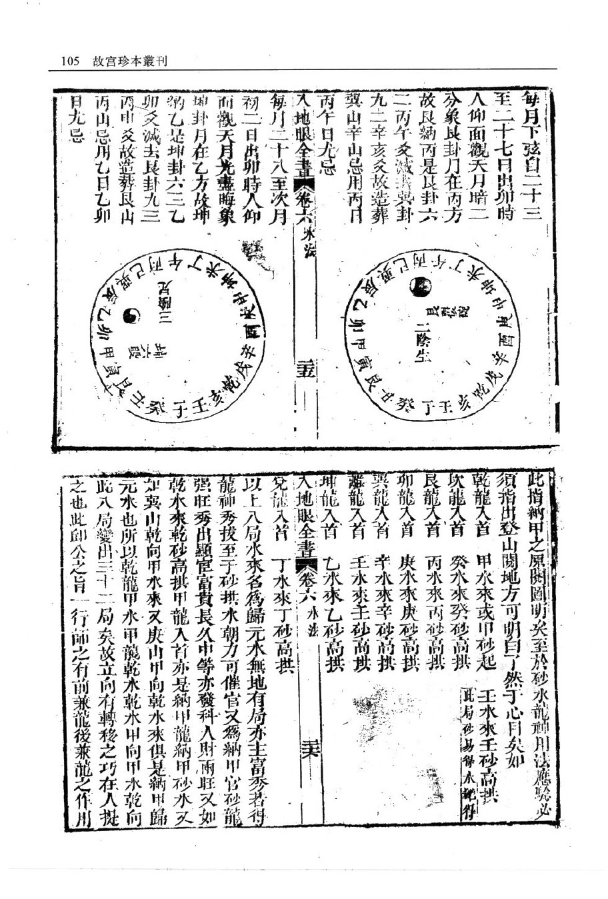

> **图版说明**：本页含图式或表格。请先核对方位标签，再按附近正文的顺序阅读；模糊或缺失标签不作推定。

> **阅读提示**：本页含已登记的残损、校勘或释读不确定项，可在原文对照版与审校账本中逐项核查。

### 原书第 106 页

浑天甲子

干金甲子外，壬午甲壬二于纳乾卦九三号，九二妻寅，初九内卦，上九死，九五肝，九四外卦。坎水戊寅外，戊申癸戌二于纳坎卦六三裁，九二成服期，初六寅上六成，九五房身，六四公，外卦艮上，丙辰外，丙戌丙干纳于良，九三前，六二，初六两表，上九，六五盱，六四。震木庚子庚午临，庚于纳于震六三秋，六二寅，初九上六数数，六五，九四符。

四阳卦顺起子寅辰午申戌。

与木辛丑外，辛未辛于纳于巽九三，九二辛刻，初六半，上九，九五记，六回。离火巳卯巳酉亲，已王二千纳离九三配，六二记，初九纪，上九妃纪，六五祀，九四顷。尧金丁巳外，丁亥丁千纳于兑六三，上六父味，九五，九二打明，九四于孩，初九。外坤土乙未癸丑凭，乙癸二于纳坤六三说，六二，初六兄，乙上六秩师，六五发，六四。四阴卦逆起丑亥酉未已卯。

托长老曰：凡阳爻言九者，一三五共得九数也；阴爻言六者，二与四共得六数也。俱用河图之五生数取义。凡过官鬼爻即为煞升，故八煞歌云：坎龙坤免震山纵，巽鸡干马兑蛇头，艮虎离猪为八煞，墓宅逢之一齐休。世人呼为八煞黄暴，皆畏忌之。殊不知有八煞龙、八煞水、入煞砂。可笑时师心中所畏忌者八煞，口中又在讲八煞，手中拿起罗经又在做八煞，所以亦有入煞向者。或曰止知八煞龙者，或曰止知八煞水者，或曰止知八煞砂者，一向不知焉知龙砂与水乎？可笑今之时师屋里先生，注书千卷不如口诀一句，方知八煞易明。坎龙忌辰戌水，坤龙忌卯水，震龙忌巾水，吴龙忌酉水，兑龙忌巳水，干龙忌午水，艮龙忌寅水，午龙忌亥水，此八煞龙水也。又云：坎龙不忌辰戌水，干龙不畏午水，且喜见之。殊不知八煞来龙、八煞水朝，乃大贵之地。其诀总在因龙辨水，依水立向，所谓化煞为官，登将台。

> **阅读提示**：本页含已登记的残损、校勘或释读不确定项，可在原文对照版与审校账本中逐项核查。

### 原书第 107 页

禄马贵人砂，寅良全宫。

艮砂辛砂山若陷，禄马不起金阶平。甲寿孙寅申，缺隋马空，倚官不食禄，名虚称。催官禄马山低小，虽有文章不显达。

静道和尚说：这段文字是后人关于川、禄、马、贵人地理的论述。地理家必须明白这个道理，在消砂纳水的操作中大有把柄，不可不知。文中提到艮、甲，那么坤、庚、干、王、吴、丙都在其中。总而言之，寅、申、巳、亥是四马，不宜有缺陷或低小的情况；子、午、卯、酉的情况也与此相同。其中“王”和“吴”可能是“壬”和“癸”的形近误字。

中禄到寅，乙禄到卯，禄坐己，巳禄居午，庚禄居申，辛禄居酉，壬祥在亥，癸祥居子。这些天干临官的位置就是禄。其中“中”可能是“甲”或“申”的误字，“祥”可能是“禄”的误字。另外，干、坎、艮、震、巽、离、坤、兑八山，依照纳甲来推算。例如甲龙，禄在寅，切不可犯甲山、庚向。甲山坐尾火虎，寅宫箕水豹，水克火，煞动中宫，不可不避。这完全在于坐度来提挈。如乙禄在卯，小乙山辛向，乙坐氏土，卯方房日火，火生土，主发科甲。

论马

寅午戌龙局，马居申；申子辰龙局，马到寅；亥卯未龙局，马在巳；巳酉丑龙局，马在亥。这是十一地支的马。若子龙辰局，喜寅水来、寅砂起；如子龙，马在寅，午向，马在申，言甲水来、寅水去。原文“子龙马寅午向”的断句可能存在歧义。若依双山三合，午向火局，寅水去，损少年威财之子。今禄马之法与双山不同，可知双山所谓“走了长生水者”，其掌诀亦无用矣。其余三局依此推演。

论贵人

这是一段贵人方位的口诀：戊对应的贵人在牛、羊对应的丑、未位，乙、巳对应的贵人在鼠、猴对应的子、申位，丙、丁对应的贵人在猪、鸡对应的亥、酉位，壬、癸对应的贵人在兔、蛇对应的卯、巳位，六辛对应的贵人在虎、马对应的寅、午位，这些就是贵人所在的方位。甲龙入首时，喜未方有砂隆起、未方有水来朝；乙龙入首时，喜申方有砂隆起、申方有水来朝；丙龙入首时，见酉方有砂隆起、酉方有水来朝；丁龙入首时，见亥方有砂隆起、亥方有水来朝；庚龙入首时，见丑方有砂隆起、丑方有水来朝；辛龙入首时，“喜偿砂起领水来”中的“偿砂”“领水”疑似是“未砂”“未水”的形近误字，对应喜未方有砂隆起、未方有水来朝；壬龙入首时，喜卯方有砂隆起、卯方有水来朝；“癸龙八首 喜己砂起己水来”中的“八首”是“入首”的误字，“己砂”“己水”疑似是“巳砂”“巳水”的形近误字，对应癸龙入首时，喜巳方有砂隆起、巳方有水来朝。

> **阅读提示**：本页含已登记的残损、校勘或释读不确定项，可在原文对照版与审校账本中逐项核查。

### 原书第 108 页

以上提到的八种格局，都属于阳贵人砂水的情况。如果是阴贵人对应女家，则不采用三合局的方法。

亥卯未木局，己酉丑金局，申子辰水局，寅甲戎火局。这是联珠格。用法是坐下收水，九九相生，循道不已，即隔八相生之道。如亥水来、未水去，即立酉向；若卯龙入首，扦甲山庚向，葬下不满三年，未水来则雷击而兴，未水去则雷击而败。其余三局依此推演。禄马贵人三合乃人命宫所载，而地理家亦用之。龙、砂、水、向纳之者则发，不善纳之者则败。可见人有命皆从“攻慕”中出也，“攻慕”具体所指不详。奈此法人不能知，何不于古冢间考核而自了然于心目也。善哉印公之示人深矣。黄泉。其中“寅甲戎”可能是“寅午戌”的误字。

甲癸向中休见艮，辛壬水路怕当干。此指向收水也。见坤水来，不可立庚、丁二向；见庚、丁水来，不可立坤向，是为黄泉。乙水来，不可立巽向；巽水来，不可立乙向，此为黄泉。若内水来，立巽向；巽水来，立丙向，此得巨门水也，又为六秀水，出聪明，主富。艮水来，不可立甲、癸二向；甲、癸二水来，不可立艮向，是为黄泉。干水来，不可立辛向；辛水来，不可立干向，是为黄泉。若壬水来，立干向；干水来，立壬向，此不为黄泉，此得武曲水也，主发富贵。人所不知，向土收水最喜净阴净阳。阳水来立阳向，阴水来立阴向，来去水皆同样，故为尽善尽美。书云此为杀人黄泉，“游是杀人黄泉”语意不明。而又有巽、丙、干、壬二局而发丁财富，可恨。这此屋里先生无中生有，造出一救贫黄泉以哄人。哄人事小，作孽事大。辛入干宫百万庄，癸归艮位发文章，乙向与流清富贵，丁坤纪是万笥箱。

> **阅读提示**：本页含已登记的残损、校勘或释读不确定项，可在原文对照版与审校账本中逐项核查。

### 原书第 109 页

据此语滴滴有味，殊不知仔细看来，尽是阴阳破局。见辛水来立干向，犯廉贞，主人吐血症，无药可治，出人无礼义、奸诈、忤逆、败绝。见癸水去立艮向，犯禄存，名绝体，“王绝嗣”中的“王”可能是“主”或“亡”的误字，过房赌传，退败淫乱，产死。见“之”水来立巽向，犯禄存，十手疾，螟蛉招赞，投河自缢。见丁水来立坤向，犯破军，主好讼，家财不了，官事不休，出人凶恶，做贼，“韩哑”中的“韩”可能是误字。

败绝亡家可笑，世之行此道者，口中又在讲黄泉，手中又在与人立黄泉。“可根”可能是“可恨”之误，这些无师之学，又摄出此救咎黄泉，害人非浅。圣人曰：害人还害己。莫学唐朝李林甫。书之方清此恨，门此惟难消。又见后习者，见此水立此向，如之奈何？后习者皆因不明此理，只知看书，不知解书，总是眼...几个字，胸中无点墨。登山临穴，看此救贫水法，即将此四句俗话说起来，殊不知发友章富贵之地，亦非此等水法。凡后习地理者，必须前思后想：古来发福之地是何规模？是何砂水？是何面局？是何向？是何收纳水城法？何得我手所作不发？他作就发，一定我之眼力未到，道术未精，“峦顿未热”可能是“峦头未熟”之误。再往“古坏”开考，“古坏”可能指古坟或古冢，方知道卫未精，不可造次。谁知以此害人之技，反来射利乎？桃花煞。

亥卯未，鼠子当头，忌木生在亥，败在子，故忌鼠。巳酉丑，跃焉南方走，金生在巳，败在午，忌马。亥卯二向，“儿子”水来为桃花；若未向不兄子水，不忌。一巳酉二向，见午水来为桃花；若丑向不见午水，不忌。此二局皆净阴，见子午阳水来破阴局为桃花，主妇女淫乱。若见子午二水来，即立阳向以收之。其中“儿子”可能是“子水”之误，“不兄”可能是“不忌”之误。

申子辰，鸡叫乱人伦，水生在“中”，败在酉，故忌“难”。“中”可能是“申”之误，“难”可能是“鸡”之误。寅午戌，兔从孝里出，火生在寅，败在卯，故忌兔。申子二向，见酉水来为桃花；若辰向不见酉水，不忌。寅午二向，见卯水来为桃花；若戌向不见卯水，不忌。此二局皆净阳，忌见卯酉二水来破阳局为桃花，主风声败坏。此言子午卯酉四水。子午阳水破卯酉阴局，卯酉阴水破子午阳局。凡水各有不同，水有来的，有去的，有池塘聚而不去的，要分三样看法。若池塘固聚而不去者为内桃花，必应自己本姓人；若是来水为外桃花，主应外乡人；若是去水又为军贼水，必主男盗女娼，万藏贼盗。凡看地理者，必先要辨于之何如，后总在以立向收之。但当如何收法？曰：若阳水须立阳向，若阴水须立阴向，切不可使阴阳破局。

> **阅读提示**：本页含已登记的残损、校勘或释读不确定项，可在原文对照版与审校账本中逐项核查。

### 原书第 110 页

禄到寅、卯为羊，又乙禄到卯、辰为羊，又丙禄到巳、午为羊，又丁禄居午、未为羊，又庚禄居申、酉为羊，又辛禄居酉、戌为羊，又主禄在亥、子为羊，又癸禄居于丑为羊。禄前一位为羊，又以其劫财，又主男子好淫，故名羊。原文错乱严重，“印向”、“主刀药七身之祸”、“丁财两旧”、“但好也之情胜耳”等语句具体所指不详，释读仅为尝试。

一刑卯，卯刑于寅，刑巳，巳刑申，申又刑寅，丑刑戌，戌刑未，未刑丑。

子向卯水来，卯向子水来，寅向巳水来，巳向寅水来，丑向辰水来，辰向丑水来，寅向亥水来，巳向申水来。

为无礼之刑，为无思之刑。

总以水法中不喜阴阳驳杂，要净阴净阳方为美。若入地世全书卷六，水出犯此相刑相破，暗暗消耗，太岁临位，损丁退财，“六箸水”具体所指不详。

子与未穿，丑与午穿，寅与巳穿，卯与辰穿，甲与亥穿，酉与戌穿。用法所忌。原文用字多误，此处“穹”、“守”、“弟”、“典”、“壻”均推测为“穿”之误。

寅向巳水来，巳向寅水来，犯三刑。申向亥水来，亥向申水来，辰同此例。卯水来，卯向辰水来，戌向酉水来，酉向戌水来。未、丑、午二向，病人不能犯，而“西戌并湖”、“卯辰说流此”具体所指不详。原文错乱，释读仅为尝试。

> **阅读提示**：本页含已登记的残损、校勘或释读不确定项，可在原文对照版与审校账本中逐项核查。

## 卷七·水法判局

> **编者导读**：讨论水的来去、聚散、水口与明堂，并以合局、破局条目记录传统判断。

### 原书第 111 页

#### 四破水

这两种局是人们容易触犯的，所以犯的人很多。一旦触犯，就会暗中受到影响，财物逐渐损耗，最为可怕。其中“暗受寄渐”的“寄”字含义不明，无法准确释读。

文中提到‘子破卯、卯破午、午破百、酉破子’，这是阴阳相缺的情况，其中‘午破百’原文如此，具体所指不详。这一段是依据人命宫位来论断水法，水法与三合相合，所以人的命逢此禄马贵人三合则吉；若遇到桃花、羊又逢三刑、六害、四破，则命贱。人在世时，命要好；死后归土，地也要好。地虽好，局也要好；局虽好，砂也要好；砂虽好，水也要好；水虽好，还要葬得好。这个‘葬’字很难说透。哪怕学富五车，若不得窍，都是徒劳，怎能知晓消砂纳水、坐度立向的窍门？得了窍才能知晓。原文提到‘一非字’，具体含义不详；若不知‘葬’字，自然发祸悠久。

入地眼全书水法卷七宋南昌辜托长静道和尙著

瀑泉袁泰、开树庭黄中楷、云门黄中植、稔安袁丰年同参计理斋刘是训、恬真徐孝先。

庚训万树华仁村氏绍次。

胞姬万基德修校字。

#### 水法

静道和尚说：水带来的祸福应验很快，山带来的祸福应验稍慢。水要在朱雀方位环绕，玄武方位缠绕，青龙方位包裹，白虎方位围护，这样的水是养荫之水。水要回旋，要流到明堂，要上阶，要“拱货”，要入怀，要环抱有声，要停聚，这些都是水的吉相。书中说：逆水哪怕只有一滴，也胜过万条水流。山不宜粗劣凶恶，水以澄清为好；水势纵横如同织布一样，才看得出眷恋的情意；水汇聚成湖，才能辨别出朝宗的态势。所以在龙脉入首结穴的地方，看它的左右前后，如果见到水横竖交错、屈曲交流，就像织帛一样，这就是砂眷恋水、水眷恋砂，就像夫妇见面不忍分离一样。各路水流都到明堂，或是在左边或是在右边汇聚成湖，就说明水与砂已经交会了。但还要辨明水神的出入方位，是朝向哪个方位朝会的，是从大江流出还是从大湖流出，辨明方位就能知道龙穴的好坏。古话说：水势洋洋悠悠，顾盼着想要流向穴场的，大的地局一定会有逆龙的水；好的地局一定会有逆砂的水流。龙的走势是最要紧的，砂逆是其次。龙得到合适的水，水搭配对应的龙，就是夫妇相配；水迎着龙来，龙迎着水走，就是夫妇交感。所有水流都归向一处的，是亲上加亲；水流来后停聚不去的，是恋上加恋。水如果屈曲有情，又符合星卦的要求就是吉利的。九曲水是秀气的象征，火形的山作为外应，地穴结在内部的，越发贵重；三台形的山作为朝案，就在穴前，地穴结在前面的，容易得气容易发福。水深的地方百姓多富裕，水浅的地方百姓多贫穷，水汇聚的地方百姓多聚居，水散流的地方百姓多离散。这是看阳宅地基的方法。水的来势也应当了解：两条水合流叫做交关，水口拦挡紧密叫做锁，水流曲折蜿蜒叫做织，各路水汇聚叫做结。水流穿破龙虎和明堂的叫做穿，水割过脚边又没有龙虎护砂的叫做割，水直着去的叫做箭，水直冲过来的叫做射。没看山先看水，有山没有水就不要找地，有水没有山还可以考量。真龙不会搭配凶水，吉水不会朝向凶龙。水刚流过就反身挑去的，一文不值；水看似入怀却又反抱的，刚发福就会衰败。平田水散在田中，平缓悠缓，不冲不射不割，不带凶煞，凡是穴位得到这样的水最吉利，但还是要以有情到堂为好，如果不到堂就没有用。天然生成的池塘水，也能储存财禄，穴前有这样的水最吉利。如果随便开凿池塘，损伤泄露龙气，立刻就会招来凶祸。坟宅旁边有清泉，来去合适的，再好不过。刚开始做穴的时候还能通船，做穴之后，全被好事的人迷惑，改成鱼池，或是子孙各户分门别类随便堰塞，贪图小利，最后导致破败，怎么能不谨慎呢！《停基浮厝记》里和尚说：救贫的方法，能达到朝贫暮富的效果，用什么水法来实现呢？就是净阴净阳法。凡是厝葬不需要找龙，只需要找局，乘生气就可以。如果没有龙气，水就不灵验。经书上说：峦头没有理气的辅助就不准确，理气没有峦头作为基础就不灵验。厝葬不用看峦头，只用水法，需要找合适的局面，总要是山脚下开阔，有帐窝钳的形态，气浮在上面的，两边也要有护砂作为龙虎。如果两边没有砂，就会被风吹，风吹就会生蚁。“当而仓板水”要一层一层朝拜到明堂，至于横来的水，也应当蓄聚，来而不去；或是“平三周腾芳刊之水”，也要一层一层朝下方流，拜到穴前才吉利。如果没有明堂，穴前有低田也算是明堂。如果山脚下没有田也没有明堂，秦何说：看到山脚下开阔的地方，一定是平坦的，就算是明堂。厝葬不看重龙，只看重水；安葬属于阴，所以以乘生气为主；厝葬属于阳，以得水为先。得水就能生财，主很快发福，不超过三十年就会应验。发祸也只应一代，全在立向收水的功效。如果立向有差错，就不准了。发福之后，再选吉地正式安葬。以上是问答内容。

> **阅读提示**：本页含已登记的残损、校勘或释读不确定项，可在原文对照版与审校账本中逐项核查。

### 原书第 112 页

有人问托和尚：什么叫风水？回答说：圣人画卦，以干为天、为父，坤为地、为母。干属阳，坤属阴，是夫妇两相配合。佛经说：天为吾父，地为吾母，日（原文‘日为苔见’，具体所指不详）为兄，月为弟，星为妹。天地日月星辰会同一家，天乃一大天，人乃一小天。譬如一户人家，一夫一妇，两男一女，共是五口，此亦天地派定者。不信，但一村人家，有自州者，男妇大小共有五百人，而十烟者只有五十人，牵多益有点点不差。又如修读三十年一世，亦不错。经云：人生过百年，便是超三界，此之意也。问曰：孝子安葬父母，风水之事亦何益哉？曰：此俗说也。风乃天之气，水入地之血。天发怒则风狂，地发怒则雨骤，是谓阴阳不合，万物受伤。若风调雨顺，万物资生。问曰：请教风何以天之气，水何以地之血？曰：有如人有气则血脉遇流，一呼一吸，生生不息，而无气则死矣。风是天气，天有风则万古不磨，一日无风则覆矣。水乃地之血，如人无血则弱矣，地无水则干，干则炕，草木皆枯。天地若无风与水，万物皆休。故风水二字最为第一。风散则归于山，山得天之气，是为地气；地得天之两，是为血，是水。归于海，海眼伸于山，山气盛则成云，云气盛则生雨，是以周流不息，生生之道也。问曰：水何以为财禄？曰：水为地之血，血脉过流而停，日夜而不息，尽归于海。水喜动，不动则聚，聚则血盈，如人得禄，故水称财禄。是以先贤看地有妙诀：先取龙气，龙气旺则人丁盛；二收水，聚水聚则财富；三取砂秀，砂秀则官高；四取局圆，局圆则悠久。凡寻地得此四取，足矣哉。问曰：再请教老师看地是因何而起？门古人葬亲，只掘一窟，画一大过卦于土内，将亲尸放在卦上，上用柴籍以盖之，再用土掩作堆。后帝尧想亲死如此非法，则心不忍，土中定有重蚁水侵，岂不食亲尸骸？命制（原文‘fi’，疑有缺漏）棺，则水不能入，出不能食，岂不快哉？是以圣人有言‘陶上摄民棺以教百姓葬亲民皆用之上’，具体所指不详。上帝见天子有道，命白鹤仙师封墓大夫下凡看地，所传有龙穴砂水向五篇为始。后世先贤亦受此道，不肯乱传，内有天机，不敢轻泄，择人而传之。及至唐元宗时，邱延翰公不识天时，误葬禁穴，获罪于天，将先圣之书尽行诛废。后囚黄巢犯境，天子迁都，杨益在京，敖邱公出狱，是以邱公所记之书尽皆录出，传于杨益。后益回江西卜地，响应的所到之处皆有铃记，其中‘响应的’具体所指不详。曰：既出钤记，何不与人葬坟？曰：有隔者遇之，无福者不信，其中‘有隔者遇之’具体所指不详。一来天机不乱泄，二来留待后人。曰：其钤记一定有手作，今在何处？老师知否？曰：我亦不知，要他何用？各习学业。曰：再请教看地要乍么看法？曰：别无他说，不过龙穴砂水向五个字。人不知此道，开口就说，实难，皆不得窍。得了窍，实不难。龙要起伏屈山，活动为主；砂要缠护，抱穴朝案分明；穴安气脉，窝藏（原文‘穴量为的’，具体所指不详）；水要逆朝，横收平净为佳；向要净阴净阳，依水所立。此五十个字，一部大地理书，千言万语都是闲谈。

> **阅读提示**：本页含已登记的残损、校勘或释读不确定项，可在原文对照版与审校账本中逐项核查。

### 原书第 113 页

### 原书第 114 页

穴前的明堂之水，需要聚拢、澄清，且四季不枯竭；堂局要圆满洁净，地势平正不动才为佳。如果水流像返弓一样无情，或者斜飞、直冲（原文作“直宫”，疑为“直冲”之讹），层层泻出，稍微沾湿便流走，那么水就不归聚，即使勉强聚拢也无益处。古语说“力曲入明堂，当朝宰相”（原文“力曲”疑为“屈曲”之讹），但这说法并不完全准确。水如果屈曲流到明堂，财禄才能聚积；如果看不见水流去，才是吉兆。穴前的水要澄清，绝对没有流动，才是真水。如果水面宽阔，就显得散漫；在散漫之中，穴场无法停驻。如果四条水流迢迢进入明堂，直冲直射，就不相称。如果水流屈曲、回旋，则主富贵，原文提到“金楷粟满仓”，其中“金楷”具体所指不详，疑为“金阶”之讹。

文中提到天池中的水若较少，进入时便可知其周回情况；水深且宽阔，最能汇聚天水，从而配合龙脉的充盈或枯竭，进而影响其盛衰。在平坦的山坡上，若天池既大且深，则象征真龙脉气旺盛，能早早凝结成形。文中特别指出“四时”融注，意味着四季的融雪雨水汇聚于此，会带来极大的荣华富贵；然而一旦天池干枯，便会立刻导致败落倾覆。

#### 水口

托长老说：人山寻水口，登穴看明堂。凡水来处谓之天门，若来不见源流谓之天门开；水去处谓之地户，不见水去谓之地户闭。夫水本主财，门开则财来，户闭则用不竭。水若深处则财大，浅则则小。水口即人之门户也。

水出之处，有两山高耸草拔者，是贵地；有低山关抱者，是科甲地。若无下砂关拦，是下地。若有关拦三五重，更大更悠久。水无方与位，屈曲是为先。虽然下手有关收遗，要父锁为妙。水口高卓而紧夹，则知地力之最大；水目低平而稍宽，则知地力之轻微。水口之内，又要四山融会，四水环绕重包。自二里至六七十馀里，或二三十馀里，而山和水有情，朝拱在内，必结大地。若收十馀里、二十馀里者，亦为大地；收五六里、七八馀里者，为中地；若收一二里者，不过一山一水，人财地可。

> **阅读提示**：本页含已登记的残损、校勘或释读不确定项，可在原文对照版与审校账本中逐项核查。

### 原书第 115 页

窥见城门有异踪，或生怪石，或生峰重重关锁，回头顾，户内真藏宰相荣。

洋洋大水为关锁，关钻里面有包裹，内城围住，外城销。这等水城原卫我，寻龙若见水口内有结作，莫乱走，眼界放宽，擒龙穴，休要糊轻送了。

水观界送朝聚

静道和尚说：风水之法，得水为上，藏风紧要。夫外气所以止内气，界水所以止来龙。自少祖下界送龙势者，第一入一分水，也有长短；自入首星下界分龙虎者，第二分水，也有浅溪；至于穴场有虾须金名水者，第三分水，也有股明股暗。凡龙有二水夹出，一边大江，一边小溪，一边溪渊，一边田垄，亦是股明股暗。明暗交而气钟，浅深会而气止，长短会而龙势止。故小无远近，助脉为主；穴无所定，寻气为凭。譬如人身之血，以气而行；山水之气，以水而运。水藏山内，气出水中；来处来，去处去，犹人之呼吸。水则龙身之血，石则龙身之骨，上则龙身之肉，草则龙身之毛。血行于肉而不行于骨也。善求地者，观龙之脉气，在龙虎外之界水上看；涧穴之脉气，在龙虎内之界水上看。外显迹是也，内界水微茫是也。亦有无龙虎者，不必拘龙，当究其分合。分合者，言乎其出没也。夫脉之为脉，非陡然而生，顿然而有，其出也，必有自然之来，则有分水以导之；其没也，必有所止，则有合水以界之。洗心镜云：平洋大地无龙虎，杳者寻何处？东西只把水为龙，到处有英雄。又云：屈曲明不论，大河小涧，绕流曲抱，无分江海池塘。七曲八曲出意外，直处留神九里十里不转头，曲中取象，百里直来临有曲，此中必定。

隐真龙有情之水，屈曲最喜聚堂；无情之水直冲，须用关断。要知大江交会不屈曲环抱缠绕者，中取小水钩转有情，所聚处为佳。平洋之地，以水为龙。若入首处水曲，则龙生；水直，则龙死；水聚，则龙住；水散，则龙行。故水东来，气亦东来；水西来，气亦西来。龙随水转，向依水立。苟冲水神，即冲龙神，所以发福俱从向上水上。来者甚速。人言生气地中求，岂知地气水边流。流到水边进水界，平洋濑气尽背收。

> **阅读提示**：本页含已登记的残损、校勘或释读不确定项，可在原文对照版与审校账本中逐项核查。

### 原书第 116 页

行到平洋莫问踪，只看水绕是真龙。近水楼台先得月，向阳花木早逢春。

两水夹出是真龙穴，得水时何畏风？但看古人仙手下，平洋一穴胜千峰。

平洋之地，“大木”（原文用字，疑为“大地”或“大脉”之讹）收小水，不用砂关，也能长久发福。水口的石头像人与物，走出击天朗鼎手，具体含义不详。

此言得水得局。平洋之地，砂与龙最难辨，无非求其水与局，立向不错，自然富秀。

万里茫茫一片天空，悔涧话难言。财耗消散，人丁“殿”（原文用字，含义不明），单身寡姞哭皇天。

此言有水无局，面前一望平垣，水大难收则消条矣。向依水立。

富贵贫贱在水神。水是山家血脉精。山静水动昼夜定。水主财禄，山主人。

识得立向，水来去，吉凶祸福手中随。阴水来时立阴向，阳水来时阳向宜。

东是阳，西是阴，地为“花假”（原文用字，含义不明）不难分辨。若得龙与并，穴的纵好，安战房分亏，具体所指不详。

静道和尚说：砂的吉凶，全靠坐度来消解；水的吉凶，全靠立向来收纳。地不会绝人，是水绝人；水不会绝人，是向绝人。践行这门道的人，消砂纳水的功夫有很大的作用。那些庸师对此全然不懂，像做梦一样糊涂。古人因此有这样的说法：依照我的方法安葬，能出王侯；依照你的技艺安葬，只会出贼头；依照我的方法定局，能出贤良之人辅佐圣主；依照你草率的方法，只会出强悍的贼寇，不得善终。穴位依照龙脉来承接内气，向依照水来承接外气。凡是立外向，总要依照水来确定，千万不能贪图山峰的形势而选错了向。庸师不懂这个道理，见到有仓板水来，就说这个地方好，夸赞“仓板水朝贫暮富”，殊不知这是煞水混来，怎么会是煞水混来还不好呢？比如立亥向，面前戌、干、壬、子、癸方位有仓板水来，土。

来的名为五鬼开判，有犯这个格局的，全家都会被诛杀。又比如立午向，面前巽、巳、丙、丁、未方位有仓板水来，也叫五鬼开判，虽然比亥向的灾祸稍轻——因为亥在西北属阴，午在正南属阳，稍有区别，但终究会导致吐血、瞎眼、做贼、刑戮之类的灾祸，祸事也不小。朝廷的刑罚和阴司的报应是一样的，能不后悔吗？又比如黄泉水中“乙丙须巽水”相关的内容，之前已经说明白了，谁知道好事的人把它改成救贫黄泉，反而说“九向巽流清富贵”，水来是黄泉，去就不是黄泉，唯独不明白水的来去都和祸福相关。乙向属阳，巽水属阴，阴水破了阳局，犯禄存，水流去禄存方位，就会导致眼疾、家破人亡。不是这个朝向的，确实会有逐渐消磨的富贵，最终家败人亡。都是好事的人造出假的格局来害人，不说丙向的情况，转而在水的来上去分辨，败坏人家的富贵，为什么不说“丙向巽流清富贵”难道不是真的富贵吗？举一个局为例，八个局都可以类推，二十四山的合局、破局，都有九星的断语。

> **阅读提示**：本页含已登记的残损、校勘或释读不确定项，可在原文对照版与审校账本中逐项核查。

### 原书第 117 页

第一，乾卦水为上，干甲纯阳，北极内干水多，申面鼻龙神喜坐坤巾粕。若得干峰侵入云，世登要路，居相位。午水午向，砂水秀，马上金堦出太尉。辰龙干水势汪达，龙透天门格最大，粟陈贯朽多税粮，更发显宦人惊异。干水破局。

干水破局，跛与聋、头痛、跎矮，例相通。鳏寡绝嗣多不言，维赞克妻，垒垒逢艮向巽龙，见干水，宋祸缓速分其中。干水来时祸则连，去时祸缓，迟迟凶来主跛而不能履，去虽能履，跛则同。内丁卯巽四龙向干亥双湖人，吐红咳嗽，擦天类相见。戌干双主鼓盆，凶地力将衰。向干春头多潮生，腊梨翁。

水流向北方的极地，带来肃杀之气，若这种气场影响人的襟怀，会使人变得鄙琐，反之则宽宏大量。如果这种格局来主宰，可能会导致跛脚者能行走，但鳏寡之人继嗣无迹可寻。乾卦与亥位双重运行，不会产生痨病；而天戌与干位若出现暗哑及盲龙的情况，则另当别论。

鼓盆吹第灾相攻

#### 甲水合局

甲水甲砂发富贵，干龙得之实为美，蜚声魁第少年郎，文章价高人惊长。

甲水破局

破局的话主跛足、多疯癫，对应的方位就算有山峰也不是吉位。文笔峰由来对应画工，木笏形的砂峰多出道士类的人。辛酉二龙来混杂，子孙世代受“风郑累”，具体所指不详。子癸合局。

第二卦名是破军，北方坎纳癸申辰子。癸一生水，六指国聚澄凝，发富。真水迎再得砂高拱，离龙入穴近君门。阳龙坤离，阴巽兑，定主双生，非虚称。坤离生男，家即岱；巽兑生女，便伶仃。

坎龙单行更高，从孕生六指。母猜惊凤池，身贵水在北，雁塔题名子木宫。

子癸破局

破局桃花多，龙耳女犯堕胎。因员墩子乐是仨方简，点用水盛落木，或黄肿，忽然缢死，令人惊。三煞阴龙，卯亥艮最怕癸丑井潮坡。若是混流或凝聚，沿于言混流于。

> **阅读提示**：本页含已登记的残损、校勘或释读不确定项，可在原文对照版与审校账本中逐项核查。

### 原书第 118 页

了便兄弟屠戮，女祸侵，少亡，毒药并腹胀，随母改嫁，宗亲。水合局。

申水合局，旺丁财，少年发达逞豪迈。卯龙中水，扦申向，仁煞为官，登将台。

申水破局

若格局破败且虚损，易致少年患虚痨而死。卯龙朝向庚方，水从申方流来，人命若犯此格局，将遭刑罚，即便逃脱也难免绝亡，实属可悲。

辰水合号

大发财产是辰水，干龙得之为最美。此水去来俱不静，绝是冲开墓库。垒坤龙得此辰水，人科甲翰苑贵无比。辰龙辰火真难得，状元宰辅其可许。

辰水破局

破局之后，若出现‘疯郑’并伴随落水身亡，随后家道败坏。西方龙脉若见此情形，主家多患哑疾，或生来露齿缺唇，嘴型丑陋。‘丑木一向’这一短语的具体所指不详，但若与‘艮’木合局，可能导致顽固疾病，生出横逆之凶死，并伴随‘鬼’这一概念，具体所指不详。

第三卦对应的是艮水垣局，其中‘贪狼生气星不北，艮水合局’的表述，具体指向不够明确。艮水如果符合格局，对应天市宿，人世间的财货都会聚集在这个区域。如果见到砂的形状像柜和库，平缓舒展的水再朝着坟前流去，那么家中出仕为官的人资产必定丰厚，富贵程度足以和国库相当，非同一般。如果砂形低矮小巧，水流短促，也能保证家中温饱，不愁日常的钱粮。丙龙经过此处，砂和水都清灵秀丽，那么家中会有人考中科举甲科进士，声名在当代流传。如果有三座高峰挺拔耸立，水流汇聚停留，那么家族能和皇室联姻，禄位可以长久延续。

#### 艮水破局

艮水破局多主冷退，也主绝嗣，副神不延。虽有文章才华，但不显达。此方缺陷，峰峦不全。

#### 丙水合局

丙水合局多主福寿，犯罪之家用此可救。丙丁藏文山水朝拱，皇恩浩荡，叨原宥。艮龙内水可催官，纳甲之理宜透。

但凡选地，没有砂就很难求取吉利格局，其中‘人个归元’可能是‘人丁归元’或‘人才归元’的异写，水的形态是最秀异的。砂的形状像印、笏，家中会出公卿；形状像仓库、柜橱，家中会成为富豪。‘伯辛酉亥龙实紧之’里的‘伯’可能是‘白’‘百’的误刻，也可能是‘泊’的通假字，具体含义不详。朝应的木可能指东方或青龙位的砂水，像车辐凑集在车毂上一样朝向穴场。归元水就属于纳甲体系的范畴，不光纳甲有对应木的情况，还有纳甲水、纳甲龙，也有纳砂的情况，比如干龙见到甲砂就是纳甲砂，见到甲水就是纳甲水。‘龙兄干砂干水俱为纳甲砂与水’里的‘龙兄干’可能是‘龙与干’或‘龙见干’的误刻，意思是如果是龙和干位的砂、干位的水，都属于纳甲砂和纳甲水。比如坎卦见癸、艮卦见丙、震卦见庚、巽卦见辛、离卦见壬、坤卦见乙、兑卦见丁，这就是八卦对应的纳甲规则。但凡龙经过纳甲砂的位置，可以催旺官运，其中‘出飘官’具体所指不详；遇到纳甲水就能生发秀异之气，主家中富裕并且人丁兴旺。

丙水破局

> **阅读提示**：本页含已登记的残损、校勘或释读不确定项，可在原文对照版与审校账本中逐项核查。

### 原书第 119 页

被局败家，或火烧废而不起，多灾咎。水路丙丁井流来，寅午戎年火难救。离丙双来俱切忌，天降回禄灾量飞。丙丁二水是廉贞，犯者不免透天红。葬法若乘兑亥气，回禄煞龙应潜踪。

卯水仓局

第四卦名廉贞鬼，震为长子。庚亥未卯水文宫，兼武官操持，胆略人钦畏。斩斫自由显威权，将相堀起英雄队。庚龙卯水能骤富，更喜高峰镇此位。

六破局，偷盗兼乱淫荡，产多因贼牵累。坤龙卯上水去来，定主杀戮徒刑罪。

庚水合局

当‘龙’脉来自‘卯’方，‘庚’方有‘水’来合局时，可以催旺官运，武人获取责权并非难事。‘将药胆略世无产’这一短语的具体所指不详，可能指某种胆略或药物，但世间无产。去来皆富，合家‘庚’‘砂’高起如旗旄状，再得‘地丞藁’这一短语的具体所指不详，可能指兵权。‘四神八将’来拱峙，名播华夷，镇守大藩。‘卯’‘龙’‘庚’‘砂’如此号，‘艮’‘亥’一‘龙’又一班。尖峰秀出如判笔，片言折狱称不繁。若见‘巽’‘龙’‘庚’‘砂’耸立，为官清正不污贪。‘王龙午向庚照穴’这一短语的具体所指不详，可能指某种格局，但‘强盗头目宝楼兰’这一短语的具体所指不详。

‘康水破局’这一短语的具体所指不详，可能指‘庚’水破局。若共破局，单‘庚’‘水’偷为时生不肖男。‘庚申’并朝射入场，被人杀戮最凶。头皆得‘丙’‘丁’‘砂’‘水’救，‘害禀成家祸寿全’这一短语的具体所指不详。‘卯’‘庚’二‘水’破‘阳向’，难逃刑戮事张皇。‘丙’‘丁’三水名熟，具体所指不详。‘山’‘水’朝来免祸灾。

亥木合局

亥方的水来去都能符合格局，会大大旺益家中的人丁和财禄。兑、巽两个方位来龙见到亥水，‘那甲及笃家富足’里的‘那甲’可能是‘纳甲’的误刻或异写，‘及笃’可能是‘吉庆’或‘积德’的误刻，整体意思是符合纳甲格局的家庭会富足，具体所指不详。卯龙见亥水属于纳甲格局，家中会出文武全才，享受朝廷的俸禄。亥方来龙，亥方有水，亥方有砂耸起，家中有人能官至台阁，‘更莲且荫人家久积书’里的‘更莲’可能是‘更联’或‘更连’的误刻，整体意为还能福荫家族，让家中长久积累诗书，代代出文人。末尾的‘七’可能是段落编号或误入的字符，无实际表意。

良丙一龙尤富足

亥水破局

如果风水格局虚弱衰败，会损伤少年人，也主家中断绝子嗣，祸患接连不断。午龙遇到这种格局，会破耗少量的钱财，祸患虽小，灾殃虽轻，也难以说清具体的影响。

未木合局

未方水气与局相合，旺丁兴财，守护田庄，最令人心怀快乐。巽方、辛方二龙，未方水入，为官得禄，进横财，出入拘谨，信佛道。卯方来龙、庚方为向，推小来雷击，家渐富；水去则雷击，家渐衰。艮方、亥方二龙，得水则富，何须进库财？兑丁、丙方来龙，本自配科甲，联芳列三台。

> **阅读提示**：本页含已登记的残损、校勘或释读不确定项，可在原文对照版与审校账本中逐项核查。

### 原书第 120 页

未水破局

如果格局被破，家中会出现为求财而读经、念佛的人，还可能出尼姑，或是有不明来路的道士来参拜远处的台阁，具体指代的现象暂不明确。辰、戌方位来龙，有未水入局，特别容易招来鳏夫、寡妇，出现少年夭折的情况，还有媒妁相关的是非，家中出悖逆不忠、难以管制的人，甚至会有人死在外地路上，尸首不能回乡。最后提到巽水合局是另一种吉利格局。

第五卦内是巽宫，巽辛排入巨门中。巽砂、巽水，龙辛亥，少年科甲者，运通兄弟联芳，人翰苑。喜有巽上有双庚，卯二龙，巽砂起经畧之士，振咸风。巽为长女，水朝入，贞洁女儿美貌浓。或因玄家致财宫，或因妻贵得思荣。若也蛾符山在巽宫，媿碧马两相逢。巽丙丁号三阳，水朝来，喜鬼林乡。史东卯西庚，皆儿位，义门福寿考，罗无穷。巽水龙廻，少男脉，寿算减兮福丰条。

巽水朝来，文笔起，少年科甲，访文章。穴秉辛亥，巽水入玉堂，金马状元郞。三阳水朝归未聚，楼淅断秋畅。义门寿考同休光。三水朝入震庚，食禄开府，应三公。项出仙翁与佛子，蓬莱真境超凡风。

巽水破局

巽水的格局被冲犯，‘多乞山抱花山现多泾风作’具体含义不详，可能是指周边山形有像乞讨之人，或是有花山形态，会引发反常的风灾。或者出现山形破碎、水形像针一样斜射的情况，会导致侧室的女子怀孕，喜好与人私通。巽、巳两个方位的水一起朝来，冲破阳局，‘鸣林’具体所指不详。更不用说如果巽位有高峰耸起，家中闺房里的女子容貌美丽，却会出现堕胎的事，‘玷沔春风咨’具体含义不详，可能指名声受损，惹人叹惜。最后提到辛水合局是另一种吉利格局。

辛水最秀，司文章，状元射名扬。巽龙少存，登科第，翰林学士近龙光。更有伽花汝人貌，家多金帛珠。翌香，艮卯亥龙见此水，砂水秀，知人明堂亚榜，明经人人羡。阴龙阴水适相当，亥山一丈可致富，辛山十丈富堪南。虽然金帛夸富足，过房冥姓终难养。

辛水破局

破局不觉家运退，无救，乞可至绝亡。

#### 午水合局

八卦的第六位是南方的离卦，离卦纳甲包含寅、戌、壬、巳，相关方位齐备。午水对应主宫，主家中出贵人，地位显赫。癸龙和这个格局正相适宜，龙砂虎砂环抱护卫，砂水都呈拱向穴场的态势，家中出公侯级别的贵人，和卯位对应，贵气无疑。这处水无论是来还是去都能快速带来财富，等到相应的时机，离开家乡就是发迹的开端。有高峰独自耸立，‘邅回苏干王泄制’具体含义不详，推测是相关方位气流得到疏导调控，家中会生出杰出的英才。

再评

午砂午水龙结穴，子龙乍水，公侯生。龙虎抱卫，公侠卿相贵无疑。王午来来离乡邑，乍砂则事州制火龙，英贤生。高峰独出南方位，必遭回禄。还运逢子龙，午水出西兑，男盗女淫，败家门。子午阳朝破阴局，威池水映桃花红。午水破酉，酉破子，子破卯，时卯破午，阳破阴时，阴破阳，男盗女淫，夜夜忙。

> **阅读提示**：本页含已登记的残损、校勘或释读不确定项，可在原文对照版与审校账本中逐项核查。

### 原书第 121 页

破局火灾兼浮乱，盗贼时生来相犯。著有员墩，免火，又主目盲、堕胎。患巳丙中午流动，妇人吐血，夫弦断。卯艮二龙见此水，眼外虽明，中多暗。若从酉上流出口，妇人室女同淫滥。干龙午水，人命伤，刑狱破家，遭屯离。

壬水合局

王水骤富，堪救贫，血财舆旺，多利名。午龙得此砂水秀，文武全才，为公卿。单水主富，无大贵，亦多纳粟贡。行人大抵水来居家发，水去离乡，富贵成。

壬水破局

文中提到‘破局县败出游荡’，具体所指不详；此时水势过盛，人多半会患上黄肿类的疾病，也会遇到灾厄，还有落水的人；原文提到‘逃岚他方罗灾精’，其中‘逃岚’可能是‘逃难’的异写或讹字，整个短语的具体含义不详。

寅水合局

文中提到‘寅水’处于‘长生’之位，利于丁财；‘坤’龙高耸，见‘水’来；‘干’、‘坎’二龙显现安宁；‘干’、‘坤’、‘甲’三方结穴，产育英才；‘水’来为官，生发于近处，‘祔’字具体含义不详；若离去则在他州发远财；‘寅水’破局。

文中提到‘破局’实为‘艮’方‘八煞’，足以致疯盲及虎灾；‘坤’山‘艮’向，‘寅水’入局，煞带‘廉贞’，血满胸怀；‘寅’、‘甲’小墩长而细，‘荡子’虚夸，‘博奕材员’具体所指不详；若更名‘木印’，‘道上弄法谦符脾’具体含义不详。

寅、甲属木，木生风，定主疯癫、烂眼；寅又属虎，故虎能伤人。若作坤山艮向者，加申寅三分，主出痨病；艮忌虎，非不言之中，又在说八煞手中，又在做八煞矣，不下好笑。

入地眼全书卷七水法

‘辰’龙来脉，‘戌水’环绕，广田庄财富足以敌国，多税粮；‘戌’砂与‘戊水’光照‘穴’，可出翰林学士，近‘龙光’；‘干’龙遇此‘砂’‘水’秀，科甲丁财遍满乡；‘坤’龙得此‘砂’和‘水’，小贵大富亦堪商；‘戌’龙‘戌’砂，扦‘辰’向，‘辰水’朝来最为上；主出忠臣孝子，‘弁理学’具体所指不详，是‘二十四龙’第一旺；‘戊水’破局。

‘破局’涉及‘回禄’（火灾）且暗，兼‘故盆之煞’，克妻重；‘卯’龙见‘戊水’，人喑哑；‘艮’龙见‘戌水’，聋盲；逢‘丑未’龙来，‘戌’流注，少亡悖逆，人不忠；‘庚酉’一龙，见‘戌氷尖刀砂’，‘出屑饷侬’具体所指不详；‘午戌’破局，瞎眼者或‘砂’或‘水’，病不同；‘砂’凸眼珠亦山出，‘水’则珠凹，‘限服珠’具体含义不详；‘坤水’合局。

> **阅读提示**：本页含已登记的残损、校勘或释读不确定项，可在原文对照版与审校账本中逐项核查。

### 原书第 122 页

第七卦是坤，乙上地母卦名，卯与辅坤水合局，主财富，寡母起家，多仓库；乙、癸、干、离四龙神，最喜坤砂坤水；顾山形卓拔，旗旄样，女做将军，男帅府；忽然端正拱如圭，又主科甲，不及武；乱峰低，小郡循职，杂职小官，亦堪数；坤水破局。

‘坤水’破局，势洋洋，妇女相继为孤孀；‘抱花掀裙山再见’具体所指不详；寡母淫乱不可当；尼姑佛经千卷，定有‘山形盂样’，‘主’字具体含义不详。

若是‘卯’龙见‘坤水’，克妻煞，犯人悲伤；‘坤’‘申’并朝，‘亭厚福’具体所指不详；‘先天’‘后天’会方，若与‘未水’双朝入，‘廉员煞曜’两遭殃；‘小少坤多’过阳局，‘侮贝’具体所指不详，男人吐血亡；‘未多坤少’过阴局，女人吐血，‘为妙伤’具体含义不详。

原来乙水可催官，葬得坤向实不难，名利显达，多生女王；龙落脉贯一班，乙辰双朝，多粮产；赘得妻则满心；惟乙水破局。

‘侠局’具体所指不详，多昭于足疾；‘螟蛤’继赘如亲；男若与‘卯水’混流入，定然克妻；‘三五翻时’具体所指不详，或‘乙辰’交路至，抱忿自缢投河；继‘酉水’合局。

‘第八卦’是‘武曲宿’，‘兑’‘丁’‘巳’‘丑’，‘金光透’具体所指不详；‘酉水’合局，‘雅而造鱼袋’具体含义不详；‘砂’生登朝右，‘酉砂’‘酉水’，‘巽’峰高贵，近君王，‘衣衮绣丁’具体所指不详；‘丁’‘艮’二龙出文官，惟有山朝兼‘水’秀。

#### 西水破局

这种破局会导致淫乱的状况严重到难以言说，巽龙和酉水的煞气相互关联；就算没有水只有路也不适宜，会导致人犯罪受刑，招来灾祸，‘雇灾咎’可能是‘遘灾咎’的讹字，指遭遇灾祸，具体所指暂不明确；子、午、辰、戌四龙朝向宅室的格局，会导致家中妻妾偷情跟人私奔；这个方位的山形凹陷，巽、卯龙的格局会导致为官者阵亡，全家覆灭；辛酉方位层层有水来朝；《入地眼全书》中提到相关内容，‘若七未法’具体所指不详。

虽富尅妻害难救

丁水合局

‘丁水’合局，‘南极星’，男女康宁，最多寿；‘丙’‘丁’二水名文家，无凶祐福，‘颂佑策射金门第一流’具体所指不详；‘酉’龙‘丁’方‘砂’‘水’秀，‘艮’龙‘丁’方‘水’特朝，王侯庙食，言非谬。

丁水破局

若然破局，主腹痛退股之时，无可救；巳水合局。

如果巳方的水能形成合局，就能旺助人丁与财运；卯方的龙脉若见到巳方的水来朝，也是吉象；至于‘赤蛇绕即伽金理’这一说法，具体所指不详。

> **阅读提示**：本页含已登记的残损、校勘或释读不确定项，可在原文对照版与审校账本中逐项核查。

### 原书第 123 页

艮多二龙堪裁

如果格局破碎，会导致吐血或痨病，小年多有损耗。若见到蛇形火象、酉方龙脉，或者巳方的水或风直冲射入，会引发杀身、丧家、刑狱等灾祸。丑方龙脉若遇二水多杀，文中提到‘裁理叶金鸡怡蛇害’，这一短语具体含义不详。若巳向遇到巽方的水多，会导致退败；若是巽向遇到巳方的水，则人口受灾。山向克制水，灾祸较轻缓；水克制向，重祸会迅速到来。文中提到‘巽巳双流水尅水何能句救含哉’，其中‘句救含哉’含义不明，难以准确释读。庚申、乙卯与辛酉，以及艮寅、壬亥，都遵循同样的例子。文中提到‘例仆亥巳皆属长生地’，其中‘仆’字含义不明，亥巳皆属长生之地，而巳又是地户，最宜开通。若是阴龙，在巳日遇到砂塞，会导致妇人不孕、绝嗣；若是阳龙，在巳日遇到员墩起势，文中提到虽然怀孕会出现‘粮胎’的情况，‘粮胎’具体含义不明，有推测认为是指流产，此处仅保留原文表述。

#### 丑水合局

如果丑位的水形成合局，就能使田庄兴旺。卯龙配合北面的水形成锁局，朝案与震龙相应，利于出文武双全的谋士。丙龙和庚龙能发越支脉的篇章；若兑龙或丁龙见到丑位的水流入，稍加论述便能声名传于当世。未龙见丑水利于信奉佛道，丑龙见未水则能繁育牛羊，文中最后提到“厚汗”，具体所指不详。

原来丑位的水能旺助田庄，使牛羊满圈、牧养兴旺，人们因此信奉并追求储积之道，产业丰饶，金银财宝光辉灿烂。

剑戟、衙刀等六秀方位，因之而能取得富贵；琴馆、龟鹤等三吉方位，得之便能推演文运。丑、未、坤、申这几个方位，多被认为是仙圣之风所在。

丑方若有库，若格局破碎，生人多夭折，鳏寡当道，定非吉兆。若是艮、辰、戌三方的龙脉，丑方的水流入，会导致棺椁翻覆，人遭灾殃，横逆恶死，多患癫疾、杀戮或公事祸患。若是巽向，丑方的水流入坟墓或宅第，凶险程度与巳酉方相同。文中提到的‘四真蕉袋’并非吉路，会导致死扛尸体、痛哭一场。

若四金对射，又有风吹穴场，会导致棺椁翻覆，灾祸不浅。若在丑、未、寅、甲方位遇到‘葫’，会引发疯癫、残疾或痼疾，凶险难免。

像偃月或卧尸形状的泄气砂，最忌讳出现在黄泉位的乙地。

以上所述是二十四合局与二十四破局，舍弃破局则吉，落入破局则凶，关键在于‘向’。阳水来朝应立阳向，阴水来朝应立阴向，这就是所谓的‘依水立向’。如果阳水来却立了阴向，就是破局；水的来去总要以符合‘净阴净阳’为吉。书中又说：在讲水的地方又提到龙，在讲龙的地方又提到砂，在讲砂的地方又提到向。凡是讲到龙的地方，若有峰峦拱秀耸立，法则就视为奇异。书中还提到阴龙来破阳水、阳龙来破阴水的情况。但龙脉行走屈曲，一节阴一节阳，哪里有什么‘净阴净阳’的道理呢？即使是到头结穴之处，也往往不能做到。总之，文中讲龙的地方，实际上是在讲向，是以向作为龙来看待。所谓阴龙破阳水、阳龙破阴水，并非龙本身的问题，而是向的问题。所以，阴水来立阳向，或阳水来立阴向，明显多凶，这是显而易见的。此外，还有八煞水来克龙的情况，也包含在内。总之，应以阳水立阳向、阴水立阴向，依水立向才无害。这是文王之后，大入卦水法将道理和盘托出，以救世人。

> **阅读提示**：本页含已登记的残损、校勘或释读不确定项，可在原文对照版与审校账本中逐项核查。

## 卷八·向法与分房

> **编者导读**：说明立向、翻卦、洛书紫白与分房方法，并保留原书对罗经用法的辨论。

### 原书第 124 页

3入地眼全书向法卷八

宋南昌辜托长静道和尙著

瀑泉袁秦开树庭黄中楷

云门黄中植稔安袁丰年同参订

理斋刘是训恬真徐孝先

东田万树华仁村氏编次

施姪万基德修校字。

占仙云：无绝地，有绝水；无绝水，有绝向。这个向字亦难。

只要得到了正确的“向”，气脉就不会断绝。自从《铜函书》问世后，学习的人不计其数。后来司空又伪造了一部叫《黑囊经》的书，假托杨益之名，采用左施右旋的方法，把推命和卜易中的长生法当作水法。此后各种诗歌竞相出现，内容泛滥支离，把地理这一门学问搅得像糊泥和须酱一样混乱。所以世上的人不识好歹，请堪舆先生看地，将父母安葬的大事全凭先生做主。谁知先生也依据伪书，依样画葫芦，信手乱做，害人极深。总之，看书如果不寻求解释，又不礼拜明师，只看表面是假的，暗中观察才能分辨哪几篇是真的、哪几篇是假的。人们看假书反而津津有味，真书却显得无头无脑。我贫纳得到神龟的点化，又经过邱延翰仙师的门人青衣于老师的指点，日夜钻研，才明白理气究竟在哪里。说到龙，不过是几句关于起伏盘旋、元屈曲的描述；说到穴，不过是窝、钳、乳、突这四个字；说到砂，不过是肥圆、端正、高大、中小、向我有情；说到水，就是阴来阴去、阳来阳去，阴水立阴向，阳水立阳向。虽然没有真正的龙、穴、砂、水，但只要得到了正确的“向”，立向顺应自然，就能安顿人丁，衣食无忧。后来想传授给别人，别人又不相信，说我这个和尚字义不精、文法不通，还懂得看什么地。因此只能把笔迹留存下来，恐怕以后有知者才明白我会看地。然而这些留存的笔迹，只能对知者说，难以与常人言。

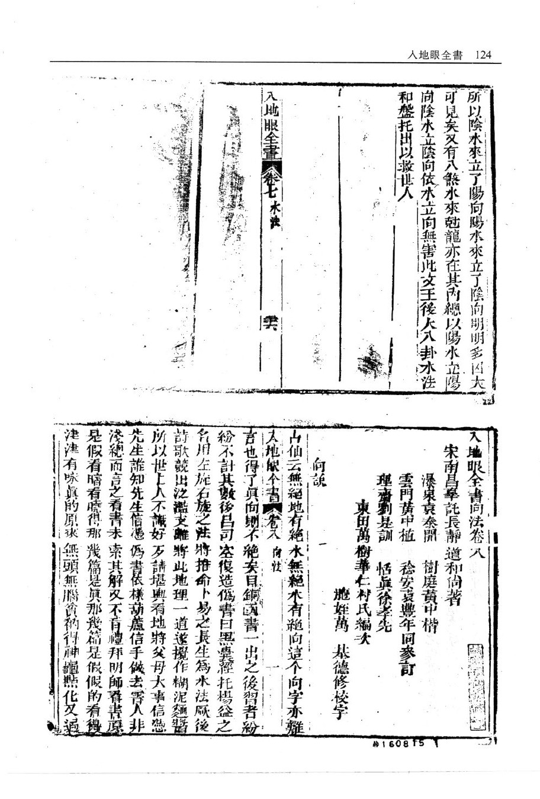

> **图版说明**：本页含图式或表格。请先核对方位标签，再按附近正文的顺序阅读；模糊或缺失标签不作推定。

> **阅读提示**：本页含已登记的残损、校勘或释读不确定项，可在原文对照版与审校账本中逐项核查。

### 原书第 125 页

立向的方法中，地盘立向的正法才是关键口诀。三七相兼会招致灾祸，阴差阳错都会导致罗盘失准，时师若立向不当会害死人。这里所说的立向，是指坟地外部的朝向，与穴内的分金无关，也就是指外部收纳堂气的宗旨。例如乙向加辰则吉利，若兼卯向则犯八煞之类。

这段口诀的内容为：戌、干、壬、子、子、癸相兼，丑、艮、寅、甲、乙、辰为‘先’，巳、丙、丁、未、坤、申为‘合’，庚、酉属于后天。其中‘先’‘合’‘后天’的具体所指原文未说明。

有些向位是不可以相兼的，如果强行相兼则不利。

文中提到“辛戌干亥亥壬家”这一组口诀，其中“家”字的具体含义不详。接着指出甲、卯、乙这一组应当“休相见”，即停止或避免相见。丙、午、丁这一组被称为“双煞曜”。此外，在酉和辛的方位上不宜进行变动。这些内容属于“翻卦诀”的范畴。

丑、癸、艮、寅怕虎牙，辰、巽、巽、巳莫逢它，未、坤、申、庚乱如麻，这是夹煞，确定没有差错。

静道和尚说，黄石公见到北斗七星而推知九星，‘巨祷文廉武破辅弼者九星也’中的‘祷’疑似为‘门’的讹误，具体所指不详。北斗斗口的第一星是贪狼，属木，在艮宿，名为阳枢；第二星巨门，属土，在巽宿，名为阳旋；第三星禄存，属土，在干宿，名为天腕；第四星文曲，属水，在离宿，名为阳权；第五星廉贞，属火，在震宿，名为阳衡；第六星武曲，属金，在兑宿，名为阳闿；第七星破军，属金，在坎宿，名为阳光；第八星在左，为左辅星，属太阳金；第九星在右，为右弼星，属太阴金。左右二星是本卦，这里以坤卦为例起例，原文‘坤属士’中的‘士’疑似为‘土’的讹误，坤属土，万物从地而生。各卦都有变动规律，原文‘譬如艮卦从上父一变为坤’中的‘上父’疑似为‘上爻’的讹误，艮卦从上爻一变成为坤，坤对应贪狼，坎对应巨门，其余七卦依此类推。第七星为斗柄，每月戌时斗柄破军所指的辰位即为月建。斗柄指向寅位时，天下皆春，为正月；指向卯位为二月，指向辰位为三月；指向巳位时，天下皆夏，为四月。一月对应一辰，一年十二月，斗柄指十二辰，周而复始。黄石公因此用此法辨别‘能神’（具体所指不详），并以此辨别水法。地理家使用此法，经文中提到九星卦。凡是入位，左辅、右弼二星共为一卦。原文‘几某卦起例变则为本卦’中的‘几’疑似为‘凡’的讹误，具体所指不明。此外还有九宫八位，即后天洛书，相关记载为‘戴九履一，右向古七，二四为肩，六八为足，五十为腹’，其中‘古’字疑似讹误，五十正是中宫。

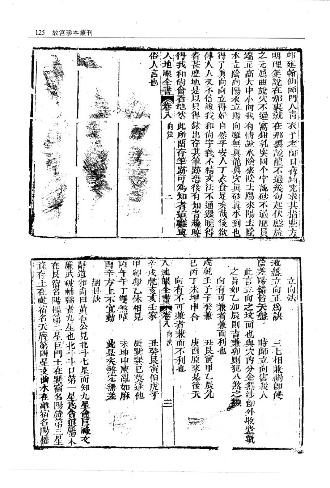

> **图版说明**：本页含图式或表格。请先核对方位标签，再按附近正文的顺序阅读；模糊或缺失标签不作推定。

> **阅读提示**：本页含已登记的残损、校勘或释读不确定项，可在原文对照版与审校账本中逐项核查。

### 原书第 126 页

黄石公邻卦掌诀

这段口诀讲述了星与卦相配成一家，通过八八变来而没有紊乱差错。具体操作是：先变乾卦，在掌中承载土；兑卦在下，震卦在小指排列；无名指安放坤卦与坎卦；中指对应巽卦在上，艮卦低徊；上离卦下乾卦归入食指。一旦确定了一卦，其余的卦象依此类推。由于原文为口诀，其中“掌中载土”、“兑下震小指排”等具体手势和方位对应关系，对普通读者而言具体所指不详。

干与兑对，兑与干对，离与灵对，离与灵对，坎与巽对，巽与坎对，艮与坤对，坤与良对。

这是八卦中乾卦的变法。

文中提到的‘五坤’，就是所谓的天父卦。例如乾卦为三连，从上爻开始变化变为兑卦上缺；再变兑卦的中爻变为震卦仰盂；原文‘三又变云之下爻’中的‘云’疑似为‘震’的讹误，又变该卦的下爻变为坤卦六段；第四变坤卦的中爻变为坎卦中满；第五变坎卦的上爻变为巽卦下断；第六变巽卦的中爻变为艮卦覆碗；第七变艮卦的下爻变为离卦中虚；第八变离卦的中爻变为乾卦三连，复归本卦。其余七卦的变化规律皆如此。例如乾卦起例，兑为贪狼，震为巨门，坤为禄存，坎为文曲，巽为廉贞，艮为武曲，离为破军，干为辅弼。如果是坤龙入首，则艮起为贪狼，巽为巨门，干为禄存，离为文曲，震为廉贞，兑为武曲，坎为破军，坤为辅弼。这是从龙脉上取三吉六秀的方法。当时的风水师常开口就说三吉六秀，若请教具体在哪里格定，回答是：吊砂则在龙的主星上格定，‘帛水’则在向上格定。‘帛水’一词重复出现，疑似为‘拨水’的讹误，具体所指不详。

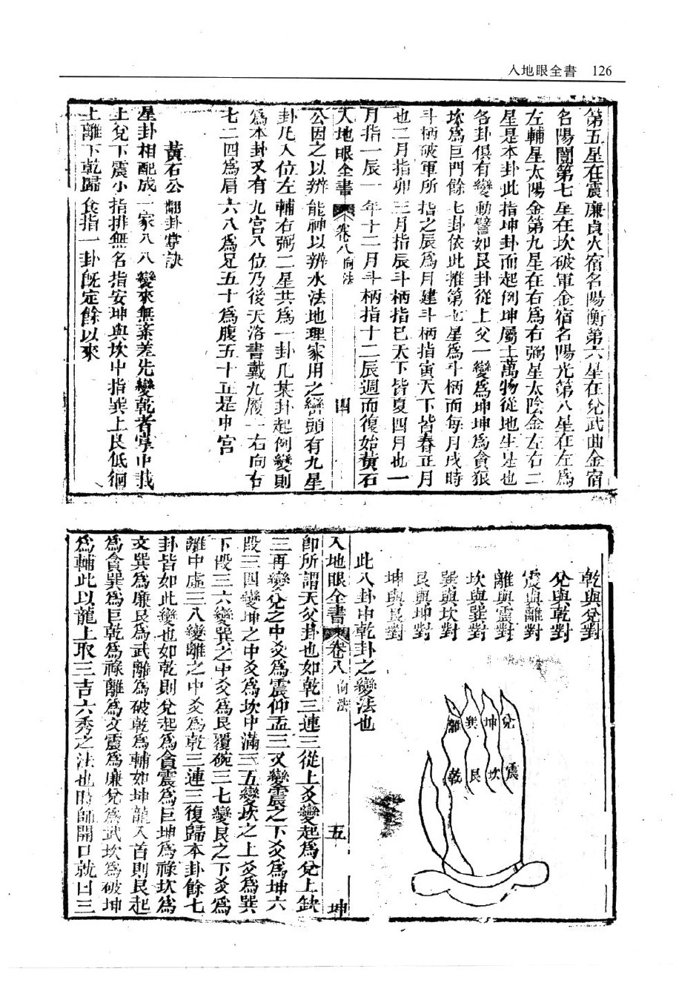

> **图版说明**：本页含图式或表格。请先核对方位标签，再按附近正文的顺序阅读；模糊或缺失标签不作推定。

> **阅读提示**：本页含已登记的残损、校勘或释读不确定项，可在原文对照版与审校账本中逐项核查。

### 原书第 127 页

这是洛书紫白掌诀的口诀：一白对应坎，二黑对应坤，三碧对应震，四绿对应巽，中五对应中黄，六白对应干，七赤对应兑，八白对应艮，九紫对应离。其中“异坤七赤”一句中的“异”字，疑似为“巽”字的讹误或特定写法，具体所指不详。

这是后天合十之法：一与九合，二与八合，三与七合。

四与六合最发，续弦侧室之子无嗣之家用此救法极。

翻卦补星向法

黄石公的八卦水法总以后天方位为主，以向为确定标准。使用翻卦掌诀，取净阴净阳与向相配。所谓净阴，是指震、巽、艮、兑四阴卦，立向时使用这四阴卦；所谓净阳，是指干、坤、坎、离四阳卦，立向时也使用这四阳卦。原文‘水之来去要阴阳不维’中的‘不维’疑似为‘不杂’或‘不违’的讹误，具体含义不明，符合该标准才算尽善尽美。总依掌诀上翻，得到辅、武、食、巨四卦则吉，其中‘食’疑似为‘贪’的讹误；得到破、禄、文、廉四卦则凶。遇到吉就按吉判断，遇到凶就按凶推断。用八卦法得到对应方位，翻卦可以知晓吉凶，辅星辨别‘字向联珠’，该短语具体含义不明，以其坐山收水。此法用十二地支最为确切。而有人使用干、甲、丁、艮、丙、辛、巽、奏、癸、坤、壬、乙的说法，其中‘奏’疑似为‘庚’的讹误，这些都是混谈，不必费心研究。如果学习现在的《铜函经》，那是杀人不用刀，一定要千万慎重。

辅星翻卦向法，即禹主治木之法。

翻卦得出贪、巨、辅、武四卦为吉卦，破、禄、文、廉四卦为凶卦。以辅、武、破、廉贞、禄、文八个字为排列顺序。比如巽山干向的情况，从干位上起辅，依次是武曲、离发军、艮廉贞、巽贪限、坎。其中“离发军”“巽贪限”表述疑似存在讹字，具体所指不详。

文中提到“长兑”，这可能是前文的延续或特定术语，具体所指不详。接着举例说，如果是干山巽向，从巽上起辅，接着是武曲、艮破军、离廉贞。

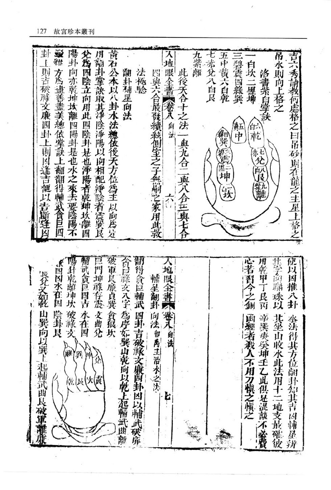

> **图版说明**：本页含图式或表格。请先核对方位标签，再按附近正文的顺序阅读；模糊或缺失标签不作推定。

> **阅读提示**：本页含已登记的残损、校勘或释读不确定项，可在原文对照版与审校账本中逐项核查。

### 原书第 128 页

文中列举的内容包括干贪狼、兑巨门、震禄存、坤文曲。坎辅、武、贪、巨对应的四吉水位于四阴卦。文中提到“艮巽总尼”，具体含义不详。破、禄、文、廉对应的四凶水位于四阳卦，即干、离、坤、坎。不管是什么朝向的山，都按照纳甲来计算。如果是甲向，就从干位上起辅；如果是辛向，就从巽位上起辅。原文说“二十四八依此推”，“二十四八”具体指代不详，按照这个规则推演即可。

这段是龄局水法的相关定例，内容如下：入地康四向水、四向水、坤乙二向、向水、坤、巽二向水、艮丙、良丙二向水、巽辛、四水、干甲二向水、五四向水、向水、坤乙二向水、干甲、巽辛。原文列举的条目存在重复，“五四向水”“良丙”具体所指或是否为讹字不详。

文中提到了“中向水”涉及“干甲”、“艮丙”、“巽午共辛二向水”、“艮丙二向水”、“刻”、“支”、“款地”、“坤乙”、“辛癸资四向水”以及“坤乙干甲二向水”等术语。以上所述的二十四水与二十四向，皆可依此推演。对于已下葬或未下葬的情况，其吉凶祸福皆可了然于心。若能熟记合局、破局、德诀及断语，登山辨察祸福便尽在掌握之中。由此可知，此卦源于易理，为先圣所作，一则为了代世人提供行事的方便，二则为了不误人大事。关于“三”与“九”则到各处有缘者这一句，原文在数字间有空格，具体是“三则、九则”还是“三九”之数，含义不详。文中还引用古先师的话说：“世上谁能识我？当世明师后代仙”，这难道不是堪舆家的一大乐事吗？

水法分房分图

一子向上是真元，二子脚踏两头船，三子却从何处立。孟白仲青李在前。

> **阅读提示**：本页含已登记的残损、校勘或释读不确定项，可在原文对照版与审校账本中逐项核查。

### 原书第 129 页

十水法中，房分的吉凶分别对应穴前的方位：长子对应右手，二子对应左手，三子对应前方，四子对应案右，五子对应案左，六子对应案中。其中四子与长子同宫，二子与五子同宫，三子与六子同宫。参考图表即可明白。以子山午向为例：若坤申水来，长房、四房先发达；若乙辰水去，二房、五房后发达；若午水当面朝来，三子、六子房先发达。但立向时有兼左或兼右的情况，有的兼得，有的兼不得。如今的时师依据伪书左右瞎兼，不知暗中受害。人家祖山少则葬数十座，多则百余座，若立向相同，祸福便一样。闲暇时若谈起坟山，常说自家祖坟总是三房不利，这是什么道理？回答说：并非祖坟本身导致三房不利，总是因为立向时错兼了，导致三房受损。哪有龙脉能偏袒三房的道理？书中说：向克向主三房，而水克尚导致三房绝。例如子山午向之地，若水朝来，午方左边丙、右边丁，三水混流，主时眼受损且遭火烧，必须午水干净才行。若丙、丁三水齐来，立丙向以收纳，则三房大发丁财且秀，但终究不免吐血淫乱之事。若此水与午水并来，则三房绝；若二房序无三，则二房绝，长房承其地。如果龙真穴的，可在当面多栽树木成林以遮蔽，或改水往坤申、乙辰而去，或在面前筑起高堤以避水之恶煞，则丁财两旺，富贵绵远。因此天地无全功，人力可为之中也。文中“丙今丁”极可能为“丙丁”之误；“二房序无三”语义不明；“人力为 中之也”原文有空格，具体补全方式不详。

#### 阴阳破局

水法阴阳兮，弓者如干向得庚水犯苏存则不吉。甚而若龙身双来，边阴边阳者亦不吉。有阳龙阳水，止阳向；阴龙阴水，立阴向，则吉。阳龙阴水，立阴向；阴龙阳水，立阳向，则吉。阳龙阴水，立阳向；阴龙阳水，立阴向，则凶。曰：依水立向，不与龙相涉，理气撬。

这段文字主要讲述求取理气中先天与后天的灵验法则，并提到太阴星用于确定纳甲之法。文中指出河图蕴含了生成的道理，而河图与围局的格局都应当纯粹。其中水、木、火、金各行其道且保持平衡，但在洛书中金与火的位置发生了互换。文中还提到‘两南县杂’以及‘北东亨洪范’，这些短语的具体所指不详。关于元空之法，文中描述其状态多为清乱交织，而净阴净阳的感应则如神一般灵验。最后提到‘红黑一盘详水路’，意在详细考察水路的情况，但究其根本，似乎不必刻意分辨龙神。

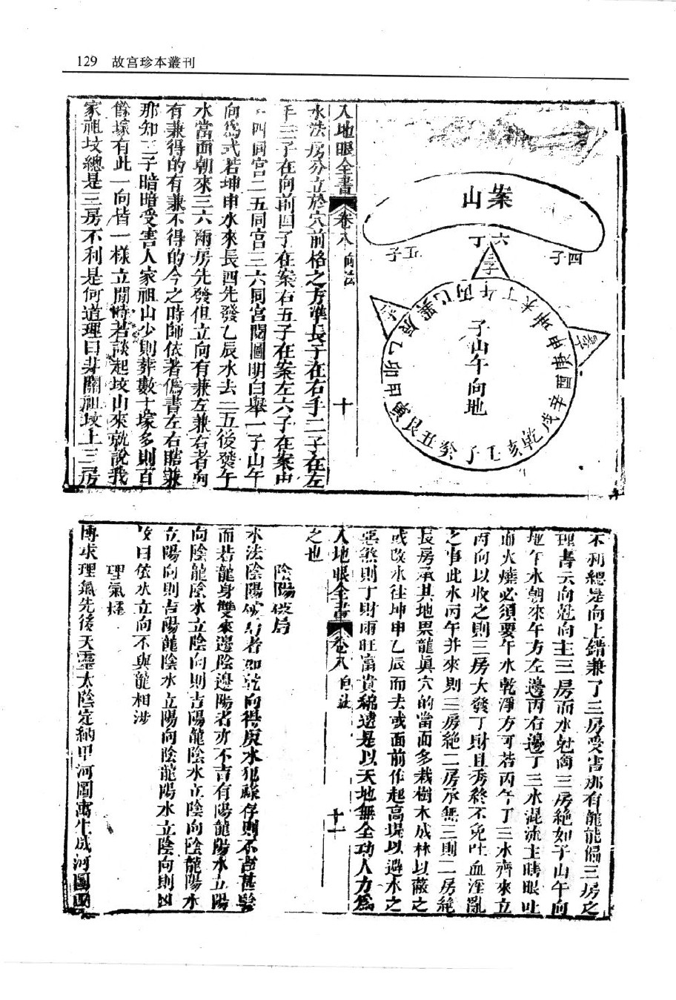

> **图版说明**：本页含图式或表格。请先核对方位标签，再按附近正文的顺序阅读；模糊或缺失标签不作推定。

> **阅读提示**：本页含已登记的残损、校勘或释读不确定项，可在原文对照版与审校账本中逐项核查。

### 原书第 130 页

#### 分房分法

水的来去均关系到福祸。若右水到左，先发达长房；左水到右，先发达二房。当若有水朝来，则先发达三房。因此水有先后之理，来者为先到，去者为后到，当面朝来更为迅速，即为即到。所以左有水、前朝水都关系到房分。房分歌云：“盂自仲青季在前”，长子在右手，二子在左手，三子在向前。文中“盂自仲青季在前”一句，根据常见口诀可能为“孟白仲青季在前”之误，具体所指不详；“当而若有水朝来”中的“当而”语义不通，可能为“当面”或“当若有”之误；文末“如有五子”似乎未完整，原文后续可能有缺漏。

既然六房的情况已经相同，又何必再区分呢？这些情况都体现在朝案上的内外水势上，要看水来的气势进入明堂。四子与长子相同，五子与一、二子相同，六子与三子相同。就像人家兄弟之间不平均，又该怎么说呢？人家兄弟不平均，都是因为砂和水上的窍妙。时师不知道消砂纳水的工夫，所以才有不平之事。又有发富但没有儿子的，又有儿子多却贫穷的，又有一支出贵人的，又有一支愚钝浑浊的，又有的人家两旺的，又有贫穷导致绝后的。这都不是龙的问题，全在于砂水。能知道消砂纳水，就是明师。所以明师给人卜地，预先就能知道哪一房兴旺、哪一房衰废，富贵在哪个朝代出现、出现在哪个人身上，不过是消砂纳水配合全坐相的作用罢了。见到房分不均的，是砂的问题；水不坐堂就是贫穷。如果没有砂就绝后，水不坐堂就贫穷。如果偏房分是一边阳水来、一边阴水去，或者阴水来、阳水去，或者左水到右（左是阳水来，右是阴水去），立了阳向则二房发、长房贫；立了阴向则长房发、二房贫。如果面前有水朝来，则三房掌管。水有来得好的，也有来得坏的；有向得的，也有向不得的，都有分别。面前有水朝来，水有一个字上来的，有两个字上来的，或者三四个字上来的，有水片来的。一个字上来为单来，却妨射穴；两个字来为双来；三四个字来为一片，却要层层肩朝拜发触。若是一片无情，名叫“莅花水”，是无用之水。所谓一字，就是罗盘上一字。比如坤山艮向，地面前又有明掌一池清水正对面，常师不知是好是丑，一见便说好个明堂。坤山艮向兼申寅三分，正对塘中四水归聚，一非之后人财两旺，富贵长久，日后教子侄读书，遗要发榜做官。东家不知，听得此语，虽不想贵，身可安，得就说：我们不知，全仗先生。哪里是先生，就是尔前世的对头。艮寅方不池塘，左是三艮，右是寅甲，一塘煞水，如何是好？误将老父老母葬下。庸师不知纳水之法，此是八煞水，向是八煞向，难满三十年，全家死得干净。还是先生乎？对头乎？独不知书云：坤山艮向，寅水入煞，带廉贞，血满肠。一宜立子向，若见回龙顾祖，鄙身逆势结穴者，壬子癸三方水朝向，先发三房，右水到左，次发长房，后发二房。此言阳水来去，立阳向以收之。无龙有水，山脉气旺，亦可发丁财。举一子向为式，而申向、辰向可例推矣。一宜立午向，坤申水来，乙辰水去，为后天会先天局，先发长房，次发二，而后发三房。此阳水来去，立阳向则吉。举一午向为式，而寅向、戌向，地眼全书入同法，南向可以例推。又曰：乙辰与坤申同理，坤急未乙，忌卯未，即卯也。乙司手足，又司口舌。乙卯二水混来皇堂，则重妻；若射来，则成痨病。卯向不可兼乙，乙向不可兼卯。庸师知之否？请往古家间考，不可依伪书而行。见向己卯向者，直断他有痨病，有重妻。卯多男人吐血，乙多妇人吐血。乙多则生女多，卯多则生男多，且又难养。若卯向兼甲者，见有乙辰二水朝来，则又断他出拐脚人，出结舌人。若有明堂在乙辰，则断他出吊颈人、落水死。又有卯向兼甲者，用水朝来，则断他好酒色，出游荡人，好吃懒做，萧荡败家，赌博道遥。若有明堂左寅甲方，则出麻疯，生产死，吊颈死，中疯死，出家为僧。一个卯向，两自阳水来，破了阴局，就有许多的故事出。死人死得不同，败家败得不同。今特标出，后学不可不慎。一宜立卯向，巽水来，艮水去，为雷风相薄局。震为雷，巽为风，合后天洛书生成之。先发长房，得横财，发大族；次发二房，后发三房。人兴财旺，科甲绵绵。此举一卯向为式，而亥向、未向可以例推。总而言之，阴水来立阴向，总不宜混杂。阳水来去，或当面有阳水朝来主来，则宜避之。如有阳水朝来，则三子受害；水克向，两克水，则三子受殃。又曰：时师与人立向，不知阴阳相兼，只知四十八局，左兼右，右兼左，大事毕矣。殊不知阴不可兼阳，阳不可兼阴。如卯向，左右俱阳；如午向，左右俱阴；如巽向，左阳右煞；如亥向，左右皆阳；干壬二曜相夹。如此之向，无有可兼。是以立正向方能发福，而若一兼，则三房受害。伪书假造，元有百二十分金。何为分金？曰：未识穿山虎，先明透地龙。穿山虎者，言艮为山，寅属虎，寅艮同宫，故名。透地龙者，如地支子宫内有甲子、丙子、戊子、庚子、壬子，是何子？论纳音。如甲子龙入首，纳音金，为金龙，不可用火局克了金龙。何为透地龙？如线穿针，争差毫厘不得。审定来龙，一线穿定，气脉贯进顶耳腰腧，受穴乘气透入尸骸，依此放棺，故曰透地。又言百二十分金，每一山有五位，穿山透地在其中矣。五行陶洗不净，如金在沙中，犹未净也。后人见分金广多，难以趋避。六十龙中，为各作一分金；八干四维，各又作一分金，共成七十二龙，作七十二分金。又穿山透地包括在内。穿山七十二，布于二十四山，每山各有三分金。后见其理不合，又改为四十八局，分左右相兼，则不犯差错、空亡、龟甲、空亡、戊巳、孤虚、关煞等项。一山又去戊巳正中一条，又除孤虚空亡一条，又除关煞一条，共除去七十二条，所余下四十八分金。任凭相兼，则不犯关煞空亡。岂有此理？圣人造罗经，原告后人定方向，川天地人三盘。地盘立向，人盘消砂，天盘纳水。将罗经竖起，天盘在上，人盘在中，地盘在下，天地人三才之义。又将二十八宿把守边开，所载某宿度若干，用线索牵正，前在某宿几度上，后在某宿几度上，是以不得差错。后不知何人将差错二字设出，戌巳、龟甲、孤虚、差错、关煞、容十等语，以慌人。又说出穿山透地，以哄人。亏尔说得像人生天地间，不能与人分忧解结，须尝以利济为心，何苦出此幻说以哄人耶？穿山虎三字，依尔说，艮为山，寅属虎，寅艮同宫，此正理也。尔又借此穿山虎以名之，且虎在山，亦不能穿山，曷不借叶中有个穿山甲名之，为更妙也？若作中山寅向兼坤艮丙，中丙寅分金，此依尔穿山透地，各煞不犯，则该发富贵及丁财。殊不知祸未至，祢先来，主人吐血，恶死人命，败家。非穿山虎，乃真伤人虎也。何苦实学不求，心如黑墨笔，以讴人耶？衲只见已葬旧地，皆砂水向三盘之故。砂不能消，水不能纳，向不能立，是以败绝者多。自从未见有穿山透地分金犯戊巳空亡等煞而败者。莫说未见，自古未闻，则是真是假乎？罗经五盘作用，先已说明，余者多篇无用之学，不必推求。立向不得用缝针与外盘，此二盘乃消砂纳水用之。又有托文俊、杨益二人之作用，天怨矣。盖立向的用正针，正针即地盘。世间用缝针者，皆错。以至二八益加三七，饶减不立正向者，以其避俗孤虚空亡也。此不必拘。总而言之，要看局面砂水，有不容分毫勉强者，自然而然也。虽正向，亦不妨。无论相兼正句，总看有情无情。衲手与人定阴阳二宅，立正向者甚多。又旧以旧宅正向者发福之家亦多。是以先贤立法以救人，后人立说以害人。庸师不识此窍，只得依葫芦画样。固谈及立向之法，故有此一说。不然，又说托和尚多事矣。一宜立酉向，丁未水来，亥水去。若得巽脉转艮，复转卯入兑结穴者，必须要当面酉水朝来，为化煞生权局，定主拜相，又主男为驸马，女作宫，如仙翁佛子。此言阴水来去，立阴向则吉。举一酉向为式，而巳向、丑向可以例推。又曰：酉水乃兑，其兑为少女。若遇阳龙阳向，酉水来破局，则生浮乱风声而败。子评云：申子辰鸡叫乱人伦，命宫犯此，谓之桃花煞。辛酉二水局，层拜下，若得产曰二向者，则重妻，多生女，难生男。生十胎九女一男，何则？辛纳于巽，巽为长女；酉纳于兑，兑为少女，谓之八女同申，难以生男。辛酉并立，辛忌酉，酉岂不忌辛？虽是八煞，但二卦皆属阴也。阳向遇酉水，则不肯减力。契凡阳向收酉水者，则主男盗女淫，人命军徒绞斩，四宇定不饶也。呀，唯我只道生得子，径不成器，原来非坟，怎么生出许多怪物？还凶打架，奸经窃盗，昊大混杂，如何是好？曰：非也，不关攻事，总辟水事。水是生成，如何改得？曰：谁叫你改水？远将碑石移向，则无祸矣。阳水来云立阳向，阴水来去立阴向。若无碑石者，即买石逆转，可就是无龙之地，立了向收了水，虽不发，却平安顺，祸亦消除，则慢慢幸地以纪之，自然发富贵矣。唤咄，总是穷无奈，不能请得地师，不过是用道上安葬了，载是那襄。

> **阅读提示**：本页含已登记的残损、校勘或释读不确定项，可在原文对照版与审校账本中逐项核查。

### 原书第 131 页

### 原书第 132 页

### 原书第 133 页

看到有这般祸患，那些道士懂什么呢？他们只知道阳年论东西、阴年论南北，乡村大事和军事事务，都谈论大利，就觉得家家都能发福。哪一家不是符合大利的山向？怎么会有兴盛和衰败的分别？水合了局就夸赞，破了局就判定会衰败。有一类不信地理风水的人，开口就说：“命好的就能碰到好地，命不好的就碰到差地。”谋求好地安葬以求后代出官人，碰到好地就能出官人，这想来是合理的；但谋求好地安葬的人多，碰到好地能出官人的却少。人们唯独不想想：谋求好地，或是为了补山，或是为了葬在正穴的位置，葬在两旁就是界水，难道肯把父亲葬在界水范围里吗？所以不得不谋求合适的地。地在旷野里，不在家中，不像别的东西可以拿到屋里来。就算碰到好地出了官人，也是祖上有大功德，所以才能遇到吉地。先贤说过：吉地是神明掌管的，不能当作寻常事看待。又有说法称：“行凶作恶的人，子孙反而发达，是因为前生积了德。”文中提到“德礼灭地理”，具体含义不详，只说要祖上有德才能遇到吉地。天地回报这份德行，护佑他的子孙，让人丁兴旺、富贵双全。凡是富贵的人，再继续培植根本，自然子孙能长久享福。行凶作恶的人，虽然眼下富贵，要是再行事刻薄，之前的德行耗尽，就会遭受天谴。所以天地的报应一点都不差，天地没有私心，对有德的人用吉地回报他。文中提到“作峰以曰地诛之”，具体所指不详。世间的事，文中说“女方布在地理内分别善哉考哉”，具体所指不详。

> **阅读提示**：本页含已登记的残损、校勘或释读不确定项，可在原文对照版与审校账本中逐项核查。

### 原书第 134 页

理斋刘是训怡真徐孝先

胞姪万基德修校宇

阴宅不外河洛之理，配合不外八卦之法。龙、穴、砂、水、向，不外五字之真。龙认生死，穴认有无，砂认粗秀，水认曲直，向辨纯疵。此五法亦为紧要。知此五者，改天命夺神功，有不测之机。伏羲画先天之卦为河图，得干一、兑二、离三、震四、巽五、坎六、艮七、坤八，识天地之阴阳，知世上之吉凶。禹王画后天之卦，故戴九履一，左三右七，二四为肩，六八为足，以定八方之正隅，知天地四时八节之气候。文王之上易用后天之八卦，干坎艮震巽离坤兑，二卦合而为一，则知天地之气数、世间之祸福。黄石公作翻卦，干离艮与坎、坤震兑，定水之阴阳，知人家之兴废。惟制卦无一定之规，总以斗柄七星为主：贪、巨、禄、文、廉、武、破，此七星之名。七星之外，又有左辅、右弼二星，加入七星之内，共成九星。卦只八方星有九星，故辅弼二星廿一卦。其卦干、离、坎、坤为四阳卦，艮、巽、震、兑为四阴卦。阴向要四阴水路吉，四阳水路凶；四阳向要四阳水路吉，四阴水路凶。其翻卦从向上起：辅、武、破、廉、贪、巨、禄、文。阴向四吉星在艮与震、兑，四凶星在干、离、坎、坤；阳向四吉星在干、离、坎、坤，四凶星在艮、巽、震、兑。其星辅、武、贪、巨四星吉，破、禄、文、廉四星凶。吉星便以吉来断，凶星便以凶来推。翻卦之法神乎其神，乌有不灵验者哉？九星断语列于后。是以圣人知天地阴阳，画卦以示后人，遵其教者习而明之，无有不验。奈地理一道，百不得一，而用之者不以为德，反以为仇，贬而削之。所云用卦不用卦，用卦还是错。殊不知自不明其理，胸无点墨，先圣岂有哄人者哉？今特标明，请刻列老师徃人祖山者验看其宇向，辨其水路，用翻卦诀，却其吉凶，方信用卦之妙。总以净阴净阳为主，故云红黑一盘，详水路，究来不必辨龙神。

> **阅读提示**：本页含已登记的残损、校勘或释读不确定项，可在原文对照版与审校账本中逐项核查。

### 原书第 135 页

每月十五望月全明，三阳俱足，象乾卦。由十三至十七日入土时，月在甲方，故干纳甲。

每月望后，晓明亏，一阴生，月暗一分，象巽卦。自十八至二十一日出卯时，月在辛方，故巽纳辛。

每月下弦，月半亏，自二十三至二十七，二阴生，月暗二分，象艮卦。日出卯时，月在丙方，故艮纳丙。

每个月在下弦月之后，从二十八日到三十日，月亮完全黑暗没有光亮，这是三阴之气都具备的象，对应坤卦。到了次月初二日天还没亮时，月亮位于乙方的位置，所以坤卦纳乙。子对应坎卦，坎卦纳申、辰；癸、戊、午对应离卦，离卦纳寅、戌、壬；已、卯对应震卦，震卦纳亥、未、庚；酉对应兑卦，兑卦纳巳、丑、丁。

> **阅读提示**：本页含已登记的残损、校勘或释读不确定项，可在原文对照版与审校账本中逐项核查。

## 卷九·合局与破局图说

> **编者导读**：将河图、洛书和方位组合落到具体坐向，并列举黄泉、八煞等传统忌例。

### 原书第 136 页

#### 天一集

天一生壬水，地六癸成之。先天干纳壬，坤纳癸。癸地也，壬天也。一生一成，夫妇之道，天地交泰，万物发生。坟茔得此水城者，故主富贵。断曰：子癸二水生六，指国县澄凝发富，具寅水长生旺丁财，龙真局秀贵自来。

入地服全书卷九

地六成之

先生而后成。干三爻属阳，万物资始；坤六爻属阴，万物资生。坎得干之阳爻在内，离得坤之阴爻在中，故坎为中男，离为中女，乃后天之夫妇。坎茔得此堂局，至大富贵。壬水骤富，堪救贫，文武全才，为公卿。

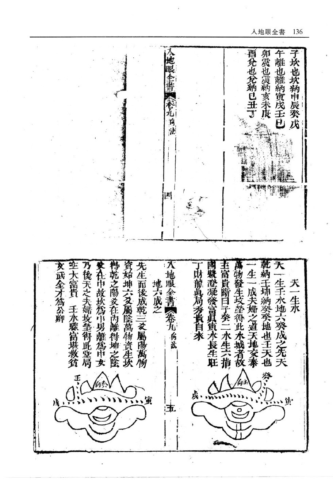

> **图版说明**：本页含图式或表格。请先核对方位标签，再按附近正文的顺序阅读；模糊或缺失标签不作推定。

> **阅读提示**：本页含已登记的残损、校勘或释读不确定项，可在原文对照版与审校账本中逐项核查。

### 原书第 137 页

地二生火，地二生丁火，天七丙成之。丁纳兑，丙纳艮。少男少女，夫妇相配。丁寄离明之位，南极老人一星下照。丁地坟茔有此堂局，主少年发达，寿考龈龄。丁水朝来，南极星，男女康宁，最多寿。丙丁二水名赦文，少年为官，转公卿。

入地眼全书卷九法

天七成之

丁生发而丙成就，丙对应艮卦，丁对应兑卦。艮为山，兑为泽，所以形成山泽通气的格局。丙在九紫星旁，太微一星向下照临丙地。如果有丙水朝来，必定主家富贵双全，人丁和财业两旺。文中提到“丙水朝来多祸寿皇恩浩荡叨原宥”，语句断句存疑。丙丁赦文出现，家无灾祸。八个归元水最为吉利。

天三生木，天三生甲木，地八乙成之。甲为阳木，乙为阴木。甲属乾卦，乙属坤卦。若乙木从干方来，其势不小。太阴一星赤色在右，阳衡一星赤色在左，二星夹辅，因此催官第一。乙水朝来可催官，出状元宰相，姓名扬名，名利显达，多宫贵，招得皇姑，满心欢喜。

大地眼全书卷九向法

地八成之

文中提到“先生后成”，具体含义不详。甲是东方的阳木，为天干之首，乙木次之，对应时令是仲春，天帝司掌甲，所以甲水朝来和其他的水不同。牝斗第五星向下照临，主掌文章之府、宰相之宫。甲水朝来能发富贵。乙向得到这样的水，实在是好事。文中提到“蜚声魁簿”，具体所指不详，能出状元，文章盖世，令世人惊叹畏惧。

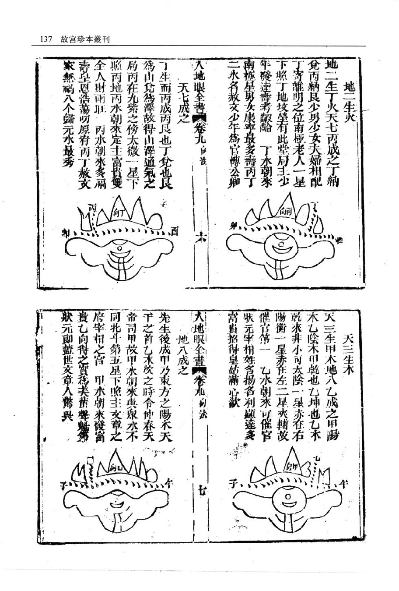

> **图版说明**：本页含图式或表格。请先核对方位标签，再按附近正文的顺序阅读；模糊或缺失标签不作推定。

> **阅读提示**：本页含已登记的残损、校勘或释读不确定项，可在原文对照版与审校账本中逐项核查。

### 原书第 138 页

地四生辛金，天九庚成之。辛纳巽卦，庚纳震卦。震为长男，巽为长女，夫妇相配，秉镇主事。辛水朝来，乃衣章之府，天乙贵人之治。内有文昌一星下照辛地，辛水主秀发文章，少年科第，姓名香。更有如花女人貌，翰林学士称龙光。

大地眼全昼卷九舟法一天九成之

庚属震卦，震为雷；辛属巽卦，巽为风。雷动风散，故称鼓舞。庚在龙德之官旁，有二星赤色下照庚地。凡庚水朝来，定产威武权谋之上，忠勇果毅之人。应此坟茔者，震龙庚水也，催官武士取贵亦非难。艮龙庚水，富堪敌国。雷动天潢，才堪文武。此八局，龙其穴，水绕砂关，莫大之局，所以发福更大更悠久。凡遇此八局，乃河图之生成，所以各局开载于右：天一生水，地六成之；地二生火，天七成之；天三生木，地八成之；地四生金，天九成之；天五生上，地十成之。水火木金分于四方，土居五行之中。罗经无戊巳，故五十不用。圣人用此以画卦，地理川之如神灵，一生一成，反复详明。水之来去，均关祸福。依水立向，丁财雨旺。水朝向错，百事见祸。水从天生，地以收之。收吉则吉，收凶则凶。天地之道，东西南北，先圣即九。

以此训人，曰：志者受授，明乎天地之道，总不出子东方甲乙木，南方丙丁火，西方庚辛金，北方壬癸水。所以癸水来立壬向，壬水来立癸向，得生数而发富贵，得成数而旺人丁。余三局仿此推。罗经无戊己，故不用中央。

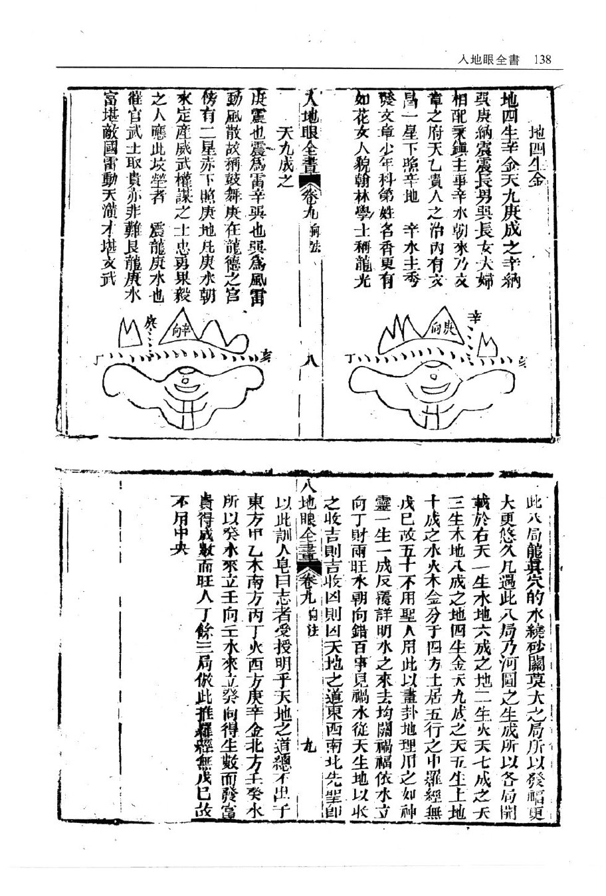

> **图版说明**：本页含图式或表格。请先核对方位标签，再按附近正文的顺序阅读；模糊或缺失标签不作推定。

> **阅读提示**：本页含已登记的残损、校勘或释读不确定项，可在原文对照版与审校账本中逐项核查。

### 原书第 139 页

原文开头“洽书”疑为讹误，所记内容为：天乙生水，天一生坎水，地六配干而成之。先天的坎对应坤，见到后天的干，就是先后天相见。坎得白，干得六白。干在天门的位置，文中提到“乙左奎宿居其所”，具体含义不详。干水从干方来，所以会出状元、宰相。干水是第一等的，最为上吉。子朝向北极，向内如果见到干峰高耸入云，很快就能增加财富。原文末尾语句不完整，疑有缺损。

入地眼全书卷九向

地二生火

地二生坤火，天七兑成之。坤得二黑，兑得七赤。二黑水克七赤火，不吉。坤为老母，兑为少女，左右离中女，此为三女成群，不能添丁。坤向左右得贪狼水上堂，虽富，水先到前来打搓，是以此一局，先圣亦言平常。

天三生震木，地八艮成之。震三碧，艮八白。震为雷，艮为山。先天之震在东北，后天艮居之，故喜艮水朝来，谓之物还原，主贪狼水归宗，主人财富贵。艮水朝来，天市宿，富堪敌国，非等闲。卯向得此砂水秀，黄甲声名常世传。

入地眼全书卷九

地四生金

地四生巽金，天九配离而成之。巽对应四绿，离对应九紫。巽是长女，离是中女，左右得长男相配。巽喜见震，是夫妇相配的格局。忌讳午为破军，必须三午七未才算符合法度。午、未二水朝拱，主大富贵。午水主富贵显达，庚卯未向与之相宜。龙虎抱卫，水来拱护，毫无疑问会出公侯卿相。洛书的四六局，是仿照河图四局而来的。只是先天四局二阴二阳，没有驳杂；洛书四局一净阴一净阳。坎与震这一局，尽善尽美。只有原文“地二生切火”一句，“切”疑为“坤”的讹误，这一局全无意味。地四生巽金这一局，最忌讳的是原文提到的“巽句午水为破军”，“巽句”疑有讹误，这类情况不适宜。如果能得到左卯右庚二水来去，又有未水相汇聚，最喜午与未相合，必须是午水占三分、未水占七分，这既符合后天生成的法则，又符合雷风相薄的格局，主大富大贵。原文提到“若无未木则三房受害”，上下文均论及水，此处“未木”存疑，主因名声败坏而衰败。洛书是大禹所创，大禹见到神龟背负纹样出水，背上有卦纹，才知道治水的方法。原文末尾“治后想龟背壳上有紫白黄主”语句不通顺，疑有缺损。

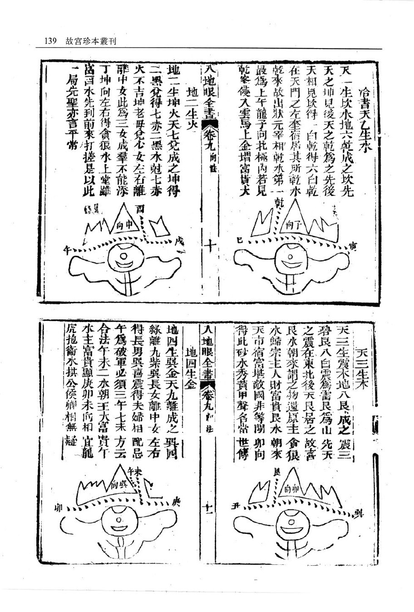

> **图版说明**：本页含图式或表格。请先核对方位标签，再按附近正文的顺序阅读；模糊或缺失标签不作推定。

> **阅读提示**：本页含已登记的残损、校勘或释读不确定项，可在原文对照版与审校账本中逐项核查。

### 原书第 140 页

龟背上有绿、黑、碧、赤等颜色的点状纹路：头朝向南方，有九点紫色；尾在北方，有一点白色；左侧东方有三点碧色；右侧西方有七点赤色；前右足在西南方位，有六点黑色；前左足在东南方位，有四点绿色（原文“缘色”为“绿色”的形近讹误）；后右足在西北方位，有六点白色；后左足在北方，有八点白色；背脊中间有五点黄色；肚腹下方有十点淡黄色。因此圣人见此景象有所感悟，创作洛书传给后人，所以设定为戴九履一，左三右七，二四为辅，六八为弼，五十为中宫，之后再用八卦与之相配。因为多了一个中宫，所以有“九八卦”的说法，“九八卦”疑为“九宫八卦”的省称，具体所指不详。

天地定位。干向坤水来，干为天为父，坤为地为母。癸水去，先天癸纳于坤。干天也，坤地也，故称定位。干父坤母，又得夫妇相配。干向坤水朝来，主人财兴旺，富贵双全。干向坤水为上龙，透天门最美。癸水合法，且富，马上金阶太尉。

入地眼全书卷九前法

#### 水火济

子向的情况下，寅水来、戌水去。子对应坎卦，坎为水，代表中男；寅、戌纳于离卦，离为火，代表中女。坎水离火，所以称为既济。坎是中男，离是中女，又是夫妇相配的格局。子向最喜欢寅、戌二水来去，寅、戌水朝拱，能旺丁财。子向宫位见到这股水来，水来主官禄生、近福来；水去主离乡，在远方发福，原文末尾“发远则”语句不完整，疑有缺损。

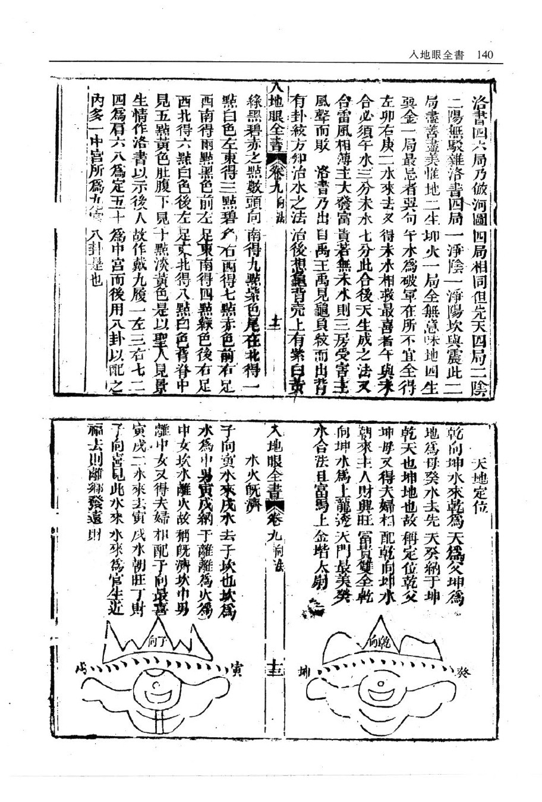

> **图版说明**：本页含图式或表格。请先核对方位标签，再按附近正文的顺序阅读；模糊或缺失标签不作推定。

> **阅读提示**：本页含已登记的残损、校勘或释读不确定项，可在原文对照版与审校账本中逐项核查。

### 原书第 141 页

文中提到“曰风相薄”。原文“卯向邦震也”一句中“邦震”疑有讹误，通常震为雷，原文提到“艮男”，与震卦通常代表长男的说法不同，存疑。巽水朝来，巽为风，代表长女。震为雷、巽为风，所以称为相薄，又是夫妇相配的格局。艮水去。洛书天三生震木，地八配艮而成之。卯向最喜欢这两种水来去，卯向见到艮、巽水朝来，实在是可喜，主家中出的人才文武兼备，文中提到“旭略世无敌”，“旭略”具体含义不详，一家有八九个子嗣，家财丰厚没人能比，家中出豪杰，获得横财都不值得一提。

入地眼全书卷九向法

由泽通气

开头“丙句丙纳壬艮”一句含义不明。接着说明艮为山，代表少男。丁水流向未方，丁纳于兑，兑为泽；艮为山、兑为泽，因此二者称为通气。丙对应少男、丁对应少女，又成夫妇相配的格局。庚、卯二水来去，得贪狼水朝堂，朝向丙方最为吉利。丁水朝来，“南极尾”相关的情况下人财兴旺，大多高寿。庚、卯二水能“骤宫”，皇恩浩荡，“叨原有”。其中“骤宫”“叨原有”具体含义不详。

坐子山，朝向午方。子山位于北极之宫，一白星位居此处，八白星在其左侧，六白星在其右侧，二白星作为辅佐，因此掌有寸柄。九星之中坎为水，离为火，水在上火在下，因此是水火既济的格局。左右有“市辰”二水辅助，具体所指不详。坐子向午两相适宜，联珠三合，兄弟齐集，人财大旺。多科甲，为官清正，福寿归。其中“多科甲”与“为官清正”的断句关系不明，“福寿归”具体所指不详。

入地眼全书卷九自

坐午向子

平山子向午，离也，丽也，利贞亨寿。牝牛位居正南，日以暄之，而阴阳湿燥长物之功也。九紫正临，一阴在中，二阳外，燥化机宜暑而万物光辉。离为中女，坎为中男，夫妇相配。子向最宜，寅戌水上堂，定七人财兴旺，科甲绵绵。其中“定七人”的具体含义不详，可能指七政、七曜或其他风水概念。

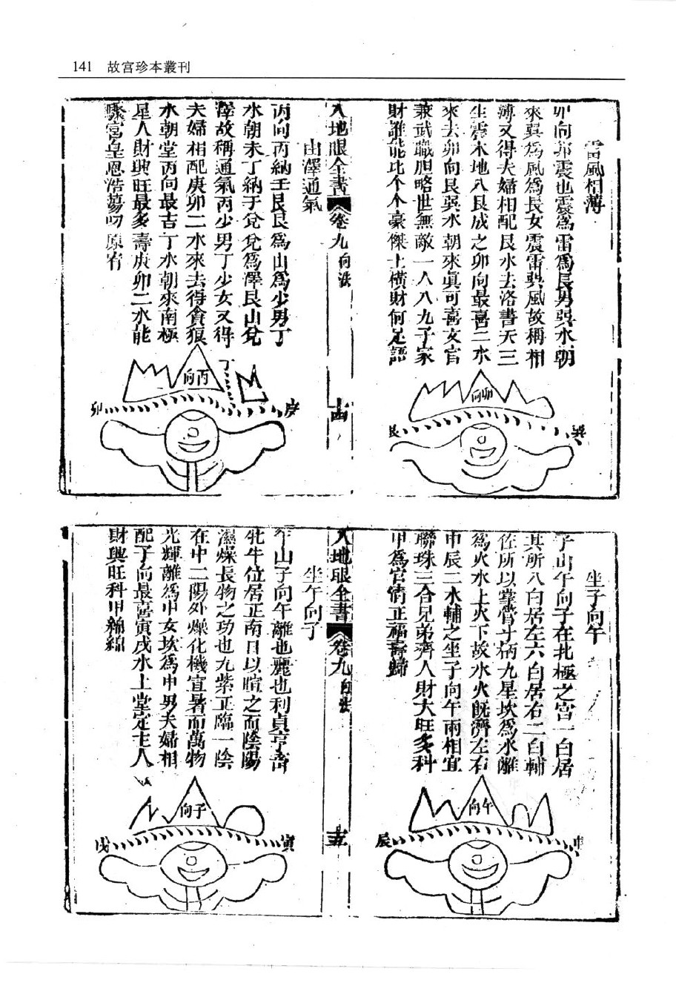

> **图版说明**：本页含图式或表格。请先核对方位标签，再按附近正文的顺序阅读；模糊或缺失标签不作推定。

> **阅读提示**：本页含已登记的残损、校勘或释读不确定项，可在原文对照版与审校账本中逐项核查。

### 原书第 142 页

#### 坐卯向酉

卯为震，震为雷，为长男，故掌兵权，操持威武。洛书为左三，庚、亥、未俱“绢”于震，具体所指不详。酉为正西，后天之右七，卯为左三，正东。一东一西，相对之夫妇。亥、未二水朝来，正合隔八相生。亥、未二水朝坟，敌国富豪，无任。再得庚来拱朝，定主文武君前。其中“无任”的具体含义不详。

入地眼全书卷九自法

#### 坐酉向卯

酉山卯向，兑对应少微垣，其中有一星最为明亮，向下照临酉地，这里是阳图所居的处所，为枢机之府。洛书对应兑为右七，卯向对应震，后天八卦对应震为左三，因此洛书有左三右七的排布，后天八卦形成对待的格局。“卯向已水旺丁财”，隔八相生。丑水来则人财两旺，家道富足，七品郎官的运势不需猜疑。其中“卯向已水”的“已”可能为“巳”之误，该短语的语法关系及含义存在歧义。

甲向乙水。甲为东方之阳木，乙为东方之阴木。甲纳于干，乙纳于坤，本东方阴阳相配，又合天地定位。辰、癸二水朝堂，得贪狼水。若有巽水三分，为后天合十。甲向乙水，可催官，人财兴旺，多利名。若有“三巽七辰水”，具体所指不详，可能指比例关系或特定方位组合，无子之家亦发丁。

入地眼全书卷九角法

#### 乙向甲水

原文开头“乙向乙乃阴木甲水甲乃阳水”断句存在歧义，一种解读为：朝向乙方，乙属阴木；甲水，甲属阳水。阳水滋养阴木，属于阴阳得配，能让枯苗复生。左右有寅、午二水朝来，乙得贪狼，定主富贵。再得到三分艮水，属于后天合十。坤二合艮八，乙向遇甲水则事事昌盛。“贪狠生气”福分更长。“合十原发侧室”，子名成利就，中魁元。其中“甲乃阳水”的说法与常规五行理论不同，具体所指不详；“贪狠”通常写作“贪狼”；“合十原发侧室”具体含义不详。

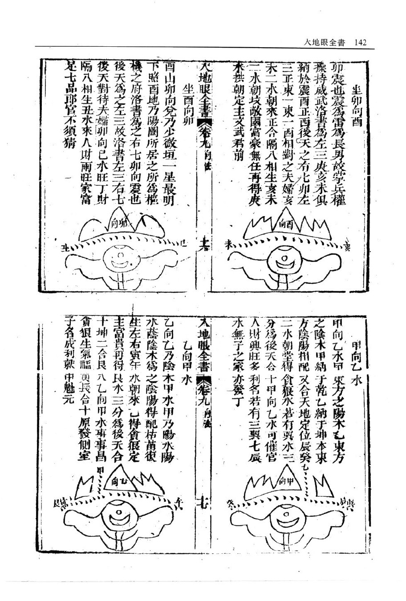

> **图版说明**：本页含图式或表格。请先核对方位标签，再按附近正文的顺序阅读；模糊或缺失标签不作推定。

> **阅读提示**：本页含已登记的残损、校勘或释读不确定项，可在原文对照版与审校账本中逐项核查。

### 原书第 143 页

丁向丙水

丁向，丁纳于兑，兑为少女。丙纳于艮，艮为少男，正是夫妇相配。右手酉水上堂，正合俗书丁火生在酉，非生也，乃归元水也。丙、巽二水朝流，六秀中，此得三秀大吉。巽、丙、丁号三阳水，酉水归元，当更先。丁向得此，真富贵也，有儿孙受皇恩。原文末尾有“X”，可能表示残缺或结束符。

庚向辛水

朝向庚方，遇辛水。庚纳于震，震为雷；辛纳于巽，巽为风。虽不符合雷风相薄的格局，也符合雷风鼓舞的态势。亥、未二水朝来，都属于震卦纳甲对应的水，可以说是水与向属眷属一家，为纳甲水。庚向遇辛水主骤富。归元最秀，武当先。若问人财与富贵（“井”字可能为误写，具体含义不详），三科两榜的功名都会有姓名标注。其中“武当先”具体含义不详。

朝向辛方，遇庚水。辛纳于兑，兑为长女；庚水纳于震，震为长男。又得酉方庚辛金之位，正是后天夫妇相配的格局，一为阳金一为阴金，因此兑有悦纳之义。断语说：辛向遇庚水，能进金宝，也主家中有貌美的女子。“辛向儿庚”，才能文武兼备。雷动天潢，财富之多足以敬重国家。震庚奋武，手握重权，定主家中出英雄将相。其中“儿庚”具体含义不详，“天潢”具体含义不详。

入地眼全书卷九向法

癸向乙水

朝向癸方，癸纳于坎，坎为水，为中男。“先大坤之位”具体所指不详。乙水来，乙纳丁坤，因此向与水符合先后天相见的义理。左侧有戍水来去，戍纳于离，离为中女，与朝向正好相配为夫妇。癸向最喜戍水朝来。原本乙水可以催官，要得癸向的吉运其实不难，主名利显达，多富贵，戊库重逢的情况非同一般。中子辰局。寅向中子辰水局，仍符合坎离二卦的格局。申子辰都属坎卦，坎为水，为中男；离为火，为中女，正是夫妇相配的格局。寅向“最姜”，子辰二水朝来，称为巨门水下堂，主富秀人财。寅向遇坎水，是北辰北方水朝来，主富贵，丁财出众，家中孝友，为官清正不侵害百姓。其中“戍”“戌”“戊”存在混用，“戊库”可能指“戌库”，“最姜”可能为“最宜”之误，“中子辰局”与“寅向中子辰水局”的关系不明。

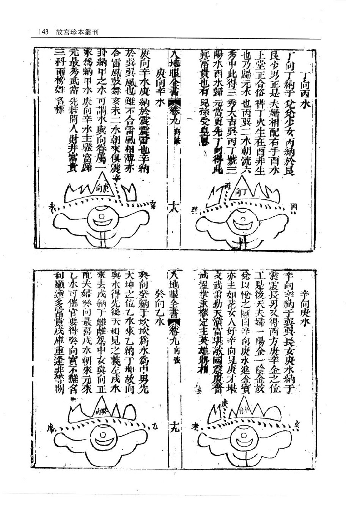

> **图版说明**：本页含图式或表格。请先核对方位标签，再按附近正文的顺序阅读；模糊或缺失标签不作推定。

> **阅读提示**：本页含已登记的残损、校勘或释读不确定项，可在原文对照版与审校账本中逐项核查。

### 原书第 144 页

入地服全书卷九前法寅午戊局

申向寅午戌火局，亦合坎离一二卦。寅午戌皆离卦，离为火，为中女。坎为水，为中男，正是夫妇相配。申向最宜，午戌二水朝来，亦是巨门水上堂，主富秀丁财。申向午水，是南离，离纳壬，寅戌已齐，午水主富，发显宦，人财典旺，正相宜。其中“典旺”可能为“鼎旺”或“大旺”之误。

亥、卯、未构成木局，巳向对应此木局，这符合后天八卦中震卦与兑卦一东一西相对待的关系。洛书数中左二右七，巳向最喜卯、未二水流入明堂。文中提到“卯未一水乃巳向之武曲水”，此处“一水”具体是指卯、未两股水还是合为一股水，原文表述存在歧义，因此能使人发财、出秀才，百事兴隆。巳向原本就喜见卯水，若见亥、未、卯，则家中长子等能出文官武官，家财巨富，人丁兴旺。

入地眼全书卷九向法

巳酉丑局

朝向亥方，巳酉丑金局也对应兑、震二卦，洛书中三碧与七赤左右对照。“亥向生已坐山”，合巳酉丑联珠三合局。亥向最喜酉、丑二水朝堂，最为秀丽，定主金玉富足、人才秀异。亥向遇酉水，为武曲宿，“兑丁巳丑金光透”，科甲连绵，入翰林院，地位显贵接近君王，身穿锦绣官服。其中“亥向生已坐山”含义不明，“兑丁巳丑”具体所指不详。

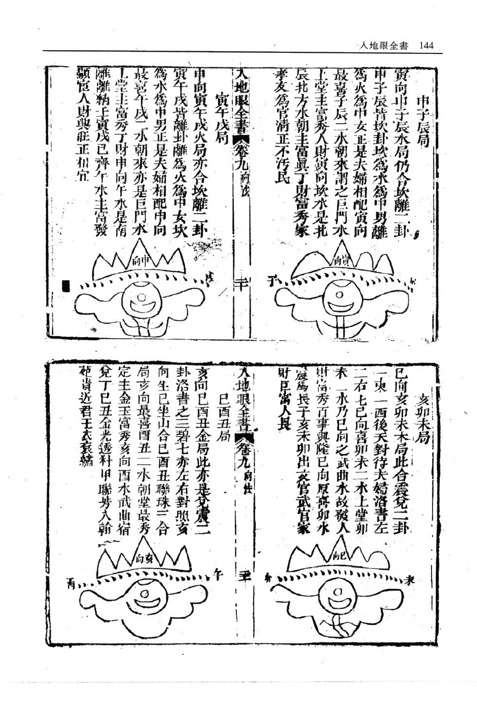

> **图版说明**：本页含图式或表格。请先核对方位标签，再按附近正文的顺序阅读；模糊或缺失标签不作推定。

> **阅读提示**：本页含已登记的残损、校勘或释读不确定项，可在原文对照版与审校账本中逐项核查。

### 原书第 145 页

寅、午、戌构成火局。辰向，辰纳于坎卦，坎为中男；午水，午纳于离卦，离为中女，正合夫妇相配。洛书中离为九紫，坎为一白，一与九合十。文中提到“辰向长台寅二水朝来第一发续”，其中“第一发续”具体所指不详。文中提到“续向线弦侧室之子”，此短语具体所指不详。辰向见午水为巨门星，文中提到“寅水长坐旺丁财”，其中“长坐”具体含义不详，该格局主丁财兴旺。若无子，速娶偏房，妇人不满一周年便会生子，应验非常快速。

入地眼全书卷九向法

戊向对应申、子、辰水局。戌纳于离卦，离为火；坎为水，这也是水火既济，莫大之局。却也难遇，因戌与干同宫，奎、壁二星居其所，故发状元、宰辅。又得申、子二水朝来，戌向坎水出聪明，科甲显宦，不污民，隔八相生，原如此，人财与旺，多利名。

亥、卯、未构成木局。丑向对应亥、卯、未木局。丑纳于兑卦，兑属金，为金西之卦；丑属牛金，故居年金牛之所。丑向最喜卯、亥二水朝堂。水从亥发源，从卯归海，一为发源，一为收藏，点滴不漏。丑向震水旺丁财，文中提到“库守由庄最乐怀出人尽是由会第者想衣冠何处来”，此段文字具体含义不详。

入地眼今书卷九

巳酉丑局

未向对应巳、酉、丑金局。未宫天付五星，其中一星主天下士子阴德，又主坟茔。东北星主精马，东南星主精兵，西南一星主靖布，西北星主精金。德满者以金赏之，德大者以坟补之，半德者以布赏之，劳多名以马乘之，孽多者以兵诛之。以上先天四局，后天四局，天干六局，三合相生人局，共成二十二局。以前名局分折明自，后学者了然心目。见一局合何局之水，即以何局内之断语以断之，则事无不准矣。或来合局则吉，破局则凶，必须分房分以断之。水吉断吉，水凶断凶。阴向阳水为破局，阳向阴水亦然。总要阳向阳水则发，阴向阴水则兴。故合局吉，破局凶。所以先圣知此水法，依水立向，合而成局，以示后人，无非一片婆心。回死枯骸不安，皆水来为祸。水来为祸，则子孙不安。其所以救世之苦，心免祸害于人，岂浅鲜哉。

> **阅读提示**：本页含已登记的残损、校勘或释读不确定项，可在原文对照版与审校账本中逐项核查。

### 原书第 146 页

庚、丁坤泉。坤向见庚、丁二水为黄泉。庚、丁一同见坤水，亦为黄泉。向水不合，坤向见丁水犯破军，见庚水犯廉贞。廉贞主吐血、做贼，破军主赌博、官事。左翼右干，干水须发福；巽水又来为祸。详查九星断语便明。

入地眼全书卷九向注丙巽黄泉

文中提到“与向见乙丙二水为黄泉”，其中“与向”具体所指不详。乙向见巽水为黄泉。丙向见巽水不为黄泉。丙见巽，巽见丙，俱得武曲合法，主富贵丁财。巽见乙，乙见巽，则犯禄存，主赌博退败。文中提到“左良水须发福”，其中“左良水”具体所指不详。右坤水又犯禄存。查阅九星断语就能明白其中的判断依据。

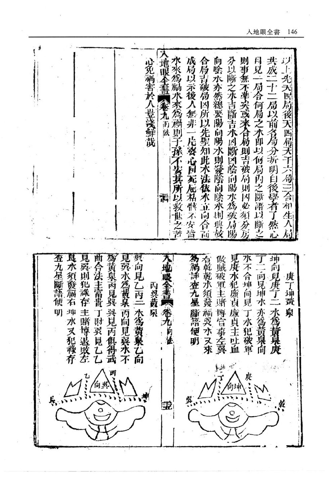

> **图版说明**：本页含图式或表格。请先核对方位标签，再按附近正文的顺序阅读；模糊或缺失标签不作推定。

> **阅读提示**：本页含已登记的残损、校勘或释读不确定项，可在原文对照版与审校账本中逐项核查。

### 原书第 147 页

甲、癸艮黄泉。甲亥艮画身。

艮向见甲、癸二水为黄泉。甲、癸二向见艮水，亦为黄泉。艮向见申水犯破军，主赌博、好讼、败绝。原文“七家见癸水犯禄存”中的“七家”含义不明，可能为衍文或误字。原文“七辰水与癸水同”中的“七辰水”含义不明。壬水犯廉贞，主吐血。原文“而同禄”含义不明。查九星断语明。

入地恨全书卷九句卒壬干黄泉

干向见辛、壬二水为黄泉。文中提到“辛向见干水为黄张”，其中“黄张”具体所指不详。壬向见干水不为黄泉。文中提到“王见干干见壬”，其中“王”字具体所指不详，可能为讹字。壬见干，干见壬，俱得武曲合局，主富贵，发丁财。干见辛，辛见干，犯廉贞，主妇人吐血、瘟疫流行、人口损伤。文中提到“右癸水乡发福”，该短语具体所指不详。庚水又来为祸。文中提到“查九星断语使明”，其中“使明”具体所指不详。艮寅为八煞，长房对应乙位，二房对应壬位，三房对应寅位。文中提到“良向乙水”，其中“良向”具体所指不详。大房会没有子嗣，过继的螟蛉子如同亲男。壬水对应二房出游荡之人，水势盛大则多人生黄肿病。惟有三房对应寅水多，主患风盲病以及被虎所伤。坤山艮向，寅水入煞，带廉贞，主便血满肠。

寅艮八煞，长房乙，二房主，三房艮。

寅向，艮水在回前，惟有一子，实堪怜。艮木朝来，主冷退，一定绝嗣，不须言。若有三兄并四弟，三绝仲承，祸连绵。如若知之，将向改，恐有明堂当坟前。

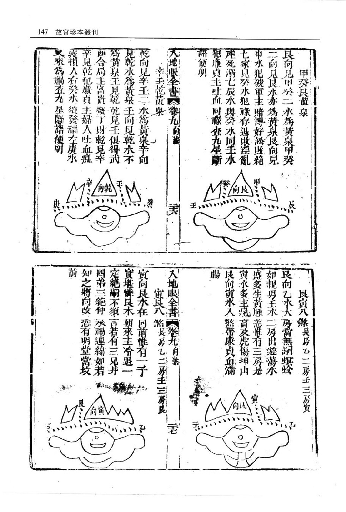

> **图版说明**：本页含图式或表格。请先核对方位标签，再按附近正文的顺序阅读；模糊或缺失标签不作推定。

> **阅读提示**：本页含已登记的残损、校勘或释读不确定项，可在原文对照版与审校账本中逐项核查。

### 原书第 148 页

禄存夹煞，长房巳，二房，三房。原文“二房子”含义不明。甲向卯水犯禄存，三房嫖赌，何须问，家财退尽，为贼盗，定主杀戮徒刑罪。长房巳水不当埋，少年吐血，又蛇灾。原文“阳同巳口员墩起”含义不明。虽然怀孕也堕胎。惟有二房，子水来，不发贵，时也发财。卯向甲水相同。

原文存在严重乱码或OCR识别错误，包括“1乙卯八煞”“三勇乙”“乙卯八！！三”等内容，无法进行有效释读。

原来乙卯是八煞。卯向乙水，人不察。若有坟茔如此向，定主手足与劳瘵。若还乙卯并流入，定然克妻。三五翻，长二两房俱发福，三房宫位在向前。

文曲夹煞的格局中，长房对应丁位，二房对应甲位，三房对应巽。

辰向、巽水被称为文曲，主三房有疾，灾祸来得很快，即便有钱也难阻挡家人游荡致败，耗尽家财尚且不够。长房对应丁位的水，主家人腹痛，运势退败的时候没有办法挽救；甲位的水对二房正好合适，主丁财两旺，全族同祠的人寿命都齐长。

八煞之外还有对应艮位的八煞格局，长房对应丁位，二房对应卯位，三房对应辰位。

八煞之外的灾祸更为严重，文中提到“与向一辰水”，“与向”具体所指不详，这类水带来的灾祸本就难以抵挡，木克土的效应谁能知晓？犯此煞的人家会全家绝亡，先出现有人投河等溺水事件，后出现聋哑人以及悬梁自尽的情况，长房、二房都不会受妨碍，只怕三房灭绝、二房承接祸殃。

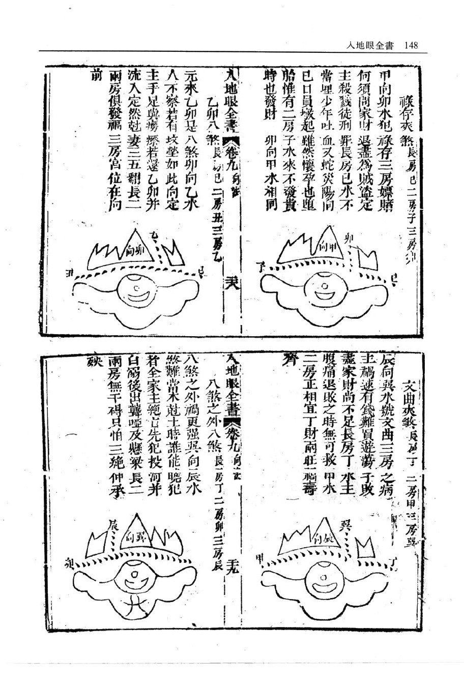

> **图版说明**：本页含图式或表格。请先核对方位标签，再按附近正文的顺序阅读；模糊或缺失标签不作推定。

> **阅读提示**：本页含已登记的残损、校勘或释读不确定项，可在原文对照版与审校账本中逐项核查。

### 原书第 149 页

纳甲八煞的格局中，长房对应未位，二房对应巳位，巳向见巽水多主冷退；巳位的水入口，火山向克水的灾祸较为轻缓，水克向的时候灾祸来得很快。长房的未位水多，主积累人丁财富，人财两旺，还能出武官，十分难得；二房的甲水入宅，主家人得麻风、痢疾，大遭祸殃。

双煞曜局的格局中，长房对应庚位，二房对应乙位，三房对应丁位。文中提到“双负明人”，这一短语的具体所指不详。丙、丁二水夹在前方，廉贞煞曜会使两房一同遭殃，三房会出现吐血、眼瞎的情况，还有回禄之灾，午向正应此煞。长房的庚水来犯，定主家中出贼人，危害村坊；乙水来朝，原文末尾有讹字“肝”，相关表述具体含义不明，可确认的是长、二房会有福寿双全的吉兆。

原文记载为“康贞水局”，又被称为“阳及水”，“阳及水”的具体所指不详。丙向、午位的水犯廉贞煞，三房会受害，主有风声相关的事端；水往局外流则家人离乡，运势必然退败；水往局内来则家人在家做贼，还会有吐血、回禄之灾。家中遇到廉贞水，灾祸就不会停止。长房、二房遇到贪狼水，主丁财两旺，确实会发贵。

入地眼全书卷九向法

坤未八煞

未向、坤水水势浩大，主妇人接连守空房；若有“巾水”双向朝入，犯克妻煞，家人悲伤。“巾水”的具体所指不详。丁向如果见到坤位的水，主有官司、家业败落，家中出游荡之人。长房、二房遇到巨门水，丁位会助力家宅豪富，寿命延长。

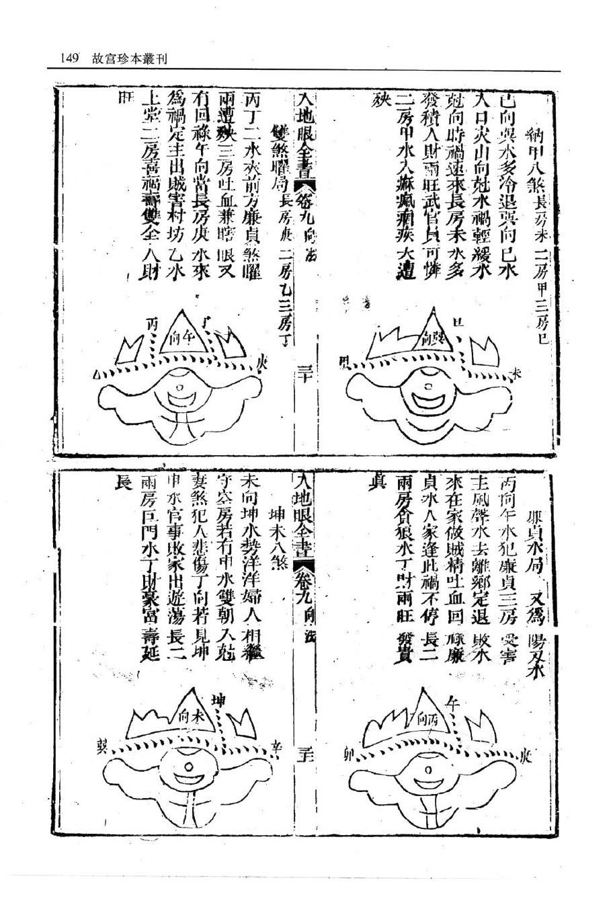

> **图版说明**：本页含图式或表格。请先核对方位标签，再按附近正文的顺序阅读；模糊或缺失标签不作推定。

> **阅读提示**：本页含已登记的残损、校勘或释读不确定项，可在原文对照版与审校账本中逐项核查。

### 原书第 150 页

#### 未坤八煞

朝向为坤，未水依照纳甲法而来，对应的是廉贞，不需要猜疑。如果未多坤少，遇到阴局，会出现妇人止血为妖，造成损伤；如果未少坤多，遇到阳局，常会出现男人吐血死亡的情况。长二两房一同破败，出现禄存绝体的情况，“定不瓦”的具体含义不明。

入地眼全书卷九角法

庚申八煞，申向庚水，三房会出现偷窃之事，生出行为不端的男子；庚申并流射入冢，会被人杀戮，最为凶恶顽劣，若犯此煞，会遭刑罚、逃亡，甚至绝嗣，实在可悲。长二两房多富贵秀气，超出常人，文章出众。

巾庚八煞，庚向申水，坎位不安，坤申井流水洋洋，三房有此洋洋水，会导致寡母淫乱，不可当。正是庚向见巾水，会绝子灭孙，哭一场。长二两房一齐败坏，禄存文曲起祸。

入地眼全书卷九角

辛酉八煞

门朝向对应的辛水属于“雨女煞”，该术语具体所指不详；就算没有水只有路，也不会发旺。如果辛、酉二水朝来环绕，虽然能得富贵，但会克妻，“无挞刹”具体所指不详。长房对应的壬水属于禄存星，会导致家人喜好赌博、酗酒，最终家业败坏；二房对应的丁水是归元格局，家中会代代出俊秀之人，藏书满箱。

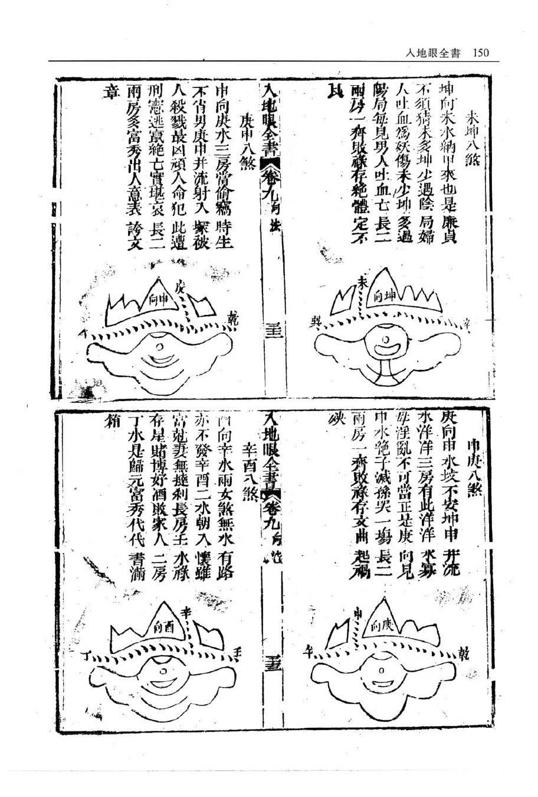

> **图版说明**：本页含图式或表格。请先核对方位标签，再按附近正文的顺序阅读；模糊或缺失标签不作推定。

> **阅读提示**：本页含已登记的残损、校勘或释读不确定项，可在原文对照版与审校账本中逐项核查。

### 原书第 151 页

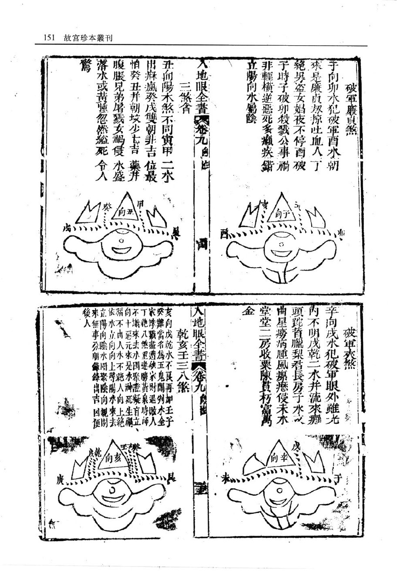

> **图版说明**：本页含图式或表格。请先核对方位标签，再按附近正文的顺序阅读；模糊或缺失标签不作推定。

### 原书第 152 页

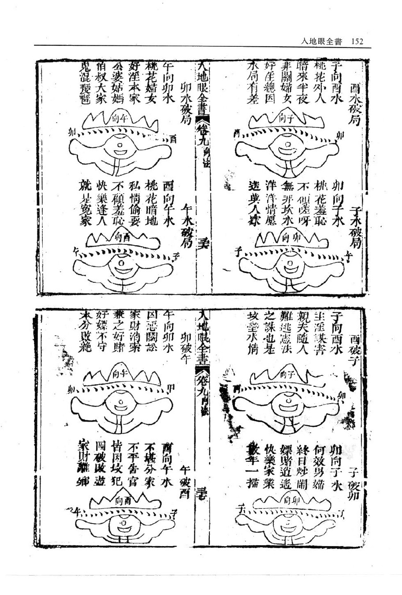

> **图版说明**：本页含图式或表格。请先核对方位标签，再按附近正文的顺序阅读；模糊或缺失标签不作推定。

### 原书第 153 页

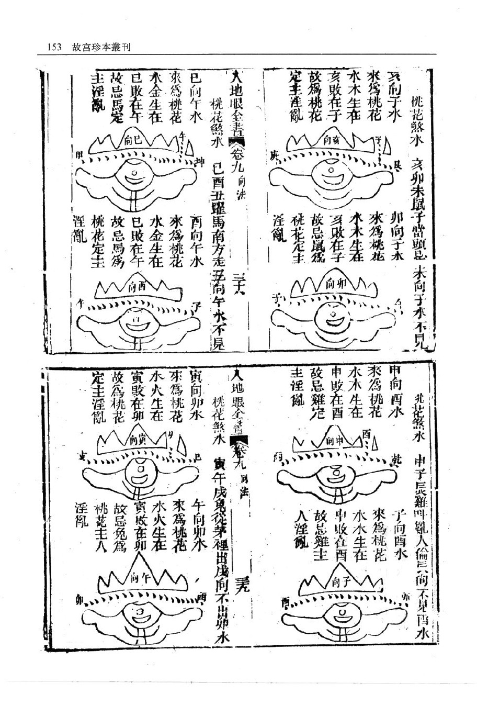

> **图版说明**：本页含图式或表格。请先核对方位标签，再按附近正文的顺序阅读；模糊或缺失标签不作推定。

### 原书第 154 页

以上所说都是破局之水，犯之就会应验，都是因为立向不能绝水，水来破局，局就是向。先圣说水不绝人，向绝人，都是四立向有错，人不知道的缘故。吉水变成凶水，水之来去都关乎祸福，合之则吉，不合则凶，所以水不可与向相反，水是生成的，向是人立的，吉则趋之，凶则避之，因此立向有转移之巧，又有不能转移者，切不可扦葬，倘有错误，轻则败家，重则绝嗣。所以大禹治水能知水之性情，文王书卦分水之阴阳，黄公之翻卦辨水之吉凶，都是论水之情与性、阴与阳、吉与凶，全在一向以纳，所以三圣……

作者说尽千言万语训导后人，无非是希望后世做子女的必须妥善保管父母的遗骨，遗骨安葬安稳，子孙就会兴旺，这一片苦心，无非是出于好生之德。所以做子女的，不能不懂医术，也不能不懂风水地理。现在有不良的风俗，风水师用双山、三合、五行的方法给人确定朝向，却不知道双山、三合本是长生掌诀，是用来卜卦、推命的，用在水法立向上会害人极深。要是问他们翻卦的相关知识，他们完全不懂，所以现在的风水师里，一千个人里也找不到一个懂翻卦的，各省各地都日渐出现“消条”的状况，“消条”具体所指不详，都是因为固执地使用这套三合长生方法的缘故。现在举一两个符合长生立向的方法为例：假如亥水从右边来，构成小局，木长生于亥，木库在未，就是吉象；倘若未方的水不能从衰方的门流出，只能从衰方流出三分，就是大吉。这些说法都是出自一些好事之徒，他们假装有学问，篡改相关内容，说成是自古就有的定论，总归不出《双山天机会元》《地理元真》这两部书的内容，这两部书里的说法都是双山三合的内容。文中提到“君其旋踵动手洗钳水与向雨用此法以误人”，其中“洗钳”“雨用”具体所指不详，大意是说有人马上动手使用这套理论，在相关操作中对水和向采用这套方法，就会误导他人。学习这些方法的人却不明白，“风凭皆是假的”具体所指不详，只有坎位的相关判断是属实可以辨别。验证砂的情况后，不管有没有龙、有没有局，都能在心里判断出对应的家庭里哪一房兴旺、哪一房次序如何，哪一年哪一支发财，哪一支得贵，哪一房得福，哪一房贫贱，哪一房淫乱，哪一房能安稳过活。做风水这行的人，文中提到“件作都要之书”，具体所指不详，还有什么可依仗的呢？所以真正的堪舆宝典特意创作翻卦作为“纳”相关的方法，“纳”字后有缺文，具体内容不详。

这段原文存在多处断缺、语序混乱的问题，无法准确释读完整语义。可辨识的内容提到“食与方水去”“向兼卯酉”，还有后人纷纷学习相关内容，又编造新的地理书籍，归入四十八局之内，现在做地理风水的人没有不钻研这些内容的，还觉得十分有味，依照这些内容操作反而招来灾祸，所以现在各地的破败衰落，都是因为去查验古代坟墓时，相关内容在书上没有记载。

判断吉凶要看丁字向，纳水之后就能知道这户人家的吉凶祸福。原文“废富贵在何代出贵在财若干贵者官居何品丁何房绝嗣何房富秀盗何房”存在语句断裂的问题，无法准确解读，仅能辨识后续内容提到还可以判断哪一房读书、哪一房作恶，作者认为自称地仙却学习这些内容害人是何苦。“二圣辨大源”是世间立向的精妙方法，有龙有穴就能发福。

> **阅读提示**：本页含已登记的残损、校勘或释读不确定项，可在原文对照版与审校账本中逐项核查。

## 卷十·阳宅

> **编者导读**：从东西四宅、游星与竹节贯井法，讲到门、主、灶及宅元生克的传统说法。

### 原书第 155 页

原文列有参与参订的人员名单，依次为浙泉袁秦开、树庭黄中楷、云门黄中植、稔安袁丰年，另有无法辨识的字符「r」后接理斋刘是训、恬真徐孝先，因原文断句不清晰，部分人物归属暂无法完全确定。

东田万树华仁村氏编次胞姪万基德修校字

本篇是《阳宅门路杜宫星生克方位总论》。八宅周书的流传由来已久，干、坎、艮、震、巽、离、坤、兑八卦，每一卦分管三个方位的山。文中提到“几戊干亥皆乾宅也”，其中“几”“戊”具体所指不详，可能为讹误；壬、子、癸三个方位都属于坎宅；丑、艮、寅三个方位都属于艮宅；甲、卯、乙三个方位都属于震宅；辰、巽、巳三个方位都属于巽宅；丙、午、丁三个方位都属于离宅；文中提到“未坤巾皆坤宅”，其中“巾”具体所指不详，可能为讹误；庚、酉、辛三个方位都属于兑宅，这套划分方法名叫连山卦。这套理论依据阴阳相对匹配的原理，运转消长盈亏的气数，原理完备则气数充足，造化运作就能灵验。文中提到“其卦以乾坤艮兮为西四宅”，内容有缺漏，西四宅的三吉位都在右侧，西四宅内部的门路、灶台千万不能犯东四宅的方位；文中提到“坎关巽震为东四宅”，其中“关”具体所指不详，东四宅的三吉位都在左侧，东四宅内部的门路、灶台千万不能犯西四宅的方位。至于大门的方位，又必须在三个吉位中选择阴阳相匹配的位置，这样之后才能人口繁衍昌盛。所以先天八卦乾坤定位的原理，配合后天八卦文中提到“坎离济”的内容，有缺字，相关气数是万古不变的道理，河洛之书的记载清晰，可以考证。这套理论中的游星是在七政的基础上加上九曜，贪狼、巨门、禄存、文中提到的“来”具体所指不详，可能为讹字、廉贞、武曲、破军，这是七政的名称，再加上左辅、右弼，总共就是九曜，对应生、天、延、绝、五、祸、六、伏八个方位属性。书中还有“竹节贯井宫星生克方位要诀”，详细记载在后面的内容里，阳宅的论断方法就基本没有遗漏了。

> **阅读提示**：本页含已登记的残损、校勘或释读不确定项，可在原文对照版与审校账本中逐项核查。

### 原书第 156 页

#### 游星

原文记载的八宅游星口诀依次为：干六天五祸绝延生，坎五天生延绝祸六，艮六绝祸生延天五，原文写为「虞延生祸绝五天六」，其中「虞」应为讹误，推测为「震」字；巽天五六祸生绝延，离六五绝延祸生天，坤天延绝生祸五六，兑生祸延绝六五天。每句口诀的第一个字是本宅的伏位，后面七个字对应的是七政星。所谓七政，是把生、天、延作为三个吉位，吉位适合开门、安置灶台、选择房间、摆放卧床，其中大门的方位尤其重要；四凶位里绝命最凶，五鬼次之，祸害和六煞又次之，这就是所谓的四吉四凶。这四个凶位，还要原文写为「卦地黍之」，其中「黍」应为「度」或「辨」的讹误，即结合卦象方位来考量，才能分清轻重程度。比如绝命本是凶位，但只有它的属性克制宅的属性时才是真凶，如果它的属性生扶宅的属性、和宅的属性比和，或是被宅的属性克制，凶性都不会太强。

#### 竹节贯井法

要从大门的位置起算游星，数到朝向对应的第一栋建筑，逆着生克顺序向内推算，以此分辨哪一栋属于三吉位应该建高，哪一栋属于四凶位应该建低。如果在正中开大门，那大门所在的位置就是第一重；如果大门开在侧边，一定要从大门开始数到头一栋，再逆着生克顺序向内推算。静宅不需要使用竹节贯井的方法，只有动宅、变宅、化宅才需要使用。这套方法依据金生水、水生木、木生火、火生土、土生金的五行生克规律，原文写为「遂栋生人」，语义暂不明确，每栋分别对应不同的星曜，这里各举一个例子作为范式。三栋到五栋、没有墙体隔断的阳宅属于动宅，比如坎宅开离门，门对应的是延年金星，第二栋对应六煞水星为凶，第三栋对应生气木星为吉；如果在边角开门，比如坎宅开巽门，原文写为「则州巽天五六之法」，其中「州」应为「用」的讹误，就使用巽天五六的推算方法，从巽位到离位对应的天医土星是第一栋，土生第二栋对应的延年金为吉，原文写为「第三栋六煞水内」，语义不通，暂无法解释，以上就是动宅的五行相生推算方法。有六栋、七栋的阳宅叫变宅，意思是五行生克循环到尽头就会发生变化。五鬼火生祸害土，不生天医土；天医土生延年金，不生绝命金；原文写为「祸害土生绝命 三金不生延年金」，存在缺字，语义暂不明确，大致意思是吉位生吉位、凶位生凶位，这是通常的规律；只有六煞水能生贪狼木，贪狼木只生五鬼火，也符合这个规律。变宅的前五栋都按照常规的生入方法推算，到了第六、第七栋，就变成五鬼火生天医土，天医土反而生绝命金，祸害土反而生延年金，所以叫做「变」。比如坎宅开巽门，使用巽天五六的推算方法，朝向对应的第一栋天医土为吉，第二栋延年金为吉，第三栋六煞水为凶，第四栋生气木为大吉，第五栋五鬼火，到第六栋天医土为吉，就是凶火生了吉土；第七栋绝命金为凶，就是吉土反而生了凶金。第五栋之后，吉位会变凶，凶位会变吉，以上就是变宅的相生推算方法。有八栋、九栋的阳宅叫化宅，原文写为「谓景后一栋为辅弼星」，其中「景」为讹误，语义暂不明确，意思是最后一栋对应辅弼星，随大门的方位确定。推算方法是双木变金、双土并进，以此配齐贪狼、巨门、禄存、文曲、廉贞、武曲、破军、左辅、右弼九星的作用。静宅、动宅、变宅都不使用辅弼星，只用到七政，和化宅的推算方法不同。比如坎宅开巽门，共有九栋，也使用巽天五六的推算方法，从大门数到朝向对应的第一栋天医土为次吉，第二栋祸害土，这是双土，为凶；第三栋绝命金为凶；第四栋延年金，这是双金，为吉；第五栋六煞水不吉；第六栋生气木为大吉；第七栋左辅木，这是双木，为次吉；原文写为「入杖五火凶」，语义不明，暂无法解释；第九栋右弼，原本巽门的生气属木，这里右弼也属生气木，为大吉。如果只有八栋，那第八栋就是右弼生气木，为大吉。原文末尾写为「此为化宅相生之」，存在缺字，语义不完整。

> **阅读提示**：本页含已登记的残损、校勘或释读不确定项，可在原文对照版与审校账本中逐项核查。

### 原书第 157 页

第一点是宫星的生克规则：所谓宫，是指门、宅、房都属于宫的范畴；所谓星，就是生、天、延三个吉星，以及绝、五、祸、六四个凶星。星飞到某个宫的位置，如果和宫的属性相生或者比和，那么吉星会更吉，就算是凶星，凶性也不会太强；如果宫和星的属性相克，那么吉星也不会吉，凶星的凶性会更强。与其出现星克宫的情况，不如宫克星，因为宫是主，星是客，主可以胜过客，客不能欺侮主，这确实是很准确的论断。原文写为「门宅房皆为官也」，其中「官」应为「宫」的讹误。

方位要诀：先从坐山位置起算飞星，飞到大门的位置后，就从大门的位置起算对应的星曜，再飞回到坐山位置。如果大门飞到的吉星落到坐山位置，忌讳开后墙、后户来泄散吉气；原文写为「凶内飞得凶星为木坐」，语义暂不明确，大致意思是如果飞临的凶星落到坐山位置，适合开后窗、后门来泄散凶气。所以如果大门开在凶方，原文写为「以游星从门土绕屋一数」，其中「土」应为「上」的讹误，用游星从大门位置绕屋推算一圈，本宅的三个吉位都会转化为四个凶位，所谓的「逢恩不发」，大概就是因为恩星落到了仇宫，说的就是这种情况。比如宅外的三吉方位适合地势高耸，或者有高砂、树木都很好，只要有一个贵格当权，所有的凶煞都会被制伏；如果三吉方位低陷，也会导致福运减损，如果在这些位置建厕所、原文写为「疠」，此处应为讹误，语义不明、牛栏等，就会冲破吉星的气场，吉位也不会吉利了。宅外的四凶方位适合地势低平完整，如果地势高耸，凶星就会得势，如果有缺陷，地风就会扫过穴场，都是凶相。

七政九曜的学说。1143

生气就是贪狼，五行属木，位于震、巽、坎、离宫即为得地，主高第清贵。五

主掌文章运势，主生五到六个孩子。断语说：贪狼生气福运绵长，为人聪明孝友、有志气，因公事获得田产，财帛兴旺，人口和钱财都大为兴盛，没有灾祸。

天医就是巨门，五行属土，位于坤、艮、干、兑宫即为得地，主福禄富贵，主性情慈善，原文此处有“主生匹子”的表述，“匹”应为讹字或缺字，具体含义不明。断语说：巨门天医又为天财，富贵长寿，灾祸又会到来，衣食丰足，钱粮充足，仓库堆满，原文末尾仅存“不须”二字，后续内容缺失。

延年就是武曲，五行属金，位于干、坤、艮、兑宫即为得地，主掌风宪兵权，主性情豪侠，主生三个儿子。断语说：武曲是福位，事事昌盛，人丁兴旺有主见，富贵之余还能取得科第功名，庄稼没有凶祸，寿命绵长。绝命就是破军，五行属金，门和灶的位置切忌设在破军方位，主会患上恶疾，主寿命短促，主断绝后嗣。断语说：破军凶暴，若是处在门前，会出现劫掠、投军之类的惨事，家人喜好赌博、打官司，出现聋哑之人，家庭败落灭亡，损伤少年人口。

> **阅读提示**：本页含已登记的残损、校勘或释读不确定项，可在原文对照版与审校账本中逐项核查。

### 原书第 158 页

五鬼就是廉贞，五行属火，主邪祟侵扰，主火灾、官司，文中提到“主一于”，该短语具体所指不详。断语说：廉贞五鬼不值得夸赞，独火、燥火都属它管，性子执拗好欺诈、不讲礼义，寅年属虎的人会遭雷伤，卯年、未年也会有灾殃，文中提到“失红吐血值离淮”，其中“淮”字具体所指不详，该句主失红吐血的灾祸；遇到四金方位会退失财产、瘟疫频发。廉贞和武曲、巨门一同到来，就会富贵双全、人丁和钱财都兴旺，还有进花红之喜；廉贞要是和文曲相会，就会有野狐精作祟伤人，家庭败落。

祸害就是禄存，属土，主壅滞。断语说：禄存绝体孤曜，注注视，过房莫怨天，赌博退败，遭淫乱，产死，给亡为道僧。

大六煞就是文曲，属水，主好淫游荡。断语说：文曲游魂扫荡星，暗博如酒显，拐人失火，水厄，离乡，败痨病，肿藏瘰瘗侵。伏位就是辅弼，门金化金，门土化土，门火化火，都是本宫的位置。断语说：辅弼慈祥孝友，先富贵人丁，官其前，男驸女如谁，命妇太阳生人，福寿全。右三吉门路能催屋运而厚其福，四凶不宜门路床灶，若门之卦尅宅之卦则凶，如生宅及与宅比和者次之，为宅所尅者又次之。看衙署法，门主灶，三吉得地，升迁最利。

三元命诀

这部分内容属于三元命诀相关的记载，提到上元甲子阶段的相关推演要从一宫开始参考查看，中元的起始位置在八卦之一的巽位下方、兑位之间。相关的排布规则是五对应上、二对应中、其余对应下，男女推演方向有所不同，男为逆行，女为顺行，这是相关推演规则的基础内容。

又捷诀

属一、四、七宫的男性逆序排布，五、二入宫的女性顺次推算；男性左位寄于坤，女性都按照甲子周轮来对应本命相关的事宜。

瓦屋有坐山和朝向的分别，人的命也有东四命、西四命的区别。只看重山的朝向而不考虑本命的，会遭遇大凶；只考虑本命而不看重山的坐向的，会遭遇小凶；既与本命相合又符合坐向要求的，就能获得无穷的福运。

> **阅读提示**：本页含已登记的残损、校勘或释读不确定项，可在原文对照版与审校账本中逐项核查。

### 原书第 159 页

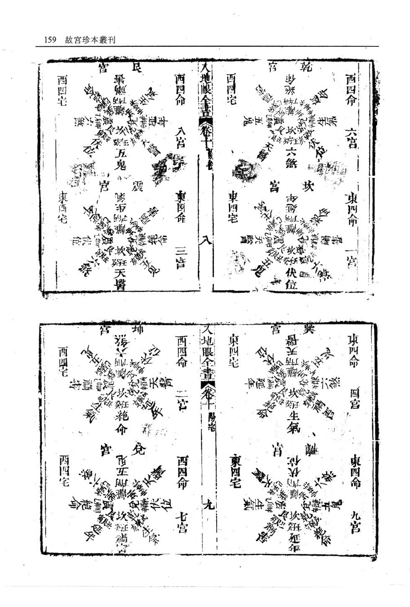

> **图版说明**：本页含图式或表格。请先核对方位标签，再按附近正文的顺序阅读；模糊或缺失标签不作推定。

### 原书第 160 页

有一种方法：灶是五祀之一，是家宅的核心、养育性命的根本，应当选择三个吉利的方位安置。这样安置必定容易生子，所以人丁不兴旺的家庭适合安置天医灶，名利没有成就的人适合安置生气灶，财旺寿高的人适合安置延年灶。这三种灶都要和住宅、本命相合，假如不合，就将床与灶的朝向对准本命的吉方安置，也会吉利，只是比不上门、主、灶、床、灶向五样都全部与本命相合的吉度高。比如坎命的男子娶了巽命的女子，在巽方设路灶都属于生气位，应当会生儿子并且家境富贵。如果坎命男子娶了兑命的妇人，就犯了祸害禄存，应当没有子嗣，需要把这扇门改朝巽方，这样坎命男子就能得到主气；再把小灶做成风炉，另外将灶口朝向干方让妻子单独在这做饭食用，那么妻子也能得到生气的吉运，食用这里做的饭自然会有子嗣，这也是挽救的一种办法。

偏气致应

离宫的交卦属阳，必然会衰败；巽兑相交也类似这种情况；坎干合卦属阴，必然会有妨害；震艮同属一原。共同推演这种名为偏气的情况，相互驳杂变化，阴阳的妙理可以应用在天井放水的事宜上。

放水的方法，适宜水流曲折振荡地注入三神位：乙、辛、丁、癸是小神，甲、庚、丙是中神，干、坤、艮、巽是大神。原文此处“宜由小大申由由人大”存在讹误，合理的规则应为水流适宜从小神位流向大神位，如果顺序颠倒就会招致灾祸。如果山形较小而直接接入大神位，没有中神也可以；从山位直接接入大神位，没有小神也可以；又或者从小神位流入中神位，没有大神也可以，要根据地形灵活安排。小神对应的流程适宜短，中神对应的流程适宜长，大神对应的流程要更长。沟口要区分阴阳：十二种阴向适宜放阴水，十二种阳向适宜放阳水，门路的规则也是一样。忌讳黄泉位，忌讳水流穿房、穿梁、穿门，这些都是放水的要诀。

《元畿经》说：“伟大啊，居处之事，关乎民生。门户分辨阴阳的路径，气口区分祸福的关键。八卦纯宗二十四向，元神属于四正隅宅，依五行确立，星邻九曜来推演元神；元神确定后，恩仇就已显现，来路设置后，吉凶才开始明确。岑高为体，气口为用；生比为恩，克制为仇。体有书凶2而化凶顽为役使者，机运在于恩星；用无定征而拨生旺于休囚者，权归于气。日宅元神不可损伤，用神最宜生旺。门宅相生相比，又遇恩光主照，就是进气之居；门或克或泄，又遇仇难当权，就是退气之宅。绝虚逢生，吉凶相半；旺处逢绝，吉少凶多。因此元神宜用恩星补养，仇难应当用吉曜调和。宅有化气则小人道消，宅无死气则君子道长。逢恩不发，大概是因为恩落仇宫；遇难不伤，是因为有恩星远籥。一贵当权，诸凶尽伏。木入坎宫，是凤池身贵的征兆；金居兑位，是乌府名高的应验。金取土培，火宜木相；水泄金枯，坎癸对西兑无恩；火炎土燥，艮坤对南离无乐。这就是东四宅与西四宅的区分，而西四宅各自成为隅宅。然而四宅的成爻，讲求相济而相比，八卦的配合，也自有假合与真合。因此天地定位，这是老阴之土生纯阳之金；如果坤配兑女，就像庶妾难投寡母的欢心。山泽通气，这是少男之精结少女之胎；如果艮配干金，就像鳏居没有生发的可能。坤艮相配，是亲比的情分；干兑相配，是假托邻里的情谊。至于风相薄，双木取成林之象；水火不相射，坎离成既济之功；水木相生，那么水是木气的根源；木火通明，那么木是火神的根基。巽不能作为离宫的火，它散开就成风，最终一发就立刻衰败；震阳生南离的能量，它聚集就成雷，必然响动不止。坎与震是暂交，巽与离是假合。艮的元神没有恩星可用，就以兑金为傍城借主，像玉藏在山中光华自现；坎的主气没有养育的地方可用，就以巽木为借体筑基，使得风平浪静。真食是宅元的正体，假合是作用的权宜之计。

> **阅读提示**：本页含已登记的残损、校勘或释读不确定项，可在原文对照版与审校账本中逐项核查。

### 原书第 161 页

### 原书第 162 页

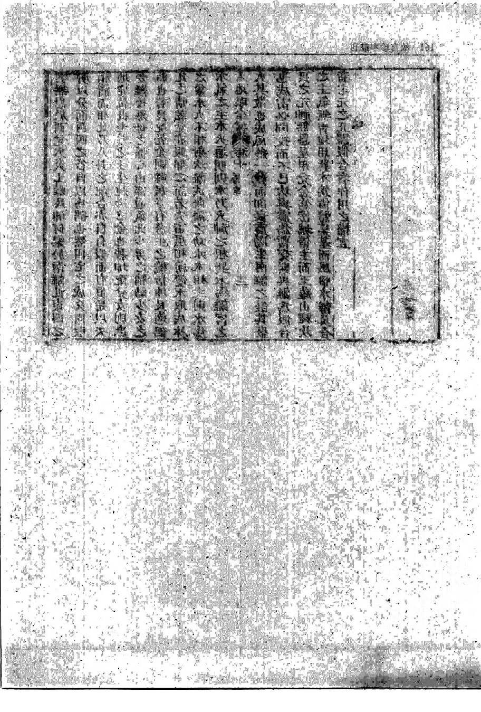

> **图版说明**：本页含图式或表格。请先核对方位标签，再按附近正文的顺序阅读；模糊或缺失标签不作推定。

## 编者附录：实地观察顺序

> **阅读提示**：以下只是帮助理解原书的观察顺序，不是对吉凶预测的认证。

1. 先看大地形势和山脉走向，区分可观察的地形与书中的象征解释。
2. 再看候选穴场前后左右的高低、开合和遮护关系。
3. 记录水流的来向、去向、曲直、聚散和水口位置。
4. 最后再对照本书的方位、卦例和星名规则，不要把规则名称误当成直接可观察的事实。

## 术语表

> **编者说明**：以下定义用于帮助阅读本书，不扩展为原书未说明的新理论。

- **三元**：以三元、九运等时序结构为核心的一类体系
- **三合**：以地支三合等关系构成的一类风水体系或方法
- **二十四山**：将周天分为二十四个方位的系统。
- **五行**：木、火、土、金、水五种分类及其关系体系
- **先天**：术数中表示先天卦序或本体关系的概念
- **入首**：龙脉进入结穴区域前的关键一段。
- **八卦**：干、坤、震、巽、坎、离、艮、兑八种卦象
- **分金**：罗盘中进一步细分坐向度数的方法。
- **合局**：按本书规则，来水、去水、坐向等相互配合的情形。
- **向**：建筑或穴位所朝的方位。
- **地支**：子丑寅卯辰巳午未申酉戌亥
- **坎**：八卦之一
- **坐山**：建筑或穴位背靠的方位。
- **坤**：八卦之一，卦象及五行、方位依原文语境确定
- **天干**：甲乙丙丁戊己庚辛壬癸
- **峦头**：以地形、山水外观与空间关系为主的观察方法。
- **巽**：八卦之一
- **干**：八卦之一，卦象及五行、方位依原文语境确定
- **干支**：天干和地支组合形成的纪时、纪序系统
- **挨星**：玄空等体系中按规则排布、推移星数的方法
- **明堂**：穴前相对开阔、有收聚关系的空间。
- **朝山**：穴前较远、与穴场形成朝拱关系的山体。
- **朱雀**：穴场前方形势的传统称呼。
- **案山**：穴前较近、形如案几的山体。
- **水**：风水语境中的河流、水系及其来去形态
- **水口**：水流进出一地或局势收束的位置。
- **河图**：术数传统中的数理图式，本书用于解释生成关系。
- **洛书**：术数传统中的九宫数理图式。
- **游星**：八宅等体系中依门宅方位排布的星名序列。
- **玄武**：穴场后方形势的传统称呼。
- **理气**：以卦、干支、五行、方位和时序关系进行推演的方法。
- **白虎**：穴场右侧形势的传统称呼。
- **砂**：穴场周围起护卫、朝应作用的山丘或地形。
- **破局**：按本书规则，水、向或方位关系不合的情形。
- **穴**：风水中认为地势收束、气脉聚结的位置。
- **立向**：依特定规则确定坐与向的操作。
- **纳甲**：将八卦与天干、地支等相配的术数方法。
- **结穴**：传统上认为山水形势在某处收束、聚集并形成穴场。
- **翻卦**：按特定次序变换卦爻，以排定星曜或方位吉凶的方法。
- **艮**：八卦之一
- **过峡**：龙脉行度中相对收窄、连接前后山体的地段。
- **震**：八卦之一
- **青龙**：穴场左侧形势的传统称呼。
- **龙**：指山脉或地势连续起伏的走向，不是神话生物。
- **龙脉**：风水文献中对山脉及其走势的称呼。
