# 平砂玉尺经：规范化原文

## 原书第 1 页 {P000001}

刘文成公汇解

### 平砂玉尺经

附郭璞塟经

择日全纪秘诀僊机

鲁班造福经

汇贤斋藏平沙玉尺经序国师文成公知旺气在金陵而首率群儒以辅之而滁阳开基应天定鼎紫荆

## 原书第 2 页 {P000002}

奏为帝王万代陵寝斯不精于地理哉然又惧一人之目力不能遍天下廼于告老暇日创为平沙玉尺颁行海内并附晋国师郭璞塟经此非轻泄天机欲使后之人得是尺而量之获福应无崖岸矣是为

万历丙午岁仲夏上浣之吉题

## 原书第 3 页 {P000003}

新刻石函平砂玉尺经全书真机上卷元太师文正赵国公那州刘秉忠述明太师文成诚意伯青田刘基解

敬简赖从谦发挥

审势篇第一

天分星宿地列山川仰观牛斗之墟乃见众星之拱运俯察圗阜之来方识平原之起迹

五行之气在天成象而日月星辰见焉紫微太极起于亥子之中天市东垣起于寅卯之区少征西单尺经卷一

液在坤兑之间太后南极在巽巳丙之首中有一星尊居于内而二十八宿环遶于外故牛斗之墟左为帝星所居之处其列宿则随斗柄所指而拱向之附天而行是谓天经五行之气在地成形峙而为山冈垅阜散而为平原都隰流而为江淮河汉故山川之流峙莫非是气之疑布然平原旷野皆根于圗垅分布四维而成形故察冈阜之所来则知平原之发迹矣马山一贯起自昆仑

山龙之散见于地虽有千万之多而其龙脉之来皆出于昆仑按搜异录及地志啚吉昆仑山高万八千九百四十七里中峰齐天在中国计之昆仑则在西北干兑之间实天下山川之祖而五之入中国又众山之大宗也

聂出孤宗分行八极

昆仑之山上方而下员周围一万二千七百里九十三步鳞分孤宗东北出角居艮东南出角居巽西南出角居坤西北出角居干乃为四势下山之玉尺经卷一二

顶六千七百九里十三步旁乃条分四正东条居震南条居离西条居兑北条居坎上按八卦下按八方乾坤艮巽开五龙生气之门坎离震兑发五气官旺之脉是谓八极八极者又万山之大宗也乾坤坎离及兑归绝域而西通渐海艮震与巽三条入中国而五岳分居

乾坤坎离兑五条分归西北及正南入羌夷蛮种之地龙脉出拆俱不可考惟艮震巽三条独入中国分居五方为五岳之山又中国山川之大宗而

## 原书第 4 页 {P000004}

分势施生东南巳巽行龙出身行十一万九千六百五十里人海结帝之都三起龙之地一百四十七水穴三十六其间产忠贞育英才出圣君贤相者七百二十穴聚精拔秀为卿士大夫之地不计其数寅艮行龙出身八万四千一百里入海结帝王之都一起蛟龙之地七十二顶穴一十有八其产大圣人之地五出贤人良相五百有七穴为卿大夫之地不计其数甲卯行龙行八万一千五百六十里止于伊洛廛涧之交结帝王之都三起尺经卷一上11]

蛟龙之穴二十有四产圣君贤相侯伯五百五室其间钟气发秀为卿士大夫宝士之类北艮巽之穴龙多

如中回之东是故黄河界而西北丑艮行龙

黄河之水派自昆仑艮寅之左甲卯之右界良丑于东北之首限甲卯于正东向东曲折而流入中国至河套之北出峡之左而山西等路右臂至汴之东南左纡徐州之东北入海故河之西地乃丑艮行龙实为坤申之气入首故燕冀至靑兖之地义一坤甲结穴自右转为坎局左顾为兑局趋巽为亥龙无离巽艮震穴盖水趋东北故也敬仙云昆仑丑艮落脉为坤申之气入首者水多东流燕冀云朔之地为坤气腰落青徐之地为坤气之尽龙黄其界也直沾其孤也开州以南其左臂也辽东其右臂之尽气也其脉直遂无曲折河北气散不收故其民多直鲁性刚风气强劲少许诈民不恋业家不久富官无三代然而清泉穴汉气从下升产圣贤为文章之祖育英才为一时之尺经卷一上

盛女子美貌而无耻皆其气之惠也长江限而东南巽辰起祖

昆仑东南孤角分条自康姑九万八千七百五十里出西羌天竺西番南界曰六国山之北一万二千里通巴西之严鹏山分枝三派左股出陕之南为雍之右卫中股历凭旗发派为荆襄之南衞渡祁山起南岳衡山为离宫之火星凭旗右股作成都之左衞而止严南股历雍思入东蜀之南为成都之右卫过东北起平华顶分二右股为云南

## 原书第 5 页 {P000005}

之右卫左股过四川之东北作云南之左卫过电磨山起二枝一枝出辰州以南为贵州之西北护一枝出贵州之东北分岐南一枝广东趋南海枝入广西与辰州之北界合行过东梅峰为广东之北护即福之南条山也梅峰西角分枝入豫章西南尽于九江渡江过黄川作湖广之下流为河南之东北障梅峰之北角入建者过潜阳山起祖为建之西南障历铅山左臂为建之北障即浙之南卫自建宁出漳江之南而入海右臂分结诸洞玉尺经卷一上五

一铅山左臂二条一条入福建一条入浙东历处州分二条一条自温入海一条自台至四明入海具铅山之左股一条逾玉山蓼花峰起顶出三条条出饶信一条出南康渚泽鄱阳一条自祈门入至浙江临安之西起天目甲卯行龙为兑气入首至古杭左回右抱合气结穴为钱塘其左股历臯亭至海盐入海而止其丑艮一条至宁国西界分派一枝出太平濩洋子江过舍山经六合从太典入海一枝出建平西界分派入建康之东界历句容而为长山一枝自东而西逆回为建康之北卫一枝自西过东至润州出靖江入江经历十一万-九千六百五十里入海其中分枝异派不止数百逆行顺行各有所趋故是岷山以东幡山以西地多离龙云南之水自北而南地多坎艮干龙贵州北界地多震巽广东之界地多坤艮兑干自广以西巽震艮坎受气豫章以东巽震之交北界则坎艮是贵闽福之南坤申得气而北条则兑亥坎成胎临安为坤兑之交建康得南离之气以长江卷一上六

敬仙曰昆仑之东南出脉者为干亥行龙几巽宫之气煖而风和亥木得之则生意条畅枝叶茂盛故自南条向南者气愈和而散漫鸟兽稀章民乃析故南方之人散而不聚不服教化然多洞穴水从穴行

号曰潜木人反奸淫同域异音话言不辩南条而北者气和平而教化行风俗美车同轨书同文行同伦而国大治惟广西云南阙福三省之气背东逆行独向东南与大江流神别派其地多胶股合脉穴地出木民风硕不知礼无父子君臣之义淫贪无耻龙蛇出没岚气时行民多病疫语不通音其风土气习类如此

## 原书第 6 页 {P000006}

惟寅甲卯乙之落脉为河江中柱之根基

河源之左自寅甲卯乙当震之首落脉起帐出一万四千里为兰花嶂至三万三千七自一十六里为乔黎山至一万九千里入榆莱山过西域羌胡一南幕西首山行一万二千二百五十里入中国至主尺经卷一占2

幽谷连奇为秦汉又一条分至南楚之北界一条分至同原之北界入河中条之洛长江东限黄河西流余气及淮杨通秦入海是知震脉之落为江湖之中柱其龙独尊其气独正出震入离犬都二区卜年悠久民安物阜文士萃出风气正直民无诈奸上下从化皆其应也

散仙日其地多坤申龙兑局离垣出荆湖者多亥局民俗朴素少文

冈垅平源之分别犹体骨肌肉之相附肮肉丽于骨

录穴是内卿不能也所

外血脉行于肉中知血脉流动之情见肌肉荣枯之理

凡山脉起自昆仑为山之首而气脉之行因山而见犹人有体骨之格气络流行分布而散漫为土皮犹人之肌肉士不离山犹肉不离骨也乃知乎土之气皆根于山山自东来则土脉之气随山血

故曰肌肉丽于骨外山行则水随水犹人之血脉王无水则不养故龙脉必得水而涵行于地中为玉尺经卷一

气行而外见为水水者气之述也界乎外将以固乎内而气脉得以行于地中矣故水神流动之处可以验气之出入流于东则山气之东行可见矣无水东流而气反西布之理所谓龙行则水随气行则自随也血脉流动经络秩然余理贯串故曰地理天经地理合而为一观乎天文而地理之妙用显然是故众水趋归东北而坤中之气施生

大凡坤申行龙水巡趋流东北其气脉之使然也震龙入首向西则西为震气之至而东为气出之

## 原书第 7 页 {P000007}

故水神倒东北而行者其地多坤申之气结局三门故向砂之酉首立穴是气止水交之处乃为关换气则有干兑之交而坎离艮震之气不入求穴若自东首立标则收辛酉兑气入穴原水交于西坎离艮震之龙于东北交媾者非真龙也龙之不岂有兑气返东之理所谓不食酉辛之气言兑气真照穴不正未有不绝减而贫折者1不入于东而震龙不食兑气也时师不知龙脉之仙曰水归东北则龙首在西南而尾在东北地尽起止不审水神之来去不明地气之所从只者坐对指东画西谬立标穴其挤人于害不可胜言矣群流来向震辰而干亥之龙秀育午丁生息岂乗坎癸之灵假如众水流向震辰之方交会合流而去则土辰午丁行龙者水神必自南而向北合流而去凡见之来必自干亥行龙故求龙干东南之交者始真此水步龙立穴须向水流交合之处求之则午下玉尺纵卷一尤尺经卷十转关则壬子龙亦结地坤申之气左关者亦可取生息之气始聚而成地若不于水城出合之所而惟离巽灵艮气之不入故寻龙者不当于干亥之反向南之上水处立穴是乘坎癸之灵非穴也下砂头立穴也之必绝仙日东南水聚之处界水倒右有震穴界水倒左观众水之交衿而雄雌乃见向北流有兑穴离艮巽三龙决不宜下龙从西北山为雌而水为雄犹人之有男女也龙尽水合虽方来水自东南合者气脉水交媾情意巳在震巽雄交会犹男女合而媾精也此玄妙之处万物化无逆至之理生之大关也然男女之玄门任督二脉之尽故男甲卯成胎不食酉辛之气女媾则两尾相对犹山尽水会之处正牝牡交媾之

## 原书第 8 页 {P000008}

仙曰龙至水交之处方止脉尽气聚乃为真穴水7---F不合衿则龙脉未止龙脉不止则气行未住故寻龙定穴必于水交之处求之方是察万里之乎垅而首尾当知

平原旷野维万里之远而求其脉之所自必有山龙以为之根犹四肢分职而元首在上起处为首止处为尾其理一致故寻李洋之地必求首尾之所自然后察其水神之去来以观其交会止聚之情则真穴自见矣

长经卷上敬仙曰昆仑山天地之首也五岳四渎者心腹也支流分脉散于八极者四肢也以中国而言五岳者万山之首也如山之首可以循脉之知脉之分可以见龙之止矣

纵是回头顾之龙岂脱父毋本生之气虽云甲卯行龙不食酉辛之气然亦有国贾愿尔者如甲卯行龙而气脉返向甲卯结穴者名顾袖之地虽逆回成穴而砂头起脚须从震宫发来关转逆水向震乃真转关处若被水流断则父毋本生之气巳为水神隔绝矣非真地也右关水左倒兑气入首从兑局作用左吉水倒干气入首从干局作用又不当以震气立法取之举一龙而七龙之法同例仙曰两砂并出股长股短边粗边细其短而细者必缩粗而长者必伸粗大雄急势必曲折向砂之短处挨归故多结回龙之地及盘龙之地或为下砂所压而曲折转关者亦有回龙盘龙之穴然必得父毋本生之气不脱始行之砂随水转关而成方为大地

故顺水直冲而逆回结穴方知体叚之真若还逆水直冲而合衿在后断是虚花之地

回龙之地其砂头不从本生之方而来但只逆水直衡而上其水流向背后交合者皆非真地时师指曰上氷鱼飞天龙者甚谬虽其体势宛转坐应整齐亦是虚花合流在后则其砂之行气终趋向于交襟之处也

干源圹野舖氊细认交襟

有数百里平洋之地前后左右又无沟壑溪涧如

## 原书第 9 页 {P000009}

铺氊展席一韦无际此等形体既无水神可寿其出入又无冈阜可辨其来去何以察其龙脉之行止穴情之定否如见此等平地必有微茫之水可满整之水必有所归而微茫之水去留亦足以察其龙脉之行止凡水必归趋于卑下而低洼之处为众水之所归虽征浩之水亦可以见其会合交会于东则寻兑气之入首交会于西则寻震气之入首细心详察必得真情

古云高一尺为山低一尺为水正为平洋干源旷玉尺经卷一上十三野之地立法

仙曰龙脉有起伏隐见故砂术有微茫之迹龙脉有住结故虽沟潦亦有交合龙微茫之分合考冲潦之去处而真龙自明然

一水日微茫则至细难认非智者目力心思之巧不能也

极垅平披月角详看住结

山龙穷尽截头挂角铺出平坡左右无水夹随行送前无沟壑溪涧界合如此落头虽无水法可辨然其龙脉之出若有真龙结穴则其气止融聚之处必有正脉垂落或微茫以界于左右旁分砂翼上首如月角之出两肩兠转护衞周匝或一重二重或四五重只只向前兠堂收气或左右肩肘抱出砂头宛转曲折到堂横过做微茫案应者其地方真或从别支分脉曲折到堂直拜堂局旁分两翼复冒于本砂之左右者亦佳故看平地落头无处寻其住结只于月角兠收兴不兠收砂头转匝以不转圃而龙之住与不住穴之结与不结方见玉尺经卷上十四

又有四五山头出廊平坡尤烦辨其何山落头长何山落头短旁角从何方地转则知其五山和气交合成穴其法尤微得此穴者富贵双全万子画孙一二百纪福力

势说繇峦声

寥天乙日塟经日势为上形次之方位次之势也者理之立也显立之神之容也玄牝之门也乾坤复姤之间也造化鼓万物出入之机也希夷之数也不可得而闻不可得而见不可得而审也

## 原书第 10 页 {P000010}

新刻石函平砂玉尺经全书后集卷之时之半而右行阴阳相禅左右相荡北之谓化机元太师文正赵国公洲州刘秉忠者知化机之理则知山川列形要非块然示人以象明太师文成诚意伯青田刘基解矣故法象莫大乎天地敬仙顿从谦发挥左阳右阴龙行两路而阳顺阴逆气本一原造微腻形之列于地者非块然之物要亦阴阳二气为之也故太极分而两仪奠二气布而顺逆行土因气形阳气左严则脉从而左转阴气右旋则混沌之初太极之气末分及轻清之气开于子正脉从而右转故其地势自右转左入局者为阳龙上浮者为天重浊之气关于丑而下凝者为地其从左转右入局者为阴龙分阴阳而两路而顺行日月星辰悬象于天者即其清气精而明者也逆行其地气自然之运也上人经下卷之一王大经下卷之二川江河列形于地者即其浊气凝而通者也天气阴用阳朝阳用阴应相见协室家之义阳以蓄阴阴属阳地象属阴阴阳分五行兆布阳气左旋秦以含阳虽雄庆交媾之情行于东夏行于南秋行于西冬行于北五气顺流气者水之母气行则水随水止则气止子母同情四持序而万化生者皆是气也阴气右旋夏行于南水气交逐犹影之随形也益气一也溢于地外而春行于东冬行于北秋行于酉五气逆流时序正有逆为水行于地中而无形者为气水其表也气而品汇亨有皆是物也然阳气长故进而左阴气其里也表里同运内外同流此造化必然之妙运消故退而右阳长则阴满阴长则阳消进退消长故欲知地中之气趋东趋西即水之来夫亦可以化育之机也而一顺一逆亦自然之运焉耳故阳槩守之矣生寸冬至甲子时之半而左行阴生于夏至甲子诀是性命非神气水乡笔只一味

## 原书第 11 页 {P000011}

故曰善观气机之运者观诸水川上之叹亦可观宜尾见道之深焉然龙行必有水辅止气必在水界辅龙行者周在于水故察其水之所来足以知龙气发源之始止龙气者亦本于水故察其水之所交足以知龙气赢聚之处

经日界水则止又日外气横行内气止生识哉言欤然天地之气阴与阳而巳易曰一阴一阳之谓道又日阴阳互藏其宅动静互为其根阴阳相禅万物化醇郭子有云独阳不生独阴不长由是1卷之之则知冲阴和阳而后可以成化机也故阴龙逆得阳水来会阳龙必得阴水来交外气与内气相会气荡而成物犹夫妇媾而生育也阳为雄阴为雌阳龙左行而阴水右来到堂合襟为阴以含阳阴龙右行而阳水左来到堂合襟为阳以蓄阴即雌雄相会牝牡交媾之情也阴阳相见福禄丞祯冲阳和阴万物化生此天地自然之化机合而言之即统体一太极之妙用分而言之随物付物又各具一太极之玄与也知太极之理可与语化机之妙知化机之妙可与语肜法之学矣故阴交于阳阳下济而施生阳交十阴阴仰承而翁交

日龙脉之来土随气形气虽流行而不可御然其土脉之来止一定而难移故龙形则静而守位若夫水则动而无常或东或西无一定之性虽气行水来固有自然之势然气不能自止必得水交而后止故阳龙入首而阴水来会阴龙入旨而阳水来会是之谓阴阳史嫌言阴交于阳阳交于阴者尺经下卷之一19

皆以木言也经有云形止气畜气之流行无往不到何以能畜益以局前之水能止龙气如界水三乂是也故杨公所以日水对三乂细认宗也经又云外气横行内气止生内水随土十因气形而脉止气聚者以横行于前足以止内气也至于山龙得龙虎应按备行于前亦为形止气畜而内气所由以止生者此也由是范之则阳公所谓阴交阳交以从水神立意何也气随十形形则静而有常水则动而能运静刑守位动则流通故水东于龙而龙不盘进交于水势也故龙不可裁而水可裁

## 原书第 12 页 {P000012}

阴交于阳阳下济而施生者阳在下而阴在上汤气下济而乘阴以施生也阳交于阴阴仰承而翕受者阳在上而阴在下阳气下降而乘阴以翕受也阳施阴受胎息始化育之妙气机必然之理也

天根呈众妙之门，月窟启玄机之户。

天根者阳气所从出之门即施生之窦犹男子之卷之一

牡月窟者阴气所发育之施即翁爱之户犹女子之牝牝牡相对玄窍相通男女交媾而生息自盛矣如下文所云

乙丙交而趋戌，辛壬会而聚辰，斗牛纳丁庚之气，金羊收癸甲之灵。

乙用丙交者丙火生于寅沐浴卯寇带辰临官巳帝庄午衰于未病于申死于酉基于戌是成者再之墓即阳艮龙之天根阴亥水之月也丙州乙交者乙木生于午沐洛巳冠带辰帝旺卯临官寅

衰于丑病于子死于亥墓干成是戍者乙之阴亥龙之月窟也阳艮水之天根也丙乙相见玄窍相通为虽雄交媾者此也震离二龙同局至于辛配壬者异兑之阴局也壬配辛者申子之阳局也四龙水法皆在辰上出路故耳庚配丁巽兑之阳局也丁配庚者寅午之阴局也以四龙水法皆在于丑上出路故耳癸配甲申子之阴局也甲配癸亥卯之阳局也以四龙水法皆在于未上出路故耳行龙布气并放甲乙交配法例其黄式并见后玉尺经下卷之一大故有乙辛丁癸之妇室配甲庚丙壬之夫夫夫妇妇雌雄牝牡

乙辛丁癸阴也甲庚丙壬阳也阳用阴应阴用阳朝故乙得丙丁得庚辛得壬癸得甲为阴用阳赵丙得乙庚得丁壬得辛甲得癸为阳用阴应阴阳相见犹夫妇之获雌雄牝牡义见上文

若阴遇阳而非其类号曰阳差阳见阴而失其偶名为阴错

如乙亥龙用丙气相合乃为阴阳正配而戍上出

## 原书第 13 页 {P000013}

1

水得相见之义若辰与丑上出水是见庚壬水口而非其偶谓之阳差阳差则伤男丙寅龙用乙气来合乃为阴阳正配而戍上出水为阴阳相见之义若辰与丑上出水是见丁壬水口而失其类为之阴错阴错则伤妻

妻犹路遇终强合而不谐眷属一家纵轻微而有用如丙乙相见为夫妻同情眷属一家虽去来轻发犹为有用富贵福泽亦能及其所生若丙不逢乙而遇丁癸辛未木日出路者是夫遇妻于路乙不玉及经下卷之一

逢内而逢甲庚壬水口出路者是妻遇夫于路虽砂明水秀终为强合无情其发福亦不甚厚以玄户不通也铜山西崩灵钟东应又云崔鸣在阴其子和之以其同声相应同气相求耳先贤曰气和则形和形和则气和形气俱和物乃化生故阴阳和则万物生夫妇和则勇女育又若丙配乙于中途乙配内于半道如丙生于寅而水却不自寅来却于辰巳方来至于水口却在戌上出木是去窦相通而来水在中途中见也此本为正配发福迟缓更王老年科第凡百俱迟主老夫生子之应不旺人丁长房不利特发中小房财又有水从他处横伏过堂而出亦为路遇此尤不合局不发福祉虽发亦轻可认水立向有千向上消息则客水登堂亦能致吉

女同居纯阴不长两男并处独阳不生

如乙亥龙得卯木水来及子午水来到堂右转倒左是亦阴遇阴为二女全居纯阴不长水舆龙一路来故也若将左水右倒会阴水而行不妨五玉人经下卷之

寅龙得壬庚甲水左行倒右而去是以阳遇阳为两男并虞独阳不生若得右水倒左会阴水而出--不妨

阴与阳而遇交亢则为害阳过阴而不及废则无功如乙亥龙与丙火交当自寅巳上水来右倒至成字上出水却不于戍上出直流至干亥字上出此名为过交而亢反能亏损人丁冲散生气故也更主非横官灾孤绝出入刚恶立巳过高灭视人物违理败家乂如丙寅龙与乙木交本在艮丙上来左倒向戌上出方合却未到戍上便从干亥不及而废出人王懦怯无谋贫弱无力多学有始无终克妻丧子晚年丧败虽砂水秀享禄不久为官则谪降不一天机决二水交不及颜圆三十二云殂亦出玉寿也

## 原书第 14 页 {P000014}

化育本于龙家盛衰系于形应

夫天地一男女也勇女一天地也观男女可以知天地矣干阳宰生物之机而坤阴成生物之能犹男女合而二气感而育故上龙虽龙生物富贵入经下卷之一

利达于兹焉出然不得形应以触则化机亦几乎息矣故阳用阴应阴用阳朝形以气融则因以生气感而应鬼福以及由是论之则生富贵盱人丁皆在于水神交会合法而后应也主贫贱受孤穷亦惟水神来去失度使然也故气化之聚不聚或盛或衰系于水而巳龙阳而水阴或龙阴而水阳阴阳交构则气感而应鬼福始生旧本刘伯温先生许云化育虽本于阴阳龙气而所以发富贵贫贱则又系于形应形应感触物随而始言龙气

11

融结而不得穴则形与气不应而衰穴乘生气则形与气应而盛此以乘气穴立法也阴阳交媾而不得向则向与气不应而衰向乘堂气则向与气应而盛此又以乘气立向而言也

是故左行从亥子而进右行从子亥而旋

此言布气以察盛衰立向以求生旺之法向指一明则水神之生旺死绝燎然在目故阳从左旋自亥子丑而行阴从右旋自子亥戍而进各因阴阳朝应以为愿逆之法正所谓二十四山分愿逆诏天经下春之十

取阴阳祖与宗阳从左边团团转阴从右路转相通

生旺互用玄窍相通

如乙丙相见乙水生千旺丙寅火生寅旺午乙本所生之地即丙火帝庄之方乙木帝旺之方即西火所生之地乙与内交故曰生肝互用丙墓在戌乙墓同之故为玄窍相通以丙乙皆以戌上为水口也杨公塟白龙潭乙亥龙主穴乙生气在子乙丙向生气在寅戌上出水此正生壮

## 原书第 15 页 {P000015}

窍相通故发大富贵作丙向收寅甲水归戍也惟偶成于契合勿乐交于兄妹

乙丙丁庚癸甲辛壬皆契合而偶成者若乙亥见甲水辛酉见庚水癸龙见壬水丁龙见两木则乙甲辛庚千癸下内皆为兄妹同气岂其所交乎虽乙见甲为遇阳而总为不乐

是故周公制礼明家室所以别男女娶异姓所以辨夫妇

此言周公制礼男女相配俾有家室异姓相合德卷之一十1

明嫌疑礼不聚同姓者所以辨族也圣八心通乎天道德明乎地纪法天之经则地之绝以立人极要亦理气自然之运也

此盖天经地懿之常要亦理气自然之运

此言圣人别男女定夫妇者法天经地懿之常道以立人纪合理气自然之运要非强人情违天地之道而为之制也即圣人制礼以合男女定阴阳不外乎天经地懿之常则知地理取阴阳相见北牡交媾各有正配而不可乱者乃天地自然之化育万物之真机也乃若天开开财禄之源地轴濬化生之宝未神发源之处名天関水神流出之处为地轴天関主财禄地轴官人丁来水深长则财德悠远出水合法则人丁系息以玄窦为化生之牝户故也法显玄空神功莫测

以水龙相交得阴阳相见之义而生肝到堂则生水发人旺木发禄亦所必然者或有阴阳背驰而向指难收财禄人丁若有所则又立玄空五行千经下卷之一十十

之法取八水四金四火四木四土布列二十四山之中用以消息乎水路取生我尅我为吉生出尅出为凶来水合法必发助苏去水合度必旺人工吉以吉应凶以凶应神功莫测者也

五行实无系于龙家祸福须取明于水路

玄空五行舆龙家本音之义实无于系日本山五行以甲乙异寅卯属本两丁巳乍属火庚辛干车属金壬癸亥子属水艮辰戍丑未桥七之类面玄空之气则又以乙木酉金为火异木申金为日丙丁乙酉原属火乾坤卯午金同坐亥癸里艮是木神戍庚丑未还属土子寅辰巽水为名多巳壬申同水府取用坐穴坐向与水口来去之地一是何字得何五行以求生尅也

## 原书第 16 页 {P000016}

尅我为官生我为父凡五行之气取相生忌相尅此反取尅入者以水神之来彼来交我情自趋之故生我尅我者情自彼入也水神出去情不盛绝故生我尅我亦情自彼入也若土龙体静而专人卷之州

雅静故专故常守位生出尅出则动矣水龙动而直惟动而直故常运化尅入生入而化工自成矣穴依龙君道也无为恭巳南面而出令者也向依水臣道也行君之令而施化者也君则逸而有成臣则劳而成功此亦天地自然之运耳如此则生入尅入之义所矣

之夺之彼无心而曷济生入尅入情既去而复永神流出势不可用我虽生之不以为德我虽尅之不以为怨所谓彼无心而局济然水神流出变不可面而其情则不可失我固不能为彼若何而彼之情则不忘乎我势欲去而生我尅我亦能为我作福矣来施恩去犹贡福岂不为吉

张古松论玄空之法有曰情自我出泄龙气也情自彼来益龙气也此四句正指生人尅入而言难日尅出亦情自巳出耳虽日尅入亦情自外入也天地赞化育无非此道造化改天命术何妙焉形法之术冲阳和阴覩形审气辨方察音故裁天经以立人纪明尊卑定上下随天时顺人事建邦玉人经下卷之一十四

国治百姓辅相天地之空参赞化育之不及使天地位于上下而万物育于两间者亦不过此道焉巳矣况于塟者乘气立穴收生气荫死骨召鬼福以及其所生使鬼神不得以司吉凶之柄造化不得以宰物之权回天命而改造化其术亦妙矣哉○至道精微惟圣人然后能及此非睿知孰能之地理之学本于太极之理河啚以呈其源洛书以发其微乘阴阳五行之气而顺天地自然之运反气以入骨其道至精至妙惟圣人舆天地合其总与鬼神合其吉凶夫然后能与人穴之以乘气回天命改造化若非春知听明之圣人其孰能知此道之妙哉道且不能知况又能穴之以乘气召鬼福以及其所生乎

## 原书第 17 页 {P000017}

吉地每雷于积德善地罔授于邪淫升之匪人天神其怒

塟法有回天改命之功能召鬼福以及人如此故吉地常留于积德之家而善地不可授于为恶之徒福善祸淫是乃天道顺天之道以造福则天经卷之十五

必应之若授之于邪淫之辈则天固祸之而人国福之是达天道而幸福矣天地鬼神其肯容耶天不罪为恶之人而罪法象家矣

某虽不敏幸淑师传戒言在通焉敢忽诸

论天真戒严总为天吏立玄科耳彼购大利操大钺者何居焉嗟乎购大利者天假籍没也操大钺者天委征勦也故宁为恶家赁天愠毋为伐恶天将作先锋宁为善恶两家皇功过纠籍毋宁为混善恶于千雷可海而顾为一润打尽之枕花也

悲夫背上元赐福之是一若夷后人题于圣统槐临

石函平砂玉尺经全书后集卷新刻石甬乎砂玉尺经全书真机上卷元太师文正赵国公邢州刘秉忠述明太师文成诚意伯青田刘基解

## 原书第 18 页 {P000018}

敬仙赖从谦发挥审气篇第二之日玄都日理寓于气者故谈势而坎龙分三八气属五行定阴阳消长之理明孤虚旺相之因

地支一十二位以四维入午配隶于交中并而为二十四位以甲庚壬丙隶于四正之宫乙辛丁癸隶于四库之地乾坤艮巽隶于四维之方三合以亥卯未属木而干甲丁从之巳酉丑属金而巽庚癸从之寅午戌属火而艮丙辛从之申子辰属水而坤壬乙从之

经云从气者是也干纳甲而为金巽纳辛而为本艮纳丙而为火兑纳丁而为金坤纳乙而为水离纳壬而为土坎纳癸而为木震纳庚而为木经二纳气者是也以正五行论之则寅甲卯乙巽五山属木巳丙午丁属火庚申辛酉干属金亥壬子癸属水辰戌丑未坤艮属土分布四方万方不易之定气也若三合罗纹之法则以土寄旺于四方而生气配于水神长生于坤旺于子而无正位用水火木金为四经五行如筮家之妙用亦古人之深一意也推生旺休废以明阴阳消长之理而孤虚旺相亦于此而可知矣

是故壬癸来自兑庚乃作体全之象坎水迎归寅卯名为领气之神

壬癸为北方之水水龙自庚兑而来出自印绶之玉尺经卷二上

乡从生趋旺秀气乃全甲卯为东方之水水龙领气入东方生甲耶木是坎龙行体木龙入局水木相生秀气乃出此言旺龙乗生气而结局体制也仙云坎龙自西兑出身震龙自北方出身皆不犯气尅泄而钟灵草秀周审完固若入首一节更不混关杀如坎龙单行卯龙单行不与寅甲壬亥相间则木木之气清纯而富贵双全矣

三阳交泰而震星呈祥四伏生舆而天罡蚀气丙午丁为阳之地气属南离从震坎二方起祖则一贞贪狼之气趋至南离而火神愈明且秀此是长生发足旺方八首之意也然火炎而性烈又自一东方行龙则猛威之性恐为回禄之灾须得坎方有山水相制方妙或坐水穴亦可辰戌丑未为四伏四金之地五龙所畏天罡所临之地为贵人不立之乡故曰天罡蚀气凡龙入首若犯辰戌丑未四伏生嗔立见灾害杨公云先看金龙动动即此意也

## 原书第 19 页 {P000019}

敬仙曰若午龙从双山三合作戍向或艮向者多不玉尺经卷二一

发福乃助火党反祸之故也更坐火穴则杀到局必主回禄从纳甲作壬向者极妙若巽辛二龙入首切忌辰戍决难立穴即出少亡孤寡子孙绝嗣间有丑未二龙从丁癸行者畧通亦宜避其正声也

企临火地自焚厥尸木入金即衣稀绝命兑金行龙趋向午丙立宅是金临火地向上火来尅金为自焚厥尸矣若转至丁龙入首则为阴丽相趋至巳宫入首为旺龙趋生虽巳属火亦不忌也甲卯木行龙至坎宫杂日得生若转至兑宫画酉方上到头则木入金乡而受制绝命如见此地贼当从金气取用而不宜以木论也若木龙长而气短宜以气短其入首逢金尅而绝命不成穴矣火龙畏见兑庚遇北辰而自废东震愁逢火刼见西兑而伤魂丙午行龙向西兑则火为金气泄气而展至亥寅之地则火气废绝无余矣甲卯行龙向丙午则木生火而气脱复入金乡于王尺经卷二上申酉入首则木绝于寅而魂气俱伤矣仙曰此言火龙不当从兑坎结局木龙不当从维兑结局如震木在八将之列丙丁在六秀之官行龙出身本秀丽然入首受制亦不是局坎兑人首本是清贵不宜木火行龙也杨公日行得好不如立得好此言有理是故阳龙左旋从生趋旺阴龙右归自旺朝生然皆要得生旺之木气莫犯鬼刼尅泄其本生之龙为美若克刼则不成体制矣

## 原书第 20 页 {P000020}

仙曰阳龙左旋从本生上起长生顺行如水上居申沐浴酉冠带戍临官亥之类阴龙右旋从凡位上起长生逆行如水上生于卯沐浴寅冠带丑临官子帝旺亥之类其排山起运阳龙从左阴龙从右如坎为水坎戍寅戌辰戊午顺布六爻以定才官父子兄弟之属巽为木巽木辛丑辛亥辛酉逆布六爻以定才官父子兄弟之属各从所在位砂木吉凶而断之万无一失

此结上言龙脉自生方入旺方或旺方入生方皆为进气若生旺二方反行至死绝之地入首结穴者陷入休囚矣龙体虽好亦无用也

到头囚谢旺水聚而财禄尤宜入首衰微生神会而人丁可救

来龙入首之气休囚而或符官旺水聚明堂则龙穴虽凶而外气清吉亦能财或得长生之水气流至局前则内气虽废而外气不绝亦能兴旺人丁终不致于绝嗣

所贵双兴并至那堪两败重逢得生旺之龙而又见生旺水神到局此谓双兴并至则富贵绵远发福悠长人丁财禄两无所若不能用向收制龙穴休囚而水神朝局又见囚谢是胃阿文直色心文收色无疑

是谓两败重逢必致败绝无处杨公为人救贫只用向上五行论水法出入之吉凶衰方水来向胎养则衰水巳在生旺方矣以向就水因水立向此收山出煞玄机救贫续嗣之也用也象日和风三径雪微两一龙萍

仙日杨公立双山五行之法以来龙入首用三取生旺之位者立法之经制也砂水不合而以合从向上取生旺之位者用法之权也水不合而以向上避之是取外气之吉以为人造福耳以内虽吉而外气或凶从内气立向而不顾砂水之恶则外气亦能损内气故有吉地而多凶者此也杨公深得于此法诚救贫之奇术也

生气短而死气长凶多吉少死气短而生气长福重凡来龙身生旺之气长而入首死绝之气短则君迁之时必致生祸及至龙步行运到生此之处食一能发福故吉多而凶少凡龙身死绝之气长而入首生旺之气短则初塟虽吉而龙运步至之时必生大祸故凶多而吉少

## 原书第 21 页 {P000021}

仙曰入首休囚者有砂水可收则收归向上便初塟之后亦能发福不致受休囚之祸无砂之可收则以入首从生气立向亦可百三条千里处陌三条顾祖廻头逆势重于举鼎遭伤历刼进气轻似鸿手王尺经卷二一七

廻头祖盘顾虽曲可爱势力若有举鼎之重而来历之地若遭鬼气分刼至于入首之处英灵耗散似鸿毛之轻矣

言盘龙之地福力返轻示人不可以顾而遂指为大地也顾祖廻龙地最要水缠玄武则气力乃钟不然后气脱去反不为美

仙日水龙转离泄于火归于兑复战于金经历多少尅耗故

曰来龙之势重而入首之气轻纵发富贵其能是故千剥癸癸剥壬水龙互用而自纯坎龙入首而木初之气得壬癸互换不失本方体制则始不犯鬼煞孤空之耗

故云水清宝瓶互用而自纯言龙不杂也然得癸方入首

换丙丙换丁火气相须而不疚

丙丁皆系火神丁龙横丙内龙换丁虽是阴阳相杂而不纯然为一家之气故丁龙不以丙阳为病尺经卷一上

丙龙不以丁阴为害所谓相须而成质者此也西为阳火但理气净阴净阳又系阴也故丙丁皆吉仙曰壬癸虽属阳龙而亦自有秀气非若实甲之北也故壬癸互用而亦纯丙丁相须而不疚若寅甲与卯同行申与酉同行辛巳与丙丁同行则气杂而有病矣

亥龙忌杂干千许通一路异地怕兼辰巳只爱单行直受无庇曲来有玷

干与亥同宫干阳而亥阴壬舆亥交界亥阴而王阳二气本不相通故亥气犯干壬者必绝止宜直爱不宜曲折故许通一路如带干壬而来立穴犯之不可须避其所犯挨归亥上其异龙与辰已同行亦然犯巳气未必尽绝侵辰气则人无子遗矣甲艮何堪并至酉庚辛乃可双行

## 原书第 22 页 {P000022}

艮龙为六秀之尊得之富贵极速然与寅甲同界出其身入首若有毫厘之差则福咎须异若犯丑龙同行虽为不吉然不失阴阳一体尚可裁穴则寅甲之不可毫厘犯也酉与庚辛总为一家庚虽玉尺经卷二上九

穴清亦为阴气故三龙双行换互入局亦成大地不北寅艮之多庇也

乾坤二位到头虽发福而终归败绝

干冲老亢退居西北西南以其生气竭也故龙自乾坤入首者砂明水秀外气清灵亦能发者然老阴老阳终无生息故必归于绝败亦其理之必然故后天之卦以乾坤处而一北西南此谓也

辰戍两龙入首纵利达而世受孤寒

辰戍丑未为四金之地然鬼牛二气虽烈而亢之恶尤甚故甲戊得丑未一取贵辰戌则天乙不临亢娄为害能使人绝嗣此辰戍二龙虽发者一时得砂水之福而子孙世见孤寒与乾坤两龙之害无异干之凶尤甚而极能发财但出人天寿寡毋坐房辰成亦甚凶恶而丑未又次之仙日筮易家以干坎艮云属阳巽离坤兑属阴占之堪舆法取乾坤坎离为阳者何曰易老为阳而少为阴干为老阳坤为老阴老亢而退居乾坤亦以阴而从干次离本中男中女而居子午之正交玉尺銮卷上十

极而不变故从阳至于震为长子代干施生异为长女代坤施生兑艮始交气方生息并列为阴此八卦配龙之本吉凶之应正也

疋故辩方定位究二十四宇之兴衰五行之气土从水寄为四杂东木西金南火北水各有方位而其生其旺并从一十二支辰之中配以四八千如木土生于申旺如子之类于二十四位上究之知其与衰休废以为立穴审龙之法而为纳水得气之要也

## 原书第 23 页 {P000023}

守穴朝迎察七十二龙之关杀十二支辰各配以浑天甲子甲丙戊庚壬乙丁巳辛癸所属之纳音如甲子乙丑金丙寅丁卯火之类及甲乙异丙丁坤庚辛干壬癸艮四维八干之圭甲空亡共七十二龙以审来龙立穴之关杀选其所侵趋其所喜更以六十龙均分于格盘以耕坐穴之关杀如癸龙当壬子巳丑之间空亡宜迟乙丑龙而坐于丁卯是以金龙而坐火穴矣火穴而受水向为向尅穴鬼气侵穴法即当避他如二五尺卷卷二上+1百六十五度穿山甲子透地辉之杀学者亦宜谨一求郁染日青州萄旧子内类弥

龙落空亡须明避忌向如尅制亦达推移

龙落空亡即七十二龙之说忌圭甲空亡之法也至如向制向生之诀

杨公用玄空五行以消息之取二十四山八水四金五行之生尅以定避忌之方此一法也又有用缝针取浑天六十龙五行以消息之此亦一法也又有穿山边地用三百六十五度五行以消息之此亦一法也立法多端理非归一兼行并用多墓取决只从玄空五行如杨公之法亦无不听仙日穿山浑天甲子圆布三百六十五度按二十八宿分金过度配五行所属是名星度五行用之如立穴配向如穴坐火喜对面木火星度木见火则相生火见火为此和故曰若火见水为尅木见金为克出所谓相战则凶也又如亥山入首生干向异要得透地龙水度为生气主富贵双全坐火度则犯关杀必伤人丁而败财禄矣诚非细故再玉尺经卷二」十二

庸师可苟且悮人哉

审阴阳相见之宜察曜气侵之否

艮见丙巽见辛父见丁震见庚坤见乙干见甲离见壬坎见癸为阴阳相见如艮龙到头别无山水可收可避而两上有山水相应则向首宜指两方为阴阳相见艮自与丙配意气相悦犹夫妇之翕合也自然发福若指他向则与艮龙气不相于矣他放此至如曜气之侵凌

歌曰坎龙坤兎震山侯巽鸡干马兑蛇头艮虎离飞为杀曜犯之墓宅一齐休假如巽龙到头酉为杀罪其方有砂来应或水归堂各为恶杀向首亦宜忌之若用双山五行三合论之则以生龙朝旺反受其祸又向巽龙见酉水仙日坎龙忌辰水坤龙忌卯水震龙忌申水巽龙忌酉水干龙忌午水兑龙忌巳水艮龙忌寅水离龙忌亥水向亦相同互相避忌者何也殊不知坎水受辰土尅坤土受卯木尅震木受申金尅异木尺经卷二上十川

## 原书第 24 页 {P000024}

受酉金尅干金受午火尅兑金受起尅艮土受寅木尅离火受亥水此名八曜杀纵真龙古地犯之召祸不轻故八卦之刑害有如此

艮龙寅木廻首呈祥离龙亥水此逾彖日得力兑龙巳水天贵进吉狄沾下文惟明觉不昧领会通神

二十四山之兴衰七十二龙之关杀圭甲之空亡曜气之侵惟明觉者为能审之而个昧或避或忌领会于心通其神妙然后能尽羙尽善夺造化改天命救济人贫上卷二终

刻石函平砂玉尺经后集卷之二

元太师文正赵国公刑州刘秉忠著明太师文成诚意伯青田刘基解

敬仙赖从谦发挥

天机赋

尝考寻龙之法首看龙之盛衰次观向水之吉凶审召瑞邀祥之妙察阴阳朝应之情

龙运以五行揆配于二十四山之上如亥卯方到头是木龙之气用木生于亥起例然有阴阳之分天经下卷之二

阳木起亥阴木起午顺布逆布各从阴阳行运以审生旺休废生旺为吉休废为凶而吉凶祸福可得而察矣其召瑞邀祥之法并以向上消之如生方水来吉则以向趋之旺方水来吉则以向邀之杨公云向依水立正邀祥之法也

生旺墓吊合于三方而孟仲季之公位饮分十二宫配属于五行而贪武破之天星始定

寅申巳亥四孟也而乾坤艮巽隶焉子午卯酉四仲也甲庚丙壬隶焉辰戍丑未四季也而乙辛丁癸隶焉如长生在四孟则吉凶应于长子帝旺进四仲则吉凶应于仲子墓库在四季则吉凶应于幼子长生则为贪狼官旺为武曲墓库为破军并以孟仲季分配以隶公位

## 原书第 25 页 {P000025}

入丁实系于长生财禄必根于官旺是以生水朝堂斯干古旺神聚局食禄万锺

长生带人丁帝旺主官禄故长生木到堂则子孙繁盛帝旺水朝堂则财帛丰盈

贪富贵则弃生朝庇啚嗣续则背旺迎生主尺经下卷之

立向之法先以水口为主然后细察来木方位属何生旺如生水到堂而向乘生气则先发人丁耻水到堂而向乘旺气则先发财禄此伤公救贫之衞不必得吉地以为之处即于水神之来去而向乘之便能发福如此然则得吉地而向不合水则亦不发福况于无吉气可乘者乎

破军侵帝旺之乡身无一命之寄天罡犯贪狼之位难招半子之荣

墓方水逆流到堂冲破官旺则贫贱必矣身嘉命吉不贵也不言贫者互见也墓水冲破长生则损人丁主少亡孤寡女且不可招况于子乎甚言绝嗣之祸如此

来会旺听明之子方生而旺去冲生纵富贵徒然肚去．生富贵之期骤至而生如破旺虽有子何为长生水先到堂局会旺水合流在库王塟后先发人丁生贵子登科第帝旺水先到堂局会长生水合流聚库主塟后先发官贵而后发人丁若旺水逆流冲破长生虽发官禄却损人丁生水逆流绅五人经下卷之二

破帝旺虽发人丁却伤财禄二者不足取也如见此等水法须以向上消息之将去水松在衰绝之方则来水必在生旺方矣

未离胎而天折多因冲破胎神总出世而亡身为击伤生气

胎水流出明堂主有堕胎之应及而崩淋沥之灾胎为生气发萌之初流出主女人不受胎流入则堕胎长生气方克达而水来击散其气则主在周朞亡身之祸生气为孩儿煞俗为百日阙老

## 原书第 26 页 {P000026}

非也，江乱可看

带矣归酖之男官丧成财之子气至寇带则克矣击散其克长之气则上损解乱及将出幼之人气至临官则长而盛矣挚丧其克盛之气则主损弱及三十上下之人气血方刚则中生而损其气则天亦必然之应也且人至二三十之时则成财矣气以形应乃造化之木然故也圣人顺时为政保养天和使无乖戾故鸡豚狗彘之畜无失其时斧斤以时入山林樽节爱卷人经下卷之二19

者夫固不欲损折其方长之气而使之克长条达也故日辅相之空地理家忌伤生旺之气而保金之以为人造福正所以运气而发造化耳

狼直步天罡百年愿寿破煞倒冲生气丁眷奚堪长生水向堂曲流苴至本音库墓方聚畜悠洋而去别无他方分流破碎则王子孙多寿有此等水法则堂局周密内气完固故有此应天罡水从坐后反冲生气亦主人丁天亡

四败伤生虽有子而母明父暗旺神受沐恐居官而

浪流出1

子午卯酉为咸池水又名挑花水若水从子午酉上朝来流至生方而去不惟无子且主虽得亦是奸生而母明父暗也若帝旺水朝入向了午卯酉方是旺神投于沐浴之邺虽发富贵亦是闻门淫乱而风声可丑也

遇阳差而尅夫见阴错以伤妻

阳差如巳气见壬庚甲子顺去者是也主妇人尅夫孤寡若阴错则丙气入辛丁亥水迎去者是集下卷之二

雌雄路遇而览岁荣华眷属同情而家门孝义法见图注详观图式而可知矣

情过而亢吕望八旬方际会交而不及颜回三十便身亡

交极则凡故主暮年发达如太公之遇文王也不及则废故主少年天折如颜回也并见圆注秀水来而特朝破旺隐居官而卒任尸还

旺方王官禄秀水王荣贵若三吉六秀特朝到堂却从向前官旺方流出主子孙科甲而不善终死手官而扛尸家也

## 原书第 27 页 {P000027}

至究房分之荣枯品三方之等第福有重轻须明羲急灾祥验应必有先后

房分公位及至生旺墓三方配孟仲季以断吉凶法注见前如孟为长子长生当长房王人丁若生水先到堂主先发长房仲为巾中子帝旺管中房财禄若旺木先到堂主先发中房生水先到先人丁旺水先到先发官禄此缓隐先后之应也余土入经下卷之六

可类推

是故孟兄寄位十贪狼胎沐养生同断仲于取权子武曲寇临衰旺无殊三位第当叔李分属破军休废此十二位分三札贪狼管长房而胎沐养三方系乌武曲官中房而寇带临官衰系焉天罡营三房而病钦慕绝去则吉应小房但水神来去审三吉六秀以所之

是以迢迢生水贯天罡不特长兄毓秀屈曲旺神归库也庆仲叔均荣

长生主长房若生水抱堂直贯墓方流水则长子与中小三房皆吉故曰不特长兄毓秀中关或有杂水流破何宫则断某岩应凶官旺水屈曲流来朝堂向墓方出去则主二房与三房应吉其长房则不干预矣若旺水与衰病水流来到堂却从养生方去则中房吉而小房凶

生与旺而同归人共财而咸吉更从六秀方来定拟潇门朱紫若

生旺方水全到堂朝合流慕出则人丁助帛皆吉工人乐卷之二

若生旺二水皆像是三吉六秀方发源面到则秀气更佳不特人财咸利且主科第魁元富贵双全如见曜方冲至应知阎室遭刑

生旺二水虽见朝堂若非吉秀等方来至而复从八曜关煞等方及子午卯酉咸池军贼路上流来则虽系向上生旺必主有刑戮之惨若主休四南龙身者犹验益龙体贱而煞旺则化官为鬼故也乃若龙观入首水看源头天千位上室来须防流破地支位上空去切忌朝归

## 原书第 28 页 {P000028}

凡龙只看入首一节属何三吉六秀以断贵贱水则观发源之处及经流到头一节属何吉秀以断言凶水属阳从天故来朝则室自天干乾坤艮巽甲庚丙壬乙辛丁癸方上则吉若其去则要自地支位」去而不喜其来也

是故小赦文进则贡福于小男大赦文退则祸临于仲子

乙辛于癸为小赦文水其方水朝则小房获福里庚壬丙大赦之文也其方水朝则中子应吉其子王人经卷之二

午卯酉四仲地支皆隶二房来则凶祸辰戌丑未四墓地支皆系三房来则凶祸此又不在生旺谕也

四柱有情长房应福

乾坤艮巽为维为天地之四柱也是水来朝福在长房而寅申巳亥水来则孟子遭凶矣是以庚甲朝堂腰悬金印而寅两到局身挂朱衣此言甲庚寅丙四水之吉甲水主风疾而此则者者得庚金以泄制之故吉甲水独流入堂则凶矣

书声魁第必是水来壬甲官荣即侍之尊多因朝自申庚

寅甲水天市垣星照临三吉六秀龙得寅甲朝堂主少年登高科以木主文章也申庚水少征垣罗一三吉六秀龙见之主官居极品为郎侍等职以金主利而文籍在辛兑也震龙得之则主武职以秋金肃杀之气

亥壬为外任之司巳丙为内应之职

亥壬永本紫微垣所临且在天门理当为京职者卷之二

以亥杂壬则当在外若异龙独见亥水必主有翰林之美巳丙为太徽垣所照地户为后妃之居乃天子之掖庭也故巳丙水朝主有掖庭近侍之荣三吉六秀龙见之更美

酉异发聪明之女震庚产威武之儿

异为长女兑为少女二水来朝王出聪明女人卷酉为沐浴恐犯淫行若得水清彻则无患矣若巽水来则生女极美而贵非若酉水之不洁也震庚为威武之地三吉六秀龙得此殊朝主出将相之易若离龙坤龙见之则为将军矣艮巽丙辛交应世世魁元之贵亥联寅甲巽庚代璧蒋相之权

## 原书第 29 页 {P000029}

艮丙异辛六秀之水也良异主文章故四水聚堂主出神童状元为品之贵亥与寅甲巽庚吉秀水也然庚主武甲卯为雷霆异亥至文五水到堂主出将入相文武全材

元辰永到功名白首垣星入局立霸封侯辅龙发源血脉大为元辰曲屈随龙到堂交合会王尺经卷之二

内外朝流而去是元辰入局此水最难遇如得此水到堂合襟则富贵悠久寿考无疆为白头功言其久也垣星四垣水也如寅巳丙申庚亥壬水此水入局朝堂此水亦不易得有此水法主立疆封侯之应大勇之象也

震庚朝而富堪敌国巳内至而武将英雄

震庚威断故其发则有斩斫自由之势所以大富巳丙水来出武将木盛火烈其性威烈故巳两四午三火水皆有是应三吉六秀方好若龙体藤题

两为军贼之资

干成为鼓盆之杀坤流为寡宿之星干老阳也戌天罡杀也干戌水来必主尅妻庄子妻死惠子吊之庄子鼓金而歌坤为寡母是水流入主尅夫天上有寡宿只此星独明旁无别宿故以寡宿明之言孤而无夫也

卯酉为咸池水来则主淫若来水悠洋清彻不浊则生女子反贤淑贞絜

支无下卷之十午必招军贼源流浩大而偏室武职子午水来本出军贼大盗若源头荡漾湖渚不至直流冲财则主子孙有威严出武将若直射纲小惟武职人家塟之反吉如士庶之家见此必出军贼或大盗相于

乙辰至而投河自缢丙丁来而寿考无疆辰为天罡而乙为盛索辰与乙并至主出投河自缢死之人否则少亡扛处之福丙丁二方南极长真星所临二水朝来主有寿考

## 原书第 30 页 {P000030}

赦文若带桃花难乘清白之风甲庚丙壬乙辛丁癸为赦文水单来则吉水如混杂子午卯酉上并至或问他方同朝皆带桃花非淫乱则主军贼而清自之风少矣

曜杀之气最凶六秀龙若犯丽星非遭刑戮必虫强暴之人横死扛尸之应

少亡横死为犯黄泉

辰成丑未为黄泉四库水穴前若见此水必主火王天经下卷之二十十十

亡横死之应辰戌二方主生背逆丑未二方主出孤寡念经师尼

流通囚库妇女据家

辰戌丑未为四库若水流来男女少亡女人寡居独撑家业若水流来而堂外聚蓄不至冲射其稍轻反主妇人起家

寅申巳亥水朝非瘟火则产难虚痨戍干辰兑来临非疯疾则自肓喑哑

n寅申巳亥四路水主有瘟疫火灾及产虚梦之彝

-盖五气初生而四水破地支有是也戍干之气凶烈辰兑之气孤恶或有水来而应者未知何义寅甲水来那堪风疾缠身

寅甲属木而寅为火生之地而其宫分有箕星临之箕星好风况木盛则生凰而东方又木旺之邻也故寅甲水来主出来主出疯疾

妻亢双归应见持刀刎头

辰戌二宫水至为天罡对射主自之寅亥午戍水归垣会乙辰而史立至

玉尺经下卷之二

十三

午天火也戌地火也寅人火也乙辰木中火也宜龙见午戌水入堂而又遇乙辰则主有禄之变申地子壬辰会局逢亥水而飘荡无遗申天河水也子大海水也辰池塘水也亥黄河水也申龙见子壬辰水入堂而更遇亥水则主有水飘之患否则生荡败之子祖拳废而逊流也是故方位之纯杂有此吉凶之异应

凡是皆因二十四方位之气有清浊纯杂不同故其吉凶之应干人有如此之异也兆结上文有上新刻石函平砂玉尺经卷之三

## 原书第 31 页 {P000031}

计观先圣之遗言方识寻龙之要诀古先贤哲如杨筠松作寻龙赋有平地青云之要诀鲁杨问答有浪花浓月芦花三枭等语刘江东有铺氊展席田角兜筌之说考其理因得夫平地玉尺经卷三上

寻龙之诀，殆与山龙同术，而水神出入尤紧于山也。故下文先以砂行水辅发之

经云乘风则散界水无外气所以止内气气为水之母水为气之于冰行则气行水止则气止水界平外则气止于内故凡龙行则永自随如夫妇相随情请意恊亦理之然也

## 原书第 32 页 {P000032}

回则水自然还遶局外交流到堂悠悠洋洋止而不动聚而不涣如拜如舞类臣之见君肃然钦伏也

仙曰砂回头伏盘舒如舞拜之象而水之来去屈曲之玄亦若舞聚蓄不流亦如拜又曰其静如拜其动如舞准取

是故真龙发足之初犹万马奔驰之势

大抵真龙之行砂随水辅如万马奔驰之势不可过也

主人经卷三上

砂如狼涌水如鳞交簇拥向外谁试方来之迹一真龙出身其送从之砂夹辅推拥如浪之涌重重叠叠顺水流逾绝无回头反背之势水从砂去如鱼之鳞或分或合或合复分如鳞之交随砂而行滔滔向外不蓄不聚此真龙出身之势如此形体岂易得哉今之术师一见砂头方正便指点曰某龙某穴岂知龙有真体出身发足有住不住有正龙傍龙有真气伪气望砂点穴亦悟人矣水似横弓砂犹动马军屯戟列孰知止札之县

真龙到头则送从傍砂只只回头相须犹如勒马四水交流过堂横聚环抱如弓案应龙虎侧列如戟屯伏如军有此形势方见真龙止札不去乃结地也今之术者一见砂头水面方正不问水之合流交会而竟从点穴亦悮人矣

大凡真龙结穴不在长流之傍亦不出大水之门多结于两水夹流之中傍有护送砂魂送从而来宜主入首之处群砂愿局或展开作案或缠或遶外遮后拥必不出身露体献头露面以泄真气经卷三上n

古人云好龙却是闼中女帐幕藏身不露体正此谓也

龙未住时其来如逐龙住时其止如伏左砂右归右砂左蹈众水朝堂群龙蹑足

真龙未住其势逐逐而行不容止也及其住也其势即伏静而不动左砂到堂向右或右砂过堂向左四畔环抱明堂其送从之砂蹑足而朝拱护斋如此方是真龙住歇之势

注气疑神璧招之而不来前关后钻将拒之而不去砂愿水朝则气淫而不行神凝而不散静而不动其止如伏言右关拦前后拥护周密招之不来拒之不去真龙人首之势如此

## 原书第 33 页 {P000033}

故知水交砂会之方乃见真龙入首之地

水交于局前砂会于左右此见龙势歇泊之处而寻龙必须先看其局前后左右之势何如然后详其体制之美恶方可以得其情状吉凶休咎之述也

势或消消情犹赴海鸦飞鴈影极目天涯

玉天大卷王上四

消消赴海言水去而不聚鸦飞雁影言沙去而不头此四句将以发龙行未住之势如下文所云疏神涣散则不归龙尚去而不住

龙之畱去观水之行止水行则龙行水聚则龙住故水神涣散不收则知龙尚行去而未见其止泊也

微垣星散而不愿气尚行而未收

龙气凝住在傍砂揖伏展关而后可见若微垣像列群砂向外而不顾堂局则知气尚行而未见其或开门立面须知风翼游鳞龙行而不住气去而未收中有砂头分布门面似有穴塲可指点者此不过行龙上分枝结耳非气钟大地如风林宿鸟焉有宁翼急水游鱼岂有杂解虽有发福非久长也

总然蓄水为关亦是斩庆截气

真龙出身中间或得木聚之处分头立面或被水插肩破腹立头面此等塲穴亦是斩截龙腰俶气王人无卷三上五

立穴之法耳终非正龙自止气蓄之地也如此形势必得目力之巧心思之深者善能作用不失其法而获福也

长砂展布取一节于枝流

长砂直出随水而出去如席之展无有地界收不可立穴中间有枝水插破其腹勾取其气入局者亦斩腰截脉之法也大块铺氊求至配合

大鬼砂头净藏而来如铺氊之状必使到头释交砂会阴阳配合后融结真穴否则一片峦止何所验气

## 原书第 34 页 {P000034}

透玄机实可造化古先秘诀岂容轻度非人此亦斩气立穴之法机巧玄彻能挽回天地自盎之气凶者可转为吉非深于术者不能透其奥也得其传者足以赞造化以与生人立命而使朝贫暮富也东海闻归崔南阳见卧龙古人恐泄天机秘而不言也

新刻不函平砂玉尺经后集卷之三

元太帅文正赵国公刑州刘秉彦明太师文成诚意伯青田刘基声

敬仙赖从谦发挥

逐吉赋

尝闻英雄豪杰实钟岳渎之灵富贵荣华乃系山川之秀是故龙来入局固有清浊之株途而群砂翕聚置无吉凶之异应

郭于日岳渎钟灵产豪育英山川毓秀聚富及王下卷之三

青囊经曰气感而应则生神灵忠良乃知富贵豪杰之家必得山川之秀气而致也然山川不能美有聚吉而吉聚凶而凶故龙体清贵而群砂聚堂则亦有凶咎之应是以寻龙立塟又当视砂水

之善恶何如也龙贵而砂贱者不塟良以此也成居于四维之地或见于六秀之方若见尖齐高耸君子可以官求低小方员士庶也应致富左右前后四应送从朝护等山不拘四维六秀位俱要尖齐耸拔不室欹斜破碎故尖秀者破碎者多凶或见于三吉六秀之方而尖耸侵则主科第之吉若低小方贝则但王富而巳马陷禄空虚名虚利

## 原书第 35 页 {P000035}

气属而上为星辰气凝而下为山川故山川在下上应天星辰丙属天市之垣货财所聚之处而地下应之为天禄之司也若干之与离天廐星临照为天帝行御之兵故艮两缺则禄山盾干午缺则为天焉倒此二方缺陷破碎虽乘龙穴之吉亦名虚利而巳武有职而无禄主出义官反寿官卷之主11

科甲而不及食禄或食禄而不得善终也天太两峰不起须知无贵扶持

巽宫上应天乙贵人星照辛宫上应天乙星所此二星主天下民物之福扶贫拔贱以翼上帝专以荐贤为职者故也应之也若此二方缺陷不起则主不得贵人之力尖峰秀拔而更见龙穴真正则必有大贵人携挈正出责缘于权势之家而取贵也

荐元官肯投空总是才高不第

1乾坤艮巽四垣星辰之地高山特起能发二十四龙之秀气名催官生气之曜凡龙结穴必得乾坤艮异四山耸拔不致缺陷则发贵极速以至异龙见辛艮龙见两兑龙见丁震龙见庚亦名荐元峰如异龙得辛峰高应则异得辛而癸秀登科及第皆可必也若辛峰缺陷荐元巳空矣虽异龙明净砂圆水遶亦未兴发科甲余皆然官谓甲见辛之类贵者言尊重端严也如甲龙见辛峰丙龙见癸峰皆名官曜或云案应秀山为官曜亦是凡此等卷之三丰

方缺稻空碎则虽才学过人终难及第宣尼之老途刘责之下第盖以此也

是故干马亘天坤平望月艮狗依市巽鸡鸣开天柱生四称之气而功名唾手

圣人作易隷卦以干为马坤为牛艮为狗巽为鸡物以象卦而各属其类是故曰干马旦天以干为天门也坤牛望月以坤为太阴也艮狗依市以艮为天市也巽鸡鸣関以巽为地阅也乾坤艮巽为天地之四柱处四势以衔之十四龙之年所调四势行气八龙施生齐北也故能发群龙秀为行之第一吉也凡龙入三吉六秀之局齐得此四方高耸则科甲立成而功名如唾手之易矣太征临御南极呈辉金堦步武玉殿传书荐元催秀之官而月墀独对

## 原书第 36 页 {P000036}

太微垣在两南极星在丁庚为金堦辛为玉殿如艮龙为天市之垣见太微峰起为太微临御兑龙遇丁峰高耸为南极呈辉震龙见庚山齐云为金增步武谓之步武者庚震主武库之司故也巽人经下卷之四

龙见辛峰挿天为玉殿传书辛为天帝文章之府故也丙丁庚辛各以气应故辛山发巽龙之秀丙丁发庚龙之秀庚丁之于震兑皆然得此四山催动六秀之气则科甲立至而丹墀属对也必象若异无辛应辛无异应则秀气不能奋发虽穴可乘而官贵不显矣

异见辛为文章之士更得干冲霄富贵依谁可并巽辛二方为天帝司文章典籍之地故巽辛二得气皆出文章冠古之士若干艮二峰不起则或

文齐而贵不大贵重富而不厚虽中高科止为流要翰林之职未必止于极品也如欲位三公登台阎富贵双全必复得干艮两峰高耸始应内遇艮食万锺之禄再逢干异全朝声名王谢为艮丙为天市垣财货所居之处地应是气必主食禄万锺饶财富足百货具备再见干巽同朝耸拔则魁元及第富贵双全而有王谢之声名王谢得是地气应之故也

雷动天横握重权于巽亥

雷震也天横庚也庚震二方本为威武为天子堂兵器及库之司以为除残戡乱之职也若得异辛二龙主穴外有庚震二方起应之则异亥二龙之穴三出文章之贵庚震秀峰邦应于武是以文臣由科乐之士而掌握重兵也若龙体局秀则贵至及品有出入将相之尊若壬子癸坤申寅甲等贱龙得此二山耸秀而龙身气聚则不由科甲而取武职矣或由他途而幸致武贵者有之更见罗则武不保身

## 原书第 37 页 {P000037}

震庚奋武正南西于坎离震庚二峰起秀若得坎龙结局穴乘其气而又得南离高声一峰乾坤艮异各起旗山鼓阁军屯韩列重重密布者主出天下英豪横行四方也凡见此地勿得乱传点作反主奇祸

丙午丁秀拔拟独占魁元

丙午丁三阳之地秀峰特起至有魁元之贵若艮玄之气受之其福力尤大壬龙得之亦奇余山见此虽能发科第未必得中魁元也当再得木山卷之

官等沙助之方应母峰高起幸题名于榜尾

坤为老母又名太阴星坤龙本为元极而其方高起作他山之应亦仅发秀气而获吉故坤峰高耸秀拔主科第低在势之末耳

是故木主兴隆煞曜变为文煞龙身微贱牙刀化作屠刀

煞曜者黄泉八曜之煞也煞罗犯之主出刑祸然坐下龙穴或得巽方艮丙丁兑庚辛等气而几护应等砂聚秀可观则黄泉八煞等方高峰反龙助我福力化煞生权而刼曜可以作腹心矣有此砂应反主威权而斩斫自由使龙贱砂散则黄泉八煞为祸重则刑戮轻则天亡抄拈也必然应之牙刀佩刀也屠刀杀创刀也龙身贵则刀为珮刀龙身贱则牙刀化作屠刀友致伤人刀无屠牙之别而龙有贵贱故吉以吉应凶以凶应矣柜落于艮丙富堪敌国

艮丙二方财货之司故库山柜山方平肥满形似玉尺经卷之三

库柜者见于其方则上应天星之气地气得之必主大发财禄百货具积而富主敌国言无比也娥眉见于巽宫女色倾城

异为长女太微所临之地清而不杂其娥居山形如半月低小长湾异山见之主女人美貌有倾之姿若得坐下山龙秀丽清贵则女为后妃之尊或男婚鼎马也离与兑为坤之少女中女虽娥眉砂应然离百为沐浴之地女色美而多淫故只取其砂而巳其异砂兴似娥眉卯酉子午上砂来胫

## 原书第 38 页 {P000038}

破则美貌亦所不免

发文笔于异辛在坤辛乃为词讼之凶

文笔峰高拔如笋挿于巽辛二方王文翰轨誉者在坤申之地见之则虽挿天如笋反主词讼为笔之凶也得坐下乘亥艮异丙等龙受之亦主出科第有刀笔之才按断之美也

𫖮旌旗于庚震在子午则为刼贼之资

旌旗刀戟本为凶器如见于庚震之方坐下得吉六秀龙气受之则出文武全才掘兵权于关处玉人经卷之三人

八若在子午二方见之则子午为劫煞之乡主出军贼而更有旗剑应之则执凶器以杀物而不可胜一言矣大则背父背君小则刼乡携村

剑战牙刀六秀因之而取贵四金八曜之方反作杀身之害

刀剑锐戟兵器也六秀龙见之必主武威兵形之职若在辰戍丑未四金之位及八曜之方反主杀身亡家八曜即坎龙坤兑震居猴异鸡干马兑残头艮虎离术曜之尅制之煞也

龟鹤冬剑三吉得之而未坤申之地多为仙圣之风

龟鹤琴书玩戏之器而龙鹤女永年灵瑞之物也三吉龙见之主出文臣清雅之职为翰林驰誉羞在丑未坤申四方则丑未主出神仙而坤申又生孤耿地气应之其产仙圣也必矣

秋君舞袖不堪于沐浴之乡

欹裙砂一股长直一股反长东西不相向者是也舞袖砂来长曲折东凶绕绕如风之飘舞者是也土入经下卷之九

此等砂法若见于子午卯酉方位必主妇人淫丽无耻若有他方其祸略轻

偃月卧尸最忌于黄泉之地

依月砂状蛾眉而斜是低长卧尸砂低小长直头高头低者是也此二砂不拘何方见之皆不美若在辰成丑未及八煞遇之立主害人不容死扛尸则主刑戮

八曜重遇力砂难逃宪法之诛

八曜八煞方也如坎龙而辰上有刃砂见则辰本坎之曜煞方也而又见尖砂如刀其刑戮之祸岂能免耶曜煞方若有高山尖秀且不可向尖砂如刀而不至杀身者哉坐下龙体清秀群砂皆吉而曜地逢刀武则阵下又则罪戮

## 原书第 39 页 {P000039}

乙展交加木路未免悬河之厄

乙辰宫轸水角木二星所占且展为水龙之库若乙辰位上有水流入或有路道踏破崩横碎陷不拘何龙并出投河自缢之灾若坎龙见之立应不飘孟钵藩坤申为僧尼乞丐

木飘砂一山有柄长员欹侧者是也孟钵低员如覆盆盘而小者是也他方见之主出僧尼乞丐之徒若在坤申二方应之坤申之气主出看经念费之人又为孤神煞必有是验也

鬼牛寅甲遇葫芦而疯残痢疾

葫芦山头局低中凹而员者是也丑未寅申乙辰方主应疯疾更葫芦砂见千其方则药不离口矣高峰独出南离恐骜苏之称

杂南方火位也火性炎烈易发威气若南方独峰过秀而亥干之砂不耸必有火烧之变若离山过寅龙戍水来其祸立至巳辰砂会寅午戌局全者亦然否则目盲之祸

星印如当日马必遭瞽目之殃

印者砂平方员如印也星者散乱细小如星也二砂见于正午应主眼目之殃离者日月当之丽明之地故万物至离为明晕如人之两目明烛事物也若有尾印遘掩则两日无光万缘杂葛矣故有是应

人经卷之十一

从故辛峰凌云虽十余里何嫌于远六秀挿汉纵数日步亦不为辽

异辛位府秀峰挿天高卓不嫌于十里二十里六远只尖员端乐鳞前见之便呈秀气六秀方有峰凌汉数千百步亦不凝其逃退远也只要不至于压眉遮掩堂局宽平穴前朝便生秀气二六喜爱季于昭昭太忌藏奸于隐隐凡三吉六秀等方如有秀砂皆要送情拜舞拱向局前或在局后根身俯伏谓之爱幸于昭昭若岩

## 原书第 40 页 {P000040}

身露爪探头隐体谓之出奸了隐隐皆不吉也露忠献赤宾主识心面而遂情方可如贵

秀砂挺出拜舞局前者名露忠献赤，其心事彼谣此见无有隐匿也

若或抱头侧面，非忠厚之风；闪迹抛踪，必是险邪之辈

君于之风立必正坐必容抱头侧面容貌无在可象之仪者皆食邪小人之态也喻砂抱头斜而欹侧而不正也闪迹抛踪半藏牛露也如小人之玉人经下卷之十11

险邪既无可象之威仪则不可法之德行矣轻微项碎似山非山或罗列于四旁或星散于左右瞻之在前视之而不见顾焉在后迁之而不觇轻微渺小似山非山或举或砂堆不长不方无形无像欹斜尖曲或罗列下四方或如星之散见于左右望之似有而闪迹在旁不向堂局头之在后近身涉足虽拨之而不十云如此砂法皆为不吉如上险邪不足取也

随形步影，非穿窬则鬼祟为妖；摸背推肩，非私淫则奴谋主

如上文土推星散近身步影视之而不见拨之而不夫此等砂法为穿奋鬼祟之应闪迹在旁背推肩无形无像此等砂法为私淫阴谋之应凡正人君子堂堂可见彼此识心若此藏头闪迹等辈心地暗昧阴邪害物故砂头像之必王出穿窬之盗否则遭穿窬盗贼或鬼祟如妖及妻谋夫奴谋主以至妇人淫乱素中之期上宫之要无所不至也

王人龟下卷之王

十

是故砂如圆净定素忠贞势或歌斜必生淫偻地舆入符气通物应

由是观之则砂如则净高大峻洁者必出人方正秀雅欹细碎者必出阴人佞丑恶此裕地气自然之符而一定不易之理也

见地可以知人，而察来验于巳往

观地之形象以及其龙气之秀否便可以知其家之子孙如砂员端正则子孙必主大端厚欹斜侧向则子孙阴丑恶不必见其孙而后知之也

## 原书第 41 页 {P000041}

知将来之事即于其祖基之龙砂验其巳往之事一则将来者亦如见来

石函平砂玉尺经后集卷之三王尺经卷之三十四新刻石甬平砂玉尺经卷之四

元太师文正赵国公刑州刘秉忠著

明太师文成诚意伯青田刘基解

敬仙赖从谦发挥

审穴篇第四

龙从地起有吉有凶水自天来惟清惟浊凡龙出身须在十二支辰之方龙万阴气十一支辰象地从阴故也然地支上行龙出身入首亦有吉凶之异如辰成丑未藏四暗金杀此龙入首玉尺经卷内上

董不结穴凡水神来去宜在八干四维之上水属阳气天干象天从阳故也然天干水亦有清浊之铢乾坤坎癸木神来去总非吉骊之类

杨氏语万木尽从天上去群龙须向地中行以砂水分之而不言吉凶秘之也

仙曰气行地中取地气也水流地外取天气也故龙从阴而水从阳

杨氏为人转祸为福立法示人

日万木尽从王人上去群龙须向地中行者就局取裁因外气以立向拨龙入入干移龙入地支以分天清地浊之象召摄外气纳就局中移祸为福之权法也

## 原书第 42 页 {P000042}

故寻龙赋终篇秘旨无一言及来龙贵贱吉凶之别且日二节三节不须拘又曰前后八尺须无杂又曰不问坐向及来山死气却虚闲观于此则知杨公取用于外气之去来立向收山以生旺休囚之气何如耳此避祸转福之权而其寻龙贵贱之法默受于文仙江东诸人而立言著书班班王人抚卷四上二

可考也稽诸古圣龙穴砂水止避孤虚趋生旺面未尝曰龙宜地支水取天干也左衿仙人独见杨公之意秘于书而废之曰龙从地起有吉有凶水自天来惟清惟浊独以见龙从地支而未画吉水自天干而未尽清显然示人以寻龙之法不当专取卜地支而水亦不宜尽从乎天干也

艮两异辛兑丁为六秀之位以天市垣在艮太微垣天贵星在丙主天下之禄天乙在辛太乙在巽

主天下之福少徽在兑寿星在丁主天下之寿福禄寿三者洪范为五福之最洪范之数上应人星故其方之气清贵纯美而龙体秀丽若震则为雷门主天下之威柄庚如威斗主四方之权衡以肃令万物故其方名为将星亦贵龙也但巽辛艮为丈章之府兑丙丁为司籍之地故六秀龙多出文章之士而艮丙则富贵双全也又不如异辛为清贵枢要卯庚则出人有谋畧威权耳至于亥为紫微之垣天皇之帝座其贵尤尊故自粹诞于天门五尺经卷四上三

若巳龙亦有发贵特不显大不如六秀八将亥龙之美丑未二龙鬼牛之气虽有微秀终亦败绝十二阴龙弃丑未巳而不取蕃以此耳至于阳龙为穴如寅甲亦发福辰戍且能发财而左衿仙人不取之者非直以孤虚弃之也寅甲为风磨之杀凤能柝物况气得风而散虽发福其如孤寡疯疾何辰戍发财灭门绝嗣亦使不忍也若坎离二山虽为阳龙乃阴阳之正位干于西北而坎继之坤退于西南而离继之虽曰交极气不尽废故二龙亟能发贵但骤发骤废如可畏耳至如坤亦有下后大发者久亦大废故地理家贵阴而贱阳且阳龙性气缓弱力微而轻阴龙雄急力厚而清此阳之别祸福应验乃如此也

## 原书第 43 页 {P000043}

仙曰阳山行龙若体势秀异特达入首润厚方正左右周密三吉六秀方有砂水朝应尊严亦可指点一则收外气之利一则收本山之吉亦能发富贵而旺人丁三四十年后必须别求吉地以代之否则力退福衰人丁必绝至如辰成二龙决不宜玉尺经卷四上四

宸庚会而耀武亦有轻重

震庚二龙主武说见前篇然震为雷门天定卦以为廉贞星在焉故有威主出大将有镇边压境之权若庚方亦不失禅将之职此重轻之别若庚龙坐干朝异则主出武文双全震龙坐乙朝辛或庚辛二方山水相应亦主出少年科甲掌兵权之职坎离交而巳极焉无厚薄

坎离虽交极而气不尽废故亦有发富贵者然子午壬癸皆阳龙若入首清奇则官显壬癸畧似簷久而坎则易退离为火性急骤发富实而其退亦速必然之应也他如坤龙则发达尤速于坎离但坎离二龙亦有人才而坤为老阴必出孤寡故阳龙如坤申左衿仙人使不用也

癸龙乘坎气而有用坤母妙西掖而未纯癸本阳山得坎子之正气故有用更生坎穴向离亦利坤亦阳山而为太微垣所属故不以阳而以阴坤龙亢阴在申未之间少有曲折则不纯矣故玉尺经卷四上五

日未纯

以阴阳老亢四墓藏金寅甲富风广之列巳申当二四之偏

如干为亢阳坤为亢阴老阴老阳不能生物故选处而不用辰戍丑未有亢娄牛鬼四金暗杀藏焉寅甲雷神风本震威散气况火生在寅风生于本五行惟火性酷烈木性易焚风能散气折物也巳申当二四之偏不识其意皆明阳龙之穴固不如笼而以上十山充不如离壬坎癸阳中四山也来生止积虽有成胎之象而穷阳剥体终蹈孤虚之

## 原书第 44 页 {P000044}

上言四墓乾坤寅申巳甲诸山虽来乘生气之方而入首之处又得四兽攒聚砂水会堂止而有情者亦能发富贵然终是阳龙气散犯孤虚之咎不惟易兴易衰其不利于人丁刑祸灾疾必所不免其巳龙本属阴而比干阳山之内者以巳龙之灾祸与阳山同也

又曰六秀之内惟巳亥为最则巳亦吉龙也左矜玉经卷肉上

仙人更不取巳者以其兴废之不一耳非素其才与德也与丑未二山同故下文云云

故地理家贵阴龙而取旺相虽丑未巳尤为所弃贱阳龙而避孤虚纵寅甲申亦见难容

结上文地理之家贵龙者取旺相之气也然气虽旺相而德有不足亦不为美故丑未巳虽山而尤为所弃虽贵龙而不尽取于阴贱阳龙者以孤虚之气也龙气虽犯孤虚而德有可用未尝不取如坎离二龙之发贵是也若既以阳龙而秀气

又不能纯厚易发易象且台祸绝人则寅甲三龙下之发财极远宜若可取而刑祸绝丁故不敢用

用坎离而求一节之长避丑未而废四金之气坎离二阳龙也而取用之者以坎离为太阳太阴之地火南水北有济之美下之发富贵显达人财两旺故亦可取若丑未虽阴山终为暗金所修而不用

虽云龙无吉凶之异亦惟气方清浊之苏清主贵而王人径卷四

触主贱理之常也阴必吉而阳必凶气使然欤二十四龙吉凶之异无处考验惟气有阴阳清浊之别故贵贱吉凶应之矣

是故三吉六秀主富贵之枢机而阳品配为作用之玄奥

三吉古云以贪巨武为是然九星贪巨武有天定卦取用者有长生帝旺取配者有三匝取用者有坐方取用者取用无一定之见故此言三吉者非九星贪巨武之谓也

## 原书第 45 页 {P000045}

玉尺经中无一言及九星而此三吉者断然不在九星上取也此盖言亥与震艮三龙为三吉矣三吉六秀等龙实钟秀气为富贵之枢机而作用向指要得阴阳相配乃为可贵如艮见丙兑见丁巽见辛之类如阴阳相见

经云阴阳相见福禄永祯阴阳相幸祸咎踵门以此也

仙曰艮丙兑丁巽辛此卦气五行用之以收来山之吉净阴净阳以收纳气之秀如异龙而华上有主人经卷四上八

砂水秀丽则以辛收之之谓也然龙形有斜侧之异水神有来去之差则纳甲亦有不可尽合者要不宜拘执于此也又有三合五行如寅午戌艮两辛之类取一气相见之义以明砂水生旺休废之情收归本龙之内然水神与砂又不尽合乎龙家之气生旺宜来而反去休囚宜脂而反高则又用三令五行以向上收之谓之向上五行山音五行三合之常

杨公取用以定龙穴之贵贱向上五行杨公取用一以避砂水之吉凶三合之法在人宜活动用而不当偏执死法今之术家用卦气取川者执纳甲而不知变虽凶杀而有所不顾用三合取向者孰三合而不变虽水神反逆而不知避其有随山行地势立向则日有真龙必有真案真水之处但取案三应门面方正面不究砂水龙向合法与否此庸师一议见噫何愚哉

离趋壬癸癸向南离

离纳壬用壬向而坐丙穴此卦气也然坐丁向癸玉尺经卷四上九

亦不失为坎离相见而离山本音之气亦癸向收之矣癸山用午向癸配于坎坎癸同方而上纳于离亦不失为坎离木火相射之意以离向收癸气而取贵也

坎得丁坤而发贵丙逢辛艮以钟灵

坎本纳癸癸坎同方故取癸坐以收丁气入坎亦正配也坐坎而借配于坤以坎水长生于坤巾力耳丙艮本同一气生旺相关正配也辛在戍宫三合类配亦足以钟灵

## 原书第 46 页 {P000046}

庚宜艮震坤遇癸交庚喜震而穴坐酉一气也而配于艮则富贵并至坤本纳乙而不作乙向者以近卯也借配于癸而坐丁亦发大贵

艮辛亥乃丁龙之乐许丙异癸为亥气之必从丁山行龙正配在酉然酉与丁相隔四宫虽卦气得合而势不可指故弃兑而趋艮者以艮亦兑之喜也辛与亥二方以丁在未而亥为本音兑为异之所恶而借巽之辛为配弃其所恶而从其所好玉尺经卷四上十

情无不合亥龙本舆未配而辰成丑未四金之杀皆非可交故弃未而取丙为正巽癸为借此三合皆能以贵致用癸非可向坐癸向丁亦是兑丁本为正乱见亥艮而富贵尤奇

兑丁相见兑宜向丁然酉与丁相间六宫体势欹斜而气贯不顾亦不吉借配千亥艮则富贵殊异从三合癸亦可但异非兑之所喜故左矜仙人不取巽巳于兑龙犯曜气侵害之故也震庚犹如夫妇见辛亥而文武双全

震与庚卦气相见而配合向指所趋必发大贵若辛亥则文武相承而并显震庚主武辛亥主文章之应亥则先文而后武辛则文武全才也巽见辛辛见巽两承妙用

异辛相见互用作向主大贵少年科第文翰清奇何其妙也然辛龙尤配于卯主亦先文而后武备配于亥亦主文翰官爵若异龙见辛则大贵而借配于艮亥二方则福力便轻虽贵不显氏生壬壬生丙诚为上吉

玉人经卷四上

然用辛庚而尤贵取丁兑而亦宜艮山纳卦于勇作壬山丙向者大吉之壤极富极贵之向也然用辛向则名驰毫管用庚向则才畧过人用丁向则禄与寿齐用兑向则文与福齐是皆亦为全美而艮山又不当执丙向为定也

天市见庚才堪文武少男遇巽福寿全难

天市艮山作庚向艮本生气贪狼之地主生而不主杀以庚向则庚为威胆主有武畧故出文武之才而富贵也艮为少男而巽为艮之所忌者卷艮土陷于东南也若川巽向罗主发富而出人无寿独发中房夫人贤美以少女在巽矣

## 原书第 47 页 {P000047}

此实卦气之攸宜为阳之相人

巳上取穴立向并从卦气作用然有不合于法面不容执一取裁故于各山之下复取借配之意亦皆与龙家本音相合情性一气而用之也

如砂水吉凶异宜则弃正配而用借配方向上消息之务使龙向与砂水品定得旺相休囚之宜而不失于偏废荣枯乃为妙用卦气不全则用双山玉尺舞卷四

三合五行收本山之音本山之音不合则用双山收向上之音三合之法互相斟酌庶不悮人若日某山必得某卦气纳甲作向者固不是理某山龙必得某三合作向者亦不通变必须旁观龙气及堂气砂水相应而后议立向指以收某山之吉出某木之凶方善其法并见前卷

龙或神杀之交横不一砂水之隐见不齐例难执乎纳甲法莫妙于变通

黄泉曜气皆为神杀交横子前后左右甚至不砂水之夫来于前后左在隐见难齐被寻龙容易立向极难向指一差如隔万山所贵智者在于活法如执巳私拘于卦气而不知神然之在侧执于双山而不知砂木之去来犯煞如此议向鲜不悮人古云宁与人家寻千龙不与人间立一向以向之祸人甚大世术用双山卦气之法少有不合则便人移山塞水以强就之不知以立向就砂水而欲改砂水就立向至愚亦甚矣

先圣曰愚而好自用灾必建夫身

仙曰有吉龙必有吉水相辅然而世远年湮或为人开鉴填塞有不合法者若龙体真正则又不得不开凿剪裁以就向也亦不过是大纯而小疵者方可如此若大执不合亦当弃之矣若其龙来真正而入首体制或欠齐整或欠收拾则又不可不裁剪经曰龙不足当培则培虚有余宜裁则裁是亦裁成辅相之宜也易曰裁成天地之道辅相天地之宜此之谓也

又曰龙家入首有一定之方而穴因龙形少有城

## 原书第 48 页 {P000048}

势或前或后或左或右不过因缓急曲直之间及双来单来之异以为之移就耳若立向生穴全在避堂气之神煞与水神之去来及八方之秀气以为趋避耳无杀可避就卦气而无害用三合而不7伤则以三合卦气卦气衍字收八方之秀若有所碍则宁背秀气而灌神煞也祸去则福自生如犯神煞而贪秀气则求福未得而反致大祸况祸应速而福应迟未获将来之福而先失巳成之福礴财绝人眼前之福且不可耐安用将来之福哉世玉尺经卷四四

天心律日地申龙之术者戒之戒之失之云外鬼拥车

乃若禄马贵人速于应催官生气荐福如雷艮丙二山为天禄山凡六秀三合当作吉穴用蜜藏气护卫秀丽发富毓贵虽是本音之所必至然艮丙二山缺陷或水神流出返逆无情主初年未便应食天禄必先出无禄贵人而后登科第或发科弟而不得食禄食禄而不显干离为天马山六秀三合为作吉穴而离干二山高耸主发科第极速内为金马玉堂之贵外为节使屏翰之任若二山缺滔水返发贵边而爵禄不重且为官多谪降阻滞之失巽为太乙贵人辛为天乙贵人巽辛二山高起齐云挺立朝拜者发科第主贵人荐拔名荐元山又名贡福贵人星为官多得权主贵人引荐若二山缺陷发贵亦主后榜科甲不高辛丙庚丁四山为阳催官巽兑良震四山为阴催官如异见辛为阳辛见巽为凡异龙结穴必得辛方山水秀丽而高耸特出则发科第枢速主少年登科魁元压众更得艮山应之兄弟联芳泄天机云玉尺经卷四上

催官星起须知贵自天来若辛山缺富而不贵虽贵亦小者耳又如辛龙入首异方山秀发贵极显巽山缺陷而更见禄马崩损虽有文章五选失第

泄天机曰催官与禄焉知龄纵文齐而福不齐凡诸六秀三吉得催官星高而见生气方高来相应尤妙生气指艮也生气贪狼方位主尔禄之枢机故欲其相廉

泄天机之秘牧由玉屋之幽造化开通卿文自见责人禄马催官用之以收三吉六秀之灵粹天机之与为天下开造化枢机裁成辅相之大玄术也古人惧泄天机之秘而藏之石屋之中盖不肯轻以指示人耳此书名神文通机集华山所撰而左矜先师得之以自秘其书收拾于虔州之石屋基自取陕州旋师而获见是书观之真地理家奇术也因体左衿先师之意而不欲泄其机复藏之于私且戒其后曰莫泄天机

## 原书第 49 页 {P000049}

华东经卷四廿寿刻年沙王尺经酉卷终新刻石函平砂玉尺经后集卷之四

元太师文正赵国公刑州刘秉忠者明太师文成诚意伯青用对基解

敬仙赖从谦发挥

枝水贯腹腰分作护图各分砂还气龙肋下及腰下分砂各向左右出去向前曲遶而行到头归向堂局或拜或舞或俯或伏重重上前关锁堂气不容走泄局中气贯直来入首其枝木尽虞只只朝内为龙脉之関挟如此形体又得坐下王经下卷之四

正平大案应齐整或成坎局壬子行龙坤申水到乙辰巽巳出水其地雄北福力远大富贵双全百于千孙若得后脉三四里起身出体者主发旺五六十纪久

坎局直贯入首龙脉形势空作午丙丁向则堂局整齐可观辰巽出水坤巾牛旺水来则周丙午向者冲破官禄矣用丁未向则休囚永出至堂矣用坤申向则堂局不正贪堂局而川午向不出五七年必败用丁未向则灾祸少亡不败则绝用坤申何虽堂局不正终能发旺人丁然不如从非气矣体癸作子癸向其福始大作涌泉受气为倒骑龙爵二圆斗原瓒野认征茫水法

## 原书第 50 页 {P000050}

一望数百里平原之地又无长江大河界脉载气涣散而去亦必有气交脉会结穴之处当其微莅小水殚毙细砂交合趋流之所寻认穴情凡小水交合之地亦必有浅涧出水通流至大江大河者此便是气脉住处小水交合此便是气聚处又用平洋之地一二百里忽然突出一片高地四畔拙出主尺经卷之四

月角向前梵收散气者亦是又有一坎高一坎堡三高四低向前铺出下地理分余气兜收入堂何局者亦是此等龙脉主富旺人丁发财出官芦花三枭水星行龙体

九龙之来最嫌奋直相拙使死丑陋惟水星行龙三湾四曲节节开气地激到头开门立面端齐方正左退右护肋下出砂向堂作龙虎者其地脉活动不带蚕硬形似芦花折三晨龙体其美发福悠久当贯双企而子孙孝义温雅聪明过人少年登科第之应也此龙形体亥气出身亥气到头得一二里长者龙九美看气至水旺之虞立穴仍审流神山入吉凶以为向生甲卯者本向也丁未次之如合流在中上山作乙辰坤申亥龙无戍水有丑水丑上出作乙酉丑受气

戴丸履一区

凡一阳数居上下以为辅中尊方体属土水神在煎横直如织盘遶四辟似去不去欲来不来左右砂东拜西舞拥伏朝向得天地之中正五行之处灵萃聚成质第一之龙体为拜为舞则朝会夷皇立宅安坟则萃忠良产圣贤出侯王百子千孙飘一祐攸久也

其正气居中面离立穴者出圣贤受禁妇左受气中文士神童状元为天下宗归右受气出将相英名通四夷界水有破中局不过中品之地山州牧之职至人忠义正直方大沉思有谋此龙不论水法出入四水俱可来朝八面俱可出入只空千向福力深大若认水立向则福气减矣三十六龙惟此最贵如见此地不可轻易指黜禁之禁之

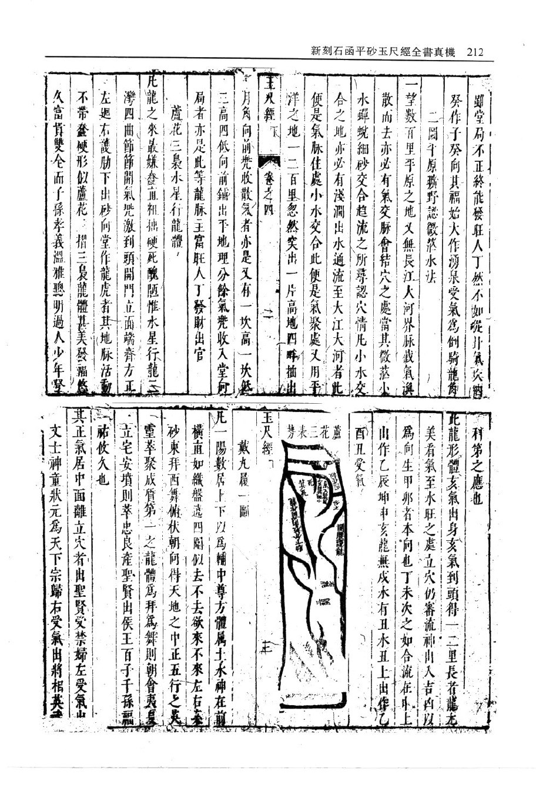

## 原书第 51 页 {P000051}

才汤四网巴工夏君只申巳亥四维水交流众堂而四正俱系实地则子午卯酉四面之龙脉俱至此住绝搆聚交会矣然四势无并结胎理或离龙结穴面坎为朝砂坎结穴而离为朝砂或在兑或在震皆从水神来去上辨别水从乾坤二方来则知正龙居兑而左右作护震为朝砂水从坤巽干三方来则知离兑为正龙而震坎为朝护但只从正龙上寻大小合矜及兠澈小水详其左来或右来正来偏来以求龙脉之到头定穴或倚左倚右方正欹斜以求服气人穴之法然亦各有方成小可穴者即于本龙小9分合右转左转正来直来之因以及小合水出入之方辨位取穴乃为得之然终是小发隔力粮轻

群鴈落湖形

此地中砂或成金形木形或随水形或如舟形旁有小长砂砂只只与龙体不连各有成形湾湾向堂朝拱或横长直长在前横湾长砂在后水神东穿酉遶周廻来去三重及四重综横如织砂体各谷交牙水路曲折密不通风亦大地也主生子孙繁盛孝义忠信富贵并显但后世子孙同居其户者不能皆发只要分门剖云另居立业方主名位俱发福气官禄财帛人丁牲畜无不兴隆者矣此地局内水法四通八达难拘出入当看城外大合来去之方以定坐向否则只从局内砂头转处耳观朝水聚处作案亦可畧从大势水法于向中饶减之可合卦例只以卦例取用为妙者也

## 原书第 52 页 {P000052}

综群横属如落织朔之形

尺经卷之四六2

气无形而有神土无神而有形气随土形神从形发故凡土脉之来皆本山龙而平原之气尽从土脉而至土脉起处为首龙气发行之始也土脉尽处为尾龙气聚会之处也龙气聚位方始融结神龙真经云要知止处须寻来处来处为头止处为尾血脉在外精神在里虽雄媾合玄从尾底言山水交合之处即精神聚会之处龙底穴左肩脉之尽男女玄牝之门是阴阳妙合之真境也即此可见气之会在水交龙尽之处而取气之穴当从砂之尾底求之若水自东来流从西去则东为首酉为尾育水鲁之处指穴反于水头上寻穴是弃其所止取其所脉经日甲卯作龙不食酉辛之气此言绝要矣

玉尺经卷之

鬼劫龙

鬼劫行龙出身东西南北各出土脉飞窜顺去直来或直去顺来尖斜横曲乱流支水交冲腹心穿丛龙脉入首轻斜不分门面者谓鬼杀分散英灵无所收拾断不结地肋下分砂向前逊出不颈堂局自开不端不正者谓之鬼砂顺刼分散聚气也腰下分砂向后逃出不来护局东牵西洁长斜分脚者谓之鬼砂逆刼分散来气也时师误认黄龙安坟立宅不出二年必遭横祸瘟疫死亡子孙逃宽军徒刑横无所不至出入讦诈无信不仁男盗女淫十年之外便主绝嗣

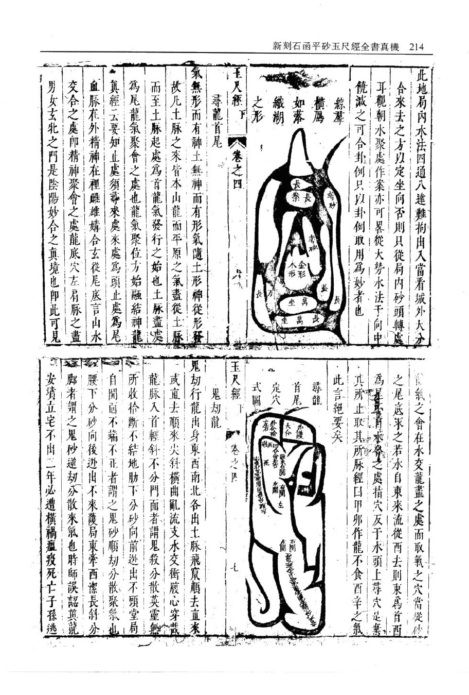

## 原书第 53 页 {P000053}

长砂关气直受长砂关气直受

凡龙体出身砂头直长或一里二里行来全无委曲若中间腰去处不分枝水西边插入肋下作关则主尺经卷之四入气散不聚到头又无枝水两旁插入肩窝则气滇不收皆不结穴惟于来龙行脉中间两得三重水挿进关激龙气居中过峡到头又得枝水插窝左关右激收气脉在中则方成龙势体叚便可指点更得开水东挨西推过一边收气归角成四维受气又妙真龙真水其气冲隐最难立向看水神来去东北出水作兑向腰受西北出水作午向通泉受东南出水作坎向正受西南出水作震向疆受凡正受须带丁丙光分子午三分要避双金真气然恐伤人丁腰受只正下无妨若斜归二分则气不贯庆矣

受直气阴沙长形风蜈天上

三関三峡本气入首式

能体出身沙头长直或二三里远中间有水挿入内王尺经卷之四

地作开峡换气入首则龙气方清凡阁峡过气所在须一関过东一开过西使龙腰曲折活动而来到首更有肩水挿进兜激收气入局方成贵龙体叚此龙坎上为坐闪过壬上度气换来癸癸换上仍归正坎入首虽系坎龙行属中间换过壬癸而来脱煞到头不犯直冲方可正下仍看水神出入或耳受农受皆可

九开峡形势有谢関有斜阅直来直受多币直来斜受者多斜闪看开口受气屈何方则知气至何

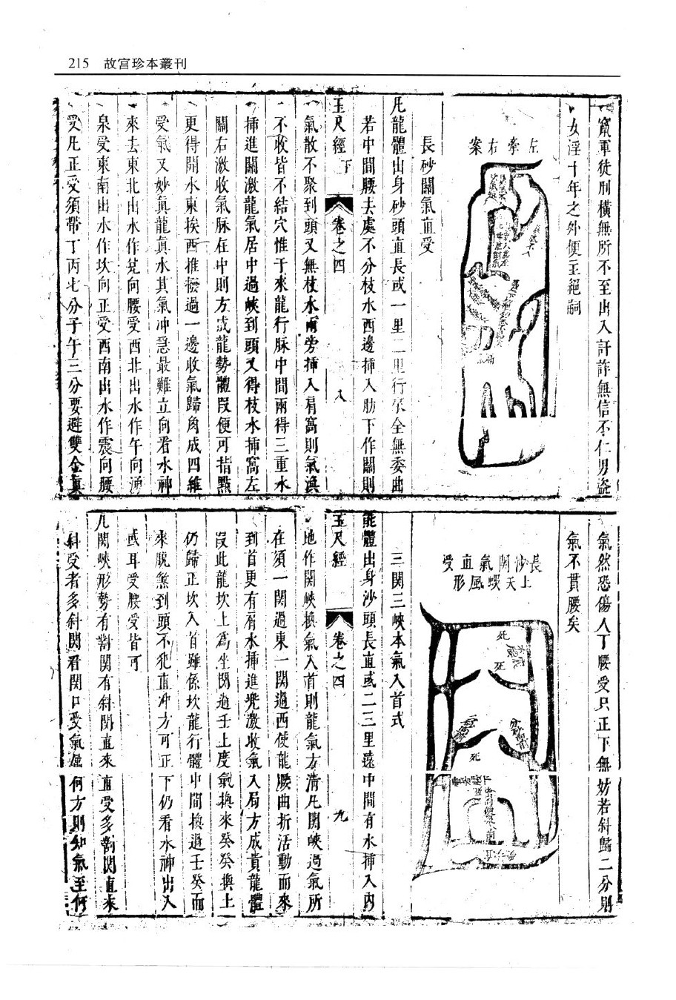

## 原书第 54 页 {P000054}

方如口张向巽干水自干来气必超巽坤申之角为死脉矣

斜来正下水朝业外

龙体出身不分枝脚对角发脉腰有二回阅气入首卷之四

开作正面堂前大小朝人分开两股挿肩兜收龙气入穴前有横案左卫右护亦大地也生龙旺穴王百子千孙富贵绵远更得袭闲双徽福力尤建旁无劫泄又无兴废奕世富贵朱紫不绝坤申兑干俱可出水放煞

长宫行龙向从卦例艮纳丙坐穴对丙空甲午木或丙午火方美若艮土来水向巽巳午出当改癸角耳受终不如丙午向富贵攸长若作申向则艮为病龙申为病向虽不死绝而龙气休囚岂为尽善

有壬子癸水来亦好水朝案外势

中局气势

龙脉体势砂头方正傍出枝水关气到中局都从中王尺卷之四十

腰门面入一交水到中局分出两股横开向傍摄入收来脉在中又得局中肩上挿入重觉入气斜开关口收受其力大鼎寺龙穴安坟立宅子孙攸久富贵洪远房分均年朱业满朝由人忠厚听明形体丰美

申来龙卦气纳乙乙水去向作壬若癸木来向作坎朝止于辰水去三合同子向七壬向三分巷作甲佛向煞人退败丙午向主退出年丙水赵艮作巽已向亦可

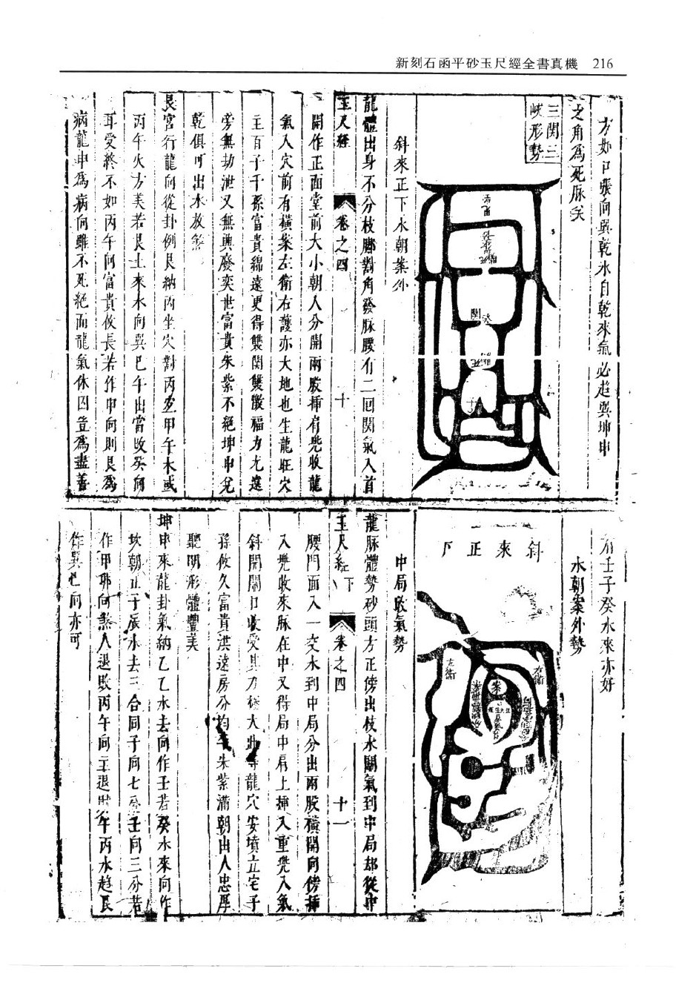

## 原书第 55 页 {P000055}

中受平收气脉势

龙脉出身细小枭集面来将近扁后百步二百步或三百步分外开大庆直至一百步外两木合转人经下卷之四十

一处出来却从去水合处复分尔杖小水从局肩挿破局内逆砂而逛从中关进龙气当中聚水如湖两傍插砂作本身龙虎俯伏湖外其中气不偏不斜名中局平收气脉言穴傍无界兠激只取本身龙虎为主气取穴也

如亥气出身带亥壬子气入穴巽巳午上出身只作丁未向收亥气长生本入局又收坎上临官木穴既取人丁又发财禄但气宽大欠清细出官贵三逢俱有发财则商艺俱典水木气混行者也

群鴈宾鸿势

体随木出身先出一大横砂流水界断后生少砂五七块东西散立向前复结大砂居中或员咸方或出角左右旁小砂一二十块或尖长或舒翼或香之神出角只双向内朝堂向前又结小砂或长或方三五块周廻又结曲折长砂抱护向内者名群属宾鸿形中间结穴砂头得十亩二十者准小砂或三亩五龙方是外谗大砂不拘只要长湾内向其一小砂只只交股片片遮栏不见木来水去其地极妙百子千孙富贵不胜难计立向从外水立向其中穴傍水来去纵横极有情况难以认取故也不必俱此图此益以异亥立式也认水定龙详看首尾中砂若大亦要尧收取气

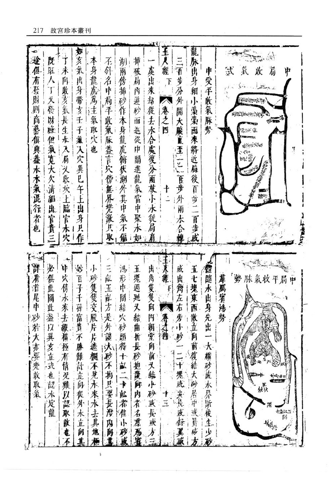

## 原书第 56 页 {P000056}

众砂小次砂大小群鴈从大宾鸿形

刼龙分气

龙脉到头开头有面类若聚气穴塲端正凡见此龙玉尺经卷之四十四

便易指点若腰肋之间有砂劈出两旁向后定宝一与龙穴无情谓之刼砂龙分散英灵之气故也虽是穴塲可观头面端正塟之无福而反致大祸绝人退败理之必然尤防隔绝使龙气入路不清越隔与劫砂二者俱是凶恶决不可下古人所谓菩萨由者正此龙也言龙气不至虚立门面徒好看耳龙随土行土到气至何以有气不至之事所日譬犹吹管者然闲气音开一音气至而多出音齐开则气泄而多音便不出矣此理必然至

玄至妙学者祭之

出头尖细鬼砂食气

龙来有气三开三折甚是活动及至到头出额反尖王尺经卷之四十五

细度长斜欹逼则虽龙来亦必减没如海中之潮浪涌而来及至逼窄之处势无容则冲击而终是灭没必然之验古人云来得好不如收得好长戴尾龟鬼头踏着便生愁正谓此也

龙行入首面额须然端正而坐下鬼砂支水倒挿入展三重四重穿破龙形如破金杨公所谓棕栏业散夜文头正此龙也时师见此头额便从此处寻一穴绝人宗嗣受祸无穷不可荐言矣棕叶鬼形似棕栏叶有向前不顾堂局而散乱不收者有破拿

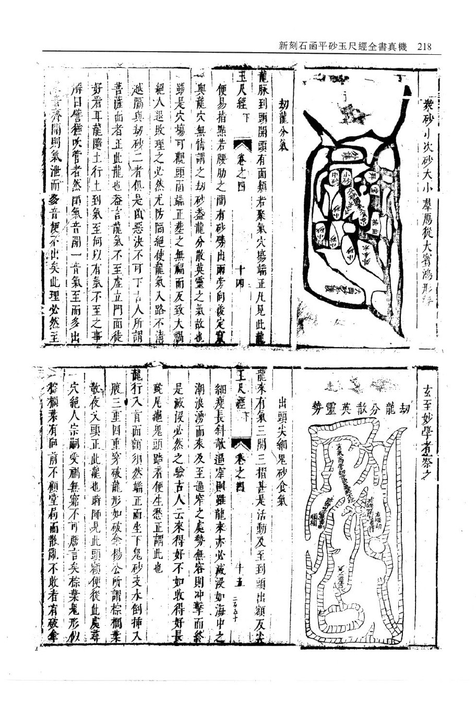

## 原书第 57 页 {P000057}

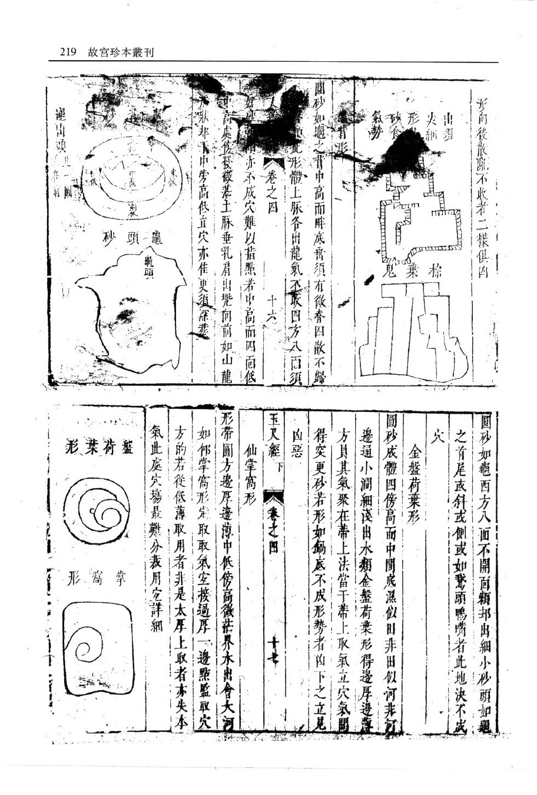

## 原书第 58 页 {P000058}

回龙顾祖大水来处起祖行龙随水而出到头或为他砂挨重使本龙从左转右或从右转左道流而上却乃回龙顾祖之地经曰龙廻则水廻又目龙从水转若水面流出而不见有转归逆流处决无廻龙顾祖地虽有砂头转回不过是支木界龙脉矣虽穴塲好其力亦轻谓非真龙到头之故也若日是真龙到头其水必从龙逆回此地最难立向以四边皆实地一路出水耳后立图自坤申右迁转至坎五尺经下卷之四十八

入首是阴龙行体水土喜东南出水而东南反灾出煞然矣故凡回龙之地发福不久阴木自卯上起长生返从阳木长生之方出去只发七八十年便衰后之辟自辰上出木畧悠久终无福气

截气立穴法截兑气入左截震气入右砂到头龙体有势但到首余气分散难以下穴须在砂之偃间看有枝水入腹涛割如钩傍待短浜隔断气不使入首之处当庆收气入局内亦能发福终不达矣

斩气立穴

砂如舡形或如梭形两头俱尖难以下手必须看得枝水在脇间斜入向去之处逆展作钩下水背面又得永逆入腹申兠气入局当钩取穴名斩穴玉尺经下卷之国十九

其气使不入头乘而立穴之谓亦能发福纪看龙出身远大则福亦厚

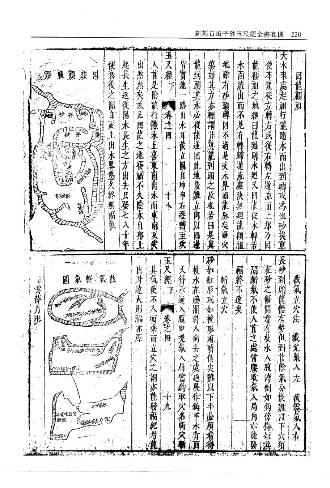

## 原书第 59 页 {P000059}

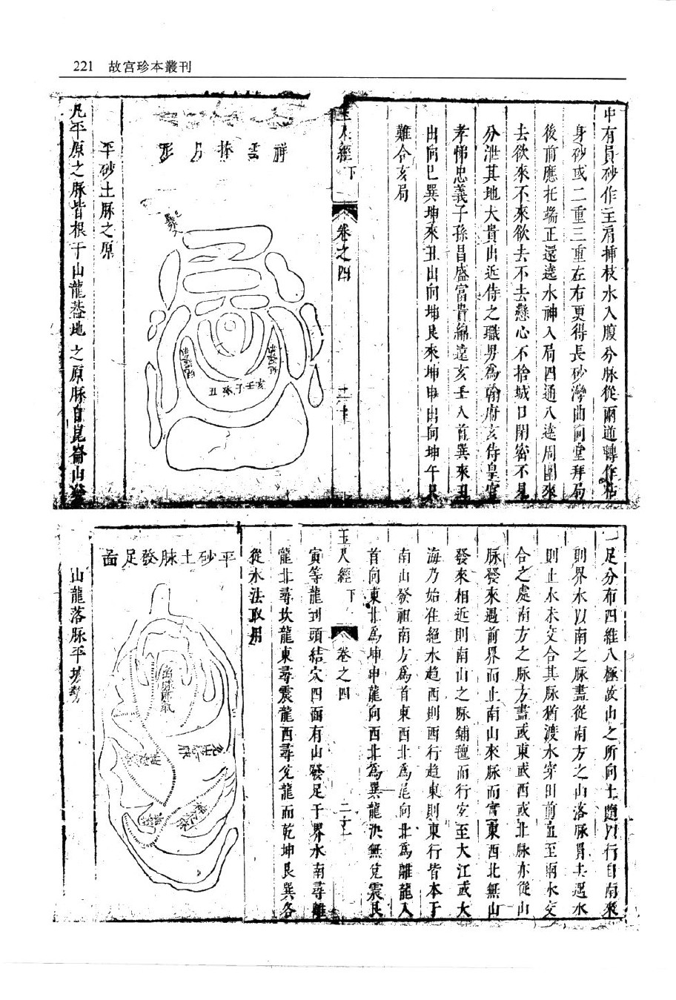

## 原书第 60 页 {P000060}

凡山龙到头分开两翼中不垂乳山逼势急宜铺曲去平坡三里四里之外方有大溪或长江界绝或有山脚下一二百步便结穴有平坡腹中结穴前无水止四畔界溪又远取穴认气之法看真龙落头到结穴处四畔必出月角瓮转向堂或左右抱出轻砂向前作栏头砂或三重四重抱护者必是真穴所在其后而脉须三伏四伏节节隐露不一及至结穴之处自然明自可辨两边微落水夹流合矜而去其地福力亦大百子千孙发财发福与玉天经下卷之四114-11山龙脉穴更佳水法不堪裁剪不比平源大河之处一不合法东手无计

出木龙寅甲水延上远来层曲朝堂返作阴水右旋出戌巽水远至两上朝来生旺二水俱是有清但不虑左倒从坐下行出戍是阴过阴矣局内腮水甲卯水自左夹出坤未水自右夹出左倒会甲寅长生大水逆行则内俱逆矣向丙午则发财源官维下卷之四

贵而背生水其人丁亦无病但主人当家妇尅夫少亡寡居矣发中房财禄则长房人丁久旺发长房人丁则中房官贵不兴东典西退消长不一若作甲寅向则人丁虽旺又出气疾若带艮上发源可免商贾起家主骨肉不和出人用佞丙向亦能发邪第但阴邪误国食禄不终

本正

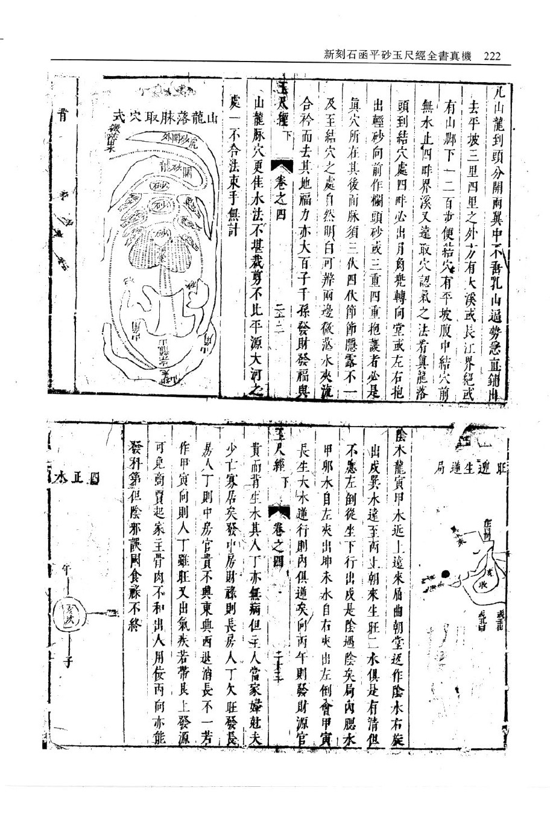

## 原书第 61 页 {P000061}

子午卯而四正不空来去名滚浪桃花水又为军睡水又为天狱水又如天禁水主出女人淫袭男子流荡破家主出军贼离见坎卯西兑见午那见子主出女人杀夫阴邪如过此水得申庚壬丙赦文水救之方可否则男主盗女主奸败绝孤寡若直冲破局必有抄拈之祸产难少亡一路二路来长其祸立见来短则祸轻若龙气清丽六秀水朝亦玉尺释下卷之四二十四

主为官取罪而刑

假如亥龙从坎入亥者为阴亥龙以乙木生于午从午上起长生逆布至成为墓乙席丙龙从寅上起长生顺数至戌为墓所谓乙丙龙变而赵成为虽一雄交媾也冲阳和阴始发聚然后以向制之使气感而应鬼福以及矣然穴依龙乘生气也甸依水接堂气也故气行地中用土龙本音以布运水溢地外用水龙本音以布运审生旺体聚之气土龙以山运收山水龙以水运收水如午上有高峰则旺人丁寅上有高山则旺财禄此正谓水管水也并用以寅午向制之则于水与龙之气始合而不散矣此控制龙家之气在于向而巳矣一差祸福千里

阳龙布气冈

土尺经下卷之四

二十五

从辛戍入亥为阳龙亥龙木音以甲木生于亥顺行至未为墓甲用癸配癸水生于卯逆行至未为墓所谓金羊收癸甲之蠹是也认龙布运之诀凭随气化流行之楼从子丑寅卯员布子外阳左阴左以为之式然其水神之来去不可执子丑寅卯顺逆周施转来为合法也只要水从生旺来问局前朝堂为来言赵至局前朝会众水然后向墓方出去吉癸龙卯为三方亥为旺方空从局后至寅丑子亥右转入未流去则亥卯水玄武而不入堂矣虽来自生方出自死方亦不可言吉余做此推之

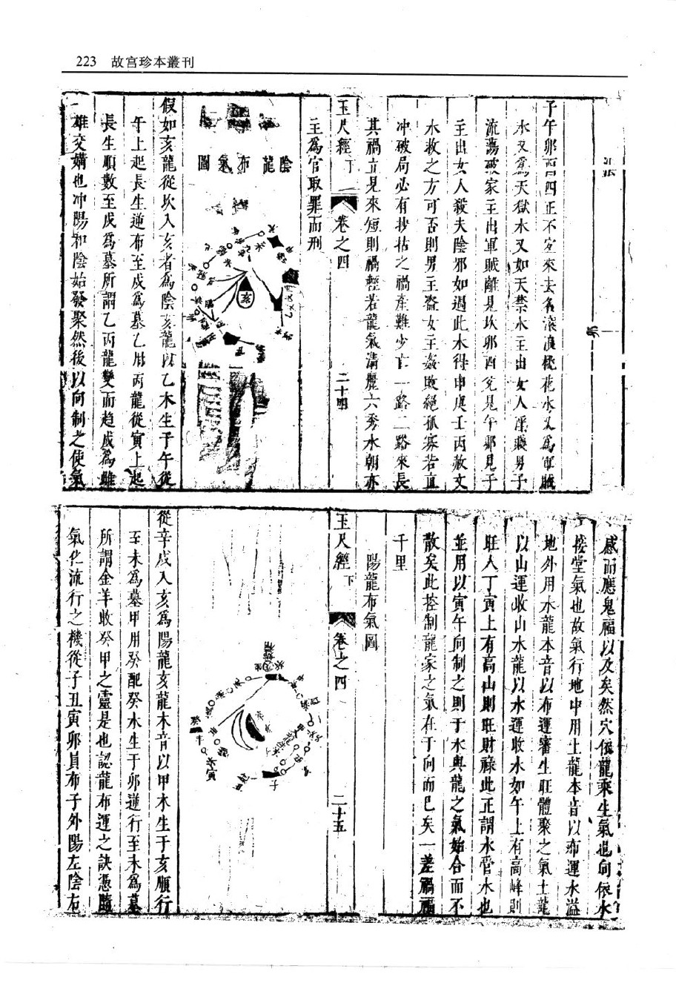

## 原书第 62 页 {P000062}

云木龙借配壬虽交媾不真而夹流出异亦有秀气砂法合局大能发富贵若得内堂腮水从甲卯乙遇丙午右到转戌反向午丙赵巽合流出异是外木虽不合法而内水得局作异向则兼外水顺向外卯则人丁贵亦美丁未向犹吉丙午向则人官禄更盛地发长子向发中子丁向发小房又六七十年丽力贵不过四品富不过艮万水步行至外堂败矣

多壬为北极业薇之司尊帝之居申庚而少缀亘数之地巳丙为南极之司寅申为天市天帝司货之处地得此水到堂朝会其福无比或三路四路水来亦美寅中水先到会巴丙倒右出成主出神童状元官居清要极品之贵南会庚酉木而左倒则卷之四114

临力畧官至四品酉水先动会寅甲水出成先发外始后发本宗先发小贵后发魁元亥木先到金寅甲出未少年科第文章奕世辛兑龙见之文压天下但清贵矣庚中水遇震龙得干异峰高出主英豪经云开享门关地户震龙动而龙见时

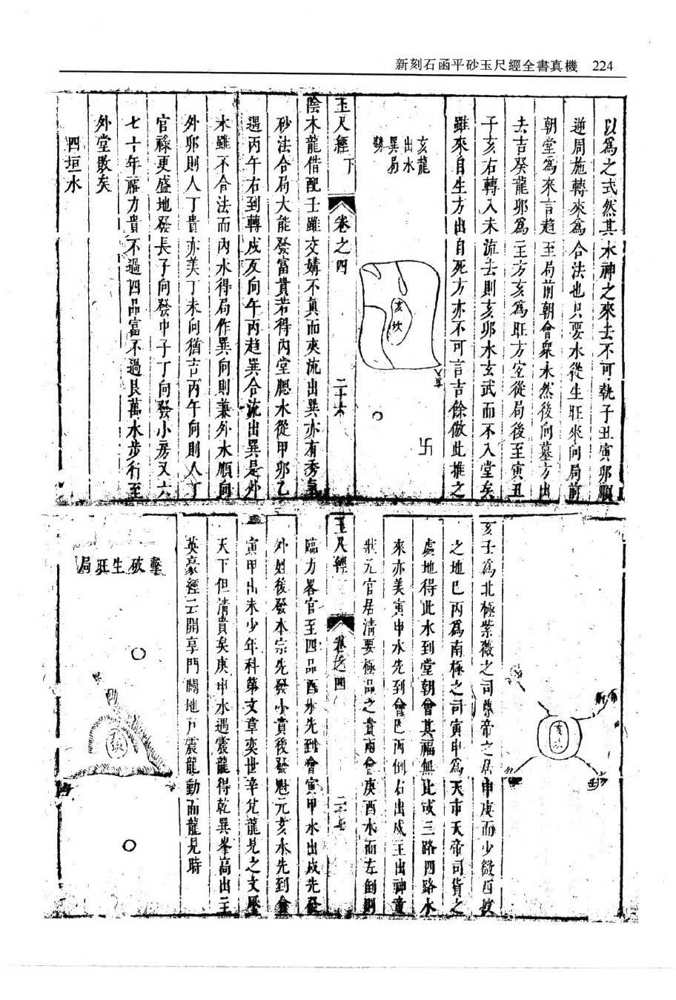

## 原书第 63 页 {P000063}

阴亥龙戍上本为亥窍水空山不互入若水变戍上龙自外由离者只取艮水出夫作庚下气其内水逆人分流从局前破午丙方去枝分流变垫赵向异震作巳丙可教此收山山气之做妙移祸到寅上流出则生年二方俱要井击须内堂水法为雇之真机也如作丙午寅艮向则立见害人也作砂亦不可下下之不出十年外定主败家绝人官讼残疾抄枯寅水大先绝财禄戍水先到堂中生房先败绝继及长小二房破家损人只看内堂水水园出入向若寅甲上有内水丙午则人丁可教内水法不出午而出申酉二方则财禄可至一二纪方进作异向始可少缓其祸若作午丁向巢左系寅申巳亥四龙长生之地交流入局朝堂者垂发人玉尺经下卷之四二十八玉尺经卷之四芒九冲破丁然水阳也外气从天地交阴也龙气从地故生旺喜地支行度水喜天于行度故日水从天上去龙借配来地下眠又曰万水尽从天上夫群龙须向地中来行门生虽无四正之祸然终为地支不发福气法且为长房之煞若犯四生水法惟长房受灾见为成土水来或分或合俱右转左向堂一路出丙午各有分位兼得乾坤艮异四宇上来其灾稍路出寅艮生旺二方俱受冲散而亥气不聚矣迁4之立见败绝若戍水并流到堂分坤离艮者其祸水基15犹烈如戍水来处便分流一枝过堂出艮一枝分

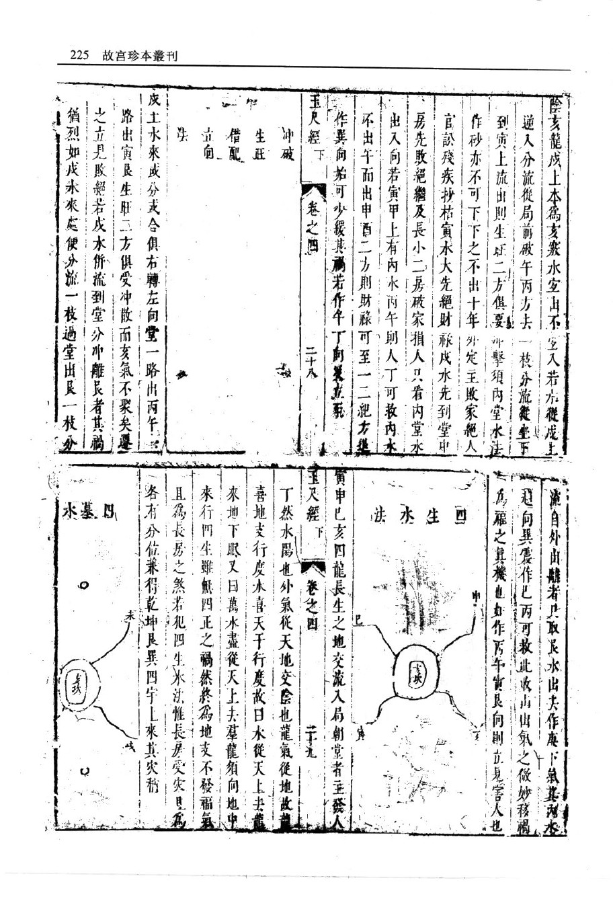

## 原书第 64 页 {P000064}

法殿成丑未为四墓是水宣紧不室来室去不空入若墓水朝堂主瘟疫病疾孤败绝后若聚而不来则又能发富贵直冲破局小房受祸冲破北气中子主灾伤财生气则长子当祸看龙气左忌以断吉凶如四墓俱聚不来冲击堂气主大富甚比石崇若西某侧到决不可下下之立见灾秽池河方壤通众水来去者不是刀

主天经下卷之四

亥龙起顶落孔正亥入局左右龙虎蹲踞而中脉抱出詹口若从亥脉尽处立穴则忍露脉风吹退缠则玄武舌长然气乘风则散而进则五气和融故只可退止一步

乘得亥气着不当以此书为忌杨公三十六穴法去玄武内长高处点此亦开劳火之法也是以山脉余气不尽者可兼则裁之如不可裁把穴立得高使坐下不碑谨舌亦妙

龙起祖换出坎局脉乳入首横铺平濶开面又似坎体是真龙伪行也然有艮龙起祸则必有艮脉入穴须朝应情向若何正行斜受子不雏祖其人穴之处必有艮气到头者势决超在右角畔矣以中局取穴则用伪气矣其祸立至

故真龙伪行者不当在正落处求之行前山以求李心察左右以求开气二者一得其法则真伪自一见矣

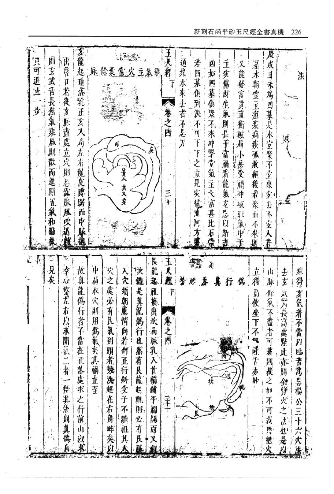

## 原书第 65 页 {P000065}

刘秉忠砂周昌奇厢作艮龙转亥作丙向二十三年昌奇十状元为元太学士改监茶马司后卒其子一塟昌奇于艮龙之顶取艮脉尽处世代显官接踵相继此龙体制本自艮方起祖再损艮龙不杂第二节损出亥局再博得幕亥麻大宗小宗俱各三吉六秀故艮亥一二穴皆发官贵

工尺无卷之四三十三共峰起祖至第三节变出土星横濶厉平粗区不开窝乳东西二角又无脉落可考似难立穴然有大穴虽无明净乳脉必有微茫灰线亦荫腮暗异佐证方可立穴若并其翼砂不明则又当验朝应山水何方有情经云唯气朝山识幸心后看来脉前看朝山以为准的刖万无一矢矣又有乳脉乱杂难杂真伪者皆于朝应左右萨砂察之则其真穴可见占先圣贤立法金取窝土取角恐非的论若朝对迹接在中安得舍中局而取金角乎

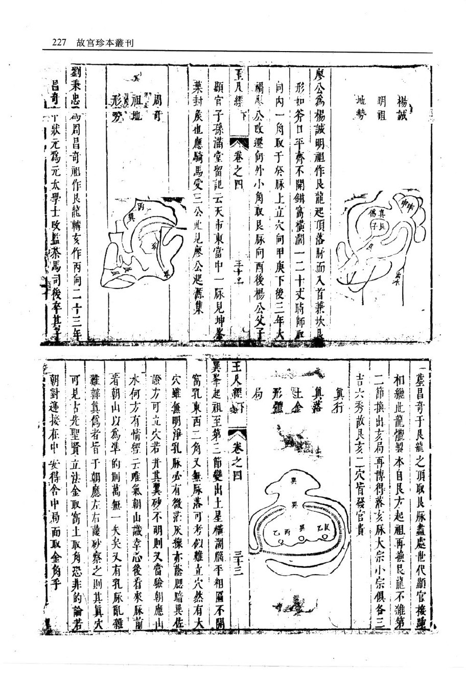

## 原书第 66 页 {P000066}

良龙起祖二三节皆艮峰起顶至落脉入首邦流趋癸丑方尽是伪立穴之法当循艮脉尽处乃为气却于艮脉尽处立穴虽拖出癸丑方去亦空裁人经下卷之四王十四剪以截伪气如不可载亦就艮气上迁之故古人云真气得乘伪气自灭不当以癸丑绝出砂头为嫌疑也作丙向以阳艮收丙气大发官贵后富贵双全若犯丑癸之气其祸不可胜言矣

催官吉秀罗列

1亥龙起郦三节四节不脱本体人首结穴之处龙虎降伏乾坤艮异四山高叠震庚丁兑列秀于前后左右得此形势而龙真穴的则主出将人相封象赐爵子孙奕世济美更得旗鼓剑戟森严则淹英芍横行天下百战无敌者来龙迢迢数百里入首而八而降伏并系禁忌如过此地禁口勿言福缠之人迁之必至献虎雷击水飘而后亡

玉尺经下卷之凶三十

干龙起祖换亥二节四节亥龙行入首端正而乾坤艮异四山高应丙丁兑灾边到秀峰众水倒左出寅艮长流而去作巽向以收水神则砂水尽美主出魁元宰相无震庚砂主文章冠世名播夷百子千孙世代显赫朱紫满朝儿催官荐元砂水得一则贵况群秀呈祥者乎

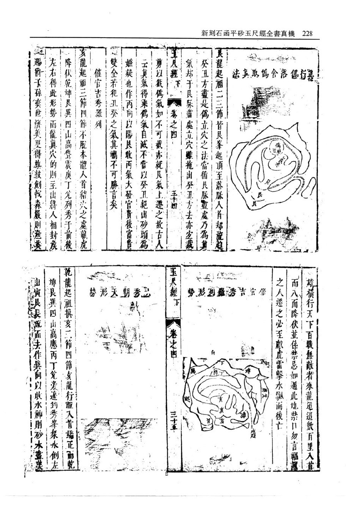

## 原书第 67 页 {P000067}

亥龙起顶单行落脉到头一路俱系亥脉临穴处都王人经卷之四三十六

杂壬气出右边似壬亥双到左东右伸时师不知却见左右护砂紧促应案整齐便从落脉画处点之是弃其亥气而取伪脉自壬气上作用则失之矣法当从亥脉尽处族左立穴任其壬脉铺出

妨赵真避伪审飞龙势法空高则高下脚下有余气虽不裁亦可也法空就来则东迁右有余气虽不裁亦可也全凭月力之巧者上术也

参形杂势断

如艮龙从坎换入艮方起顶卑落至入首之处却铺出一片平濶一二十丈拔用同情似无收拾势杂形乱坎癸艮寅皆刊全无屈曲情况然龙真正左右护砂明自不可弃如此形势最难指点全凭且王尺经下卷之四三十七

力之巧详察朝应情势属何体制书云形杂发如何认惟有朝山见幸心故有真龙必有真穴有真穴必有真朝从穴内详观前峰有情者若在丙上则下丙上对穴取艮作用便为真穴其余癸坎寅气皆为伪落矣

石雨年王尺经全书后集卷之四新刻石函平砂玉尺经卷之五

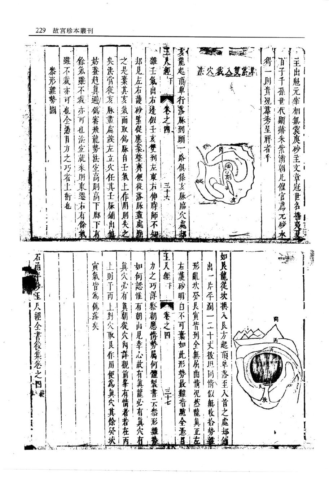

## 原书第 68 页 {P000068}

元太师文正赵国公邢州刘秉忠述 明太师文成诚意伯青田刘基解

审砂篇第五

砂明生死脉辩阴阳敬仙赖从谦发挥

平原之地砂头进脉有左生右死右生左死有来生而止死有来死而止生凡龙脉之来活动曲拆为生硬直粗逼为死定脉取穴须弃死挨生金函卷五

经云生脉活动而弃死挨生是也地理之说高为阴而低为阳覆为阴而仰为阳直逼为阴而平坦为阳惟平原之地独阳无阴而砂水合处始见阴阳之会脉辩阴阳者以五气定阴阳之升降左阳而右阴也阳从左而阴从右也干坎艮震属阳而卦列左布如子寅辰午申戌之类巽离坤兑属阴而卦列右布如未巳卯丑亥酉之类此天地身然之气运五行之定机天气阳而左旋地气阴面右旋故阳龙从天气顺行为吉阴龙从地气逆行为吉杨公所谓龙飞两片阴阳取者是也赖氏曰龙自方生而纡从死地入首者名生龙死穴下之必绝如亥方发足本木也而纡从午申酉地入首结局本死于午绳于申墓于未名生龙入死非吉地也又为亥龙气脉趋东南巽巳入首而取穴西南东北角者亦是生龙发足而下死穴莽亥归东南西南东北亥气不贯为死绝之地此法精妙时师不知多有向死绝点指者其贫绝之祸立至龙脉之来有阴有阳阳从左转阴从右转避尺经卷五

其死绝趋其旺生则龙气清和结穴秀丽故右而左转入首者为阳龙自左而右转入首者为阴龙阴阳二气俱得生旺不犯死绝吉如甲卯入首者木气也自午巽而至为阴木自干亥壬子癸丑而至为阳木阴木生于午阳木生于亥俱得生气出身若犯兑坤二方出身则龙脉发源巳先绝矣纵虽到头得局护托完固终不发福水发城门流详出入

龙行水随故水发源之地即龙神出身之地或趋东或趋西必须详观其所出之方若流神从实艮而出则知龙脉自坤兑而来则知水神必从寅艮而出以艮寅为水日者必先龙成胎于正西巽龙生息于东南故郭氏云入山观水口登穴看明堂即此意也

## 原书第 69 页 {P000069}

龙行审来历之因

凡龙体到头归收水口之处必考其本龙之来要知从何发足经历何方如东北到头向艮寅之方其龙必自兑宫出身乃为真龙自坤申而兑者亦尺经卷五三

吉若从壬子癸丑而来必得坎上有左水佐辅夹流会合于坤申水左倒更得乙辰水佐辅夹流会合于坤申水向寅艮而去方的若是离宫落头则水必不自坤上来矣故龙行来历之因须自流坤上消息之始可以得其情也

赖氏日平坡之地千里无画龙无一定之穴而人无一定之见假如一片方砂四方八面无有收拾似难取穴若能审龙形来历之因真知灼见的系坤申行龙出体则知穴清龙脉趋东菜坤兑之

迎神定分合之自

气而融结矣吴巳行龙发源则知穴情龙脉归西北矣

迎神者朝会于堂局之水也水来到塘必有发源之处从何方分流而来又从何方会流而去知流神分合之清而龙脉结穴之真伪自见若水来到堂左畔分流交行前后而右畔不见其合两派流或横去或直来前有无收后无廻统者其龙自未住扎虽砂头有情方正端通未继穴也直至水上尺经卷五四

交砂会之处龙脉始聚而融结真穴是故五行品配于八方万象画归于四蛰

乾坤坎离艮震巽兑八方各分隶于五行金木水1火土正五行则干金坎水离火兑金巽震木坤艮土万世不易之定气也然以生旺死绝之气定之则木生在亥而配干金生在巳而配巽水生在申而配坤火生在寅而配艮甲庚丙壬丽子午卯酉为五行帝旺之乡是五行品配于八方者天地然之气运行而不息以化生万物非人为可得而品兜牵合之者也若寅申巳亥乃五气发生之始为龙家之四始万物之根基五行乘旺之气必一自寅申巳亥发生充盛而至于旺犹先金之气甚始生在巳也青囊经云地有四势气从八方四势行龙八方施生正谓此也

## 原书第 70 页 {P000070}

变形察体观象审龙

随地之形以察其龙之体观砂之象而审其龙之气象以气形以理变者也如木之形必直而耸火之形必尖而侧金之形必头员邝关土之形必方玉尺经卷五五

正而尊水之形必曲折而动故观其直而耸者知其如木尖而侧者知其如火头员而脚关者知其为金也水土亦然为金之形圆而阔者又当审甚龙之自何方来如兑方发足则金形乘于旺气而出真金龙也若自离方来其出身巳被火制矣纵虽结穴亦不久远余龙倣此

赖氏曰夫龙有形者气之所钟聚而成者也有象者形之所成类而象者也如土形方而玉凡御屏金柜天马之类金形员而覆钟覆釜半月娥类木形直而玉尺横琴展轴之类水形曲而生蛇非五气之流行而各有当然之则如取火形于熖动取木形于包节取金形于开巨取水形于曲拆习土形于觚角如此审详以取中则有以得其穴情之真也

气藏于左右忌分泄于鬼刼之交横

龙体成形水神交合其地须巳结穴然气之充固与福力之轻重则又在于左右之护砂或环抱有玉人经卷五

情水城紧固更不东西直窜四重五重节节包集者方佳或自本身分枝向前环抱顾堂尤妙若左右砂头东西飞窜或有本体柚出从肋下从腰内肩肘之间左牵右挚东西乱窜者乃名鬼刼能分泄龙气之英灵如有此等则须水交砂会亦不成穴矣

脉承于前后怕透漏于坐应之下涣

龙行入首结穴必前有案砂后有坐托则气脉镇重方有收坐托无砂或有砂而喷屑前有应而歆斜反跳不拜堂不平正或水来斜射者其气透漏而不聚也

## 原书第 71 页 {P000071}

荡如鳖背出似龟头虑散漫而难收圆若金盘平如一仰掌认高低而定取

平坡之龙砂头宽大中高而四围必低如鳖之背砂圆而四围乱出尖角如龟之头者气散而不聚也此不可迁之祸绝圆若金盘边幅高而中低平如仰掌中前低而后高成此形象若龙气分明的知来历方可下手

玉尺经卷五七

赖氏日鳖背者砂不出角气散难收龟头者砂头微细而气不藏蓄二者皆不结穴金盘荷叶傍高中卑水在中亦必有出处点穴当如仰月形看角兠收而中取之仰掌平坡必有掌窝语取窝穴而定之杨公曰荷叶须寻蒂平坡认掌窝正此法也囚四正四维之去来究枝分枝合之聚向

水交流于子午卯酉四正之方则寅申巳亥为实地乂观其水之出入以审何龙之结穴凡四至之地实者多自生龙发足乗旺穴水交流于寅申巳亥四维之方其子午卯酉为实地凡四正之地实者自旺能行成生穴又须以水神辨之看其水送分水合枝水之出入方见若水不分枝作小分小合则气宽而不清亦不结地

秋横似织方知眷恋之情汇泽如湖仍辩朝宗之势入首结穴之处前后左右若见水三横四直屈曲交流犹如织帛然此砂恋水水恋砂犹夫妻相见而不忍违也众水到堂或左或右聚汇如湖则知水交砂会矣然又要辩水神之出向何方而朝主人经春五人

或出于大江或出于大朔辩方定位以明龙穴之美恶也

赖氏曰水来到堂有聚必有泄观水之聚处可以见龙脉之行止水出之去处可以见结穴之倚着几龙结穴必倚何水神流去一边水神合流而去之地离雄交媾之处也故穴必倚焉九曲入明堂石崇富贵一乱如箭射伯道孤寒水曲则财禄聚屈折朝入明堂者富贵双全水直如箭射至明堂不惟贫贱而且孤绝天亡7

## 原书第 72 页 {P000072}

是故流神合法者龙体方真此总结上文言水之去来合法则龙脉沾穴方见真正而无虚假若砂头端正应托尊严左右护从周匝虽云龙脉可观而水神去来一或不合共法则此等总为虚假所谓菩萨面者此也

戴九履一而天地之中数居尊凤舞龙飞而干巽之阴阳交泰

一者阳之始九者阳之极五者阳之中五属土面于体方正居中坐下长砂为托面通横水四道直尺经卷五九

水四道列砂九方得天地之正气阳刚中正为壹王建极之地产明王育贤相非寻常可北之地此坎离交媾震兑合气而成者也若亥上行龙自天门而出踊跃如飞巽上行龙自地户而迎扬砂如舞亥巳交合朝对有情左右送从合法则干阳而巽阴二气交太翕受敷施为明王圣帝临民之地聚贤才会文武此地原不易得或九履一谓子午也2

虽有三关三峡之落尤防左牵右挚之非龙脉出身前无关镇则行面不住气随七行峡不转峡则气散而不收真龙真地入路到头故左右必有护送砂头向前拱夹其中龙穿田渡水之处不使出体露风其到头之左右东环西抱如拜如舞则气藏完固无有漏泄诚大地也中龙入首或为长砂曲折三里四里而来固自有关夹而气发阻碍曲角复恐分畜于折处而入首之气反轻则结穴亦薄故曲折之间有枝水界逼使气从脉行兜收到头方真又有直砂行龙三四里五六里随上人经卷五十

水而出者有方砂居中三五百七八百成地有龙脉之来历固在水神之出入可考而英气之聚处何从而辩别必得辰股而下有微水穿破关气节脉使渡峡在左在右曲折活动而未入首之处武左右肩膊水插界明白其气方聚否则龙脉须来气涣而不收难以指点三里四里来龙或成曲折长砂或为直木长砂到头其中腰与肩肘之下若有余砂分臂而出须要向前作本身之护从拜舞朝堂方可若东牵西挚各自分逃于本砂畧各无情意者却来分泄我气所谓飞散英灵者此也生龙发足莫犯天罡旺处出身休逢死绝

## 原书第 73 页 {P000073}

寅申巳亥如长生辰戌丑未如天罡莽天罡所临之地禄马贵人不到故生龙出身带辰戍丑未天罡而来者皆不结地如寅艮龙出脉转过丑上而行是犯天罡矣子午卯酉为帝旺寅申巳亥为死绝旺龙出身转寅申巳亥者亦不结地如卯木龙转至午未申方入首是木死在午绝在申而卯龙受死绝矣此天地阴阳之妙理五行之真机地理尺经卷五十

家不明此道则龙穴之生旺休囚且不知何以验吉凶休咎之应

大从小而祥云捧月以小辅大而群鴈賔鸿群砂俱大小者为尊龙来到头结成三四地面负成方而旁有大砂重重交遶节节包承如祥云捧月之状群砂俱小特取其大龙来入首结成二三百地面或方或圆而旁例小砂如星如月瞬肩开翘如飞如舞双双砂头向内朝堂顾局如群鴈賔鸿之势也

赖氏曰结穴之龙特大而众砂特小者必得小砂之外又有大砂或长或方关拦于左右前后之外包承群砂在内则局内之水方有归东不致散乱分流漏泄否则砂虽整齐而水神涣散能泄堂局之气纵结穴亦不美也若中砂细小而护砂大者其水自有兠收虽出身轻微而其力反重

粗出细而细出粗形奇鹤滕横取曲而曲取横袅若芦花

粗中出细细中出粗形如鹤膝三关四锁入路而玉尺经卷五

来者其气清奇横来曲展曲来横展三折四袅形似芦花入路而到者其脉活动龙体真而穴情善福力大而富贵远矣

赖氏曰三关四锁似断不断如鹤膝也三折四身似来不来如芦花也此言来情之善龙脉之活气行之清皆于此可见左衿先师独得之妙发杨曾之所未到处

木冲天而包节生处方成

如倒地木星形长直而瘦若无包节乃为死木金用处也必得水合襟之左右有界水插入肩膊之内界出门面方成体制

## 原书第 74 页 {P000074}

火炎上而焰起动处乃见精微

如火星成形头尖脚关若火熖不动名照天火无用处也必得尖斜所向之处界水挿过一边使尖头归堂方可立穴

面方正大挂角留情

土星方正其情在角界水收气故曰留情挂角吐出金唇则生气更完廖公言土角流金正此谓卷五十三

也

赖氏曰土为五气之尊中立不倚其正性也傍分界水立穴在中通受子午卯酉四止之气为震杂坎兑之局尤妙但不宜当局正心取穴俗云中宫地也谬甚矣惟帝皇之都多有如此取用者取宅中以御天下坐坎面离之义开日月卯酉之门而四海文明矣

那关头圆开金取穴

金星形体脚关头圆须得开口取穴然异坐实差坐下不实名为悬钟金其气在边如钟之声应在边也

虽四通八达之区必有伏元归气之所

此总言上文砂水须四通八达分枝散布面去然其到头必有收拾之处为伏元归气之根也

赖氏曰龙体到头东西前后旁分枝砂四通八达而去似难收拾至于入首之处其众砂分出者登要只只回头愿祖或为龙虎抱归左右或为案狭俯伏在前或为拦砂回塞水口其始虽四通八达卷五十四

若与本方无情及至到头结穴之处只只不虚收作用神乃为伏降之气而归东堂局矣众水会淹到堂在前在后或左或右东穿西渡南去北来一似四通八达无所收拾然其总括去处众水群聚合流于城门之口重砂关寨于下者见其合不见其去此亦伏元归气之根地有神气而融结穴情始大

来气短须防腰截进气长尤怕直冲

砂头短折者坐后不得有横水截住来脉使气折脉短而曲折则气反急疾不和故砂短折者怕腰截曲折也砂头来若有三四里或五大里长者中间须得曲折转关博换过峡或三重四重如亥气入艮艮气还亥亥龙入震震气还亥则非直冲矣然亥龙趋艮艮上又得支水兜激回亥则艮宫不到散流各立门面以分泄其英灵使复还亥而去乃玅若艮宫无水兜激任其自去各立堂局是亥入艮就火局结穴矣亥入卯卯宫无水兜激任其自去卯上立成堂局是亥龙入卯就旺方木玉尺经卷五十五

## 原书第 75 页 {P000075}

局结穴矣若得艮入亥亥入艮艮又入亥三关三出仍作本龙出身结地是以亥龙入亥穴则发福绵远富贵双全百子千孙无有极也经云龙来不脱来龙气三峡三关元复元正此理也

是故博换转关，实龙行体势之真，而左关右界为入首成胎之要。

赖氏曰上二句结上文行龙体势须要博换之意下二句发明入首结穴之体段大凡砂头入首将结穴之处若头平额关或左薄而右厚或左厚而右薄者脉气冲至到头在东在西或左或右而倚于一边何以兠收其气而取穴故龙脉入首必得支水关界使气聚而不散方或穴体关者关其气使不走也界者界其气使就局也关水长而曲界水短而直

片蛮皮将奚取证云翔雾走何处兠收

此言到头立穴之处左石无关界水入是一片蛮皮无以证其气之聚不聚气须止而又无以辨其归向之定局也

玉尺经卷五十六

赖氏曰平洋之地与山龙之局取气验穴最难盖山龙落头有大小分水可辨其入首之真伪有大小合水可考其气止之精玄个字定出脉之由毬簷详住结之根蝉翼界于其旁腮水荫于其侧龙蹲虎踞案应向堂有此取证昭然可指若其平砂一片不仰不俯若无关界何以取证至如龙行体势云飞雾走须有关峡而前无砂头回抱又不得水来交合于左右则龙脉未见收拾之处脉不收则气必不聚矣

## 原书第 76 页 {P000076}

薪刻石函平砂玉尺经卷之六元太师文正赵国公邢州刘秉忠述明太师文成诚意伯青田刘基解敬山赖从谦发挥审向篇纳水消水

山为体水为用一气而成用属阳体属阴动静乃见五行之气行于地中有土则有气而山者土之脉络也积而成山是五气升而成体故曰山者气之体也气行则水随故水必随土而出脉从水止水玉尺经卷六上

从脉行故水者气之用也土静而不动属阴水动而流通属阳动为用而静为体此阴阳之别体用之分于此可见

赖氏曰山为体故地理家必先取龙体之来以观其气之所钟及其到头之处乃察其水神之出入以审其龙之所止龙脉至而水不来则有体而无用非真龙也地理家以高为阴以低为阳逼为阴一平坦为阳覆为阴仰为阳有尖为阴有窝为阳此一以静为阴动为阳者以水之体质性情而言也定故阳品配得生旺而富贵双全山为阴水为阳以山水而定五行之气接入方十二宫之生旺休因则山水有生旺之方亦各有疾死绝之处合生旺者吉合死绝者凶如亥方为本长生之地震宫行甲卯乙龙生于亥旺于卯死于午绝于申如实方为火长生之地离宫丙午丁行龙生于寅旺于午死于酉绝于亥如巳方为金长生之地羌宫庚酉辛行龙生于巳旺于酉死于子绝于寅如申方为水土长生之地坎官壬子癸行王庚继卷大

龙生于申旺于子死于卯绝于巳各得生旺之气者富贵双全必然应之乗死绝之气者败绝又何楚焉

赖氏曰山水本生旺休囚因观龙体出身之所及而入首之方而以五气各从长生位上数之始见有某方生某方死以到头或生来入旺旺位趋生者吉无不利然又当观其坐穴立向之法何如本是生旺山龙水神而取归死绝之方虽为旺方生方出身到头亦不为吉此理玄而又玄惟曾阳气一之深而左衿先师发之真为后世开蒙也其功大矣哉

## 原书第 77 页 {P000077}

体用一原逢三合而英灵纯粹

山水本同一原俱要得生旺之气而欲收其气卷坐向之下则以三合之法详之其木龙则以干里丁亥卯未火龙以艮丙辛寅午戌水土龙以坤壬乙申子辰金龙以巽庚癸巳酉丑如山水出身耸亥上来坐癸丑向丁未则是收木气于亥甲卯出身坐癸丑何丁未则是收木气于卯从寅上来坐玉尺综卷六

乙辰向辛戌则是败火气于寅丙午出身坐乙辰向辛戌则是收火气于午从巳上来坐丁未向癸丑则是收金气于巳庚酉出身坐丁未向癸丑则是收金气于酉从申上来坐辛戌向乙辰则是收水气于申壬子出身坐辛戌向乙辰则是收水气于子各得生旺之位而不入死绝之方其英灵秀气岂不纯粹杨公云三合联珠贵无价者此法也赖氏曰干甲丁巽庚癸艮丙辛坤千乙收阳山行龙从天气也天属阳寅午戌巳酉丑亥卯未申子辰收阴山行龙从地气也地属阴龙脉清奇三方砂水贵马收龙脉于地支水神出入合格而龙脉不清与三方砂无贵则收水神于天于收龙合局者主旺人丁收水合局者主旺财禄龙与水皆局而收归坐向之下则用天干兼地支双坐双血水神清而龙气杂山用天干多地支少水欠清面龙气真则用地支多而天于少此古人用向坐取之玄奥而非时师之所可传者每用此法无不应验也

然龙穴之美恶从木犹女人之贵贱从夫龙穴本无善恶而以水为吉凶水之去来合法则砂之吉凶方见若水神出入不合法其砂虽也龙凤等形花朶之巧亦不足取正犹女人本无贱而其贵其贱惟视夫之贵贱以为贵贱未有夫贵而妻不贵者故择地以认水为要用也砂有吉凶者非以气言以形言也如圆正端方丰居益动为吉失斜破碎歆侧走窜为凶曲折之玄经回环为吉箭割穿助斜飞倾跌为凶皆指山水形状以为吉凶者若以气而论之有何美恶哉性得其生明则吉休四则凶矣左矜先师常言砂无吉凶视水为吉凶以于论之水亦无吉凶以向为吉凶砂之吉凶从水而水之吉凶从向则向实五行生旺死绝之主也若一不合则砂头木神皆人休囚死绝而无用矣

## 原书第 78 页 {P000078}

故砂虽吉而水凶从生百恶穴虽凶而水吉尚集诸祥

木神出入一不合法则砂虽纯粹温良亦不能生玉尺经卷六

吉而反招百祸是凶咎之应惟于水神上致之形砂之美无验也故穴虽不得善而水或得生旺之气则立宅安坟尚能召吉生祥旺人丁发财禄杨公能救人贫贱者岂常与人别寻善地以救人之贫哉经云有绝木无绝地无绝穴有绝向正以此也

颠公曰杨筠松之卫随地立不分砂水之善恶堂局之偏正而惟取足于八方生旺休囚之气有砂可收则收之有水可取则取之使得乗千生旺

之乡而巳如白龙潭引记未尝易地而取水法一移而福祸顿异其玄妙有如此者欲观坐穴之吉凶须看水神之出入穴无吉凶以木神之出入为吉凶如亥卯行龙木气入穴水自西北东北从亥干艮寅甲卯而来徃巽离坤申而去则气随水行而木龙之气方清故亥卯入局之穴必发富贵旺人丁若亥卯行龙木气入局各各如法而水神之出入反从东北而去则官旺之气不聚从亥干而去则长生之气分泄五尺经卷六六七八

矣如艮丙行龙火气入穴水自东北东南从实毕巽巳丙午而来徃坤兑干亥而出则气随火行面火龙之气方清故艮丙入局之穴必发富贵旺太丁若艮丙行龙火气入局各各如法而水神之出反从东南而去则官旺之气不聚从艮寅而去则长生之气流泄矣如巳酉行龙金气入穴水自东南西南从巽巳坤申庚酉而来徃坎癸艮寅而此则是气随金行而金龙之气方清故巳酉入局之穴必发富贵旺人丁若巳酉行龙金气入局各各

## 原书第 79 页 {P000079}

气也立巽巳庚酉立向则其祸断不旋迩考从上立向则寅卯之山反为火之长生而巳午之水乃火之临官帝旺之水矣岂不为福迎福背煞化煞生权

如甲卯亥干木气行龙丁未方水来入明堂或坤申庚酉丙午合流入局从左何流出寅卯生旺方去是木龙之水来去背凶出久失度左右前后满局带煞从亥局立向若对甲卯丁未人财败绝立向若对壬子乙辰大损财禄立向若对艮寅丙午主尺经卷六九

辛戌则伤人丁若从巽巳庚酉或癸丑金气作奥则坤申庚酉朝水反为官旺进神而亥卯木气之煞反为迎神旺方去水反为进神而亥气木龙之煞出进神至矣煞化生权人丁财帛两不损伤但从金气立向则亥卯龙气虽受病亦无大害犹能小发而人丁尚得生息也如巽巳庚酉金气行龙而巽巳坤申庚酉水朝作坤申丁未立向乃退神入局主绝嗣也若迁巽巳庚酉或癸丑向反得生旺到堂流归艮寅癸丑方去大发人丁官爵决矣

赖公曰水之来去无有定方而水之吉凶亦无定位非谓必系某方来去乃为吉某方来去乃为凶只以行龙入首得何五行而生旺死绝属于何方乃以水神出入落何方位因而吉凶悔吝所由动也然其趋吉避凶之法不须易地改穴而即于本龙穴上立向收来水于生旺之方废去水于休囚之位便为迎神背煞其法其理至精至妙能朝食暮富之术此乃杨筠松之所以深秘而不传者也卿存鬼没而富贵速如转圜

砂水者有迹而易见其生旺死绝各有方位立向出煞人所易知至于五行之气流于地中顺而出也有神在焉逆而入也有鬼在焉黙寓于八方变化不测微妙难见作用者不惟因砂向之吉凶而立向以为趋避之法至于五气生旺之神尅泄之思隐于二十四由分金之内及六十龙分金之中其生旺尅泄尤所当察神欲其存鬼欲其保和本气不伐天精则福鬼自至而富贵及于人矣赖氏曰假如木龙入首坐癸甲艮收木气入穴是

## 原书第 80 页 {P000080}

以木龙用木穴向未为财帛申巳巽为印绶皆留神去鬼若坐向卯坤午方则金气尅木为鬼两丁乙酉火泄木气或尅或泄皆为鬼杀鬼旺神休有祸无福神旺鬼没富贵立至以六十龙坐下纳音神煞亦宜忌之此玄空五行坐向之用也暗煞逼身而贫贱易如反掌

水自来去不合生旺休囚之位者明煞也至庄方水来虽为吉神亦有暗煞存乎其中即经云旺方带煞流来者此也如木气入震方者带煞至也林玉尺经卷六+1

囚位方去水虽云出煞然亦有腊煞隐于水口所谓休因出煞不尽者此也如木气氷出于坤是水出煞在也至于六十分金纳音暗煞亦然尤宜忌之分金之法秘分金丛珠内彖曰鸳鸯绣出从君看不把金针度与人

赖公日此玄空五行之法即杨公十四退神之欢六十分金即景纯暗金神煞之术此煞最关利害所贵地师既明龙穴之美恶尤当求作用之玄机龙体成形难有美恶而无吉凶至于吉凶之应精神气会成之也正犹人之形貌有美恶而无贵贱至贵贱之应骨格神气为之也神气清而骨格潼奇则虽形貌未必尽美而富贵利达功名事业亦有见于当时传于后世者矣若夫龙穴之精神不特在乎砂之护卫流神之出入来脉之清奇而巳裁收生庄之气召摄天地之灵收四吉之山议三之水发生成之玄微审五雷之妙应接天星招挂气使其精神会合于穴内而英灵聚结和荫枯骨则鬼福自然以应所生之子孙矣一失其法百主尺经卷六十二

凶并至虽得龙穴之美亦不为福故曰作用之不善反为真龙之咎又云年月之不善反为吉地之殃此立向出煞收山召气玄机妙用尤所当来审藏神合煞之彻察休囚旺相之气

收五形积灵之气归藏于穴中不犯尅泄以伤其和召金水日月之英华使照临于穴上天将护其外三奇孕其胎则神藏而不散矣布于二十四山者为明煞隐于六十分金三百六十五度之中者为暗煞见于砂水之来去为形煞昭于年月日时者为星煞然二十四山及六十分金三百六十五度内以至于砂水之中者以向上消息之使合法度而不致伤制本气之神若年月日时之中有星煞无星煞则以年月日时尅释之间求合法度而巳生旺之气行于一十二方即长生帝旺之位运于年月日时者即五运六气之顺布以向上审五气之生旺以年月审气运之流行俾收生气于穴中而忌犯于休囚尅泄斯为作用之善此郭氏所谓塟乗生气之法也

## 原书第 81 页 {P000081}

赖公曰神宜藏而煞不宜合左衿先师曰合煞者以三合制之也如木气见煞以丁制之金龙见煞以癸合之水土气见煞以乙制之火气见煞以辛制之故曰合煞于在燕都得砂本玉尺经题曰石函玉尺经篇曰藏神辟煞无伯温先生解注全姚曰合煞意者古先人相传之讹因关不可晓而说改为合字或者意会其为围辟之闾声同而误写之也故伯温因而从其书以讹传讹耳秀水特朝取贵常势而趋也

艮丙兑丁巽辛为六秀水若从曲折特达朝会盛内于本龙虽不合生旺而他方无好水可收只将六秀之水收归局内或合长生或临官或帝旺别带养方皆可若生旺方原有水来虽不在六秀位只收本方之水为上吉不必勉强牵合六秀归堂合得六秀则反失却本方生胚之水拨归死绝之处不惟不得六秀之吉而反受生旺死绝之祸矣廖金精曰拏得瓜见失却李盖得一失一之喻也故左衿先师日当趋而趋言当审其轻重得失而玉尺经卷大十四

为之斟酌耳不特水为然至于砂亦宜命法休囚反逆生灾宜避面避焉

如坤壬乙申子辰水土龙入首水宜向东南就钵囚方去或反流逆冲到堂击散生旺则水土龙不能融合作穴而塟之立至生祸立向取裁当避其反逆之恶司作艮寅丙午辛戌向则用火局受之乂可生亥甲卯丁未向则用木局纳之亦可巽智癸丑向则用金局就之盖火局收东南少经方亦能与财禄官爵水局收东南之水于衰弱方亦龙轻发财禄而不至于退败局收东南之水于长生方亦能发旺人丁而不至于少亡孤寡绝灭宗乔

## 原书第 82 页 {P000082}

赖公曰休囚与帝旺二方山水俱来到堂法难取裁理宜以生方作衰方生方与衰方山水俱来到堂法难消息权宜以旺方作衰方以旺方作衰友则衰方以为旺方矣以生方作衰方则衰方以为生方矣且如火局戌亥休囚与午丁旺方俱难穴难岁处立向须坤壬乙申子辰水局则戌干乃为尺经卷六十五

官禄水也午丁乃为胎养水也是以生方作衰左之法且如金局巽巳生方与辛戍衰方俱来点穴尤难法宜缩退数步收庚酉旺气于辛戌之位则辛戌衰方巳为旺方矣然裁收生旺之气亦在上前落后挨左挨右之妙此转移祸福之玄机乃筠松救人之微术也时师不知妄论砂水岂不悮哉射破生方向少差而就绝冲伤旺位针一转以从衰此四句即上文趋避之法转移祸福之一玄机左衿先师发杨筠之旨意以为后世学术之鉴也彖日蜗角千钟少鸿毛大帛轻可合双山作用法联珠之妙双山者一十二宫每宫二位共二十四位八千四维十二支各以类合如母子公孙骨肉一家之以甲配卯从木气也以艮配寅从火气也以亥卯未类者合气也亥卯未联以干甲丁如珠之联而三合收之情交意合而生旺休固之方位与气化无干矣此九天玄女立法之本意景纯详注于前筠松发明于后地理家切要之玄机万物之根本玉尺经玉尺经卷六卷六十六十六

也杨筠松作联珠经开明双山五行之妙以为收山出杀之枢机其至神至妙者欤宜从卦例椎求尊纳甲之宗

九天玄女以卦气从八卦纳八于十于之内以干纳甲坤纳乙离纳壬坎纳癸艮纳丙巽纳辛震纳庚兑纳丁是犹夫妻相见情交意契不相违背者也塟法用之以立向若干龙到头作甲向艮龙到头作丙向者一气相合吉庆乃生用之以收山艮宫水吉以丙收之干宫水吉以甲收之则干艮之水乃为我用神而吉庆自生否则艮干之水虽吉而牧掣不归则犹如路人与我无相亲爱欲其从上我为福岂不难哉至如干甲丁巽庚癸坤壬乙艮丙辛卦例三合法用纳甲而推立向纳水甚得其法又如乙辛丁癸即辰戌丑未因墓天于也国墓方水宜去龙穴局面人见向对去水有所嫌忌殊不知乙辛丁癸四向要对去水左右自然有生旺水来受气此乃曲煞乘生之玄妙凡俗可知人杀黄泉虽云恶曜若在生方例难同断

## 原书第 83 页 {P000083}

黄泉八煞水如庚丁忌坤乙丙防巽甲癸怕艮辛壬忌干又丁向坤庚巽嫌乙丙又云乙丙黄泉巽莫游之类此等水若得有生旺方来绝胎方去虽是入煞亦不为害不可泥于黄泉而反失于生旺休囚五行之正气也正穴水城倒左向虽死而无妨

干亥坤申艮寅异巳龙穴乃五行四良生之位水宜对面趋朝倒右而去今反倒左是死绝水来入何出旺方矣欲出左例水煞宜坐生朝死即前趋避之说如水土龙立穴向金龙立木向木龙立金向火龙立水向此为变局纳水之良法也乃天地之真机弗容易言

旺龙左水右归向就养方向害

壬子丙午甲卯庚酉来龙为五行四帝庄之地水宜倒左今反倒右是死绝水来人局出生方矣欲出倒右水煞向宜坐衰朝养如水龙立木向木龙立火向火龙立金向金龙立水向水实鬼神之精蕴岂可浪泄即前趋内之法其例左倒右即登穴三尺经卷六十人

见水如入左右手臂后流去也

是故认水立朝有夜吉此凶之应而收山出煞有朝贫暮富之殊

察认水神之出入以立向有得其法则反凶为吉失其局则化吉为凶是知水神之出入本无吉凶一定之应而顽福之相验系于朝向得失有如此然则作用之间其可苟耶

赖氏曰吉凶之应系于立问之得失者以砂本无吉凶以向为吉凶向无吉凶以生旺死绝为吉凶气至而伸为神气反而归为鬼生旺之气神气也死绝之气鬼气也神属阳鬼属阴阳气进而生长阴气反而收藏故发育万物者神气也肃杀万物者鬼气也鬼神之气行于土脉之内充周于天地之间运行不穷为春为夏为秋为冬化育万物者是气也则夫生旺死绝之气是即阴阳鬼神之运而为吉凶之主者也故神气为吉而以长养鬼气为凶而以收藏此天地自然之运为阴阳一定之玄机也是故气至而伸为生为旺而其方位之经卷六十九

## 原书第 84 页 {P000084}

上宜高而来气反而归为休为四而其方位之上宜低而去高而来者为神从气至而伸也低而去者为鬼从气反而归也以神感神则吉吉以神生以鬼摄鬼则凶凶以鬼致收鬼气入神方收神气入鬼方神鬼异情阴阳反常以收藏为长生以春夏为秋冬天地变而万物灭矣其为凶也亦天地阴阳自然之应而岂强于人为者哉故杨氏曰生旺宜来而死绝宜去入云生方高耸耶人丁旺起峰宫禄至其深知鬼神之情状阴阳之妙用也四生三合是天机甲寅巳丙庚申亥壬此四方乃五行长生之位天市紫微少微太微四垣之贵若得此四样水或一时朝虽非生庄亦能致科名官禄又不在死绝休囚之论三合作法到首定龙立穴定向得向专观水口龙向要三合生旺而至金木水火各成一气水口要三合库墓绝胎而去此乃得天机奎造化之真诀而不可轻露也

双山五行全秘诀

玉尺经卷六

二十

假如寅艮行龙作丙辛二向艮寅长生之水巽巳丙午临官帝旺之水会朝到堂流归戌干亥于而去此得火局之全美也又如干亥行龙作丁卯二向有干亥长生之水艮寅甲卯之水并入于堂流归西南丁未坤申而去此得木局之全美也如巽巳行龙作庚酉癸向有巽巳庚酉水来流入艮青而去得金局之全美也如坤申行龙作壬子乙向1有坤巾壬子水来流入巽巳而去此得水局之全美也福禄均齐而公位不至偏枯全气之地也久震庚里仪三吉之位也若此三方曰有山水特朝并与六秀相同有吉无凶亦非五行休四所限也面卧夫若日右经六谛乃希夷老祖之砂演而左矜仙师之所郸鄂也若后集四诠则左衿著之犁眉公什之又天顾秘之穗书也成能者钦至教而方程之依别传而勾

## 原书第 85 页 {P000085}

法而混沌之则丑未辰成地真而有子午卯酉六灵戒仪寅申巳亥腾紫度炎光矣宁徒以惠盐哉宁徒以惠薰鸣哉

玉尺经卷六

## 原书第 86 页 {P000086}

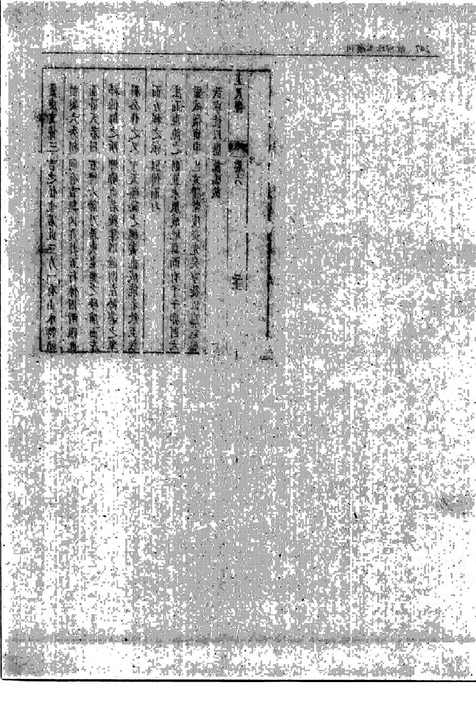
