# 平砂玉尺经

白话文版

传本题署：刘秉忠述、刘基解、赖从谦发挥

现代编校：葛超云

制作：壮五福国学院

## 出版说明

本书按现存传本的六篇次序编排。书中的吉凶、福祸判断属于传统堪舆观念。原文不能确定的地方保留简短说明；图下注解及书末词语解释为编者所加。上述作者姓名依据传本题署，不据此断定全书实际作者。

本书主要讲平原地形中如何根据山脉、水流和周围地形，判断地势从哪里来、在哪里收住，再找到具体的穴位和朝向。六篇的顺序是：先审大势，再分辨气的类别；接着寻龙、审穴，查看周围的砂山，最后才处理立向。这个顺序就是全书的主线。

# 卷首

<!-- source:P000001-B001 -->

<!-- source:P000001-B002 -->

<!-- source:P000001-B003 -->

<!-- source:P000001-B004 -->

<!-- source:P000001-B005 -->

汇贤斋藏《平沙玉尺经》序：国师文成公察知金陵有旺气，率先率领一众儒士辅佐明主，在滁阳开创基业，在应天建立都城，紫荆【此处原文残损，语义不明】

<!-- source:P000001-B006 -->

上奏说：帝王传承万代的陵寝事宜，难道能不精研地理学问吗？但又担心仅凭一个人的眼力，没办法遍察全天下的地理形势，于是在告老还乡后的闲暇时间，编撰了《平沙玉尺》颁行到全国各地，同时还附上了晋代国师郭璞的《葬经》。这并不是随意泄露天机，而是希望后世的人得到这把尺去度量，获得的福泽感应会没有边际。这就是作序的缘由。

<!-- source:P000002-B001 -->

万历丙午年五月上旬吉日题。

<!-- source:P000002-B002 -->

# 第一篇　审势

<!-- source:P000003-B001 -->

<!-- source:P000003-B002 -->

<!-- source:P000003-B003 -->

天上分布着星宿，地面排列着山川。仰头观测牛宿、斗宿所在的区域，才能看到众星拱绕运行的景象；低头勘察丘陵的来向，才能辨识平原地势的发源迹象。

<!-- source:P000003-B004 -->

五行的气在天上形成表象，日月星辰由此显现。紫微太极星区起始于亥、子的方位中间，天市东垣星区起始于寅、卯的方位区域。

<!-- source:P000003-B005 -->

少微西垣在坤、兑方位之间，太后南极星区在巽、巳、丙方位的前端，中间有一颗尊星居于内部，二十八宿环绕在它的外侧。因此牛宿、斗宿所在区域的左侧是帝星居住的位置，各个星宿都会顺着斗柄指向的方向拱卫朝向，依附天体运行，这就叫做天经。五行的气在地下形成实体，耸立起来成为山冈、丘陵，散布开来成为平原、都城与低湿之地，流动起来成为长江、淮河、黄河、汉水。所以山川的流动与耸立，无一不是气的凝结分布。而平原旷野的地势，都根源于土岗分布在四周形成的形态，因此勘察丘陵的来向，就能知晓平原地势的发源了。马山的山脉一直起自昆仑山。

<!-- source:P000003-B006 -->

散落在大地上的山龙虽然有成千上万条，但它们的龙脉源头都出自昆仑山。根据《搜异录》和地志图册的记载，昆仑山高一万八千九百四十七里，主峰和天齐高。以中国的方位来测算，昆仑山处在西北方的乾、兑卦位之间，确实是全天下山川的总祖脉，原文“而五之入中国”有缺损，疑似后续分入中国的支脉，是众山的大宗本源。

<!-- source:P000003-B007 -->

从孤绝的本源分出，向八方极远之地延伸。此处“聂出孤宗”的“聂”字原文词义不明，无法确译。

<!-- source:P000003-B008 -->

昆仑山山顶是方形，山底是圆形，周长一万二千七百里零九十三步。山脉像鱼鳞一样从主脉分出，向东北延伸的支脉位于艮位，向东南延伸的支脉位于巽位，向西南延伸的支脉位于坤位，向西北延伸的支脉位于乾位，这就是四种走势的下山龙脉。

<!-- source:P000003-B009 -->

山顶幅员六千七百零九里十三步，两侧的龙脉向四个正方向分布：正东的支脉处在震位，正南的支脉处在离位，正西的支脉处在兑位，正北的支脉处在坎位。上对应八卦，下对应八方。乾、坤、艮、巽四个方位开启了五龙生气的门户，坎、离、震、兑四个方位生发五气官旺的脉气，这就称作八极。所谓八极，又是所有山脉的总本源。乾、坤、坎、离以及兑位的这几条支脉延伸到极远的境外，向西通往渐海；艮、震和巽位的三条支脉进入中国境内，五岳就分别分布在这三条支脉上。

<!-- source:P000003-B010 -->

乾、坤、坎、离、兑这五条支脉分别延伸到西北和正南方向，进入羌、夷等少数民族聚居的地区，这些龙脉的分支走向都已经无法考证。只有艮、震、巽这三条支脉单独进入中国，分布在五个方位，形成五岳群山，又是中国山川的大宗本源。（原文末尾缺损）

<!-- source:P000003-B011 -->

地势分展、施布生气，东南巳巽方位的行龙，从发源处算起，行经十一万九千六百五十里，入海后聚结成帝王都城。这一区域内有三起龙之地一百四十七处，水穴三十六处；其中能诞生忠贞之士、培育英才、出圣君贤相的穴有七百二十处，聚集精华、生发秀气，成为卿士大夫出身地的穴更是多到数不清。寅艮方位的行龙，从发源处算起，行经八万四千一百里，入海后聚结成帝王都城。这一区域内有一起蛟龙之地七十二处，顶穴十八处；其中能诞生大圣人的地方有五处，出贤人良相的穴有五百零七处，成为卿大夫出身地的穴数量多到无法计算。甲卯方位的行龙，行经八万一千五百六十里，在伊水、洛水、廛水、涧水的交汇处停驻，聚结成帝王都城，有三起。

<!-- source:P000004-B001 -->

蛟龙之穴共有二十四处，能出圣君、贤相、侯伯共五百零五家。这当中聚敛气脉、生发秀气，孕育出卿士大夫、宝士这类人物的地方，北方艮、巽方位的穴龙脉最多。

<!-- source:P000004-B002 -->

比如中回的东侧，因此以黄河为界，西北方是丑艮行龙。

<!-- source:P000004-B003 -->

黄河的水脉发源自昆仑山，在艮寅的左侧、甲卯的右侧，在东北端划分出丑艮的界限，在正东限定了甲卯的范围，向东曲折流进中原。到河套的北侧，出峡谷的左侧是山西等地的右臂，流到汴梁东南，向左曲折绕到徐州东北入海。所以黄河以西的地域属于丑艮行龙，实际是坤申之气入首。因此从燕冀到青兖的地域，一概是坤甲结穴，向右转是坎局，向左顾是兑局，朝向巽方是亥龙，没有离、巽、艮、震的穴位，这是因为水向东北流的缘故。敬仙说：昆仑山丑艮发脉属于坤申之气入首的，水大多向东流。燕冀、云朔的地域是坤气从腰部分落，青徐的地域是坤气的尽龙，黄河是它的界限，直沾是它的孤脉。开州以南是它的左臂，辽东是它右臂的尽气处。这里的龙脉直来直去没有曲折，黄河以北气脉散逸不能聚敛，所以当地百姓大多憨直粗朴，性情刚直，风气强劲，很少有狡诈之人，百姓不眷恋家业，家庭不会长久富裕，做官的没有连续三代的。但是清泉穴汉水，气脉从下方升发，能诞生圣贤作为文章之祖，培育英才成为一时的鼎盛，女子容貌美丽却没有廉耻，都是当地气脉造成的。长江作为界限划分东南，巽辰方位是龙脉的起祖处。

<!-- source:P000004-B004 -->
<!-- source:P000004-B005 -->

昆仑山的东南孤角分出支脉，从康姑起行经九万八千七百五十里，穿出西羌、天竺、西番的南部边界，叫做六国山，山的北面一万二千里，连通巴西的严鹏山。这里分出三派支脉：左股延伸到陕西南部，是雍州的右卫；中股经过凭旗山发脉，是荆襄的南卫，渡过祁山隆起为南岳衡山，属于离宫的火星；凭旗山的右股形成成都的左卫后停驻。严鹏山的南股经过雍思进入东蜀南部，是成都的右卫，向东北延伸后隆起平华顶，分出两条右股延伸到云南。的右卫，左股经过四川东北，形成云南的左卫，经过电磨山分出两支。一支延伸到辰州以南，是贵州西北的护脉；一支延伸到贵州东北再分叉。往南的一支往广东方向延伸抵达南海，分支进入广西，和辰州北界的山脉并行，经过东梅峰，是广东的北护脉，就是福建的南条山。梅峰西角分出的支脉进入豫章，向西南延伸到九江为止，渡过长江经过黄川，在湖广下游地带形成河南东北的屏障。梅峰北角延伸入福建的支脉，经过潜阳山起祖，是福建西南的屏障；顺着铅山左臂延伸的支脉是福建的北屏障，也就是浙江的南卫。从建宁延伸到漳江以南入海，右臂分支聚结为各个洞地。

<!-- source:P000004-B006 -->
<!-- source:P000005-B001 -->

铅山左臂有两条分支：一条进入福建，一条进入浙东，经过处州后又分两支：一条从温州入海，一条从台州到四明入海。铅山左股有一条越过玉山蓼花峰起顶，分出三条：一条延伸到饶州、信州，一条延伸到南康的鄱阳水泽区域，一条从祈门进入到浙江临安以西，从天目山起脉。甲卯方位行龙，兑气入首，到古杭州后山脉左回右抱，气脉聚合结穴为钱塘。它的左股经过皋亭山，到海盐入海为止。丑艮方位的一条支脉到宁国西界再分脉：一支经过太平的濩洋子江，过舍山、经六合，从太典入海；一支从建平西界分脉，进入建康东界，经过句容形成长山；一支从东往西逆向回转，是建康的北卫；一支从西经过东到润州，出靖江进入长江，共延伸十一万九千六百五十里后入海。这当中分支异派不下数百支，或逆行或顺行，各有走向。按书中的说法，岷山以东、幡山以西的区域多离龙；云南的水从北往南流，当地多坎、艮、乾龙；贵州北界的区域多震、巽龙；广东地界多坤、艮、兑、乾龙。广东西边的区域，巽、震、艮、坎受气；豫章以东，巽、震交会的北界是坎、艮受气；贵州、福建以南，坤、申得气，北条的支脉则是兑、亥、坎成胎。临安属于坤、兑交会的区域，建康得到南离方位的气脉。

<!-- source:P000005-B002 -->

敬仙说：昆仑山向东南延伸出的脉是乾亥行龙。巽宫的气温暖风和，亥木得到这种气就会生机顺畅，枝叶繁茂。所以南条山往南的区域气脉越发和缓散漫，鸟兽稀少，民众分散。书中认为南方的人住得分散不聚居，不服从教化，不过当地多洞穴，水顺着洞穴流动。

<!-- source:P000005-B003 -->

这种被叫做潜木，当地人性情奸邪淫靡，同一个地域的人语音都不同，话语难以分辨。南条山往北的区域气脉平和，教化推行顺利，风俗淳美，车同轨、书同文、行同伦，国家治理得很好。只有广西、云南、阙福三省的气脉背向东方逆行，独独朝向东南，和长江的流神不同脉。当地的山脉多胶股合脉，穴地生出树木，民风粗朴不懂礼仪，没有父子君臣的纲常观念，淫乱贪婪不知廉耻，龙蛇经常出没，山岚瘴气时常发作，民众多患疫病，语言不通。当地的风土习气大抵都是这样。

<!-- source:P000005-B004 -->

只有寅、甲、卯、乙方位的落脉，是江河中流柱石的根基。

<!-- source:P000006-B001 -->

河源的左侧，从寅、甲、卯、乙方位开始，正当震卦的首位，龙脉由此落脉张开帐幕，延伸一万四千里形成兰花嶂；再延伸三万三千七百一十六里形成乔黎山；再延伸一万九千里进入榆莱山，经过西域羌胡地区，向南经过幕西首山，行过一万二千二百五十里进入中原。原文此处有缺损，后续内容无法确译。

<!-- source:P000006-B002 -->

幽谷连绵有奇脉，是秦汉时期的另一条龙脉，其中一条分支延伸到南楚的北界，另一条分支延伸到同原的北界，进入中条山脉的洛水、长江东段界限，黄河向西流，剩余的气脉波及淮水、扬水，通达秦地后入海。由此可知，震卦方位的落脉是江湖之间的柱石，这条龙脉地位独尊，气脉最为纯正。出震入离，大都二区，占测可得绵长的享国时间，百姓安定、物产丰饶，文士大量涌现，社会风气正直，百姓没有欺诈奸邪的行为，上下都顺从教化，都是这一龙脉气脉感应的结果。

<!-- source:P000006-B003 -->

散仙说：这类区域多有坤申龙、兑局、离垣，荆湖地区延伸出的龙脉多属亥局，当地民俗朴素，缺少文采。

<!-- source:P000006-B004 -->

山冈垄地和平原的区别，就像人体的骨骼和肌肉相互依附的关系，肌肉是附着在骨骼之上的。

<!-- source:P000006-B005 -->

原文此处缺损，只能辨认出与记录穴位、内卿相关，句子不完整，无法确译。

<!-- source:P000006-B006 -->

就像血脉运行在肌肉当中，能通过这种状态了解血脉流动的情形，也能看出肌肉荣盛或枯槁的道理。

<!-- source:P000006-B007 -->

大凡山脉都起源于昆仑山，昆仑山是众山的起始，气脉的运行依托山体显现，就好比人有骨骼作为身形的框架，气脉在骨骼间流通扩散，最后在表层形成松软的土层，就像人的肌肉。土不会脱离山而存在，就像肌肉不会脱离骨骼生长。由此就能知道，土中的气都源自山脉。如果山从东方延伸而来，那么土中的气脉就会随着山的走势（原文此处内容有截断，后续内容缺失）。

<!-- source:P000006-B008 -->

所以说肌肉是附着在骨骼上的，山脉往哪里延伸，水流就会跟着往哪里走，水就好比人的血脉。没有水的滋养，气脉就无法存续，因此龙脉必须要有水来涵养，才能在地中运行。

<!-- source:P000006-B009 -->

气在地中运行，向外显现出来就是水，水是气的外在表现。它环绕在龙脉外围，作用是稳固内部的气脉，让气脉能够顺利在地中运行。所以观察水流流动的状态，就能验证气的出入方向：水流向东方，就能证明山脉的气是向东运行的，绝没有水流向东、气却往西扩散的道理，这就是常说的“龙往哪里走，水就跟着往哪里流；气往哪里运行，水自然也会随之而行”。就像人的血脉按规律流动，经络清晰有序，所有道理都是贯通的。所以说地理和天道是相合统一的，观察天文的规律，地理的运用原理也就清晰明了了。因此众多水流都往东北方向汇聚的话，坤位的生气就能生发滋养万物。

<!-- source:P000006-B010 -->

大凡坤申方位来的行龙，水流都会往东北方向流动，这是气脉运行的自然规律。震龙入首朝向西方的话，西方就是震气到达的位置，东方则是气散出的（原文此处内容有截断，后续内容缺失）。

<!-- source:P000006-B011 -->

所以水神向东北方向倒流的区域，当地多有坤申之气，结局三门。因此朝着砂的酉首立穴，是气脉停聚、水流交汇的地方，属于关换。气脉有乾兑相交的情况，此时坎、离、艮、震的气不会进入。如果在东首立标求穴，就会收纳辛酉的兑气入穴。原本水流在西侧交汇，坎、离、艮、震的龙如果在东北交媾，就不是真龙。龙哪有兑气返回东侧的道理？所谓“不食酉辛之气”，说的是兑气真照时穴位不正，没有不出现子嗣断绝、家道衰落、贫病夭折的情况。兑气不进入东侧，所以震龙不会取用兑气。当世的地师不懂得龙脉的相关规律，仙人称水归向东北的话，龙首在西南而龙尾在东北，若不清楚地脉起止的界限，不明白水神的来去方向，没弄明白地气的来源，就只凭着坐向方位指东画西，胡乱立标选穴，给人造成的祸害说都说不完。各路水流朝向震辰方位，而乾亥的龙秀美养育，午丁方向生息，怎么会是乘受坎癸的灵气？假如众水流向震辰方向交汇合流而去，那么辰、午丁方向行龙的区域，水神必然是从南向北合流而去。

凡是见到这样的水势来向，必然是乾亥方向来的行龙，所以在东南交汇处寻求龙脉主干才是真龙。这种凭水势推断龙脉走向、立穴的方法，必须向水流交合的地方去寻求，此处原文有缺损，无法通顺释读；之后的内容提到壬子龙也能结地，坤申之气左关的，也可取用，生息之气聚集才能形成地。如果不在水城出水交汇的地方，就只会有离、巽的灵气，艮气不会进入，所以寻龙的人不应当在乾亥反向朝南的上水处立穴，这样是乘受坎癸的灵气，不是正确的穴。在下砂头立穴，必然会导致绝嗣。仙人称东南方水聚的地方，界水倒向右侧有震穴，界水倒向左侧有兑穴。观察众水的交汇之处，雌雄的区别就会显现。水向北流有兑穴，离、艮、巽三个方向来的龙绝对不宜立穴。龙从西北来，山为雌、水为雄，就像人有男女之别。龙脉到尽头、水流汇合，就算是从别处来的水在东南方汇合，气脉与水交媾的情意已经在震巽方位。雌雄交会，就像男女结合而媾精一样。这个玄妙的地方，是万物化生没有逆向的道理，是生命诞生的关键。

而男女的玄门，是任督二脉的尽头，所以男在甲卯方位成胎，不会取用酉辛之气，男女交媾则两尾相对，就像山到尽头、水流交汇的地方，正是牝牡交媾的位置。

<!-- source:P000007-B001 -->

书中引用仙人的说法：龙脉行到水流交汇的地方才会停住，脉势穷尽、生气聚积，才是真穴。如果水没有形成合衿的格局，说明龙脉还没有停住；龙脉没有停住，生气就还在运行、没有停留。所以寻找龙脉、确定穴址，一定要在水流交汇的地方寻求，这样才能考察万里的垄地，清楚它的首尾情况。原文末尾有无法辨识的内容，含义不明。

<!-- source:P000008-B001 -->

平原旷野哪怕绵延万里之远，要推求它的脉势来源，一定有山龙作为根本，就像四肢各有职能，而头颅在最上端，发源的地方是首，终止的地方是尾，其中的道理是一致的。所以寻找平原地区的穴地，一定要先探明首尾的来源，之后观察水神的去向来判断它交汇停聚的情形，真穴自然就会显现出来。

<!-- source:P000008-B002 -->

《长经》卷上记载敬仙的说法：昆仑山是天地的首，五岳四渎是天地的心腹，分散到八方极远之地的支流分脉是天地的四肢。就中国范围来说，五岳是所有山脉的首。沿着山脉的首就能顺循脉势的走向，知道脉势的分衍就能判断龙脉的止息处。

<!-- source:P000008-B003 -->

就算是回头顾望的龙脉，也不会脱离父母方位的本生之气。虽说甲卯方向来的行龙不会取用酉辛之气，但原文此处有“国贾愿尔者”的表述，具体含义不详。比如甲卯方向来的行龙，气脉返回朝向甲卯方位结穴，名为顾袖之地，虽说是逆向回绕结穴，但砂山的起脚必须从震宫方位发来，关转逆水朝向震位，才是真正的转关处。如果被水流冲断，那么父母方位的本生之气就已经被水神隔绝了，不是真地。右关水向左倒，兑气入首，就按照兑局的方法取用；左关水向右倒，乾气入首，就按照乾局的方法取用，就不应当再按震气的规则来立法定穴。举这一条龙脉的情况为例，其余七龙的用法都是同一规则。书中又引仙人的说法：两座砂山并排延伸，有长有短，一侧粗一侧细。短而细的一侧一定会收缩，粗而长的一侧一定会伸展。粗大体势雄急的，势必会曲折朝向砂山短的一侧靠拢，所以大多会结成回龙地或者盘龙地。有的是被下砂压住而曲折转关的，也会形成回龙、盘龙的穴，但必须要没有脱离父母方位的本生之气，初始行来的砂山随水转关而成，才是大地。

<!-- source:P000008-B004 -->

所以顺水直冲而来又逆回结穴的，才能判断是格局真确的穴地。如果是逆水直冲，合衿在后方的，一定是虚花的假地。

<!-- source:P000008-B005 -->

回龙地的砂头如果不是从本生的方位而来，只是逆着水流直冲向上，水流是朝向背后交合的，都不是真地。当时的风水师把这种地叫做“上水鱼飞天龙”，这种说法非常荒谬。哪怕它的体势宛转，坐向对应整齐，也只是虚花假地。合流在后方的话，砂山的行气终究会趋向于交襟的地方，无法聚气。

<!-- source:P000008-B006 -->

乾源方向的旷野里地面平整如同铺展毛毡，要仔细辨认水脉交汇的交襟位置。

<!-- source:P000008-B007 -->

有的地方是绵延数百里的平地，前后左右都没有沟壑、溪涧，原文此处句子不完整，后续内容缺失，具体含义不详。

<!-- source:P000008-B008 -->

地形像铺展开的毡席，一望无际。这类地貌既没有水势可以察验它的出入，又没有山岗丘陵能分辨它的来去，要怎么判断龙脉的行止、穴情的真假呢？遇到这类平地，必然有隐约的细流，原文此处有“可满整”字样，含义不详，这类水必然有归向，而隐约细流的去留，也足够用来判断龙脉的行止。所有的水都会流向低洼的地方，低洼处就是众水汇聚的所在，虽然原文有“征浩”字样，含义不详，也能看出水流的会合。水在东边交汇，就寻找兑气入首的位置；水在西边交汇，就寻找震气入首的位置。仔细勘察，必然能得到真实的情况。

<!-- source:P000009-B001 -->

古人说：高出一尺的地方就相当于山，低陷一尺的地方就相当于水，这正是针对平野旷野这类地形制定的判断方法。

<!-- source:P000009-B002 -->

书中认为，龙脉有起伏、隐现的变化，所以砂术能找到它隐约的踪迹。龙脉如果有停驻结穴的迹象，就算是沟渠里的积水也会有交合的形态。考察龙脉隐约的分合规律，再查看沟渠流水的去向，真正的龙脉走势自然就能明了。原文此处语义未完。

<!-- source:P000009-B003 -->

所谓的微茫水，是最细小难辨认的，不是有智慧、眼力心思都足够巧妙的人，是没法辨识出来的。

<!-- source:P000009-B004 -->

山垄的尽头地势平缓铺开，要仔细观察“月角”的形态，判断龙脉是否停驻结穴。

<!-- source:P000009-B005 -->

山龙到了尽头，像被截断一般在边缘铺展成平缓的坡地，左右没有水流夹护送行，前方也没有沟壑溪涧作为界合。这种落头虽然没有水法可以辨别，但如果龙脉是真龙结穴，那么气脉停驻融聚的地方，必然有正脉向下垂落，或者左右有隐约的水界分开，两侧分出砂翼，上端像月角一样伸出，两边兜转回来，周围护卫周全，可能是一两重，也可能是四五重，全部朝向前方兜住堂局、收纳生气。要么是左右肩肘向外延伸，砂头蜿蜒曲折延伸到堂前，横在前方形成隐约的案山对应，这样的地方才是真穴。如果是从别的支脉分出，蜿蜒到堂前，正向朝向堂局，两侧分出两翼覆盖在本砂的左右，也是好的格局。所以看平地的落头，找不到判断是否结穴的依据时，只要看月角是否兜收、砂头是否回转环绕，就能判断龙脉有没有停驻、穴有没有结成功了。

<!-- source:P000009-B006 -->

还有四五个山头延伸出平缓的坡地，这种情况尤其需要仔细分辨哪座山的来脉落头长、哪座山的来脉落头短，侧边的山角从哪个方位转折，就能知道这五座山的气脉和谐交汇，形成结穴。这种方法特别精微，书中认为葬得这种穴的人家会富贵双全，子孙绵延，能享有一两百纪的福运。

<!-- source:P000009-B007 -->

此处原文残缺，只能辨认出“势说繇峦声”五个字，无法确译。

<!-- source:P000009-B008 -->

寥天乙的《葬经》上说：风水中势是最重要的，形其次，方位又其次。所谓势，是理的载体，是显化出来的神的容貌，是玄牝的门户，是乾坤阴阳复姤交感的节点，是造化催动万物出入的关键，是虚寂微妙的运数。听不到它的声音，看不到它的形状，也很难精确地察辨它的状态。

<!-- source:P000009-B009 -->

阳气生于冬至甲子时的半刻向左运行，阴气生于夏至甲子时的半刻向右运行，阴阳相互更替，左右相互激荡，这就是所说的化机。元朝太师、文正赵国公、州人刘秉忠，懂得化机的道理，因此知道山川排布的形态，并不是毫无生气地只向人展示外形。明朝太师、文成诚意伯、青田人刘基为此作注。所以说法象没有比天地更大的。敬仙顿从谦对此作了阐发：左属阳右属阴，龙脉行走分为两路，阳顺行而阴逆行，气的本源是统一的。极细微地推究：地形排布在大地上，并不是孤立的事物，本质上也是阴阳二气构成的。所以太极分化之后两仪就奠定了位置，二气分布之后就有了顺行和逆行的区别。土凭借气而形成形态，阳气在左侧强盛，脉就随之左转；阴气向右旋转，脉就随之右转。混沌初始的时候，太极之气还没有分化，等到轻清的气在子正时散开，向上浮的成为天；重浊的气在丑时收敛，向下凝结的成为地。所以地势从右转向左入局的是阳龙，从左转向右入局的是阴龙，分为阴阳两路，一顺一逆行，是地气自然的运行规律。

日月星辰在天上显现的形象，就是清气精粹明澈的表现；江河在大地上排布的形态，就是浊气凝结而通畅的表现。天气属阳，地象属阴，阴用事则阳来朝应，阳用事则阴来呼应，两者相见符合家室相配的义理；阳用来蓄养阴，阴用来含藏阳，就有了雌雄交媾的情状。阳气左旋，春天行于东方，夏天行于南方，秋天行于西方，冬天行于北方，五气顺流，四季按秩序运行，万物化生，都是这股气的作用。阴气右旋，夏天行于南方，春天行于东方，冬天行于北方，秋天行于酉位，五气逆流，时序正常万物亨通，也都是这股气的作用。气是水的母体，气运行水就跟着流动，水停滞气就跟着停留，母和子的特质是相通的。水和气相伴运行，就像影子跟着形体一样。气是统一的，溢出地面之外而有形态的是水，运行在地面之下没有形态的是气；水是气的外在表现，气是水的内在本质，表里同步运行，内外一同流动，这是天地造化必然的妙理。然而阳气生长所以向前进发向左，阴气消减所以向后退减向右；

阳气生长阴气就盈满，阴气生长阳气就消减，这种进退消长，就是化育的机理，一顺一逆也是自然的运行规律。所以想要知道地下的气是往东边还是西边走，只要看水的来向，就可以大概把握了。末尾“诀是性命非神气水乡笔只一味”内容残缺，含义不明。

<!-- source:P000010-B001 -->

所以说，善于观察气机运行规律的人，会通过水的状态来做判断，就像孔子在川上的感叹，也能体现出观察水的人对道的体悟之深。龙的行进一定有水作为辅助，气的停驻必然以水为边界。辅助龙行进的，始终是水，所以观察水的来向，就足以知晓龙气发源的起始位置。能让龙气停驻的，根本也在于水，所以观察水的交汇之处，就足以知晓龙气聚集的地方。

<!-- source:P000011-B001 -->

经书中说“界水则止”，又说“外气横行，内气止生”，这话说得实在有见地。天地间的气，不过就是阴和阳两类而已。《易经》说“一阴一阳之谓道”，又说“阴阳互藏其宅，动静互为其根，阴阳相禅，万物化醇”。郭子也说过“独阳不生，独阴不长”，由此推论可知，只有阴阳之气相互冲和，才能形成化育的机理。所以阴龙逆行需要阳水前来会合，阳龙也一定要有阴水前来交汇。外气和内气相会，气激荡就形成万物，就像夫妇交媾能生育后代一样。阳为雄，阴为雌。阳龙向左运行而阴水从右方流来，到明堂前合襟，就是阴来含藏阳；阴龙向右运行而阳水从左方流来，到明堂前合襟，就是阳来蓄养阴，这就是雌雄相会、牝牡交媾的情状。阴阳相感应，福禄就会自然降临，阴阳冲和，万物就能生长化育，这是天地自然的化育机理。总起来说，就是整体太极的妙用；分开来说，对应每一种事物，又各自具备一个太极的玄妙。懂得了太极的道理，就可以谈论化机的奥妙；懂得了化机的奥妙，就可以谈论形法的学问了。所以阴与阳相交，阳向下沉降而施予生气；阳与阴相交，阴向上承接而聚合收敛。

<!-- source:P000011-B002 -->

龙脉到来时，土壤会随着气的运行形成对应的形态，气虽然流动无法阻挡，但土脉的来向和停驻的位置是固定的、难以变动的，所以龙的形态是静态的，固守着自身的位置。至于水就是动态的，没有恒定的形态，有时向东有时向西，没有固定的属性。虽然气运行水就随之而来，本就有自然的趋势，但气无法自行停驻，必须等到水流交汇之后才能止住。所以阳龙入首时阴水前来交会，阴龙入首时阳水前来交会。原文此处有“是之谓阴阳史嫌言阴交于阳阳交于阴者”的内容，其中“史嫌”具体含义不明，无法确译。

<!-- source:P000011-B003 -->

原文此处有“皆以木言也”，上下文关联不足，具体含义不详。经书中说“形止气畜”，气是流动的，无处不到，为什么能蓄聚呢？是因为穴局前方的水能止住龙气，比如界水的三汊口就是这样。所以杨公才说“水对三汊，细认宗也”。经书又说“外气横行，内气止生”，内水随土壤分布，原文两处“十”字系讹误，词义不明，无法确译；脉止气聚的原因，是外气横行在前方，足够止住内气。至于山龙得到青龙、白虎砂山呼应，罗列在前方，也属于形止气聚的情况，内气就是因此得以停驻、生发的。由此推广来看，杨公所说的阴交、阳交，是从水的运行角度来立论的，为什么呢？气依附于形，形是静态的、有固定规律的；水是动态的、能运行的，静态的形固守位置，动态的水可以流通。所以水在龙的东方时龙不会盘桓前进，是受水势的影响。因此龙的走势难以改动，但水的走势可以调整。

<!-- source:P000011-B004 -->

阴与阳相交，阳气向下流布而施予生机，对应的是阳在下、阴在上的格局，阳气向下运行，依托阴气来施放生机。阳与阴相交，阴气向上承接而聚合收纳，对应的是阳在上、阴在下的格局，阳气向下沉降，依托阴气来汇聚蓄存。阳气施放、阴气收纳，胎孕生机才会产生，这是造化孕育的奥妙，也是气机运行的必然规律。

<!-- source:P000012-B001 -->

天根是呈现万般奥妙的入口，月窟是开启隐秘玄机的门户。

<!-- source:P000012-B002 -->

天根是阳气生发的门户，也就是施放生机的通道，如同男子的牡。

<!-- source:P000012-B003 -->

月窟是阴气孕育生长的处所，也就是收纳生机的门户，好比女子的牝。牝和牡相对，玄妙的孔窍彼此相通，男女交媾之后生育繁衍自然会旺盛，就像下文所说的那样。

<!-- source:P000012-B004 -->

乙与丙相交而归向戌位，辛与壬相会而聚于辰位，斗牛之位收纳丁、庚二气，金羊之位收摄癸、甲的灵气。

<!-- source:P000012-B005 -->

乙与丙相交的情况：丙火生于寅位，沐浴在卯位，冠带在辰位，临官在巳位，帝旺在午位，衰于未位，病于申位，死于酉位，墓在戌位，戌是丙火的墓库，也就是阳艮龙的天根、阴亥水的月窟。丙随乙相交的情况：乙木生于午位，沐浴在巳位，冠带在辰位，帝旺在卯位，临官在寅位。

<!-- source:P000012-B006 -->

（气运）在丑位衰败，子位病弱，亥位死亡，戌位归墓，原文此处有讹误，具体内容难以完全辨明。戌是乙的阴位，是亥龙的月窟，也是阳艮水的天根。丙和乙相遇，玄窍相通，就是雌雄交媾的情形。震、离二龙属于同一局。至于辛配壬，是异兑的阴局；壬配辛，是申子的阳局。这四龙的水法都从辰位出水，所以是这样的规律。庚配丁，是巽兑的阳局；丁配庚，是寅午的阴局，这四龙的水法都从丑位出水，所以是这样的规律。癸配甲，是申子的阴局；甲配癸，是亥卯的阳局，这四龙的水法都从未位出水，所以是这样的规律。行龙布气的方法，一并参照甲乙交配的法例，相关的黄式记载都在后面的玉尺经下卷之一。因此乙、辛、丁、癸属阴，为妇，要配属阳为夫的甲、庚、丙、壬，夫妇相配，就像雌雄牝牡两两对应。

<!-- source:P000012-B007 -->

乙、辛、丁、癸属阴，甲、庚、丙、壬属阳。阳局要用阴气来应合，阴局要用阳气来朝迎。所以乙得到丙、丁得到庚、辛得到壬、癸得到甲，就是阴用阳朝，原文此处“阴用阳赵”应为“阴用阳朝”的讹误。丙得到乙、庚得到丁、壬得到辛、甲得到癸，就是阳用阴应。阴阳彼此相配，就像夫妇配对、雌雄牝牡相合，相关的义理前文已经说明。

<!-- source:P000012-B008 -->

如果阴遇到阳却不是相配的类属，就叫做阳差；阳遇到阴却没有遇上对应的配偶，就叫做阴错。

<!-- source:P000012-B009 -->

比如乙亥龙用丙气相合，就是阴阳正配，此时水从戌位流出。

<!-- source:P000012-B010 -->

<!-- source:P000013-B001 -->

按原书说法，水有阴阳相见的义理：如果在辰方与丑方出水，遇到的是庚壬水口而非相配的对象，就叫做阳差，阳差会伤及男丁。丙寅龙用乙气来相合，才是阴阳正配，从戌方出水，符合阴阳相见的义理；如果在辰方与丑方出水，遇到的是丁壬水口却不属于相配的同类，就叫做阴错，阴错会伤及妻子。

<!-- source:P000013-B002 -->

如果是路上偶然相遇的配偶，终究是强行结合不会和谐；若是本属一家的眷属，哪怕福力轻微也依然有用。比如丙和乙相见，就如同夫妻心意相通，本是一家眷属，哪怕发福的程度比较轻，依然是有用的格局，富贵福泽也能惠及后人。如果丙没有遇到乙，反而遇到丁癸辛未木日出路，这就是丈夫在路上遇到配偶的情况。此处“乙不玉及”内容有缺损，具体含义不详。

<!-- source:P000013-B003 -->

（此处“逢内”表述存疑）如果属于遇到甲庚壬水口出路的情况，就是妻子在路上遇到丈夫，哪怕砂山明秀、水流清吉，终究是强行相合没有情分，能获得的福运也不会太深厚，因为玄户不通。原书有“铜山西崩，灵钟东应”的说法，又说“鹤鸣在阴，其子和之”，这都是同声相应、同气相求的道理。先贤说：气和顺则形骸和顺，形骸和顺则气也会和顺，形与气都和顺，万物才能化育生长。所以阴阳和顺，万物就能生长；夫妇和顺，子女就能繁育。又比如丙在中途配乙，乙在半道配（此处“配内”表述存疑），比如丙生于寅位但水却不从寅位来，反而从辰巳方位来，到了水口却从戌方流出，（此处“木是去窦相通”表述存疑），而来水是在中途相遇的。这种情况本来是正配，但发福迟缓，更主到老年才能考中科第，凡事都延迟，会有老夫生子的应验，不旺人丁，长房不利，只有中小房能特别发财。还有水从其他地方横伏过堂流出的情况，也属于路遇，这种尤其不符合格局，不会发福运，哪怕发福也很轻微。认水立向有“千向上消息”的说法，（此处表述存疑），如果符合相关规则，就算是客水进入明堂也能带来吉兆。

<!-- source:P000013-B004 -->

两个女子共处，纯阴无法生长；两个男子共处，独阳无法化生。

<!-- source:P000013-B005 -->

比如乙亥龙得到卯木方来水，以及子午方来水到明堂，从右转向左流出，这就是阴遇到阴，属于两个女子共处，纯阴无法生长，是因为水和龙同一路来的缘故。如果将左水倒向右流，会合阴水而行，（此处“不妨五玉人”内容有缺损，具体含义不详）。

<!-- source:P000013-B006 -->

如果是寅龙，遇到壬水、庚甲方的水从左向右流去，这属于阳和阳相遇，就像两个男子共处，独阳无法化生万物。如果有右方的水流向左方，和阴水交汇后流出，就没有妨害。

<!-- source:P000013-B007 -->

按书中的说法，阴和阳相遇时，如果交汇过度就会产生祸害；阳超过阴，或是交汇不足、达不到标准，就不会产生吉利的功效。比如乙亥龙和丙火相交，本应该是水从寅、巳的上方来，向右流到戌位出水，实际却不从戌位流出，直接流到乾亥位才出水，这就叫交汇过度，反而会损耗家中人丁，冲散宅地的生气，还会招来意外的官非灾祸，家族孤绝，后人性格刚猛凶恶，所立巳位过高，轻视他人、违背事理，最终败尽家业。又比如丙寅龙和乙木相交，本应该水从艮、丙的上方来，向左流到戌位出水才符合格局，实际却没流到戌位，就提前从乾亥位流出，这属于交汇不足、达不到标准，后人会性格懦弱、没有谋略，贫穷孱弱、没有能力，学东西大多有始无终，会克死妻子、丧亡儿子，晚年家业衰败。哪怕周围的砂形、水势秀丽，能享受到福禄，也不会长久，做官的会被降职贬谪，并不一致。天机诀记载二水交汇不及的情况，颜圆三十二岁便去世，也出自玉寿的说法。

<!-- source:P000013-B008 -->

万物的化育根本源自龙家运势，家族的盛衰取决于形峦的应验情况。

<!-- source:P000014-B001 -->

天地就好比一对男女，原文此处“勇女一天地也”的“勇”疑似讹误，具体含义不详。观察男女的相处规律就可以推知天地的运行道理。乾属阳，主宰着万物化生的契机，坤属阴，具备成就万物生长的功能，就像男女结合、二气交感就能孕育后代一样。故上龙虽龙生物富贵。入经下卷之一。

<!-- source:P000014-B002 -->

利益显达都从这里生发，但如果没有形峦应验作为触发条件，化育的生机也几乎会停息。所以阳气需要阴气来相应，阴气需要阳气来相朝，形峦因为气息相融才能产生生气，气息交感产生应验，祖先的福泽就能惠及后人。从这个角度来说，生出富贵、旺添人丁，都要等水神交会符合法度之后才会应验；而主家贫贱、遭受孤苦穷困，也只是水神来去不合规则导致的。所以气化能不能聚集，运势是盛是衰，都只和水有关。龙属阳而水属阴，或是龙属阴而水属阳，阴阳交相构合，就会气息交感产生应验，祖先的福泽才会生发。旧本刘伯温先生说：化育虽然本源于阴阳龙气，但最终能显发富贵贫贱，又还是取决于形峦的应验。形峦应验、气息相感，事物随之变化，这才说龙气的作用。

<!-- source:P000014-B003 -->

<!-- source:P000014-B004 -->

山水融结却没有点到合适的穴，那么形局与生气就不能呼应，气运就会衰败；穴场乘得生气，形局与生气就能呼应，气运就会兴盛。这是根据乘气的原则来确定点穴的法度。阴阳交媾却没有选到合适的坐向，那么坐向与生气就不能呼应，气运就会衰败；坐向乘得堂局之气，坐向与堂气就能呼应，气运就会兴盛。这又是根据乘气的原则来确定立向的说法。

<!-- source:P000014-B005 -->

因此左行的气运从亥位、子位依次向前推进，右行的气运从子位、亥位往回回旋运转。

<!-- source:P000014-B006 -->

这是讲解布气来察明盛衰、立向来求取生旺的方法。朝向的指向一旦明确，水神的生旺死绝状况就会清晰分明。所以阳气按左旋的规律，从亥、子、丑的顺序运行；阴气按右旋的规律，从子、亥、戌的顺序推进，各自根据阴阳的朝应关系，作为顺逆的法则，正像所说的“二十四山分顺逆”，原文此处有“诏天经下春之十”的内容，具体含义不详。

<!-- source:P000014-B007 -->

要探究阴阳的本源与宗系，阳气从左边循环周转，阴气从右路流转相通。

<!-- source:P000014-B008 -->

生气与旺气相互配合使用，玄关与气窍彼此相通。

<!-- source:P000014-B009 -->

比如乙和丙相配，乙水的相关记载有“生千旺”，“千”字疑似讹误，具体含义不详；丙寅火的长生位在寅，帝旺位在午。乙木的长生之地，就是丙火的帝旺方位；乙木的帝旺方位，就是丙火的长生之地。乙与丙相交，所以说“生旺互用”，原文此处“生肝互用”的“肝”字为“旺”的讹误。丙的墓库位在戌，乙的墓库位也同在戌，所以叫做玄窍相通，因为丙和乙都以戌位为水口。杨公在白龙潭点葬的墓穴，是乙亥龙为主龙，乙的生气位在子，立乙丙向的话生气位在寅，从戌位出水，这正是生旺的格局。

<!-- source:P000014-B010 -->

玄窍相通，所以能发大富贵，立丙向收纳寅甲两方的水归于戌位。这种搭配只能是偶然契合而成，不要让相当于兄妹关系的干支交合。

<!-- source:P000015-B001 -->

乙、丙、丁、庚、癸、甲、辛、壬都属于相互契合、偶然配对成功的情况。如果是乙亥龙见甲水、辛酉龙见庚水、癸龙见壬水、丁龙见两木，那么乙甲辛庚壬癸一类都属于兄妹同气的关系，难道是适合交合的对象吗？此处“两木”具体所指不详。虽然乙遇见甲属于遇到阳干，但总归是不妥当的。

<!-- source:P000015-B002 -->

所以周公制定礼制，明确家室的规范来区分男女，娶异姓的女子来辨明夫妇的关系。

<!-- source:P000015-B003 -->

这段话是说周公制定礼制，让男女相配得以组成家室，异姓相互匹配成就德行。

<!-- source:P000015-B004 -->

明确嫌疑边界，礼制规定同姓不通婚，就是用来区分宗族的方法。原文“圣八心”疑似“圣人心”的形近讹误，圣人之心通晓天的道德，明晓地的纲纪，效法天的常道，遵行地的准则，以此设立人伦的极致标准，这也是理气自然的运行规律。“圣八心”具体所指不详，原文“法天之经则地之绝”中的“绝”字含义不明，此处仅译可确定的部分。

<!-- source:P000015-B005 -->

这本来就是天经地义的常理，也符合理气自然运行的规律。

<!-- source:P000015-B006 -->

圣人区分男女、定下夫妇关系，是效法天经地义的常道来确立人伦纲纪，符合理气自然的运行规律，并不是强迫人情、违背天地之道来制定的制度。圣人制定礼制来匹配男女、确定阴阳，也不外乎天经地义的常则，由此可知风水地理中选取阴阳相遇、雌雄交媾各有正配不能混乱，是天地自然化育万物的真切道理。原文此处“天开开财禄之源”的“开开”疑似讹误，具体含义不详。地轴是疏浚化生珍宝的方位，原文作“未神发源之处”，“未”字疑似有讹漏，神发源的地方名为天关，水神流出的地方称为地轴。天关主管财禄，地轴主管人丁，来水深长的话财运福德就会绵远悠长，出水符合法度的话人丁就会繁衍不息，这是因为以玄窍作为化生的牝户。原文“法显玄空神功莫测”的“法显玄空”具体所指不详，其功效神奇难以测度。

<!-- source:P000015-B007 -->

水龙相交契合阴阳相遇的要义，原文“生肝到堂”具体所指不详，出现对应情形就会生发水气，人丁兴旺；木气发用则财禄兴盛，这也是必然的。如果阴阳背道而驰，朝向难以收聚财禄人丁，有所不足的话，就需要另外确立玄空五行的法则。

<!-- source:P000015-B008 -->

玄空五行的用法，是取八水、四金、四火、四木、四土，分布在二十四山当中，用来调节水路。以生我、克我为吉，生出、克出为凶。来水符合法度必定发福，助益运势；去水符合尺度必定兴旺。原文“人工”具体所指不详，吉兆对应吉的应验，凶兆对应凶的应验，功效神奇难以测度。

<!-- source:P000015-B009 -->

五行本身和龙家的祸福其实没有直接关联，祸福的判断必须要从水路当中明确求取。

<!-- source:P000015-B010 -->

玄空五行和龙家本音的义理实际上没有关联。原文“本山五行”具体所指不详，它的划分是甲乙、寅卯属木，丙丁、巳午属火，庚辛、申酉属金，壬癸、亥子属水，艮、辰、戌、丑、未属土之类。而玄空五行的划分则又不同：丙丁、乙酉原本属火，乾、坤、卯、午同属金，亥、癸、艮是木神，戌、庚、丑、未还属土，子、寅、辰、巽属水，巳、壬申同属水府。取用坐穴、坐向以及水口来去的方位，要看对应什么字、属于什么五行，以此来推求生克关系。原文中“日本山五行”“两丁巳乍属火”“庚辛干车属金”“桥七”“乙木酉金为火异木申金为日”“里艮”等表述均存在讹误，具体含义不详。

<!-- source:P000015-B011 -->

克我的是官星，生我的是父星。通常五行之气讲究取相生、忌相克，这里反而取克入的情况，是因为水神来与我相交，情意自然向我趋附，所以生我、克我的气，情意都是从对方流向我这边。水神向外流去的时候，情意不会盛极断绝，所以生我、克我的气，情意依然是从对方流入我这里。要是属土的龙脉气质沉静专一，原文此处有“人卷之州”字样，具体含义不详。

<!-- source:P000016-B001 -->

气质雅静所以专一，所以能常守本位，生出、克出的情况就属于动了。水龙好动而直行，正因为动而直行，所以常常运化不息，克入、生入的气机交汇，自然的造化就能自成。穴场依附龙脉，就像君主的为君之道，无为而治，恭敬律己，面南而坐发号施令。朝向依附水流，就像臣子的为臣之道，奉行君主的命令施行教化。君主安逸却能成就事业，臣子辛劳才得建功，这也是天地自然的运行规律。明白这些，生入、克入的意义就完备了。

<!-- source:P000016-B002 -->

原文开头“之夺之”处有缺损，无法确译。如果对方无心，又能有什么助益呢？生入、克入的情意就算流去也能长久留存。水神向外流出，这种势头本不可用，但我生对方，对方不会认为是恩德；我克对方，对方也不会认为是怨怼，就是所说的对方无心，难有补益。不过水神向外流出，原文此处有“变不可面”字样，具体含义不详，但它的情意不能失却。我本来不能对它怎么样，但它的情意却不会忘记我，就算势头要流去，生我、克我的气依然能为我造福。来的时候施予恩惠，去的时候还能贡献福报，怎么会不吉利呢？

<!-- source:P000016-B003 -->

张古松论述玄空的方法时说：情意从我这边流出，是泄散龙脉的气；情意从对方那边来，是增益龙脉的气。这四句话正是针对生入、克入的情况说的。有人诘难说：克出也是情从自己这边流出，克入也是情从外面流入。天地赞助化育万物，无非就是这个道理。造化能改易天命，这方术是多么神妙啊！形法的方术，调和阴阳，观察形局审度气脉，辨别方位察纳音，所以裁度天道来确立人伦纲纪，明辨尊卑、定下上下秩序，随顺天时、顺遂人事，建立邦国、安定百姓。

<!-- source:P000016-B004 -->

治理国家安定百姓，辅助天地的化育，补充天地造化的不足，让天地安位于上下，万物在天地之间生长繁育，也不过是遵循这个道理罢了。何况丧葬之事，要乘生气、立墓穴，收纳生气荫护死者的骨殖，召致冥福惠及后代，让鬼神不能掌控吉凶的权柄，造化不能主宰万物的命运，回转天命、改易造化，这方术也太神妙了啊！最高深的道理精细微妙，只有圣人才能达到这样的境界，不是睿智的人谁能理解呢？地理之学，根源于太极的原理，河图展现它的源头，洛书阐发它的精微，凭借阴阳五行的气脉，顺应天地自然的运行，让生气回转入骨，这个道理极其精深奥妙。只有圣人才能够和天地的规律相合，和鬼神的吉凶感应相通，之后才能替人选点墓穴，乘纳生气，回转天命，改易造化。如果不是聪明圣智的圣人，谁能知晓这个道理的奥妙呢？连道理都不能理解，更何况能点穴乘纳生气，召致冥福惠及后人呢？

<!-- source:P000016-B005 -->

本书认为，吉祥的宝地总是留给积德行善的人家，上好的地绝不会授予奸邪淫恶的人。如果把宝地给了品行不端的人，上天神灵就会发怒。

<!-- source:P000017-B001 -->

葬法有扭转天命、更改命数的功效，能招来阴灵的福泽惠及在世的后人。正因为如此，吉地才常常留给积德的人家，善地不能授给作恶的人。施福给善人、降祸给恶人，这是上天的规律。顺应上天的规律来造福，就符合天的常道。

<!-- source:P000017-B002 -->

善有善报恶有恶报的规律必然会应验。如果把宝地授给奸邪淫恶的人，那上天本来要降祸给他，旁人却反而要让他得福，这是违背天道来求取福分。天地鬼神怎么会容许这种事呢？上天不会降罪给作恶的人，反而会降罪给乱点风水的堪舆师。其中“人国福之”的具体含义无法确定。

<!-- source:P000017-B003 -->

我虽然不聪慧，幸好先师传授的戒律训言都还记得，怎么敢轻忽对待呢？

<!-- source:P000017-B004 -->

论述上天的戒律森严，总归是为代天行职的官吏定下玄妙的规范。那些谋求巨大利益、执掌生杀大权的人是做什么的呢？唉！谋求大利的人，是上天借他的手来抄没罪人财产；执掌杀伐大权的人，是上天委派他去征讨贼寇。所以宁可被作恶的人家怨恨，惹来上天的愠怒，也不要做上天讨伐恶人的先锋；宁可给善恶两家人记录功过，也不要混淆善恶，等到上天雷火遍燃的时候，反而做了被一同铲除的对象。其中“皇功过纠籍”“千雷可海”“一润打尽之枕花”的具体含义无法确定。

<!-- source:P000017-B005 -->

可悲啊，违背了上元赐福的规律，这段内容是后人题写在圣统槐临的。其中“背上元赐福之是一若夷”“圣统槐临”的具体含义无法确定。

<!-- source:P000017-B006 -->

<!-- source:P000017-B007 -->

# 第二篇　审气

敬仙赖从谦推演阐释《审气篇》第二时说：玄都的道理蕴藏在气之中，所以讨论地势的时候，坎龙分为三八之数，气归属五行，凭此确定阴阳消长的规律，阐明孤虚旺相的缘由。

<!-- source:P000018-B001 -->

地支共有十二位，将乾、坤、艮、巽四个方位和午位配合隶属，合并之后共成二十四位。其中甲、庚、壬、丙隶属于四正宫；乙、辛、丁、癸隶属于四库之地；乾、坤、艮、巽隶属于四维之方。三合的规则是：亥、卯、未属木，乾、甲、丁随附于它；巳、酉、丑属金，巽、庚、癸随附于它；寅、午、戌属火，艮、丙、辛随附于它；申、子、辰属水，坤、壬、乙随附于它。

<!-- source:P000018-B002 -->

经书中说的“从气”就是这个意思。乾纳甲为金，巽纳辛为木，艮纳丙为火，兑纳丁为金，坤纳乙为水，离纳壬为土，坎纳癸为木，震纳庚为木，经书中讲的“纳气”就是这个意思。如果按正五行来论定，那么寅、甲、卯、乙、巽五座山属木，巳、丙、午、丁属火，庚、申、辛、酉、乾属金，亥、壬、子、癸属水，辰、戌、丑、未、坤、艮属土，分布在四方，是万世都不会改变的固定气属。如果采用三合罗纹之法，就是土寄旺在四方，生气和水神相配，在坤位长生，在子位当旺却没有固定方位，用水、火、木、金作为四经五行，就像占筮家的精妙用法，也是古人的深刻用意。推究生、旺、休、废的规律来明确阴阳消长的道理，孤虚旺相的情况也就能从这里推导出来了。

<!-- source:P000018-B003 -->

因此壬癸水从兑方、庚方而来，就会形成“体全之象”；坎水被迎入寅方、卯方的格局，被称为“领气之神”。

<!-- source:P000018-B004 -->

壬癸对应北方的水，水龙从庚方、兑方而来，出自印绶之位。

<!-- source:P000018-B005 -->

从生的方位趋向旺的方位，秀气才能完备。甲、卯对应东方的木，水龙领气进入东方生助甲木，木是坎龙的行用本体，木龙入到局中，水和木相生，秀气就会显现出来。这是说旺龙乘承生气而形成的结物体制。仙师说：坎龙从西方兑位出身，震龙从北方出身，都不会触犯气的克制、耗泄，从而汇聚灵气、草木秀茂，四周周密完固。如果入首的那一段更没有混杂关煞，比如坎龙单独行走，卯龙单独行走，不夹杂寅、甲、壬、亥的气，那么木气清纯，就会富贵双全了。

<!-- source:P000018-B006 -->

三阳交泰时震星会呈现祥瑞，四伏生舆时天罡会折损气运。丙午丁属阳位，气对应南方离位，如果龙脉从震、坎两个方位起祖，那么一贞贪狼之气就会汇聚到南离位，让火神的气势越发明秀，这就是长生发足、方位旺相的八首要旨。但火性炽烈刚猛，如果龙脉从东方行来，这种猛烈的威势恐怕会招致火灾，必须得坎位有山水相克制才妥当，要么坐水穴也可以。辰、戌、丑、未是四伏，属于四金之地，是五龙所畏惧的方位，天罡所降临的地方，是贵人不会停留的区域，所以说天罡蚀气。凡是龙入首如果犯了辰、戌、丑、未四伏的忌讳，马上就会显现出灾害。杨公说：先看金龙动，动说的就是这个意思。

<!-- source:P000018-B007 -->

敬仙说：如果午龙按照双山三合的规则立戌向或者艮向，大多不吉利。

<!-- source:P000019-B001 -->

这种情况不能发福，是因为助长了火的党势，反而招来灾祸。如果再坐火穴，煞气进入局中，必定会引发火灾。按照纳甲法立壬向的最为吉利。如果是巽龙、辛龙入首，切忌遇到辰、戌，绝对不能立穴，否则会出现少年早亡、孤寡无依、子孙绝嗣的情况。偶尔有丑龙、未龙跟随丁龙、癸龙运行的，勉强还算可行，但也应当避开它的正向。

<!-- source:P000019-B002 -->

金到火地，会自我焚毁形骸。木进入金乡，就会衣禄稀薄断绝性命。兑金行龙，朝向午、丙方立宅，就是金临火地，向上的火来克金，就是自我焚毁形骸的情况。如果转到丁龙入首，就是阴气明丽相投；到巳宫入首，属于旺龙趋向生方，就算巳属火，也不用忌讳。甲、卯木行龙，到坎宫杂合日能得到生助。如果转到兑宫，到酉方到头，就是木进入金乡受到克制，性命断绝。如果遇到这种地，应当从金气取用，不能按木来论断。如果木龙长势悠长但气短，就应当按气短来论，入首处遇到金克就会断绝性命，不能成穴。火龙怕遇到兑、庚，遇到北辰就会自行废败。东震木愁逢火劫，见到西兑金就会损伤魂气。丙午行龙朝向西方兑位，火就会被金气泄气，再延展到亥、寅之地，火气就会废绝殆尽。甲、卯行龙朝向丙午，木来生火就会气散，再进入金乡，到申、酉方入首，木就在寅位绝地，魂气都会受损。仙说：这是说火龙不应当从兑、坎位结局，木龙不应当从四维、兑位结局。比如震木属于八将之列，丙、丁属于六秀之宫，行龙出身本就秀丽，但入首处受到克制，也不能成好局。坎、兑龙入首本主清贵，却不宜搭配木、火行龙。杨公说：龙脉走得好，不如立向立得好，这话很有道理。所以阳龙左旋，从生方趋向旺方；阴龙右旋，从旺方朝向生方。但都要获得生旺的气，不要触犯鬼劫、克制、泄耗本身来龙的气，才算上好。如果遭到克制劫夺，就成不了合格的格局。

<!-- source:P000019-B003 -->

按原书仙家的说法：阳龙向左旋行，从本身的生位起长生顺向排列，比如水的长生在申，沐浴在酉，冠带在戌，临官在亥这类排布。阴龙向右旋行，从对应位置起长生逆向排列，比如水的长生在卯，沐浴在寅，冠带在丑，临官在子，帝旺在亥这类排布。排山起运的规则是阳龙从左排布，阴龙从右排布。比如坎卦属水，就顺着排布坎、戌、寅、辰、戊、午六爻，来确定才官、父子、兄弟的所属关系；巽卦属木，就逆着排布巽木、辛丑、辛亥、辛酉六爻，来确定才官、父子、兄弟的所属关系。各自根据所在方位的砂、水吉凶来推断，万无一失。

<!-- source:P000020-B001 -->

这是总结上文的说法：龙脉从生位行到旺位，或者从旺位行到生位，都属于进气的吉格。如果本该走生、旺方位的龙脉反而走到死、绝方位再入首结穴，就会陷入休囚的凶局，哪怕龙本身的形态再好，也没有用处。

<!-- source:P000020-B002 -->

龙脉到头如果处于囚谢的状态，有旺水聚集的话，财禄方面还能得到保障；入首的龙气如果衰微，有生旺之气会合的话，人丁方面还可以补救。

<!-- source:P000020-B003 -->

来龙入首的气如果休囚，但刚好有官旺的水聚集在明堂，那么龙穴哪怕有凶性，只要外气清吉，也能保有财富。如果有长生方位的水流入局内，那么哪怕内气已经废弛，只要外气没有断绝，也能兴旺人丁，终究不至于绝嗣。

<!-- source:P000020-B004 -->

最可贵的是龙和水都处在生旺的双兴状态，最要不得的是龙和水都处于衰囚的两败局面。如果得到生旺的龙，又有生旺的水神来到局中，这就叫双兴并至，会富贵绵长，福运长久，人丁和财禄都不会短缺。如果不能通过立向来收束克制，龙穴本身休囚，来朝的水神又处于囚谢状态，此处原文有缺损，毫无疑问是凶局。

<!-- source:P000020-B005 -->

这就叫两败重逢，一定会导致家族败绝，没有容身之地。杨公为人救贫，只看向上的五行来论断水法出入的吉凶。如果衰方的水来，朝向胎养方位的话，衰水就已经被纳入生旺方了。根据水的情况调整朝向，顺着水势来立向，这就是收山出煞的玄妙诀窍，是救贫、延续子嗣的实用方法。原文末尾“象日和风三径雪微两一龙萍”存疑。

<!-- source:P000020-B006 -->

书中先师说：杨公创立双山五行的方法，以来龙入首为主选取生旺方位，这是立法的固定准则。如果砂水不合局，便变通地从向上选取生旺方位，这是用法的灵活权变。如果水法不合局，就从向上避开凶位，是取外气的吉兆来给人造福。如果内气虽吉但外气有凶，只顺着内气立向却不顾砂水的凶煞，那么外气也能损伤内气，所以有的吉地反而多招凶祸，就是这个原因。杨公深通这个方法，实在是救贫的奇术。

<!-- source:P000020-B007 -->

书中认为：如果生气短促，死气绵长，就会凶多吉少；如果死气短促，生气绵长，福报就厚重。凡是来龙本身的生旺之气绵长，而入首的死绝之气短促，那么刚刚迁葬的时候一定会遭遇灾祸，等到龙步行运走到生旺的方位，就能发福，所以吉多凶少。凡是龙身的死绝之气绵长，而入首的生旺之气短促，那么刚下葬的时候虽然吉利，等到龙运行到死绝的方位一定会招来大祸，所以凶多吉少。

<!-- source:P000020-B008 -->

仙家说：如果入首之气处于休囚状态，但有砂和水可以收纳，就将它们收纳到向方，这样初葬之后也能发福，不会遭受休囚的灾祸。如果没有砂水可以收纳，就依据入首之气从生气方立向，也是可行的。此处原文有“百三条千里处 陌三条 顾祖回头逆势重于举鼎遭伤历劫进气轻似鸿手”，具体含义不详。

<!-- source:P000021-B001 -->

回头朝向祖山的龙脉，走势虽然屈曲可喜，来势有举鼎那样的厚重感，可如果龙脉行经的途中遭遇鬼气分劫，等到了入首的位置，英灵之气已经耗散，就轻得像鸿毛一样了。

<!-- source:P000021-B002 -->

按书中的说法，盘龙之地的福力反而偏轻，是告诫人们不能只因为龙脉有回顾祖山的态势，就认定是贵格大地。顾祖回龙的地，最关键的是要有水缠绕玄武方位，这样生气气力才能会聚；否则后方生气脱散，反而不算好格局。

<!-- source:P000021-B003 -->

仙家说：水龙转到离位，被火气耗泄，再归到兑位，又与金气相战，一路上经历了太多克制损耗，所以说：来龙的气势虽重，可入首的气偏轻，就算能发达富贵，所能延续的福力也有限。所以千剥癸、癸剥壬，水龙之气互用自然纯粹。坎龙入首而带木初之气，能得到壬癸互换，不失去本身的方位体制，一开始就不会招惹鬼煞、孤空的损耗。

<!-- source:P000021-B004 -->
<!-- source:P000021-B005 -->

所以说水清与宝瓶互用，气机自然纯粹，指的就是龙脉不混杂。但如果是从癸方入首改换到丙位，再由丙转入丁位，火气互相配合，就不会生出灾病。

<!-- source:P000021-B006 -->
<!-- source:P000021-B007 -->

丙和丁都属于火神，丁龙横在丙位之内，龙体从丙换为丁，虽然阴阳相杂不够纯粹，但属于同一家的气脉，所以丁龙不会把丙阳当作弊端。

<!-- source:P000021-B008 -->

丙龙也不会把丁阴当作妨害，这就是所说的互相配合形成本质的情况。丙为阳火，但按净阴净阳的理气说法又属阴，所以丙丁都属吉。仙说：壬癸虽然属阳龙，也自有清秀之气，不像寅甲属北方之类的情况。所以壬癸互相搭配也属纯粹，丙丁互相配合就没有灾病。如果寅甲和卯同行，申和酉同行，辛巳和丙丁同行，就会气脉混杂出现弊端。

<!-- source:P000021-B009 -->

亥龙忌讳杂有乾气，只允许气脉从一路贯通，不同的地脉怕兼有辰、巳之气，只适合单行。气脉直来受气就没有弊端，曲折而来就会有瑕疵。

<!-- source:P000021-B010 -->

乾和亥同宫，乾属阳，亥属阴。壬和亥交界，亥属阴，壬属阳，两种气本来不相通，所以亥龙气脉混杂了乾、壬的一定会绝后。只适合气脉直受，不适合曲折而来，所以只允许一路贯通。如果气脉带着乾、壬而来，立穴时犯了这种情况是不行的，必须避开所犯的杂气，把气脉归到亥位上。其他的龙和辰、巳同行也是一样的道理，犯了巳气未必会完全绝后，侵犯了辰气就会让人没有子嗣留存。甲和艮怎么能一同到来，酉、庚、辛却可以双行。

<!-- source:P000021-B011 -->

书中认为艮龙是六秀龙里最尊贵的，得到它的话富贵来得特别快。但它和寅、甲的方位边界相邻，从出脉到入首，如果有毫厘的偏差，带来的福分和灾祸就会完全不同。如果和丑龙同行，虽然不算吉利，但还算是阴阳同气，还可以点穴，但是寅、甲的气是半分都不能犯的。酉和庚、辛本来就同属一家，庚虽然……原文此处有缺损，具体含义不详。

<!-- source:P000022-B001 -->

穴场清贵也属阴气，所以这三龙并行、交替入局也能形成大局，不会比寅艮带来的庇佑少。

<!-- source:P000022-B002 -->

书中认为乾、坤二龙到头结穴，即使能发福，最终也会衰败灭绝。

<!-- source:P000022-B003 -->

乾位阳气过盛老亢，退居西北方位；坤位在西南，是因为二者的生气都已经枯竭了。所以龙脉从乾、坤方位入首的，就算砂山明丽、水势清秀，外气清灵，也能有一时的发迹。但老阴老阳终究没有生发的气息，所以最后必然会衰败绝嗣，这也是理所必然的。所以后天八卦里乾处在西北、坤处在西南，说的就是这个道理。

<!-- source:P000022-B004 -->

书中认为辰、戌两龙入首，就算能顺利发达，世代也会孤苦贫寒。

<!-- source:P000022-B005 -->

辰、戌、丑、未是属金的四个方位，其中鬼、牛二气虽然酷烈，但亢宿带来的祸害更严重。所以甲、戊方位的龙得丑未之气还能取贵，要是犯了辰戌，天乙贵人就不会降临，亢、娄二星为害，能让人绝后。这辰戌二龙就算能一时发迹，得了砂水的福分，子孙也世代孤寒，和乾坤二龙的害处没有差别。乾龙的凶性更重，虽然极能发财，但生出的人大多短命、孤寡。辰戌方位也非常凶恶，丑未的凶性稍次一些。有仙家说：研究《周易》的人把乾、坎、艮、震归为阳，巽、离、坤、兑归为阴。有人问堪舆的方法里把乾、坤、坎、离当作阳是为什么？回答是：《周易》里以老者为阳，少者为阴。乾是老阳，坤是老阴，二者都因老亢退居方位，坤也因为阴的属性随从乾。其次坎本是中男、离本是中女，处在子午的正交界位。原文此处有缺损，具体含义不详。

<!-- source:P000022-B006 -->

达到极致就不再变化，所以从阳到震是长子，代替乾行施生之功；巽为长女，代替坤行施生之功；兑、艮二卦刚开始相交，生气才开始生长繁育，一同归为阴类。这是八卦搭配龙势的根本原理，吉凶的应验是符合正道的。

<!-- source:P000022-B007 -->

所以辨明方位、确定位置，推究二十四个山字的兴衰规律，五行中的土气依附水气寄放，成为四种杂气。东方属木、西方属金、南方属火、北方属水，各有对应的方位，而五行的生、旺规律，都是从十二支辰当中，搭配四维、八干来推导的。比如木、土生于申位，旺于子位这类情况，在二十四个方位上推究，就能知晓五行的兴衰休废，以此作为立穴、审察龙势的方法，也是纳水得气的核心要领。

<!-- source:P000022-B008 -->

守定穴场、辨明朝迎方位，要先详察七十二龙的关杀。十二支辰各自搭配浑天甲子，以及甲、丙、戊、庚、壬、乙、丁、巳、辛、癸所属的纳音，比如甲子、乙丑属金，丙寅、丁卯属火这类情况，再加上甲乙属巽、丙丁属坤、庚辛属乾、壬癸属艮这四维八干的龟甲空亡，合起来共七十二龙，用来审察来龙立穴的关杀，避开所犯的凶煞，趋向所喜的吉方。再把六十龙均匀分布在格盘上，用来查察坐穴的关杀。比如癸龙处在壬子、巳丑之间的空亡位，应当避让，要是乙丑龙坐于丁卯位，就是金龙坐火穴。火穴如果朝向属水的方位，就是向克制穴，鬼气侵陵穴场，按方法就应当避开。至于二百六十五度穿山甲子、透地的辉杀，学习的人也应当谨慎探求，原文此处后续内容有缺损，具体含义不详。

<!-- source:P000023-B001 -->

龙脉落入空亡方位必须明确避开忌讳，朝向如果受到克制，也要懂得推移调整。

<!-- source:P000023-B002 -->

龙脉落于空亡，就是七十二龙说法里忌讳龟甲空亡的规则；至于朝向受克制、朝向得生扶的口诀，后续内容有缺损，具体含义不详。

<!-- source:P000023-B003 -->

杨公用玄空五行来推算吉凶，选取二十四山、八水、四金五行的生克关系来确定需要避忌的方位，这是一种方法。又有用缝针取浑天六十龙五行来推算的，这也是一种方法。还有在穿山边地用三百六十五度五行来推算的，这同样是一种方法。创立的方法很多，道理并不统一，很多人兼行并用，多数墓穴的判断只依照玄空五行，像杨公的方法，后世没有不遵从的。书中说，穿山浑天甲子均匀分布在三百六十五度上，按二十八宿分金过度搭配所属五行，名叫星度五行。用它来立穴配向的时候，比如穴场坐火度，喜对面有木、火星度，木见火就会相生，火见火就和顺，所以说如果火见水就是受克，木见金就是克出，这就是所谓的两相战伐就会有凶祸。再比如亥山入首，生乾向巽，要得透地龙的水度才算有生气，主富贵双全；如果坐火度，就会犯关杀，必定会损伤人丁、败破财禄，实在不是小事。

<!-- source:P000023-B004 -->

平庸的地师怎么能苟且行事、耽误他人呢？

<!-- source:P000023-B005 -->

要审察阴阳相配合的适宜情况，察看有没有曜气侵陵的状况。

<!-- source:P000023-B006 -->

艮见丙、巽见辛、兑见丁、震见庚、坤见乙、乾见甲、离见壬、坎见癸，这叫阴阳相见。比如艮龙延伸到尽头，没有其他山水可以收纳或回避，而两方有山水对应，那么朝向就应该指向这两个方位，这就是阴阳相见。艮本身和丙相配，意气相投，就像夫妇和睦相合，自然会生发福运。如果朝向其他方位，就和艮龙的气脉不相干了，其他方位的情况都参照这个规则类推。至于曜气侵凌的情况。注：原文此处的“父见丁”应为“兑见丁”的讹误，八卦中无“父”卦，与上下文八卦配对格式不符，此处径改。

<!-- source:P000023-B007 -->

有歌诀说：坎龙坤兔震山猴，巽鸡乾马兑蛇头，艮虎离猪为煞曜，犯之墓宅一齐休。假如巽龙延伸到尽头，酉方是煞位，这个方位如果有砂山来对应，或者水流归入明堂，都属于恶煞，朝向也应该避开这个方位。如果用双山五行三合的理论来分析，反而会认为这是生龙朝旺的吉象，反倒会招来灾祸。又有：巽龙见酉水为凶，坎龙忌辰水，坤龙忌卯水，震龙忌申水，巽龙忌酉水，乾龙忌午水，兑龙忌巳水，艮龙忌寅水，离龙忌亥水，朝向的宜忌也是一样的。要互相避开这些方位是为什么呢？是因为坎属水，被辰土克制；坤属土，被卯木克制；震属木，被申金克制，巽木[以下原文残缺]

<!-- source:P000023-B008 -->

受酉金克制，乾金受午火克制，兑金受此处有缺损，具体含义不详克制，艮土受寅木克制，离火受亥水克制，这就是八曜杀。书中认为就算是真龙结穴的古地，犯了八曜杀也会招来不轻的灾祸，八卦的刑害影响就是这样。

<!-- source:P000024-B001 -->

艮龙见寅木回头呈祥，离龙见亥水，此处原文有缺损，含义不详，符合彖辞所说的得力情况。兑龙见巳水主天贵进吉，“狄沾下文”含义不详，只有心思明觉不昏昧，才能领会其中的神妙道理。

<!-- source:P000024-B002 -->

二十四山的兴衰规律、七十二龙的关杀、圭甲的空亡、曜气的侵凌，只有明晓事理的人才能审察清楚。如果能做到不昏昧，该避该忌都领会在心，通晓其中的神妙之处，就能做到尽善尽美，夺天地造化，改天命，救济他人的贫困。上卷二终。

<!-- source:P000024-B003 -->

<!-- source:P000024-B004 -->

元太师文正赵国公邢州刘秉忠著，明太师文成诚意伯青田刘基解

<!-- source:P000024-B005 -->

敬仙赖从谦发挥

<!-- source:P000024-B006 -->

天机赋

<!-- source:P000024-B007 -->

我曾经考察寻龙的方法，首先要看龙脉的盛衰，其次要观察向首和水流的吉凶，审察召瑞邀祥的精妙道理，察验阴阳朝向呼应的情形。

<!-- source:P000024-B008 -->

龙运用五行匹配到二十四山之上，如果亥、卯方位到头，就是木龙之气，按照木生于亥的规则起例。不过龙运有阴阳的区别。

<!-- source:P000024-B009 -->

阳木从亥位起运，阴木从午位起运，顺排、逆排各自按照所属的阴阳行运，以此来审察生旺、休废的状态。生旺为吉，休废为凶，这样吉凶祸福就可以察知了。召瑞邀祥的方法，都要通过向首来消纳。如果长生方位的来水吉利，就用朝向去趋迎它；如果帝旺方位的来水吉利，就用朝向去接引它。杨公说：朝向依据水流来确定，正是邀祥的方法。

<!-- source:P000024-B010 -->

长生、帝旺、墓库三者在三个方位吊合，孟、仲、季的公位就可以区分；十二宫配属于五行，贪狼、武曲、破军这三颗天星的定位才能确定。

<!-- source:P000024-B011 -->

寅、申、巳、亥属于四孟，乾、坤、艮、巽归属于这一类；子、午、卯、酉属于四仲，甲、庚、丙、壬归属于这一类；辰、戌、丑、未属于四季，乙、辛、丁、癸归属于这一类。如果长生位在四孟，吉凶就应验在长子身上；帝旺位在四仲，吉凶就应验在次子身上；墓库位在四季，吉凶就应验在幼子身上。长生对应贪狼星，官旺对应武曲星，墓库对应破军星，都依照孟、仲、季的顺序分配，对应到各房的公位。

<!-- source:P000024-B012 -->

人丁兴旺实际取决于长生位，财禄必定以官旺位为根基。因此长生水汇聚到朝堂，旺神聚集在局中，就能享有万钟食禄。

<!-- source:P000025-B001 -->

长生位主管人丁，帝旺位主管官禄。所以长生方位的水到堂，子孙就会繁盛；帝旺方位的水到堂，财物就会充足。

<!-- source:P000025-B002 -->

如果追求富贵，就舍弃生位朝向存疑的方位；如果求子嗣延续，就背离旺位迎向生位。

<!-- source:P000025-B003 -->

立向的方法，首先以水口为核心，然后仔细察看来水的方位属于哪一种生旺状态。如果长生水到堂，立向又乘得了生气，就会先旺人丁；如果旺水到堂，立向乘得了旺气，就会先发财禄。这是杨公救贫的方法，不需要一定得到吉地，只要顺着水神的来去方向调整立向来乘对应之气，就能发福。既然如此，就算得到了吉地，要是立向和水的走势不合，也不会发福，更何况是没有吉气可乘的情况呢？

<!-- source:P000025-B004 -->

破军星侵入帝旺的方位，命主连最低的功名都得不到；天罡星冲犯贪狼的方位，很难招到哪怕半个儿子的荣耀。

<!-- source:P000025-B005 -->

墓方的水逆流到堂，冲破官旺位，就必定会贫贱。哪怕本身命局吉庆，也不会显贵，这里没说贫穷，是和前面的表述可以互相参照。如果墓水冲破长生位，就会损伤人丁，主年少死亡、孤寡，连女儿都招不到，更何况儿子，这是极言绝嗣的祸患严重到如此地步。

<!-- source:P000025-B006 -->

来水会合旺位，朝向明堂的子方，生位与旺位相合；去水冲破生位的话，就算得到富贵也没有意义。原文此处有“肚去”表述，具体含义不详。原文此处有缺损，部分内容无法辨认。生位和旺位配合得宜，富贵会很快到来；如果生位被旺位冲破，就算有子孙也没有用处。长生方的水先到明堂，和旺方的水合流后归入墓库，下葬后会先旺人丁，生下贵子、科举及第。帝旺方的水先到明堂，和长生方的水合流后聚集在墓库，主下葬后先得官贵，之后再旺人丁。如果旺方的水逆流冲破长生位，就算能得到官禄，也会损失人丁。长生方的水逆流，原文此处有缺损，具体含义不详。

<!-- source:P000025-B007 -->

要是水冲破帝旺位，就算能旺人丁，也会损伤财运官禄，这两种情况都不足取。如果遇到这样的水法，必须根据朝向来调整权衡，让去水从衰、绝的方位流出，这样来水就必然处于生、旺的方位了。

<!-- source:P000025-B008 -->

按书中的说法，胎儿还没出生就夭折，大多是因为胎神被冲破；孩子刚出世就身亡，是因为生气被击伤。

<!-- source:P000025-B009 -->

胎位的水流出明堂，主会有堕胎的应验，以及妇女崩漏、淋沥的疾病。胎是生气最初萌发的阶段，胎水外流主妇女难以受孕，胎水内流则会导致堕胎。长生的生气方位如果被来水击散元气，主孩子满周岁时会有丧命的灾祸。生气对应的是孩儿煞，民间俗称百日阙老。

<!-- source:P000025-B010 -->

不对，时局动荡也可以观察（其中规律）。

<!-- source:P000026-B001 -->

“带矣归酖之男官丧成财之子”部分文义晦涩，此处存疑。按书中说法，气行至冠带位就会产生克制作用，击散这种克制生长的气，就会导致上位受损、局势混乱，还会波及刚脱离幼年的人。气行至临官位就会生长旺盛，若损伤这种旺盛的气，就主家宅受损衰弱，还会影响三十岁上下的人。人在气血方刚的年纪，如果中途损伤了对应的气，出现夭折也是必然的应验。况且人到二三十岁的时候，已经能创造财富，气和外在形貌相互感应，这是造化的自然规律。因此圣人顺应时节施行政务，保养自然的和顺之气，不让它出现乖戾的情况，所以鸡、猪、狗这类家畜的饲养不耽误时节，砍伐树木也按照时节进入山林，懂得节制和爱惜。

<!-- source:P000026-B002 -->

正是因为不想损伤折损正在生长的气，让它能够顺利生长、舒展通达，所以说要对它加以辅佐。地理家忌讳损伤生旺的气，护持好这些气来给人造福，正是在运转气运、催动造化的力量。

<!-- source:P000026-B003 -->

按书中的说法，贪狼星气顺着天罡位直来，主后人能得百年高寿；如果有破煞反过来冲克生气，家中人丁眷属就会承受不住灾祸。长生位来的水朝向明堂曲折流淌，一直到本音的库墓方位汇聚停蓄，再平缓悠长地流走，没有从其他方向分流、水流破碎的情况，主子孙大多长寿。有这样的水法，明堂格局周密，内部的气完足稳固，所以会有这样的应验。要是天罡位的水从坐山后方反过来冲克生气，也主人丁夭折。

<!-- source:P000026-B004 -->

四败的方位损伤了生气，就算有儿子，也会是母亲明事理、父亲昏庸的状况；旺神受到沐浴之气的冲犯，恐怕居官的人会[后文残缺]。

<!-- source:P000026-B005 -->

此处原文残缺，仅能辨认出与水流相关的内容，无法确译。浪流出1

<!-- source:P000026-B006 -->

子午卯酉四个方位来的水是咸池水，又叫桃花水。如果水从子午卯酉方向朝来，流向长生方位而去，按书中的说法，不光会没有子嗣，就算有孩子也是偷情所生，只知母亲是谁、父亲身份不明。如果帝旺方的水朝来，朝向子午卯酉方位，属于旺神落入沐浴之位，就算能发富贵，也会家门淫乱，名声败坏。

<!-- source:P000026-B007 -->

遇到阳差会克丈夫，碰到阴错会损伤妻子。

<!-- source:P000026-B008 -->

所谓阳差，比如巳气遇到壬、庚、甲子顺行而去的情况，按书中的说法，主妇女克夫，导致孤寡；若是阴错，就是丙气进入辛、丁、亥水迎去的情况。集下

<!-- source:P000026-B009 -->

雌雄之气路遇相合，就能享有多年的荣华；家属亲眷心意相通，家门就会充满孝义。这些法则都记载在图注里，详细观察图式就能明白。

<!-- source:P000026-B010 -->

气运过盛反而亢极，所以吕望八十岁才得机遇会合明主；气运相交不足，所以颜回三十岁就去世了。

<!-- source:P000026-B011 -->

气数交合到极致就会厚积薄发，所以主晚年发达，就像姜太公遇到周文王的情况；气数交合不足就会衰废，所以主少年夭折，就像颜回的情况。这些都可以参考相关的图注。秀水来而特朝，破旺居官而卒任尸还。

<!-- source:P000026-B012 -->

按书中的说法，旺方主官禄，秀水主荣贵。如果三吉六秀的水特意来朝到达明堂，却从朝向前面的官旺方流出，主子孙能考中科甲但不能善终，死于官事而尸身被扛回家中。

<!-- source:P000026-B013 -->

要探究各房的兴衰，评定三方的等级次第，福报有轻重的区别，必须明白轻重缓急，灾祸祥瑞的应验必然有先后次序。

<!-- source:P000027-B001 -->

房分公位以及生、旺、墓三方，配合孟、仲、季来判断吉凶，相关方法的注释见前文。比如孟对应长子，长生方位主管长房的人丁兴旺，如果长生方位的水先流到明堂，主长房首先兴旺。仲对应中子，帝旺方位主管中房的财禄，如果帝旺方位的水先流到明堂，主中房首先获得财禄。长生水先到的先旺人丁，帝旺水先到的先得官禄，这就是应验有缓急先后的区别。余土入

<!-- source:P000027-B002 -->

其余情况可以类推。

<!-- source:P000027-B003 -->

所以孟兄寄位在贪狼，胎、沐、养、生四个方位判断方法一致；仲子受权于武曲，冠带、临官、衰、旺各方判断没有差别；第三等对应叔季，分属破军，主休废。这十二个方位分为三组：贪狼掌管长房，胎、沐、养三个方位归属于它；武曲掌管中房，冠带、临官、衰位归属于它；天罡掌管三房，病、死、墓、绝等位归属于它，吉兆应验在小房。只要观察水神的来去，审察三吉六秀的方位，就能确定对应的归属。

<!-- source:P000027-B004 -->

因此绵长的长生水贯穿天罡方位，不只是长房能够得到秀异的气运；曲折的旺气水流归入墓库，仲房、叔房都能共享荣盛。

<!-- source:P000027-B005 -->

长生方位主管长房，如果长生水环抱明堂，直接流向墓方，那么长子和中、小三房都吉利，所以说不只是长房能得到秀异气运。中关如果有杂水流破某一宫位，就判定对应房分应验凶祸。官旺方位的水曲折流来朝向明堂，再向墓方流出，就主二房和三房应验吉利，和长房没有关系。如果旺水和衰病水一同流到明堂，却从长生、养生方位流走，就主中房吉利而小房遇凶。

<!-- source:P000027-B006 -->

生位与旺位的水一同汇归，人丁和财富都会吉利。如果水再从六秀方来，按书中的说法就能断定家族会出现显贵之人，原文此处“潇门朱紫若”具体含义不详。

<!-- source:P000027-B007 -->

如果生位、旺位的水全部流到明堂朝会，汇合之后从墓位流出，那么人丁、财帛都会吉利，家中工匠仆役也能安乐。

<!-- source:P000027-B008 -->

如果生、旺两股水都是从三吉六秀的方位发源而来，那么秀气更盛，不单单是人丁、财运都顺遂，还会主家族出科考的头名，富贵双全。要是有来自曜方的水冲来，按书中的说法家中会有人遭受刑罚。

<!-- source:P000027-B009 -->

生、旺二水即便流到朝堂，要是不是从吉秀等方位来，反而从八曜关煞等方位，以及子午卯酉咸池、军贼路上流来，那么就算是朝向对应的生旺水，也必定会有遭受刑杀的惨祸。原文此处“主休四南龙身”有缺损，具体含义不详，若对应休囚的南龙身，应验更加明显，这是因为龙体卑贱而煞气旺盛，官星就会化成鬼煞的缘故。看龙要观察入首的部分，看水要查看源头，原文此处“天千位上室来”有缺损，具体含义不详，天干方位来的水要提防流破，地支方位若有空缺切忌水流朝归。

<!-- source:P000027-B010 -->

凡是看龙脉，只需观察入首这一节属于何种三吉六秀，以此判断贵贱；看水则需观察发源之处以及流经到头这一节属于何种吉秀，以此判断吉凶。水属阳，对应天的属性，如果来朝的水是从乾、坤、艮、巽、甲、庚、丙、壬、乙、辛、丁、癸这些天干方位而来，就吉利；如果是流去的水，就要从地支方位流走，不喜欢水从地支方位朝来。

<!-- source:P000028-B001 -->

所以小赦文方位的水来朝，会给小房赐福；大赦文方位的水退去，灾祸会降临到二儿子身上。

<!-- source:P000028-B002 -->

乙、辛、癸方位的来水是小赦文水，这些方位的水来朝，小房就能获得福报；庚、壬、丙方的水是大赦文水，这些方位的水来朝，二房会应验吉利。其子

<!-- source:P000028-B003 -->

午、卯、酉是四仲地支，都对应二房，水从这些方位来就会有凶祸；辰、戌、丑、未是四墓地支，都对应三房，水从这些方位来就会有凶祸，这些情况都不用按生旺的规则来论断。

<!-- source:P000028-B004 -->

如果四柱方位的来水合宜有情，长房就会获得福运。

<!-- source:P000028-B005 -->

乾、坤、艮、巽是四维，也称作天地的四柱，这些方位的水来朝，福运应在长房身上；如果寅、申、巳、亥方位的水来，长房就会遭遇灾祸。因此庚、甲方位的水来朝堂，家中会出腰悬金印的高官；寅、丙方位的水入格局，会有身挂朱衣的贵人。这里说的是甲、庚、寅、丙四个方位来水的吉利情况，甲水原本主风疾之类的病症，这里之所以吉利，是因为有庚金泄化克制甲木的凶性，所以才吉；如果只有甲水独自流入堂前，就是凶兆了。

<!-- source:P000028-B006 -->

家中出读书人、科举得魁首，必定是壬、甲方位有水来；官位荣显、能做郎侍级别的高官，大多是申、庚方位有水朝堂。

<!-- source:P000028-B007 -->

寅、甲方位的水有天市垣星照临，三吉六秀的龙脉如果有寅甲水朝堂，书中认为主家族子弟少年时期就能科举高中，因为五行中木主掌文章。申、庚方位的水有少微垣星照临，三吉六秀的龙脉遇到这种水，书中认为主官运能做到最高品级，担任郎侍之类的职务，因为五行中金主掌利益，文籍又对应辛、兑方位。如果是震龙遇到申庚水，就会主出武职官员，因为秋金带有肃杀的气质。

<!-- source:P000028-B008 -->

亥、壬方位对应的是外任官职，巳、丙方位对应的是内廷任职的职位。

<!-- source:P000028-B009 -->

亥、壬方位，原文此处“永本”词义不明，是紫微垣照临的方位，而且处在天门的位置，按理应当对应京城任职的情况。

<!-- source:P000028-B010 -->

如果亥方的水混杂壬方的气，就主在外任职；如果异龙单独遇到亥水，书中认为必定会有家族子弟入翰林院的美事。巳、丙方位是太微垣照临的区域，地户是后妃的居所，也就是天子的掖庭，所以巳、丙方有水朝堂，书中认为主能得到掖庭近侍的荣耀，三吉六秀的龙脉遇到这种格局会更好。

<!-- source:P000028-B011 -->

酉、巽方位有水发端，会生出聪慧的女子；震、庚方位有水朝堂，会生出勇武的男儿。

<!-- source:P000028-B012 -->

书中认为，巽为长女，兑为少女，如果这两个方位的水来朝，家中会出聪明的女子。酉位属沐浴位，水从这里来恐怕会导致家中出现淫乱的行为，如果水流清澈就没有祸患。如果是巽方的水来朝，生下的女儿样貌极美而且身份尊贵，不像酉方来的水会带来不洁的影响。震、庚两方属于威武之地，三吉六秀方位的龙脉如果得到这两方的水来朝，主出将相；如果是离龙、坤龙遇到这种格局，家中就会出将军。艮、巽、丙、辛四个方位的水交相呼应，世代都会有考中魁元的贵人。亥、寅、甲、巽、庚几处方位联动，主世代掌握宰相的权柄。

<!-- source:P000028-B013 -->

艮方、丙方、巽方、辛方属于六秀水。因为艮方和巽方主管文章，所以这四方的水汇聚在堂局，书中认为会出神童、状元，是品级显贵的象征。亥方与寅方、甲卯方，以及巽方、庚方是吉秀水。其中庚方主管武事，甲卯方象征雷霆，巽、亥二方主文运，这五方的水汇聚到堂局的话，会出将入相，文武全才。

<!-- source:P000029-B001 -->

元辰水常到堂，主功名到老不衰；垣星入局，主立霸业、封侯爵。辅龙发源处水势盛大的为元辰水，屈曲随龙到堂交合会聚。

<!-- source:P000029-B002 -->

内外水流朝入堂局再流去的格局就是元辰入局，这种水局最难遇到。如果能得这种水到堂合襟，书中认为会富贵悠久、寿数无穷，所谓“白头功名”，说的就是这种福运长久。垣星指的是四垣水，比如寅、巳、丙、申、庚、亥、壬方位的水，这种水入局朝堂也不容易得，有这种水法的话，会有裂土封侯的应验，是大勇的征象。

<!-- source:P000029-B003 -->

震方和庚方的水来朝，家中富贵可敌国。巳方、丙方的水来，主出武将英雄。

<!-- source:P000029-B004 -->

震方、庚方主威武果断，所以发福时有杀伐自主的态势，因此主大富。巳方、丙方的水来，会出武将，木旺火盛，性质威烈，所以巳、丙、午等火位的水来都有这类应验。三吉六秀的方位最好，原文此处有缺损，“若龙体藤题”的具体所指不详。

<!-- source:P000029-B005 -->

此处原文残缺，仅可辨认“两为军贼之资”，语义无法明确。

<!-- source:P000029-B006 -->

按书中的说法，乾方是鼓盆煞的方位，坤方来水对应寡宿星的预兆。乾是老阳之位，戌是天罡煞位，乾方和戌方同时有水来，一定会克妻。这里引用了庄子的典故：庄子的妻子去世，惠子前去吊唁，庄子敲着瓦盆唱歌。坤对应寡母的意象，坤方有水流入，会克夫。天上的星象里有寡宿星，这颗星单独明亮，旁边没有其他星宿相伴，所以用寡宿来命名，意思是孤苦没有丈夫。

<!-- source:P000029-B007 -->

卯方和酉方是咸池方位，这两个方位来水，主家会出现淫乱的事；如果来水悠长澄澈、不浑浊，生出的女子反而会贤淑贞洁。

<!-- source:P000029-B008 -->

原文此处开头有缺损，只可辨认属于下卷第十部分，仅能确定内容与午方水会招引军贼、源流浩大对应偏房武职相关，其余缺字含义不详。子、午两个方位有水来，本来主家会出军贼、大盗。如果水的源头是荡漾的湖渚，不会直流冲向财位，就主子孙有威严，会出武将。若水流直射，原文此处有“纲小”二字，具体含义不详，只有武职人家安葬在这种地方反而吉利，如果是普通士人、百姓家遇到这种水势，一定会出军贼，或者出和大盗有关的人。

<!-- source:P000029-B009 -->

乙、辰方位来水，主家会有人投河自缢；丙、丁方位来水，主家人福寿绵长。辰是天罡，乙是盛索，辰方和乙方的水同时来，主家会出现投河自缢而死的人，不然也会有人少年亡故，原文此处有“扛处之福”的说法，具体含义不详。丙、丁两个方位是南极长真星照临的位置，这两个方位的水朝来，主家人有长寿的福分。

<!-- source:P000029-B010 -->

赦文水如果混杂了桃花气，家中就很难保持清廉端正的家风。甲、庚、丙、壬、乙、辛、丁、癸这八个方位来的水是赦文水，单独从其中一个方位来是吉利的。如果水势混杂，同时从子、午、卯、酉四个方位来，或是和其他方位的水一同朝入，就都带上了桃花气，家中不是出现淫乱的事，就是会出军贼，清廉端正的家风就很少能保住了。

<!-- source:P000030-B001 -->

曜杀的气最是凶险，如果六秀龙触犯了丽星，家人不是遭受刑罚处死，就是会出凶暴强横的人，有横死、尸首被抬回家的应验。原文此处有“虫”字，具体含义不详。

<!-- source:P000030-B002 -->

少年早亡、意外横死，是因为触犯了黄泉煞。

<!-- source:P000030-B003 -->

原文此处写为“辰、成、丑、未”，疑似“辰、戌、丑、未”的讹误，这四个方位是黄泉四库水，如果穴前见到这几个方位来的水，一定会有“火王”的应验，“火王”具体所指不详。

<!-- source:P000030-B004 -->

有死亡、横死的应验。辰、戌两个方位来水，主家中生出悖逆不孝的人；丑、未两个方位来水，主家中出现孤寡之人，以及会念经的和尚、尼姑。

<!-- source:P000030-B005 -->

原文此处内容为“流通囚库妇女据家”，具体含义无法准确翻译。

<!-- source:P000030-B006 -->

辰、戌、丑、未四个方位是四库，书中认为如果有水流从这几个方位来，会导致家中男女少年早亡，女子寡居，独自撑持家业。如果水流从这些方位来，但在堂局外汇聚蓄积，没有形成冲射，情况就稍轻，反而主妇人能够起家兴业。

<!-- source:P000030-B007 -->

如果寅、申、巳、亥四个方位有水朝来，带来的灾祸不是瘟疫、火灾，就是生产困难、虚劳病症；如果戌、乾、辰、兑四个方位有水或气来临，带来的灾祸不是疯癫疾病，就是自行失明、口不能言的喑哑病症。

<!-- source:P000030-B008 -->

寅、申、巳、亥四个方向来水，书中认为主家中会出现瘟疫、火灾，以及生产困难、虚劳、梦魇之类的灾异。

<!-- source:P000030-B009 -->

这是因为五气初生的时候，四路来水冲破了地支，才会有这样的应验。戌、乾方位的气凶暴猛烈，辰、兑方位的气孤寒险恶，也有这些方位来水对应这类凶兆的情况，具体原理尚不明确。如果寅、甲方位有水来，会导致风邪疾病缠身。

<!-- source:P000030-B010 -->

寅、甲五行属木，而寅是火的长生之地，这个方位的分野有箕星照临，箕星主掌风，加上木气旺盛就会生风，东方又是木气旺盛的方位，所以寅、甲方位来水，书中认为主家中会有人患上疯癫疾病。

<!-- source:P000030-B011 -->

“妻亢双归”含义不明，按原书所载，这种情况应验为会出现持刀刎颈自杀的事。

<!-- source:P000030-B012 -->

辰、戌两个方位有水来，属于天罡对射的格局，按原书记载主出现自杀的情况。寅、亥、午、戌方位的水归垣，汇合乙辰方位的水，原文此处有缺损，“史立至”具体含义不详。

<!-- source:P000030-B013 -->

<!-- source:P000030-B014 -->

<!-- source:P000030-B015 -->

午对应天火，戌对应地火，寅对应人火，乙辰对应木中火。如果龙脉遇到午、戌方位的水流入明堂，又碰到乙辰方位的水，按原书记载主会有俸禄相关的变故。申地、子壬辰合局，要是遇上亥水，就会导致家业飘荡无存。申对应天河水，子对应大海水，辰对应池塘水，亥对应黄河水。如果龙脉遇到子、壬、辰方位的水流入明堂，再遇上亥水，按原书记载主会遭遇水患飘荡的灾祸，否则也会生下放荡败家的子孙，导致祖业荒废、家族沦落流散。所以方位的纯和杂不一样，对应的吉凶应验也有这样的区别。

<!-- source:P000030-B016 -->

所有的情况都是因为二十四方位的气有清浊、纯杂的不同，所以对应的吉凶对人的影响才会有这样的差异。

<!-- source:P000030-B017 -->

# 第三篇　寻龙

只有仔细研读先圣留下的言论，才能真正掌握寻龙的诀窍。古代贤哲比如杨筠松撰写了《寻龙赋》，其中提到了“平地青云”的要诀；《鲁杨问答》里记载有“浪花浓月”“芦花三枭”等说法；刘江东则提出了“铺毡展席”“田角兜筌”的观点。考察这些论述的原理，就能理解平地理法的相关内容。

<!-- source:P000031-B001 -->

寻龙的诀窍，大致和寻山龙的技法相同，但是水神的出入流向比山势的影响更关键。因此下文首先从砂的走势、水的辅助作用出发展开阐述。

<!-- source:P000031-B002 -->

经书中说：气遇到风就会飘散，被水界止时，外气能够止聚内气。气是水的母体，水是气的子息。水流动的地方气也随之流动，水停蓄的地方气也随之止聚。如果外部的水界平齐，那么气就会止聚在内部。所以凡是龙脉行走，水都会随之跟从，就像夫妇相随，情意融洽，这也是理所必然的规律。

<!-- source:P000031-B003 -->

砂山回转的话，水流自然会环绕在局外，交错流到堂前，水势舒缓平和，静止不涌动，汇聚而不涣散，好似下拜、好似舞动，就像臣子觐见君主，神色庄重恭顺。

<!-- source:P000032-B001 -->

有仙家说：砂山回头低伏、舒展盘绕，就像舞动、下拜的样子；而水流来去曲折盘旋，也像舞动的姿态，蓄积不流动的状态，也像下拜。又说：它静止时像下拜，运动时像舞动，都可按这个标准取用。

<!-- source:P000032-B002 -->

所以真龙刚发源行起的时候，就像万马奔驰的势头。

<!-- source:P000032-B003 -->

一般来说，真龙行进的时候，会有砂山随侍、水流相辅，势头就像万马奔腾，不可阻挡。

<!-- source:P000032-B004 -->

<!-- source:P000032-B005 -->

砂山像狼群奔涌，水流像鱼鳞交错，都簇拥着向外而去，谁能辨认出它刚来的踪迹？真龙发源出身时，护送跟从的砂山夹护推拥，像浪潮涌动一样重重叠叠，顺着水流的方向延伸，完全没有回头、反背的态势。水从砂山间流过，像鱼鳞一样或分或合，合了又分，像鱼鳞交错那样跟着砂山走，滔滔不绝向外流去，既不积蓄也不聚拢。这就是真龙出身的态势，这样的形态哪里是容易遇见的？现在的风水术士一看到砂头方正，就指点说这是某龙某穴，哪里知道龙有真的形体，发源起步时有停驻和不停驻的区别，有正龙和旁龙的分别，有真气和伪气的差异。只看砂山就点穴，不过是误导人罢了。水势像横拉的弓，砂势像移动的兵马，就像军队屯驻、兵器排列，谁能知道龙脉停驻的具体位置呢？

<!-- source:P000032-B006 -->

真龙行到尽头时，护送、跟从的旁侧砂山全都回头相向、相互配合，就像勒住缰绳停下的马匹。四周的水流交汇流过明堂，横向汇聚、如弓一般弯曲环抱，对应着案山，龙虎砂在两侧排列得像戟一样，屯聚俯伏如同军队。有这样的形势，才能看出真龙停留不走，是会结穴的地方。现在的风水术士一看到砂头、水面形状方正，不问水流是否合流交汇，就直接点穴，这是会误导人的。

<!-- source:P000032-B007 -->

一般来说真龙结穴的位置，不会在长河的旁边，也不会在大河的出口处，大多结在两条水流相夹的中间地带。旁边有护送的砂山相随而来，适合作为入首的位置。一众砂山都归向局内，有的展开成为案山，有的缠绕围护，有的在外侧遮挡、在后方簇拥，绝对不会山体暴露、形态突兀，以至于泄掉真气。

<!-- source:P000032-B008 -->

古人说：好龙就像深闺里的女子，藏在帐幕当中不会显露身形，说的正是这个道理。

<!-- source:P000032-B009 -->

龙脉还没停驻的时候，前行的态势像在追逐什么；龙脉停驻的时候，静止的状态像在俯伏。左侧的砂山朝右侧收拢，右侧的砂山朝左侧踏伏，众水都朝向明堂，一众龙脉都收住脚步。

<!-- source:P000032-B010 -->

真龙还未停驻时，来势迅猛直行，不会停留。等到它停驻的时候，态势立刻俯伏沉静、不再移动。左侧的砂山到明堂朝向右侧，或者右侧的砂山过明堂朝向左侧，四周环绕抱合，明堂周边护送跟从的砂山都收住脚步，朝拱围护。像这样才是真龙停驻歇息的态势。

<!-- source:P000032-B011 -->

气凝聚、神安定，「璧招之而不来」此处有疑损，招引它也不会来，前方有关拦、后方聚集围护，要推走它也推不去。砂山归向、水流朝拱，气就会凝聚不再流动，神安定不分散，静而不动，停驻的状态如同俯伏。说的是四周有关拦，前后围护周密，招不来、推不走，真龙入首的态势就是这样。

<!-- source:P000032-B012 -->

由此可知，水流交汇、砂山聚拢的地方，才是真龙入首的位置所在。

<!-- source:P000033-B001 -->

水流在穴场前方交汇，砂山在穴场左右两侧聚拢，这就是龙脉气势在此停歇的表现。寻找龙脉必须先察看穴场前后左右的形势如何，再仔细研判它格局体制的优劣，才能准确掌握它的实际情况，判断出吉凶祸福的结果。

<!-- source:P000033-B002 -->

如果龙脉的气势散漫远去，仿佛要奔流入海，如同天边的鸦飞雁影，一直延伸到视野尽头的天际。

<!-- source:P000033-B003 -->

<!-- source:P000033-B004 -->

书中说的“消消赴海”，指的是水流离去而不汇聚；“鸦飞雁影”，指的是砂山远去而不回头。这四句话是用来阐发龙脉行进还未停驻的态势的，就像下文所说的，神气涣散就不会归聚，龙脉还在前行没有停驻。

<!-- source:P000033-B005 -->

判断龙脉是停留还是离去，要观察水流的动静：水流流动就说明龙脉还在前行，水流汇聚就说明龙脉已经停驻。所以如果水势涣散不聚拢，就能知道龙脉还在行进，还没有到停驻的地方。

<!-- source:P000033-B006 -->

微垣的星辰分散不肯归聚，气脉还在运行，尚未收敛。

<!-- source:P000033-B007 -->

龙气凝聚停留，要等两侧的砂山作揖俯伏、展开关拦之后才能显现。如果微垣星象排布开来，群砂都朝向外侧，不顾念堂局，就知道气脉还在运行，还没有停下，有时候即便看起来开了门户、立了向，也要明白这就像风中的飞鸟、水里的游鱼，龙还在行进没有停驻，气脉也在流走没有收敛。这种情况下哪怕有砂头分布，表面上看起来好像有穴场可以指认，也不过是行龙过程中分出的枝脉结作，并不是气脉汇聚的大地。就像风里树林中停留的鸟，怎么会安稳收拢翅膀？湍急水流里的游鱼，怎么会安静停留？这种地哪怕能发福，也不会长久。

<!-- source:P000033-B008 -->

就算是蓄积水流作为关拦，也还是斩断福庆、截留气脉的格局。

<!-- source:P000033-B009 -->

真龙发源前行的途中，有时候在林木聚集的地方分出支脉、立起朝向，或是被水流冲击肩部、破穿腹部，形成穴场的外在形态。这类场穴，也是截断龙腰的格局，俶气王人无卷三上五。

<!-- source:P000033-B010 -->

这只是立穴的一种方法而已，终究不是正龙自行停驻、气脉蓄积的正地。遇到这样的形势，一定要眼力精准、思虑周密的人，善于运用技法、不违背相关规则，才能获得福泽。

<!-- source:P000033-B011 -->

长形的砂山铺展开来，可以在支流处选取一节作为可用之地。

<!-- source:P000033-B012 -->

长条的砂山径直延伸，顺着水流而去，舒展的样子就像铺开的席子，没有地界收束，这种地方不能立穴。如果中间有支脉一样的水流插入破开砂山的中部，勾取气脉进入局内的，也属于斩腰截脉的方法。大片的地势像铺展开的毡垫，要等到阴阳配合才行。

<!-- source:P000033-B013 -->

大鬼砂的山头从隐伏藏聚的地方延伸而来，形状如同铺开的毡毯，必须让它延伸到尽头，砂水交错会合，阴阳配合之后才能融结出真穴。否则如果只是一片山峦停驻，又凭什么来验证气脉的情况呢？

<!-- source:P000033-B014 -->

透彻其中的玄机确实可以参赞造化，古人传下的秘诀，岂能轻易传给品行不端的人？这也是斩气立穴的方法，机巧玄妙精深，能够挽回天地自然充盈的气脉，按书中的说法，凶地可以转为吉地，不是精通此术的人，没法参透其中的奥妙。得到真传的人，足以辅佐造化之功，给在世的人安立福命，甚至能让人实现早上还贫穷、傍晚就富贵的效果。东海的闻归、南阳的崔氏见到卧龙形的地势，古人怕泄露天机，才把这些方法秘藏起来不对外说。

<!-- source:P000034-B001 -->

<!-- source:P000034-B002 -->

元代太师、文正赵国公、邢州刘秉彦，明代太师、文成诚意伯、青田刘基 注

<!-- source:P000034-B003 -->

敬仙赖从谦 发挥

<!-- source:P000034-B004 -->

逐吉赋

<!-- source:P000034-B005 -->

曾听说英雄豪杰，实在是聚合了山岳江河的灵气才降生；富贵荣华，本来就和山川的秀气息息相关。所以龙脉进入穴场范围，本来就有清、浊两条不同的路径；而各类砂山聚集到一起，怎么会没有吉凶不同的应验呢？

<!-- source:P000034-B006 -->

郭于说：名山大川汇聚灵气，会孕育出豪杰英才；山川凝聚秀美之气，能聚集财富，养育王侯。

<!-- source:P000034-B007 -->

《青囊经》说：气互相感应呼应，就会生出神灵、忠良之人，由此可知富贵豪杰的家族，一定是得到了山川的秀气才会如此。但山川的态势不会全是秀美，聚了吉气就应吉，聚了凶气就应凶。所以就算龙体清贵，要是群砂不合理聚集在明堂，也会有凶灾的应验。因此寻找龙脉、安排墓葬，还应当察看砂水的善恶状况。的善恶状况如何。龙尊贵而砂低贱的，不能安葬，正是因为这个缘故。吉砂成形居于四维之地，或出现在六秀之方，如果形态尖齐高耸，仕宦之人可以谋求官职；如果形态低小方正圆润，普通百姓也能相应致富。左右前后的四应、送从、朝护等山，不管在四维还是六秀方位，都要尖齐耸拔，不能倾斜破碎。所以尖秀的山多主吉，破碎的山多主凶。如果出现在三吉六秀方位，且尖耸冲天，就主科举及第的吉兆；如果低小方正圆润，就只主富裕而已。如果马位陷落、禄位空虚，就主虚名虚利。

<!-- source:P000034-B008 -->
<!-- source:P000034-B009 -->

气上升则化为天上的星辰，气凝结则下沉形成山川。所以山川居于地面，在上对应着天上的星辰。丙位对应天市垣，是天上财货聚集的地方，在地面则对应掌管天禄的司职。至于乾位与离位，有天厩星临照，是天帝出行的车马所在。因此艮方如果有两处缺损，禄山就会受损；午位如果有缺损，就属于天厩倾倒。这两个方位如果有缺陷、地形破碎，就算能获得龙穴的吉气，也只能得到虚浮的利益。按书中的说法，会出现武官有职位却没有俸禄，家中出义官、反而多长寿之人的情况。原文末尾有缺损，具体含义不详。

<!-- source:P000035-B001 -->

按书中的说法，会出现考中科举却得不到官职俸禄，或者虽有俸禄却不得善终的情况。如果天、太两座山峰没有起势，就意味着缺乏贵人扶持。

<!-- source:P000035-B002 -->

巽宫在上对应天乙贵人星照耀，辛宫在上对应天乙星所在的方位。这两颗星主掌天下百姓与万物的福运，帮扶贫困、提拔地位低贱的人，辅佐天帝，专门以举荐贤才为职责。如果这两个方位有缺陷、山峰不起势，家中就得不到贵人的助力。如果这两处山峰尖耸秀丽挺拔，再加龙穴位置纯正，就一定会有大贵人提携，能依靠权势之家获得显贵。

<!-- source:P000035-B003 -->

如果荐元官星落入空亡，就算才华极高也会考不中科举。

<!-- source:P000035-B004 -->

乾、坤、艮、巽是对应天上四垣星辰的方位，如果这里有高山特然耸起，能够激发二十四龙的秀气，叫做催官生气的曜星。凡是龙脉结穴，一定要有乾、坤、艮、巽四座山高耸挺拔，没有缺陷，这样发贵的速度会非常快。还有巽龙见辛方有山、艮龙见两方有山、兑龙见丁方有山、震龙见庚方有山，也叫做荐元峰。比如巽龙得到辛方山峰高耸呼应，巽得辛位之气、癸位山水秀丽，必然可以登科及第。如果辛方的山峰有缺损，荐元就已经落空了，就算巽龙形态明净、砂山圆润、水流环绕，也不会发科甲，其余情况都是这个道理。所谓“官”，就是指甲龙见辛峰这类情况；所谓“贵”，指的是山势尊重端严。比如甲龙见辛峰、丙龙见癸峰，都叫做官曜，也有说法称案山对应的秀山就是官曜，这个说法也是对的。原文末尾有缺损，具体含义不详。

<!-- source:P000035-B005 -->

相关方位缺损、峦头破碎的话，就算才学过人，终究难以科举及第。孔子终身仕途不顺，刘贲科考落第，都是因为这个缘故。

<!-- source:P000035-B006 -->

因此乾宫属马、横贯天关，坤宫属牛、遥对明月，艮宫属狗、依傍天市，巽宫属鸡、鸣动地阙，这四维天柱生出四势均衡的气，求取功名就易如反掌。

<!-- source:P000035-B007 -->

圣人创作《易经》，为卦配属的物象里，乾对应马，坤对应牛，艮对应狗，巽对应鸡，万物都按照卦象归属各自的类别。所以说乾马横贯天际，是因为乾对应天门；坤牛朝向明月，是因为坤对应太阴；艮狗依傍市垣，是因为艮对应天市垣；巽鸡啼于关阙，是因为巽对应地阙。乾、坤、艮、巽是天地的四根支柱，处在四势的位置统领气机，原文此处有“十四龙之年所调四势行气八龙施生齐北也”的表述，具体含义不详，所以能催发群龙的秀气，是行运里第一等的吉兆。但凡来龙归入三吉六秀的格局，又能得到这四个方位的山峰高耸，就会立刻科举及第，功名来得唾手可得。太微星君临照，南极星呈现辉光，在金阶上迈步随侍，在玉殿上传达诏命，有举荐状元、催发文秀的贵气，能独自在御前的月阶下对答奏事。

<!-- source:P000035-B008 -->

太微垣位于南方，南极星对应丁位，庚位对应金阶，辛位对应玉殿。如艮龙对应天市垣，见到太微峰高耸，称为太微临御；兑龙遇到丁峰高耸，称为南极呈辉；震龙见到庚山高与云齐，称为金阶步武。之所以叫步武，是因为庚和震主掌武库的职司。巽入

<!-- source:P000036-B001 -->

龙势见到辛峰直插云天，称为玉殿传书，是因为辛位是天帝掌管文章的府库。丙、丁、庚、辛各方位都按气数感应，所以辛山能生发巽龙的秀气，丙丁能生发庚龙的秀气，庚丁对于震龙、兑龙的作用也是如此。得到这四座山催动六秀之气，科举及第很快就能实现，也会有在宫殿丹墀前应答皇帝的机遇。如果形局有异却没有辛位呼应，辛位有异常没有对应呼应，那么秀气就不能奋发，虽然有可用的吉穴，官位显贵也不会显赫。

<!-- source:P000036-B002 -->

巽位见辛峰，主出擅长文章的士人，要是再有乾峰直冲云霄，富贵程度无人能比。巽、辛两个方位是天帝掌管文章典籍的地方，所以巽、辛两方得气，都会出文章冠绝古今的人才。如果乾、艮两座山峰不高耸，那么或许……

<!-- source:P000036-B003 -->

文气充足但显贵的程度不高，贵重而富禄不厚，就算考中高等科举，也只能担任重要的翰林职务，不一定能升到最高官位。如果想要位至三公、进入台阁，做到富贵双全，必须还要有乾、艮两座山峰高耸才能应验。局内有艮位相应，能享受万钟的俸禄；再遇上乾、巽两方位得势，就会拥有像王、谢家族那样的举国盛名。艮、丙是天市垣储存财货的方位，地气对应这股气，必然主家中俸禄万钟、财富充足、各类货物齐备。要是再见到乾、巽两方一同高耸挺拔，就会高中状元、富贵双全，而且有王、谢那样的声名，是因为王、谢家族就是得到了这样的地气感应的缘故。

<!-- source:P000036-B004 -->

雷动天横，主在巽、亥方位执掌重权。

<!-- source:P000036-B005 -->

雷对应震位，天横对应庚位。庚、震两个方位本来就属威武，是天子殿堂、兵器及府库的职司，主掌铲除凶顽、平定叛乱的职务。如果得到巽、辛二龙为主的穴场，穴外还有庚、震两方山峰起势呼应，那么巽、亥二龙的穴位，会接连出以文章显贵的人才；庚、震的秀峰对应武事，因此文臣可以从科举士人出身而掌握重兵。如果龙势格局清秀，就会贵到极品，有出将入相的尊荣。如果是壬、子、癸、坤、申、寅、甲等贱龙，得到这两座山高耸秀丽而且龙身气脉聚集，就不需要通过科举就能获得武职，也有靠其他途径侥幸得到武职显贵的情况。要是再见到罗星，那么担任武职的人会无法保全自身。

<!-- source:P000036-B006 -->

震、庚两方主掌武事，正南、西对应坎、离方位。如果震、庚两方的山峰秀丽耸起，又有坎龙成局，穴位承接了龙脉的气脉，再加上南方离位有一座高大的山峰，乾、坤、艮、巽各方都有旗山、鼓阁、军屯类的山形，罗列得重重密布的，按书中的说法会出天下英豪，能横行四方。凡是见到这样的地，不能随便传授指点，要是胡乱点葬反而会招致异常的灾祸。

<!-- source:P000037-B001 -->

丙、午、丁三方地势秀美挺拔，按书中的说法能出独占首位的状元之才。

<!-- source:P000037-B002 -->

丙、午、丁是三阳之地，如果这里有秀峰独立耸起，就能出考中状元的贵人。如果是承接了艮、亥的气脉，带来的福泽力量会更大；壬龙遇上这样的格局也是难得的贵格。其他的龙脉就算遇上这样的形势，虽然能出科举及第的人，也未必能中状元，还需要再有木山搭配才可以。

<!-- source:P000037-B003 -->

官、曜、砂等辅助方位的对应母峰高耸隆起，按书中的说法能得中科举，只是排名在榜尾。

<!-- source:P000037-B004 -->

坤位是老母，又叫太阴星。坤龙本来是元极之龙，如果坤位有山峰高耸作为其他山的应山，也只会生发秀气带来吉兆，所以坤位的山峰高耸秀拔，按书中的说法主科举及第，但排名会靠在榜的末尾。

<!-- source:P000037-B005 -->

所以木气主兴隆，原本的煞曜也会变成文星；如果龙脉本身格局微贱，原本象征贵气的牙刀也会变成屠宰的凶刀。

<!-- source:P000037-B006 -->

煞曜就是黄泉八曜的凶煞。如果犯了煞罗，按书中的说法会招来刑罚灾祸。但如果坐山的龙穴得巽、艮、丙、丁、兑、庚、辛等方位的气脉，原文此处有“几护应”，含义不详，等砂山聚秀可观，那么黄泉八煞方位的高峰反而会助力龙势，福力能化解凶煞、生发出权柄，劫曜也能当作心腹助力。有这样的砂山应验，反而主掌威权，可以自主决断杀伐之事。如果龙本身贱弱，砂山零散，那么黄泉八煞就会酿成灾祸，重则受刑被杀，轻则早亡，原文此处有“抄拈”，具体含义不详，这类后果必然会应验。牙刀就是佩刀，屠刀就是杀生的刀。龙身贵气的话，刀形砂就是佩刀；龙身贱弱的话，牙刀形的砂就会变成屠刀，原文此处有“友致伤人”，语义不明，刀本身没有屠刀、牙刀的区别，但是龙有贵贱的不同，所以吉地就会有吉的应验，凶地就会有凶的应验。柜形的砂落在艮、丙方位，家中会富裕到可以和国家相比。

<!-- source:P000037-B007 -->

艮、丙两个方位是主管财货的方位，所以库山、柜山形的砂山要是方正平阔、肥厚饱满。

<!-- source:P000037-B008 -->

库柜形的砂出现在对应的方位，就会上合天星的气脉，地得到这样的气脉，按书中的说法必然会发大财、享厚禄，各种货物堆积满屋，富裕程度堪比国家，意思是富足到无人能比。娥眉形的砂出现在巽宫，家中会有容貌倾城的女子。

<!-- source:P000037-B009 -->

巽对应长女，是太微星降临的方位，气质清透不杂。原文此处有“娥居山”，具体所指不详，形状像半月，低矮小巧、绵长弯曲，巽方出现这样的山，主家中女子容貌美丽，有倾城的姿容。如果坐山的龙势秀丽清贵，那么家中女子会成为后妃之类的尊贵人，或者男子能娶权贵家的女子。离和兑对应坤位的少女、中女，虽然也有娥眉砂的应验，但离是沐浴方位，女子容貌美丽却多淫荡，所以只取这处砂的形就罢了。巽方的砂隆起像娥眉，卯、酉、子、午方位有砂来，原文此处有“胫”，具体含义不详。

<!-- source:P000037-B010 -->

如果砂形破损，家中女子即便容貌美艳，也免不了会有淫乱的问题。

<!-- source:P000038-B001 -->

文笔砂出现在巽、辛两个方位，如果位于坤、辛位，就主有词讼的凶祸。

<!-- source:P000038-B002 -->

文笔峰挺拔高耸如同竹笋，耸立在巽、辛两个方位上，原文此处提到“王文翰轨誉者”，具体含义不详，如果在坤、申方位见到这种高耸如笋的山峰，反而会主有词讼纠纷，是文笔砂带凶的情况。如果坐下承接亥、艮、巽、丙等方位的龙气，也会主家中子弟科举及第，既有精通诉状的笔才，也有处理刑案判断是非的能力。

<!-- source:P000038-B003 -->

旌旗形的砂出现在庚、震方位，如果位于子、午位，就会主出盗贼的凶祸。

<!-- source:P000038-B004 -->

旌旗、刀戟形状的砂本来属于凶器，如果出现在庚、震方位，只要坐下方位吉利，承接六秀的龙气，就会主家中出文武全才的人物。原文此处有“掘兵权于关处”的表述，其中“掘”字可能是“握”或“攫”的讹误，具体含义不详。

<!-- source:P000038-B005 -->

原文此处有“八若”的表述，具体含义不详，如果在子、午两个方位见到这类砂形，因子、午是劫煞的方位，就会主家中出从军为盗的人，如果再有旗、剑形的砂呼应，就会持凶器伤害他人，祸患多得说不完。情况严重的会背叛君父，情节较轻的也会劫掠乡里村落。

<!-- source:P000038-B006 -->

剑、战、牙、刀这类形峰，在六秀方位出现便主家出贵人；如果出现在四金、八曜的方位，反而会招致杀身的灾祸。

<!-- source:P000038-B007 -->

刀、剑、锐、戟都是兵器类的形砂。六秀龙的格局遇上这类形砂，家中必然会有人出任掌兵权、管武事的职位；如果这类兵器形的砂出现在辰、戌、丑、未四个属金的方位，以及八曜方位，反而会导致主人被杀、家族败落。八曜即坎龙、坤兔、震猴、巽鸡、乾马、兑蛇头、艮虎、离猪，是方位克制的凶煞。

<!-- source:P000038-B008 -->

龟、鹤、刀剑这三类吉形砂，在三吉方位出现，再得未坤申之地配合，当地多有修仙成圣的风气。

<!-- source:P000038-B009 -->

龟、鹤、琴、书是赏玩类的器物形砂，龙、鹤是寓意长寿的灵瑞之物形砂。三吉龙的格局遇上这类砂，主家中出气质清雅的文臣，任职翰林院、声名远扬。如果这类砂出现在丑、未、坤、申四个方位，丑未位主出神仙，坤申位地气又主人生性孤傲耿直，地气与人事相应，当地一定会出仙圣类的人物。

<!-- source:P000038-B010 -->

秋君舞袖形的砂，最忌出现在沐浴方位。

<!-- source:P000038-B011 -->

欹裙砂的特征是一股长直，一股反向伸长，东西两股不相向。舞袖砂的特征是来势绵长曲折，蜿蜒缭绕，就像风飘舞衣袖的样子。土入

<!-- source:P000038-B012 -->

这类砂形如果出现在子、午、卯、酉方位，必定主家中妇人淫荡艳丽、不知廉耻；如果出现在其他方位，对应的祸患会稍微轻一些。

<!-- source:P000038-B013 -->

偃月、卧尸这两种砂形，最忌讳出现在黄泉之地。

<!-- source:P000038-B014 -->

依月砂形状如同蛾眉一样倾斜，属于低长的卧尸砂；还有低小长直、一头高一头低的砂，也属于卧尸砂。这两种砂形不论出现在哪个方位，都不吉利；如果出现在辰、戌、丑、未以及八煞方位，会立刻应验灾祸伤人。后附“不容死扛尸则主刑戮”内容疑有讹误，无法释读。

<!-- source:P000038-B015 -->

八曜方位如果再遇到像刀刃一样的凶砂，家中人难逃刑罚诛杀的灾祸。

<!-- source:P000038-B016 -->

八曜就是八煞方。比如坎卦对应的煞是龙，要是辰位上出现刃砂，辰本来就是坎的曜煞方位，此时又见到像刀一样的尖砂，那刑杀的灾祸怎么可能避免呢？曜煞方位即便有尖秀的高山，尚且不能朝向像刀一样的尖砂，不然怎么会不落得杀身的下场呢？如果所坐的龙体清秀，周围的砂形都吉利，但曜煞方位遇到像刀一样的凶砂，后附“武则阵下又则罪戮”内容疑有传抄讹误，无法释读。

<!-- source:P000038-B017 -->

乙、辰交错，再有属木的道路，书中认为难免会发生落水溺水的灾祸。

<!-- source:P000039-B001 -->

乙辰宫是轸水、角木二星的分野，也是水龙的库位。如果乙辰方位有水流入，或者有路道被踩踏破损、出现崩塌、碎裂凹陷的情况，无论是什么样的龙格，书中认为都会主应投河、自缢的灾祸。如果是坎龙遇到这种情况，灾祸会立刻应验。原文此处有缺损，具体含义不详。

<!-- source:P000039-B002 -->

木飘砂，是指山形带柄，长圆形、倾斜不正的砂山。孟钵砂，是指低矮圆润，像倒扣的小盆盘的砂山。按书中的说法，这两种砂出现在其他方位，主应家中出僧尼、乞丐之类的人；如果出现在坤、申两个方位，应验会更加明显，因为坤申的气脉主应家中出看经念佛的人，同时这两个方位又是孤神煞，一定会有对应的应验。

<!-- source:P000039-B003 -->

鬼、牛、寅、甲四个方位如果出现葫芦形的砂山，书中认为会导致家人疯癫残疾、患上痢疾。

<!-- source:P000039-B004 -->

葫芦山，是指山形整体较低、中间凹陷且外形圆润的山。书中认为丑、未、寅、申、乙、辰这几个方位本就主应疯癫类的疾病，如果葫芦砂出现在这些方位，主应家人常年药不离口。原文此处有讹误，具体含义不详。如果有高峰单独耸立在南方离位，恐怕会有“骜苏”的称呼，原文此处“骜苏”词义不明，具体含义不详。

<!-- source:P000039-B005 -->

南方属火位，火性炽热猛烈，容易发作凶威之气。按书中的说法，如果南方有单独的山峰过于秀丽，而亥、乾方位的砂山不高耸，一定会发生火灾的变故。如果离山的脉气过寅位，龙格遇戌水来朝，灾祸会立刻降临。巳、辰方位的砂山会合，寅午戌火局完整的情况也是一样，否则会主应眼盲的灾祸。

<!-- source:P000039-B006 -->

如果星砂、印砂正对着日、马方位，家中一定会有人患上眼盲的灾祸。

<!-- source:P000039-B007 -->

所谓印，是指形状方正圆润、像印章一样的砂；所谓星，是指散乱细碎、像星星一样的砂。如果这两种砂出现在正午对应的方位，按原书的说法会应验眼目相关的灾祸。离位是日月所居、附着光明的方位，万物到了离位都会显出明亮的光晕，就像人的两只眼睛能清晰照亮事物一样。如果有类似尾印的东西遮挡，就会像日月失去光芒，各种因缘杂乱纠缠，所以才会有这样的应验。

<!-- source:P000039-B008 -->

<!-- source:P000039-B009 -->

因此辛位的山峰高耸入云，哪怕相隔十多里，也完全不会嫌它远；六秀方位的山峰直插云霄，就算距离有几天的步行路程，也不算遥远。

<!-- source:P000039-B010 -->

辛位的府秀峰高耸入云、高峻挺拔，就算远在十里、二十里也没有妨碍。只要山峰尖圆端正，如同鱼鳞一样排列在前方显现，就会透出秀气。六秀方位有凌云的高峰，就算距离有数千百步，也不会阻碍秀气汇聚，原文此处“逃退”具体含义不详。只要山峰不至于压近遮挡视线，堂局宽阔平坦，穴前有朝山相对，就会生出秀气，原文此处“六喜爱季于昭昭太忌藏奸于隐隐”具体含义不详。凡是三吉、六秀等方位有吉秀的砂，都要呈现出倾慕的情态，像人跪拜起舞一样拱向局前，或者在局后山体俯伏，这才属于吉利的情况。

<!-- source:P000039-B011 -->

如果山体露出爪状、探头探脑，身形隐藏，就叫作“出奸”，这类藏在暗处的形峦都不吉利。只有砂山显露忠心、呈现开敞明朗的形态，宾主彼此心意相通、情态相投，才算得上贵格。

<!-- source:P000040-B001 -->

挺出的秀砂像人拜舞一样朝向局前，这种形态名叫“露忠献赤”，就像双方的心意彼此都能看见，没有任何隐藏。

<!-- source:P000040-B002 -->

如果砂山做出抱头侧对的样子，就不是忠厚的气象；身影躲闪、半隐半现，必然属于奸险邪僻的类型。

<!-- source:P000040-B003 -->

按书中的说法，君子的风度是站立必定端正，坐姿必定从容。抱头侧面、容貌失度，没有可以效仿的仪态的，都是奸邪小人的姿态。这里是比喻砂形抱头歪斜、倾斜不正，闪迹抛踪、半藏半露，如同小人的状态。

<!-- source:P000040-B004 -->

奸险邪僻的地形既没有可以效法的威仪，也就没有可以遵从的德行。那些轻微细碎、似山非山的地形，有的罗列在四周，有的零散分布在左右；看着好像在前面，细看却不见；回头看好像在后面，移动位置又观测不到。这些地形轻微渺小、似山非山，此处原文有“或举或砂堆”的表述，含义不明；形状不长不方、无形无像、歪斜尖曲，有的罗列在四方，有的像星一样散见于各处；远望似乎存在，却踪迹闪烁在旁，不朝向堂局，山形的头部偏在后方；走到近前，即便仔细分辨也无法对应清楚特征，此处原文有“不十云”的表述，含义不明。像这类的砂形都不吉利，以上这类险邪的地形都不足取用。

<!-- source:P000040-B005 -->

这类砂形像跟着人的身形、踩着人的影子出没，按原书说法，要么招窃贼，要么招鬼怪作祟；像在背后摸人肩膀、推人后背一样形态暧昧的，要么主家有淫乱私事，要么会出现奴仆谋害主人的事。

<!-- source:P000040-B006 -->

就像上文说的，土堆零散分布，贴近了看它的形影，却什么都看不见，拨弄它也没有反应。这类砂形是出现穿墙盗窃、鬼怪作祟事象的应验。如果砂的踪迹闪烁在旁侧，像是背对着人、挤靠肩头，没有固定的形态样貌，这类砂形是出现私情淫乱、暗中谋划阴谋事象的应验。正人君子都是光明磊落，彼此心意坦荡可鉴，像这种藏头露尾、行迹闪烁的人，心地阴暗不明，行事阴邪害人。所以砂头如果呈现出这类形貌，必定会出穿墙行窃的盗贼，否则就会遭遇穿墙行窃的盗贼，或是鬼怪妖邪作祟，还会出现妻子谋害丈夫、奴仆谋害主人，甚至妇人淫乱的事，原文提到的“素中之期，上宫之要”具体所指不详，这类祸事没有不会发生的。

<!-- source:P000040-B007 -->

<!-- source:P000040-B008 -->

<!-- source:P000040-B009 -->

因此，砂形如果圆润洁净，必定会出现忠贞的人；地势如果倾斜不正，必定会生出淫邪奸佞的人。这就是地理格局与气运相感应，气场贯通、事物随之应验的规律。

<!-- source:P000040-B010 -->

由此看来，砂形如果洁净、高大、高峻整洁，家中必定会出方正俊秀的人；如果砂形欹斜细碎，必定会出阴险奸佞、丑陋邪恶的人。这是地气自然的符应，是确定不变的道理。

<!-- source:P000040-B011 -->

观察地理形势就可以知道该地的人事特点，既可以推断将来的事，也可以验证已经发生的事。

<!-- source:P000040-B012 -->

观察地形样貌，以及龙气是否清秀，就能推断这户人家子孙的情况。如果砂山圆润端正，家中子孙必定品行端正宽厚；如果砂山歪斜侧倾，子孙品性阴险恶劣，不需要见到子孙本人就能预先知晓。

<!-- source:P000040-B013 -->

# 第四篇　审穴

想要知道将来的事，可从祖墓的龙砂形态验证已经发生过的事，这样将来会发生的事也能像亲眼见到一样预判。

<!-- source:P000041-B001 -->

<!-- source:P000041-B002 -->

<!-- source:P000041-B003 -->

<!-- source:P000041-B004 -->

<!-- source:P000041-B005 -->

审穴篇第四

<!-- source:P000041-B006 -->

龙脉从地面兴起，有吉有凶；水自天上来，只有清浊之分。凡是龙脉发源，必须在十二地支的方位。龙属万种阴气，十一支辰象征地，是依从阴的属性的缘故。但沿地支方位行来的龙脉，发源和入首之处也有吉凶的差别。比如辰、戌、丑、未四个地支，暗藏四种暗金煞，若此类龙脉入首

<!-- source:P000041-B007 -->

董不结穴。凡是水神来去的方位，适宜在八干、四维的方位上。水属阳气，天干象征天，依从阳的属性的缘故。但天干方位来的水也有清浊的差别，乾、坤、坎、癸方位的木神来去，总归不是吉骊之类。

<!-- source:P000041-B008 -->

杨氏有句话说：万木都向着天的方向生长，群龙都要顺着地的脉络行止。这句话是用砂和水来作分别，但没有明说吉凶，是有意保留隐秘。

<!-- source:P000041-B009 -->

仙师说：气在地下运行，取的是地气；水在地面流动，取的是天气。所以龙属阴，水属阳。

<!-- source:P000041-B010 -->

杨氏为人转祸为福，创立法度告知后人。

<!-- source:P000041-B011 -->

说“万木尽从王人上去，群龙须向地中行”的意思，是根据具体形局裁度，凭借外气确定朝向，拨龙入干、移龙入地支，来区分天清地浊的意象，召摄外气纳入形局之内，这是转祸为福的权变方法。

<!-- source:P000041-B012 -->

因此《寻龙赋》全篇的秘旨里，没有一句话提到来龙贵贱吉凶的区别，还说“二节三节不须拘”，又说“前后八尺须无杂”，又说“不问坐向及来山死气却虚闲”。从这些内容就能知道，杨公在运用外气的来去、确定朝向收纳山形的时候，看重的是生旺休囚之气的状态如何。这是避祸转福的权宜方法，而他寻龙辨贵贱的方法，是从文仙、江东诸位先贤那里暗中传承来的，著书立说的时候，条理清晰明白。原文末尾“王人抚卷四上二”含义不明，具体内容无法确译。

<!-- source:P000042-B001 -->

相关内容是可以考证的。考察古代圣贤的说法，龙、穴、砂、水只要求避开孤虚、趋向生旺，从来没有说过龙要取地支方位、水要取天干方位的说法。左衿仙人独自领会了杨公的心意，没有把相关内容直接写在书里，只说：“龙从地中升起，有吉有凶；水从天上而来，有清有浊。”这恰恰表明，龙从地支方位来不见得全是吉，水从天干方位来也不见得全是清，明白地告诉世人，寻龙的方法不应当只取地支方位，而水也不应当全都从天干方位来取。

<!-- source:P000042-B002 -->

艮、原文此处有缺损，具体含义不详、辛、兑、丁是六秀的方位，因为天市垣在艮位，太微垣的天贵星在丙位，主掌天下的禄位；天乙在辛位，太乙在巽位。

<!-- source:P000042-B003 -->

主掌天下的福运。少微星在兑位，寿星在丁位，主掌天下的寿运。福、禄、寿这三样，在《洪范》里是五福里最重要的，《洪范》的数理上应天星，所以这几个方位的气清贵纯美，对应的龙体也秀丽。比如震位是雷门，主掌天下的威权；庚位好比威斗，主掌四方的权衡，用来整肃号令万物，所以这个方位叫将星，对应的也是贵龙。只是巽、辛、艮是文章之府，兑、丙、丁是司籍的地方，所以六秀方位来的龙，多出擅长文章的人士；艮、丙方位来的龙，主家会富贵双全，但又不如巽、辛方位来的龙清贵、能掌枢要职位；卯、庚方位来的龙，主家出的人有谋略、掌威权。至于亥位是紫微垣，是天皇的帝座，尊贵程度尤其高，所以精华灵气都从天门诞生。

<!-- source:P000042-B004 -->

如果是巳方位来的龙，也有能让人发贵的，只是不会特别显赫，比不上六秀、八将、亥方位来的龙好。丑、未两个方位来的龙，带鬼牛之气，虽然有微小的秀异，最终还是会败绝。十二阴龙里舍弃丑、未、巳不取，就是因为这个缘故。至于阳龙结穴，比如寅、甲方位的也能发福，辰、戌方位的还能发财，左衿仙人不取用这些，不只是因为它们属孤虚而舍弃。寅、甲是风磨煞，风能摧折万物，更何况气遇到风就会散，虽然能发福，但随之而来的孤寡、疯疾又怎么办呢？辰、戌方位的虽然能发财，却会导致灭门绝嗣，也实在让人不忍心用。像坎、离二山，虽然属于阳龙，却是阴阳的正位，乾在西北，接下来就是坎；坤退在西南，接下来就是离，虽说已经到了阴阳交接的极致，气还没有完全衰败，所以这两个方位的龙很快就能让人发贵，但是发得快败得也快，十分可怕。至于坤位的龙，也有下葬之后立刻大发的，时间久了也会大败。所以地理家推崇阴龙而轻视阳龙，而且阳龙的性气缓弱，力量微薄轻浮；阴龙的性气雄健急劲，力量厚重清贵。这就是阴阳的区别，祸福的应验就是像这样的。

<!-- source:P000042-B005 -->

书中记载，仙人说：阳山行龙，如果龙体走势秀美奇异、特出通达，入首处丰润厚重、端正方整，左右围护周密，三吉、六秀方位有砂水朝拱对应，气象尊严的，也可以点用。一来能收外气的益处，二来能收本山的吉气，也能使人发富贵、旺人丁。但三四十年后，必须另外寻找吉地来替换，否则龙力气运退散，福禄衰败，人丁必定断绝。至于辰、戌二龙，绝对不适合选用。

<!-- source:P000043-B001 -->

宸、庚二方相会主耀武，也有轻重的分别。

<!-- source:P000043-B002 -->

震、庚二龙主出武贵，相关解说见前篇。震是雷门，按天定卦的说法，廉贞星在此处，所以有威势，主出大将，掌镇守边境、弹压地方的权力。如果是庚方来龙，也至少能出偏将之类的职务，这就是二者轻重的区别。如果庚龙坐乾宫朝巽方，就主出文武双全的人才；震龙坐乙宫朝辛方，或者庚、辛二方山水呼应，也主出少年考中科甲、执掌兵权的人物。坎、离二气交会就算达到极致，也没有厚薄的分别。

<!-- source:P000043-B003 -->

坎、离虽然气交达到极致，但气没有完全耗尽，所以也有能发富贵的情况。但子、午、壬、癸都属于阳龙，如果入首处清峻奇秀，就会官位显达。“壬癸畧似簷久”句疑有讹误，含义难明。而坎龙的气运容易衰退，离属火，性势急躁，发富快速且实在，但气运衰退也快，这是必然的应验。其他比如坤龙的发迹比坎、离二龙还要快，坎、离二龙也会出人才，但坤是老阴，必定会出孤寡之人，所以阳龙当中，坤、申这类，仙人主张不用。

<!-- source:P000043-B004 -->

癸龙凭借坎气能发挥效用，坤母在西方方位得妙气但仍不纯粹。癸本来是阳山，得到坎宫子位的正气，所以能发挥作用。如果再立坎穴朝向离方，也很吉利。坤也是阳山，属于太微垣的统辖范围，所以不按阳龙算而归为阴类。坤龙是极阴之气，处在申、未之间，稍有点曲折，气就不纯粹了。

<!-- source:P000043-B005 -->

此处原文残缺，仅存“日未纯”三字，上下文关联不足，无法确译。

<!-- source:P000043-B006 -->

按阴阳的说法，老亢之气与四墓位都藏有金气。寅、甲方位可致富，属于风广之列。巳、申对应二四的偏位。

<!-- source:P000043-B007 -->

比如乾是亢阳，坤是亢阴，老阴老阳不能化生万物，所以选地时不会选用。辰、戌、丑、未方位藏有亢、娄、牛、鬼四金暗杀。寅、甲对应雷神，风本身属震，有散气的作用。何况火生于寅位，风生于木，五行里只有火性酷烈，木性容易被焚烧，风能散气、摧折物体。巳申当二四之偏，不知其含义。以上内容都说明阳龙结的穴，本来就不如笼，而以上十山也不如离、壬、坎、癸这阳中四山。龙脉来气、生发、停驻、积聚，虽然有成胎的意象，但穷尽阳气、剥落本体，最终会陷入孤虚的境地。

<!-- source:P000043-B008 -->

上文所说的四墓、乾、坤、寅、申、巳、甲各山，就算来脉乘得了生气的方位，入首的地方又有四兽聚集，砂、水都在明堂前汇聚、停驻有情，也能让人发富得贵。但终究是阳龙气脉涣散，犯了孤虚的煞害，不仅容易兴旺也容易衰败，还有对人丁不利、刑祸灾疾的问题，必然是避免不了的。巳龙脉本来属阴，却归入阳山之列，是因为巳龙带来的灾祸和阳山是一样的。

<!-- source:P000044-B001 -->

还有说法认为，六秀之中只有巳、亥是最优的，所以巳也属于吉利的龙脉。左矜玉

<!-- source:P000044-B002 -->

有堪舆造诣的人士不肯取用巳龙，是因为它的兴衰变化没有定准，并不是它本身的气脉禀赋不足。它和丑、未两座山的情况相同，所以下文会有相关的论述。

<!-- source:P000044-B003 -->

因此，堪舆家看重阴龙，只取用其中处于旺相状态的，就算是丑、未、巳也尤其会被弃用；不看好阳龙，要避开其中带孤虚气的，就算是寅、甲、申这类龙脉也大多难以被接纳。

<!-- source:P000044-B004 -->

总结上文的内容，堪舆家看重龙脉，本质是取用其中的旺相之气。但就算气是旺相的，如果气脉本身的禀赋不足，也不算好。所以丑、未、巳虽然也是山，却尤其会被弃用，可见即使看重阴龙，也不会所有阴龙都取用。不看好阳龙，是因为它们带有孤虚之气，要是龙气虽然犯了孤虚，但禀赋有可用之处，也不是完全不能取用，比如坎、离二龙能带来贵显就是例子。如果本身是阳龙，气带秀气却不能纯和厚重，就容易发迹也容易发生变故，甚至会招来刑祸绝嗣的灾殃。像寅、甲、申三龙，用了之后发财的气运能延续很久，看起来好像可以取用，但因为有招刑祸、绝人丁的弊端，所以也不敢使用。

<!-- source:P000044-B005 -->
<!-- source:P000044-B006 -->

选用坎、离两脉只取其中一节的长处，避开丑、未两山而废弃四金的气脉。坎、离是二阳龙，之所以取用它们，是因为坎、离分别对应太阴、太阳所在的方位，火在南、水在北，有互相济助的好处，下葬后能让人富贵显达，人财两旺，所以也可以选用。至于丑、未虽然属于阴山，但始终被暗金之气克制，所以不用。

<!-- source:P000044-B007 -->

虽说龙脉本身没有吉凶的区别，只看气的清浊状态如何。气清主贵，后文残损无法解读。

<!-- source:P000044-B008 -->

气浊主贱是常理。难道阴龙一定吉、阳龙一定凶，是气的特质导致的吗？二十四龙的吉凶差异没有地方考证，只有气有阴阳清浊的分别，所以贵贱吉凶会相应应验。

<!-- source:P000044-B009 -->

因此三吉、六秀是主导富贵的关键，而阴阳品类的匹配是发挥作用的深奥诀窍。

<!-- source:P000044-B010 -->

三吉，古人说就是贪狼、巨门、武曲三星。但是九星中的贪狼、巨门、武曲，有按照天定卦取用的，有按照长生、帝旺搭配取用的，有按照三匝取用的，有按照坐山方位取用的，取用方法没有统一的说法，所以这里所说的三吉，并不是指九星里的贪狼、巨门、武曲。

<!-- source:P000044-B011 -->

《玉尺经》里没有一个字提到九星，所以这里说的三吉，绝对不是从九星的范畴里取的。这里的三吉，指的是亥、震、艮三龙。三吉、六秀这类来龙，确实是聚藏了灵秀之气，是主掌富贵的关键，而具体立向布局的时候，最重要的是要做到阴阳相配，才算合宜，比如艮位对应丙位、兑位对应丁位、巽位对应辛位这类情况，就是阴阳相配的例子。

<!-- source:P000045-B001 -->

经书中说：“阴阳相见，福禄永祯；阴阳相冲，灾祸马上就会找上门。”说的就是这个道理。

<!-- source:P000045-B002 -->

先贤说：艮、丙、兑、丁、巽、辛，属于卦气五行，是用来收纳来山吉气的；净阴净阳的规则，是用来收纳八方灵秀之气的。后文“如异龙而华上有主人 经卷四上八”句语义不通，疑有缺损，无法准确解读。

<!-- source:P000045-B003 -->

如果砂形水势秀丽，就用辛位来收纳，说的就是这个收纳的用法。但来龙的形态有偏斜、侧出的差异，水流有来、去的区别，所以纳甲的方法也有不能完全契合的情况，关键是不应该拘泥死板。还有三合五行，比如寅、午、戌、艮、丙、辛这类组合，取的是同气相合的意思，用来判断砂水的生旺、休废状态，把吉气收纳到本龙的范围里。但水流和砂形又不一定完全和龙气契合，本该生旺来朝的反而流去，本该休囚低伏的反而高耸，这种情况就又要用三合五行从向上收纳，叫做向上五行。山音五行是三合的常规用法。

<!-- source:P000045-B004 -->

杨公采用山音五行来判定龙穴的贵贱，向上五行是杨公创制的用法，用来规避砂水带来的吉凶影响。三合的方法，关键在于人要灵活运用，不应该固执死守成法。现在的方术之士，有用卦气来取用的，死守纳甲的规则不知道变通，就算遇到凶杀也不管不顾；有用三合来立向的，抱着三合的规矩不知道调整，就算水势逆行也不知道避开。还有那种顺着山势走向立向的，就说有真龙就一定有真案山、真朝水，只选案山对应、朝向方正的位置，不考究砂水、龙、向是不是符合法度，这是庸师的一己之见，唉，实在是太愚昧了。

<!-- source:P000045-B005 -->

离位适宜趋向壬、癸方位，癸位适宜朝向南方离位。

<!-- source:P000045-B006 -->

离卦纳壬，朝向取壬向、穴位坐丙位，这是符合卦气的用法。还有坐丁向癸的情况。

<!-- source:P000045-B007 -->

这种情况也算得上坎离相见，离山本有的气也能被癸向收纳。如果是癸山用午向，癸归属坎卦，坎和癸方位相同，上又纳于离，也符合坎离木火相射的意旨，能用离向收纳癸气从而获得贵气。

<!-- source:P000045-B008 -->

坎得丁、坤而发贵，丙逢辛、艮以钟灵。

<!-- source:P000045-B009 -->

坎卦本就纳癸，癸和坎方位相同，所以取坐癸山来收丁气入坎，也是正配。坐坎山而借配坤位，是因为坎水在坤位处长生，有生发之力。丙和艮本是同气，生旺互相关联，属于正配。辛在戌宫，属于三合类配，也足够聚集灵气。

<!-- source:P000045-B010 -->

庚方适合与艮、震、坤三方相遇，再和癸方交会。庚方偏好震方，如果穴位坐酉方，就是气息相通的状态；如果配属艮方，就会富贵双全。坤方本来收纳乙方，但不立乙向，是因为乙方靠近卯方；于是借癸方相配，如果坐丁方，也能获得大贵。

<!-- source:P000046-B001 -->

《玉尺经》认为艮、辛、亥是丁龙乐意接纳的方位，丙、巽、癸是亥气必然依附的对象。丁山行龙，正配在酉方，但酉和丁相隔四个宫位，虽然卦气相合，但地理形势无法对应，所以舍弃兑方而趋近艮方，因为艮也是兑所喜好的方位。辛和亥两个方位，因丁处在未位，亥是丁的本音，兑是巽所厌恶的，所以借用巽所属的辛来相配，也就是舍弃兑所厌恶的，依从兑所喜好的。

<!-- source:P000046-B002 -->

情势没有不相合的地方。亥龙本来应该和未方相配，但辰、戌、丑、未四个方位的金煞都不能接触，所以舍弃未方而取丙方作为正配，巽方、癸方作为借配。这三合方位都能发挥显贵的作用。癸方本来不能立向，如果坐癸向丁，也是兑方的格局。丁方本是正配，如果同时遇到亥方、艮方，获得的富贵会格外特殊。

<!-- source:P000046-B003 -->

兑方和丁方相遇，兑方适合朝向丁方。但酉方和丁方相隔六个宫位，形体地势倾斜，气息不能贯通相顾，也不吉利。如果借配于亥、艮两方，就能获得特殊的富贵。从三合的规则来看，癸方也可以使用，但巽方不是兑方所喜好的，所以左矜仙人不选用巽方、巳方，是因为兑龙会犯曜气侵害的缘故。震方和庚方就像夫妇相配，遇到辛、亥方位就能文武双全。

<!-- source:P000046-B004 -->

震方和庚方卦气相合匹配，朝向所指向的方位，必然会获得大贵。如果遇到辛、亥方位，就会文武相继同时显贵。震、庚两方主掌武贵，辛、亥两方主掌文章运数。亥方对应的是先从文而后从武，辛方对应的是文武全才。巽方遇到辛方，辛方遇到巽方，两者搭配自有奇妙的作用。

<!-- source:P000046-B005 -->

巽方和辛方相遇，互相作为朝向，主掌大贵，能少年登科，文章清奇，十分巧妙。但辛龙尤其适合配属卯方，也主掌先从文而后从武。如果配属亥方，也主掌文章和官爵。如果巽龙遇到辛方就会大贵，要是借配艮、亥两个方位，福力就会减轻，即使显贵也不突出。氏生壬，壬生丙，确实是上等吉格。

<!-- source:P000046-B006 -->

<!-- source:P000046-B007 -->

不过选用辛向、庚向素来尤为贵气，取用丁向、兑向也很合宜。“艮山纳卦于勇”原文有缺损，含义难明。按本书说法，壬山丙向是大吉的地局，是能带来极富极贵的朝向。另外如果用辛向，会文名远扬；用庚向，会才干谋略过人；用丁向，会官禄与寿命都丰足；用兑向，会文才与福运兼备。这些都是十分完美的格局，所以艮山的取用不应当只拘泥于丙向这一种固定的选择。

<!-- source:P000046-B008 -->

天市方位见到庚方，人才文武双全；少男方位遇到巽方，福寿难以两全。

<!-- source:P000046-B009 -->

天市对应的艮山开庚向。艮原本是生气贪狼所在的方位，主生发不主刑杀。开庚向的话，庚代表威胆识略，主人有武略，所以会出文武兼备的人才，得享富贵。艮对应少男，巽是艮的忌讳方位，原文此处有“艮土陷于东南”的相关表述，具体所指不详。如果开巽向，按书中说法会发财但人多短寿，只对中房有利，家中主妇贤淑美好，是因为少女对应巽位的缘故。

<!-- source:P000046-B010 -->

这其实是卦气所适宜的情况，是阳气相辅于人。

<!-- source:P000047-B001 -->

以上取穴立向，都依照卦气的作用来施行。但如果有不符合成法、不能固执一端裁断的情况，所以在各山之下，又采用借配的思路，也都要和龙家的本音互相契合，情性一气，再加以运用。

<!-- source:P000047-B002 -->

如果砂水的吉凶适配情况不同，就放弃正配而采用借配，在方向上仔细调整，一定要让龙向和砂水的格局判定，符合旺相休囚的适配规律，不出现偏废、荣枯失衡的情况，才是巧妙的运用。如果卦气不全，就使用双山之法。玉尺舞

<!-- source:P000047-B003 -->

用三合五行收纳本山的音，如果本山的音不相合，就用双山收纳向上的音。三合的方法要互相参照斟酌，才不会耽误事。如果说某山一定要配某卦气纳甲来定向，本来就不合道理；某山龙一定要用某三合作向，也不懂灵活变通。必须要旁察龙气和堂气，砂水呼应之后再商议确定向指，以此收纳某山的吉气，摒除某方位的凶气，才能让方法完善，相关内容都见于前卷。

<!-- source:P000047-B004 -->

来龙有的神杀交错不一，砂水或隐或现不齐，成例难以固执沿用。纳甲的用法，最可贵的就是灵活变通。

<!-- source:P000047-B005 -->

黄泉、曜气都属于交错的神杀，分布在前后左右，原文此处有缺损，砂水从前后左右来，或隐或现难以齐整，因此寻龙容易立向极难，向指只要差一点，就像隔了万重山一样悬殊。可贵的是有智慧的人懂得灵活运用方法，如果固执于一己私见，拘泥于卦气却不知道神煞就在近旁；坚持双山之法却不知道砂水的来去会犯煞，像这样商议立向，很少有不耽误事的。古话说：宁可给人家寻千条龙，也不给人定一个向，就是因为立向一旦出错害人的后果太严重。市面上的术数家用双山、卦气的方法，稍微有不合的地方，就让人移山塞水来勉强适配，不知道应该调整立向来适配砂水，反而想要改动砂水来将就立向，实在是太愚蠢了。

<!-- source:P000047-B006 -->

先贤说：愚笨还喜欢刚愎自用，灾祸一定会降临到他身上。

<!-- source:P000047-B007 -->

仙家说：有吉祥的龙脉，就一定会有吉祥的水势相互辅助。然而年代久远，有的地方被人开凿填塞，已经不符合法度了。如果龙脉本身是纯正的，就不得不通过开凿修整来配合向位。只有整体格局纯粹、只有小瑕疵的情况才能这么做，如果整体格局严重不合法度，就应当直接放弃。如果龙脉来势纯正，但入首的格局有的不够齐整，有的不够规整，就不能不做修整。《玉尺经》说：龙脉有不足的地方，该培补的就要培补；虚空有多余的地方，该裁减的就要裁减，这也是调整辅助的合理做法。《周易》说：剪裁成全天地运行的规律，辅助配合天地的适宜事宜，说的就是这个道理。

<!-- source:P000047-B008 -->

还有说法认为，龙脉入首有固定的方位，而穴的位置要根据龙的形态确定，原文此处有缺损，仅能辨认到“少有城”，后续内容不明，具体含义不详。

<!-- source:P000047-B009 -->

形势或前或后、或左或右，不过是根据缓急曲直的差别，以及双来、单来的不同，做出相应的调整罢了。如果确立向位、点选穴地，核心是避开堂气中的神煞、察明水神的来去，以及八方的秀气，以此作为趋避的依据。如果没有凶煞需要躲避，依循卦气不会有妨害，运用三合也不会有损伤，就以三合收纳八方的秀气，此处“卦气”疑似衍字。如果有所阻碍，宁可放弃秀气也要避开神煞。祸患祛除之后福气自然会产生，如果触犯神煞却贪图秀气，那么求福还没实现反而会招来大祸。况且祸患应验很快，福报应验迟缓，还没获得将来的福报，就先失去了已经拥有的福报，出现破财绝人的情况，此处“礴”疑似“破”的讹误，连眼前的福报都保不住，哪里还谈得上将来的福报呢？

<!-- source:P000048-B001 -->

“天心律日”文意存疑，《玉尺经》告诫使用地申龙之术的人务必要十分谨慎，若是施用失当，就会出现云外鬼簇拥车马的凶兆。

<!-- source:P000048-B002 -->

至于禄马贵人，催官、生气荐福的应验速度像雷声一样快。艮、丙二山是天禄山，凡属于六秀三合的都应当作为吉穴选用，气脉藏匿、护卫形势秀丽，就能使人发财致富、孕育贵气。虽然这是本音必然会带来的吉兆，但如果艮、丙两山有缺陷，或者水神流出、返逆无情，主家初年不会立刻享用天禄，一定会先出现无禄贵人，之后才能登科第；或者登科第却不能食禄，或者食禄却不显达。乾、离二山是天马山，六秀三合作为吉穴，如果离、乾二山高耸，主登科第的速度极快，内可获金马玉堂的贵位，外可任节使屏翰的官职。如果这两座山有缺陷、水流返逆，即使能发贵，爵禄也不厚重，而且做官多有被贬谪、仕途阻滞的损失。巽是太乙贵人，辛是天乙贵人，如果巽、辛两山高起，挺立齐云，呈朝拜之态，主登科第，会得到贵人举荐提拔，这两座山名为荐元山，又名贡福贵人星，主做官多能掌权，有贵人引荐。如果这两座山有缺陷，即使发贵也会是后榜，科甲名次不高。辛、丙、庚、丁四山是阳催官，巽、兑、艮、震四山是阴催官，“如巽见辛为阳，辛见巽为”后原文有缺损，具体含义不详。巽龙结穴时，必须辛方的山水秀丽且高耸特出，才能登科第，速度极快，主少年登科、魁元压众。如果再得到艮山相应，会兄弟接连登科。《泄天机》记载

<!-- source:P000048-B003 -->

催官星升起，须知贵气自天而来。如果辛山有缺陷，就会富裕但不贵显，就算有贵气也是小贵。又如辛龙入首，巽方山形秀丽，发贵会极为显赫。如果巽山有缺陷，再加上禄马山崩损，就算有文章才学，经过五次选拔也会落第，“五选”具体所指不详。

<!-- source:P000048-B004 -->

《泄天机》说：催官与禄运的到来，哪能预料到年龄呢？纵然文才齐全，福气却不一定相配。凡是属于六秀三吉的格局，能有催官星高耸，再有生气方山势高耸来相应，尤其吉妙。这里的生气指的是艮位。生气贪狼方位，是主掌官禄的关键枢纽，所以希望二者相配。“相廉”疑似讹误，按文意应为相配之意。

<!-- source:P000048-B005 -->

《泄天机》的隐秘内容，藏在石屋的幽深处，等造化机缘到了自然会显露，贵人的禄马催官之术，是用来收聚三吉六秀的灵秀之气的。天机的传承，是为天下开启造化的关键，是裁成辅相的大玄术。古人惧怕泄露天机的秘密，将它藏在石屋之中，大概是不肯轻易传授给外人。这本书名为《神文通机集》，由华山所撰，左衿先师得到后将其秘藏。该书原先被收在虔州的石屋基，左衿先师从陕州回师时获得此书，观看后认为真是地理家的奇术。因为体察左衿先师不愿泄露天机的意愿，所以再次将它私藏，并告诫后人说：不要泄露天机。其中“牧由玉屋之幽”“卿文自见”“责人禄马催官”等句原文有讹误，部分文意不明。

<!-- source:P000048-B006 -->

<!-- source:P000049-B001 -->

元代太师、文正赵国公、刑州人刘秉忠，明代太师、文成诚意伯刘基（“刘基”原文此处有缺损，仅余“青田”相关残字与“基”字，补注参考）为此书作解

<!-- source:P000049-B002 -->

敬仙赖从谦对此书内容作了补充阐释

<!-- source:P000049-B003 -->

枝水贯穿龙脉的腹腰部位，“分作护图”的“护图”原文此处有缺损，具体含义不详。各处分出的砂峰回转聚气，龙脉肋下及腰下分出的砂，各自向左右延伸出去，向前曲折环绕而行，到尽头归向堂局，或呈拜伏姿态、或呈舞动姿态，或俯或伏，层层叠叠上前关锁，不让堂气走泄。堂局内的气脉贯通直来入首，原文“其枝木尽虞只只朝内”有讹误，“枝木”疑似“枝水”的讹字，“虞”含义不明，整体是说这些砂水作为龙脉的关挟。有这样的形局，再得坐下“王经”原文此处有缺损，具体所指不详

<!-- source:P000049-B004 -->

按书中的说法，方正平整的大案山应当齐整，或者形成坎局。壬子方位行龙，坤申方位有水到来，乙辰、巽巳方位出水。这样的地气势雄壮，福力远大，富贵双全，子孙绵延成百上千。如果后脉在三四里处起身出体，主家族发旺五六十纪之久

<!-- source:P000049-B005 -->

坎局的气脉直贯入首，龙脉形势空阔，若立午、丙、丁向，堂局就整齐可观。辰、巽方位出水，若坤申方位（原文误作“坤巾牛”，应为坤申）的旺水来朝，那么立丙午向的就会冲破官禄。立丁未向的，休囚之气就会一直流入堂局。立坤申向的，堂局就不规整。贪图堂局规整而立午向的，不出五七年必然败落。立丁未向的，会有灾祸、少年亡故的事，就算不败落也会绝嗣。立坤申向的，虽然堂局不规整，终究能发旺人丁，但还是不如顺从正气立向好。原文“体癸作子癸向其福始大作涌泉受气为倒骑龙爵二圆斗原瓒野认征茫水法”文字错乱，此处原文残缺，只能辨认出与立向、水法相关，无法确译

<!-- source:P000049-B006 -->

放眼望去数百里的平原地带，要是没有长江大河界定脉气，气脉就会消散离去，但也必然存在气脉交汇、结作穴场的地方。遇到有细小水流汇聚、细碎砂体交合、水流趋聚的处所，就要寻找确认穴情。凡是小水交合的地方，也一定有浅涧流出的水，一直通到长江大河，这就是气脉停驻的标志。小水交合的位置，就是气脉凝聚的地方。在一二百里范围的平洋地带，忽然凸起一片高地，四周向外伸出（注：原文“拙出”词义不明），主……

<!-- source:P000050-B001 -->

月角向前，能够收聚散气的也属此类。另有一处坎地较高，一坎堡（注：“坎堡”疑似讹字，含义不明），地势三高处、四低处向前铺展延伸，下方地势分出余气，兜收后流入堂局，符合格局的也属此类。书中认为这类龙脉主家道富裕、人丁兴旺，能发财、出仕官，为芦花三枭水星行龙体（注：“三枭”具体所指不详）。

<!-- source:P000050-B002 -->

九龙来脉，最忌讳刚直粗拙、死硬丑陋。只有水星行龙，三弯四转，每一段都舒展气脉，行至到头处开面立势，端正整齐、方正不偏，左边退卸、右边护持，肋下生出砂山，朝向堂局作龙虎砂，地脉灵动活跃，没有僵死硬直的状态，形似芦花折三晨龙体（注：“折三晨”含义不明），这种吉地发福绵长。当贯双企（注：词义不明），书中认为主子孙孝顺仁义、温和文雅，聪慧过人，有少年考中科举的应验。这种龙的形体，从亥气出身，亥气延伸到头，有一二里长的，为龙九美（注：具体所指不详）。察看到气脉抵达水旺的地方（注：“水旺之虞”的“虞”疑似讹字），立穴还要审察流神、山向的吉凶来确定朝向。甲卯为得生本向，丁未向次之。如果合流在中，上山作乙辰、坤申亥龙，没有戌水，有丑水，丑位出水，作乙酉向，丑位受气。

<!-- source:P000050-B003 -->

戴丸履一区

<!-- source:P000050-B004 -->

凡是一阳数处于上下位置作为辅助，中间尊贵的方体属土。水神在煎（注：“煎”疑似讹字，含义不明），水流横竖交错如同织线，盘绕在四周，看似要流走却没走，像是要过来又没过来。左右的砂山像在东、西两面揖拜舞动，俯伏朝向，禀受天地的中正五行之气，灵气汇聚成形，是第一等的龙体。砂山呈现拜舞的姿态，就是朝会拱卫。书中认为在这里建造住宅、安葬坟墓，会汇聚忠良之人、孕育圣贤、出王侯，子孙繁多，福佑绵长（注：“飘一祐攸久”的“飘一祐”疑似讹字）。

<!-- source:P000050-B005 -->

书中认为，正气居于中心，面朝离位立穴的，会出圣贤，受贞洁妇人。左方受气的，家中出文士、神童、状元，被天下人尊奉敬仰。右方受气的，出将相，威名传播到四方外族。如果界水有破损，中局只能是中品的地，主出州牧一级的官职，为人忠义正直，器量宏大、深沉有谋略。这种龙不用考虑水法的来去，四方的水都可以来朝，八个方向都可以出入，立向不拘（注：“只空千向”词义不明），福力深厚广大。如果依据水势立向，福气就会减损。三十六种龙里，只有这种龙最尊贵。要是见到这种地，不能轻易指点废弃，切记，切记。

<!-- source:P000050-B006 -->

### 平原中局总图（原图）

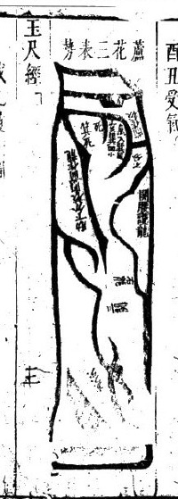

> 原图模糊，仅保留原图，不承担教学证明。

<!-- source:P000050-B007 -->

篇首“才汤四网巴工夏君”为文字讹误，具体含义不明。若申、巳、亥四维方位的水流交汇于明堂，而四正方位都是实地，那么子、午、卯、酉四个方向的龙脉都会在此处停驻，集结交汇。但四种地势不会同时结聚胎息气脉，常理要么是离龙结穴，以坎位的砂山为朝砂；要么是坎位结穴，以离位的砂山为朝砂；结穴位置要么在兑位，要么在震位，这些都要根据水神的来去方位辨别。若水从乾、坤两个方位来，就可知正龙位于兑位，左右的山势作为护砂，震位的山势是朝砂。若水从坤、巽、乾三个方位来，就可知离、兑方位是正龙，震、坎方位是朝护砂。只需在正龙上寻找大小合襟水以及兜收的小水，详细查探水是从左来还是右来，是正来还是偏来，以此确定龙脉的到头位置来定穴。定穴时要么偏左要么偏右，根据地形的方正或歪斜，来寻找乘气入穴的方法。不过也各有规制，能形成小型穴场的，就根据本龙的小分合（此处原文“9”疑为讹误，具体含义不明），分辨右转、左转、正来、直来的来脉情况，以及小合水出入的方位，辨别方位取穴，才是正确的方法。但这种穴位最终只能带来较小的福运，发福的力量薄弱，福泽较轻。

<!-- source:P000051-B001 -->

群雁落湖形

<!-- source:P000051-B002 -->

这类地的中砂有的呈金形、木形，有的随水势成形，有的像船的形状。旁边有小型长砂，每座砂都和龙体不相连，各自成形，弯弯朝向明堂朝拱。有的横长、直长的砂在穴前，横弯的长砂在穴后。水神从东穿流，绕向酉方，回环来去，有三重到四重，纵横交错如同织布。砂体的各个山谷交相锁牙，水路曲折严密，几乎不通风，这也是大贵之地。主家子孙繁盛，孝义忠信，富贵都能显达。但后世同户居住的子孙不能全都发达，只要分家别居，各自立业，就能名位都兴旺，福气、官禄、财帛、人丁、牲畜没有不兴隆的。这类地的局内水法四通八达，很难拘泥于固定的出入方位，应当看局外大合水的来去方位来确定坐向。如果不这么做，也可以只看局内砂头转向的地方，观察朝水汇聚的地方作为案山，也可以大致依据大势水法，在立向时稍加调整，使之符合卦例，只按卦例来取用是最好的。

<!-- source:P000051-B003 -->

众多支脉横向交织，形如织物。原文末字有疑，整体是在形容土脉交错分布的样子。

<!-- source:P000052-B001 -->

<!-- source:P000052-B002 -->

气本身看不见，却能表现出作用；土本身只是有形的载体，它所呈现的作用来自气。气随着土的形态运行，它的作用也通过地形显露出来。因此，各处土脉都以山龙为根本，平原之气也沿着土脉到来。土脉开始的地方是首，也就是龙气开始运行的地方；土脉终止的地方是尾，也就是龙气聚会的地方。只有到了龙气聚集的位置，才可能形成结穴。《神龙真经》说，要知道龙脉停在哪里，先要寻找它从哪里来：来处是头，止处是尾；外面可见的是血脉，内里凝聚的是精神。原文接下来的阴阳交合术语有残损，但可以确定，它把山水交会之处看作精神聚集之处，并主张在砂脉末端寻找承接龙气的穴位。比如水从东面来、向西面流去，东面是首，西面是尾；如果反而到水流来处寻找穴位，就舍弃了龙脉真正停止的地方。《脉经》说，甲卯方来龙，不承接酉辛之气，讲的正是这个要点。

<!-- source:P000052-B003 -->

<!-- source:P000052-B004 -->

鬼劫龙

<!-- source:P000052-B005 -->

所谓鬼劫行龙，是指龙脉起行时，土脉向东、西、南、北四面飞窜，直来直去，或者斜横曲折、杂乱分流；支水穿插交冲，龙脉入首又轻斜不正，分不出清楚的门面。书中把这种形势看作气脉分散、无法收束，因而不能结穴。肋下分出的砂向前斜出，不顾堂局，堂局本身也歪斜不正，书中称为鬼砂顺劫，认为它会分散已经聚集的气；腰下分出的砂向后逃出，不能回护堂局，东牵西扯、长斜分脚，书中称为鬼砂逆劫，认为它会分散来气。按照书中的传统吉凶说法，如果误把这种形势认作真龙，用来安坟立宅，便可能招致横祸、疫病、死亡、逃亡或刑罚等灾祸，并对子孙品行和延续作出非常严厉的负面判断。

<!-- source:P000052-B006 -->

### 鬼劫与护持的对照图（一）

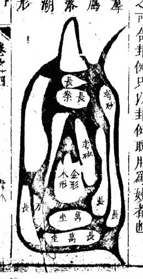

> 图注：从上方的长砂看到中部穴位，再比较两侧回抱与右侧向外斜出的支砂。

<!-- source:P000052-B007 -->

### 鬼劫与护持的对照图（二）

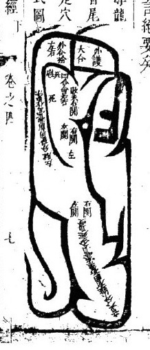

> 图注：看腰肋分出的支砂：是回抱堂局，还是向外伸展。

<!-- source:P000052-B008 -->

长砂关气直受。长砂关气直受。

<!-- source:P000053-B001 -->

按书中的说法，凡是龙体发源的时候，砂头直长，延伸一二里地过来完全没有曲折，如果中间龙腰行经的位置，没有分出的枝水从西边插入肋下作为关拦，就会导致气脉散逸无法聚集。行龙到头之后又没有枝水从两旁插入肩窝，原文此处“气滇不收”的“滇”字含义不明，疑似讹误，这种情况都不会结穴。只有在来龙行脉的中间，左右有三重水插入，关拦催动龙气，从中间穿过过峡的位置，行龙到头之后又有枝水插入肩窝，左有关拦、右有催动，将气脉收拢在中间，才能形成完整的龙势体段，可以在此处点穴。如果再有展开的水流东挨西推，往一侧收拢气脉归到角位，形成四维受气的格局，就更好了。真龙配真水，气脉冲和隐蔽，最难确定朝向。要观察水神的来去方位：东北方位出水，就立兑向腰受；西北方位出水，就立午向通泉受；东南方位出水，就立坎向正受；西南方位出水，就立震向疆受，“疆受”疑似指在疆域方位受气，具体所指不详。凡是正受的情况，必须要带丁、丙方的光，将子午向偏出三分，要避开双金真气，“双金”为风水特定术语，具体所指不详，不然恐怕会损伤人丁，腰受的情况只要正下就没有妨碍。如果斜向偏移二分，气脉就不会贯通带来福庆了。

<!-- source:P000053-B002 -->

此处原文残缺，只能辨认出零散文字，无法确译。

<!-- source:P000053-B003 -->

三关三峡本气入首式

<!-- source:P000053-B004 -->

“能体”疑为“龙体”的讹误，按书中的说法，龙体发源时砂头长直，延伸二三里远，中间有水插入内部。

<!-- source:P000053-B005 -->

按书中的说法，地形作开峡换气入首的格局，龙气才能清吉。凡是阁峡过气的位置，必须要有一处关拦往东边延伸，一处开阔往西边展开，让龙腰曲折活动地延伸过来，到入首的位置再有肩水插入，兜收催动气脉入局，才能成为贵龙的体段。这种龙以坎位为坐山，先闪过壬位，渡气换到癸位，从癸位转换之后仍然归到正坎位入首。虽然属于坎龙行度，中间经过壬、癸位转换而来，脱除煞气到尽头，不犯直冲的情况，才可以正下。还要看水神的出入方位，采用耳受或者“农受”都可以，其中“农受”具体所指不详。

<!-- source:P000053-B006 -->

九开峡的形势，有谢关，有斜阅。龙脉直来径直受气的，多属「原文此处有缺损，具体含义不详」；直来斜向受气的，多会斜闪，要观察它的开口在哪个方位受气，看气脉归向哪一方，就能知道气脉到达了什么位置。

<!-- source:P000053-B007 -->

### 长砂经关峡换气

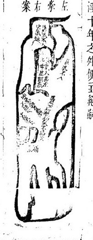

> 图注：沿长直的来脉，先看中途的枝水和转折，再看末端两侧的水是否回抱。

<!-- source:P000053-B008 -->

形状像张开的嘴，朝向巽、乾方位，水从乾方来，脉气必定会冲向巽方，坤申角是死脉。

<!-- source:P000054-B001 -->

龙脉斜来，正面朝下走势，水流朝向堂局之外。

<!-- source:P000054-B002 -->

龙身从祖山发脉出来，没有分出枝脚，从对角位置发脉，腰部有两道回束脉气的峡，脉气入首。

<!-- source:P000054-B003 -->

开成正面的形态，明堂前有大小不等的朝应砂水，分开两股，插在肩头兜拢收住龙气，让龙气融入穴中。穴前有横列的案山，左右都有护卫砂山，这也属于大格局的宝地。生龙配旺穴，能庇佑家族人丁兴旺，子孙后代富贵绵长。如果再有“袭闲双徽”的格局，此处“袭闲双徽”具体所指不详，福力会更加厚重。周边没有劫煞泄煞的格局，也没有兴废不定的情况，家族世世代代富贵，做官的人连绵不绝。坤、申、兑、乾方位都可以作为出水口，用来放煞。

<!-- source:P000054-B004 -->

长宫方位的龙脉行度，立向要遵循卦例。艮卦纳丙，坐穴对着丙方，空亡对应甲午木或者丙午火的格局才好。如果艮方有土形山来，水流从巽、巳、午方位流出，应当改到癸角方位受气，终究不如立丙午向能让富贵长久。如果立申向，那么艮龙属于病龙，申向属于病向，虽然不会导致家族死绝，但龙气休囚无力，算不上完美的格局。

<!-- source:P000054-B005 -->

有壬、子、癸方位的水来也很好，是水流朝向案山之外的形势。

<!-- source:P000054-B006 -->

中局气势

<!-- source:P000054-B007 -->

龙脉的体势中，砂头方正，从旁分出的枝水关拦龙气，龙气都向中局收拢。

<!-- source:P000054-B008 -->

“腰门面入”具体含义不详，交汇的水流到中局后分出两股，横向铺开，朝向旁侧收摄，把来脉之气收束在局中，又有局中肩位的水流汇入，“重觉入气”具体含义不详，斜向开辟关口收纳气脉，力量很大。“大鼎寺龙穴”具体所指不详，按书中的说法，在这个位置安坟或者建住宅，子孙能够绵延长久，富贵昌盛又长远，各房分得的福运均匀，“年朱业满朝”具体所指不详，家族中人品性忠厚、头脑聪慧，身形丰满俊秀。

<!-- source:P000054-B009 -->

龙脉从申方来，卦气纳乙，乙水流出的方位作壬方论；如果癸水来，朝向作坎方，水流止于辰方流出，符合三合局，对应子向占七分、壬向占三分；如果立甲向，会有煞气相冲，导致人丁退败；立丙午向也主家业退败；“丙水赵艮”含义不明，作巽巳向也可以。

<!-- source:P000054-B010 -->

### 斜来正受

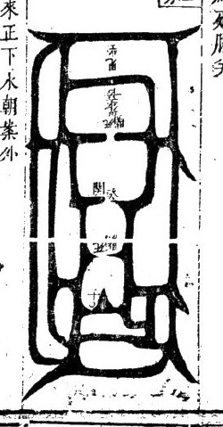

> 图注：来脉虽然斜入，穴前的水和两侧护砂仍可能使它收正。来路与取穴方向要分别看。

<!-- source:P000054-B011 -->

### 中局收气

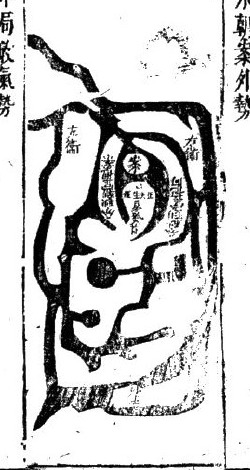

> 图注：看两旁枝水如何把来脉约束在中央。

<!-- source:P000054-B012 -->

中受平收气脉势

<!-- source:P000055-B001 -->

龙脉发源时形态细小，“枭集面来”具体所指不详，“将近扁后”具体所指不详，延伸百步、二百步或是三百步之后向外开展，“庆直至一百步外”的“庆”字含义不明，最后有两股水相合回转；原文句尾残缺。

<!-- source:P000055-B002 -->

龙脉从一个方向发源，却在去水交汇的地方再次分开，“尔杖”具体所指不详。小水从局肩插入，冲破局内的逆砂而后流走，“逛”疑指水流散乱，具体所指不详。从中间关拦龙气，局域中间聚水如同湖泊，两旁插出的砂山作为本身的龙虎砂，俯伏在湖的外围，湖内的气脉不偏不斜，这种格局叫做中局平收气脉，指的是穴旁没有界水兜收冲激，只以本身的龙虎砂为主来判断气脉选取穴位。

<!-- source:P000055-B003 -->

如果是亥气出身，附带亥、壬、子气入穴；若在巽、巳、午方位出身，只立丁未向收亥气长生本气，入局之后又收坎方的临官之气。这种格局既能旺人丁，又能发财禄，但气脉偏宽大不够清细，能出官贵，三次遇到相关格局都能发财，从事商业、技艺相关的事业都能成功，属于水木之气混杂运行的格局。

<!-- source:P000055-B004 -->

群雁宾鸿势

<!-- source:P000055-B005 -->

龙脉随木气出身，先出现一道大横砂，被流水界断开，之后生出五到七块砂山，东西分散矗立，向前方再结出大砂居于中间，形状或圆或方，或是有出角，左右两旁有一二十块小砂，有的尖长，有的像张开的翅膀，“香之神”具体所指不详。出角不管是单个还是成对都向内朝向朝堂，向前方再结出三到五块小砂，或长或方，周围又结出曲折的长砂抱护，朝向内部的格局叫做群雁宾鸿形。中间结穴的地方，砂头能有十亩、二十亩大小就算符合标准，小砂有三亩大小方为合格，“五龙”“外谗”具体所指不详。大砂的大小没有限制，只要呈长湾状向内，每一块小砂都相互交叠，片片遮拦，看不到来水去水，这种地极为吉妙，能旺百子千孙，富贵难以计算。立向要根据外水来确定，这种格局的穴旁水来去纵横，情形复杂，很难辨认，所以不必完全参照这幅图，“此益以异亥立式”具体所指不详。要根据水判断龙的情况，仔细看首尾和中间的砂，如果砂比较大，“尧收”具体所指不详。

<!-- source:P000055-B006 -->

### 中受平收

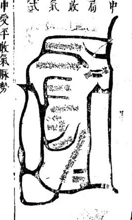

> 图注：中央地面较平，没有明显凹窝或突起；取点要结合两侧水流的位置。

<!-- source:P000055-B007 -->

### 群雁宾鸿形

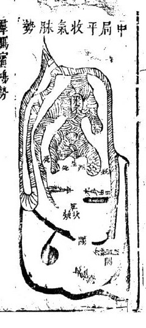

> 图注：居中的大砂与周围小砂，形似群雁相随。要看各处是否朝向堂局。

<!-- source:P000055-B008 -->

众多砂峰有大小等次区分，就像群雁跟随着领头的大宾鸿的形态。

<!-- source:P000056-B001 -->

劫龙分气

<!-- source:P000056-B002 -->

龙脉延伸到尽头，开展有正面的形态，如果聚气的穴场端正，只要见到这样的龙脉。

<!-- source:P000056-B003 -->

很容易指点辨识，如果龙脉的腰肋部位有砂山劈向两旁伸展出，原文此处有缺损，具体含义不详。一旦砂山和龙穴不相呼应，就叫做劫砂，是龙脉的英灵之气分散导致的。哪怕穴场看起来品相不错，头面端正，下葬之后也不会得福，反而会招来大祸，导致人丁断绝、家道败退，这是必然的道理。尤其要防备隔绝的情况，要是龙气入穴的路径不清，越隔和劫砂这两种情况都是凶恶的，绝对不能选来下葬。古人所说的“菩萨由”，指的正是这种龙脉，说的是龙气根本到不了，只是空有好看的门面，只是外表好看罢了。龙气顺着土层行进，土层延伸到的地方气就到，为什么会有气到不了的情况？原文此处有“所日”字样，具体含义不详。就好比吹管的道理，只开一个音孔的时候，气到了就能吹出响亮的声音，要是所有音孔一起打开，气就散了，很多音就吹不出来了，这个道理是必然的。

<!-- source:P000056-B004 -->

这其中的道理极为玄妙，学习这门学问的人要慎重对待。

<!-- source:P000056-B005 -->

如果砂山伸出来的头部又尖又细，就是鬼砂食气的格局。

<!-- source:P000056-B006 -->

来龙有气，三次开展三次转折，走势十分灵活，到了尽头露出额部，反而呈尖形。

<!-- source:P000056-B007 -->

如果格局细长倾斜、狭窄逼仄，就算有龙气来也一定会减损消散，就像海里的潮水奔涌而来，到了狭窄的地方，没有容纳的空间就会冲击四散最终消失，这是必然应验的规律。古人说“来势好不如收势好，长戴尾龟鬼头，踏着便生愁”，说的正是这种情况。

<!-- source:P000056-B008 -->

龙行到入首的位置，面额看起来端正，但是座下的鬼砂、支水倒插进来，延伸出三重、四重，穿破了龙形，就像破损的金属。杨公所说的“棕栏业散夜文头”，指的就是这种龙。一般的风水师看到这样的头额，就从这里点穴，会让人家断子绝孙，遭受无尽的灾祸，这种做法万万不可提倡。棕叶鬼的形状像棕树的叶子，有的是向前伸展不顾堂局、散乱不收的，此处原文残损。

<!-- source:P000056-B009 -->

### 劫龙分气（原图）

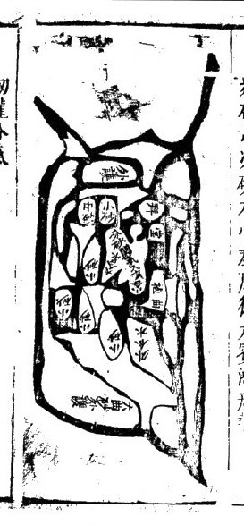

> 原图模糊，仅保留原图，不承担教学证明。

<!-- source:P000056-B010 -->

### 棕叶鬼形

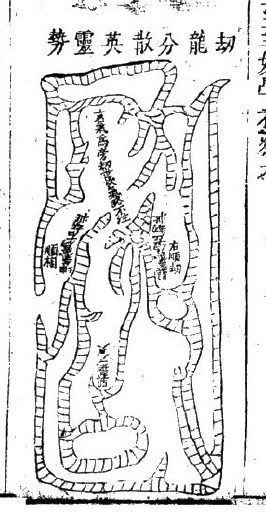

> 图注：看支水、支砂在何处倒插、穿破主体。

<!-- source:P000056-B011 -->

### 组合图

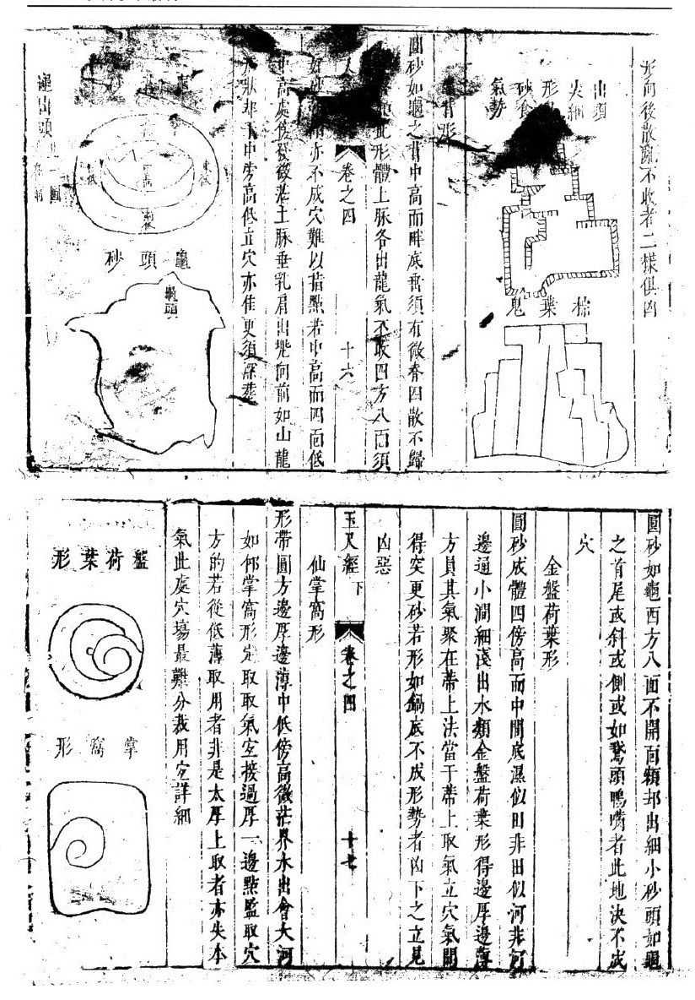

> 图注：这一页包含多幅小图，需分别看各图的来脉和收束处。

<!-- source:P000057-B001 -->

回龙顾祖的格局，是在大水来的方位起祖，行龙跟着水流延伸，到尽头时有时候会被其他砂山挤逼，使得本龙从左转右，或者从右转左，逆着水流向上走，这就是回龙顾祖的地势。经书上说：龙回转的话水也会回转，又说龙是跟着水转向的。如果水一直向外流，看不到转向回流、逆着来的地方，绝对不会有回龙顾祖的宝地。就算有砂头回转，也不过是支脉分隔龙脉的情况，哪怕穴场看起来好，力量也很薄弱，这是因为没有真正的龙到头的缘故。如果真的是真龙到头，水流一定会跟着龙逆向回转，这种地最难立向，因为四周都是实地，只有一路出水。后面附的图是从坤申位向右迁移转到坎位。

<!-- source:P000058-B001 -->

入首如果是阴龙行体，水土属性的龙本来适合向东南出水，但这种情况东南反而会出灾煞，是必然的。所以凡是回龙的地，发福都不会长久；阴木从卯位起长生，反而从阳木长生的方位流出去，只会发福七八十年就衰败；后来就算从辰位出水，木气虽然稍微持久一点，终究也没有福气。

<!-- source:P000058-B002 -->

截气立穴法，是截兑方的气引入左侧，截震方的气引入右侧。这种方法适用的情况是：砂山到尽头的时候龙脉形态有气势，但入首处的余气分散，很难直接下穴。必须在砂山低伏平缓的位置察看，如果有枝水流入砂山内部，水流冲刷切割得像钩子的形状，旁边还有短河道隔断气脉，不让气直接进入入首的位置，这时候要把气收进局内，这样的地局也能发福，但终究达不到最好的效果。

<!-- source:P000058-B003 -->

斩气立穴

<!-- source:P000058-B004 -->

如果砂山的形状像船或者像梭子，两头都很尖，很难下手立穴。必须观察到枝水在两侧斜着流向穴位朝向的方位，逆向展开形成钩状，而且水从背面逆流进入砂山内部，兜住气脉入局，这时候对着钩的位置取穴，叫做斩穴。

<!-- source:P000058-B005 -->

这种方法是让气不进入入首处，顺着气的走势立穴，也能发福。如果龙脉出身的走势长远宏大，福泽也会更深厚。

<!-- source:P000058-B006 -->

### 斩气立穴小图（一）

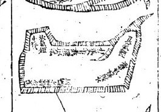

> 图注：砂体两端尖，像船或梭子；注意侧面的枝水是否回钩入腹。

<!-- source:P000058-B007 -->

### 斩气立穴长图

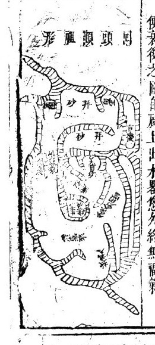

> 图注：沿砂体看水流切入、回钩的位置。原书据此讨论从侧面取穴。

<!-- source:P000058-B008 -->

### 斩气立穴小图（二）

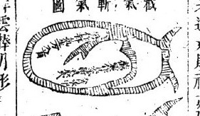

> 图注：与前图比较，注意钩形水流位于哪一侧。图中文字模糊，不能据此确定方位。

<!-- source:P000058-B009 -->

### 回龙与截气关系图

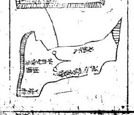

> 图注：先看来脉是否回转，再看水流是否随之回转。原书认为，只有砂回而水不回，还不能算真回龙。

<!-- source:P000058-B010 -->

### 回龙与截气诸图

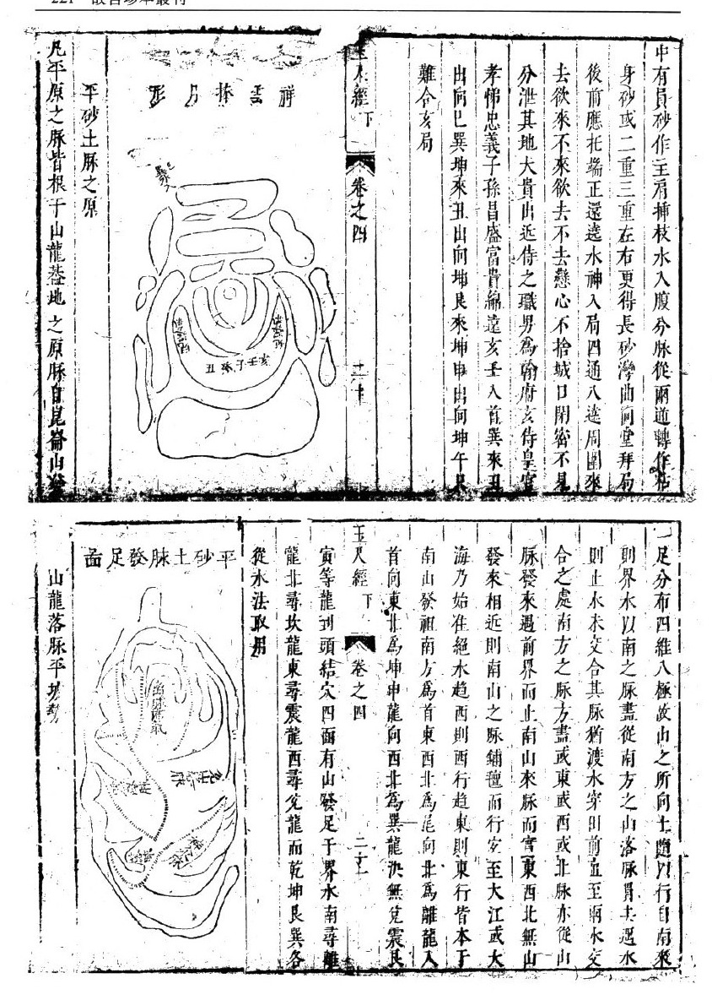

> 图注：这一页应分成几个局部看；画在一起的线条，不一定表示地形相连。

<!-- source:P000059-B001 -->

凡是山龙行到尽头分开左右两翼，中间没有下垂的乳突，山势紧逼、形势急促的，应当顺着山势铺展曲折走向平坡，往往要到三里、四里之外，才有大溪或者长江作为界限隔断龙气。也有山脚下走一两百步就结穴的，还有在平坡中心位置结穴的，这种穴前没有水界止气脉，四周的界水溪流又距离很远。辨取穴位、认取气脉的方法是：看真龙落脉到结穴的位置，四周一定会生出月角形的砂山，朝向穴场，或是左右两侧生出轻薄的砂山向前伸出，作为栏头砂；如果有三重、四重砂山抱护的，就一定是真穴所在的位置。它后面的龙脉必须要经过三次、四次伏藏，一节节有时隐没有时露出，没有固定的形态，等到了结穴的地方，自然形势清晰可以辨别。两边有细微的流水夹着龙脉汇合后流出，这种地的福力也很大，按原书说法能庇佑家族百子千孙，发财得福。和《玉天经》下卷第四部分的相关内容相比，这种山龙脉穴的格局更好，但水法不适合人工调整改造，不像平原大河的区域，一旦水法不符合规制，就毫无补救的办法。玉

<!-- source:P000060-B001 -->

如果是木龙格局，寅甲方位的水从远处延伸而来，层层曲折朝向穴场，之后转为阴水向右旋流，从戌位流出。巽方位的水从远处来，分两路朝穴场而来，生、旺二水都十分清澈，不必担心水从左侧倒向，从坐山下方流出戌位，这属于阴水走阴位的格局。局内的腮水，甲卯方位的水从左侧夹流而出，坤未方位的水从右侧夹流而出，向左倒与甲寅方位的长生大水汇合后逆行，那么局内的水就全都属于逆水格局。朝向丙午方位的话，按原书说法会财源兴旺、得官运。下

<!-- source:P000060-B002 -->

如果格局显贵但背后有水，家族人丁也不会有疾病，但会出现家中当家的妇人克死丈夫、丈夫年少死亡、妇人寡居的情况。按原书说法，如果能发中房的财禄，长房的人丁就会长久兴旺；如果发长房的人丁，中房的官贵运势就不会兴盛。家族各房东边典当西边退产，盛衰消长没有定准。如果立甲寅向，那么人丁虽然兴旺，还会多出患气息类疾病的人；如果水从艮方位发源而来，可以避免这种情况，但会是从经商起家，家族主骨肉不和，多出善于阿谀奉承的人。立丙向也会发邪运，只是会因为行事奸邪误国，就算得到官禄也不能长久保有。

<!-- source:P000060-B003 -->

本正

<!-- source:P000060-B004 -->

### 山龙落平结穴

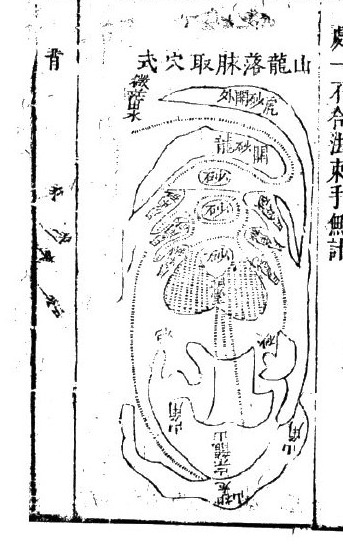

> 图注：从上方山体看到平坡，再找两侧弯出的月角、细小水迹和前方界限。

<!-- source:P000060-B005 -->

子午卯酉四个正位有水流来去，没有空缺，这种水叫做滚浪桃花水，也叫做军睡水、天狱水、天禁水，主家中女子淫乱，男子游荡败家，还会出现从军为盗的人。离方见坎卯，兑方见午，（原文此处用字不明，疑为“坤”）见子，主家中女子杀害丈夫，出现阴邪怪事。如果遇到这种水，要有申、庚、壬、丙方的赦文水来解救才可以，否则男子会做盗贼，女子会有淫乱之事，导致家族败绝、孤寡。如果水直冲破局，一定会有抄没类的灾祸，还会出现产妇难产、少年早亡的情况。如果有一路或两路来水很长，祸患立刻就会显现；来水短的话祸患较轻。如果龙气清灵秀丽，又有六秀水朝拱

<!-- source:P000061-B001 -->

主做官的人会获罪受刑罚。

<!-- source:P000061-B002 -->

假如亥龙的脉气从坎方来，进入亥位，就是阴亥龙。亥龙对应乙木，乙木长生于午位，从午位起长生，逆行排布到戌位是墓位。（原文“乙席”二字讹误，文意不明）；丙龙从寅位起长生，顺行数到戌位是墓位。（原文“所谓乙丙龙变而赵成为虽一雄交媾也”讹误较多，文意不通）。阴阳之气调和才能生发聚集，之后通过向来控制，使得气脉感应，亡者的福泽就能惠及在世的子孙。穴是依托龙脉来乘受生气的，（原文“甸依水接堂气也”中“甸”字疑似讹误，大致指穴前区域要依托水来承接堂气）。所以气在地下运行，用土龙的本音来布运；水在地面流淌，用水龙的本音来布运。察辨生旺聚气的状态，土龙用山运来收山气，水龙用水运来收水气。比如午位有高峰就旺人丁，寅位有高山就旺财禄，这正是所说的水管水，再用寅午向来控制，水和龙的气就能相合不散。这种控制龙气的方法关键就在于向，一旦有差错，祸福相差千里。

<!-- source:P000061-B003 -->

阳龙布气冈

<!-- source:P000061-B004 -->

<!-- source:P000061-B005 -->

<!-- source:P000061-B006 -->

从辛戌方位进入亥方位，这是阳龙中的亥龙，纳音属木。甲木生于亥位，顺行到未位为墓库；甲木与癸水相配，癸水生于卯位，逆行到未位也为墓库，这就是所说的“金羊收癸甲之蠹”。辨识龙脉、布排气运的口诀，依据随气的运化流行而定，从子、丑、寅、卯方位开始排布，按阳从左、阴从右的规则运作。水神的来去不能死板地遵循子、丑、寅、卯方位的顺逆周转模式作为合法标准。只要水从生旺方来，朝向局前朝堂汇聚为来水；水到局前与各处水流汇合后，再朝向墓方流去，按书中的说法就是吉利的。如果是癸龙，卯方为生方，亥方为旺方，水若从局后经过寅、丑、子、亥方位右转，流入未方再流出，那么亥、卯方位的水虽在玄武方位，却没有进入堂局，即便水来自生方、从死方流出，也不能算作吉利，其余情况都依照这个逻辑类推。

<!-- source:P000061-B007 -->

### 来去水与亥龙配合（一）

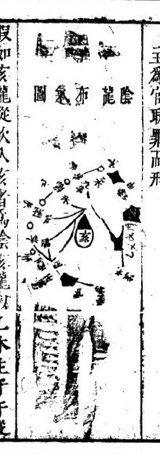

> 图注：先找来龙和堂前水流，再分清水从哪里来、往哪里去。

<!-- source:P000061-B008 -->

### 来去水与亥龙配合（二）

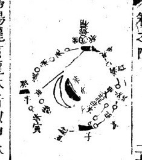

> 图注：这一幅补充前图的水口位置。图中文字残缺，不能据此补出完整水法。

<!-- source:P000061-B009 -->

书中认为，木龙借配壬方位，虽然交媾不真且夹流有异常，但也带有秀气，如果砂法符合格局，完全能够催发富贵。如果内堂的腮水从甲、卯、乙方位流来，到丙午方位右转流向戌，反向朝向午、丙，经巽位合流有异常，这种情况是外木虽然不符合法度，但内水符合格局，立异向的话，可兼收外水顺向的利好。立卯向则人丁显贵，也属佳局；丁未向依然吉利；丙午向则人得官禄更为旺盛。地气荫发长子，朝向的利好荫发中子，丁向荫发小房。过六七十年之后，效力渐退，贵不过四品，富不过数万，水行至外堂后运势就会败落。

<!-- source:P000062-B001 -->

书中认为，壬方叠见为北极紫微之司、尊帝所居之处，属申庚方位延绵伸展之地。巳丙为南极之司，寅申为天市天帝司货的处所。局地如果得到对应水流到堂局朝会，福报无可比拟；如果有三路、四路水来也属佳局。寅方水流先到会合，巳丙方水流右倒出戌，主家中出神童、状元，官居清要的极品贵位。南方会合庚酉水而左倒的情况。

<!-- source:P000062-B002 -->

书中提到，临官地应验福力约略官至四品。酉水先动，会合寅甲水出戌，先发外姓旁支，后发本宗族；先发小贵，后发魁元。亥水先到，会同寅甲水出未，主家中少年登科及第，文章世代相传。辛兑龙遇到这种格局，文章冠绝天下，只是仅能得清贵之位。庚中水遇到震龙，得乾、巽峰高出，主家中出英豪。经书中说“开门关地户，震龙动而龙见时”。

<!-- source:P000062-B003 -->

### 内堂水与外堂水（一）

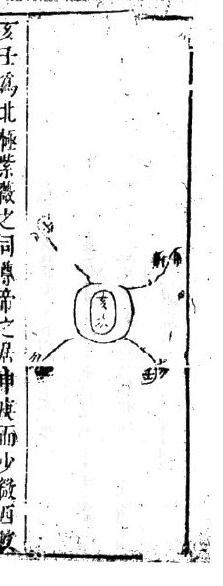

> 图注：比较靠近穴前的水与外围水路，看它们的流向是否相同。

<!-- source:P000062-B004 -->

### 内堂水局部图

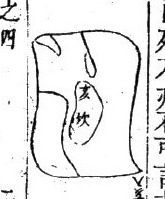

> 图注：这是前图的局部，需要结合前图阅读。

<!-- source:P000062-B005 -->

### 内外水合流图

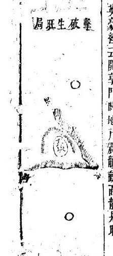

> 图注：沿水线看各股水在何处会合、又从哪里分流。

<!-- source:P000062-B006 -->

> 以下水路文字残损较多，具体方位尚不能确切释读。

阴亥龙在戌位上本是亥窍，水空则山气不互相通入。如果水势改向戌位，龙从外部由离位而来的，只取艮位出水，作庚向纳气。局内的水逆行汇入后分流，从局前冲破午、丙方而去，支流分流改道变低陷，原文此处“赵向异震”表述残损含义不明，作巳丙向还可，这是收聚山气的妙法，如果引祸让水从寅位流出，那么生年对应的两个方位都要关拦紧扣，必须以内堂水法作为核心的真机。如果作丙午、寅艮向，就会立刻害人。堆砂也不可在此处安置，安置之后不出十年，一定会导致家族败家绝人，遭遇官讼、残疾、抄家破落。寅位来水大的先绝财禄，戌水先到堂的，中房先败绝，接着连累长房、小房都破家损人。只需要看内堂的水，水形圆转、出入朝向合度。如果寅甲方有内水，丙午向则人丁还可保全。内堂水如果不从午位出，而从申、酉二方流出，那么财禄可在一到两纪之后到来。改作其他朝向才能稍稍缓解灾祸。如果作午丁向，原文此处“巢左系”表述残损含义不明。寅申巳亥是四龙的长生之地，众水交流入局、朝向朝堂的，会很快发福人丁。

水属阳，是外气，从天与地交合而生；龙气属阴，从地中生出。所以龙的生旺方位喜地支行度，水喜天干行度，因此说“水从天上去，龙借配来地下眠”。又说“万水尽从天上去，群龙须向地中来”。行门即使没有四正位的灾祸，终究是地支行度，不能发福聚气，而且是长房的煞星。如果犯了四生水法，只有长房会受灾。见有戌土水来，或分或合都从右转向左朝向明堂，一路从丙午位流出，各有分位，同时兼有乾、坤、艮、巽四隅方位来水的，灾祸会稍缓；如果水从寅艮生旺二方流出，生旺气都被冲散，亥龙的气就无法聚集了。迁葬到这种地方立刻会败绝。如果戌水一并流到明堂，分向坤、离、艮位的，灾祸尤其猛烈。如果戌水来的地方就分出一支流过明堂从艮位出，另一支的去向因原文换页残缺，无法确译。

<!-- source:P000063-B001 -->

### 阴亥龙复杂水路

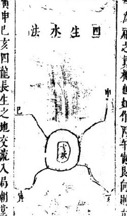

> 图注：本图对应的文字残缺较多，具体方位不能确定。

<!-- source:P000063-B002 -->

“法殿成”具体所指不详，丑未为四墓。“是水宜紧不室来室去不空入”一句原文疑似讹误，含义不明。若墓水流入朝堂，主家中发瘟疫病疾，孤寡败绝后嗣；若墓水聚集而不冲来，又能催发富贵。水直接冲破格局，小房遭受灾祸；冲破北气，中子主灾伤损财；冲破生气，长子承当灾祸。看龙气的“左忌”来判断吉凶，“左忌”具体所指不详。如果四墓的水都聚集而不冲击堂气，主家中大富，可比石崇。如果“西某侧”水到，绝对不可立穴，立穴后立刻就会出现灾秽，“西某侧”具体所指不详。“池河方壤通众水来去者不是刀”一句原文疑似讹误，含义不明。

<!-- source:P000064-B001 -->

<!-- source:P000064-B002 -->

亥龙从山顶起顶，落下时正对亥方入局，左右两侧的龙虎砂山蹲踞环抱，中间的脉气抱出，形如詹口。如果在亥脉的尽头处立穴，就会使脉气暴露被风吹，退缠的话玄武舌过长。气遇风就会散失，进气则五气和融，因此只可退后一步立穴。

<!-- source:P000064-B003 -->

如果能乘得亥气，立穴就不应当以本书为忌。杨公三十六穴法说，要在玄武内侧的长高之处点穴，这也是“开劳火”的方法，“开劳火”具体所指不详。对于山脉余气没有散尽的情况，如果可以裁截就加以裁截；如果不能裁截，就把穴立得高一些，让穴的坐处不犯玄武舌，也是好办法。

<!-- source:P000064-B004 -->

龙脉从祖山发源，换出坎局，脉气如乳状入首，横向铺展平阔，开面又类似坎卦的形态，这是真龙伪行的情况。若有艮龙起祸，就一定会有艮脉入穴，必须要看朝应的向势情况如何。如果正行斜受，子脉不承接祖气，入穴的地方一定会有艮气到头，势必会超出在右角边。如果在中局取穴，用的就是伪气，灾祸立刻就会到来。

<!-- source:P000064-B005 -->

所以真龙伪行的情况，不应当在正落的位置找穴，要到前山去寻求穴心，观察左右两侧来寻求开气，这两点只要掌握了方法，龙脉的真伪自然就能一目了然了。

<!-- source:P000064-B006 -->

### 退后取穴（一）

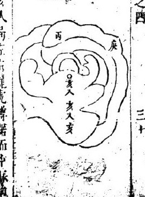

> 图注：原书在来脉末端余势过长时主张退后取穴。看图中末端与取点的位置关系。

<!-- source:P000064-B007 -->

### 真龙伪行

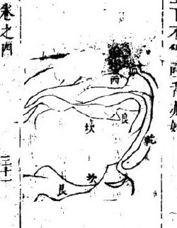

> 图注：外观上显眼的来路未必通向真穴，还要结合左右护砂和前方朝应判断。

<!-- source:P000064-B008 -->

刘秉忠、砂周昌奇，在偏位立艮龙转亥的格局，立丙向。二十三年间，昌奇位至状元，任元朝太学士，后来改任监茶马司，之后去世。他的儿子将昌奇安葬在艮龙的山顶，取用艮脉的尽头处，后世代代都有显贵的官员，接连不断。这道龙的形制本来是从艮方起祖，再入艮龙没有夹杂其他脉气，第二节转出亥局，再得到亥方的幕帐，大宗小宗都符合三吉六秀的格局，所以艮、亥方位的一两处穴地都能催发官贵。

<!-- source:P000065-B001 -->

工尺无卷之四三十三。共峰起祖，到第三节变化出土星，横向宽阔、高而平坦，粗笨不开豁，窝穴、乳突的东西两个角又没有脉气下落可以考证，看起来很难立穴。但存在大穴的话，就算没有明净的乳脉，也一定会有隐约如灰线的脉迹，还有荫腮部位的暗异作为佐证，才可以立穴。如果连它的翼砂都不明显，就又应当查验朝应的山水哪个方位有情。经书说：“唯气朝山识幸心”，后面看来脉，前面看朝山，以此作为标准，就万无一失了。还有乳脉杂乱、难以分辨真伪的情况，都要从朝应左右的砂山来考察，就能找到真穴。古圣贤立法，说金形山取窝穴，土形山取角穴，恐怕不是准确的论断。如果朝对的痕迹接在中间，怎么能舍弃中局而去取金角呢？

<!-- source:P000065-B002 -->

### 无明显窝乳的判断（一）

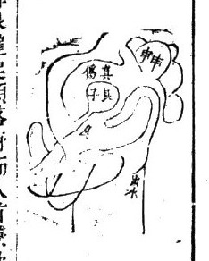

> 图注：地面宽平时，注意细小的高低痕迹、左右两翼和前方朝应。

<!-- source:P000065-B003 -->

### 无明显窝乳的判断（二）

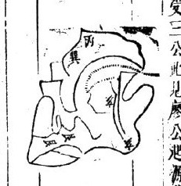

> 图注：结合前图，比较中央和边角分别受到哪些地形朝应。

<!-- source:P000065-B004 -->

### 朝应辅助定穴

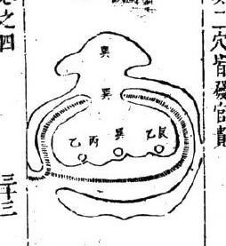

> 图注：来脉细节不清时，原书借前方朝山和左右护砂辅助寻找穴位。

<!-- source:P000065-B005 -->

艮龙发源的最初两三节都是艮位山峰起顶，到落脉入首的位置，原文此处有“邦流趋癸丑方尽”的表述，“邦流”具体含义不详，这类情况全是错误的立穴方法。应当顺着艮脉的尽头，那里是生气聚结的位置，就在艮脉的尽头立穴，就算余脉拖向癸丑方延伸，也属于空耗的无用脉气。原文提及《人经》下卷之四里有“王十四剪以截伪气”的内容，“王十四剪”具体所指不详。如果不能裁截多余的伪气，就往艮气更充足的上方迁穴。所以古人说：只要乘得真的生气，伪气自然会消散，不应该因为有癸丑方位延伸出来的无用砂头就有疑虑。立丙向，用阳艮方位收丙气，书中认为会大旺官贵，之后富贵双全。如果犯了丑癸的气，祸患说都说不完。

<!-- source:P000066-B001 -->

催官吉秀罗列

<!-- source:P000066-B002 -->

1.亥龙起祖，原文此处有“郦”字，具体含义不详，经过三节到四节都不脱离亥龙本体，到入首结穴的地方，龙虎砂山势降伏，乾、坤、艮、巽四个方位的山高耸重叠，震、庚、丁、兑方位的秀峰分布在前后左右。有这样的地势，而且龙穴真实准确，书中认为会出将入相、封侯赐爵，子孙世代美德相传。再有旗鼓、剑戟形状的砂山排布森严，就会出现勇猛的英雄横行天下、百战百胜。来龙绵延几百里，入首后有缺损无法确译的形态而降伏，都属于风水禁忌。如果路过这样的地方，千万不要开口谈论相关的内容，福分浅薄的人要是迁葬到这里，一定会遭遇被虎噬、雷击、水淹的灾祸而后死亡。

<!-- source:P000066-B003 -->

<!-- source:P000066-B004 -->

乾龙起祖，转换到亥龙行度，经过二节或四节的亥龙行度，入首的形态端正，乾、坤、艮、巽四个方位的高山对应得宜，原文此处有“丙丁兑灾边到秀峰”的表述，“灾边”具体含义不详。众水往左边汇流，从寅艮方位流出，长远而去。立巽向来收聚水神，那么砂水格局都十分完美，书中认为会出状元、宰相。如果没有震、庚方位的砂山，就会出文章冠绝当世的人才，原文此处有“名播夷百”的表述，“夷百”具体含义不详，子孙众多，世代显赫，朝廷里满是自家做官的后人。原文提及“儿催官荐元砂水”，其中“儿催官”具体所指不详，这类砂水只要得一样就会出贵人，更何况是众多吉秀一起呈现祥瑞的情况呢？

<!-- source:P000066-B005 -->

### 催官吉秀罗列（一）

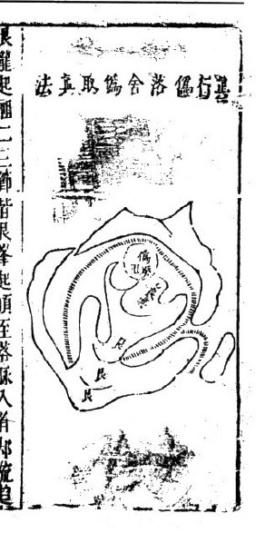

> 图注：图中画出周围峰峦的位置与高低。原书据此所作的官禄判断属于传统说法。

<!-- source:P000066-B006 -->

### 催官吉秀罗列（二）

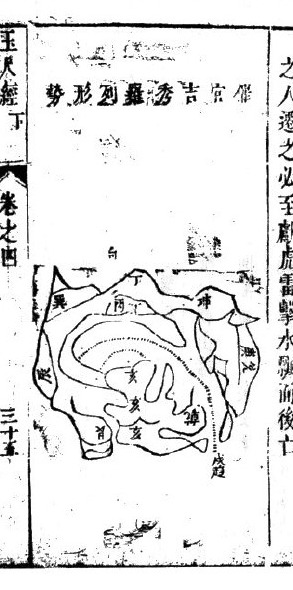

> 图注：与前图合看四周峰峦的朝向，不能只凭一座山峰判断。

<!-- source:P000066-B007 -->

亥龙起顶后，脉气单行下落延伸到头，一路全是亥脉，临穴处的内容原文此处有缺损，具体含义不详。

<!-- source:P000067-B001 -->

如果夹杂壬气从右边透出，看起来像是壬、亥两股脉气都到了，左边往东、右边伸展。普通风水师不懂这个道理，只看到左右护砂紧凑，朝应案山整齐，就顺着落脉的画线处点穴，这是舍弃了纯正的亥气，取用了伪脉，从壬气的方位操作，自然就出错了。按书中的方法，应当顺着亥脉的尽头偏左的位置立穴，任凭壬脉往别处铺展即可。

<!-- source:P000067-B002 -->

原文此处有缺损，具体含义不详，要注意避伪，审察飞龙的态势。原文此处有缺损，具体含义不详，脚下如果有余气，即便不裁用也是可以的。原文此处有缺损，具体含义不详，东边、右侧有余气，即便不裁用也是可以的。全靠技艺的巧妙运用，这才是上等的方法。

<!-- source:P000067-B003 -->

参形杂势断

<!-- source:P000067-B004 -->

比如艮龙从坎位转换脉向进入，在艮方起顶，平缓下落至入首的位置，却铺展出一片宽平的区域，范围有一二十丈。原文此处有缺损，具体含义不详，这里的地貌看起来没有收束的态势，形局混杂紊乱，坎、癸、艮、寅方位的脉气都有显现，整个区域完全没有曲折回转的形态。不过龙脉是真的，左右两侧的护砂形态明确，这样的地方自然不应该放弃。这类地形最难判断方位点穴，完全要依据《玉尺经》下卷的相关内容判断。

<!-- source:P000067-B005 -->

要凭借巧妙的方法，详细考察朝应的情势属于哪种格局。书中说：形局混杂的龙脉要怎么辨认？只有看朝山的情形才能判断。按书中的说法，有真龙就一定有真穴，有真穴就一定有真的朝山。从穴场位置仔细观察前方山峰，如果有朝向穴场有情意的山峰在丙方，就对准丙方的山峰，取艮气立穴，就是真穴，其余癸、坎、寅方向的脉气都属于伪落。

<!-- source:P000067-B006 -->

<!-- source:P000067-B007 -->

### 杂形中辨真脉（一）

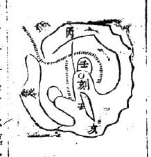

> 图注：地形宽平混杂时，先追来脉，再看左右护砂与前方朝应是否指向同一处。

<!-- source:P000067-B008 -->

### 杂形中辨真脉（二）

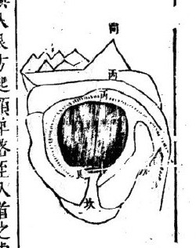

> 图注：结合前图看各处朝应。图中小字有未能辨清之处。

<!-- source:P000067-B009 -->

# 第五篇　审砂

元朝太师、文正赵国公、邢州人刘秉忠著述，明朝太师、文成诚意伯、青田人刘基注解。

<!-- source:P000068-B001 -->

审砂篇第五

<!-- source:P000068-B002 -->

辨明砂的生死，分辨脉的阴阳，敬仙赖从谦阐发

<!-- source:P000068-B003 -->

平原地区，砂头进脉有左方生、右方死，或是右方生、左方死的情况；有来脉为生，却终止在死地的情况，也有来脉为死，却终止在生地的情况。大凡龙脉行来，活动曲折的为生，僵硬笔直、粗陋逼压的为死。定脉取穴的时候，必须舍弃死脉，挨近生脉。

<!-- source:P000068-B004 -->

经文中说：生脉形态活动灵活，取穴要舍弃死脉、挨近生脉，就是这个道理。风水地理的说法认为，高处为阴，低处为阳；向下覆的形态为阴，向上仰的形态为阳；笔直逼仄的形态为阴，平坦开阔的形态为阴。只有平原地区独阳无阴，要到砂与水交汇的地方，才能见到阴阳交会的状态。辨别龙脉的阴阳，要依据五行之气判定阴阳的升降：左侧属阳，右侧属阴。阳气从左运行，阴气从右运行。乾、坎、艮、震属阳，卦象排布在左侧，比如子、寅、辰、午、申、戌这类地支就属于阳位；巽、离、坤、兑属阴，卦象排布在右侧，比如未、巳、卯、丑、亥、酉这类地支就属于阴位。这是天地自然的气运，是五行运行的固定规律。天气属阳，向左旋转；地气属阴，向右旋转，此处“阴面右旋”的“面”字可能是“而”的讹误。所以阳龙顺着天气的方向顺行是吉象，阴龙顺着地气的方向逆行是吉象，杨公所说的“龙飞两片阴阳取”就是这个意思。赖氏说：龙脉从生旺的方位发端，却迂回从死绝的方位入首，这种情况叫生龙死穴，在这里下葬一定会导致家族绝嗣。比如亥方发端的龙脉，本属木气，却迂回从午、申、酉方位入首结穴，按照十二长生规律，木死于午，文中提到“绳于申”，“绳”可能是十二长生状态中“绝”或“病”的讹误，具体所指不详，墓于未，这种情况叫生龙入死，不是吉地。又比如亥龙的气脉向东南方运行，从巽、巳方位入首，却在西南、东北角取穴，这也是生龙发端却点在死穴上。文中提到“莽亥归东南，西南东北亥气不贯”，其中“莽”可能是“若”的讹误，整句意思可能是如果亥龙运行到东南方，西南、东北方位没有亥龙的气脉贯通，具体所指不详，这样的地方就是死绝之地。这个方法十分精妙，时下的风水师大多不懂，很多人会点在死绝的方位上，那样贫穷绝后的灾祸马上就会到来。龙脉运行而来，有阴有阳，阳龙从左侧旋转，阴龙从右侧旋转。以上内容出自《避尺经 卷五》，此处“避尺经”可能是《玉尺经》的讹误。

经书上说生脉活动灵活，取穴要弃死挨生，指的就是这个道理。风水地理的说法是：高处为阴，低处为阳；向下覆的形态为阴，向上仰的形态为阳；笔直逼仄的形态为阴，平坦开阔的形态为阳。只有平原地区独阳无阴，要等到砂和水交汇的地方，才能见到阴阳交会的状态。辨别龙脉的阴阳，要依据五气判定阴阳的升降：左侧属阳，右侧属阴，阳气从左运行，阴气从右运行。乾、坎、艮、震属阳，卦象排布在左侧，比如子、寅、辰、午、申、戌这类地支就属于阳位；巽、离、坤、兑属阴，卦象排布在右侧，比如未、巳、卯、丑、亥、酉这类地支就属于阴位。这是天地自然的气运，是五行运行的固定规律。天气属阳，向左旋转；地气属阴，向右旋转，所以阳龙顺着天气的方向顺行为吉，阴龙顺着地气的方向逆行为吉，杨公所说的“龙飞两片阴阳取”就是这个意思。赖氏说：龙脉从生旺的方位发端，却迂回从死绝的方位入首，这种情况叫生龙死穴，在这里下葬一定会导致家族绝嗣。

比如亥方发端的龙脉，本属木气，却迂回从午、申、酉方位入首结穴，木死于午，原文此处有“绳于申”的表述，词义不明，木又墓于未，这种情况叫生龙入死，不是吉地。又比如亥龙的气脉向东南方运行，从巽、巳方位入首，却在西南、东北角取穴，这也是生龙发端却点在死穴上。原文此处有“莽亥归东南西南东北亥气不贯”的表述，部分词义不明，大意为亥龙的气脉不能贯通西南、东北方位，这样的地方就是死绝之地。这个方法十分精妙，时下的风水师大多不懂，很多人会点在死绝的方位上，那样贫穷绝后的灾祸马上就会到来。龙脉行来有阴有阳，阳龙从左侧旋转，阴龙从右侧旋转。

<!-- source:P000068-B005 -->

避开死绝方位、趋向旺生方位，龙气就会清和，结穴也会秀丽。所以从右向左转入首的是阳龙，从左向右转入首的是阴龙。阴阳二气都得到生旺，不触犯死绝，就是吉地。比如甲卯方位入首，属木气：从午、巽方位来的是阴木，从乾、亥、壬、子、癸、丑方位来的是阳木。阴木生于午，阳木生于亥，这两种情况都是得到生气出身。如果是从兑、坤二方出身，龙脉发源时就已经先断绝了，就算到头结局完整，护山托山都完备坚固，终究不会发福。水从城门方位发源，要详细审察它的出入情况。

<!-- source:P000068-B006 -->

龙脉行走时会有水随伴而行，所以水的发源处，就是龙神的出身之地。水流或是往东边流，或是往西边流，必须仔细观察它流出的方位。如果流神从“实艮”方位流出，就能知道龙脉是从坤、兑方位来的，也能知道水神必定从寅、艮方位流出。以艮、寅为“水日者”的说法，认为龙脉必定先在正西结胎，巽龙在东南生养休憩。因此郭氏说“入山观水口，登穴看明堂”，说的就是这个道理。

<!-- source:P000068-B007 -->

审察龙脉行度的来历根源

<!-- source:P000069-B001 -->

凡是龙脉行到尽头、收纳水口的位置，一定要考察这条龙脉的来源，要知晓它从哪里发源起步，经过了哪些方位。比如龙脉到东北方尽头，朝向艮、寅的方位，这条龙脉一定是从兑宫出身，才算真龙。

<!-- source:P000069-B002 -->

这种格局吉利。如果龙脉从壬、子、癸、丑方位而来，一定要坎位有左侧水流辅助，相夹同流，在坤、申方位会合，水流从左侧倒出；还要有乙、辰方位的水流辅助，相夹同流，在坤、申方位会合，水流朝向寅、艮方位流去，才算符合要求。如果龙脉是从离宫方位落头，那么水流一定不会从坤位流来。所以判断龙脉运行的来历时，必须从流向坤位的水流情况来研判，才能掌握其中的实情。

<!-- source:P000069-B003 -->

赖氏说：平坦的坡地绵延千里没有界限，龙脉没有固定的结穴位置，人也没有固定的判断标准。假如有一片方形的砂山，四面八方都没有收束的态势，看起来很难取穴。如果能考察清楚龙脉形态的来历，有明确的判断，确实是坤、申方位行龙出体，就可以确定穴的位置，龙脉向东方延伸，坤兑之……原文此处有缺损。

<!-- source:P000069-B004 -->

迎请神煞要确定分合的来源

<!-- source:P000069-B005 -->

内气就能融结了。吴巳行龙发源的话，就能知晓穴的情况，龙脉是朝向西北方归聚的。

<!-- source:P000069-B006 -->

所谓“迎神”，就是朝向明堂局汇聚而来的水。水来到明堂，必然有它的发源地，要弄清它从哪个方向分流而来，又从哪个方向汇合流走。弄清楚水流分合的情况，龙脉结穴的真假自然就能判断了。如果水流来到明堂，只在左侧分流、前后交错流动，右侧却看不到水流汇合，两股水流要么横向流走，要么径直而来，前面没有收束，后面也没有回旋归聚，说明龙脉还没有停驻扎稳。就算砂山看起来有情，形态方正通达，也还没有结穴。一直要到水流和砂山交汇的地方，龙脉才会聚集融结，形成真正的穴场。因此五行分别匹配八个方位，万象最终都统归到“四蛰”之中。

<!-- source:P000069-B007 -->
<!-- source:P000069-B008 -->

乾、坤、坎、离、艮、震、巽、兑八个方位，各自归属于金、木、水、火、土五行。正五行的划分是：乾属金，坎属水，离属火，兑属金，巽、震属木，坤、艮属土，这是永远不会改变的固定属性。但如果按照生旺死绝的气运来判定，那么木生于亥位而配属乾，金生于巳位而配属巽，水生于申位而配属坤，火生于寅位而配属艮。甲、庚、丙、壬对应子、午、卯、酉，是五行处于帝旺的方位。五行和八个方位这样的匹配，是天地自然的气运运行不息、化育万物的结果，不是人可以随意匹配、牵强附会的。至于寅、申、巳、亥四个地支，是五气生发的初始，是风水家所说的“四始”，也是万物的根基。五行乘旺的气，一定是从寅、申、巳、亥开始生发、变得充盛，直到达到帝旺的状态，就像金气最初是从巳位开始生发的一样。《青囊经》说：“地有四势，气从八方。四势行龙，八方施生”，说的正是这个道理。

<!-- source:P000069-B009 -->

辨变形态、体察本体、观察征象、审度龙脉

<!-- source:P000070-B001 -->

顺着地形来体察龙脉的本体，观察砂山的征象来审度龙脉的气脉状况，气脉伴随形态、遵循规律发生变化。比如木形的形态一定是直耸的，火形的形态一定是尖削倾斜的，金形的形态一定是头部圆润，此处原文有缺损，具体含义不详，土形的形态一定是方正的。

<!-- source:P000070-B002 -->

端正尊贵，水形的形态一定是曲折流动的。所以看到直耸的形态，就知道它属木；看到尖削倾斜的形态，就知道它属火；看到头部圆润、足部收束的形态，就知道它属金。水、土的形态也可以按这个方法类推。如果遇到圆润宽阔的金形，还应当审度这龙脉是从哪个方向来的。如果是从兑位发脉，那么金形乘着旺气显现，就是真金龙。如果是从离位来，龙脉出身时已经被火克制，就算能结穴，福运也不会长久。其余属性的龙脉都可以仿照这个方法推断。

<!-- source:P000070-B003 -->

赖氏说：龙脉有形态，是气脉聚集凝结而成的；有征象，是形态仿照同类事物显现出的形象。比如土形方正，此处原文有缺损，御屏、金柜、天马这类都属土形；金形圆润，覆钟、覆釜、半月这类都属金形，此处原文有缺损；木形直长，玉尺、横琴、展轴这类都属木形；水形曲折，像游蛇一样。这都是五气运化流行、各有固有规则的体现。比如观察火形要看它的焰动之势，观察木形要看它的苞节之态，观察金形此处原文有缺损，观察水形要看它的曲折流动，观察土形此处原文有缺损。像这样仔细审察来选取适中的位置，就能探明穴情的真实情况了。

<!-- source:P000070-B004 -->

气脉藏在左右两侧，忌讳在鬼劫砂交错横出的地方分散泄漏。

<!-- source:P000070-B005 -->

龙脉的本体已经成形，水势也交相汇合，这样的地方一定已经结穴。但气脉是否充盛稳固，能带来的福力轻重，还要看左右的护砂是否环抱有情，此处原文有缺损。

<!-- source:P000070-B006 -->

环绕穴场的水势要稳固紧密，不能向东或西直冲逃窜，要有四重、五重的水流节节环抱聚集，这样才算吉好。如果是从龙脉本身分出的支脉向前环抱、顾盼明堂，尤其妙善。要是左右的砂头向东向西飞窜，或是从龙脉本体延伸出来，在肋下、腰内、肩肘之间左牵右扯、向东向西乱窜的，就叫做鬼劫，会分走、泄掉龙气的灵秀之气。如果出现这种情况，就算水脉交汇、砂体聚集，也结不成真穴。

<!-- source:P000070-B007 -->

脉气前后承接，最忌讳在坐山和应位的下方出现透漏涣散的情况。

<!-- source:P000070-B008 -->

龙脉行到入首处要结穴，必须前方有案砂，后方有坐托，这样气脉才会沉稳厚重，能被收聚。如果没有坐托的砂山，或是有砂但呈松散喷散的样子，前方有应砂却歪斜反跳、不朝向明堂拜伏、形状不平正，或是水流斜着冲射过来，那气脉就会透漏，无法聚结。

<!-- source:P000070-B009 -->

地形开阔漫散如同鳖背，突出的地方好似龟头，要担心气脉散漫难以收聚。地形圆得像金盘，平整得像仰放的手掌，要辨认地势的高低来确定取穴的位置。

<!-- source:P000071-B001 -->

平坡地带的龙脉，砂头宽大、中间高耸，四周必然偏低，形状就像鳖的背部；如果砂体圆润但四周胡乱伸出尖角，形状像乌龟的头，属于气脉散逸不能聚结的形态，这种地绝对不能迁葬，会招致灾祸绝后。如果砂体圆润得像金盘，边缘高耸中间偏低，平整得像向上仰的手掌，中部前低后高，形成这样的形态，只要龙气清晰明确，能查知来龙的来历，才可以着手选址。

<!-- source:P000071-B002 -->

<!-- source:P000071-B003 -->

赖氏说：“鳖背”的地形，是砂山没有突出的棱角，气脉涣散难以收拢；“龟头”的地形，是砂山的头部纤细微弱，气脉无法藏聚积蓄，这两种地形都不能结穴。金盘、荷叶这类地形，四周高、中间低，水汇聚在中部，也必然有流出的去处。点穴应当像看待仰月形状那样，观察到两角兜收，就在中间选点。仰掌一样的平坡地形，一定有类似掌窝的凹陷，就选在窝穴的位置定穴。杨公说：“荷叶地形要寻着蒂部选点，平坡地形要认准掌窝定穴”，说的正是这个方法。要考察四正四维方位水流的去来，探究枝脉分出、汇合的聚向。

<!-- source:P000071-B004 -->

水在子午卯酉四个正方位交汇的话，寅申巳亥方位就是实地。还要观察水的出入情况，来研判是哪条龙脉结的穴。凡是四周边界的地块，坚实的大多从生龙发脉，乘旺的穴场如果水在寅申巳亥四个四维方位交汇，那么子午卯酉方位就是实地。凡是四正方位的地块坚实的，自身气脉健旺能够运行，形成生穴。还要用水神来分辨，观察水流送、分、合以及枝水的出入情况，才能判断明白。如果水没有分出枝脉，只是小范围的分合，那么气脉宽散不清纯，也不会结出吉地。

<!-- source:P000071-B005 -->

水流交错横布像织布的纹路，才能看出彼此眷恋的情态；水泽汇聚得像湖泊，仍然要辨别它朝向穴场归聚的态势。在龙脉入首结穴的地方，前后左右如果看到水流三横四直、曲折交错，就像丝织品的纹路一样，这就是砂恋着水、水恋着砂，就像夫妻相见不忍分离的样子。各路水汇聚到明堂，或是从左来或是从右来，汇聚得像湖泊一样，就知道水和砂已经交会了。但还要辨明水神的流出方向，以及水流朝向穴场主位的态势。末尾残损，文义不明。

<!-- source:P000071-B006 -->

（龙脉）要么发源于大江边，要么发源于大朔地，要辨明方位、确定位置，才能明白龙穴的优劣。

<!-- source:P000071-B007 -->

赖氏说：水来到明堂，有汇聚就必然有流泄。观察水汇聚的地方，就能判断龙脉的行止；观察水流出的方向，就能知晓结穴的倚靠所在。但凡龙脉结穴，必定倚靠在水流流去的一侧，众水合流而去的地方，就是阴阳交合的处所，所以穴场必定要倚靠这里。如果有九曲水汇入明堂，家主会像石崇那样大富大贵；如果水流杂乱像箭一样直射，家主就会像邓伯道那样孤单贫寒。水势蜿蜒曲折，财禄就会聚集，水弯折着朝向明堂流入，家主富贵双全。水势直急像箭一样射到明堂，不仅会贫贱，还会孤苦无依、早夭身亡。

<!-- source:P000071-B008 -->

所以水流符合法度的，龙脉的形体才是真的。这是对上文的总结，是说水的来去合乎法度，龙脉结穴才能显得真实没有虚假。如果砂形端正，照应托举的格局庄重严谨，左右的护砂环绕周全，就算龙脉看起来很不错，可水流的来去一旦不符合法度，这类情况全都是虚假的，就是所说的“菩萨面”的情形。

<!-- source:P000072-B001 -->

戴九履一，天地的中数就居于尊贵的位置；凤舞龙飞，乾和巽的阴阳就相交安泰。

<!-- source:P000072-B002 -->

一是阳气的开端，九是阳气的极致，五是阳气的中位。五属土，对应形相方正居中，坐穴下方有长砂作为托举，前方贯通四道横水。

<!-- source:P000072-B003 -->

四道水排列，砂山分布九方，获得天地的正气，阳刚中正，是帝王建立基业的地形，能出圣明的君主、培育贤能的宰相，不是普通的地。这是坎离交媾、震兑之气相合形成的。如果亥方来龙，从天门出处踊跃奔腾如同飞动；巽方来龙，从地户处相迎，砂山扬起如同舞动。亥和巳交合，朝向对应有真情，左右护送随从符合法度，那么乾属阳、巽属阴，二气交感安泰，聚合布施，就成为明王圣帝治理天下的地，能聚集贤才、汇合文武人才。这种地原本就不容易得到。还有说法认为“九履一”指的是子午。

<!-- source:P000072-B004 -->

就算有三关三峡的落脉，也要格外防备左拉右扯的弊病。龙脉发源之前如果没有关隘镇守，那么行龙的态势就停不住，气脉会随山势流淌，若是行峡没有转折，气就会散失无法收敛。真正的龙脉和真地，行入的路径到尽头时，左右一定要有护送的砂山向前拱卫夹护。龙脉穿过田地、渡过水面的地方，不能让它显露本体、暴露在风中。在龙脉到尽头的位置，左右东环绕西抱合，像朝拜像舞动，这样气才能藏得稳固完整，没有泄漏，确实是贵地。中龙入首，有的是长砂曲折走三里或四里而来，本来有关口夹护，但气脉在曲折转角的地方发动受到阻碍，又怕在弯折的地方分泄，导致入首的气反而微弱，那么结穴也会浅薄。所以在曲折的位置，要有分支的水界隔逼迫，让气顺着龙脉运行，兜转收束到尽头才是真结。还有直砂行龙三四里或者五六里，沿龙脉向上延伸。

<!-- source:P000072-B005 -->

顺着水延伸出来的，有方砂处在中间，三百步、五百步、七八百步就能成地。龙脉的来历，本来可以通过水的出入去考证，可英气聚集的地方，要怎么辨别呢？一定要在辰股以下，有细微的水流穿破关气，按节梳理脉气让它渡过峡口，不管在左在右都要曲折灵活，还没到入首的地方，左右肩膊位置的水插界清晰，气才能聚拢。不然就算龙脉过来了，气涣散不收，也很难判断结穴的位置。三四里的来龙，要么是曲折的长砂，要么是像直木一样的长砂。长砂到了尽头，它的中腰和肩肘下方，如果有多余的砂山分支伸出，一定要向前作为自身的护从，朝向朝堂拜舞才可以。如果东拉西扯，各自往不同方向离散，对本砂完全没有情意，就会分泄本身的气，就是所说的“飞散英灵”的情况。生龙始发的位置，不要犯天罡；旺气的方位出身，不要碰到死绝的方位。

<!-- source:P000072-B006 -->

寅、申、巳、亥位对应长生，辰、戌、丑、未位对应天罡。天罡所降临的方位，禄马、贵人都不会到来，因此生龙在出身阶段如果夹带辰、戌、丑、未这些天罡方位的气脉而来，都不会结出吉地。比如寅艮龙出脉后，转过丑位再前行，就是犯了天罡。子、午、卯、酉位对应帝旺，寅、申、巳、亥位对应死绝。旺龙在出身阶段如果转到寅、申、巳、亥方位，也不会结出吉地。比如卯木龙转到午、未、申方位才入首，就是木在午位处死地、在申位处绝地，卯龙就承受了死绝的气。这是天地阴阳的精妙道理，是五行运行的真切规律。

<!-- source:P000073-B001 -->

如果风水从业者不明白这个道理，就连龙穴的生旺、休囚状态都搞不清楚，又怎么能应验吉凶祸福的征兆呢？

<!-- source:P000073-B002 -->

大的格局以小砂拱护主穴，如同祥云捧月；小的格局以小砂辅弼大龙，如同群雁朝拜鸿鸟。所有群砂都偏小时，就以大的龙脉为尊：龙脉行到尽头，结成方圆三四百丈的地，旁边有大砂重重交错环绕，一节节包裹承托，就像祥云捧月的模样。如果所有群砂都很小，就特别选取大龙入首的位置，结下方圆二三百丈的地，形状或方或圆，旁边排布的小砂像星星、像月亮，耸起肩角、张开翘翼，姿态如同飞动、如同舞动，成对的砂头都向内朝向明堂、顾护局内形势，就像群雁朝拜鸿鸟的态势。

<!-- source:P000073-B003 -->

赖氏说：结穴的龙脉特别大，而周边众砂特别小的情况，必须要在小砂之外，还有或长或方的大砂，在左右前后的外围关拦，把群砂都包裹在内，这样局内的水才有归向，不至于散乱分流、漏泄气脉。否则砂形就算整齐，水的走势涣散，会泄露堂局的气，就算能结穴也不算好地。如果中间的主砂细小，但是护砂高大，局内的水自然会被兜收拢住，哪怕龙脉出身看起来轻微，它的力量反而更厚重。

<!-- source:P000073-B004 -->

粗脉中生出细脉，细脉中又生出粗脉，形状奇特如同鹤膝；横卧的脉要取走势曲折的，曲折的脉要取走势横展的，飘摇的形态如同芦花。

<!-- source:P000073-B005 -->

从粗的脉形中生出细脉，从细的脉形中又生出粗脉，形状如同鹤膝，要经过三关四锁的入路。

<!-- source:P000073-B006 -->

气脉清奇的来龙，有的横着来却曲折舒展，有的曲折而来却横向铺展，经过三四次转折袅动，入路的形态像芦花一样轻软灵动。这样到了入首之处，脉气活动流畅，龙脉本体真实，穴情优良，福运的力量强大，能让人富贵绵长。

<!-- source:P000073-B007 -->

赖氏说：三关四锁的形态是似断非断，就像鹤的膝盖一样；三折四身的形态是似来非来，就像芦花一样。这说的就是来龙情势优良、龙脉灵动、气脉运行清和的特征，从这些地方都能看出来。左衿先师有独到的心得，阐发了杨公、曾公没有提及的精妙之处。

<!-- source:P000073-B008 -->

木形山高耸冲天，要在生出包节的地方才能结地。

<!-- source:P000073-B009 -->

比如倒地的木星形山，形状长直瘦削，如果没有包节，就是死木，没有结地的用处。必须要在合襟水的左右，有界水插入山的肩膊位置，在正面界出穴场的范围，才能符合结地的规制。

<!-- source:P000073-B010 -->

火的特性是向上燃烧，只有在火焰窜动的地方，才能显出它的精微奥妙之处。

<!-- source:P000074-B001 -->

比如火星的成型格局，头部尖耸、脚部收束，如果火焰完全静止不动，叫做照天火，是没有用处的凶格。一定要在尖形朝斜向的位置，有界水从一侧插过，让尖形朝向明堂，才可以在此点穴。

<!-- source:P000074-B002 -->

穴的正面要方正开阔，在角落处留有情致气韵。

<!-- source:P000074-B003 -->

土星形状方正，它的气脉情性落在角的位置，有界水收纳气脉，因此叫做留情挂角。如果角部吐出金唇，生气就会更加完满。廖公所说的土角流金，指的正是这种情况。

<!-- source:P000074-B004 -->

。

<!-- source:P000074-B005 -->

赖氏说：土是五气里最尊贵的，位置中正不偏斜，这是它的本来属性。土形的侧边要有分界的水脉，在中间立穴，能承接子、午、卯、酉四个方位的止聚之气，形成震卦掺杂坎卦、兑卦的格局，尤其好。但不适合在格局的正中心取穴，俗称这种是“中宫地”，这种说法错得很厉害。只有帝王的都城，大多会采用这种布局，取位居都城中心统治天下、坐坎位朝离位的含义，开启卯、酉对应的日月门户，天下就能文化昌明。

<!-- source:P000074-B006 -->

那块关的头部呈圆形，属于开金形态，要在这个位置取穴。

<!-- source:P000074-B007 -->

金星形态的砂体，脚部和头部都呈圆形，必须找到开口的位置取穴。但如果坐基不实，这种就叫做悬钟金，它的气脉在侧边，就像钟的声音是从侧边传出来的一样。

<!-- source:P000074-B008 -->

哪怕是砂水分布四通八达的区域，也一定有伏藏真元、收归气脉的地方。

<!-- source:P000074-B009 -->

这是总括上文的内容：砂水需要四通八达，分出枝脉向各处散布，但到了尽头一定会有收束归拢的地方，这就是伏藏真元、收归气脉的根基。

<!-- source:P000074-B010 -->

赖氏说：龙脉行走到尽头，东西前后的旁侧分出枝砂，向四处通达散开，看起来很难收束。到了龙脉入首的位置，那些分出去的众多枝砂，紧要处都回过头朝向祖山，有的作为龙虎砂环抱在左右，有的作为案山低俯伏在前方，有的作为拦挡的砂山回转堵塞住水口，它最初虽然是四通八达的形态。

<!-- source:P000074-B011 -->

如果砂水和本位方向没有情分，等到龙脉走到尽头结穴的位置，每一处都有实际的收束作用，气脉就会成为伏降之气，归入堂局当中。各处水流汇聚到堂前，有的在前有的在后，有的在左有的在右，向东穿流过向西渡，向南流去向北方来，看起来像是四通八达没有收束。但在水流汇总的去处，众水聚集汇合流入水口，多层砂山在下方关拦堵守，只能看到水势汇合，看不到水流流走，这也是伏藏真元、收归气脉的根基。地有神奇的气脉融结，穴的格局才会大。

<!-- source:P000074-B012 -->

来气短的，要提防被腰截；进气长的，尤其要忌讳直冲。

<!-- source:P000074-B013 -->

如果砂头短折，坐穴后方不能有横水截断来脉，导致脉气折断；如果脉短却曲折，脉气反而会急疾不和，所以砂头短折的情况，忌讳腰部有截断、曲折的状况。要是砂头来势有三四里或者五里长，中间必须要有曲折转关、博换过峡的结构，可能是三重也可能是四重，比如亥气进入艮位，艮气又回归亥位；亥龙进入震位，震气再回归亥位，就不会形成直冲。不过亥龙往艮位走，艮位上又有支水兜收冲激，让气回返亥位，那么艮宫的气就不会散流，各自立出门面分泄其中的英灵之气，使气重新返回亥位而去，这才是妙处。如果艮宫没有水兜收冲激，任凭气自行散去，各自形成堂局，就是亥气入艮位、依火局结穴的情况。如果亥气入卯位，卯宫没有水兜收冲激，任凭气自行散去，在卯位形成堂局，就是亥龙入卯、就旺方木局结穴。如果出现艮气入亥、亥气入艮、艮气又再入亥，经过三关三出的变化，仍然要按本龙的出身来判断结地情形。因此亥龙入亥穴的话，会发福绵远，富贵双全，子孙繁盛没有穷尽。经书上说“龙来不脱来龙气，三峡三关元复元”，说的正是这个道理。

<!-- source:P000074-B014 -->
<!-- source:P000075-B001 -->

所以说博换转关，是龙行态势真实的体现；而左右的关拦界水，是龙脉入首、聚气成穴的关键。

<!-- source:P000075-B002 -->

赖氏说：上面两句话总结了上文行龙态势必须要博换的意思，下面两句话阐明了入首结穴的格局。一般来说，砂头入首即将结穴的地方，如果头部平缓、额部有关拦，或是左边单薄右边厚重，或是左边厚重右边单薄，脉气冲到尽头，位置偏东偏西、靠左靠右，偏倚在一侧，要怎么兜收脉气来取穴呢？所以龙脉入首，一定要有支水关拦界合，让气聚集不散，才能形成穴体。所谓“关”，就是关住脉气不让它流走；所谓“界”，就是界定脉气让它归入堂局。关水要长而曲折，界水要短而平直。

<!-- source:P000075-B003 -->

只有一片粗蛮的皮壳，能拿什么来验证呢？气脉像云飘雾走一样散漫，又要到哪里去兜收呢？

<!-- source:P000075-B004 -->

这段话是说，到头立穴的地方，如果左右没有石头关拦、界水汇入，只是一片平整没有脉理的“蛮皮”，无法证明气是否在此聚集。气需要止聚，却又没有办法辨别其归向的确定格局。

<!-- source:P000075-B005 -->

<!-- source:P000075-B006 -->

赖氏说：平原平地区域的地形和山地龙局相比，判断气脉、查验墓穴是最难的。因为山地龙的落脉处有大小分水，能辨别入首龙气的真假；有大小合水，能考证气脉止聚的精微奥妙。“个字”形的龙脉走势可以确定出脉的来由，毬簷的形态能明确龙气停驻结穴的根本，蝉翼状的薄砂在两旁分界，腮形的水在两侧荫护，龙虎砂蹲踞护持，案山对应朝向明堂，有这些作为依据，情况清晰可以指明。如果是一片平坦的砂地，既不高耸也不低伏，好像没有关隘界限，能拿什么来做验证呢？至于龙气运行的态势像云飞雾走一样飘忽，必须有关峡，如果前方没有砂头回头环抱，又没有水在左右交汇，那就说明龙脉还没有被收拢停驻的地方。龙脉不被收拢，气脉就一定不能聚积。

<!-- source:P000075-B007 -->

# 第六篇　审向

<!-- source:P000076-B001 -->

山是本体，水是功用，二者由同一种气生成。功用属阳，本体属阴，动静的差异由此显现。五行之气运行在地下，有土就有气，而山是土的脉络。土堆积形成山，是五行之气上升凝结成的本体，所以说山是气的本体。气运行的时候水会随之流动，所以水必定顺着土的走势而出，龙脉到水交汇的地方就会止息。

<!-- source:P000076-B002 -->

水顺着龙脉的走向流动，所以水是气的功用。土静止不动，属阴；水流动通行，属阳。运动的是功用，静止的是本体，阴阳的区别、体用的划分，从这里就能看明白。

<!-- source:P000076-B003 -->

赖氏说：山是本体，所以地理家一定要先察明龙体的来势，看气聚集在什么地方，等龙脉走到尽头的位置，再考察水流的出入情况，来判断龙脉止息的位置。龙脉到了但水没有随之而来，就是有本体没有功用，不是真龙。地理家以高为阴，以低为阳；狭窄逼仄为阴，宽阔平坦为阳；地形下覆为阴，地形上仰为阳；有尖突形态为阴，有窝坳形态为阳。这些阴阳的划分都以静止为阴、运动为阳的原则为基础，是针对水的质地、形态和性质来说的。所以阳的属性搭配得生旺的格局，就会富贵双全。山属阴，水属阳，依据山水确定五行之气，对应十二宫的生、旺、休、囚状态，那么山水既有生旺的方位，也各有病、死、绝的位置。符合生旺方位的就吉利，符合死绝方位的就凶险。比如亥方是木的长生之地，震宫的甲、卯、乙龙，长生在亥，帝旺在卯，死在午，绝在申。此处“实方为火长生之地”的“实”疑为讹误，按五行规律应为寅方，离宫的丙、午、丁龙，长生在寅，帝旺在午，死在酉，绝在亥。比如巳方是金的长生之地，“羌宫庚酉辛行龙”的“羌宫”疑为“兑宫”的讹误，兑宫的庚、酉、辛龙，长生在巳，帝旺在酉，死在子，绝在寅。比如申方是水、土的长生之地，“坎官壬子癸行龙”的“坎官”疑为“坎宫”的讹误，末尾“行王庚继”字样缺损，含义不详。

<!-- source:P000076-B004 -->

坎宫水、土龙长生在申，帝旺在子，死在卯，绝在巳。各龙得到生旺之气的，必然会应验富贵双全；要是乘受了死绝之气，就会败绝，还有什么可说的呢？

<!-- source:P000076-B005 -->

赖氏说：山水本来就有生、旺、休、囚的状态，要先观察龙体发源的位置，以及入首的方位，再把五行之气各自从长生位开始顺数，才能知道哪个方位是生、哪个方位是死。龙脉到头的时候要么从生方来进入旺位，要么在旺位趋向生方，都属吉利，没有不好的。但还要看坐穴立向的方法对不对：如果本来是生旺的山龙、水流，却被收纳到死绝的方位，就算龙脉是从生方、旺方发源走到头，也不会吉利。这个道理玄妙极了，只有曾杨参悟得十分透彻，又经左衿先师阐发得真切，实在是为后世的学者开启了蒙昧，功劳太大了。

<!-- source:P000076-B006 -->

体和用本是同一本源，若遇上三合格局，就能汇聚英灵之气，气质纯粹。

<!-- source:P000077-B001 -->

山和水原本同出一源，都要获得生旺之气，要把这些气收纳汇聚到坐向之下，就得用三合的方法详细推演。其中木龙对应乾、丁、亥、卯、未；火龙对应艮、丙、辛、寅、午、戌；水土龙对应坤、壬、乙、申、子、辰；金龙对应巽、庚、癸、巳、酉、丑。如果山水从亥方高耸发源而来，坐癸丑向丁未，就是在亥方收纳木气；从甲卯方发源，坐癸丑向丁未，原文此处“何”字疑似讹误，就是在卯方收纳木气；从寅方而来的后文残缺，无法确译

<!-- source:P000077-B002 -->

坐乙辰向辛戌，就是在寅方损耗火气。从丙午方发源，坐乙辰向辛戌，就是在午方收纳火气；从巳方而来，坐丁未向癸丑，就是在巳方收纳金气；从庚酉方发源，坐丁未向癸丑，就是在酉方收纳金气；从申方而来，坐辛戌向乙辰，就是在申方收纳水气；从壬子方发源，坐辛戌向乙辰，就是在子方收纳水气。像这样各得生旺之位，不落入死绝的方位，山水的英灵秀气怎么会不纯粹呢？杨公说“三合联珠贵无价”，指的就是这个方法。赖氏说：乾甲丁、巽庚癸、艮丙辛、坤壬乙，原文“千”疑为“壬”的讹字，是收纳阳山行龙，顺应天气，天属阳；寅午戌、巳酉丑、亥卯未、申子辰，是收纳阴山行龙，顺应地气，地属阴。如果龙脉清奇，三方的砂、水都有贵气，就把龙脉收纳在方位的地支上；如果水神出入符合法度，但龙脉不清，且三方的砂没有贵气，就把水神收纳在方位的天干上。收龙合局的，主旺人丁；收水合局的，主旺财禄。如果龙和水都合局，并且都收纳汇聚到坐向之下，就用天干兼地支，形成“双坐向”，原文“血”疑为“向”或“气”的讹字。如果水神清纯但龙气驳杂，立山向就多用天干、少用地支；如果水不够清纯但龙气纯正，就多用地支、少用天干，原文“天于”的“于”疑为“干”的讹字。这是古人选取立向坐穴的深奥道理，不是当时普通的风水师能够懂得传授的。每次使用这个方法，没有不应验的。

<!-- source:P000077-B003 -->

然而龙穴的好坏依从水的状况，就像女人的贵贱依从丈夫一样，原文作“从木”，结合上下文逻辑，极可能是“从水”的讹误。龙穴本身没有善恶之分，是通过水来定吉凶。水的来去如果符合法度，那么砂的吉凶才能显现出来。如果水神出入不符合法度，就算砂有龙凤之类的形状、花朵般的精巧姿态，也不足取用。就像女人本身没有贵贱，她的贵贱只看丈夫的贵贱来定，从来没有丈夫尊贵而妻子不尊贵的情况。所以选择地形要把辨识水的情况作为关键。砂有吉凶，不是从气的角度来说的，是从形态的角度来说的。比如圆润端正、丰满灵动就是吉，歪斜破碎、倾斜窜动就是凶；水流曲折回旋就是吉，像箭一样直穿、斜飞直下就是凶，这些都是依据山水的形状来判断吉凶的。如果从气的角度来讨论，又有什么美恶的区别呢？气得生旺就吉，遇上休囚就凶。左衿先师常说：砂本身没有吉凶，看水的情况才定吉凶；从向的角度来说，水本身也没有吉凶，看向的情况才定吉凶。砂的吉凶依从水，而水的吉凶依从向，那么向实际上就是五行生旺死绝的主宰。只要有一点不符合，那么砂头和水神，原文“木神”疑为“水神”的讹字，都会落入休囚死绝的状态，没有用处了。

<!-- source:P000077-B004 -->

所以砂形即便吉利，只要水势凶险，也会生出各种祸事；穴地即便不佳，只要水势吉利，还是能汇聚诸多祥瑞。

<!-- source:P000078-B001 -->

木神出入方位一旦不符合法度，即便砂形纯粹温良，也没有效用。

<!-- source:P000078-B002 -->

本该吉利反而招来百种灾祸，这种凶咎的应验，只需要从水神上查找原因，形砂的美好完全不会产生吉效。所以就算穴地不够好，只要水得到生旺之气，修建住宅、安葬坟墓还是能招来吉祥，生出祥瑞，兴旺人丁，发达财禄。杨公能救助贫贱的人，难道是常常给人另外寻找好地来救人于贫贱吗？经书说：有绝龙，无绝地，无绝穴，有绝向，说的正是这个道理。

<!-- source:P000078-B003 -->

颠公说：杨筠松的方法是随地势立向，不区分砂水的好坏，也不管堂局的偏正，只注重获取八方的生旺休囚之气。有可收用的砂就收用，有可选取的水就选取，让地能够承接生旺之气。的地方罢了。比如《白龙潭引记》里记载，没有更换地点，只是改动了水法，福祸立刻就不一样了，其中的玄妙就到这种程度。要判断坐穴的吉凶，必须看水神的出入情况。穴本身没有吉凶，以木神的出入情况定吉凶。比如亥卯行龙，木气入穴，水从西北、东北的亥、乾、艮、寅、甲、卯方位来，向巽、离、坤、申方位流去，那么气随水运行，木龙的气才会清朗，所以亥卯入局的穴必定会发富贵、旺人丁。如果亥卯行龙，木气入局，各方面都符合法度，但水神出入反而向东北流去，官旺之气就无法聚集；从亥、乾方位流去，长生之气就会分散泄漏。

<!-- source:P000078-B004 -->
<!-- source:P000078-B005 -->

又比如艮丙行龙，火气入穴，水从东北、东南的艮、丙、巽、巳、丙、午方位来，向坤、兑、乾、亥方位流去，那么气随火运行，火龙的气才会清朗，所以艮丙入局的穴必定会发富贵、旺人丁。如果艮丙行龙，火气入局，各方面都符合法度，但水神流出反而从东南方向去，官旺之气就无法聚集；从艮、寅方位流去，长生之气就会流泄。再比如巳酉行龙，金气入穴，水从东南、西南的巽、巳、坤、申、庚、酉方位来，向坎、癸、艮、寅方向流去，这就是气随金运行，金龙的气才会清朗，所以巳酉入局的穴必定会发富贵、旺人丁。原文在此处换页残缺，后续条件无法确译。

<!-- source:P000078-B006 -->

接下来的意思是：如果立巽、巳、庚、酉方向的向，灾祸很快就会到来。如果按照前面的原则立向，那么寅、卯方位的山反而属于火的长生位，巳、午方位的水就是火的临官、帝旺位的水，怎么会不是福兆呢？这就是迎纳福运、背离凶煞，转化凶煞、生发权柄的道理。

<!-- source:P000079-B001 -->

例如甲、卯、亥、乾方位的木气行龙，丁未方的水流入明堂，或者坤、申、庚、酉、丙午方位的水合流入局，原文此处有“从左何流出”表述，具体含义不详，往寅、卯生旺方流去，这就是木龙的水流来去违背了宜忌规则，长久失去法度，导致左右前后整个局都带着凶煞。如果按亥局立向，朝向甲、卯、丁未的话，会人口散尽、家财败绝；朝向壬、子、乙、辰的话，会大幅损失财禄；朝向艮、寅、丙午的话，原文此处有缺损，具体含义不详。

<!-- source:P000079-B002 -->

朝向辛戌的话，会损伤人丁。如果从巽、巳、庚、酉或者癸丑方位的金气布局，那么坤、申、庚、酉方向来的朝水反而成了官旺进神，亥卯木气的凶煞反而成了迎神旺位，去水反而成了进神，亥气木龙的凶煞转化为进神，凶煞化育成权柄，人丁和财物都不会受到损伤。只是按金气立向的话，亥卯的龙气虽然受损，也不会有大的妨害，还能小幅发福，人丁也还能繁衍生息。如果是巽、巳、庚、酉方位的金气行龙，巽、巳、坤、申、庚、酉方向的水朝来，立坤、申、丁未方向的向，就是退神入局，按书中的说法会导致绝后。如果改成巽、巳、庚、酉或者癸丑方向的向，反而能得到生旺之气到堂，水流归向艮、寅、癸丑方流去，一定会大幅兴旺人丁、获得官爵。

<!-- source:P000079-B003 -->

赖公说：水的来去没有固定的方位，水的吉凶也没有固定的位置，不是说一定要从某个方位来、某个方位去才是吉，从某个方位来、某个方位去就是凶。只需要看行龙入首对应哪种五行，它的生旺死绝对应哪些方位，再看水神出入落在什么方位，吉凶悔吝就由此产生了。而趋吉避凶的方法，不需要更换地点、改动穴位，只要在原本的龙穴上调整立向，把来水收纳到生旺的方位，让去水从休囚的方位流走，就是迎神背煞。这个方法和道理极其精深巧妙，是可以早上施用晚上就致富的法术，这就是杨筠松对此深深保密不外传的原因。吉神留存、凶煞消失，富贵来得就像转动圆环一样快速。

<!-- source:P000079-B004 -->

砂和水是有痕迹容易看见的，它们的生旺死绝各有对应方位，立向、出煞的方法人们也容易了解。至于五行的气在地下流动，顺向流出时有“神”存在，逆向流入时有“鬼”存在，它们暗暗寄托在八个方位，变化不可探测，微妙难以窥见。操作的人不能只根据砂和向的吉凶来立向作为趋避的方法，对于五气的生旺之神、克泄的机理，隐藏在二十四山分金以及六十龙分金当中的，它们的生旺克泄尤其应当仔细考察。要让神留存，要让鬼安和，保住本气不损伤天精，福运自然就会到来，富贵也会降临到主人身上。赖氏说：假如木龙入首，坐山在癸、甲、艮，收木气入穴，原文此处有缺损，文意未完。

<!-- source:P000079-B005 -->

如果是木龙用木穴，朝向未方是财帛位，申、巳、巽三方是印绶位，这些方位都要留神避开鬼煞。如果坐向是卯、坤、午方，金气克木就会形成鬼煞；丁、乙、酉三方属火，会泄耗木气，不管是受克还是被泄，都属于鬼杀。鬼煞旺、吉神衰弱，就会有祸无福；吉神旺盛、鬼煞消隐，富贵很快就会到来。六十龙坐下对应的纳音神煞，也应当注意宜忌。这就是玄空五行在坐向方面的运用道理。如果有暗煞逼近自身，遭遇贫贱是非常容易的事。

<!-- source:P000080-B001 -->

水流的来去不符合生旺休囚方位要求的，属于明煞。至于庄方来的水，虽然属于吉神，但其中也暗藏着暗煞，就是经书里所说的“旺方带煞流来”的情况，比如木气进入震方，就是带着煞气到来的。

<!-- source:P000080-B002 -->

从囚位方向去水，虽然说是出煞，然而也有暗煞隐藏在水口，就是所谓的“休囚出煞不尽”的情况。比如木气相关的水从坤位流出，就是水出煞的情况。至于六十分金的纳音暗煞也是同样的道理，尤其应当忌讳避开。分金的方法，秘密记载在《分金丛珠》里面，书中彖辞说：“鸳鸯绣出从君看，不把金针度与人。”

<!-- source:P000080-B003 -->

赖公说：这种玄空五行的方法，就是杨公十四退神的相关技法；六十分金的方法，就是郭景纯暗金神煞的方术。这种煞对祸福的影响最大。地师既然能辨明龙穴的好坏，更应当探求其中运用的玄妙道理。龙的形态成型之后，只有好坏的差别，本身没有吉凶之分，至于最终的吉凶应验，是由精神气汇聚而成的。就好比人的形貌有美丑的区别，本身没有贵贱之分，最终的贵贱应验，是由骨格神气决定的。神气清朗、骨格清奇的人，就算形貌不算特别俊美，也能获得富贵顺遂的境遇，建立功名事业，在当时显扬，声名流传后世。至于龙穴的精神，不单单只看砂山的护卫、水流的出入、来脉的清奇而已。要裁收生旺之气，召聚天地的灵气，收纳四吉方位的山形，调整三方的水势，探究生成的玄妙道理，审查五雷的巧妙应验，接应天星、招纳地中生气，让龙穴的精神在穴内会合，英灵聚结，荫护枯骨，那么福运自然会应验在所生的子孙身上。一旦违背了这些方法，原文此处有缺损，具体含义不详。

<!-- source:P000080-B004 -->

各种凶事都会一起到来，就算得到了上好的龙穴，也不会带来福运。所以说：操作运用不得当，反而会给真龙吉穴带来祸患。又有说法：选择的年月不吉利，反而会给吉地带来灾殃。因此立向出煞、收山召气的玄妙妙用，尤其应当仔细审察。要透彻地核查藏神合煞的情况，辨明休囚旺相的气脉状态。

<!-- source:P000080-B005 -->

收纳五行积累的灵秀之气，归藏在墓穴之中，不要让它遭到克泄，破坏了平和的状态，召引金水日月的精华，让它们照临在墓穴上方，天将在外侧护卫，三奇在内中孕育，那么神气就会藏聚不会散失了。分布在二十四山的是明煞，隐藏在六十分金三百六十五度之中的是暗煞，通过砂水的来去显现的是形煞，在年月日时上显露的是星煞。对于二十四山、六十分金三百六十五度以内以及砂水之中存在的煞气，要根据立向来调整消纳，让它符合法度，不会损伤克制本气的吉神。至于年月日时之中有没有星煞，只需要在年月日时的克泄关系中求取符合法度就可以了。生旺之气分布在十二个方位，就是长生、帝旺的位置；在年月日时中运行的，就是五运六气的顺向排布。根据立向审查五气的生旺状态，根据年月审查气运的流行规律，让生气被收纳到墓穴之中，忌讳触犯休囚、克泄的情况，这才是妥善的操作方法。这就是郭氏所说的“葬乘生气”的方法。

<!-- source:P000080-B006 -->

赖公说：神气应当藏聚，煞气不应该被合入。左衿先师解释：所谓合煞，是用三合的方法制伏煞气。比如木气遇到煞气，用丁火制伏；金气遇到煞气，用癸水合化；水土气遇到煞气，用乙木制伏；火气遇到煞气，用辛金制伏，这就是所说的合煞。曾有人在燕都得到砂本《玉尺经》，书题名为《石函玉尺经》，其中相关篇名是“藏神辟煞”，并没有刘伯温先生的注解。全姚认为：“合煞”这个说法，是古代先人流传下来的讹误。因为“辟”字的含义不好懂，就被改成了“合”字；也有可能是后人误以为是“围辟”的“辟”，两个字读音相近才误写成了“合”，刘伯温依从传下来的版本，才导致以讹传讹。秀水特朝是取贵的常势，应当顺势趋向。

<!-- source:P000081-B001 -->

艮、丙、兑、丁、巽、辛这六个方位来的水是六秀水。如果水流曲折通畅，特地朝向穴场汇聚，哪怕和本龙脉的生旺要求不匹配，只要其他方位没有更好的水可以收纳，就只把六秀水收归局内，只要这水符合长生、临官、帝旺的方位要求，或者顺带包含养位的来水，都是可以的。如果生旺方位原本就有水来，就算不在六秀的方位上，直接收纳本方的来水就是最吉利的，不必勉强凑六秀水汇聚到堂前的格局。要是硬凑六秀的格局，反而会丢失本方本来的生旺水，把它拨到死绝的方位去，不但得不到六秀水的吉利，反而会遭到生旺水改归死绝带来的灾祸。廖金精说“拿到了瓜，却丢了李子”，就是用来比喻这种得一失一的情况。所以左衿先师说：该趋向的才去趋向，意思是要仔细考量其中的轻重得失。

<!-- source:P000081-B002 -->

要根据实际情况斟酌考量。不只是水法要这样，砂法也应当遵循相应的法则。如果砂处于休囚、反逆的状态，就会招来灾祸，应当避开。

<!-- source:P000081-B003 -->

比如坤、壬、乙、申、子、辰对应的水土龙入首，水应当朝东南方向，从休囚方流走；如果水流反过来逆冲到堂前，击散生旺之气，水土龙就无法融结形成吉穴，安葬之后马上就会招来灾祸。立向取裁的时候，应当避开这种反逆的恶势。如果立艮寅、丙午、辛戌向，就用火局来承受来水；也可以立亥、甲卯、丁未向，用木局来收纳来水；还可以立巽巳、癸丑向，用金局来承接来水。火局收纳东南休囚方的来水，也能获得财禄官爵；水局在衰弱方收纳东南的来水，也能平稳获得财禄，不至于家业退败；金局在长生方收纳东南的来水，也能旺人丁，不会出现少年亡故、孤寡无依、宗族绝嗣的情况。

<!-- source:P000081-B004 -->

赖公说：休囚和帝旺两个方位的山水都汇聚到堂前，常规的风水法度很难适用取裁，按理应当将生方当作衰方来处理。如果生方和衰方的山水都汇聚到堂前，法度也很难斟酌权衡，可暂且将旺方当作衰方来处理。把旺方当作衰方，那么原本的衰方就会被视作旺方；把生方当作衰方，那么原本的衰方就会被视作生方。就比如火局，戌亥是休囚方，如果和午丁旺方的山水一同来朝，很难确定穴位和立向的方位，需要用坤、壬、乙、申、子、辰组成的水局来对应，那么戌乾方位就……原文此处文意未完，可能有脱漏或错乱。

<!-- source:P000082-B001 -->

是官禄水，午丁方位的水是胎养水，这就是将生方当作衰方处理的用法。再比如金局，巽巳生方和辛戌衰方的山水一同来朝，点穴尤其困难，按法度应该往后退几步，在辛戌的位置收庚酉的旺气，这样辛戌这个衰方就变成旺方了。不过裁度收纳生旺之气，奥妙还在于调整穴位的前后、左右位置，这是转变祸福的隐秘诀窍，是杨筠松救人的精微方术。现在的风水师不懂这个道理，胡乱论断砂水，难道不会误事吗？“射破生方向少差而就绝，冲伤旺位针一转以从衰”，这四句话就是上文所说的趋避方法，是转变祸福的一大诀窍。左衿先师阐发杨筠松的要旨，作为后世研习风水的借鉴。彖说：蜗角般的小利就算有千钟禄米也不算多，鸿毛样的大事就算有大批布帛也不算重。可以配合双山的用法，达到联珠的妙效。所谓双山，就是十二宫，每宫包含两个方位，总共二十四个方位，八干、四维、十二支都按类别相合，就像母子公孙、骨肉一家人一样。把甲和卯相配，是顺从木气；把艮和寅相配，是顺从火气；把亥、卯、未归为一类，是因为气脉相合。亥、卯、未再和乾、甲、丁串联起来，就像珠子串在一起，用三合的方法收纳，情投意合，生旺休囚的方位就和气化不相违背了。这是九天玄女创立这套方法的本意，郭景纯之前已经做了详细注释，杨筠松后来又做了阐发，是风水师最重要的隐秘诀窍，是万物的根本。

<!-- source:P000082-B002 -->

杨筠松撰写《联珠经》，阐明双山五行的妙用，把它作为收山出杀的关键，这真是神妙至极的方法啊。应当依照卦例推求，尊奉纳甲的宗旨。

<!-- source:P000082-B003 -->

九天玄女将卦气从八卦纳入十天干的体系里，乾纳甲，坤纳乙，离纳壬，坎纳癸，艮纳丙，巽纳辛，震纳庚，兑纳丁，这就像夫妻相见，情意投合，不会互相违背。葬法用这种纳甲方法来立向，如果乾龙到头立甲向，艮龙到头立丙向，气脉相合，就会产生吉庆。用这种方法来收山，艮宫的水吉利，就用丙来收纳；乾宫的水吉利，就用甲来收纳，那么乾、艮的水就会成为为我所用的用神，吉庆自然会产生。否则艮、乾的水虽然吉利，此处“牧掣不归”含义不详，就像路人和我没有亲近关系，想要让它为我造福，难道不是很难吗？至于乾甲丁、巽庚癸、坤壬乙、艮丙辛的卦例三合法，用纳甲来推演立向、纳水，是非常合宜的方法。又如乙、辛、丁、癸，对应辰、戌、丑、未，是墓库天干。此处“国墓”具体所指不详，该方位的水适宜流走，看龙穴格局的人见到朝向对着去水就有所忌讳，却不知道乙、辛、丁、癸四个朝向本就应该对着去水，左右自然会有生旺水来受气，这是“曲煞乘生”的玄妙道理，普通的俗人是没法明白的。人杀黄泉虽说属于恶曜，如果处在生方，按惯例不能和其他情况同样论断。

<!-- source:P000082-B004 -->

关于黄泉八煞水的规则：比如庚向、丁向忌讳坤方来水，乙向、丙向要防备巽方来水，甲向、癸向怕艮方来水，辛向、壬向忌乾方来水。又有丁向忌讳坤、庚、巽方，以及“乙丙黄泉巽莫游”这类说法。这类水如果是从生旺方来，从绝胎方流去，就算是犯了煞，也不会造成危害。不能拘泥于黄泉煞的说法，反而违背了五行生旺休囚的根本正气。如果是正穴，水城（指穴前环绕的水流）从左侧倒流，就算朝向处于死位，也不会有妨害。

<!-- source:P000083-B001 -->

乾亥、坤申、艮寅、巽巳方位的龙穴，属于五行“四长生”的位置。水流本应当从对面来朝，向右方流去。如果现在反而向左流，就是死绝水到来，无法从旺方流出。如果要按水流向左的情况化解水煞，应当采用坐生朝死的方法，也就是前面所说的趋避原则。比如水土龙立穴朝向金向，金龙朝向木向，木龙朝向金向，火龙朝向水向，这是变局中纳水的好方法，属于天地的真机要理，不能轻易对外言说。

<!-- source:P000083-B002 -->

此处原文语义不完整，可辨认内容为：旺龙的左水向右归流，朝向选在养方，原文此处有缺损，具体含义不详。

<!-- source:P000083-B003 -->

壬子、丙午、甲卯、庚酉方位的来龙，属于五行“四帝旺”之地。按规则，水流本应当向左流去，如果现在反而向右流，就是死绝水进入局中，从生方流出。如果要按水流向右的情况化解水煞，立向应当采用坐衰朝养的方法，比如水龙立木向，木龙立火向，火龙立金向，金龙立水向。水是鬼神的精蕴所在，相关规则不能随便泄露，这就是前面所说的趋避之法。水流左倒向右的相关规则，记载于《登穴三尺经》，原文此处有缺损，具体卷次、内容不详。

<!-- source:P000083-B004 -->

见水像从左右手臂的外侧流入，之后再向后流去。

<!-- source:P000083-B005 -->

所以根据水流确立朝向，会有当夜吉利、次晨就转凶的应验；而运用收山出煞的方法，效果差异极大，甚至可能出现早上还贫穷、傍晚就富裕的悬殊情况。

<!-- source:P000083-B006 -->

勘察辨明水神的流向来确定朝向，用对了方法就能转凶为吉，弄错了格局就会变吉为凶。由此可知水神的出入本没有固定的吉凶对应，祸福的应验，完全取决于朝向选择的得当与否，就是这个道理。那么在风水布局操作的时候，怎么能草率马虎呢？

<!-- source:P000083-B007 -->

赖公说：吉凶的应验，取决于立向的得当与否。因为砂山本身没有吉凶，是朝向决定了它的吉凶；朝向本身也没有吉凶，是生、旺、死、绝的状态决定了它的吉凶。气到了舒展发散的状态就是神，气折返收敛的状态就是鬼。生旺的气，就是神气；死绝的气，就是鬼气。神属阳，鬼属阴。阳气推进就会生长，阴气折返就会收藏。所以化育生长万物的，是神气；摧残灭杀万物的，是鬼气。鬼神的气，运行在土壤脉络之中，充满在天地之间，循环运行没有穷尽。形成春、夏、秋、冬四季，化育万物的就是这个气。那么生旺死绝的气，就是阴阳鬼神的运行规律，是主导吉凶的根本。所以神气主吉，主掌生长养育；鬼气主凶，主掌收敛灭杀。这是天地自然的运行规律，是阴阳固定的玄妙道理。因此气舒展发散的时候就是生、旺，原文此处有缺损，无法完整译出。

<!-- source:P000083-B008 -->

生旺方位的区域应该地势高，来气舒展则吉，若气反而退散便为休气；死绝方位的区域应该地势低，便于气散走。从高处来的气是神，对应气舒展到来的状态；从低处退散的气是鬼，对应气回缩归去的状态。用神的规律感召神就会吉祥，吉祥由神生发；用鬼的规律招引鬼就会凶险，凶险由鬼招致。如果把鬼气收进属神的方位，或是把神气收进属鬼的方位，便是神鬼属性相悖，阴阳运行反常，把收敛闭藏当成生长发育，把春夏当成秋冬，天地运行紊乱，万物都会消亡。这样的凶险也是天地阴阳自然的感应，哪里是人为强行规定的呢？所以杨氏说：生旺方位的气应该来聚，死绝方位的气应该散走。有说法称长生方位地势高耸，人丁就会兴旺，禄位宫位有山峰突起，官禄就会到来，这是深知鬼神的情状、阴阳的妙用的道理。四生三合是天然的准则，甲、寅、巳、丙、庚、申、亥、壬，这四个方位是五行长生的位置，对应天市、紫微、少微、太微四垣的贵气。如果得到这四种水来朝，或是短时间内有朝会的态势，就算不是生旺的格局，也能带来科举功名、官职俸禄，这种情况就不用按死绝休囚的规则来论断。三合作法的流程：先测定龙势、点立墓穴、确定朝向，定好朝向之后专门查看水口。龙和朝向要符合三合规则，引生旺之气到来，金、木、水、火各成对应格局；水口要符合三合规则，让气从库、墓、绝、胎的方位流走。这是得上天机要、契合造化规律的真诀，不能轻易泄露。

<!-- source:P000084-B001 -->

双山五行全秘诀

<!-- source:P000084-B002 -->

<!-- source:P000084-B003 -->

<!-- source:P000084-B004 -->

比如寅艮方来龙，立丙、辛二向，艮寅位的长生水，巽巳、丙午位的临官、帝旺水，汇合朝入明堂，往戌、乾、亥方向流去，这就是火局的完美格局。又比如乾亥方来龙，立丁、卯二向，有乾亥位的长生水，艮寅、甲卯位的水一同汇入明堂，往西南的丁未、坤申方向流去，这就是木局的完美格局。如果巽巳方来龙，立庚、酉、癸三向，有巽巳、庚酉位的水来，往艮寅方向流去，就能得到金局的完美格局，原文此处的“艮青”疑有讹误。如果坤申方来龙，立壬、子、乙三向，有坤申、壬子位的水来，往巽巳方向流去，这就是水局的完美格局。这种格局福禄均衡，各房公位不会偏枯，是气脉全备的地方。震、庚、兑是三吉方位，如果这三个方向有山水特意来朝，作用就和六秀相同，只有吉没有凶，也不受五行休囚的限制。《右经六谛》是希夷老祖所传，左矜仙师加以阐释发挥。后集的《四诠》则是左衿所著，犁眉公又加以补充，是极为珍贵的秘传典籍。后世有能力的人，敬奉这至尊的教诲来规正做法，依照别传来推求用法。

<!-- source:P000084-B005 -->

> 以下卷末文字残损，暂无法确切释读。

按书中的说法，如果依此法融浑贯通，丑、未、辰、戌为地中真气所在，又有子、午、卯、酉六灵作为约束仪则，寅、申、巳、亥则有紫光腾跃、炎辉流转，哪里只是施予盐类利益这么简单？又哪里只是施予香草声响的好处这么简单？

<!-- source:P000085-B001 -->

<!-- source:P000085-B002 -->

### 卷末残图

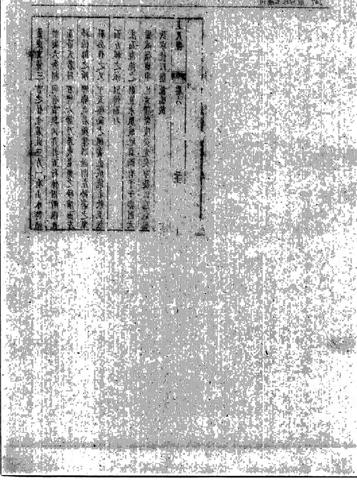

> 图注：卷末图文残损，保留原图。

<!-- source:P000086-B001 -->

# 术语简释

以下是编者对本书常用词的简要解释。

## 地形与水流

**龙、行龙、住结**　“龙”指延伸而来的山脉、土脊或地势。“行龙”说的是来势仍在延伸；“住结”说的是来势在某处收住。本书常结合水流是否交会、两侧地形是否回抱来区分两者，并不只看某个地方是否平整。

**砂**　穴场周围的小丘、土脊或高地，不是沙粒。书中看砂，主要看它处在什么位置、朝向哪里，以及它与来脉、水流的关系。

**穴、入首**　“穴”是书中认为可以取用的具体地点；“入首”是来脉接近这个地点的最后一段。找到来脉，并不等于已经确定穴位。

**气**　古人用来解释地势运行、聚散的概念。书中借土形、水流推论气的行止；这些推论属于原书的传统理论。

**水、水神**　“水”包括河流、沟渠、浅涧和低处的水迹。“水神”是书中讨论水流作用及其方位吉凶时使用的称呼。

**来水、去水**　以所观察的穴场或堂局为参照，流向这里的是来水，离开这里的是去水。

**合襟**　两侧水流在局部交会，如衣襟相合。书中把它作为判断来势是否收住的线索，还要结合来脉和周围地形。

**界水**　对土脉起分界、约束作用的水流或水沟。这个名称强调水与土脉的位置关系。

**明堂、堂局**　“明堂”是穴前较为开敞的地方；“堂局”还包括周围的砂和水。讨论堂局时，要把来水、去水和四周地形一起看。

**水口、城门**　“水口”是堂局水流出入、收束的关键处；“城门”借门户作比喻，强调这一带形势的开合与关拦。

## 周围地形与取穴

**护砂、劫砂、鬼砂**　“护砂”是向来脉或穴场回抱、形成护持的地形。书中把从腰肋分出、向外牵扯的支砂称作劫砂，并以鬼砂描述向外斜出或穿破主体、不能回护的支形。辨别时要看分支从哪里出去、是否回抱，不能只凭远近或形状好坏。

**鬼劫**　书中对支砂外窜、支水交冲、使来势分散等情形的合称。“鬼”“劫”是它的传统评价用语。

**朝应、朝山、案砂**　“朝应”说的是周围地形朝向穴场的关系。“朝山”通常在穴前较远处；“案砂”较近，像几案一样横在前面。距离之外，还要看它们是否与穴场相应。

**龙虎、玄武**　“龙虎”指穴场左右的护卫地形；“玄武”指穴后的地势。这些名称表示相对位置和作用，并不要求地形长得像相应动物。

**关峡**　来脉中途收窄、转折或受到两侧约束的部位。书中借此考察来脉怎样继续通向入首。

**正受、斜受、中受**　这些词描述来脉与取穴位置的承接关系。“正受”较正地承接，“斜受”从侧向承接，“中受”强调在局部中央承接。不能只凭图纸上的上下、斜直或几何中心判断。

**月角**　来脉到头处，两肩或两侧弯出、近似月牙的地形。书中在水迹不明显时，也会据此观察地势是否收住。

**生脉、死脉**　书中把曲折活动、有转折的来脉称为生脉，把僵直、粗硬、逼压的形态称为死脉。这是传统的形态分类。

**迎神**　卷五对朝会到堂之水的称呼。相关段落关注水从哪里分流而来，又向哪里会合而去。

## 方位与传统分类

**向**　穴位或营建对象的朝向。书中讨论立向时，要连同来龙、来水、去水和水口一起考虑。

**二十四山**　罗盘上的二十四个方位，不是二十四座山。北为壬、子、癸；东北为丑、艮、寅；东为甲、卯、乙；东南为辰、巽、巳；南为丙、午、丁；西南为未、坤、申；西为庚、酉、辛；西北为戌、乾、亥。

**三合**　按木、火、金、水把方位分组的传统方法。例如，亥、卯、未为木组。书中用这些分组讨论龙、水与向的配合。

**纳甲**　把八卦与天干等相配的方法，用于讨论来龙和朝向的配属。它与三合并非同一套分类，阅读时要分清当前段落使用哪一套。

**十二长生、生旺休囚**　“十二长生”用长生、沐浴、冠带、临官、帝旺等十二阶段表示盛衰。“生旺休囚”也是描述五行之气盛衰的用语。这里的生、死、旺、衰属于传统分类，不能按眼前生物的状态理解。

**双山、分金**　“双山”把相邻方位配成组；“分金”进一步细分坐向。二者都涉及方位，但划分的层次不同。本书部分细则残缺，不能据残文补出完整配表。

**三吉六秀**　书中对若干被认为清贵、秀美的方位或来龙的合称，具体所指需看所在段落。

**合局**　来龙、砂水和方位等关系符合书中某套配合法则，称为合局。它表达的是书内规则下的配合。

**本音、卦气、玄空**　“本音”涉及来龙的纳音或五行归属；“卦气”以八卦方位区分气类；“玄空”是书中讨论方位生克时使用的方法名称。这些词不能互换，具体含义以各段论述为准。

**关杀、圭甲空亡**　书中在七十二龙、分金等细分方位的讨论中，使用这些名称指称应避开的关系或位置。现存文字有疑损，具体配属无法处处确定。

**曜煞、八曜、黄泉**　均属于传统忌讳用语。“曜煞”涉及被认为相克的方位关系；“八曜”与八卦来龙对应的忌方有关；“黄泉”常见于水法、立向的讨论。三者的具体规则不能混用。

**明煞、暗煞**　卷六用这两个词区分不同层次的忌犯：明煞较直接地见于砂水方位的配属，暗煞涉及分金、星度等更细的规则。现存残文不足以恢复全部细则。
