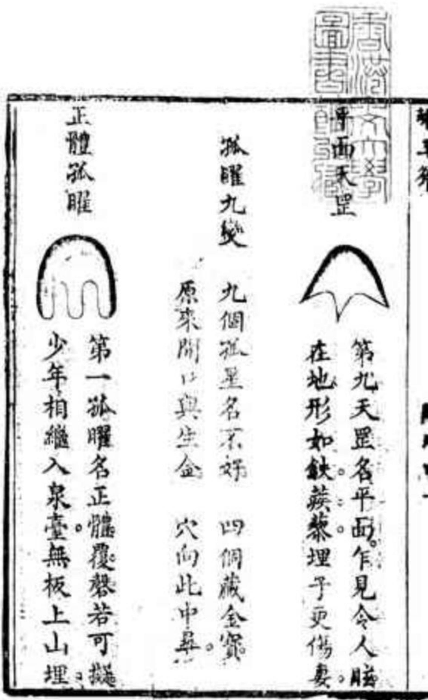
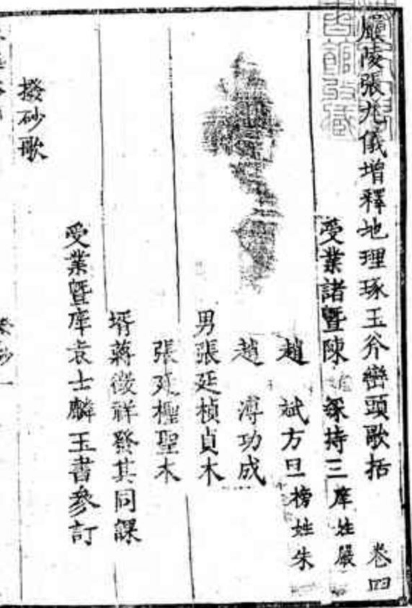

第六天罡號單成惡毒如狼虎單股夫罡若還誤認亂安括凶禍不堪言第七天罡名側腦凶中還有好例腦天罡從來形狀號紅旗富貴不須疑第八天罡名没骨不必問窩窟没骨天罡原來動處好安墳象似牛眠形撥龍括引澄地圖說日錄共十五

龍湖祭上徐氏地十一

休寧螳鄉捕蟬宋丞桐程珣祖地十九夏

義烏墩頭明初陵白衣翰林祖地二十頁

無錫龍山抵浙塢留記地二十一頁

蘇州竹塢狀元文震孟祖地二十四頁

蘇州官山嶺內丁米繆狀元祖地二十七頁諸豎苑岩前茶亭小袁氏地十三頁諸北門外石氏荷花形地三十頁圩玉斧龍來月有來山隨 左右隨龍之內即幾龍砂也穴結砂不關鄉則水走了何以融聚穴前所以撥砂難云緩撥砂之撥如提兵調將由我差適方可說傳個來字今谷地理書雖口說根而不知授之之法授他不動尺好當得一看砂的看字

明主云只此四句可見龍穴與水皆少砂不得俗術一知砂法而謾以地仙自居為人看地子不知其作何心腸也

許人云砂為龍穴之用神貴賤不能自主獨以為石然卷龍無砂隨則其勢孤亢龍有悔穴無砂會則其局露拋露西水無砂關則其局散砂飛則水走了此三句得看地的骨髓語至于水神流散而八風乘之矣八風既乘而生氣飄散矣甚矣砂之為用最喫緊所藉以衛穴而關水藏風而聚氣其所繫非沙小也故廖氏曰眞龍落處四山聚只此一句便得大亦自有名義昔賢何以喚為砂于理不呼差楊曾教人原有相 格宇甚好如見