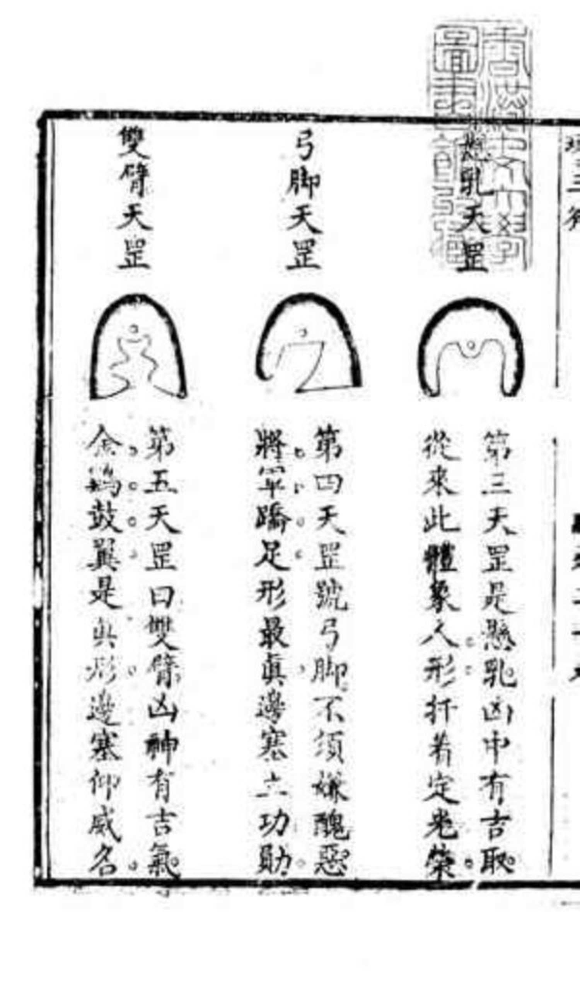
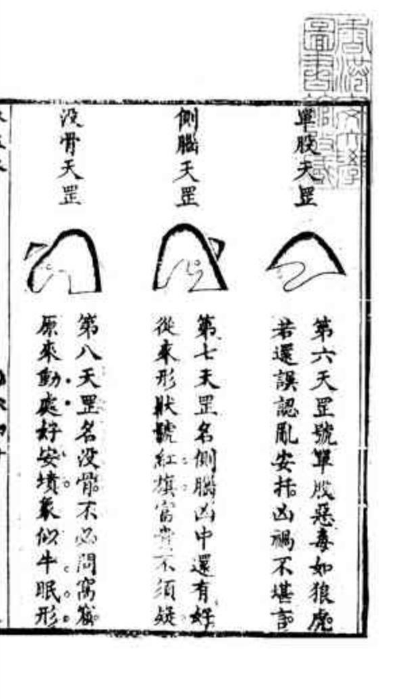
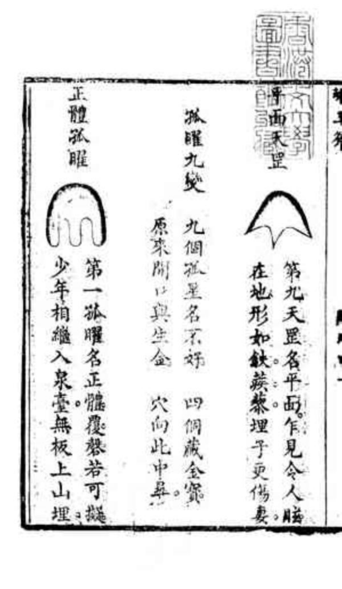
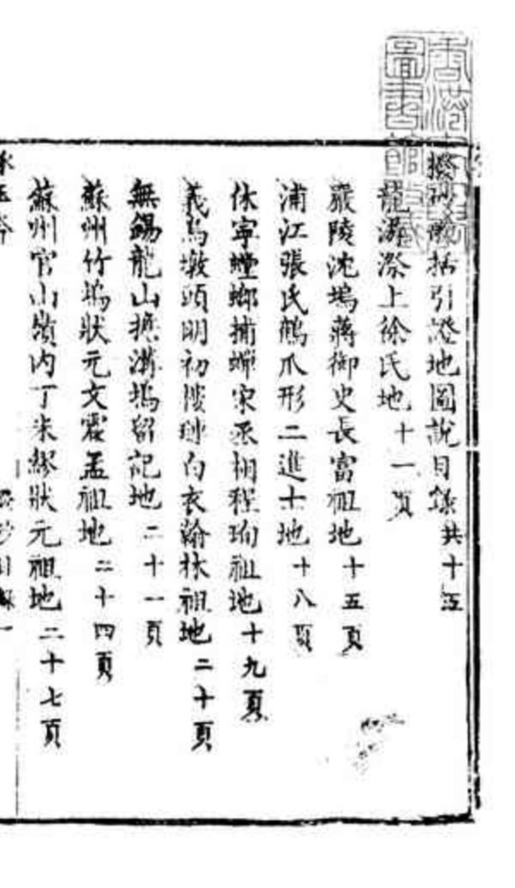
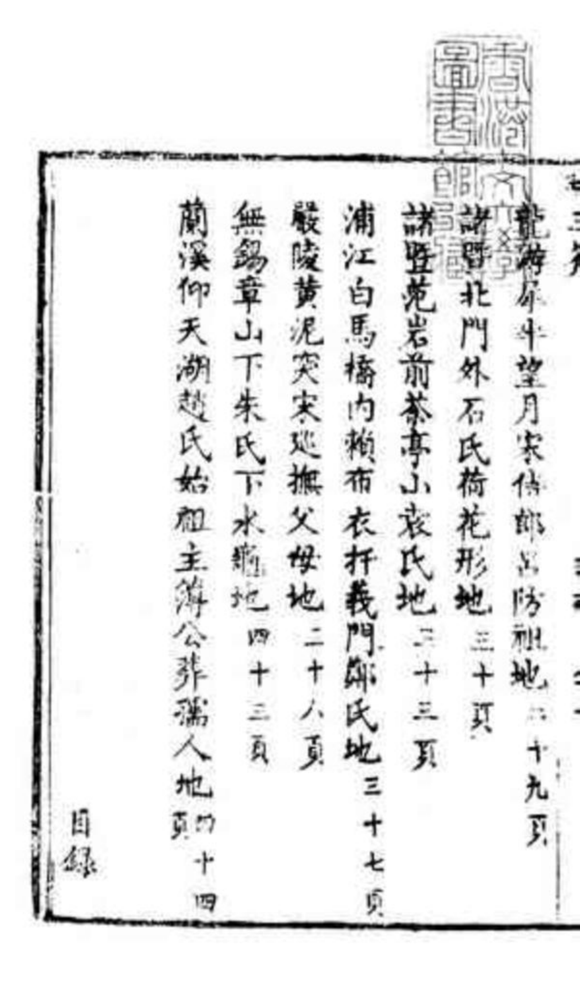
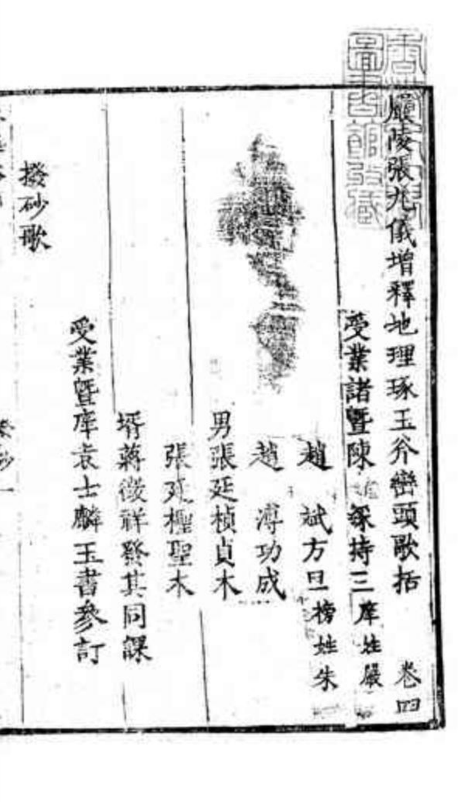
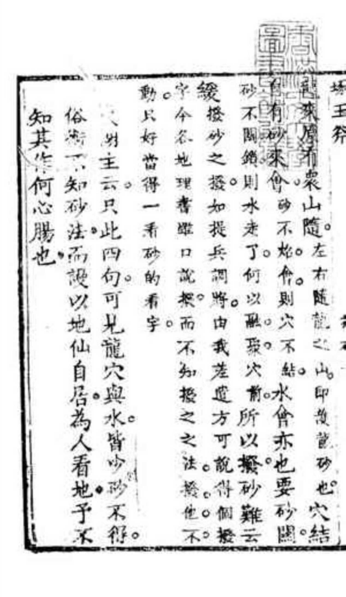
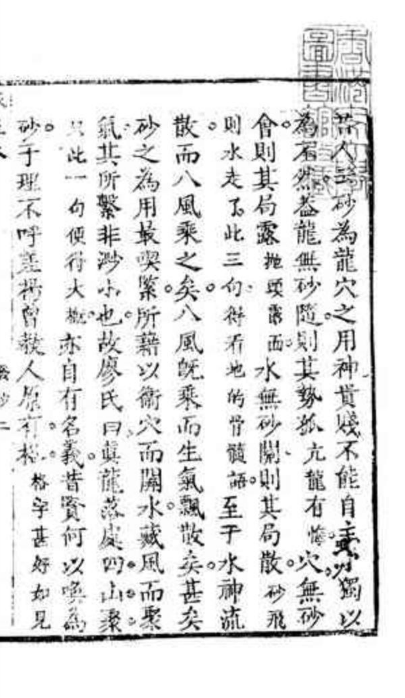

# 增释地理琢玉斧峦头歌括 张九仪 — 忠实原文样章

## 原 PDF 第 38 页

<!-- P000038-B001: visual block retained in original page image -->

## 原 PDF 第 39 页

<!-- P000039-B001 -->
第六天罡號單成惡毒如狼虎
單股夫罡
若還誤認亂安括凶禍不堪言
第七天罡名側腦凶中還有好
例腦天罡
從來形狀號紅旗富貴不須疑
第八天罡名没骨不必問窩窟
没骨天罡
原來動處好安墳象似牛眠形
撥龍括引澄地圖說日錄共十五

## 原 PDF 第 40 页

<!-- P000040-B001: visual block retained in original page image -->

## 原 PDF 第 41 页

<!-- P000041-B001: unreadable OCR region; see original page -->

<!-- P000041-B002 -->
龍湖祭上徐氏地十一

<!-- P000041-B003 -->
休寧螳鄉捕蟬宋丞桐程珣祖地十九夏

<!-- P000041-B004 -->
義烏墩頭明初陵白衣翰林祖地二十頁

<!-- P000041-B005 -->
無錫龍山抵浙塢留記地二十一頁

<!-- P000041-B006 -->
蘇州竹塢狀元文震孟祖地二十四頁

<!-- P000041-B007 -->
蘇州官山嶺內丁米繆狀元祖地二十七頁
諸豎苑岩前茶亭小袁氏地十三頁
諸北門外石氏荷花形地三十頁
圩玉斧
龍來月有來山隨左右隨龍之內即幾龍砂也穴結
砂不關鄉則水走了何以融聚穴前所以撥砂難云
緩撥砂之撥如提兵調將由我差適方可說傳個來
字今谷地理書雖口說根而不知授之之法授他不
動尺好當得一看砂的看字

## 原 PDF 第 42 页

<!-- P000042-B001: unreadable OCR region; see original page -->

<!-- P000042-B002: unreadable OCR region; see original page -->

## 原 PDF 第 43 页

<!-- P000043-B001: visual block retained in original page image -->

## 原 PDF 第 44 页

<!-- P000044-B001: unreadable OCR region; see original page -->

<!-- P000044-B002 -->
明主云只此四句可見龍穴與水皆少砂不得
俗術一知砂法而謾以地仙自居為人看地子不
知其作何心腸也

## 原 PDF 第 45 页

<!-- P000045-B001 -->
許人云砂為龍穴之用神貴賤不能自主獨以
為石然卷龍無砂隨則其勢孤亢龍有悔穴無砂
會則其局露拋露西水無砂關則其局散砂飛
則水走了此三句得看地的骨髓語至于水神流
散而八風乘之矣八風既乘而生氣飄散矣甚矣
砂之為用最喫緊所藉以衛穴而關水藏風而聚
氣其所繫非沙小也故廖氏曰眞龍落處四山聚
只此一句便得大亦自有名義昔賢何以喚為
砂于理不呼差楊曾教人原有相格宇甚好如見
