# 超云古书翻新 skill 全流程图

> 依据：`C:\Users\QIQI\.codex\skills\chaoyun-ancient-book-renovator` 的 `SKILL.md`、`references/*.md`、`scripts/init_workspace.py`、`scripts/validate_workspace.py`，以及 8 个子 skill 的 `SKILL.md` 与其 references（workflow 1.10）。
> 用途：指导 skill 优化。第 17 节列出梳理时发现的不一致与可优化点。

## 目录

1. [总体架构：两层模型与子 skill 分工](#1-总体架构两层模型与子-skill-分工)
2. [主流程（SKILL.md 第 1–13 步）](#2-主流程skillmd-第-113-步)
3. [阶段状态机（run-state.json）](#3-阶段状态机run-statejson)
4. [交付模式选择与版本范围锁定](#4-交付模式选择与版本范围锁定)
5. [接收与诊断（G0 / G1）](#5-接收与诊断g0--g1)
6. [原貌重建（G2）](#6-原貌重建g2)
7. [疑点裁决生命周期（G2.5，贯穿全程）](#7-疑点裁决生命周期g25贯穿全程)
8. [文本规范化（G3）](#8-文本规范化g3)
9. [普通读者版生产链（G4 前置 + 1.8/1.10）](#9-普通读者版生产链g4-前置--18110)
10. [阅读单元（workflow 1.10）](#10-阅读单元workflow-110)
11. [真实阅读会话（样章 / 全书）](#11-真实阅读会话样章--全书)
12. [全书读者审编与终稿裁剪（G5 / G5.5）](#12-全书读者审编与终稿裁剪g5--g55)
13. [冻结、忠实度复核与出版（G6）](#13-冻结忠实度复核与出版g6)
14. [质量闸门与完成等级](#14-质量闸门与完成等级)
15. [返工影响路由](#15-返工影响路由)
16. [停止规则与预算控制](#16-停止规则与预算控制)
17. [工作区产物数据流](#17-工作区产物数据流)
18. [优化观察点](#18-优化观察点)

---

## 1. 总体架构：两层模型与子 skill 分工

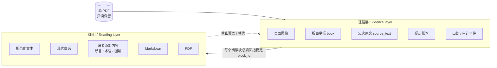

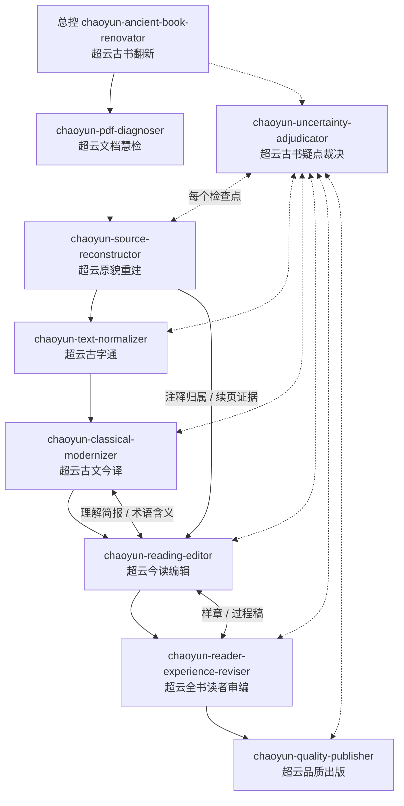

| 子 skill | 模式 | 主要产物 |
|---|---|---|
| pdf-diagnoser | — | `10-diagnosis/profile.json`、`page-map.jsonl` |
| source-reconstructor | — | `20-source/blocks.jsonl`、`source.md`、`pages/` |
| uncertainty-adjudicator | 任意检查点 / `--pilot` / `--check --publication` | 三份疑点账本、`pilot-review.json`、`uncertainty-release-review.json` |
| text-normalizer | — | `30-normalized/blocks.jsonl`、`normalized.md`、`changes.jsonl` |
| classical-modernizer | understanding / sample / full | `book-understanding.md`、`40-modernized/*`、`terminology.json` |
| reading-editor | design / sample / full-edition | `editorial-plan.md`、`reader-units.json`、`modern-reading.md`、`reader-aids.json`、`source-reader-map.jsonl` |
| reader-experience-reviser | sample / manuscript / final-reader / proof | `reader-review.json`、`reader-revision-ledger.jsonl`、`reader-acceptance-report.json` |
| quality-publisher | — | 候选 PDF、`release-binding.json`、`pdf-reader-review.json`、`quality-report.json`、正式 PDF |

---

## 2. 主流程（SKILL.md 第 1–13 步）

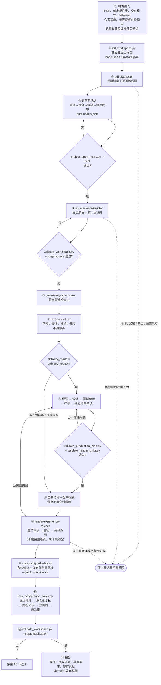

---

## 3. 阶段状态机（run-state.json）

`init_workspace.py` 中定义的 14 个阶段。灰色 4 个只在 `ordinary_reader` 模式下创建。

```mermaid
stateDiagram-v2
    direction LR
    [*] --> intake
    intake --> diagnosis
    diagnosis --> source
    source --> source_adjudicated
    source_adjudicated --> normalized

    state ordinary_reader_only {
        direction LR
        book_understood --> reader_designed
        reader_designed --> reader_units_built
        reader_units_built --> sample_accepted
    }

    normalized --> book_understood: ordinary_reader
    normalized --> modernized: 对照版 / 档案版
    sample_accepted --> modernized
    modernized --> edited
    edited --> reader_revised
    reader_revised --> final_adjudicated
    final_adjudicated --> publication
    publication --> [*]
```

每个阶段的状态值与流转规则：

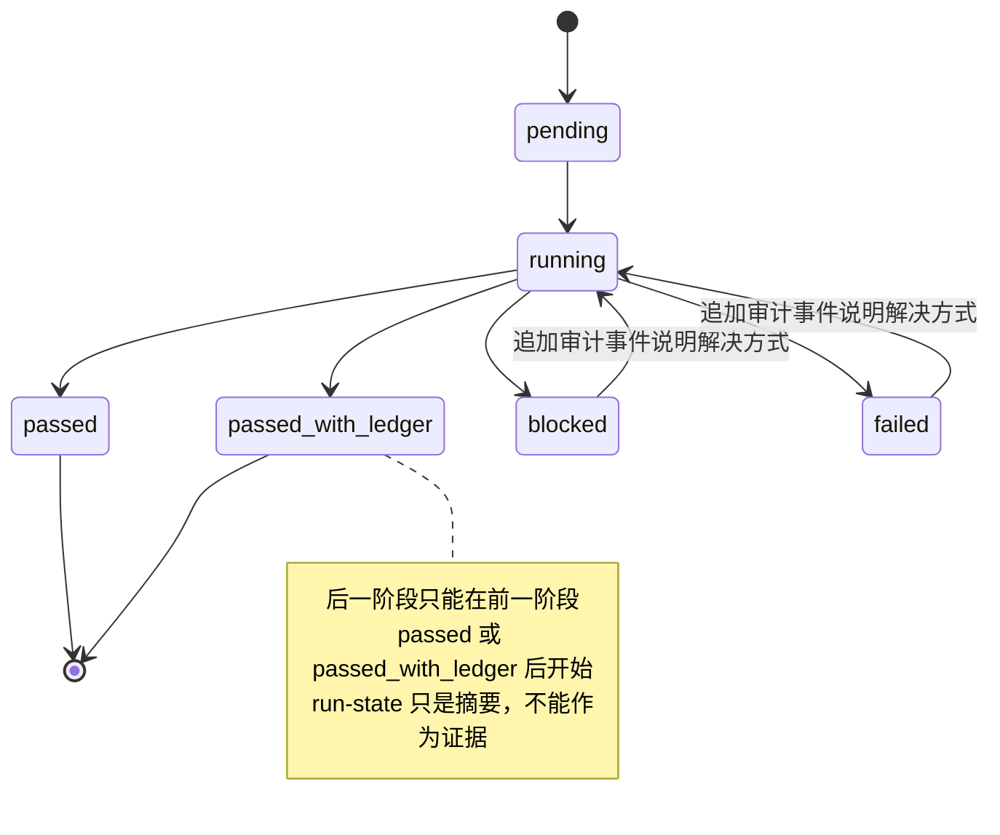

---

## 4. 交付模式选择与版本范围锁定

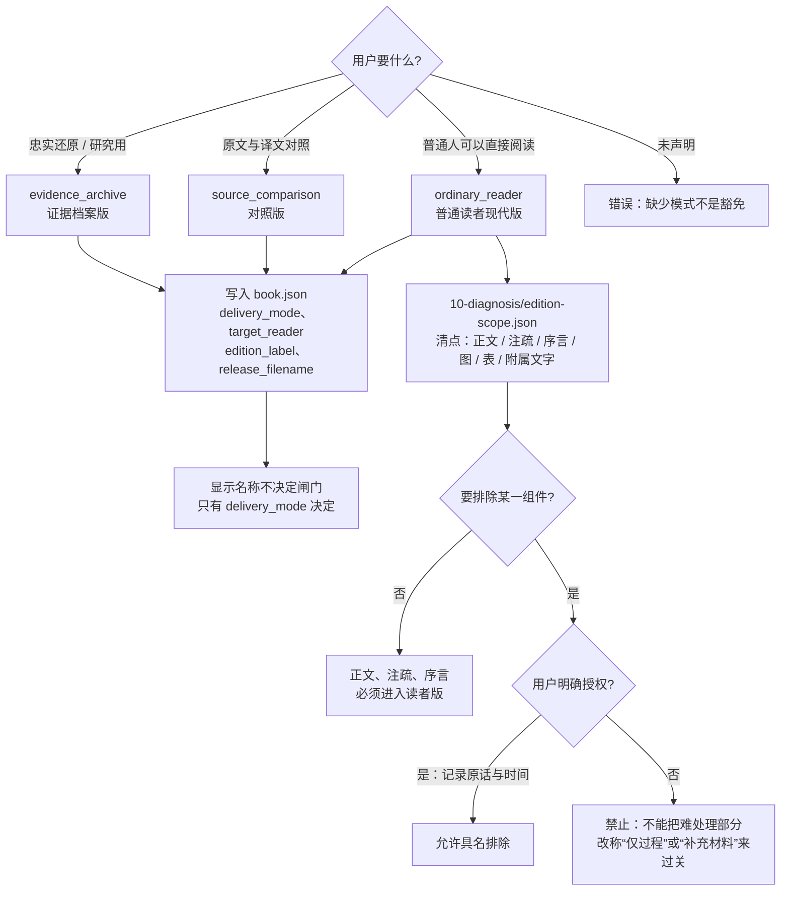

---

## 5. 接收与诊断（G0 / G1）

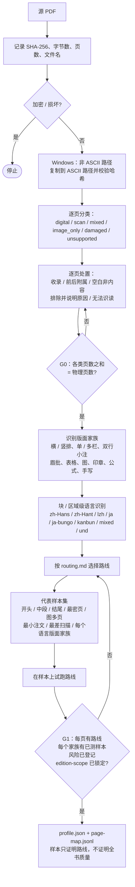

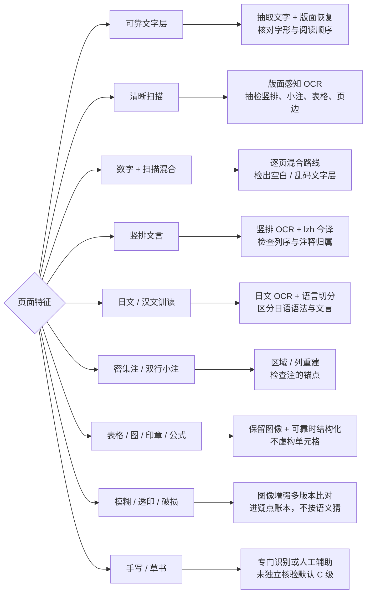

---

## 6. 原貌重建（G2）

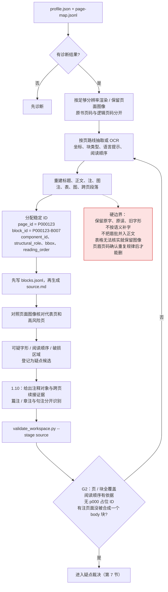

---

## 7. 疑点裁决生命周期（G2.5，贯穿全程）

同一套账本贯穿所有阶段，只用 `review_cycle` / `checkpoint` 区分轮次。不设“一疑、二疑、终疑”三份文件。

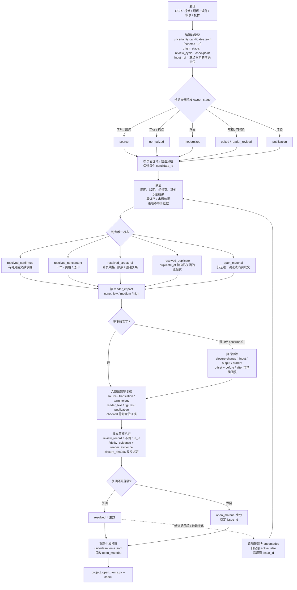

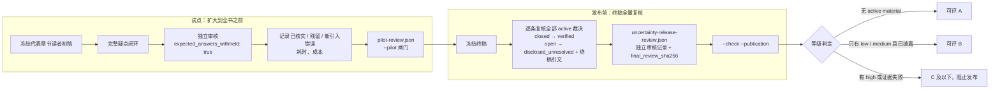

三份账本的关系：

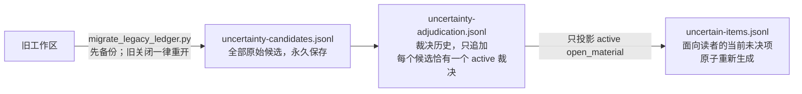

---

## 8. 文本规范化（G3）

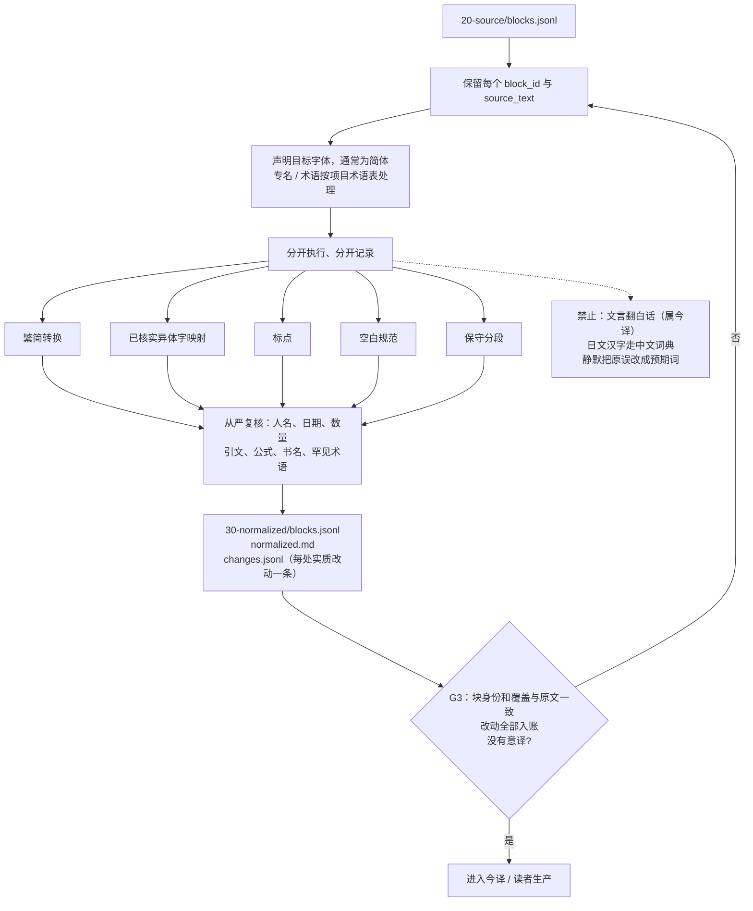

---

## 9. 普通读者版生产链（G4 前置 + 1.8/1.10）

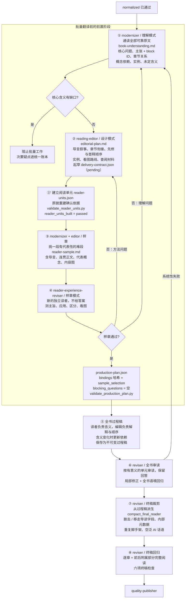

样章与疑点试点共用同一个代表章节：

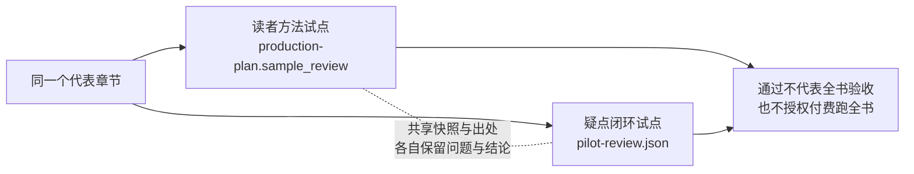

---

## 10. 阅读单元（workflow 1.10）

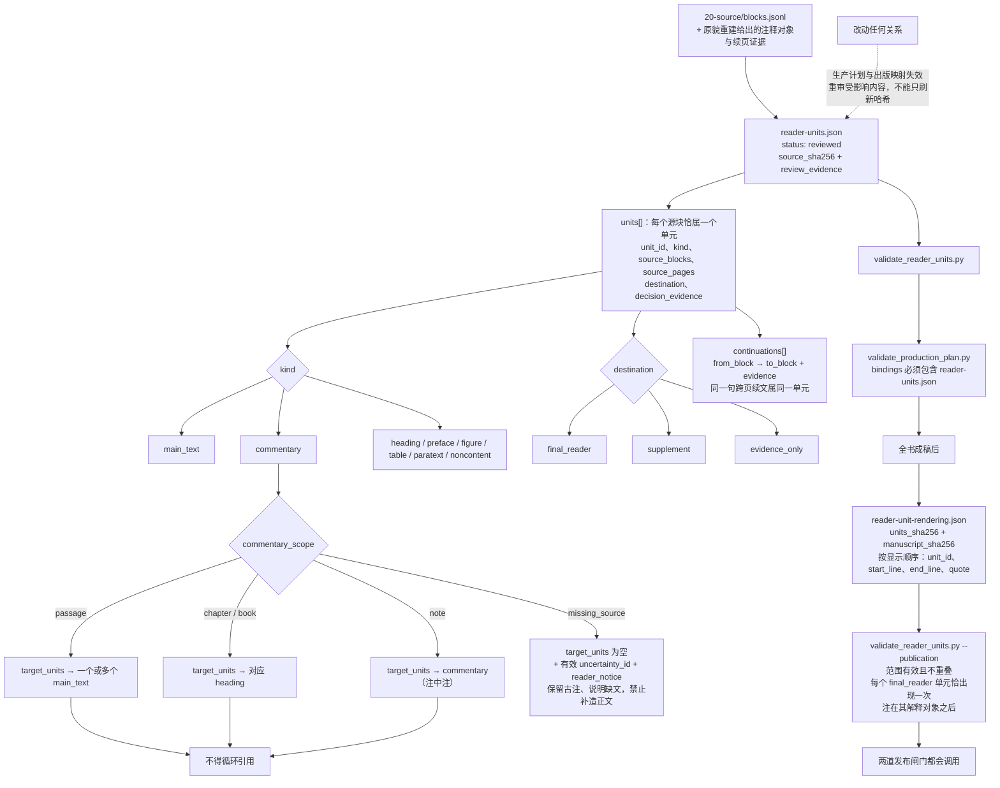

---

## 11. 真实阅读会话（样章 / 全书）

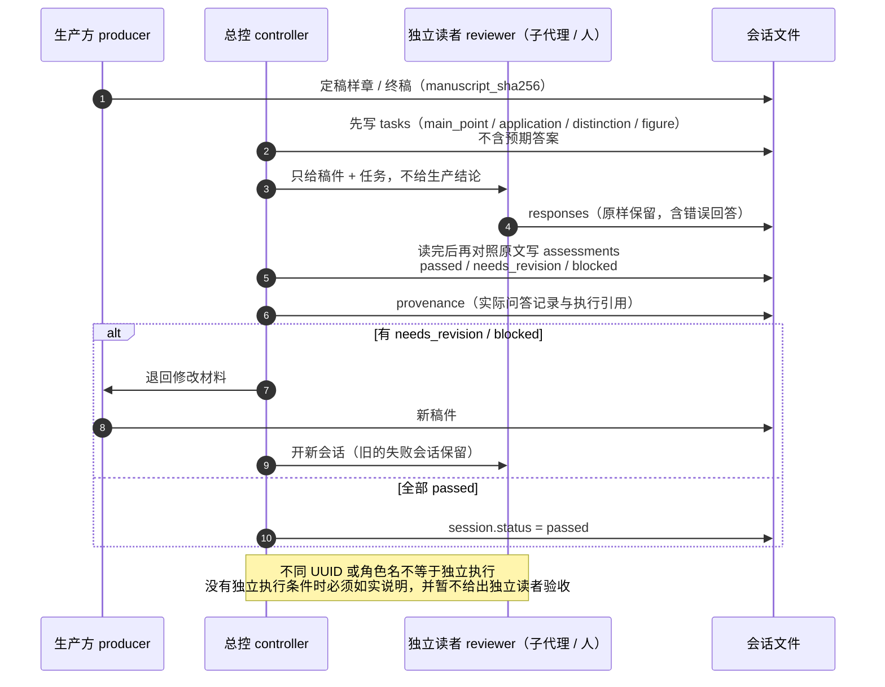

---

## 12. 全书读者审编与终稿裁剪（G5 / G5.5）

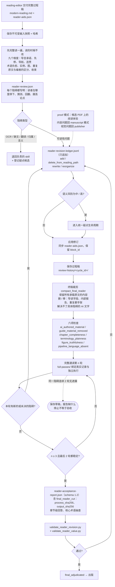

编辑侧（reading-editor）交稿前的检查清单：

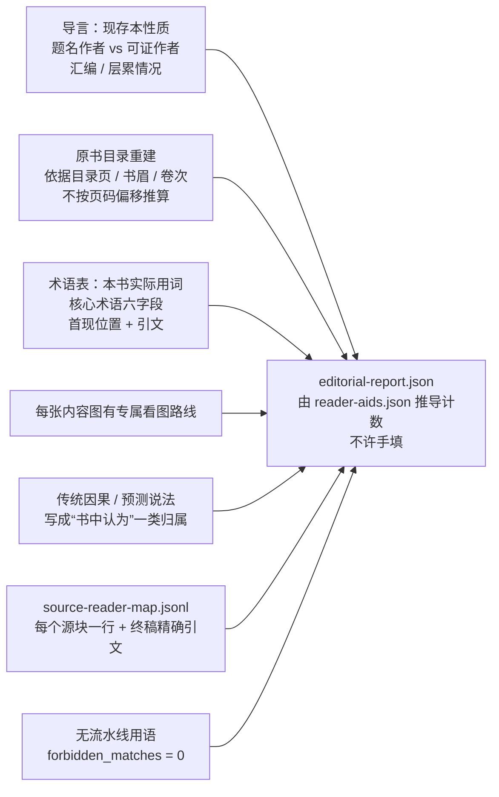

---

## 13. 冻结、忠实度复核与出版（G6）

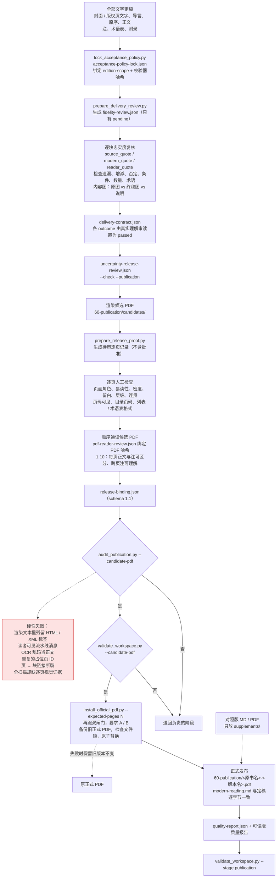

普通读者版的三道独立验收，任何一道都不能替代另一道：

```mermaid
flowchart LR
    I["完整性<br/>PDF 身份、页 / 块清点<br/>各阶段文字非空、图与引用完整"]
    F["忠实度<br/>无增添、无漏否定 / 条件<br/>数量不变、术语不漂移"]
    C["读者理解<br/>能说出章旨、区分概念<br/>看懂图、找到承诺的答案"]
    I --> OK{"三项全部通过"}
    F --> OK
    C --> OK
    OK --> PUB["才可出版"]
```

---

## 14. 质量闸门与完成等级

```mermaid
flowchart LR
    G0["G0 接收完整性"] --> G1["G1 诊断"] --> G2["G2 忠实原文"] --> G25["G2.5 疑点裁决"] --> G3["G3 规范化"] --> G4["G4 今译<br/>含 1.8 前置 + 1.10 阅读单元"] --> G5["G5 阅读编辑"] --> G55["G5.5 全书读者审编"] --> G6["G6 出版"]
```

| 闸门 | 核心判据 |
|---|---|
| G0 | 源 PDF 的哈希、大小、页数已记录；各类页数和等于物理页数；每页至少一个块记录；源文件未被覆盖 |
| G1 | 每页都有路线；每个版面家族有样本；不支持的内容已提前登记；edition-scope 已锁定 |
| G2 | 页 / 块全覆盖；阅读顺序对照过图像；疑点保留可见；每块有组件、结构角色、坐标、顺序 |
| G2.5 | 每个候选恰有一个 active 裁决；关闭必须有证据、六范围复核、独立审核、可回放修改；有试点和终稿复核 |
| G3 | 每处改动可追溯；没有意译；专名、数量从严复核 |
| G4 | 每个内容块已译 / 保留 / 标注处置；文字非空；语言路线正确；没有无据增添；高风险块有独立比对 |
| G5 | 编者内容已标注；层级、术语、图注连贯；有导读路线、首现释义、看图路线、术语表；无流水线用语 |
| G5.5 | 九个维度；≥3 轮完整通读且末 2 轮稳定；回归审读者与生产者不同；终稿裁剪证据齐全 |
| G6 | 资产可解析；字体嵌入；目录和书签可点；逐页检查；唯一正式 PDF；双闸门 + 安装器；等级与账本一致 |

```mermaid
flowchart TD
    S{"所有闸门通过?"}
    S -- 否 --> SEM{"证据足以支持<br/>负责任的转换?"}
    SEM -- 否 --> D["D 无法还原"]
    SEM -- 是 --> C["C 辅助草稿<br/>不得称为可出版、完整版、final"]
    S -- 是 --> H{"有 active high 未决项?"}
    H -- 是 --> C
    H -- 否 --> M{"有 active material 未决项?"}
    M -- 否 --> A["A 可出版"]
    M -- "是：只有 low / medium 且已披露" --> B["B 附存疑清单可读"]
```

---

## 15. 返工影响路由

```mermaid
flowchart LR
    CH{"发生了什么改动?"}
    CH -- "原字 / 阅读顺序 / 缺文" --> R1["回原貌重建 + 疑点裁决<br/>→ 受影响的规范化 / 今译<br/>→ 关联术语、图、章节<br/>→ 新的忠实度、读者、PDF 验收"]
    CH -- "译文或核心术语含义" --> R2["回今译 + 裁决<br/>→ 该术语所有用处和关联论断<br/>→ 受影响章节理解<br/>→ 全书回归 + 出版校样"]
    CH -- "导言 / 解释 / 重组" --> R3["回阅读编辑<br/>→ outcome 承诺、原文与编者边界<br/>→ 新的忠实度 + 读者验收"]
    CH -- "只动排版 / 分页" --> R4["保留内容审核结论<br/>→ 重建 PDF 绑定、逐页校样、导航映射"]
    CH -- "批准后源文件、稿件、资产或合同变了" --> R5["相关证据全部作废<br/>保留历史，重审受影响范围"]
    CH -- "edition-scope 或校验代码变了" --> R6["acceptance-policy-lock 失效<br/>重新加锁 + 重新审核"]
    R1 & R2 & R3 & R4 & R5 & R6 --> ALL["终稿仍需整本回归阅读<br/>哈希不符是确定性停止<br/>run-state 写 passed 也不能覆盖"]
```

---

## 16. 停止规则与预算控制

```mermaid
flowchart TD
    W["任一阶段工作中"] --> Q1{"文件损坏 / 加密?"}
    Q1 -- 是 --> STOP
    Q1 -- 否 --> Q2{"缺页?"}
    Q2 -- 是 --> STOP
    Q2 -- 否 --> Q3{"阅读顺序严重不明?"}
    Q3 -- 是 --> STOP
    Q3 -- 否 --> Q4{"语言被系统性误判?"}
    Q4 -- 是 --> STOP
    Q4 -- 否 --> Q5{"预算耗尽?"}
    Q5 -- 是 --> STOP
    Q5 -- 否 --> Q6{"同一阻碍连续 2 轮<br/>没有新证据或实质进展?"}
    Q6 -- 是 --> STOP2(["停止循环<br/>保存草稿，只请求缺失的证据或决定"])
    Q6 -- 否 --> Q7{"即将付费跑全书?"}
    Q7 -- 是 --> EST["估算页数 / 成本<br/>取得用户授权<br/>样章授权 ≠ 全书授权"]
    Q7 -- 否 --> CONT["继续<br/>每次会话完成有意义的页 / 章<br/>保存可续跑的证据"]
    EST --> CONT
    STOP(["停止<br/>记录确切阻塞原因"])
    STOP & STOP2 --> NOTE["停止 ≠ 验收"]
```

---

## 17. 工作区产物数据流

```mermaid
flowchart TD
    BJ["book.json<br/>run-state.json"]
    I0["00-intake/source-manifest.json"]
    D1["10-diagnosis/<br/>profile.json、page-map.jsonl<br/>edition-scope.json"]
    S1["20-source/<br/>blocks.jsonl、source.md、pages/"]
    N1["30-normalized/<br/>blocks.jsonl、normalized.md、changes.jsonl"]
    M0["40-modernized/book-understanding.md"]
    M1["40-modernized/<br/>blocks.jsonl、modernized.md、terminology.json"]
    E0["50-edited/<br/>editorial-plan.md、reader-units.json<br/>sample/reader-sample.md、production-plan.json<br/>delivery-contract.json"]
    E1["50-edited/<br/>modern-reading.md、blocks.jsonl<br/>reader-aids.json、source-reader-map.jsonl<br/>reader-unit-rendering.json、editorial-report.json"]
    E2["50-edited/<br/>reader-review.json、reader-revision-ledger.jsonl<br/>reader-acceptance-report.json<br/>review-history/（过程稿、full-passes/）"]
    P1["60-publication/<br/>candidates/、modern-reading.md<br/>&lt;书名&gt;·&lt;版本名&gt;.pdf、supplements/"]
    AU["90-audit/<br/>events.jsonl、三份疑点账本<br/>pilot-review.json、fidelity-review.json<br/>uncertainty-release-review.json<br/>acceptance-policy-lock.json<br/>release-binding.json、pdf-reader-review.json<br/>quality-report.json"]

    BJ --> I0 --> D1 --> S1 --> N1 --> M0 --> E0 --> M1 --> E1 --> E2 --> P1
    S1 & N1 & M1 & E1 & E2 & P1 -. "疑点 / 审计事件" .-> AU
    AU -. "哈希绑定" .-> P1
```

块 ID 在各层之间的保持规则：

```mermaid
flowchart LR
    SB["源块 P000123-B007"] --> NB["规范化块<br/>同 block_id"]
    NB --> MB["今译块<br/>同 block_id；拆分用 segment_id<br/>合并时列出全部贡献块"]
    MB --> EB["编辑块<br/>显示层可合段，保留贡献 ID"]
    EB --> MAP["source-reader-map<br/>一块一行 → 终稿标题 + 精确引文"]
    SB -. "处置只能是" .-> DISP["retained / translated / noncontent<br/>unreadable / excluded_with_reason<br/>不许静默丢弃"]
```

---

## 18. 优化观察点

梳理流程时发现的不一致与可优化处，供修改 skill 时参考：

1. **版本号表述互相矛盾。** `reader-production.md` 要求新工作区用 workflow 1.10，而 `data-contract.md` 仍写“New workspaces declare workflow schema 1.8”。`delivery-and-rework.md` 标题还是“workflow 1.6”，`pilot-review.json` 要求 `workflow_version: "1.6"`。建议统一成“当前版本 + 各合同自己的 schema 版本”两层表述。
2. **主流程 13 步没有包含 1.10 的阅读单元阶段。** `reader_units_built` 只在 SKILL.md 末尾补了一段话，第 7 步里没提；阶段 `source_adjudicated` 在正文中也没有名字。建议按第 3 节的状态机重写第 1–13 步，让步骤与 `init_workspace.py` 的 `STAGES` 一一对应。
3. **补丁式叠加的写法太多。** SKILL.md 和各 reference 里大量出现“1.6 增加…、1.7 增加…、1.8 保留并增加…”，读者要自己在脑中合并规则。建议把当前生效规则合并成一份，版本演进单独放进 CHANGELOG。
4. **`data-contract.md` 的目录树不完整。** 缺少 `reader-units.json`、`reader-unit-rendering.json`、`production-plan.json`、`delivery-contract.json`、`editorial-plan.md`、`sample/`、`book-understanding.md`、`60-publication/candidates/`、`90-audit/fidelity-review.json`、`pilot-review.json`、`uncertainty-release-review.json`。实际文件布局分散在四五份文档里。
5. **“九段导言”存在张力。** `editorial-evidence-contract.md` 的示例是 `introduction_sections: 9`，并要求“introduction covers all nine reader-value sections”；而 `reader-units.md` 和 `reading-editor` 又说“不强制印九项介绍”“Nine dimensions do not require nine short paragraphs”。建议明确：九项只是过程稿里的覆盖索引，终稿不按九段排版。
6. **阶段检查散落在多个脚本里。** `validate_workspace.py` 的 `REQUIRED_PREPUBLICATION_STAGES` 不含 `book_understood` / `reader_designed` / `sample_accepted` / `reader_units_built`。前三项在第 264 行单独检查，`reader_units_built` 又在 `validate_integrity.py` 里检查。建议集中成一张“阶段 → 必需文件 → 校验器”的表。
7. **审读轮次负担重。** 样章会话、疑点试点、≥3 轮全书通读（末 2 轮稳定）、终稿复核、PDF 顺序通读、闭环逐条独立审核，每一项都要求独立执行记录。流程上可以考虑合并会话，或者明确哪些证据可以复用，降低单本书的成本和时间。
8. **子 skill 之间是双向依赖。** 子 skill 反向引用总控的 `reader-production.md` / `reader-units.md`（相对路径 `../chaoyun-ancient-book-renovator/...`），单独安装子 skill 时这些链接会失效。可以考虑把共享合同抽到一个公共 reference 包里。
